# 【亚利桑那州立大学】知识表征和推理 ｜ Asu Cse 579 Knowledge Representation 2018 p10 P10_Lec12 -BV1RTWyzfEQH_p10-

Okay， so we'll continue the discussion of short number and we are going to talk about solving graph problems in using ASESP and talk about optimization in ASP。

So this is what we saw last time， how to solve the short number。

This just to recap what we want to do， you are given two parameters。

 so here the short number SK is the largest integer n for which the interval1 then can be partitioned in twoK on pre sets so in other words。

This you are given some numbers from one to n and you have to divide into k sub okay so think about as putting this number from one to n into k different buckets and each bucket should be so calledled sum3 which means if you take numbers from there either the same number or the two different numbers when you add up the addition should not be in the same bucket so that's called sum3 set and surprisingly this is quite difficult problem is' a combinatory problem。

And only S5 was known to be 160 in recent year。By using massive computing resources。

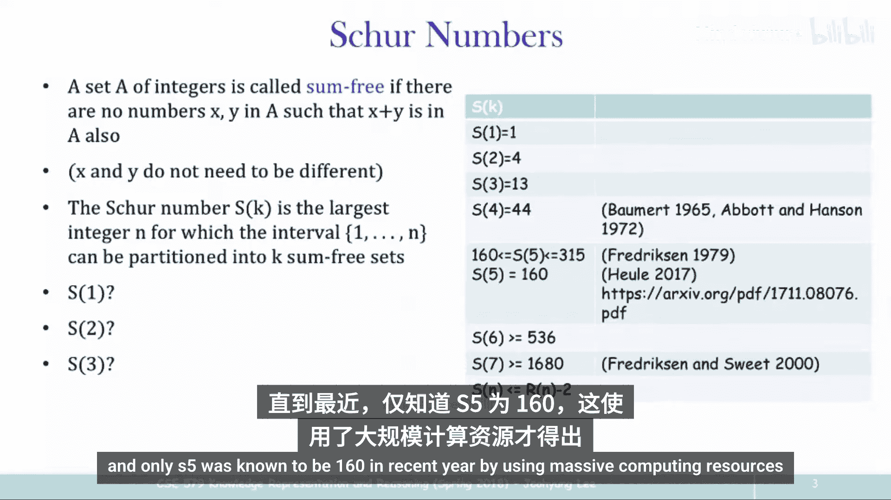

So we did that last time， so actually let's see how we can solve this problem， in fact。

The problem itself can be formalized in two lines in the Klingo code。

 and you see actually multiple lines I there five lines here。

 but all the others are common except for the middle one。Okay。

 so middle one is the only one that makes sense for the Klinggo。

So now you should be able to understand what this is doing right so when you see this one you will see that there are some symbols like N K and I so N and K are placeholder so you can assign the values in the command line so those you can assume its just a fixed number now I is variable is it local or global。

It's a global Y because it has an occurrence outside this called braces， so for the global variable。

 how do they grant？Expand into multiple rules so when I goes from one to n， so let's say n equals3。

 then basically this will create three different rules where you have in so I is replaced by1 and I replaced by2 replaced by3。

 all the others are saying so let's say just k as is so。So here you have this。Okay， and。Similarly。

So this is assuming that I。N equals three， so that's actually。Do that。

 so let's call n equals 3 and k equals2。Okay。So just to make it easy to， right， so this is two。

 this is two。Okay， and this is one2。So what is going on here now of course I can fully extend this so this one simply means okay yeah let me do it one more time so at this point there is no variable right and there is only interval inside the set and interval represents a set of values so the first one you can write it as。

1， command one。Lookcom two。喂。And you can do the same for the other things。 Let me repeat this。

Are we together？Okay， so。What is this。In doing， so。So， let's say what。We have so in a comma B。

Means that the first argument is a number from one to n。And the second number is the bucket。

 so in a comma B is the number A is in the bucket B。Okay。

So you have numbers and you put the numbers in the bucket so let me actually expand this。

 so here you have three numbers one two three and you have to place those in the two bucket。

 bucket one and bucket2。So。Think about。While I'm writing this。

Think about what should be the stable model in this case。Okay。

 so I'm talking about stable models of this guy。Okay， the one on the right。Okay。

 so maybe let me ask you。Simple location first， how many stable models are there？For this program。嗯。

How many stable models are here？8， because you have two choices from the first one。

 you can choose either one in of1 comma 1 or in of1 comma 2。And same for the others two rules。

 so two times two times2 is8， so there are eight stable models。

And each of these table model is saying that you're assigning the number from one to three to one of the values one and two。

 what does it mean， can you actually make it a simpler way to say？オデすです。Talking about。

I's actually counting the functions right， so what is this thing you're given one to three？

As a domain and one and2 as the range。And how many functions can you define？

And there's eight functions， right？A way together， you can count functions， right。

Let me not do these things， okay。So。There are eight functions that you can define， in other words。

 for each of these numbers， you can put you put exactly one you choose exactly one bucket。

 right there's a function。Okay， so you're just generating the functions here。Now。So at this point。

 what you say is for each of the numbers from one to end， you put it in one of the bucket。Now。

 is this Pakistanist free？Not necessarily， right， you just put so basically you just throw the numbers to the bucket。

 that's it， what you did， right？You just throw each number to the bucket and you are done。

 so in some cases you could have throw their two buckets。

 you could have throw one and two and maybe three here。Okay。

 so this is one possible stable model where one and three is mapped to the bucket  one and two is mapped to block 2。

 This is one function。If you are lucky， this is some free， right each of these set is some free。

 but if you're unlucky， you can have another throwing that works like this。

So one and two goes to the same bucket， this is not something。Now。

 what we know so far is if you do this way， you will not actually lose the actual solution。Okay。

 but you may have some superior answers， which doesn't count as some freesance。

So all you need to do is to get rid of those stable models that doesn't make sense。Okay。

 so you have to get out of those non sum phrases。Okay。Every we together。

 So basically the idea simple， you just slow the numbers。

And check each of them if they are not some free， then forget about that assignment。

So how do we do that， Any idea。You just write constraint， constraint is our friend， okay。

 to get rid of this， we use constraint to generate we use choice rules。Okay。

 this is actually the choice rule that we use with cardity bond。So choice generated。

 but sometimes it may generate too many solutions， which you should encounter count all of them。

 but you can just write one line solution here， which is this， so let me read this in English。

If the number I is in the bucket S and another number or maybe not necessarily distinct。

 but other number J is also in the same bucket as。Also， their sum is in the same bucket。

 den its constraint。Okay。So if you put this number， what happens is for each bucket。

 if the bucket is not sun free， they will not satisfy this constraint。

 so those assignments will be removed。So the remaining stable models are only the good ones。

Where each bucket is some free and each number is assigned to one of the bucket。Are we together？So。

 you can just solve。You can just do this in two line。How is it related to finding short number？就是一。

So short number， if you look at the definition， the definition was finding the largest interval。

 it didn't say anything about the largest interval here。But you can actually iterate this， okay？So。

Let's actually try that。嗯。So this is the code that you see。Okay。And how do you execute this。

 You just type the name of the cling file。 Okay， you can just type clinggo if you downloaded most recent version。

 so you can do this。And you have to say what is the n and K， so let's try S so4。

 What those SO4 do you remember？It was 44， so that means one numbers from 1 to 44 can be put into four different bucket and each of bucket does is some free。

 so let's say。K so K is the number of the bucket， right， So here it was 4。And。It was 44， okay？

AndThe all of these things as a method， so let me just type this is's a file， the short file。Okay。

 and。If I do that。I found the solution。Okay， so S of 4 is known to be 44， but of course。

 I didn't prove that as of4 is 45， said S of 4 is at least 44。Because it's possible。

 So how do I say S so4 is exactly 44。 How do I know that。

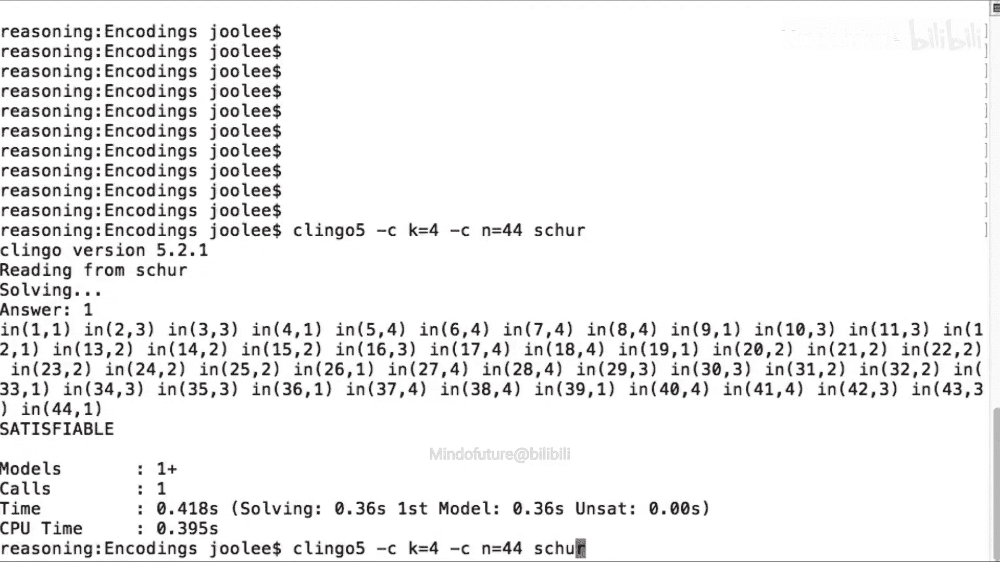

Try 45 and if it doesn't work， yes。So。You run it。And Flingo will tell you。

 I don't know how long it'll take。嗯。So why this is more time consuming than 44？Of course。

 it's a number one higher than 44， but also this time。

We have to make sure that there is no possibility， so you have to do exhaustive search。

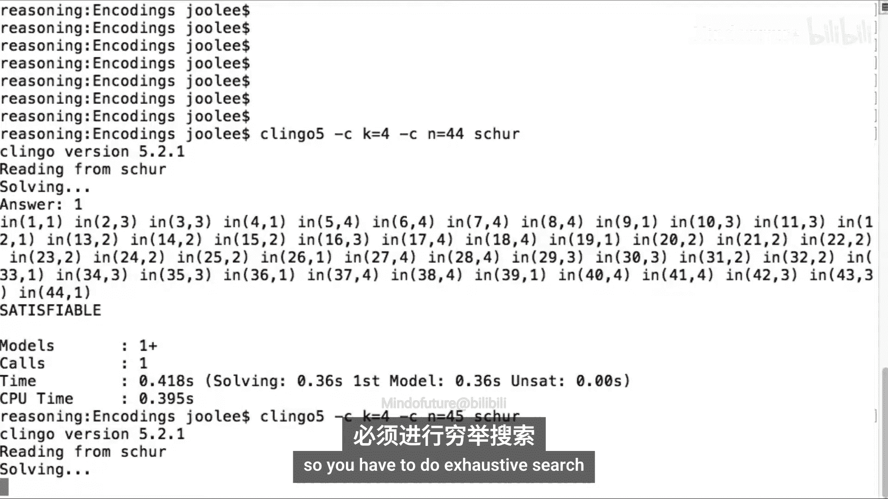

So that'll probablyy take more time， maybe let's try something simpler。Maybe S of three。

 so that's known to be 12， I believe。

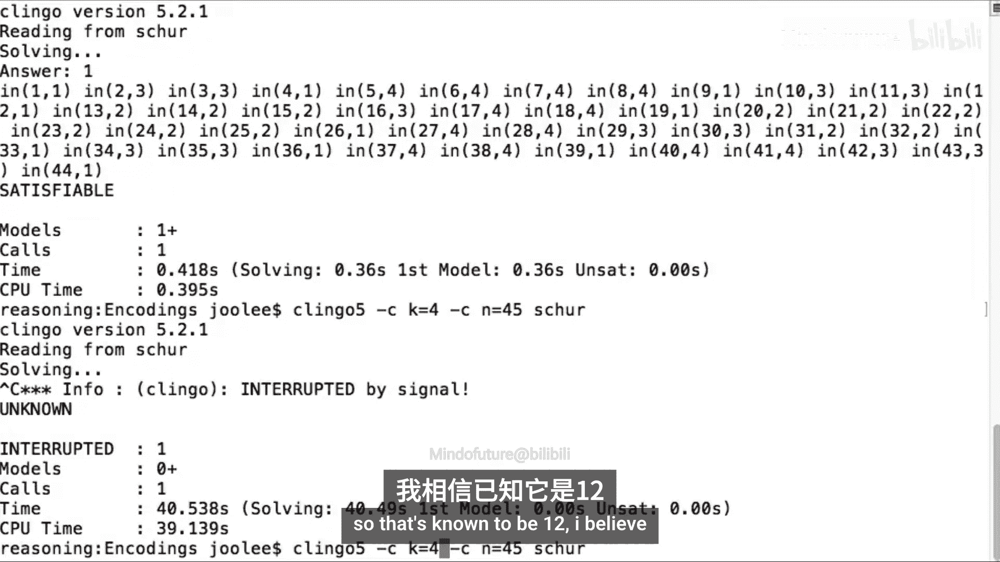

So， that means three。And 12。Okay， we got it。 So it okay， if you have 13。No， it's a found solution。

 maybe 13。14， yeah， it is actually 13。 Yeah， it is 13。

So found it okay so we check we can check that S of3 is 13 S of4， I don't know how long I try。

 I have to try so， but you can try if you want let's see what we can do with larger number or maybe I could use some different tricks。

Dash tea is actually a good option， Yes， you can probably have reader ahead。

So let's say let me explain， so here this is1 under 30， okay。

 so to check whether short number five is at least one under 30。And let me type this one。

 which is to generate fourth thread so that you can do parallel processing。And。Let's see how much。

 how long it will take I mean， if you have more CPU。Then mine， but yeah then you can try more。

 but I have only four， so。That's true。Best I can do okay。And of course。

 using the full CPU doesn't necessarily mean that you make photo times faster。

 but there are sometimes some things that you can actually paralyze， so this will help。Okay。

 so as we talk about this before。

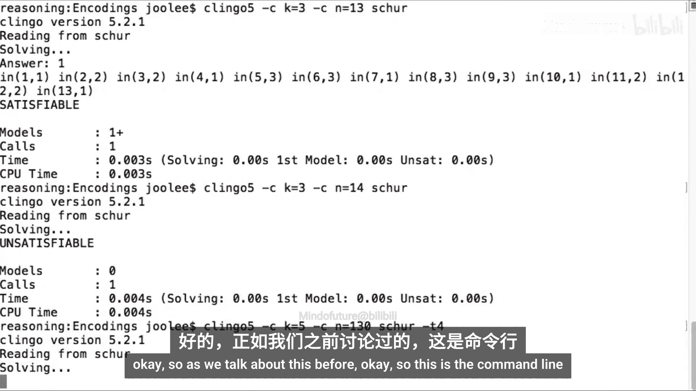

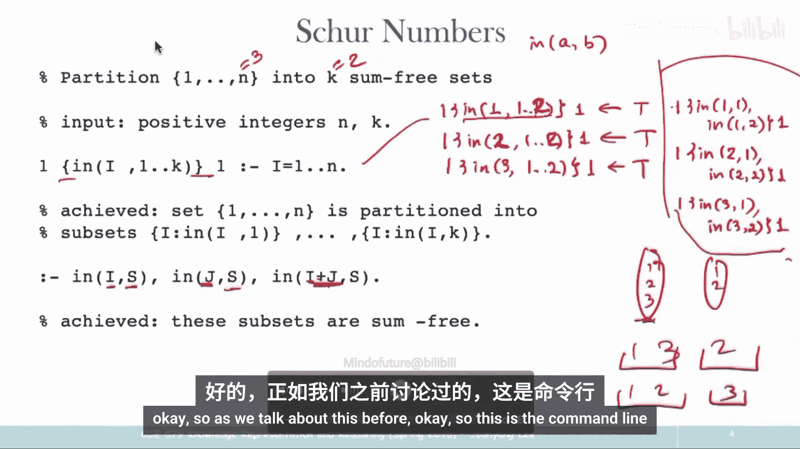

Okay， so this is a command line。Okay， so this is actually the paper that shows that short number is。

5 equal one of the 60。

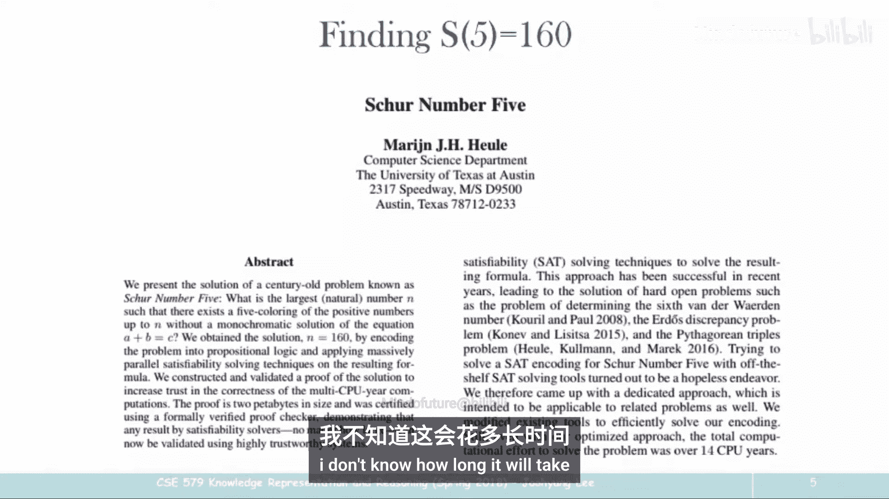

I don't know how long it'll take， so maybe let's move on to the next one and I will come back to this one。

Okay， so the next problem is graph coloring。Again， for you will see many problems today。

 it's actually fun it works like a magic because to solve。

 you know that these problems are not trivial on the other hand when you try to when you write in the language of Klinggo is' typically just a few lines of the code。

And maybe it's better than magic because you can explain why it works that way。

Because you know what is a stable model， okay， so you can see why this makes sense。

So what is a grass coloring？So， graph coloring。你선。Typical problem， right。

 So you're given a graph and you have to color the node。

 but the node two node are adjacent to each other right， So what is the complexity of this。Problem。

To to existence of the coloring。Is an MP complete problem。Okay。

 so there's no polynomial algorithm less P equal MP。

 which means that no matter what you do for the best algorithm or best data structure。

 whatever that you design， currently nobody could solve in polynomial time。可以 can do that。

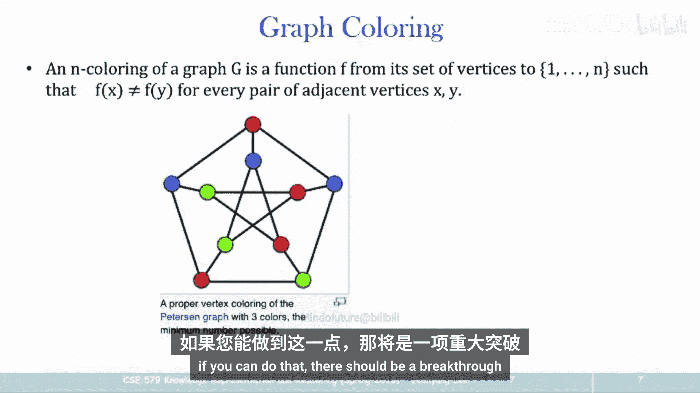

There should be a breakthrough。And it has a lot of applications， actually。

 most of the interesting problems in computer science are actually in this real。

Or many of those problems in this real， so for instance， a job scheduling problem。

 So what do we mean by this mapping from the job scheduling to the graph coloring so the。Graph here。

 for instance， you have to assign committee members and you have some different committees now the edge represent a common member。

Which means that this common member cannot be in two different committees at the same time。

So each of them should have different colors。same as you do the class scheduling。

 I actually I copied from the Wikipedia but students tell me that one of the Hesle。

 it was an undergraduate class and the student told me that the most complex thing is just scheduling the classes in the beginning or before this semester you have a lot of constraint and you cannot put these together okay so physically same student cannot be in two different classes at the same time。

 so those two classes should be colored differently。so it has a lot of applications。

 okay any kind of resources that is to be shared， okay you cannot use the same resource for two different tasks。

 it can easily map into the graph coloring problems in many cases。

How do we solve this so we have to represent graph and in terms of structure the graph is simply just a set of vertices and set of edges。

 so is actually easy to represent in in this language so here B represents the vertices so there are actually four vertices in their edges so basically this two lines here shows there are days and edges from zero to1。

1， to2。To， to3。32，4， and 4，2，0， and 0 to，2。Now you may interpret this as a directed edges or undirected edges。

 it's actually up to you。Okay， so。If you really want to have bidirectional edges。

 typically people write one more rule。To say。These are symmetric。Okay。そ。Let's see it。Oh， okay。

 so it took 121 seconds to solve that okay， so we just verified the short number5 is at least 130。

Okay so if you try a bit harder， you may get into 1 under 60， but I'm not going to try today。

 I don't have time to do that。行。Right。So that's the graph now how do we so the graph is the instance。

 okay now you have to write the rules to find the coloring assignment。Okay。How can we do that。

Okayーそう。First， we define the set of colors， so let's just call it one through n。

 so that's just the name we just number those colors okay you can write red， green。

 that doesn't matter okay， but let me just use the numbers for denoting the color。Now。

Let's think about it。 How do we do this coloring， In fact。

 it's very similar to the short number encoding。The first thing is the generator。

 So what should we generate？possible。You just assign。カラスく一ノート。

So we are defining a function from parallels to the node。RightThat's what you need to do。

 That's a generator card。Now all this coloring doesn't satisfy the graph coloring requirement。

 so then you have to add constraint saying that if the two edges two nodes are connected by an edge。

 then they should not have the same color， so how many more lines should I write here？Yeah。

 more lines are only two I need one generate and one test case， one constraint， so one choice rule。

 one constraint， that's all。それ是。So the first is each vertex is mapped to a color。

 so now it should be actually familiar to you when you use this kind of construct。

 so what is the global variable here？X， what is a local variable Okay。

 so what that means is there is each of the vertex is map to color。

 so youre assigning so here is a set of vertex。And this a color。And basically。

 you are defining the mapping。Okay。So here we use global variable to represent this domain and local variables to represent range。

 we are saying that so color x comma I means that node x or vertex x is colored with I。Okay케이。

 are we together？So for each vertex x that you choose， you have to have exactly one color。Good。

And the next thing is adjacent rotes should be of different color， well same similar thing。

 so if x is colored with I， y is also colored with I and they are connected by an edge。

 then this violate to constraint。So if you just add this one， then all those。

Assignment that does not satisfy the requirement of coloring will be gone。Okay。

 and all the remaining are the good ones。 So they are the solutions to the coloring problem。

 So here you see that each of the stable model is is recording a solution to the given problem。

 So it's actually one to one correspondence。 the stable models。

 the set of stable models that are generated here versus the solutions of the actual problem。Okay。

So let's see if I can show the demo。But by the way， yeah so here you see the thread。

 there was a fourth thread and the winner was the last one。Okay， so I think。I have coloring here。

Okay， so I have graph。Oh， by the way， actually I modified it a bit as you see。

 I don't actually even need to write colors one command I can actually put into inside this set okay that's the same trick that you saw in the short number encod。

 so either way it's actually fine。Okay。So I have actually two file， one file is called color。

 another file is called graph， and you can actually call Klinggo on multiple files。

 so you just need to say。Those fires， color and graph。And let's see I have。

Only placeholder that I have is the number of colors。Okay， so remember this graph。 Okay。

 I don't know whether。 you can find it out。 Let's actually go back。出。What is solution for this one？

How many colors do we need， how smallest number of colors do we need to color this graph？图。图。4。Okay。

 somebody says two， so。Can you say let's use maybe numbers are too complex。

 so let's say use red and green okay？So let me use different。Comello here。Can I not。Okay。

 what should I do， So suppose this is right。This should be green。Then I have no choice。

 I have to use red， but then violet is constrained， so two coloring does not work。How about 3。Okay。

 so five are here。I can use green。I can use。I have to use thisco now， what should I use here？Red。

And I can use so three coloring is possible。Okay， how many possibilities are there for three coloring？

Well， let's check。So n equals 2。In this case。It's unsatisfiable， as we just checked。

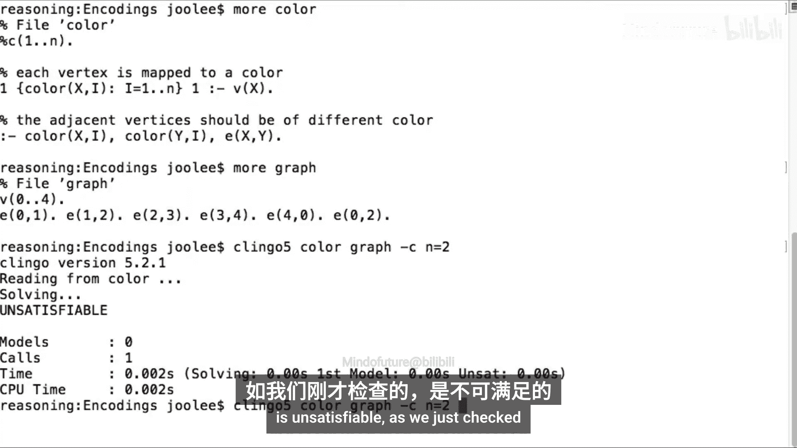

If you have three， but let's try to generate all solutions。There are actually 18 possible solutions。

Okay。So many of them actually perutation。Okay。아위 두 개다？So we are done with the coloring。

Let's go to the click。anyoneone know the definition of click。农。These's a complete sub graph， yeah。

 so it should be so if the click is a set of vertices where all the vertices are connected to each other。

ok。So as you see， oh。

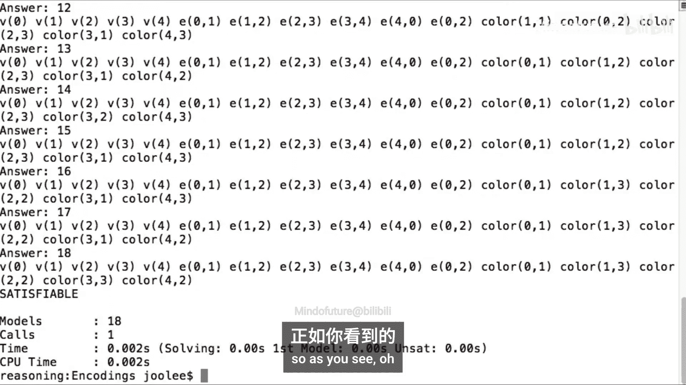

So the click in a graph is a set of pairwise of adjacent vertices。

So which means that they should be all connected。 So as you see that this is a click。

Because this node are all connected， So if you pick any two vertices from this set。

 they are connected similar for this and similar for this。Now， obviously。

 if you have smaller clickiques， that's easy to find because if you have just two vertices it。

Basically you just need one edge to connect right if you have three node。

 you just need three edges to connect right now the more difficult part is when you have more and more vertices。

 it becomes more and more difficult to make a click。Okay。

 so think about social network so you have a group of people that everybody knows each other， okay。

 that set cannot be too large。Okay。So any of the computer science problem is also about this click。

 how do we find the click？So we want to write n a program such that it is a one to one correspondence with the clicks of the cardinality greater than or equal to n。

 so we are given some parameter n， so can we have a click of S 3。Can we have a click of size 4。

 It's similar to short number， if you increase those numbers， you can find the maximal click。Okay。

How many lines do we need？2。Why think about this way so your next homework after maybe when you even do this current homework3 you have to do the programming in Klinggo right then there will be one more set of homework that uses Klinggo so。

Try to understand what is going on here today。嗯。So still there are two lines needed。

 which means that one is generate part， another is test part。左 should be generate。オしジナ。응어？

So just choose space of there。我去不该。这对这个。It's upset that it's not connected。Okay， what it， right？So。

Choose at least advertisements。How do we choose it。

This time we are not doing the mapping of functions。We are just shooting something。

And here we assume that the graph was given as in the previous five。

 so there of v of x and edge of xy。Now this x is a global variable or local variable。Local vehicle。

 so when it is grounded， it will generate multiple instances of in of zero in of1， in of2 and so on。

 right？And you're selecting how many。N okay， so n is just a fixed number， so you can say n equals 3。

 that means choose three vertices that belongs to in predicate。Okay。

 so this one is actually same same as saying。Shoose。A subset。Of V。 And this subset is named in。Okay。

 who' cardinity？Is greater than or equal twin。 This is what his line you think。

So choose a subset of V that belongs to this in predicate and the cardnuity of that in relation should be at least n。

So， you just select and。Vtices。But they may not necessarily be connected。

So you have to write one constraint， there must be an edge between the two between those vertices is in the inpredicate。

Okay， let me say again。 So they must if you have。A note that belongs to this intriddicate。Okay。

 these nodes must be connected。And that can be written in this way。Suppose x is in the predicate。

 x and y are vertices， so two vertices or two different vertices are x and y。

That belongs to the impreddicate。But there is no edge from x to y or y to x then this violate rate the constraint。

O。乱了。Okay。Any question up to this part。喂对。Okay， then let's move on。Hailtonian Circuit。

 What is Hamiltoniltonian Circuit？Yeah， you have to go through all these vertices and has to come back to the original place。

 but also you shouldn't revisit the same vertex again。That' Hamiltonia circuit。So what is the。T here。

So let's see whether we can actuallyvis visit all these vertices let's work from here so you can tell me whether to go to the left or right or up or down okay I'm working like a robot and can just direct me what to do so let's start from here。

能。Right。Right。Right。当。嗯， left。啊。😮，Left。Left or right。 Tell me。Right。当。到。Right。Left。好。没有。啊。来。喂。哦。嗯。

そいう范で。Good。Okay， so。This was actually the solution that is also given here。All right。

 so we are going to solve this one and let's actually try one more thing。

 It happened to be the different graph。😊，Okay， what about this one。So let's start this one。啊，都对拍嘛。

Somebody else。嗯。Right， okay， so right， you can now give the numbers。 So I'm mean the number one。

 So two， okay。F，5。6。3。4。哇，O。That's good。 How many solutions will there be。That's harder， right。

 you can find one easily， but how many they have to count everything， okay？All right。

 so we are going to solve this problem and obviously now you can encode this graph in the language of Plinggo here we actually use this tooling just to make it a bit more subccct if you don't like that's fine。

 you can just innovate edge of1coma 2，1coma 3，1coma 4。Doesn't matter Okay。

 so I mean here that means that there is an edge， Okay I have to delete this Its too complex。嗯。

Some reasonな。Yeah， my pen is not working， okay。Okay， if you read this carefully。

 the edges are not necessary by directional。Okay， so some are but if you look at a pair between say four and five。

 there's no edge from4 to five， there's an edge from five to4， but not the other way around。

 okay so this is a directed graph that we are looking at。Okay。Alright。

 so how do we solve this problem？ Now， let's guess how many lines do we need。This is probably。

More than before， that's a hint。Five is stands so if you have previous direction note， yes， five。

First， think about this as。You have to turn this into more precise language。

So Hamiltonian circuit in a graph G is。A sub graph C。That has the same set of vertices。

 asG and satisfied the two conditions。Everytex every vertex is adjacent in C to exactly two vertices。

Okay， because it's a path， if you pick any node， there is exactly one incoming edge and one outgoing edge。

Okay。That's one hint。Another thing is every vertex is reachable in C from some fixed vertex。

 you can just choose any vertex as' a matter， but you have to choose one。From this。

 you can visit all the vertics。And that's it。Okay， so if you satisfy this requirement。

 you will see that there is no case that the same vertex is revisited twice because if it revisted twice。

 then it doesn't have this one incoming edge， one outgoing edge， it may have two incoming edges。

 right？So that case is gone， so you just need to focus on this。

So your first step is try to write in a precise statement that you can formalize in the language of T。

T your English description， whatever the Hamilton sake problem that you know。

 turn it into more crispy and something that you can formalize in logical language that's the first step to do and after you do that this is exercise so。

There should be some generate part。Okay， so were going to use choice rules。

 There will be also the test part， which is to use constrain。

 But this particular program actually has one more component， which is so called defined part。Okay。

 so there are actually three sections。 Let's actually look at the generate part。

 what should we generate？We should generate something here， right？

What is the thing that we are generating？你还不去是吧。Choose edges， right。

 so just choose any subset of the edges。Okay， if you're lucky， that's already Hamiltonia circuit。

If you're unlocky， most of the time， it doesn't satisfy the requirement。Do you understand。

 just give it a graph， just choose randomly the set of edges。

And if the set of edges are perfectly connected to satisfy the Hamilton circuit requirement。

 you're done。你可。So how do we do， We're going to use these two rules。Okay， now you can read。Here。

 accent， the first rule。X is。A global variable。And why is it look available？

So each node X choose particular x。Okay。Now let's actually understand this X Y as edge from x to Y。

 this is a directed edge。Okay。So choose X。And you have to generate exactly one predicate called cycle xcoma y。

Where why is that your locally available？So what does it mean intuitively？Given an x。You have to。

She was exactly one。好，不应该是。So if you look at this。So。Try to ground the global variable first。

 so it' a particular x。 Okay it could be some node 1 or node 2。Now， this y it's a local variable。

 so itll expense to set inside。 So I can say for example。

 this rule will be generated this rule will make like。Let's see。Onecom one。这是我我C。要求 one command。2。

 if you look at the previous one， edge 1 was connected to 2，3，4。Okay。So I cant write。Okay。

So when x equals one。Okay， why？When x equals1， y can be2，3， or four。

 and you have to choose exactly one。Okay， that's what this movie is saying。Pick any x for each x。

 there should be exactly one outgoing edge。The next one。I do。Pick why。

Then there should be exactly one incoming edge， you have to choose exactly one x that has an edge from x to y。

Now， if you have these things， you will see that the。Edges that you selected。

 which are denoted by this cycle cycle x comma is this edge x comma y is in the Hamiltonian cycle。

Okay。So if you have just this part， what will happen to the stable model？It will just generate。

All the possible selection of edges。Where each node has exactly one incoming and one outgoing edge。

Isn't this sufficient。Yes是。さ Hamiltonにさっけ。So here cycle x commma y denotes that the edge x commma y is in the Hamiltonian circuit。

So in the last you will see that cycle of one comma 2， cycle of two， comma 3， cycle of three。

 comma 4， cycle of comma 5， that means one to two， two to three。

 these are the paths in the Hamiltonia circuit。Okay。Maybe let me show you first。

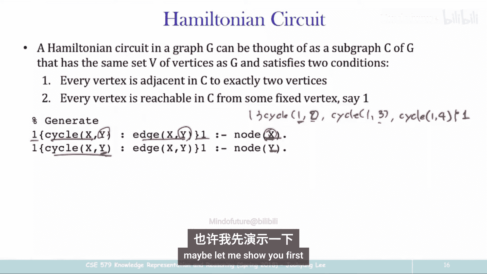

On。I think I have to give a graph。Yeah， so this is actually what you will see at the end。

Cycle predicate en the Hamilton circuit， so this means the Hamilton circuit goes like one to4。

 four to2， and two to six， six to five， five to three and three to one。

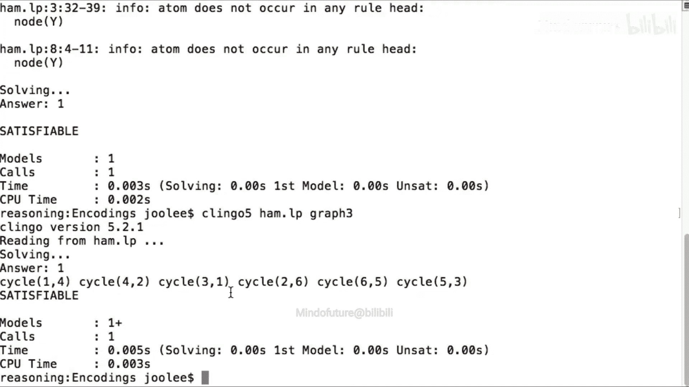

Okay， there's 122。 if you're interested in how many are there。ThereActually is six simultaneous okay。

Okay， so we will do that and I'm not showing the old program yet， so that's do one by one。

 So at this point， of course， all the Hamilton circuit will satisfy its requirement。

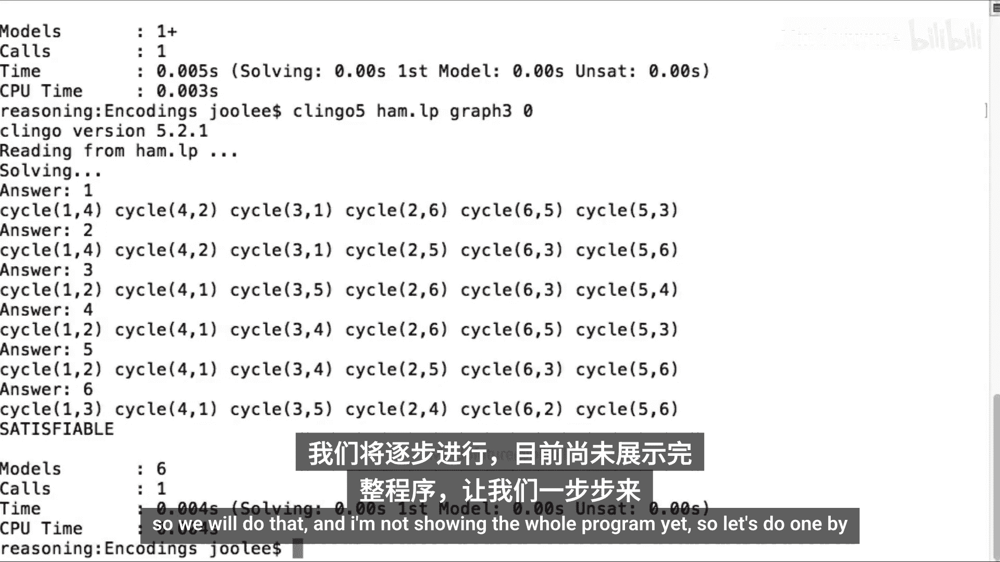

But also some other assignment will be there too，Seelection of edges will also satisfy this requirement。

 right？So what are those bad assignments？是告诉。有。What do you mean把套 here。对。这个是。Okay。

 what what do mean by Traverse？Because computer doesn't know what you mean by Traverse。

Can you be more specific。Maybe even you can use the vocabulary that computers know here。

 so it knows node edge cycle。It doesn't know what you mean by travels。It there。

In the cycles that we generate。All the notes should be there。So， if I have。Let's say， this note。嗯。

Okay， if I have these。Okay， if you select this， each node has exactly one incoming edge and one now coining edge and one incoming and one now coining。

 that's fine， right？But this is a Hamilton circuit。 No， why not。Because it's not reachable so。

Yeah but what do you mean by connected so let's try to more so if you start from the one node。

 every node is reachable from this node， so now you have to define something called reachability。

 which you already did when you are doing the family relationship you remember the acesstrtor relationship。

 that's about the reachability。So what we do。If we are going to define these things。Okay。

 maybe let's go with this。Ricach y means that y is reached from the vtex1。Right。

Because if you chose this edge 1 comma y that is in the Hamilton circuit， then y is Richard？Okay。

 so every step every path of length1 is covered here。And then you have to do the recursive case。So。

 if。X is reachable or x is rigid from vertex 1。And X and Y is connected。Or you can go from x to Y。

Then you can reach why。O。Are we together？Yes。Do you are assuming that we are starting？Oh。

 node one is just an arbitrary selection， Yes， you can choose anymore， it does' not actually network。

 but you have to select one。Yeah， so here we've happened to network。

That's not meant if you change one with other numbers。Okay。All right。

 so that's fifth part and this is actually。Neither choice rules nor constraint because it has a single predicate in the head。

So other rules this has choices， a col raised or the empty head， but this one doesn't have them。

 but it can be used for the definition so you define the reability。Okay。Okay。

 so we've defined the reachability， but we didn't use it yet。 We have to use this definition。

 how can you use it？Now we're almost there， we need only one line。To say that these are bad guys。

So what should that be。嗯，我。我知。On that third end。No。You你 one达到天地啊。How can you say this。

Well if you find at least one。Note that is not reachable and this violate constraint。

So just write this way。There's a y that is not reached and this violate constraint。Right。A ACN。

If you happen to worry about this play， you can just add this line and then Klinggo will not show other predicate like northern edge。

 it will only show the cycle。Okay。All right。So typically。

 this is also called traveling salesman problem。

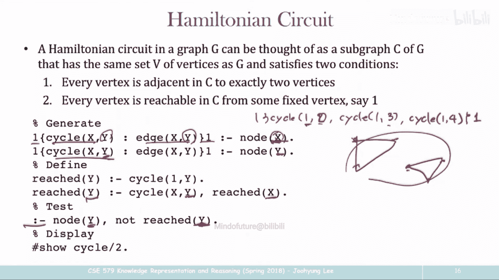

And there are many variations， but one of the typical thing is actually。Finding optimal plan。

So how can we do that。We are going to assign cost to the edges。

 so now the circuit there are actually six solutions for this problem。

 but not all of them actually optimal because。You can choose different paths。To go there。

 right And depending on the past， the cost of travel will be different。 right， So here。

 if you want to go from1 to 4 or 4 to 1， the cost is  one。 But if you have 3 to 6。

 you cannot go from 3 to 6， you can go from 6 to 3。 The cost is 3。O。So。

What is the most optimal solution。And I can give you aquiz。

And we can consume until the end of the class， but can you guess？

What will be the most optimal solution， what is the optimal plan， what is the cost for that plan？

Maybe I should give some reward。To those students who find answer。嗯，一人一说一人一事。双时没收到走。

It should be Hamilton and so， as well as it should have minimum costs but you add up all the costs assigned to the edges。

Okay。9， okay， How can we do。So，1，2，4。2。5。6。不懂。All right well let's not raise time on this let's just show directly what is the solution look like now we have to now introduce the code and the way that we do is very simple you have a new predicate cost okay and you just need to say from edge one to two the cost is two。

😊，オケーそういう健ジャスにこうで。No surprise。Now finding the optimal plan。It's easy。Just write this one line。

And it'll find the solution。Okay。So what does it do here。

 it will try to find the pair C comma x comma Y。And。Here， this is like the cognitiveity constraint。

 but we want to actually minimize the cost here， so finding all passes in the Hamiltonia circuit okay。

So let's say this part is to be appended to the program that I showed before。

 so what would happen is it will compute all the costs。

 it will actually add up all the costs and return the minimum cost plan。

We'll actually talk a bit more about this later when we go into the aggregate part。

 so the syntax may not be yet familiar， but there is actually the general concept of aggregate that we'll talk maybe next time。

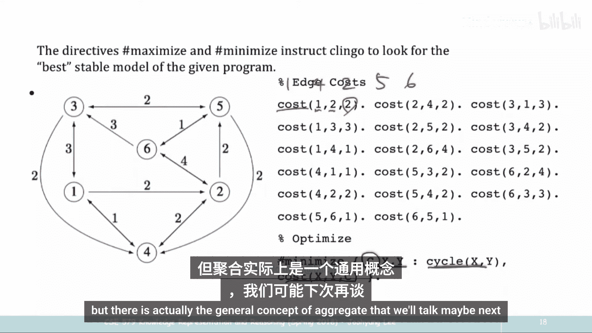

But let me just show you what happens here。

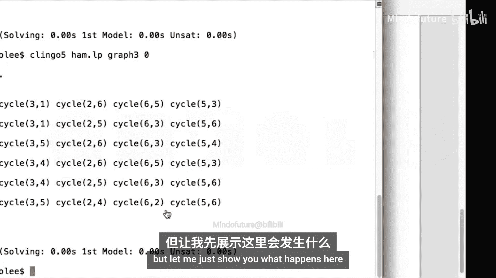

这。So。Let me sure you do quote first。So this is Hamilton circuit called。And。

This is a graph that I show。没。This is optimized statement。And this is cost。

So all I need to do is just to give everything， so Hamiltonians。Okay。3。And。Of course。Optimize。Okay。

 so the solution is this one。The minimum cost is 11。Okay， so one to two and then two to five。

 five to six， six to three and three to4 and4 to one that's the mineral plan Now Cl actually shows other plans too which is suboptimal yet so what it does is it tries to find one and try to optimize it if you can find a better plan it will produce and so on and on until the optimum is found。

Okay。That's what Klingo is doing。不。Right right。意议。ok。Theres one呃。レイ into the。So 어디서所属。You have to oh。

So you have to place numbers from one to9。 Okay， so that no to。啊。Numbers。

In one to9 no numbers are repeated in the same row or column or same three by three bucks。 right。

 Have we play this。Okay， good。嗯。In a sense， this is similar to Enque's puzzle。

So this is actually the solution。 So the last problem in the handout is actually。You think。

About the proposal， so。Let me try to get into that。Okay。

 so nine by9 may too much time consuming to do， but we can do six by six。

So let's try usually in the sloal puzzle， there's only one solutions。Okay。

 people don't like having sort puzzle with more than one solution。All right， so let's play together。

What should they do。So tell me the coordinate and maybe the number that' will be to。1，1 must be 2。嗯。

So just one okay， let me give the roll number and the column number so pa am I saying this should be two why。

If you。Well to never Ireland。十さ。嗯好。So。Basically you just look at the rows or columns that has most numbers right now if you look at the first row according to the first row it could be either two or three right but if you have three then it will violate the column constraint so it will be two so it should be two okay that's good。

What else should we do。Well， let's do easy one first。Because 160 is now easy because you have two。

 then this must be three。Right， okay， good。What else31 is also easy， Yes， what should be。4our， good。

 And what is next easy one？3 comm3， right？ There should be three。Okay， let's do term by to。

 So let's start with the last row over there。And come back。 And maybe or this way。 Okay。

 anyone in the last row， what should be the next easy one to use。4 comma2。

 because now all they are all five numbers filled， what should be the number here？6， okay。

 the robot before。Now4， six is also easy， so what should be the number five， Okay， good， okay。对对。

The second row here。之钱。22 should be one。ha why because6。Soう。Okay。

 let's say this must be one and what was your other thing that you could be。 okay？I see。

 so it could be either one or six if you look at the first box right， but if you put six。

 then it will violate okay so six is not so it must be one。Okay， it becomes easier for your guys。Two。

 three2，3 will be six。 Okay， last row over there。6， what。6。6，3 should be one。Why five three？5。

So this is according to the column3。There should be two numbers that are missing， right， one in four。

Right so why not fool here？How do you know that issue should be one？Ah。

 that's actually you're looking at this guy。Okay， so maybe yeah okay that's fine。 So if you put one。

 then this is a problem。 So instead of this one， maybe we should look at this guy first right so here again you have two choices if you just look at the column constraint that's one and4。

1 and4 right。If you just look at the column contrain， but if you put you cannot put one here。

 so by looking at this because one is already here， they should be four。And then each becomes one。

Okay those two steps there， okay，So。O。意バ思。什么时候。5。Yeah， so that's easy one， there should be three。

 Okay， it easier for。You two。喂。6， two should be2，2， okay不。Right， now we have。

A bit more difficult part here。뭐 symmetric here。呃，Let's go。이게옳 어떻게다。怎么现的都庭。2，5，2，5 should be。5。

 so what's the reason。哦，我原那边的。Okay， anyway， so if you look at the column five。

 there are actually two numbers missing， so that's the five and what。😊，3。

 but three is actually if you look at the this guy three is already there。

 so three is not possible so then it's five and then it becomes easy to do okay I'm going to fill the rest of the scene。

So比较 done。O。All right， so that's the solution that we know。How do you solve this Sudoku in Klinggo？

And I have nine minutes left， so I think I can finish this。YouYou get most probably。O。嗯。

Soう、ナンバース1ン2ゥ9。Okay， so this is easy。And I'm going to show you these rules and you try to read this in English。

What does this rule do？So let me give you the reading for this predicate。

 so A R comma c comma n means the raw number R， so R and C andN can range from1 to9。

So row number I row number I， column number C， there should be the digit end there。Okay， so one。

 comma 1 comm3 means the position1， comm 1， there is a number three there。Okay。

 so what does this rule doing？What is this rule doing？I assignment， yes。What is the domain here？可认的。

Row and column。 Yes， there's a domain。 And what is range。So what you get is if you write this。

 what are the stable models？我我我有。Yeah， you just put each position。

 you fill each position with a number。Okay， so if you are very lucky。

 you already to have the solution。Okay。Actually， I should say that you have to also encode the instance。

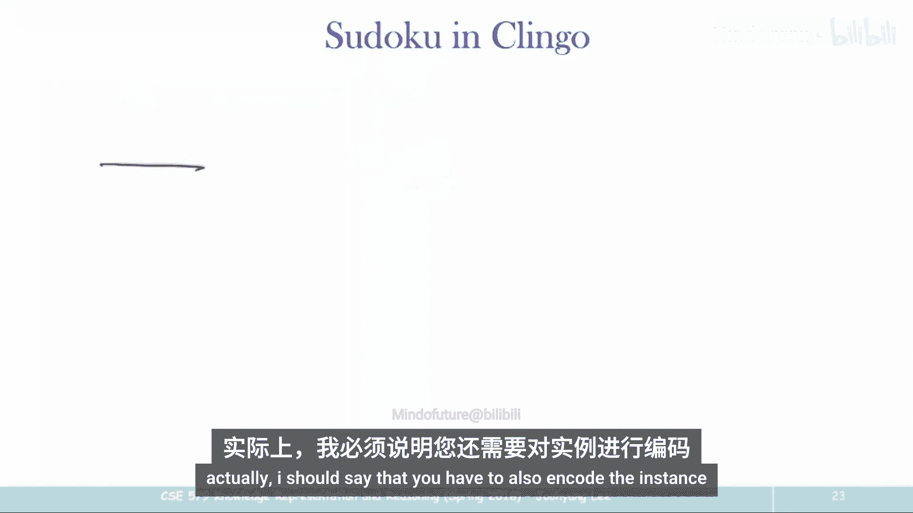

So for this kind of。Thinking you have， you can give a data， which is 1，1，9。And say。1。to three for5，5。

8 so actually I have to give this data instance or assuming that's already given so we are trying to do it we are trying to write rules for that Okay so this one is simply put the numbers in each of these coordinate。

So choose one number for each row in each color， that's what is's doing。 What about this guy？嗯。

So this is almost similar to the first one， but now C and N。Is fixed， that's a global variable。

 and you have to choose exactly one rule。So I mean， basically you just change the comment here。

 so choose one row for each column and each number if you're given a column and number。

 you have to have exactly one row for that。And similarly for this guy。

 okay so if you are given a row and number， that should be exactly one color。

 so basically you have three things， if you' are given the two that should uniquely determine the other。

One， okay， you're given the row column， then you should give the number row number。

 you should give exactly one column and also the other one。That's what he's doing。So until this part。

 what do you get？You will get all the numbers are filled into the grid and you will see that no numbers are repeated in the same row or color。

There's actually one more requirement here。Which is the box requirement。And。

The box requirement can be actually presented in different ways。

 but this is actually a complex equation。嗯。What is it doing here。What is this thing？Can you guess。

First万。嗯。I we will give these box an idea。Exactly， so the function here。

 So R1 minus divide by R times 3 plus C C minus1 divide 3。 this gives。

The uniform number for each box。Okay， that might be a bit difficult。

 but let's actually try to do something here。 So if I have。Okay，1，2，3，4，5，6，7。Right。

Let's say one comma 7， position1 comma 7， and three comma 8。Are in the same box， right？

RightThey're in the same box。 So what is the value for this What is R so let's actually plug in it。

 So if r equals 1 and c equals7， what is this value？就。

Okay youSo let's do slowly So if articles equals one， so1 minus-1 is 0。

 so this is all0 and 7 minus-1 is 6，6 divided by 3 as an integer is 2， so this number becomes2。😊。

Now r1 is3 and C1 is 8， then what should it be？So r1 is 3 minus1 is 2。

2 divided by 3 is an integer division， so it's 0， 0 times 3 is still 0， and c 1 minus1。

 so it's a 7 divide by3， the integer part is 2， so this is again2。Okay。

 so roughly every position here。Well have the number 2。According to this equation。

And I believe this is actually all zero and this is one。And83，4，5，6，7，8。Okay。

So any numbers that belongs to the same box will have the same。啊啊呃。

Value for this function so that you can say that if they are in the same box then this virus is constraint now a few years ago it gave this as a homework problem and students with solutions are very diverse so actually most diverse part is actually how to represent a three by three box constraint。

Okay。All right， so something that I want to emphasize。Okay， these are the instances that I say。

It's about elaboeration tolerance， so this was what Ja Nakasi said in 2003。

 hes one of the founders of AI， and he said， a formalism is elaboeration tolerant if it is convenient to modify a set of facts expressed in the formalism to take into account phenomena or change circumstances。

嗯。Okay let me go through this maybe next time in more detail。

 but next time what we are going to do is we are going to solve variations of the sudocal puzzle。

 that is actually offset thedocal puzzle where you see that in addition to the original problem。

 you have the colored regions here。

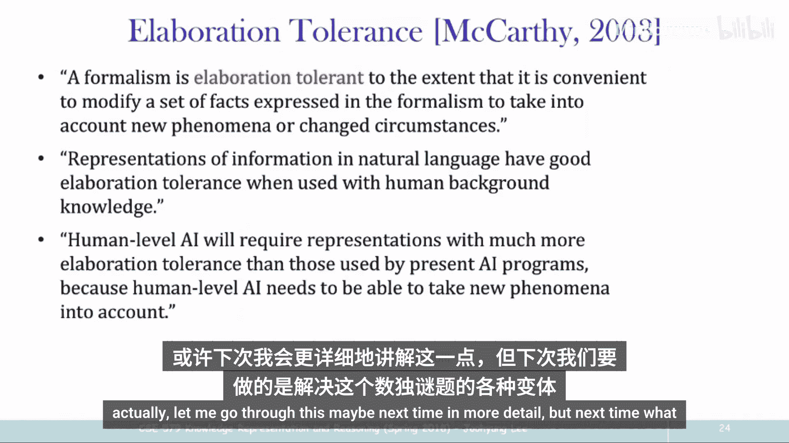

So this forms another constraint。

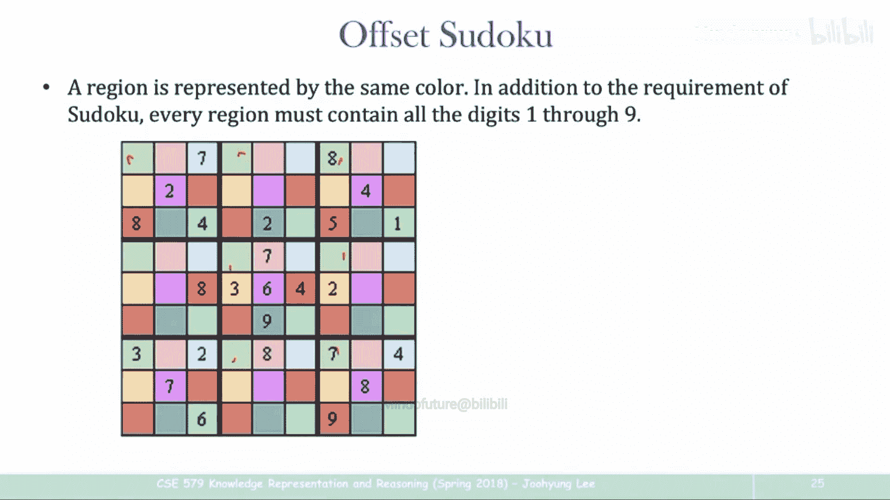

Okay， we have solved this puzzle。Anite Sudoku puzzle so okay actually I'm going to say that next time。

 so there are quite a few variations of Sudoku puzzle and each of them can be solved in just adding a few more lines to the program that I showed you and for the killer Sudoku this is really killing you maybe but if you know how to represent those constraints。

 this is actually not very difficult puzzle。

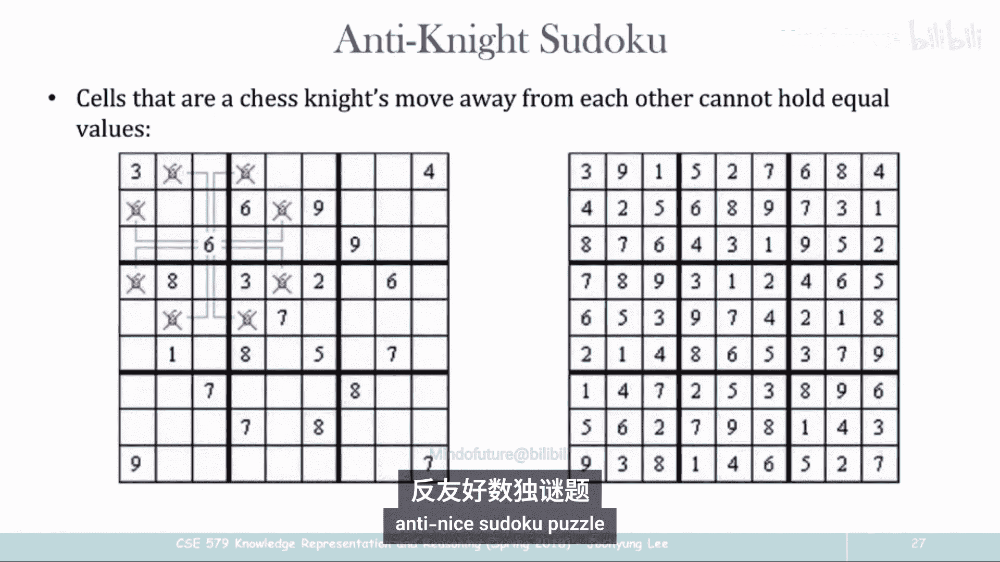

Okay， all right， so we'll continue this next time。 Any question。Okay。

 so then let me open the exit ticket。

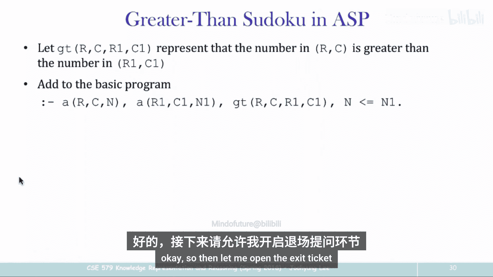