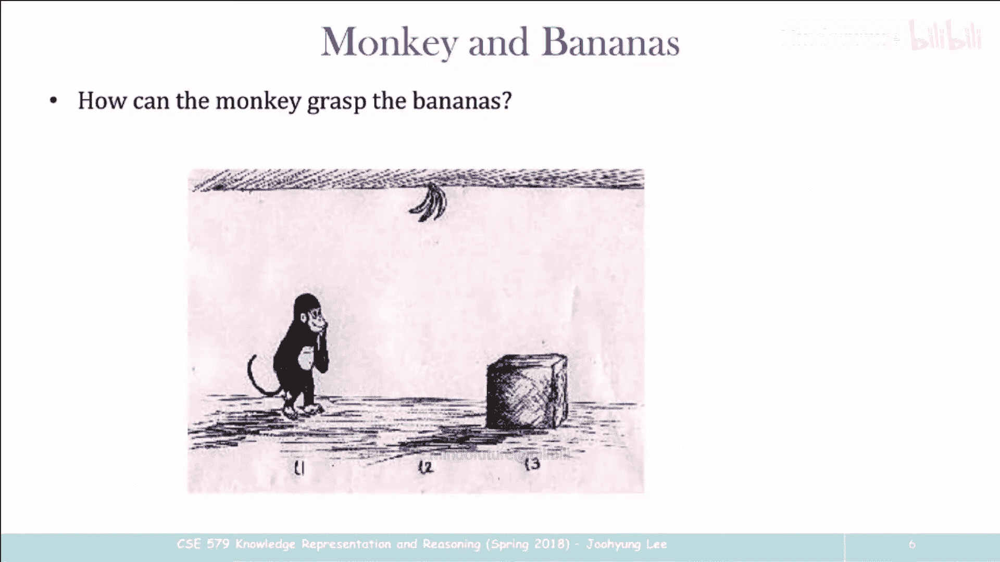
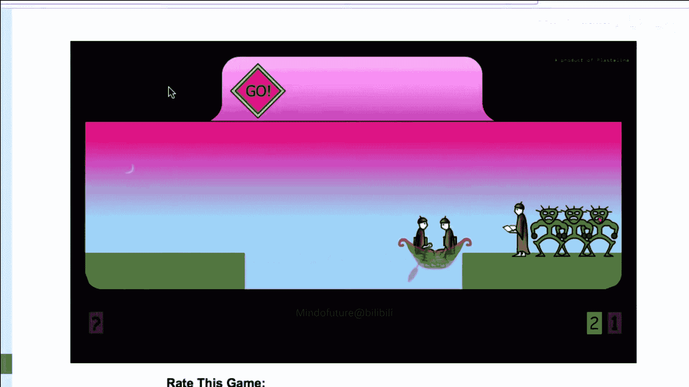
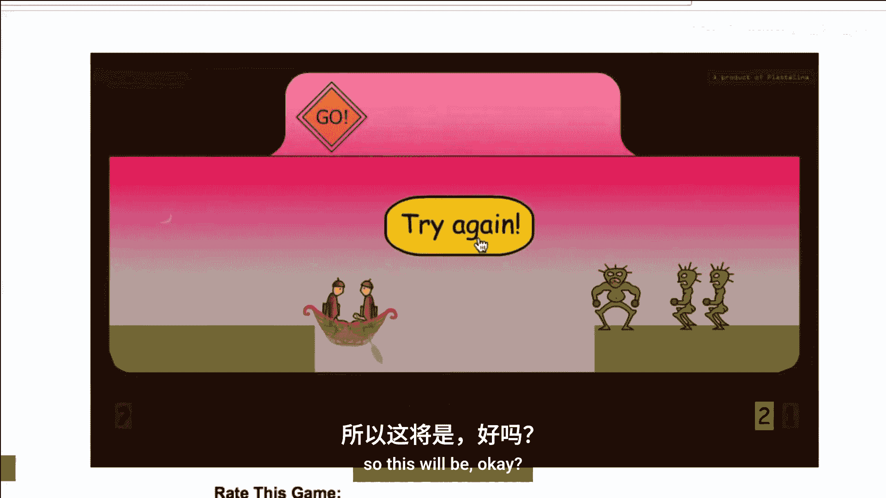
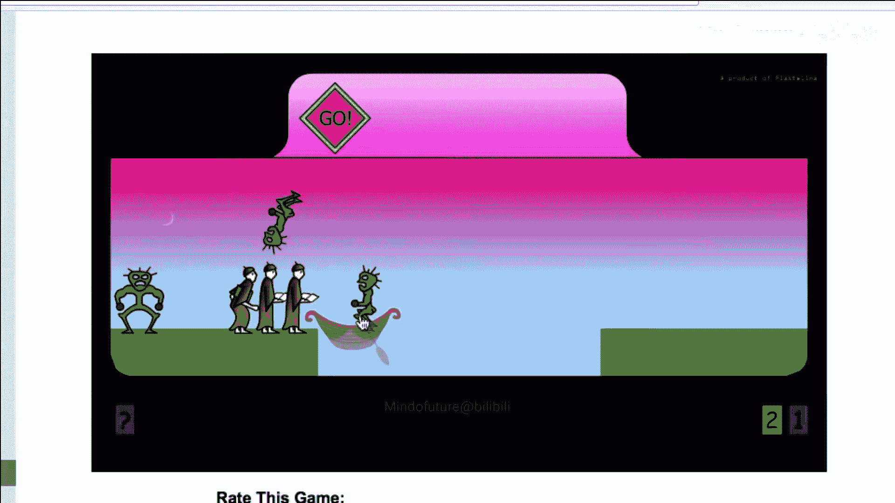
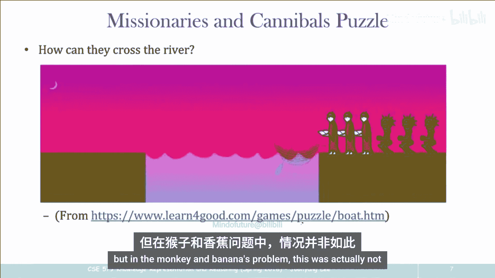
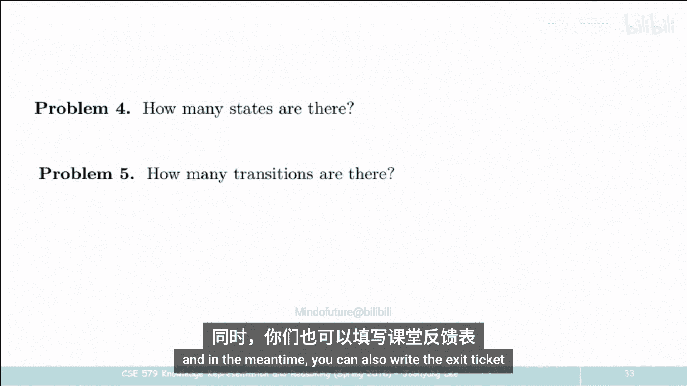

# 【亚利桑那州立大学】知识表征和推理 ｜ Asu Cse 579 Knowledge Representation 2018 p11 P11_Lec14 -BV1RTWyzfEQH_p11-

Okay， so today we'll go with this actually we constrain is something that we left over from ASP。

 but probably I'm not going to talk about this today， we'll talk later when we actually need it。

So today we will start a new part which is about reasoning about actions。

 and I put the lecture note on the blackboard， same as what you did for the other。in ASP before。

 so we refer to the lecture note and the slides are made from that note。And。

So if you want to know more precise notations that are being used， you can refer to the lecture note。

 as well as there are also exercise problems， your next homework will be assigned from those problems。

Okay， so we'll talk about today how the reasoning about actions and the especially describing transition systems can be done in ASP some of your project that I know already saw already I know involve certain changes in the state。

 so if you are doing some。Planning or specification of some workflow or some game playing。

 those involve certain changes of the actions， changes of the state according to the actions。

 and so this material will be relevant for those projects as well as for the general class。

So what we are doing is after we cover this ASP we go into the reasoning about actions now this area itself is actually a huge area and of course we don't have much time to do so what we are going to do is to focus on more align with an of programming so that you don't actually need to learn new languages so what is this idea so the field here is to be concerned with developing some formalism to describe the properties of actions so the actions actually affect the state so how you want to make those state changes to achieve certain goals or if you do certain actions how those state will evolve how can you predict what will come out of these state changes so those are what is concerned and when you talk about actions this is a very general concept so it's about anything that actually can be executed and may change the state of the world in AI。

TheT thing is about robot walking to some locations or you can say about buying an item is also an action that affects the amount of money and the items being sold。

 shooting a turkey actually has a historic reason there's actually a famous problem involved with this called Yale shooting problem we'll talk about that today。

 where you can talk about network communication network when you send a signal or message in the network that also affects the state of the world。

 where if you work on the biology domain there is also legal binding to a receptor that changes the behavior of the cells and the organism。

So we'll look at from the very simple problem， for instance， one of them is Monkey Man's problem。

 the picture was actually drawn by my friends E R of them with actually well known cognitive robotist scientists so here the problem is。

There's a monkey and monkey wants to grasp bananas hanging from the ceiling。

 It's a very typical well known example in psychology， right， you can also attribute to AI。

So the typical solution is walking， the monkey walks to the location of the box and push the box under the bananas。

And climb on it and grass bananas。 Okay， so how do we solve this problem。

 Did we actually discuss this example before。Okay so so this is a standard example。

 but like getting to the airport example that we talked before。

 there's actually no guarantee that this plan will be successful because we actually use a lot of assumptions that the box will not move when the monkey is walking to the box who knows that the box is remotely controlled so when the monkey walks to the box and the box disappears then the plan is not successful whether the box is actually too heavy so that the monkey may not move so then the plan is also not successful and also if the monkey climb on the box and then the box collapses it also does not work So there are many exceptions to this plan despite that humans actually can make certain plan which is a feasible plan basically in this domain monkey is the only one that moves box may be movable and those kind of reasonable assumptions and human can make even without actually the human knows the details but we actually go at those elabos if we are told that it's too heavy then we can retract。

Our assumptions。 Okay， or if the monkey can。Mark is smart to use a。Tool， then it can move， okay。

So everything is actually possible here。 Okay， so thing that is possible if you talk to the elementary school students。

 grade level students， what they do is。So I don't know where where they get this idea。

 There is a machine gun inside the box so that you can。I don't like that example。

 but the thing is sometimes the plan that looks like unlikely is also can be viewed as a plan。

 one of the plan is actually one Bkey。😊，Both L2 under the bananas and wait until the banana。Bs down。

So。All right， so now we want to formalize what these reasonable assumptions about this domain。

So this is actually what we are going to see probably today now there's another kind of the work like missionaries and Cannibes problem。

And I think。Actually， we can play with this example。

嗯。And if the missionaries are outnumbered by cannis， they will be eaten。しれ？So if you do， things like。

で。

Yeah。So this will。

All right， so how do we solve this problem， Anyone， let's actually do this like before。

 can you take turns from the rules。Okay， from that role， from Arendam sort okay。

 so what is the first。2 can，2 cans for， okay。用。Okay， and one of them should be out， right。

 it's reasonable and one has to come back。Otherwise， there's no no progress， right， Okay。

s one in front。아 것으로。One missionaries， and。W can。Are you sure about that。いいよと。No。Okay， so。我也是。

トミッショナりです。就在。Two cans。都没上到里。会吧。Cananniable， okay， do can。And of course， one of them has to get out。

 otherwise there's no point of progressing。 Okay， so good because now the oops。Okay。

 so what do we shall we do now。Two missionaries， Are you sure about that？No。You服。能。不再懂。Okay。

 raise your voice。トミッションナリーズょバて。Okay， two mission race。Okay， good。Okay， what shall we do？T animals。

Are you sure about that？One animal。宣读完毕。Okay， so the thing is split。给你。

Miion stays either side of the bankque think it is outnumbered then they will be。找这不。

One missionary go， wish that this guy ghost and he will be eaten by the two。Two cannis。

 Then he will be1。One canbal one visionary， okay， that seems to be fair。Okay nowわ。Two missionaries。

 Wow， okay。So then all the missionaries are in place。Okay， what shall we do？Yeah。Then canny can go。

 Yeah， okay， from then on， you see the idea， right？In fact。

 the minimal plan here is actually 11 step plan。데？Sobodybody is happier after this。

不go。Okay， so this seems to be a bit more difficult than the monkey bananas problem because it seems there is a more combinatorial that is going on。

 in fact， this is actually easier in terms of solving by computer。

Because it's actually so clear okay when something moved。

 the constraint is actually very clear about it， but in the monkey bananas problem。

 this was actually not。

Okay， so we're going to talk about this and unfortunately we don't have time to go over all the wonderful development in this area。

 I just want to mention that this is called action description languages which are about。

The formalism to describe the effects of actions and they define transition systems。

 basically this is a directed graph and the vertices correspond to the states and edges are labeled by actions。

There are many action description languages， strips is probably the oldest one known in F and Nielsen's seminal work in the robotics。

The Shaky robot， the first robot in AI or the reasonableI robot was using this language。

 there's also other languages like ADL， situation calculus is's probably the textbook example of this you probably have seen it if you took some intro to AI or graduate level intro to AI you may have seen this formalism。

 there's also other formalism like event calculus， temporal action logics。

 language A language C+ and so on and so forth okay Now we are now going to all of them。

 in fact actually none of them but we'll talk about something in terms of AESP。Okay。All right。

 so but actually the ingredients is actually the same。

 so what is the basic requirement for this action description language。

Right so this is a simple action description language that we'll focus on the first half of this class today。

 so here truetransient system has only two states where P is true or false so p is something we call fluent and fluluent is something that changes the when action is when action is applied the value of fluent may change so here P was false in this case so here p is false but action A is executed then P becomes true and when a is executed again。

 P still remains true and also when a is not executednot by this a equals false。

 the state does not change。Okay， so we are going to describe this transition system。

 but you can imagine in many practical examples， this is for too simple。

 there are actually millions of states and maybe billions of edges in the real world。

So this is some terminology， fluence as I just said fluent is anything that depends on the state of the world in the previous example he was the fluent now for other domains like monkey and bananas whether the monkey has the bananas。

 this is a true or false right it depends on the state whether this fact can be true or maybe false this is a fluent。

 whether the monkeys on the box this is also fluent this a true or false thing theres also non Boolean fluence or sometimes called multivalued fluent。

 the location of the monkey so in the previous example there were three locations L1 L2 L3 so the variant are not necessarily boolean okay the bananas。

 the box are locations are also multivalued it's not necessarily true or false。Okay。

 so another terminology， the common sense law of inertia so Newton's law of inertia is about that things will keep its current position when no false sense been applied and when you was not moving and no force applied then the thing will stay there as Newton's。

啊，罗非了说。Now， what we mean by common sense ofvininoia is analog analogs to that。

By default the values of these flus remain unchanged Fx scing actions， so for instance。

 when the monkey walks to the box， the box tastes the same because of the inertia and the banana is also hanging in the same way。

 that's also by inertia。Okay， now if you look at the domain。

 there are actually a lot of things that is governed by inertia。When the monkey walks。

 the only change in the state of the world is the monkey's location。

 but all the other things other objects's location remains the same as before。Okay。

 so that's according to the common sense lawvininoia。

Now historically this is actually one of the most difficult problems in AI。

 it's called the frame problem， how do we formalize the common sense of inertia in some formal language。

 so how do we express socalled inertia fluent， meaning that the things are not affected by actions they keep the same value as before。

And this seems to be a very easy problem at first， but it turns out to be very difficult and I will talk in the next page why this was solved anyhow this problem is actually solved now and there are actually many solutions and all the action description languages that you saw in the previous slide has good solution for this problem。

But just to illustrate what happened， this is a historic example， Yale shooting problem。

 it's about shooting the Turkey， although the original version was actually not about Turkey。

 it's about the person called Fred， and people didn't like killing human。

 so it was changed into Turkey。啊。Anyhow， the problem is， Fred let's say Fred is a Turkey。

Hes initially alive and a gun is initially unloaded， loading the gun。

 waiting for a moment and then shooting the gun at Fred is expected to kill Fred。

 so we want to teach computers to do this reasoning just describing this fact so the computers has to figure out that Fred will be dead at the end of these events。

So how do we do so try to use logic， we want to say Fred is initially alive。

 we want to say that in terms of this alive of zero， so zero represents timest。

 so it's a zero one to how the time progress is there。Okay and gun is initially unloaded。

 so how do we say that was is not loaded okay so loaded of0 means the gun is loaded。

 so negation of that means it's not loaded and0 means that initially the gun is unloaded。Okay。

 so loading the gun and there is actually a load of zero， actually I should。Say loading the gun。这个。

Now， if you load the gun。Then。The loaded becomes true so here what this rule is saying is if the gun is loaded at time0。

 then gun is loaded at time 1 okay so the load is on action and loaded is affluent so when action load is executed then loaded becomes true at the next time。

Okay。Now， another thing is loaded。And shoot Okay， so again， I didn't write this action here。

 but let's say shoot is there。Okay，So in the story， the shoot was done at time two。Okay。

Because between time one and two， you have to wait， so waiting means that you don't do any action。

So shoot this down at time two and if shoot this down at time two when the gun was already loaded。

 then the turkey is not alive at times three。可以。Okay， clear。On the other hand。

 this is actually wrong。So we want to derive this conclusion。Okay， when。So this story。

Was represented in terms of the logical formula。 right， This is what you already know。

 So remember what we did in the classical logic， propositional logic and first of the logic。

 This is just simple first of the logic。Right。Okay， so what we want to say this theory。

 when we give this to the computer， we want to say that this entails that。

Fred is not alive at Time three。We want to derive that。Yeah。我是说。五十分で。

We saved the little one but they were received the。I said。 can you repeat。OhOkay。

 you want to answer this question。Okay， so thank again。So you said loaded。

 so he said has loaded one is true because you said load zero。But you never said Loate is true。

That's one thing， yes， true。嗯。Now of course you can actually test this with your standard nuash in first logic it will not be entailed one of the thing that Aridam just mentioned is how do we know that loaded two is still true when loaded one was true that's one thing Another thing is actually about our。

Okay， so alive is zero is true。 How do we know that the Turkey is still alive at Taiwan。

 We actually assume that Turkey should be alive at Taiwan1。

 but with this formalization there is no guarantee that Turkey will be alive at Taiwan。Okay。

 and in fact， it's also possible to he was not alive at time one， but he can arrive at time too。

that kind of thing may happen。Okay， so there's a lot of things that is not done here， okay？

So most of the problem here is。If。The action did not affect that flu。

 the flu shoot remain the same as before， that is actually not stated here。Okay。

 so I can easily say if I put like not alive。1， this is actually consistent。 You can still say that。

Turkey is not alive at Taiwan， although there was no cause for that。And loaded2 is still false。

 even if you expect that loaded2 should be true after loaded 1 is true。

 but that is not guaranteed by this description。Okay。Now。

Of course that was not the problem that AI suffered at the time。

 people already know how to solve some part of this problem。

 there were actually several formalisms available at that time。

 so in 1980 in the AI journals there were three main formalisms to solve this kind of problem okay。

So subscriptionscription by McCarthy Ray right of default La。

It's also callednaphonicologic by the English was Blue McDonald's paper。Now。

 this ya shooting problem was given in a paper by Dr McDond and。His student， I think， the Hank。And。

What they said was the languages or the formalisms available at the time couldn't solve this simple problem。

OkaySo what is this thing？The formalism at that time has built upon the notion of minimal change or so called minimal models。

Okay， so we talk about。Minimal models versus stable models before right。

 So here is something that people try to think why。

How to solve this frame problem Well let's try to minimize the changes in the domain。

 Now if you say a zero is true， okay a zero becomes a becomes false at time1 is a change。Okay。

 let's not do that kind of models。 Let's not look at those models。

 Let's minimize the change in the float。Okay，So are we will only look at the models that minimize the changes。

 so for this example， let's only consider the models that minimize changes in the aliveness and loadedness。

Okay， so that's this idea， I mean， the detailed formalism is actually much more complicated。

 but the essential idea is to prefer the models that minimize the changes。Okay。Now。

 according to that， this is one possibility。So live zero and not loaded is actually true because that's actually entailed by these two。

That's good now I didn't show you here， but there was loaded at time one。Load action at Taiwan1。

 There's also shoot action at。Time to， okay。So this change must happen。Because lo one is true。

I the load  zero actually， So we are trying to say load of 0。

 meaning that this action happens between times 0 and 1。 Okay， so when load0 is true and not load it。

Okay， loaded0 is true。The law must become true why。Because of the third rule right， yeah。

 so this one is so this is fine， this change is actually justified。O。Now， when shoot is executed。

 a lie becomes false because。This last rule says loaded two is true and should two is true。

 then a life3 must be false。 So if this is true and should is executed， then alive。Is false。

 so this change is also justified， right？And all other flows should not change the all other cases。

 the flow should not change the value。 So， for instance， from a alive  zero to a  one。

Doesn't change Live1 or live two does not change because we didn't say the reason for that。

 if there's no reason， then it keeps the same failure as before， same as all the other things。Okay。

 looks convincing。The problem with this approach is actually。Exactly from this domain， this example。

Okay， so can you actually find out what is actually wrong with this idea？It looks fine for this case。

 right？And the formalism available at that time was guaranteeing that a zero and alive。

Was guarantee that。Okay， this one does not change， this one doesn't change。

So these are all guaranteed by the criteria here because we are only looking at the models that minimize the change。

So。0， never。In this problem low zero actually happened Yeah so that's actually that's what I added before。

 let me do it again。So this is actually the two factor that I should have added before。

So what is wrong is this， it's actually tricky。Right， so。

The problem is there's actually another thing here， okay。So let me say in addition to this。

 of course， load of zero should be there and should of zero。と this is there。嗯。

Let's look at the second scenario。What happened was the AI system that was based on this assumption was producing a second scenario。

And in the second scenario， what happened was this。This Lord。Has to happen。This is justified。Right。

Now， there's actually another change here。Okay， so if you count the number of changes in the flu。

 this model has two changes because of this guy and this guy right。

 the fluent changes from false to true and true to false okay。

 there are two changes Now if you look at the second one they also have two changes。Okay。

 from false to true， true to false。Now， what happens in shootcase？Now shoot2 is actually true。

 However， loaded becomes false， so this change is actually。Guaranteed。

 because theres according to the minimum change criteria， that is actually minimum change。

 you don't have to change when loaded was false。So if you only count a number of changes in the front。

 both of them are equal， they have only two changes in the scenarios。

So if you interpret the second scenario， what happens is this， you load gun at time zero。

And the gun is automatically unloaded。Right， because to prevent a life to become false。You get it。

In order to minimize the changes in their aliveness， the load actually changes one more time。

So it creates two changes in the second scenario。And in terms of the model perspective。

 minimal model perspective， these two are equally likely。Yes。そ对。

We a minimum model and X0 and L not X not X。You could say that again。我这里。我这类。

How about the loaded then How about the loaded。So waitai， wait， which scenario are you changing now？

First。Okay。So let's say what is do you think， live  zero， not a live1。Not a life tool， live。

Not the light free。Not not0。あ、ロでゼロ。有这个。609有的。Okay， now lot should happen here， right？

And should have happen here。Yeah， okay， let's look at this， so there are actually two changes here。

And。呃，许多的。It comes up。O。Yeah， I think for this domain， maybe that's also the case。

An action should to is performed。都是。We not elect3。Well， the shoot action depends on。This one， right？

So the law this is true， should is true， alive alive is false。

 that is actually conforming to this rule。Right， so there's nothing wrong in that I think original description was saying that after the shoot the G is unloaded。

 so maybe that's another story that is missing from this。Okay。Okay， good。

 so the problem is there are some changes that is actually reasonable。

 some changes that are not reasonable， so just minimizing the changes actually that didn't work。Okay。

Now， it turns out that the formalism available at that time。They can actually solve this problem。

But the encoding is actually not very natural。So what the paper。

 this year's shooting problem paper was claiming was the formalisms known at that time couldn't solve these simple reasoning problems。

 so there's no hope for AI to solve this problem， and then it's become somehow coincide with AI winter。

Because AI cannot solve even this simple problem。Turns out later。

 people found out that there is actually a way to use those old formalism to solve this problem。

 it was actually a bit more complicated and the natural way。

 but there is actually a solution for that。However。

 what this paper influenced in the community was trying to see what is actually the better way to represent this knowledge。

And this is actually what we are going to look at today。And you already know the solution。

 you just need to see how the solution looked like。Okay， so。

So let's try to look at this transent system。Okay， the common sense low inertia is that a is false。

When a is false， the state does not change， so how do we describe these loops？

That's actually the frame problem。嗯。Now， how do we use ASP to solve this problem？

So let's talk about a very simple case， we are interested in the histories of length one。

 so we are looking at only one step transition。And well use following atoms p of t0 means that the flu p is true at time zero。

And P is false at time zero and saying for time1， actually this should have been time1， okay type  O。

Okay so and there is also a， meaning that action is executed。

 so well actually use this as a base for extending to our histories of arbitrary length。

 so for now we'll just look at time 0 and1。Okay， so the very first thing is how do we describe the effects of executing this action？

It can be described by this。So P of t1 if a of 0。 meaningan that if a is true。

 a action A is executed between time0 and 1， then p becomes true at time 1。Are we together？Okay。

 if we just write this rule， it does not solve the frame problem and will encounter a lot of spur models as we saw in this yale shooting problem。

So what do we need， we need to actually add more rules。

What is missing is how do we determine the value of P in the initial state because this one by itself did not say anything about it。

 by the way， if you look at this rule only what is the stable model？约定吧。

The one nothing an empty said is different， right， so empty set is the stable model。

 empty set is the minimum model here。Right okay now that doesn't say whether p is true or false at time zero。

 we need to have those possibilities， but the rule itself does not say anything about it。

 so we have we need a rule for that。Second one is how do we know that the A is executed or not because the empty set doesn't say anything about action。

 actually it means that you can interpret as a is actually false， A was not executed。

 but we need to say that action can be executed。We also need to say how to determine the value of P in the next state if a is not executed。

Okay， so a will keep its previous I'm sorry， P will keep the previous value。

This rule itself does not say anything about it。We also need to say that exactly one of the atoms。

 piece true or piece false should be one of them should be true at any moment， time zero or time 1。

Okay。So what we are going to do is to add these photoss and please pay attention to these photoss because this rule will appear many times。

 okay？In fact， when you change the domain to another one。

 like monkey and bananas and so on and so forth。The change part is actually here。

This rule will be actually kind of universal， is are domain independent axioms that you are going to use。

Okay。All right， so how do we determine the value of P the initial state， it's actually very simple。

Let's say that initial state can be arbitrary。Okay， because P can be true or false at time  zero。

 How do we express this concept？Myチョする。So choose one t this atom。Or this at。

 choose exactly one of them。If you insert this to the previous rule。

 then now the stable model will say either P is true or false， there will be two stable models now。

 right？Do we get it。Okay， so now we solved the first problem。Easy。

Now what it says in terms of the terminology， this P is called exogenous at time zero。

 what that means is that whichever course determined the initial state is actually out of the CO。

The theory itself allows both possibilities。Okay。So this is just terminology。Now。

 if you look at this one， it also covers the part of four。

 which was actually only one of the value true or false holes for p at time zero。

Because when you write this rule， it's already guaranteed。O。

The next question how do we determine whether action A is executed again。

 a can be executed or not executed， so in terms of the previous terminology execution of A is exogenous。

 the theory itself does not direct yet。Okay， so it can be both possibilities。

 How do we represent that in ASP？这对。走。Just like this one。A of zero is choice。

 Either a of0 can be included in the stable model or not， that's it。Okay。是。Now。

 if we have those rules so far， how many stable models are there？F， because P can be true or false。

 A can be either executed。 So there are four possible combinations。In fact。

 actually that's not strictly true， but。Let's just clean for now。All right。

 so next thing is how do we determine the value of p in the final state when a is not executed。

 knowing that this is actually the frame problem。Okay。

 this is the most difficult problem haunted many years in computer science and in AI。

We'll actually combine this with the other one， exactly one of the atoms is true at time T。Okay。

 in fact， we already solved half of the problem， so we are going to look at only one case。Okay。

 instead of at any time T， we'll just look at any exactly one of them should be true at time1。

The way that we do。Is this。Okay， so there are three rules that we add。Let's read the rule together。

despite these simple three lines， it'll probably take some effort to understand what is going on。

So what this rule says？When p is true at time  zero。

 then you can either choose to include that p t comma 1 in the stable model or not。So。

 this is a choice。Right。Same for the false， when P was false。

 then you can either choose to include the Pf comma 1 in the stable model order。

 there's a choice here。Okay， now what is the next one， The next one is actually constrained。

 so it's kind of double negation here。It a。Okay so there's a neation obligation。

 So what is says is actually a constraint saying that is exactly one of them must be true at time one。

Okay， and these three lines are enough to solve the frame problem。So let's see what is going on。Now。

 so far we describe this， there were five lines here， okay， so question。

 what will be the value of P time 1 when a0 is true？If you say a0 is true。

 you write the fact that a0 is true。Okay， together with the old rules that you have seen。

What will be the value of P？喺太湾。P will be true at time1 because why a0 is true now， right。

 and we had the rule saying。When a0 is true， then p of t comm 1 must be true。O。不。Now the question。

 what will be the value of P at time 1 when a0 is false？Now。

 the first rule that we saw doesn't apply here。Because A is false， so it doesn't。

To much about whether P is true at time1， right？Those是 that room is。

So what will be the value of Pi time1？对で。It seems it can be either true or false。😡，It seems。Because。

This rule， the first rule here says。啊。Actually， I should say p was。

 let's assume that p is true at time0 for simplicity， okay， let's choose it。

This rule is saying that you can either choose to include this atom or not。Okay。

 now suppose you include this atom。Okay。So that's one possibility。国泰公司。This is actually true。Right。

Because P T comma 1 is true， but P F comma 1 is not true。 It's not derived yet。

So this constraint is true， so that's actually good。G let me repeat。

So there are actually two possibilities， P can be true at time 1 and P can be false at time1。

Okay so if P is true time1， that is actually explained。Now P false a time on。

 meaning that let's not choose this one， according to this rule。

 it says you can choose either to include Pt comma 1 in the stable model or not。

 let's choose not to include this one， what will happen。这个证据。

This constraint will be violated because none of these atom is derived， so we violate the constraint。

 so although this one looks like a choice rule， but because in the presence of this constraint。

 now it has to choose it。Okay。Let's actually look at also the other case。

So let's assume that P is false。Okay。Now， a is not executed。What will be the value of P at time 1。

Again。This is a choice role if you do not choose to include Pf comma 1。

Then nothing will say about what will be the value of P at time1。

 so this will violate this constraint。So in this case， when action A is not executed。

 then P of F comma 1 must be chosen。In other words， you can read it as a by default when P is false。

 then P has to be false at time one。Now， with this default can be overridden。If you say a0 is true。

RightBecause what happens in this case， so let's assume that F0 is already true。And a0 is true。

According to the first rule in the previous slide， what happens？You must have this one， right？

Now what happens if he also choose this guy？Any violated constraint。

 so this choice will be retracted。Okay。So here is a simple way to read this formula in the presence of this rule。

 each of these choice works like a default。By default。

 p is true at time1 if p was true at time zero and same for this one。Now。

 this default can be overridden if there's a reason for defeat when A was explicitly executed to change P2 B true at time1。

Then these default rule do not apply。开始。In the shooting problem， there was a different action。

And difference for。理个。Loading is an action like eight。Okay。

 and alive and loaded were fluent like P here。Okay。All right， so。

So these rules are illlustr solution to the frame problem in the stable model semantics now I know this may be a bit difficult to grasp in the first site。

 so I have an exercise problem for you okay。Before we talk about that。

 let's actually just look at this again。Yeah， this is actually what I just described。

 the first rule says if the value of P is true at time zero。

 then decide arbitrarily whether to assert P is true at time 1。Now， if there' is no other rules。

 no other information about P， then according to this description。

 you have to assert that P is true a time1， not to violate the last constraint。Okay。

But if you are given the conflicting information about the value of P at time 1。

 so if you say that a was true， which makes P true at time 1。

 that conflict with the fact that you choose P equals， let's say， false at time 1。

 if P was false before。喂。So then in that case， you have to， you should not assert Pf commonwe。

 actually this was。They should be a。Okay。Assuming that efforts fall at time0。O。Right。

So in order to know this in detail， I want some of you to volunteer for presenting this problem in the next class。

What I ask you to do is look at these five lines program and find the stable models。

How do we find stable models？By hand。You have to write the result。And check the minimum。Okay。

So you can now of course use Cllinggo to check it but I want you to actually try this and I hope some of you can volunteer for this presentation。

 so whoever present write your solutions on the board before the class that what you need to do is to write the program okay and write each of the stable model and you have to explain so write the readout for each of the case。

Okay， second problem is actually。タイプそイノイです。All right， question up to this part。

the problems that we have。Refin。In the handle， these hour from the handle。Okay。Yes。

For the exhibit is very busy。P X0 and P0。 If we say both of them but true test do not be but。

 then will have two schedule。Both of them cannot be true because we have the rules that says you have to choose exactly one。

No， we have this one。Okay， so that was a latest people。All right。

 so now let's try to expand the timeline。How do we actually reason about paths of length M。

 so we only look at the paths of length 1， in fact， actually I should tell you。

How many passes of length one were there？In this transitionial system。

How many passes of length one in the transitionient system？Therefore， so P equals false。

 a equals false and come back to P equals false， that's one step tradition。And p equals falses。

 equals true， equal equals through this second， p equal through， equal equals false。

 equal equal true。Okay， and people through， equal equals through， people through。Okay。

 so if you look at the four stable models in problem one。

 each of the four stable model will correspond to each of these transitions。Okay。Right。

 so we'll extend this， what we do is actually very simple。

 just adding timests to going from zero to M， so M is kind of maximum step。Okay。

 so we'll have multiple atoms p of t comma 0， t comma 1， t comma 2。

 t comma 3 to denote what is the value of p at those times。对。And again。

 a will have also the argument both from 0 to n minus1， y and minus1， because we understand a。

 the action is executed between time I and I plus1， so it was up to n minus1。Okay。All right。

 so the value of P t comm I F comm I characterize the state S。

And AI represent the events executed between those two states。Okay， so how do we do。

 So we' will first introduce Boolean as a sort true false。Direct effect。

 so this similar rule as you see before， the only change is instead of0 and1。

 I'm using T and T plus one。So at time T， when a is executed， then p it becomes true at time t plus1。

Okay， and here t is going from0 to n minus1。Now M is a placeholder， you have to give the value。

When you call the Klinggo。Okay， so how do you say initial state is exogenous。

 ta1 instead of writing this rule that I show you before， I'm using actually the local variable here。

 so B can be either true or false and you have to choose exactly one atom。Okay。

Uniqueness and existence of values at time。Other than1， other than0 is represented by this rule。

 here t goes from1 to m。OkayNow this rule and this rule are so much similar。

Right but there is a critical difference。 You cannot replace this one with this。

Okay and that's actually another exercise problem。If you delete。This part， if you remove this guy。

Okay， what would happened。Itt be actually incorrect。All right。

 the other thing is our As action execution site jars， so that is represented by this。

 now t goes from 01 minus 1。Common sense Lo bininoia， before we have two rules。

 but I can use this variable B for the Boolean variables， I can just change it to online。Okay。

 so whatever the value of B， it was the value of B at the time t。

 then the same value will be true at time t plus 1 by default。

And if you don't want to see some other sort you want to only see those P and A。

 then you write this directive。O。So how do we find all states？Actually。

 when you call this program by M equals zero。Then it will return all states so how many states are in this tient system。

 there are only two vehicles false or vehicles through right so when you call this program with m equals0 what happens is it returns all the states in the t system。

So that's what you see P of f equals F comm 0， that's one stable model。

 P of t comm 0 is another stable model。Okay。So they are two stable。Now。

 if you call this thing with M equals1， it'll return all four transitions。Okay。

 so I told you there were four transitions。 So let's look at this for instance。

 This one means P is true at times 0 and no action is executed because a does not appear here and P is still true at time 1。

 which edges it。です。Stable model correspond to which edge in the t system。P equals 2 a times 0。

A is not executed and P is social this one。Okay， so this guy。Is this one this edgeオ about this guy。

P is true。And A is executive and P is still true。This one， right？And this one is this。

And the last one p is false now A is executed and P becomes true this is such so there are four transitions in this system and each of the four can be returned as the stable model here when you call this program is m equals  one。

Now， if you call m equals2， then what will happen？When Emmy equals4。

 then it'll try to find all the patterns of length too。Okay， so you can try that。All right。

 so here's a question that I just said。 So in the case。For time one to end。

We use this constraint well at time zero we didn't write the constraint right。

 we have write direct assertion now what happens if you remove this if not。

 so just write this one like the one for the time zero。How will the stable model change？Okay。

 so this is what you can do and you have to explain by hand。

 so this will be the second problem for class participation for next class。Okay。

 so this is actually problem two in the handout。Okay。Any question up to this part？Allright。All right。

 so we move to the net monkey bananas problem and probably we will look at only half of it for today。

 maybe。そう。Knowing the previous simple transition system， we can actually extend to a larger one。

 so here Boqui Bans what are the states？In monkey and banana's problem。

 a state can be described by specifying each of these three。

 what are the locations of monkey bananas and bugs？Okay。

 and whether the monkeys on the box or monkey is not on the box。Or whether the monkey has bananas or。

How many possible combinations here？そかとけ。3， L1 L to L3 as in the picture， yes。

How many possible assignment can be given here。There's not。然后美女。嗯。But look at the thing。

 whether the bananas。So only look at the proposition written here。

Whether the monkey is on the box or not， whether the monkey has the bananas or not or the locations of each object。

 how many possibilities here？That's 18 states。Okay。

 so unlike the previous picture that I can show you two states now becomes one of the eight states。

Of course， not all of the states actually valid。Okay， in fact。

 there are only 48 of valid state in this picture， now why is this so？

We'll try to describe a state in terms of these atoms so we can write look of x comma L to denote location of monkey。

 bananas and box where the L， actually this one must be L。

Should be one of these value and one L three okay？Now she has bananas and onboxs are boolean floors。

对。Now， if you look at the interpretations。Then obviously， there are1 of the a valid interpretations。

Meaning that each object can belong to only one position。

But there's also some other things first of all， of course each object has to have a location and each object can occupy only one location。

 the second rule is saying there is no y and y1 such that x belongs to two different locations y and y1 In other words。

 each object can belong to only one location。Now， the other one is if the monkey has the bananas。

Now the monkey has bananas， What do you expect about the location of monkey location of the bananas？

They should be the same， so the next rule is saying that if a monkey has the bananas and monkey is at location L。

 then bananas should be also at the same location， so you cannot have the state where the monkey and bananas are at two different locations while the monkey has the bananas。

Similarly， whether， if the monkey is on the box， then the location of monkey and location of ducks should be the same。

说。You have to describe all these things to say that these are the valid state。可。嗯。好，我给过。

So how do you describe this domain？So first， we have to declare source and object declarations。So。

 there are two。Theres a Boolean sword， which contains two elements true and false。 these object。

 three objects， monkey， bananas and bug。And there are three locations， L 1， L 2 L 3。

How do you describe the state constraint？嗯。So all you need to do is just to read these rules in English。

 let me read it for you if the monkey has the bananas which means at time tea。

 this team is true and this capital T is the timestamp。Okay。

If the monkey has the bananas and if the location of monkey is at L at time T。

 then the bananas are also at the same location L at the same time。Same way。

 if the monkey is on the box and monkey， the box is at location L at time T。

 then the monkey is at L at time T。叔。Okay。Then we describe effects and preconditions of this action。

The first rule is saying if monkey walks to location L。

 then the monkey's location at time T plus1 is L， the destination。That's effects of。

The next one is saying about when this walk action should not be executed。

So here this is a constraint if the monkey is at L at time t。I'm sorry。

If the monkey is at L at time T and monkey walks to the same destination， this does not happen。

 so in other words， we prohibit walking to the same location。Okay。

The other one is monkeys on the bus。The monkey you cannot walk。

That's a reasonable assumption to make。Similarly， for the pushing the box。

 if the monkey pushed the box。To location L。Then the box is at L at time t plus1。

 but now not only the box， but also the location of monkey changes。 So we need a second rule2。Right。

Similarly as before， if the monkey is already at the destination。

 monkey cannot push the box to the same location。If the monkeys on the box， it can also push the box。

Okay， we are not talking about a cryobtic monkey here。Okay， now the last rule is new。

 so monkey is at L1 and B is at L2， they are two different locations。

Then the monkey cannot push the box。 It doesn't。Yeah， teletransport， okay？That makes sense， right？

Okay， good。The other actions are also similar， monkey climb on and so in fact。

 the monkeys on the buck at time T+1。Now， of course。

 monkey cannot climb on if but the monkey is already on the bus。The next one is if the monkey。

And the box are at two different locations then the monkey cannot climb on if it tries to do that if violates the constraint。

As you see， each of the rule is actually very natural things to right and very sccintly written in ASP rules。

monkeyonkey climb off， and of course at next state。

 monkey is not on the bus represented by on bug F from a t plus1。If the monkey is not on the box。

 of course， it cannot climb off。Grass bananas is same if monkey grass bananas。

 it'll have the bananas in the next time。But if monkey already has the bananas。

 it cannot grasp bananas， if the monkey is not on the box， it cannot grasp bananas。

If the monkey and bananas are at two different locations， monkey cannot grab bananas。对。

There are also some concurrent actions that we want to prohibit。

 we don't want to say monkey walks and pushing the box at the same time。Okay。

We don't want to say that monkey walk and climb on at the same time。

We don't want to say that monkey can climb on and pushing the box at the same time。Okay。

And climb off and grab bananas is like a jumping。You don't want to say this kind of thing。

 It's actually up to you if you want to say acrobatic monkey that does all these things。

 is up to you。Okay， so this part are the domain dependent axioms。Previously。

 we write only one rule for the simple trenient system。Okay now for the monkey bananas。

 there's actually much more rules that we have to write。

Now the second part is domain independent nexiims and this part remains almost same as the simple trans system example。

 we have to say initially fluluenza eorgenous， how do we do that？就是亡。From第三条。94万94万。Okay。

Uniqueness and existence of difference at time other than zero。

 this is similar to these rules but we use constraint form。Again， this is same phone。

Action like joinings， we write these rules。There's a choice rules， so action can be executed or not。

Common sense of inertia， the default rule is written in this form， and again the same form。Okay。

 the question， this is actually not for the class presentation。

 so class presentation problems are only the first two problems。You can actually check with Klinggo。

By running the clinic， Well how many states are there？how问你啥点。Okay。All right。

 so I went through quickly about monkeykey and bananas domain。

 but there are actually a few things that need more。Explanation。

 so that's what I'm going to do next class。And in the remaining four minute。

 I'm going to ask TA to come and she will explain the grading criteria。

 and in the meantime you can also write the exit ticket。

嗯。