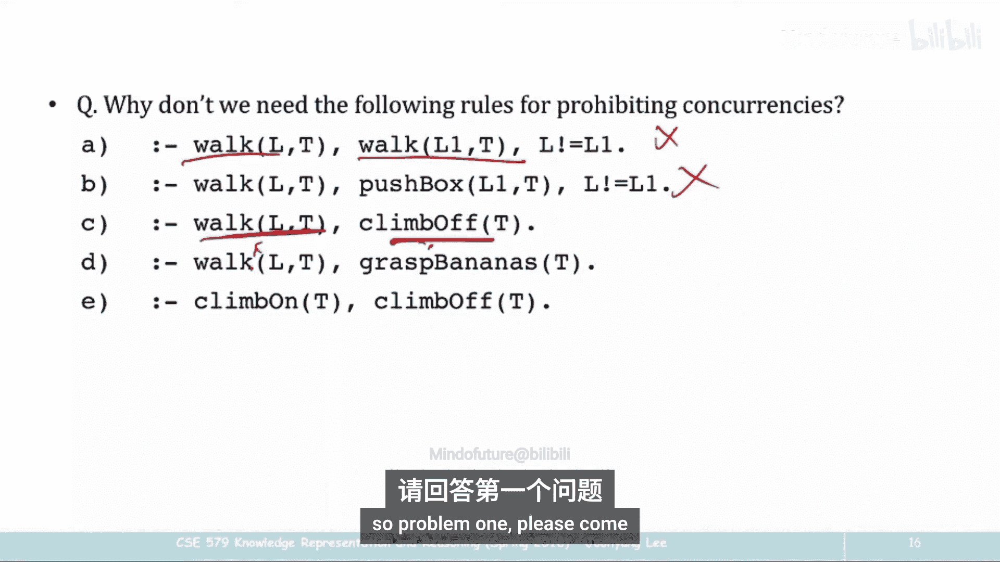
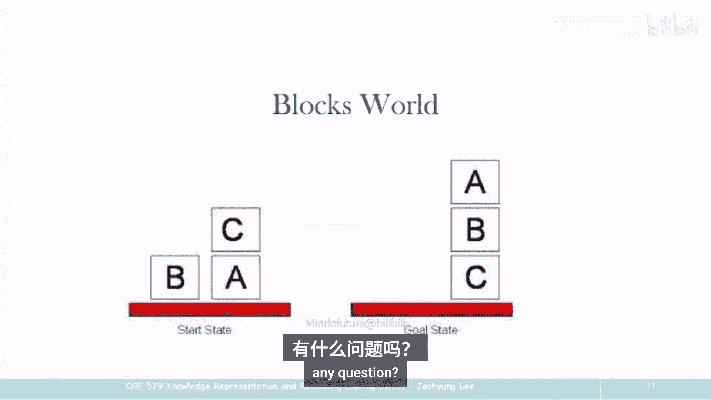

# 【亚利桑那州立大学】知识表征和推理 ｜ Asu Cse 579 Knowledge Representation 2018 p12 P12_Lec15 -BV1RTWyzfEQH_p12-

Right， so， so let me remind you what are the monkey and bananas problem。

I think we can just turn this off for now。So just first quickly remind you what were the。

Domain formalization。 So we define sort， which is a type， So the type and the objects。

 So T and F are the two objects that belong to the Boolean sort。

And monkey bananas and box are the objects that belong to this sort object。

And there are three locations， L 1， L 2， L 3。 So this was what we。Sa， okay。

 it's kind of defining the universe。 Okay， What are the types and what are the elements in that type。

And then we define the state constraint， which determines the location of bananas depending on whether the monkey has the bananas or the location of monkey。

 depending on whether the monkeys on the box， so if monkey has the bananas。

 then monkey's location determines the location of bananas。Monkeys on the box。

 then box location determines the monkey。Okay。And we'll actually see later a question why this thing is actually important。

The actions and preconditions are more or less straightforward if we want to say actions effect。

 we write action in the body of the rule， if this action is true， then this becomes true next time。

So we have this timest T and t plus1 that postss over the ranges over non negative integers。

So if work action is executed between time t and t plus1， then at T plus1 in the final time。

 locational monkeyque is at the destination L， its pretty straightforward。

Now you can actually add more things on the body if you want to say more about the condition about this action。

Okay。But for now， this is just simple thing， just write action name on the body and the effects in the head。

And we have a constrain that some combinations are not possible that the monkey is at L and monkey walks to that same location L。

 this is not allowed， same way if monkey is on the box， so this team is true。

 then monkey cannot walk。To any location L， because this L is a global variable that ranges over any location。

And similarly， we talk about pushing the box， climb on， climb off and grass bananas。

 they all have the same structure。嗯。There are some other things。

 and I'm going to quiz you in a moment， but here is the point。Some actions we disallow。

 so walking to some location L at the same time pushing the box to the same location L。

 so when I use the variable L here in the same rule， they refer to the same location L。

Okay if I use different L1， then means it may be two different locations。

 so it could be also the same。Okay。Also we we don't allow monkey to walk and climb on at the same time。

 pushing the box and climb on at the same time， climb off and grass bananas at the same time。

Okay so that's actually domain dependent axioms because this is kind of what you can change you can actually allow certain combinations possible。

 you can add more actions and more effects and you can disallow certain more precond that's up to you now once you have that after that we come across these domain independent axioms which is kind of universal across the different domains so we say that flus are initially exogenous that's actually the rule that we will see again when you are doing the read but basically we say these coordinateity bound so you can choose exactly one value for each of the fluent Now note here that sometimes you see the local variables are used there and there are also global variables here so if you look at this Boolean is a local variables so it says that at any moment has bananas can be either true or false but you should select exactly one。

Okay， so when I write this one， this is just another way to write。This one。

 because when you have local variable。This just expands inside the set。Okay。

 so global variable makes more rules， local variables just expand inside the set。

So I could just write this way too， but I can also introduce this Booleion as a thought and make a bit more succinct。

Okay。Same for the on thatts， so at initial time zero on thats can be either true or false。Okay。

 now the last one actually used was global variable and lower variable。

 so what is a global variable in the last rule？Oh right。

 all is a global variable because this variable occurs outside this set rates。

 what is a local variable？Is that L？Okay。是吧。What it means is that you first ground all the global variables。

 so each of the objects， so object can be the monkey or bananas and box。

 so let's fix it always a monkey。Then this rule will say for the monkey。

 there should be exactly one location associated with the monkey at initial time and same for the other objects。

喂。A together。Okay good now this is actually Na requirement。

 but I tend to differentiate between global variable and local variable by this naming convention。

 so if I use double characters here that is a local if not than it is。

 but anyway Klinggo does not really distinguish this kind of thing it's just for your own fake that if you don't want to be confused it may be good idea to have some different notions。

Theモテーション。他公司是有。所以系都。是该。LOC is fluent that says object O is a location LL at time0。O。

So unlike the previous two flus， this is actually multivalued because location can be multivalued。

 it can be L1 or L2 or L3。Okay。All right。Now the next thing is actually very similar to this。

 but it actually prepared these thing in front and the time is actually going from1 to m。

 so except for the initial time zero， all the rest of the times we have to Pre this dasharrow NOT。

Basically， when you have this。Not some formula， this is actually basically same as double negation because this rule is understood as bottom if notF。

 this is equivalent into NF。So sometimes we put F here like these formulas。

 and sometimes we use not not F。And we actually did this kind of exercise before preventing double neation actually makes stable models be different。

 and we see another instance here today when we do a problem two。

 why this distinction is actually needed in the stable modelmantics。Okay。

 so the next thing is actions like geogenous， it's also similar to the simple example that we discussed last time。

 so given the location L， you can either choose to walk to that location or not and same for all the other actions。

Okay now the time goes from 02 n minus1 because we think actions are executing between time t and T plus1。

 so there are only 02 n minus1 transitions here。The next thing is common sense lawvineria。

 so one way to read this is this choice works like a default。

 okay and we'll probably see why that is working as a default when you do the problem one。

But roughly the idea is you can read it as if monkey has the bananas。

 then monkey has bananas at time T plus one by default。Okay， and if didn't have。

 then doesn't have a p default fault。Okay， same for on box and the location。O so。Let's think about。

The state constrain。So we look at this rule that a monkey having the bananas determines the location of bananas。

And you also look at this one。So let's think about this。

When the monkey walks through another location while it has the bananas。

 then banana's location also changes。So usually we can describe this in terms of this rule that if monkey walk to the location L and if the monkey has the bananas in the previous day。

 then the next date locational bananas will be at the same location。Same destination， right？

Are we together。Now， this rule is actually redundant。

We only described it if you remember what we did before。

 we only said monkey walks to another location， changes the location of the monkey。

 but we didn't say about the location of bananas when the monkey has the bananas。

 why is this rule unnecessary？Yeah嗯。就。Because yeah， rule1 is actually。

Applying here now the interesting thing is Ron doesn't say anything about actions。

It's about state constraint， so for each state， whenever the monkey has the bananas。

 then the location of bananas are at the same location as the monkey。

So what happens is you can only describe monkey's location change and whatever that belongs to the monkey moves together。

 but you don't have to describe this effect individually。

This is known as the actual ramification problem， one thing that haunted also the people in AI some time。

 is's not as complicated。It's not as detrimental as a frame problem。

 but it was probably second to that problem in terms of difficulty so the problem was this。In the f。

In this case， if。So the basic problem here can be described as how to describe indirect effects of an action。

Now， monkey going back to another location is a direct defect。

But it also involves indirect effect if the monkey has the bananas。O。Now， why this is a problem。

 because maybe if you think about maybe not monkey but bee， I have carrying my。

Microphone here my shoes。大冇咧。My clothes， my socks。😔，保修。Whenever I said I going to another location。

 I have to describe the changes in all my belongings and that's actually in feasible to actually that' not very interesting thing and there are a lot of axioms that you have the right to describe indirect effect。

Okay， so this seem to be a difficult problem when you're trying to model this kind of reasoning about actions using some logic in logic you have to。

 unless you describe what happens there， you cannot derive any useful things。

like gear shootinging problem， okay the problem is even if it islic implicit understanding that humans have implicit understanding that the things do not change by default。

 machines don't have that knowledge， both things do change by default or do not change by default。

 machines don't have this knowledge and if you want to teach everything to machines that's a very tedious thing to do。

 same way here， ramification problem。If you' saying that everything that belongs to you also move。

 that is easy to do。If you have to describe all of these effects of walking on individual belongings。

 that seems to be too much。OkayNow we don't go into the other formalisms， but there are many。

 many languages that don't have this kind of construct。

 and for that it's actually difficult to describe this indirect effect。Okay。All right。

 so then so this is called the ramification problem， ramification of indirect effects。

Of walking can be described by this rule。So let's move on。So before we show some rules。

 some actions cannot be executed concurrently。Right。If you remember what was there。

So these are the actions that we prohibit to be executed at the same time。Okay。All。

 so let me actually ask you okay let's start from this。嗯。Okayそう。We didn't actually insert this。Okay。

 walking to location L and walking to location L1， so monkey cannot walk to two different locations。

O。We didn't prohibit， or maybe we didn't explicitly state this fact。Is this a problem？

Shouldn't we say that monkeykey cannot walk to two different locations？嗯。对。

I don't think you have to because not your care。Yes， that's true。

 that's another straight constraint saying that each object can belong to exactly one location for all the time。

From the initial state to the whole device of time。It actually does not make any difference。

 let's suppose this is actually possible。What will happen if monkey walks to location L and monkeykey walk to location L1？

Which where L and L1 are different， so two different locations。Then at the next time。

It looks like s models should say that monkey is at L and also at L1 at time t plus1。

 but there is a constraint that this cannot be true， so this scenario is not possible。

So this rule is actually redund。Adding this rule does not hurt， of course。

 but this actually redund that because the theory that you already have seen。

If saw in the previous slide， it already entails this fact。Okay。

 so whenever the theory has a stable model， that stable model always satisfies this constraint。

So don need to。Are we together。Okay， so a few more exercise。So why this is redundant？

It'sact the same reason okay so a monkey walks to the location and pushing the box that makes the monkey's location to be two different locations。

 but that is not allowed by the constraint， so this is okay。

We don't need this what about walk and climb off？So why this is redundant？嗯。

So can the monkey walk and climb off at the same time？If you want to climb off。

 what should be the precondition？Monkey should have been on the bus， right？

What is the precondition for work， One of the precondition for work was。

Mkey should not be on the box。So these two things cannot happen。No matter what。

 because their preconditions are different。They're actually theegation to each other。

 so you will never see this state where and on box is both true and false。Okay。And in other words。

 in order to execute the walk action onbox must be false， monkey should not be on the box。

 in order to execute this， monkey should be on the box。

There is no state that has both ownduct to be true and false at the same time。

 so this concurrency will never happen。Okay。What about this？Is the same？Okay。

So preconditional for grass bananas， this monkey should be on the box。 So this is。こラバーです。Saing。

Their pres cannot be true at the same time， so these are all redundant。Okay。All right。

 so that's some idea and。Okay， I think that's a good time to stop here and talk about the problems Okay。

 so problem one， please come。

So if you got confused about the readc， maybe you have forgot about how to form the readout。

 maybe it's glad you to review that and those presenters when they post the solutions are studied that carefully。

 that may help you understand these things。Okay， so let's actually continue the monkey banana。Okay。

 so now we have the description and what do we do with this description。

 we want to do certain curries， one of the thing is actually the planninging curry that we are talking about。

 how that the monkey can grasp bananas。Okay。So this is how you encode the planning problem。

 so note here that the planning is basically you're given the initial condition and initial state and the goal condition。

So in the classical planning， you give the full description about the initial state and you give some conditions about the goal。

 what has to be true in the goal。If you remember the finite state machine。

 then this is exactly like that concept， Okay， you give the initial state and you want to reach to the goal。

Now the difference there is if fine machine was accepting the string。

 but now here we want to find actions that leads to those both but the concept is actually very similar。

 so what did we put here？嗯。We are going to use only the constraint in this query。Okay。

 don't hear that we are only looking at some passage that are allowed。

Okay so it may generate multiple passes， but we will only look at the passes that satisfy the conditions for that we are going to use constraint forms only。

Okay。ほらそ。What is initial condition？You just think about this as a double litigationation。

 which doesn't do any harm。But think about this as a concern。

 what he says is monkeys is at L1 initially， bananas is at L2 and box is at L3。

And the monkey does not have the bananas， initially。Okay， so this is the initial state。Now。

 defining final goal state is monkey should have the bananas It's actually。

This should be false and true， I don't know why， this may be a typo that I didn't update。

Here M is actually the maximum step。And this is a placeholder that the user can give。

OkaySo this is a cur that you can make。嗯。Okay， let's explain this case。嗯。Alright， so。First。嗯。

So this is the same program that you just saw， I just want to check what I did。Okay。

 so this is actually the coding for the domain。And let's actually look at the。POkay。

 so this is a planning query that you just saw in the previous slide。

 and I did actually correct this to the F and T。Okay。

 so how do we execute this program So what we do is to asklinglinggo to find the plan。

 So here there was two file， monkey and planning。Because I can change the query in different ways。

I need to say， what is the maximum step that we are looking at。

 so can monkey grass bananas in one step？It's actually not possible。 Can you do in this two step。

 It's also not possible。 Can you do in three steps， not possible。 Can you do in four steps， yes。

So then you find these things。 Now， these are actually too much to read。 So maybe。Okay。

 let me actually comment。Still so I comment this。 So we are going to only show the actions。 Okay。

 that might be easy to read。 Okay， so this is now the solution。 So monkey。So this is time zero。

 monkey walk to L3。And the pushing the box to L2 and climb on at time two and grass bananas as three。

 then at time four the monkey grass has the bananas。Okay。

 so this is how you execute the planning Cur。 Any question up to this part。Okay。

So the next one is prediction query。So here everything about。The transition system。

It's about the reason about path。So in the planning problem you are given the initial state and you want to reach certain walls now the prediction problem what you have is you ignore the initial state and you know what actions are executed and you want to find out what is the resulting state about so you want to predict what would happen if monkeys does certain actions。

Okay。So let's look at a simple example here， so initially the monkey is at L1， bananas at L2。

 the box is at L3， the monkey walks to L3 then push the box to L2 does it follow is it entail that the bananas and the box at the same location。

Common senseically， this is true， but how can we run Plinggo to verify this claim？So。

This question can be actually formalized as follows。

 determine the monkey bananas domain when M equals2， which I'm going to say MB2。

Conjoined with the negation of conclusion has no stable office。Okay， let's say this thing。走。

MB2 is actually the full domain description。Okay， now the query that we want to answer is whether in this is actually the query。

 if this situation is true， then will the bananas and the boxs at the same location at time too？

So we want to check this claim， MB2 entails this query。But instead of that， what I can do。

Is if you negate it。And this has no stable model。Remember this？We did this a long time ago， okay？

So it was about the professional logic， but the same concept applies to the stableable modelmantics。

 what we are going to do。Is。To formalize this way。So in the prediction query。

 same as before you give the conditions that you know， and here is not only about initial state。

 so initially of course， these are the locations of the objects。But we also say monkey walks to L3。

 and then monkey push the boxs to L2。And then we have to say that they are at the same destination。

Okay，Now if you negate it， what happens is they are not at the same destination。

 which means that they can be at two different locations。

 you can represent this in many different ways， but here is one way that I did。

So we are counting the number of locations that the monkey and bananas are there。Okay， so if。This is。

Not one。Okay， then this is actually the neation of that conclusion。Let me say this way。

 if you only look at this one。Okay， you count the positions of this object and its one that means they are at the same location。

And if you put this one in front， that means they're not in the same location。

So this is a neation of the cur that you give and if you call the Klinggo， then Klingo will say no。

Theres no statementブ。And that's a way that you check this prediction query。O。

Let me actually show you。What happens here？So。Here， we need only two。So we get unsatisfiable。

There's no stable model， which means that the MB2 entails the query。

Now you can actually do in a different way too， let's actually change the prediction query。

That's actually。コmentントです。And instead of checking the unsatisfiability。

 I'm going to enumerate all stable models。And actually， there are only two。Okay， let me on comment。

This。没事。AndLet me add location because previously it was now showing the location。

So you can try to generate all stable models and it happens to be the only one stable model here and check whether the bananas and boxs are at two different locations in all stable models。

Okay， that's another way to do， and here is's actually easy to check。The location of。嗯。Bananas at 2。

 What is the。So。So location of Bness 2 is L2。Right。And location of。

Yeah box at L2 at time2 location box at time2 is also L2。

 so theyre in the same location now this way could be actually a bit more challenging if you have multiple stable models for each of the stable model we have to check whether these two objects are in the same location。

Okay， but theyre actually equivalent。 You can check that for all the。嗯。

Stable models of this satises security。You just like what I showed you， or you can check this way。

Okay， they equivalent。All right， the next one is post query here what it means is。

It's about reason about pest。Why the prediction of reason about the future？

So what we mean by this is you already know what happened as an actions， right。

 some actions happened。And you are in the resulting state， you know the resulting state。

 but you don't know the initial state， so can you infer what was the case for the initial state？

Here's an example， the monkey walked to location L3 and then pushed the box。Okay。

 does it follow that the box was initially at a three？It is because if the box was not at L3。

 then monkey cannot push the box， there was a precondition about pushing the box。

So how do we model this？Here。This is something that we know。

So note here that in the question monkey walks to L3 and then push the bus。

 but it didn't say which location that the monkey pushed the box。So for that。

 I actually use the local variable， there's some location LL that the monkey pushed the bus。Okay。

And want to find out whether the box was initially L3， so this is the query。Okay， this is cur。

 and we put the neation of the cur。And then call Klinggo to check that there's no stable model。Okay。

 question。All right， so then is your time as a homework。

So I'm going to ask you to do these two problems。Okay， in addition to， of course， other problems。

Here you have to formalize these problems in the same way that I just described。

And check the claim using Klingle。So here's the knowledge that you have to represent。

 so problem five， walking always changes the location of the monkey but never changes the location of the box。

And obviously， this is true。How can you check this。So in order to check this name。

 you only need two times 1， time 0 and time 1。But all transitions that you can consider。

 if every transition that has walking， the location will always change。

In every transition that walking is there， Foxs will never change its location。

That's what you have to check。Problem six， if the location of monkeykey changed。

 then he either walked or pushed through the bus。Okay， so monkey cannot tele a transport。

So it has to do this section， so unless there's a cause for this， monkey cannot change the location。

You have to also check this thing。So the HT is same as before。

 you just formalize this domain in terms of query and for the internal checking。

 you have to negate the conclusion and check whether Klinggo returns no stable model。Okay。All right。

 I think that's it and the next class we actually talk about Blacklobswold and some other transitions。

 we want to spend some time on the basics so that when you go into the other things。

 I'm going to give more examples just to give you more confidence in writing this description。

 but in terms of CR you already know everything。Okay， so you can start working on homework problems。

Any question？

