# 【亚利桑那州立大学】知识表征和推理 ｜ Asu Cse 579 Knowledge Representation 2018 p13 P13_Lec16 -BV1RTWyzfEQH_p13-

Okay， so today we'll talk about a few more examples of this domain， especially the B world domain。

Have any problems for your homework， so this lecture will be actually useful for doing that homework。

And I'm going to talk about some other aspects of the reasoning about actions where we have to represent actions that has nondeterministic effect。

 actions that are executed concurrently， some influences are not necessarily inertial。

 so how do we model these various aspects of reasoning about actions in the uniform framework of ASEP？

给。All right， so blocks wall is actually a very well known problem if you took any intro to AI course or even if you don't know what is AI as a kid you may have played with these blocks okay so the typical problem setting here is here given the initial state like here on the left hand side and you have to make in certain tower okay so that's the goal state so how do you move the blocks to。

Turning to a gold state。Now most usually the restriction is you can only pick up the top block。

 you cannot pick up a from this start state， which is under this block C。

 okay so you can only move one block at the top and usually the tables kind of huge so there's no limit on the number of towers that can be set on the tables。

 so that's a useful assumption， of course all of your homework actually say that that's not necessarily the case。

Okay，But we'll start with the basic version， iss similar to like Sudo puzzle。

Where you have the basic formalization and then we added some more rules to do different versions of Sudoku so in the homework problem I gave maybe four exercise problems so that you can actually modify it's actually not necessarily modify you have have to add some more rules to incorporate those additional constraint if you have read homework problems already you know what I'm talking about。

Okay so let's actually talk about how we can model this basic version in Klinggo in the language of Klinggo so let me first start this scenario so here we have block so block has one23。

4 five， six six blockss okay and here is an initial state so as we did before when we write initial state and goal state we write a constraint form okay so this is dash NT you can just ignore this as a double negation so this is about some configuration so what is look like let's actually write this down。

So we have six atoms here on atom which uses this pooling to make it a be 16 this one means that actually you notice that the last one is actually zero which means the timestamp so at time zero。

 this means that block one is on top of block two okay and this means block two is on top of table and so on and so forth。

So let's see how we draw this。So， in time。1 at time zero， block 1 is on top of block 2。

 block2 is on top of table， so the tower looked like this one and2。Right， okay， and3，4。

3 is on top of4，4 is on top of table。 So it is 3 and  four like this。 Similarlyly， if we have five。6。

Okay so this is the initial state right so you can encode this flexible domain in this way now what is the goal state here we have M we don't know how many steps that we need so we just put the placeholder the M for now okay and we can control the parameter M later when we call Klinggo。

So the thing here is we have three on top of two， two on top of one， one on top of table。

 so we have three， two， one。And6，4，6，5，5， four， four table。 So we have  six on top of five。

5 top four， four is on top table。 So this is the goal state。Okay， so let's play this puzzle。

So how can we move？These blocks so that we can fit into the tower like this。

That's actually the easy thing is you can just make all the blocks on top on spread on the table and then you can reconfigure。

 but that requires additional steps that necessary right so let's think about maybe。

What is the optimal number of steps that we need， what is minimal number of steps that we need to move these guys to the final goal？

So let me ask you to think about。And I'll ask you around， what is the minimum number？Okay。

 and we'll go with the smallest。Number of steps。は。5， somebody says five。Who is 5。How many。F， no。

 not fine。Who inspired means that can you have actually less number steps than five？So， five is the。

Vaximmal。Okay， let me say that when you say these steps。

 we don't necessarily have to move only one plug at one time。Okay。

 so you can actually move multiple blocks。 So imagine that maybe robot has maybe。Yeah。

 so there are only six。 So let's say6 blocks。 So let's say six arms， okay。So at most。

 the robot can move six blocks。At one time。Okay。So if you have this enough number of arms。

 then you can move two blocks at the think I want be two three blocks or four blocks。Okay。

 so then how many steps will we need to move these guys？once。Reeversing the tower is not possible。

 I don't know what it， but you can only grab the top lock， that's what I said earlier。

So for instance， three arms can move one， three， five at the same time。Okay。How many I have 7，7。

 Okay。Sure。If I were to place if you were to take two。At the。The same time。

Can you place it one under them or they have to be in up？

Okay so that's a good question because that kind of assumption is something that we have to work on。

 but let's imagine in terms of robot that has to execute at the same time。

 So the thing what you're talking about is something like when you maybe。Move this guy out。

While you move this， you're going to put on top of this。

That is very tricky to do for the robot so this robot imagine that the robot is not that manipulative okay so try to move the block。

 What it can do possibly is when this is moved out。

 it can move in here that's possible you can just move this way。

 but if you move this way at the same time you have to move then you have to use some control dynamics which is probably out of the scope of this robot。

本人的这个楚。Somebody says for。Okay， anyone needss for。3オ so three。From about the basic3。Okay。

 let's go with three。Okay， so how do we move。3。你发呀。So on the table， Okay， so let's so one step。

 you are moving one and three into the blocks。 So we have two。4，5，6， right。

 So this is what we get in one step。Okay。发一个。So you put two on top of one。 so there's one，2。

And three still remaining and five on top of four。Then6 remains， okay。3 on two and six。啊ha。

So you put3，2，1。6，5，4。Okay， three steps。Anyone these three steps forna， Okay， good。

So everybody follows what is going on， okay？All right， so。Now， when we do this。

How many amps did we actually use， so the first step we use only two armss， right？And the next step。

What was the。Thing that we did。2 on top of one。5ive and12， that's also two arms， right？Okay。

 and also two arms。 So each time we we use two arms together。 Okay， good。So three arms doesn't help。

 only two is actually enough。Okay， so you can also reason about that kind of things。Good。All。

 so let's actually try to formalize this domain in ASP。

 we can actually do more of this kind of analysis once we have the formal specification。

 so I mean what is the minimal number of steps that we need to achieve this goal or how many arms that we need as a minimum number of arms。

 how many minimal number of arms do we need for this kind of verification that you can actually do with Klinggo？

All right so in order to describe we have to introduce signature so how do we model these things so here I'm going to use location B okay so B here currently is a block variable for block so what it means is that what are the locations so in this domain we assume that each block can be a location as well as the table is a location because we can put the block on top of another block on top of the table so the locations here are there are seven locations here one blocks one to six as well as the table。

Now there are six blocks， so this is represented by block precate。

And we have flunt to be represented in this form， as you see in the previous slide that block B is on top of L at time T。

 so note here that B is a block， L is a location and T is a timestamp。Okay。

 so this represents fluent， so what is actually true in that current state？

The thing here we move action is also have the same parameter， but it makes when at time T。

 we move block B on top of location L。Okay， so that's what it means， all right？

Okay now what I'm going to do is I have the English representation English description and we want to write ASP rules to represent this English description okay so let's start with the things as you see here this organization of the program is actually same as what you saw in the monkey bananas and simple transitionient system before so we first declare what are the source and objects and then we have domain specific description and domain independent declaration but domain independent accents。

Okay， so the first thing easy thing， So every block is a location。

 how do we write this in the language of Klinggo？Okay， so that's true。

 so location of location B if by。Okay， so what this means is every block is a location。Okay， good。

The table is a location。How do you do that？Lo location of table， yes。But once you have this。

Note here that when I put in addition to this， I had this scenario description that one to six is a block right so then having this。

It actually populates that location is one to six as well as the table。

 if you just put this together and call the Klinggo， the Kling goal will return one as I set。

 where one to six are the blocks and one to six as well as table is our locations。Okay。

 so that's the answer sets that was stable models that will be generated， okay， good。Right。

 now let's go to a bit more complicated things。 So in this domain。

 I didn't actually explain explicitly， but we assume that two blocks cannot be on top of the same block at the same time。

 which means that you cannot have this kind of situation that blocks are kind of two blocks are actually on top of the same block。

 This is not the。我对。Angry bird problem， right？By the way， there's an angry bird challenge if you。

Happened to know。 there's also some challenge about how to solve and remote shooting using some AI method。

Anyhow， so here we have two plots on top so we don't want to allow this now note here that this is actually about the state constraint。

 it's not about actions。We want to say that in every state， in every possible state。

 we do not want to allow this situation， how can we do that？

We have to add a constraint yeah that's a good point we do not want to introduce some state but we want to eliminate the state that has this form。

 so what we do is one way to do that is to use this cardinality bound okay。So here。

 let me ask you what are the global variables？T and B and what are the local variables BB okay I told you before that I used this notational shortcut that every local variable double the character so it's actually easy to see that right but if you don't know that still you can figure it out BB is the only variable that BB is the variable that occurs only inside of set race other variable has other currencies outside the set price so then you have to fix each of the global variables so assume particular block B in particular time T。

Okay。Now you cannot have two blocks on top of this block be。Okay， so it's kind of this is B， B1。

 say B B2， and this is a B。Okay。そいう。This situation makes this part to be true。

There are at least two different block BB on top of block B。And this violates the constraint。

So you put to a constrain symbol， thearrow are in front。In other words。

 if you have two or more blocks on top of B， then this file laser constraint。Are you together， okay。

So each of these rules are actually simple to write。啊。When you're seen for the first time。

 maybe this is a bit tricky to do。 On the other hand， if you understand this well。

 you probably can solve the homework problem quite easily。Okay， so the next thing。

 so we are done with the state constraint。We have to say about the effects and precondition of actions。

 so well， the effect is actually simple， what is the effects of moving a block？

If you move then block will change its location right so it's similar to the effects of the actions in the monkeyk and bananas。

 you write what will happen in the next state in the head of the rule and the action in the body。

So what it means is if you move block B on top of L at time T。

 then B will be on top of L at time t plus1。Right。Okay， good。

 so it's just effects in the head and the action in the body。All right， now for this domain。

 we assume that theres some robots with grippers and we want to say these concurrent actions are actually limited by the number of grippers。

Okay， so we do not want to have two different。I mean， more than。

The number of move that is possible beyond the capacity of these gripers。Okay。

 so how do we model this？So here is only about move action。

 We don't want to say between the two transitions that are more move actions than necessary。Okay。

So how do we do well here？Okay， so note here that grippers is the placeholder now。

 so we don't say actually how many numbers， but this will be actually fixed when we call Klinggo。

Okay， now t goes from 0 to -1 because we are talking about actions。Okay。Now， what does this say？

This bound here says。First， there are actually two local variables here， BB and LL。

Moving so that we are counting all the move action that is possible at time T。Okay， if this action。

So if this action must be bounded by the gripers， the upper bound is number creepers。

 the number of move action that is possible is bounded by the number of creepers。Okay。

And this is actually just double you can just think about canceling when you just talk about constraints。

O。So in other words， this rule is saying that for each time t that goes from 0 to minus1。

 for each time t， the number of move action is bounded by the number of grippers。Okay。嗯。Question。嗯。O。

Another constraint is。嗯。I said you can only move the topr。 So if something。Let's imagine we have。

This situation。Okay， somebody asked this before， can we move block B here？We cannot。

 so we have to prohibit this actions to be happening right， you cannot move block B when B1。

 some other block B1 is on top of B， so we have to prohibit this move action。Okay。So how do we do？

This is about the precondition of the action so on the what condition that this action is not allowed to do well what do we do so move action BLT is happening in the state where B1 is on top of B then this violate the constraint in other words when you move this action B must be clear。

Okay。So imagine that this is a kind of neation that we want to say， so if you move B on top of L。

 so L is just any location L while some at time T， so note here that this is previous state。

 at time T initially B1 is on top of B like this picture。Okay。

 and now you've tried to move this B out of this place。To some location。

 then this violate to constraint。 In other words， you cannot move on the non top blocks here。Okay。

All right。And something I think Pama was saying， whether we want to allow this situation where we want to。

Sa。This kind of thing， So here B1 is moved at the same time， B is trying to be moved on top of B1。

That is not possible。 We don't want to do that。 We can allow B will result in the place that B1 was。

But we cannot trace B to go into where the B1 will be located。

 We don't know where B1 will be located。 So moving B on top of B1 requires very high precision to do okay。

So in some role that might be possible for here， let's not assume that way。呃，回修。O， so啊。In case。哪个。

If they are in the same location。はそでわら。块。More干。The second rule that you are talking about doesn't say anything about what is on target or something。

 it's only talking about how many move actions are there。那边呢边。都。Considervocation。再吧。

Locations are not constant， actually locations are actually the fixed。

 but their location may also change over the time。Okay。

 I think you're talking about something different than the basic person。

 maybe we can talk about flying。All right， so we want to prohibit this concurrency， okay。

 so how do we do that？It's basically easy。 You just say these two actions cannot happen at the same time。

 So you just say。These two。Move B on top of B1。 So this action means this one while this action。

Is here right， So you cannot move these actions happening at the same time done。

Are we missing anything about the domain constraint？公す里面这度。That's actually what here， right？

ANumb of gripers limit the number of blocks to be moved here。那个没で。こ水ベ。叫好。ついて。

Numb of movies actually per block。喂。So each block can be moved only when move action is executed。All。

Okay， so this is actually the domain dependent axioms and just with this Klinggo will not say actually meaningful things。

 so you need to add these domain independent axioms that we saw before but these is actually very straightforward okay you already know the basic principle so we have to what other things that we have to say flus are initially exogenous。

Okay， so how do we say， you can write in many different ways。

 but this is one thing that I find easy to do。So each block， there should be exactly one location。

Okay。异见。There's actually only one fluent on， so this is only one line that I have to write。

Now the other thing is about similar rule like this。

 but have to write for the constraint form for the time1 to M， we talk about this thing before。

 problem two that we need to have this different kind of rules。Okay。

But you're basically you're roughly saying that these two rules say that each state block should be exactly on top of one location。

So in other words， you cannot have。啊。This kind of situation。

 this block on top of two different location is actually not possible。O。All right， so that's it。

 we have to say actions like Gegenus， which is just this， so for each plug and location。

 this action can be chosen or not。검은 센스로 로인을하죠？Similarly this。

 so when you have these kind of in the presence of this uniqueness and existence of the values。

 this choice rule works like a default， so what it means is that if B is on top of L at time T then by default。

 the B is on top of L at time t plus1， but this default can be overridden。

 if there is an action that changes the blocks location。Okay。Question。In这是。

So we formalized the blocks wall domain。And。For this simple program。

 it can do actually a lot of interesting things。O。Before we do this thing。

 let me actually show you how this。

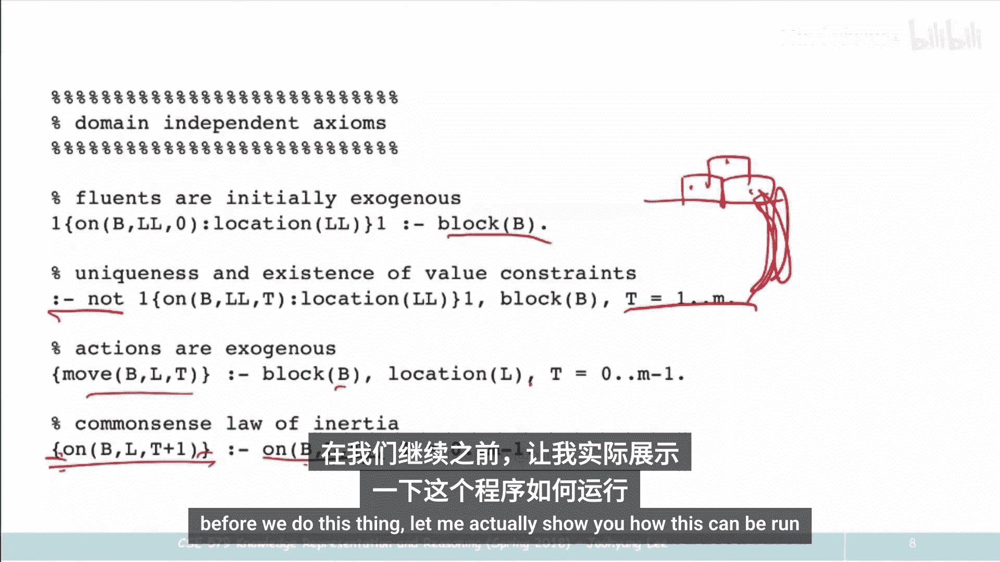

Can be run。Okay， so。I have this program here。So this is exactly the same program。嗯。

One thing that I actually didn't mention， let me actually go back to the。

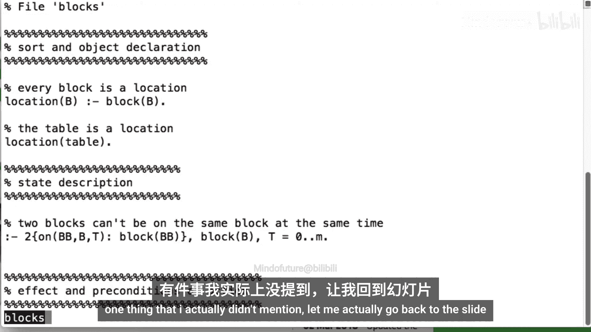

Slide， something that。I didn得。Go carefully。But it' exactly stated in the handout。

I said this one and this one is actually very similar and you can just put the double negation here。

 that's actually true， but it's interesting that actually Klingway is actually smart so you don't actually need to say that this is the location here。

ButYou can actually simplify a bit about this， while this one you cannot simplify。Okay。

 you cannot get rid of this。 So I'm not going to go beyond the。

I'm not going to describe the full details about the Klinggo grounding algorithm。

 but according to the Klingo algorithm， Klingo can figure out which variables can range over which domain。

 so if Klinggo knows about it then you don't have to describe this scope of local variable。So。

 but you don't have to know about this distinction。

 you can always write the local variable explicitly here。

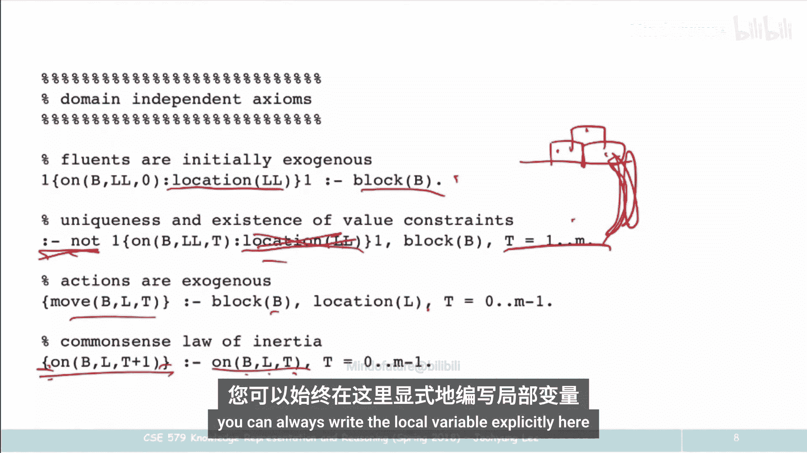

Okay。Oops。O。So then let's go back， so this is actually the blocksmail domain。

 the same thing as I showed you before， and as I just said here I omitted this location LL in this constraint。

 okay but you can put it， doesn't matter。

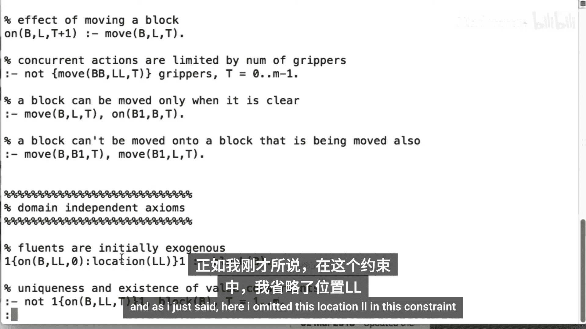

And I put also the scenario here。O。And I put a show directive that shows only the move。

 otherwise there are too many states， so it's probably difficult to find out which actions are executed。

Okay， so how do we call this， You can saylingling blocks。And you have to say。

How many grippers are there and how many steps that we have to do。

 so let's say we have say m equals 2， which I know we know that this is not possible， but let's try。

Griippers。C， maybe5。Okay， so。And Klinggo determines that this is actually not possible okay。

 so maybe that's too short time to find a plan， so let's say three。Okay， so Klingo found this plan。

I don't know whether is actually the same as what we found。So， one on top table。And。

Five on top of four， maybe a bit different there， but I think the structural wise is actually the。No。

 actually， it's in the front， right？So actually， at time zero， it has three move action。

The reason for that is that we allowed gripers to be five。 Actually， let's play with this actually。

How do we demonstrate this？就是说。You can imagine let me just describe what is。领 here。う。So。

What was the initial situation。So initially， we have one to。3。そ。Five six， right？Okay。

 so what did we do here， So block at time0， one is move on to the table。3 is on top of6。

The times0 one is move on the table。3。How is it possible？Oh， that's interesting。

 so five is also moving。Something that we didn't expect。So this is the first step。Okay。Okay。

 so that's the time 1， right， So time at time 0 for time 1，3 is on top of table。

So it's all three here。And what do we do？2 is on top one。 So we moved two here。Okay。

 and then we move six here。嗯随 here。到。That's interesting， how many actions did we use？Seven， right。

 one two， three，4，5， six， seven， and previously we used six sections。Okay。

So having the same number of steps doesn't necessarily mean that we have the minimal number of options。

So that's not necessarily true so having the smallest number of steps doesn't mean that we have smallest number of actions to be executed。

O。We can try to。Change the grips。And this time。I think this is actually the same solution as we found before。

 So there are six actionss。 Okay， you move one and 3， and then two and。5 and then three and 6。

one plus models。Oh， yeah。Can we found more than one for this one？ What What is your guess。No。

Thats not that's only one。 when the gripper is only two。 How about say， the gripper is3。

 then at least we found two solutions， right？ How many do you expect。

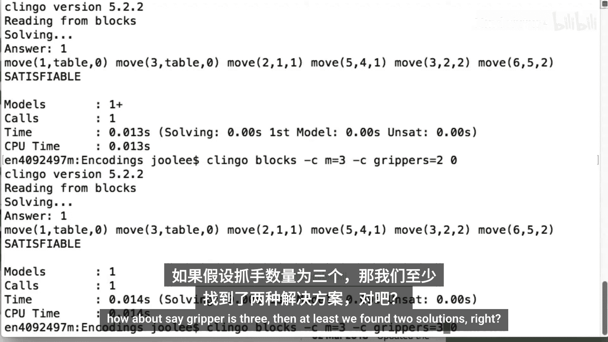

30 solutions。So we happen to find one solution， okay， and we happen to see another solution。

 but actually there are 30 solutions in this case。IfIf we increase the gripers to be full。

 will we actually have more plans possible？What do you guess？Actually， we got a bit more。

 So now we have those solution。😊，Okay， if you have five， then we get more。The plateau， yes。Okay。

 so we tried these things。 What is actually the。Small is on both stepsft that we can make。Okay。

So what is actually the ideal number of grippers if we want to solve this problem only。

 you don't need to have more than four grippers。That's waste of your money。All right。Okay。

 so that's it。Let's actually try to。Change the。Tらみたそ。When m equals4。

Let's say gripper is also say for。 How many solutions would you there have。No。

 it's actually quite a lot。Okay， so we don't want to read all of them。

 but it's actually quite amazing。 you see why this is actually a AI benchmark problem even with this simple domain。

 you can find a lot of different ways to move the blockss a lot of different properties that you can verify。

All right， so I want you to have this fun when you work on the homework。Okay。

So let's go to the homework problems。Oh， at this one。Okay。ほら soい okayッケ。

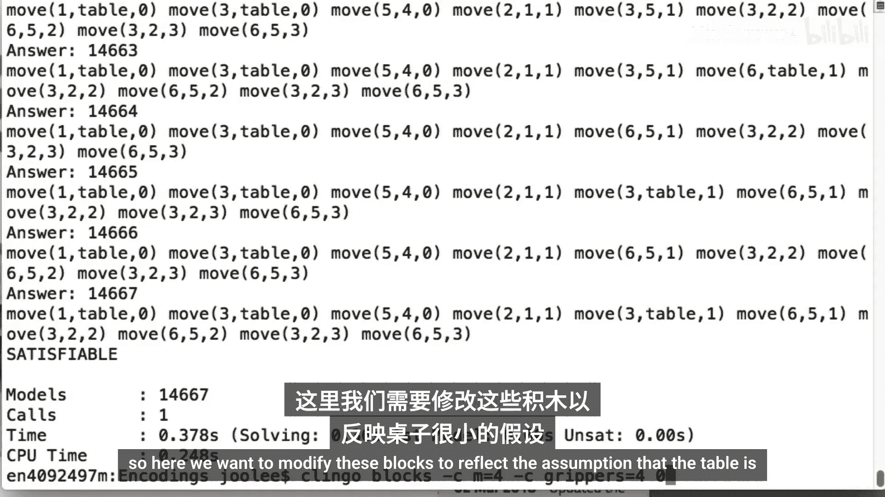

Okay， so。So here。We want to modify these blockss。To reflect assumption that the table is small so that the number of blocks can be placed on the table table at the same time is limited by some given number of towers so for instance when we move these guys I don't know how many places and we 12。

 three4 five we actually use five places on the table right but sometimes table can be too small so you cannot have five towers on the table okay so how can you solve this problem so here instead of five in the previous case。

 let's assume that we can use only four blocks。On top of table， in other words。

 four towers can be on top on the table。Okay。Furthermore， if you have only three。Towers。

Can we actually solve the problem， or is it too hard to solve？Okay。

 you don't have to solve but Kinggo will find solution。And you have to write a constraint here。Okay。

 so the hint is a constraint， you have to write a constraint， the hint。

 another hint is actually one line。Okay， now if if you don't know how to write one line and if you write two or three lines。

 I don't mind。Okay。All right。Any question for here， the problem should be clear， right？Okay。

 so obviously， this solution does not satisfy the constraint here。云。

And I don't ask you to find all solutions， so you just need to show one possible plan that is good enough。

 sometimes it's too many plans， you don't have to copy the whole plans here。In the homework。

The next one。So something that is a bit weird that we didn't actually capture in the previous scenario。

Description is there's some strange configuration that is not physically possible。

 but actually the Klinggo allows that。Okay， so the previous program that you saw。

Works correctly if you give the correct input。Okay， but it actually also allows incorrect input。

 so what does incorrect input look like So here we say this strange thing one is on top of two and the same time two is on top of one。

 that's not physically possible。Okay， three is top 없 that's also not possible。

So this this configuration should not be allowed， but the Klinggo encoding that you have before reduction allowed this。

 So your job is to prohibit this kind of input。 So when you give this input to the Klinggo program。

 the Klinggo will say unsatisfiable。 there is no stable model。Okay。Okay。

 this one will probably take about three lines。But again， if you take more than three lines。

 I'm okay with that。Right。Questian。Okay。Al right， so the next one。let's imagine now。

 the robot arms that we have is not as very accurate。So we were talking about moving this way。

 so if this block can be moved at the same time the block。

 another block can be moved in the previous location of the moved out block， we allowed that。

 so that concurrency was allowed。But let's imagine that this is not the case。Okay。

And this is actually related to the notion of socal serializable plan。

 so what is a serializable plan okay， before we talk about serializable plan。

 why do we want to prohibit this action， What is actual motivation So we're talking about a planner right so a planner makes a plan before this plan is being executed。

But what happens in the real world when the robot executes this plan。

 what happens is this robot is not actually very accurate， so when this is being moved。

 they are scheduled to move at the time， same time steps。

 but the real time execution may be different， so this may hit the block while this being moved out。

Okay， so this is actually not good， I mean， if you have very good robot arms that plan is possible。

 but if you work with a three30 robot arms that children can play with。

 this is not easy to do okay so the plan that we just saw here is called nonfeizable。Okay。

 so what is a serializable thing， The definition is here。

 so the actions that are scheduled for the same time period can be executed in real time in any order without changing the effect。

That's called serializable thing。The plan that we just talk about is noncerizable plan because if this moves out first and then moves in。

 that's fine， but if this moves in first and then moves out that is not fine。Okay。

The two actions are scheduled to be executed at the same time， and for this plan to be serializable。

 regardless of which order that you actually execute shouldn't affect the outcome。

 but this plan was not of that kind。刘nder森。O。So we want we now assume that the robot arm is not as precise as before。

So then how can we modify the description？Hint。1 line。Okay。Another hint。

 we saw a very similar rules in the basic formalization。Okay。

 so for testing that idea I gave you this particular scenario。

 here I use the location of M equal table， but you can identify its own m comma table at time zero okay。

So I've been giving you the initial state and the goal state， and you have to figure it out。

How to find the minimum length plan。Which is serializable。Okay。Yes识。A together改到。The last one。

I think， right。Okay， so we just actually saw the example the minimum length plan is not necessarily optimal。

 optimal in the sense， the number of actions。Okay， sometimes we have seven actionss。

 sometimes we have six actionss， even though the times stamps were three， right？そう。

I want you to modify the program。De in9。 actually， this depends on the problem9。

Because it makes sense about this problem and this plane is serialized good plane。给。Okay。

 so the question is this how do we find a plan that has the least number of options？Okay。

 so before one of the solution took seven actions， that's not the least one。

 so the Klinggo program now should not return that solution if you implement this constraint。Okay。

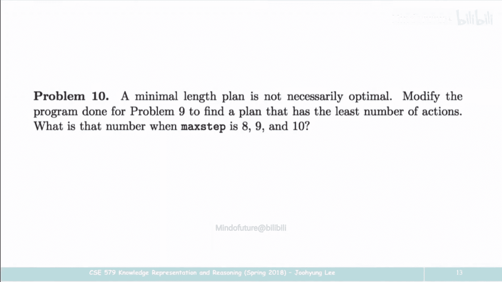

So you have to test with respect to the same benchmark problem that I gave you in Pro nine。

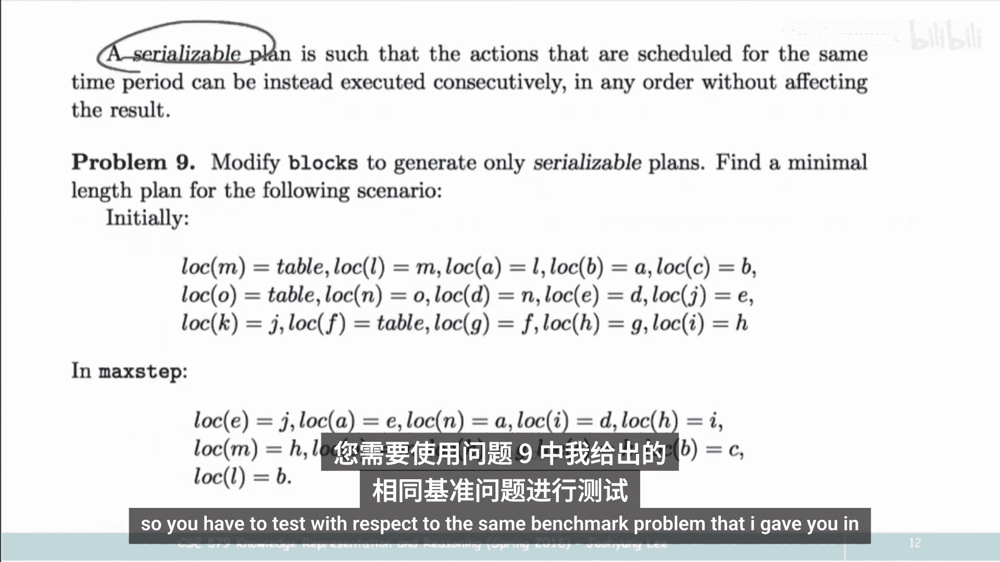

And play with this。嗯。So change the next step to be eight to9 to 10 and observe what is the minimum number of actions there。

O。Surprisingly， you will see that if you increase the time stamps。

 you get actually smaller number of actions to the executed。So roughly speaking。

 the intuition here is if you have two small number of steps。

 then there's a contentions in the moving the block。

 so you actually have to move blocks to get out of these contention and that takes some extra steps。

But if you have enough number of steps， then this contention does not arise so you can actually get the optimal plan。

O。Question。Yes， theys。Constraint in here is this。Right， so gripper is not constrained here。

 so you can use any number of grippers。Okay。All right， good， so then。Let's go to the next topic。

All right。So there are some cases that we want to describe non deterministic actions。

 what that means is so far we said when action happens， there's only one effect that this coming out。

Okay， which means that。If you have some state and you execute this， theres only one resulting state。

 but sometimes it's actually possible， even if you do the same action。

 you can go to two different places。Okay， so that's called nondeministic actions。

 How do we model this domain in the language of Klinggo。

 So here is a simple example to illustrate the idea。嗯。So when Jack goes to work。

 he either walks or drive the car。So here， walking and driving two ways of executing the same actions。

Okay。So the effects of that action on Jack's location is deterministic。

 but the effects of location of the car is not。Okay。So what we want to describe。

Is these two transition systems， so let's actually use this。So here we have a state。

There are two objects， Jack and Car， So location of Jack。你从。Location of car。It's also home。

 So both of them are at home。Okay。Now we are going to execute this action。嗯。So going to the work。

 the action name， if you just look at the action name， this is just the one action going to the work。

But the state could be different。In one state。Actually， in two either state。

 the location of Jack will change。 He will be at the。Work location。But the location of car。It's not。

 sometimes it could be home。We in another state。This is work。O。So you can interpret this as。

Walking and you can interpret this as driving okay and you can model this domain in different ways。

 but the point is you make the same action， but the state resulting state become different。Okay。

 so it could be the this or that how can we model this domain， that's the problem。Okay。

 so here you see domain description。给。So first Juliaion domain me so。We have the three and fourth。

And there are two objects， Jack and Carl， and there are two locations home and walk。Okay。

So effects of goal。 So when you execute goal， Jack's location will change。

 that is deterministic action。 Now the next one is how do we describe the non deterministic effects of goal。

On the location of the car。What this is your guess。嗯。两个意是。No， not quite constraint only eliminate。

 but here we want to say it can be either this or that choice rule， right？So that's the choice。Okay。

 so before when we execute action， there's only one atom in the head， but now we have choice rule。

 which means that when the goal action is executed， then this atom can be either chosen or not。

 so what does this mean？Okay。嗯。So actually when the jack goes to the location L。で、ロケーの？car at time。

L can be either chosen or not。 So the car can go with Jack。富尔娜。Okay。Now obviously， if this is chosen。

 then the cost location will be the new location L， if it is not chosen， what will be the location。

Previous one byinatia， we didn't actually write innatia yet， but that's actually in the next slide。

Okay as a domain independent a， independent as。And this is actually a precondition that check cannot go to the same location。

 similarly that we did in monkeykey bananas problem。O。All right。

 so the next thing is to independent neum， as you are really well familiar with。

 flus are exogenous initially， you can write this constraint。

 for each object is exactly one location associated with the object at time  zero。Similarly。

 we can have this for each object， or it's exactly one location LL at every other time。

Action like joining this？Okay， so same。フロンサなでしょ？So you see that actually choice rules are actually quite useful。

For saying that something is exogenous or or sometimes inertial。

 but you also say this is useful when this action is non determinacy。Okay。都 right。So let's actually。

Look at。Example。嗯。So this is the file that you just saw I put the scenarios at the end。

 so what is the scenario initiallynitially Jack is at home and car is at home and we say that Jack goes to work。

Okay， so how many stable models do you expect to see。

Initially both objects are at home and go work action is executed。

 how many stable models do you see for this domain tool， right？

So let's see whether we have that case。嗯。Yes， we do see the two actions， two stable model。

 So in one stable model。So let's say initially。Let's see what Jack。Okay。

 so both are at home and work action going to the work is executed， and Jack is at work at time one。

 but Car is at home。Okay， another one is similar to this except that the car is at work。

So the only difference is whether the car is at home or at work at time1。

But note here that it uses same action。Only one action executed， but you can go to different state。

And the basic idea was use choices rules。

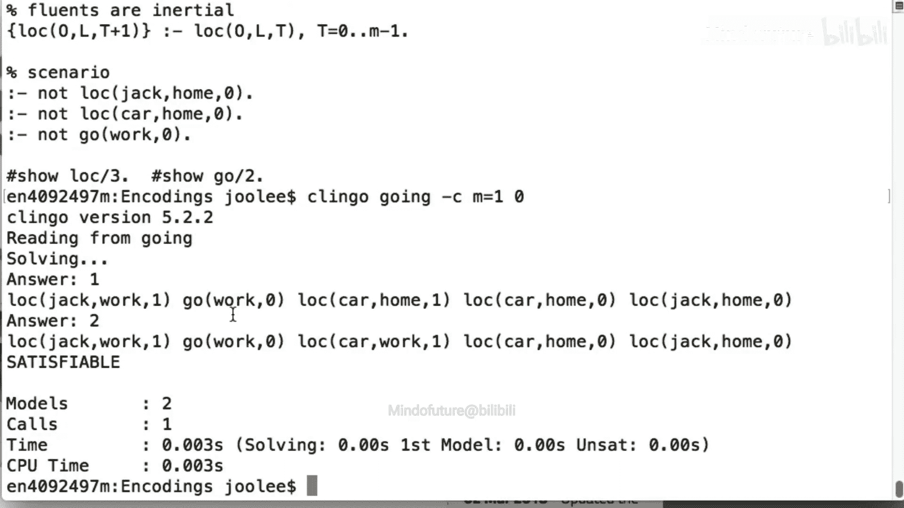

Okay， so then。好的。Yes， we can add probability maybe a couple of weeks later。

That's called LPM and N that we are going to study。て。人家认定够。

The previous scenario I put explicitly that cooperation is executed。So that's why it was。

 if I don't have that， obviously， that will be another transition。Okay。All right。

So we have only two domain left， I guess that's perfect time。Okay。

So interaction between concurrent actions。So。The concurrency here is actually very delicate。

 so some people， actually some languages like the old action language like strips。

 it doesn't have the notion of concurrency， so assume that each time exactly only one action can be executed。

 but there are some domains these concurrency actually make a difference。Okay。嗯。

So we saw actually some example in the blockssva domain， certain concurrencies should be disallowed。

 certain concurrency can be allowed， if your planner can only allow one action at a time。

 then this kind of thing is actually not very relevant but that's actually very basic language。

 sometimes we want to schedule some actions at the same time。So here is something that you cannot。

bo real。this idea is related to serializable plane， so why serializable plan there。

 sometimes when the robot cannot execute the real the plan。

 then the actual real tie of the plan can be modified to be executed in any order right but for this problem if you do that then you get incorrect results this is actually typical？

A textbook problem so。There is actually a table， okay， and there is an object on the table。

And there are two ends of the table， and each robot has to lift this table。Right now， if one robot。

Withft this end， then this will fall down。Okay， and then second time stamp， the other action lift up。

 this is already now on the table。So you cannot replace the concurrent actions with two sequential actions here。

In order to have the things on the table， these two should be eed at the same time。

So we need to differentiate between thecurren actions and the sequential actions for this domain。

So let's try to model this domain。So here we have booleanan sauce， true and false。

 and there are two end， left end and right end， and there are two height， low and high okay。

So what is effects and precondition of the lift， so the effect is easy， so if you lift its n。

 then the level will be high at time t plus1。Okay。And if it's already high， then you cannot lift。

Good， stay constrained。Now， this take constraint means that when the two levels are the same。

I'm sorry， when the two levels actually different， so here let's say the left end is H and right end is H1 and these two are different height。

Then。The object is no longer on the table。Okay。So this is the only thing that we say。喂。

And the other things are similarly as before， phones like Jordan initially， uniqueness。

 actions like phones initially， this is very mechanic now okay， in fact， if you have time。

 we can actually introduce another system that does this part automatically。Okay。

 so there's some system that does this for you， but for now let's just manually encode this by ourselves。

Okay。Alright， so then how do we test this domain， Let's go to the file。

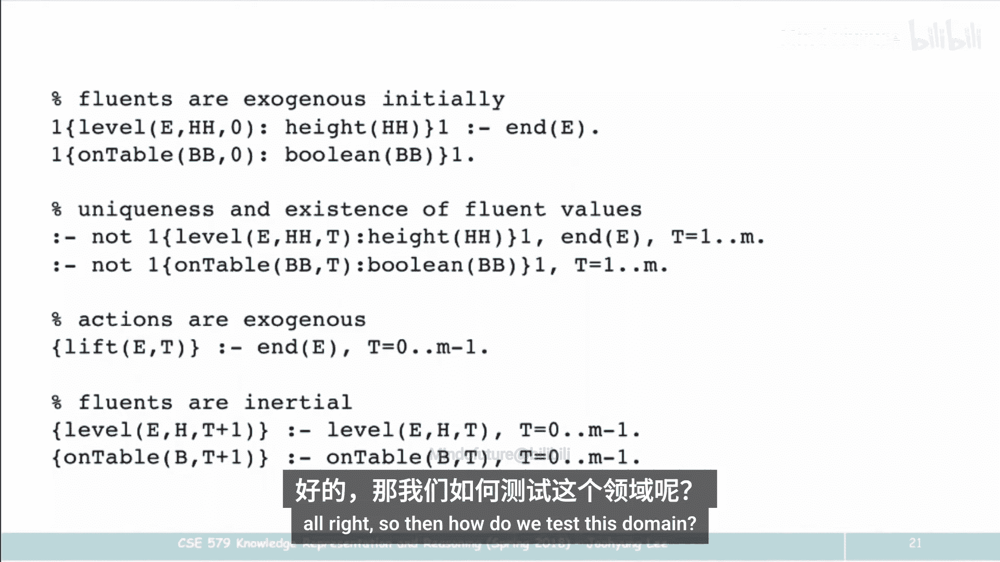

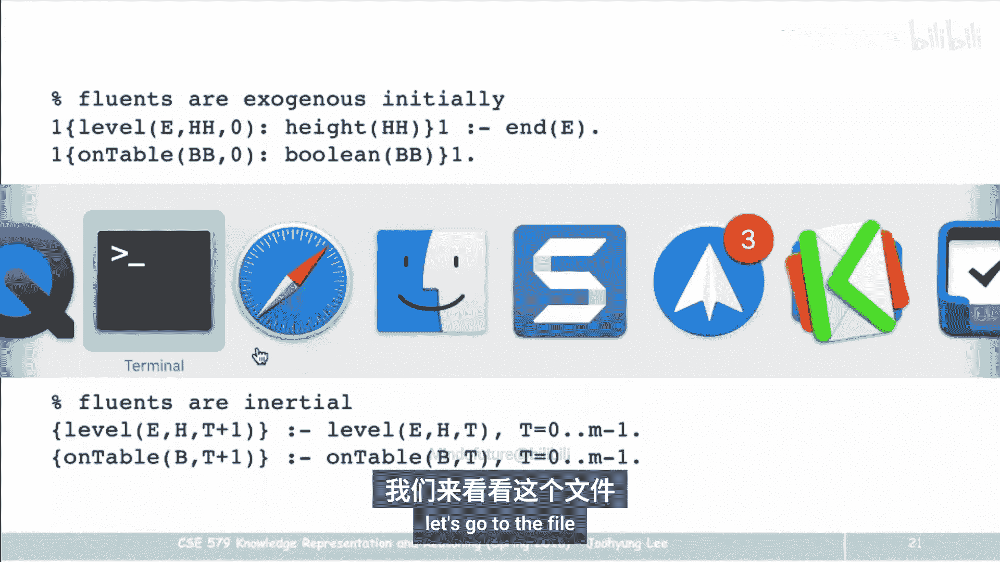

嗯。So this is a description that you saw。

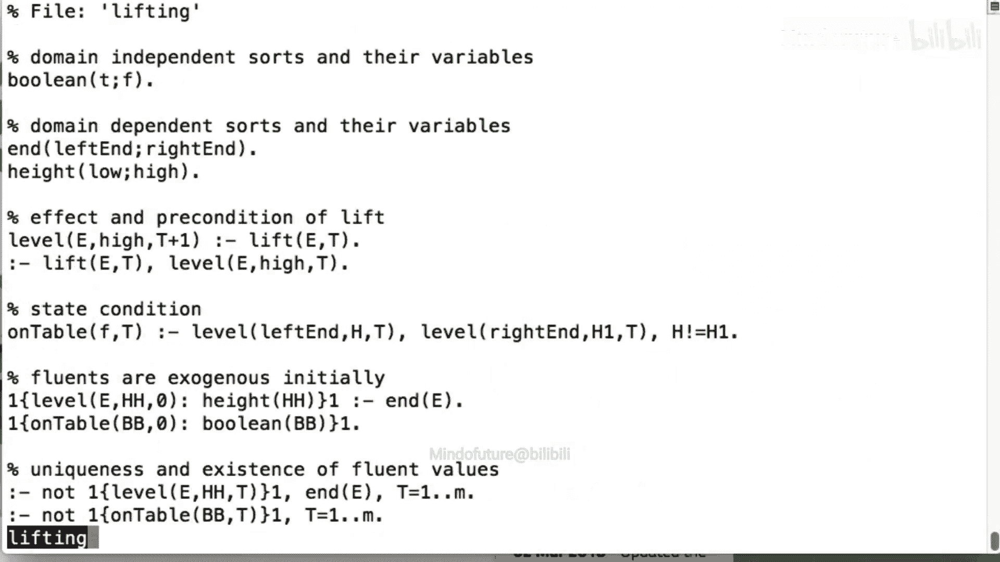

And so test， I have this particular scenario， so what do I have。

 so let's imagine that initially this object is on the table。Okay， initially both ends are low。

 so tables ends are low。And at next step。嗯。The object is still on the table。Okay。

 and they are not low end。对。Alright， so。Let's test this domain。If I give two， as a max step。

How many plans are possible？Initially， they are both down and the optic on the table。

And our goal is to make that still on the table at the next step at time too。Okay。

And both end are not law。How many possibilities are here？Actually， is's not difficult。

I'm giving you two times stamps okay this is initial situation okay at time two。

 this both end should be high and this thing should be still on the table。

 how many possibilities to execute this thing two right。

 so what are the two first doing nothing and second step you lift up both or you do the first up and then wait。

Okay， so let's see。 yeah， so we have these two actions。

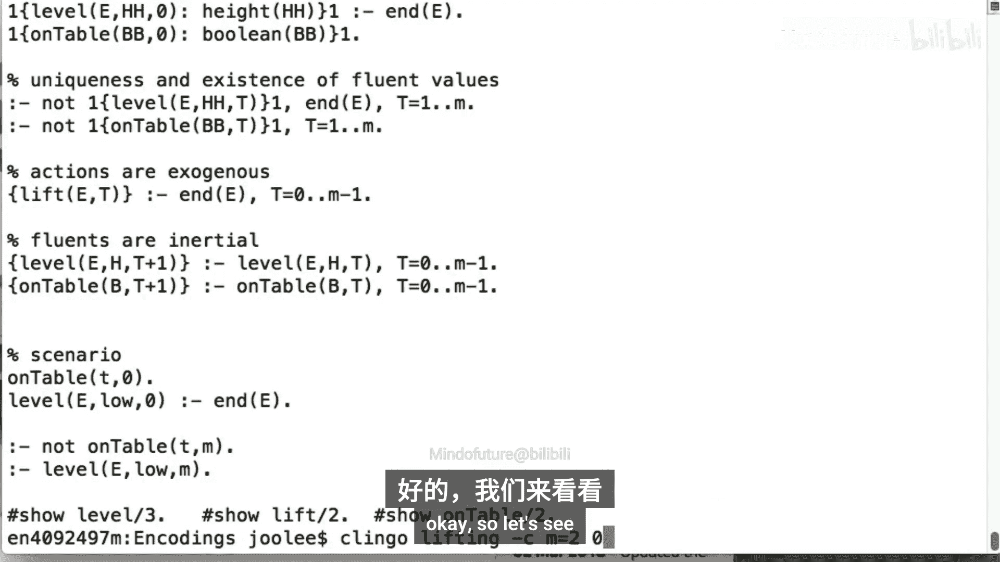

Okay， so。

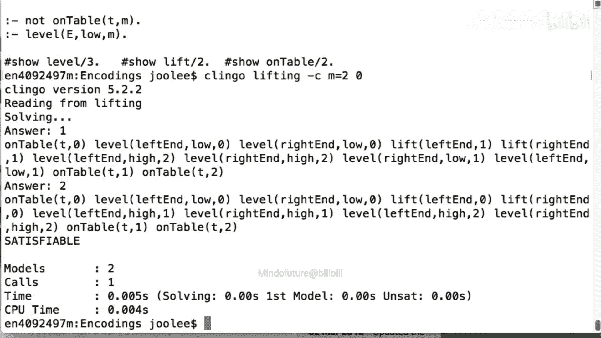

That's it and the last domain， non inertial flu so far every fluent were assumed to be inertial。

 which means that if nothing mentions about this， then it does not move right it stays in the it keeps the value in the previous state。

But there are sometimes actually that's not the case， this typical example is pendulum。

 pendulum actually changes going from left to right when you don't execute action。

When you execute action of holding， the pendulum stops there。

 so it's actually opposite to the usual scenario。So we want to model things that changes by default。

Okay。Now， some action languages， all your attempt couldn't actually solve this problem。Because there。

 this iner assumption was built in。On the other hand， in ASP formalization that we did。

We can actually change that description。So that we can model this pendulum example。

 So here's the example。True and false thats actually。Same， okay。Effects of hold now。

They are actually two end left and right， so if the pendulummon is on the right。And if you hold it。

Then the pendulum will be still on the right in the next time。Similarly for the left。Okay， so same。

Ft。However， if this action is not executed， then the pendulum will change its value。

 how do we model this？Well， you know already how to do the default。

So when the pendulum was on the right， note here that right is actually fluent。Okay。

 leftft is also so， there's no action here， action is only hold。Previously。

 if the pendulum was on the right。Then by default， pendulum is on the left。

 why do I read as a default because this is a choiceable？Okay。So if I don't do anything。

 if I don't have hold action， then。The left must be chosen。

Because of the things that we talked before， right， so when right is true， if nothing happens。

 no action has happened， then the choice rule has to choose the left。Okay， so by default。

 at time t plus1， the pendulum will be on the left。But if you actually execute whole there。Okay。

 when the pendulum was on the right， this choice will be overridden。

So these effects will be enforced。Okay。Alright， So then， of course， there are。

Doomain independent axioms， as you see， this is actually easy to see at time zero。

 one of them must be true in the time 1 to M， there is also one of them must be true。

 but this is actually by constraint and this is actions are eogeneous。

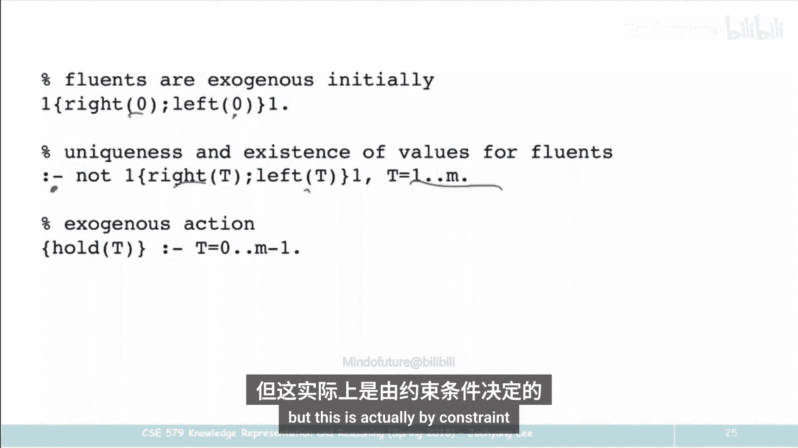

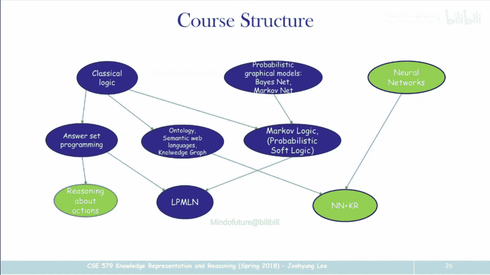

Oh， okay， so let's go back to。This one。

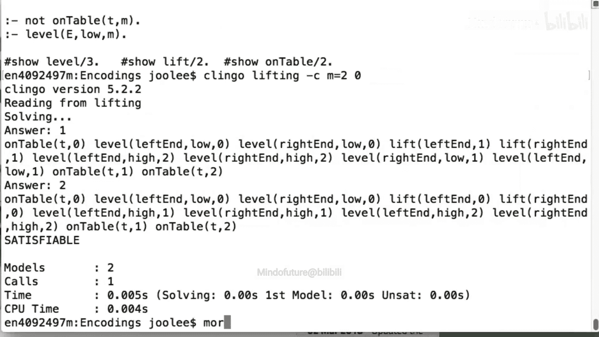

嗯。So this is the pendulum。 So what is the scenario that I put？So the scenario is at time zero。嗯。

Its on the right and the next time is on the right。Okay。And if I give max step to be two。

 how many stable models are possible？Do you see what I'm saying， so the pendulum is on the right？

Initially， at time two， it should be the still on the right。How many possibilities are there？2。

 one is just holding continuously。 Another thing is just not holding and come back。

 So that takes two。 Let's see whether that's the case。Yes， so the first one is actually， I didn't。

 Yeah， so the first one。Is not holding， okay， I actually don't show the left。I put only right here。

 so if I put show left and it will show the left thing， but basically right zero， left one。

 right two， that's what is shown and this one is holding so in all the time that right is true。Okay。

Question。Perfect。All right， so then so what we covered so far， we actually covered this branch。

What we are going to cover next time will postpone the ontology part okay the reason for that is looks like a lot of projects will benefit I didn't switch。

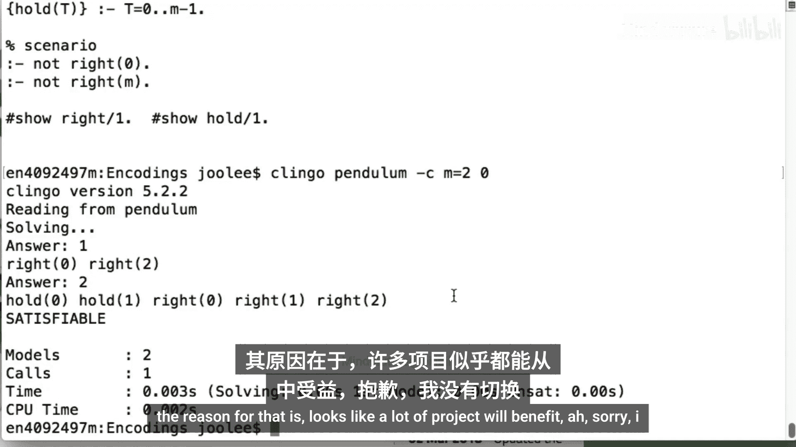

So it looks like so we have done this part and lots of projects actually require certain probabilities。

 some uncertainty， as well as some logical reasoning。

 so what we are going to do is we'll go through this branch next time。

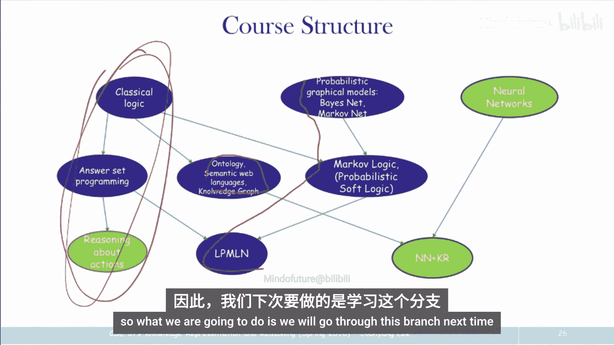