# 【亚利桑那州立大学】知识表征和推理 ｜ Asu Cse 579 Knowledge Representation 2018 p14 P14_Lec17 -BV1RTWyzfEQH_p14-

Okay so let's so what we are going to do today is some introduction to priority theory。

 so many of you indicated that you have some familiarity of probability theory。

 so I'm not going to go through in too much detail but for those who are rusty in those things you may get some refresh I'm going to go a bit fast on the introduction to priority theory。

 but I'll leave the slides so for the part that I skipped you can still take a look at it and the slides may not be enough then you can go to your own textbook the standard textbook on AI or any。

Probty theory introduction is actually okay。All right。What we do。

 we can understand probability in two different ways， but we'll just stick to one way for now。

 so if there is something event well understand the event as a proposition and we will use mean this is actually universal so we will use this three axiom so many of the properties on probabilityba is coming from these three axioms which you are probably familiar with。

 so every probability should be either between0 and 1 so here I use a as a proposition so prop is something that we know is true or false okay so we can say0 and1 so we know how truth that P of a a can be so how probable is a likely to be true and if you have a proposition that gives totalology and if you insert that as a P so P of totalology is always one and if you have two mutually exclusive。

which I didn't define carefully here， but you can understand that there's no interpretation that sat both A and B。

 Now if you had this P of A or B， then this is basically adding the two probabilities。

Each of A PO A and PO B。O。So。That's the thing。And now there's a terminology called random variable and possible work so what we'll see is actually there are some similar concepts that you already did when you were doing the classical logic okay now logic and pro were actually kind of developed in the separate tracks so there are common things but sometimes its confusing because they don't use the same terminology。

So let me try to actually relate these things， so what is called random variable is actually not either random and it's not u variable Okay you can understand this random variable as something like a multivalued atom in propositional logic。

So the agent is uncertain about this value， but this is about what you can say either true or false so for instance。

 in monkey and bananas domain location is a random variable and it has a value called value of a location so we say log equals here is something so random variable is associated with the domain and for instance location is a random variable whose domain is the set of locations so we write log of monkey or let's say log equals L1 means that random variable log takes the value L1 okay now when you say log equals L1 that's a proposition because now you can say whether this is true or false and then in the probability theory you actually give the probability measure to this proposition。

Okay， so we are just building up on the logical things。

Okay smokingmo is a random variable whose domain is poololean so smoking you can say either smoking is true or smoking is false so these are valid proposition and then you can assign the probability measure to this so some numbers between0 and1 you can assign to these propositions but you have to make this probability axiom has to be true so when you assign the values let's say smoking is true or smoking is false so when you add these two measures for smoking goes true and smoking goes false the probability of each of them when you sum up it should make one okay and each of the measures should be between0 and1 okay。

This kind of thing。All right， so now we call possible world in the probilistic language。

 but basically you can understand possible world as an interpretation。

 so we go back into the Proal logic and think about interpretation it's a possible truth value assignment okay so we talk about slightly more general setting here because the random variables are not necessarily boolean but that's actually similar to the multivalued atom that we already studied。

So when we say possible world， this is an assignment to each random variable。

 so if you have smoking and cancer， there are two random variables and take Boolean values。

 then there are actually four possible assignment and that's actually the same as entries in the true table。

 so this is actually same as interpretation。Okay， let me just finish on this thing so possible words can be identified with an interpretation in the logical language and we can also utilize the same notions that we use in logic so we say W satisfies x equals x so note here that。

cannot use the arrow Okay， so W here is a possible world and x equal equals x is a proposition。

 right so。So this is actually the same as what we say as a satisfaction for professional logic。

 so interpretation satisfies the proposition。Okay。So what is new here is so far is actually the just same as provision logic。

 so what is new here is we are going to assign some probability measure to each of the possible world so that they sum up to one。

Okay。So basically， probability of any proposition can be defined as the summation of all possible world that makes this possible world to be true。

What this possible will satisfyisfies those proposition。Okay， so we'll see the example。

Now joint distribution is something similar to truth table。

 we want to say what are the possible probability distribution for each of the random variable。

So the domain here is a Cartian product of each of the domain of the random variables。

So let's actually look at the example， so if you have weather and temperature。

 so weather can have two values sunny or cloudy， temperature can be either hot， mild or cold。

 then there are actually two times three possibilities。

 so there are actually six entries in the table。And joining the this is simply saying that what probability measure do you want to assign to each of the possible world。

 Okay， so you can say that sunny and hot。啊。Has the Me 0。1， Sony and Mars 0。2 and so on and so forth。

 so if you add up all these things， it must add up to one， okay， so that's it。Okay。

So in each row corresponds to an assignment and its probability nothing new Now so this is actually the big table。

 sometimes we don't want to talk about each of the possible world。

 we are only interested in the probability that the weather is hot。

 but I don't care about I'm sorry the probability of temperatures to be hot。

 but I don't care about the weather okay so how do do that kind of thing I'm only interested in part of the assignment to the random variables or subset of the assignment of random variables。

 then I can actually marginalize out all the rest of the variables。

 which means there's just some of those variables that do not occur in X。

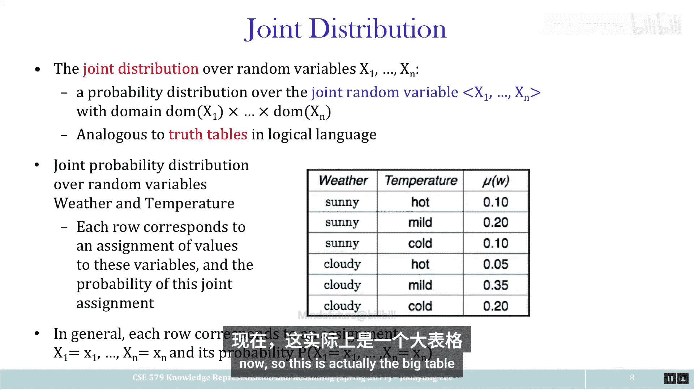

Okay。So if I want to only know about the probability of x being equal x。

 so here capital x is a random variable and small x is a particular value okay so if I want to know about this。

 then I can just sum over all the assignment to other random variables so add up all these probability。

Okay。All right， so this maybe is easier to see from this example。

So here I want to know what is the probability of temperature to be hot and what we are given is on the left-hand side table right so we are given the joint probability distribution but we want to know the probability of temperature to be hot then you have to marginalize which is basically some of all the entries that has temperature to be hot okay so weather can be either sunny or cloudy doesn't matter。

 you just add up all this probability measures okay so there are two entries that temperatures hot okay just add up all these values that become 0。

15 okay so you can also feel the rest of the thing in general the probability of these thing can be represented as this way。

So basically， it' just just a simple idea。What is the conditioning so in the conditioning we are given the new evidence and it revs our belief so the priority has to be changed。

So for instance， this is actually prior probability， but now we observe that weather it's sunny。Okay。

 and I want to know what is the probability that the temperature is hot？Okay。

 so now when you say weather is sunny， then there are actually three possible world that has weather equals sunny。

 which is w1， w2， w3， but now w 4， w 5， w6， they are no longer 0。050。350。

20 chance because they all go into 0 because we already observed that weather equals sunnyny。

Okay so this goes0， but according to the probability axiom when you add up all the the probability of totalology should be one。

 so in order to compensate for that we have to prorate these remaining probability okay。

So how do we do， we just add up the current remaining probability me which is 0。1 0。2 0。

1 you add up and divide each of the probability measures with the sum of these probability measures。

 so here's an example。So 0。4 was actually the new normalization factor。

 so each of the priority methods before is now divided by this and then so it becomes bigger than before okay but now if you add up then 0。

25 plus 0。5 plus 0。25 they add up to one。

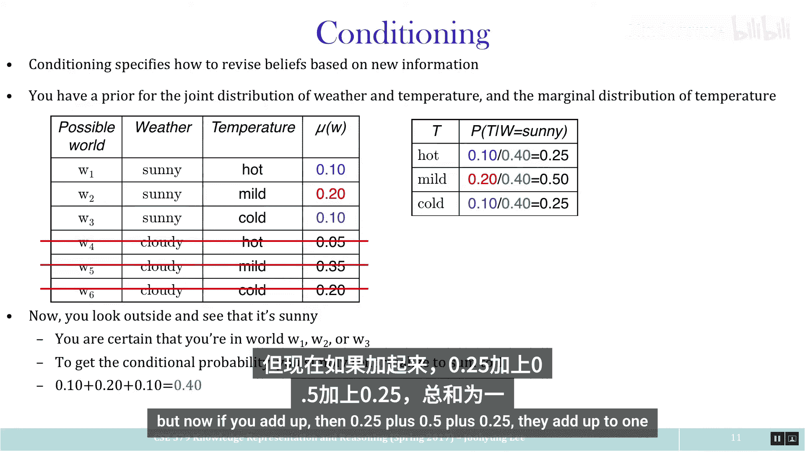

Okay， so that's the called컨ンディショing。Okay。Now， this is just a summary of what I just said。Okay。

 for some reason， I cannot use any pointer。Okay so what happens in this conditioning is you are going to use new probability measure which I denoted by mu okay so before that mu was the probability measure。

 but when you observe new things that changes your belief so all the possible world that does not satisfy the new evidence they will get the new probability measure to be zero because that's not possible。

But the rest of them now have to be prorated then what we do is the probability of E。

 so E is the evidence that we observe what is the probability of E and you have to divide the prior probability measure with the new with this probability of the evidence。

Okay。If you're interested， you can just see this elevation Okay。

 so I'm not going to go into the detail， but that's probably easy to read okay now with this you can now include the base rule。

嗯。Challenge here is how I can。Show the derivation。O。Now， let me try。诶。Okay。

 so let me just use the board for doing this。Okay， so by definition。

 this is actually what we show in the conditioning。 So if you know P。Of H given E。

So basically where you divide this prior probability。With the probability of the evidence。

 right okay？And。So this is actually what comes directly by the definitional condition and you can rewrite this in terms of P。

 and E， just rewrite。This division into multiplication。So you can get this， right， iss visible。

And then this is actually symmetric so I can。Also， by this way。Okay。And these two are the same right。

 so conjunction conjunction is formative。 So what you get is。These two are the same， right？

So this one is same as this one， so you can actually say。喂。So this is called the base CRM。Okay。Okay。

 now is's the time for you to。the Soative so that I can probably correct some problem in the computer。

So here's a question for you， okay？嗯。So。On average， the alarm rings once a year。

 so what is the probability？Of alarm， if you don't know anything about it。

 what is the probability of alarm to be true。So it's actually one out those 165。Okay。

 so assuming that you have one365 days a year and youre in a particular day。

 So the alarm rang without knowing anything。 the alarm is actually one out of 365。 Now。

 if there ist fire， the alarm will ring。Almost always free， so that can be written。As。

So if we don't know anything about the fire， then the priority is actually1 out of 365。

 but if you know that there was an alarm， if you know that there was a fire。

 then what is the probability of a lamb， it becomes quite close to one。

 I would not write actually one here， if almost always， so let's just say 0。999 okay。And on average。

 we have a fire every 10 years， so what is the probability of fire？Okay。

 so 10 years is about 365 times 10， so this is actually one out of 365 times 10 okay。

So these are the known fact and what you have to find out is now， you know that alarm brand。对。

Should we evacuate？我的是陈述法院。Okay。I'll give you one minute to do this calculation and let me open the Piazza for that。

And。see。

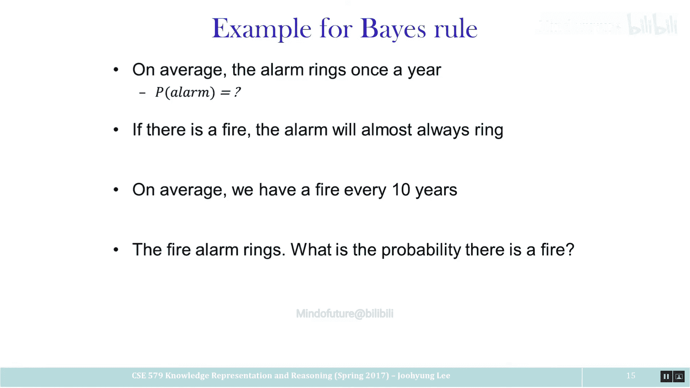

Okay， so what this answer。嗯。Two points。0。1。Okay。So 0。 to among these。

 actually I should have given it。So。C。ABCD。B， okay， good， so。Okay。

 so I think you can just verify is just plugging the number。 So what is surprising is actually。

There's only 1% of chance that there is actual fire， right？All right， okay， so now I can use this。

So there's a product rule what we can find out using these conditioning is actually very straightforwardly follow from the definition so if you want to say P of F1 and F2 that's actually what we know from the conditioning you can actually find this so what you do is you want to find you find first the probability of f to be true and then probability of F1 and then probability of F2 given F1 that is same as probability of the conjunction of F1 and F2 and this can be actually generalized so if you have n variables and random variables then you can go into this way so you can have priority F1 and then knowing F1 value what is F2 probability and knowing the previous two what is priority and so on and so forth this is one way to prove it okay。

Okay， and there is a marginal independence， this is the definition。

So what do we say is there are two random variables x and y。

 and we assume that y does not knowing the value of y does not affect the value of x then we say that x and y are marginally independent and this is actually symmetric so knowing y if x and x is marginally independent from y then also y is marginally independent from x so。

That that is the thing so for example， what about the weather weather is actually marginally independent from the result of dying through okay so becomes six in the head doesn't have anything to do with weather so we expect that knowing the value of die result does not affect the probability of the weather so we assume that these two variables are marginally independent now if you actually see this this is really very strong condition so all values of the capital x and all values of capital y okay knowing the value of y does not affect knowing the value of x。

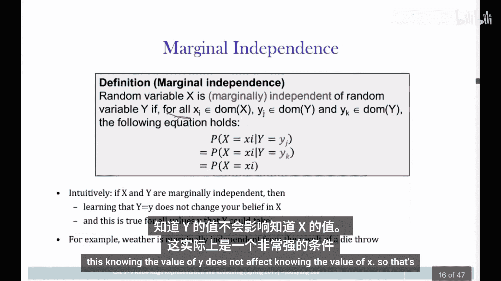

So that's actually quite strong condition。And here is an example I'm going to skip it。

 you can actually just figure it out， so what will be easier to prove that this distribution is marginally independent versus marginally dependent。

Which one will be easier to prove？你肯定。Vinally， independent， you have to check for all possibilities。

but for the imaginary dependent， you only need one example that this equation breaks。Okay。

 so it's actually quite easy to I mean easier to check that this is marginally dependent。

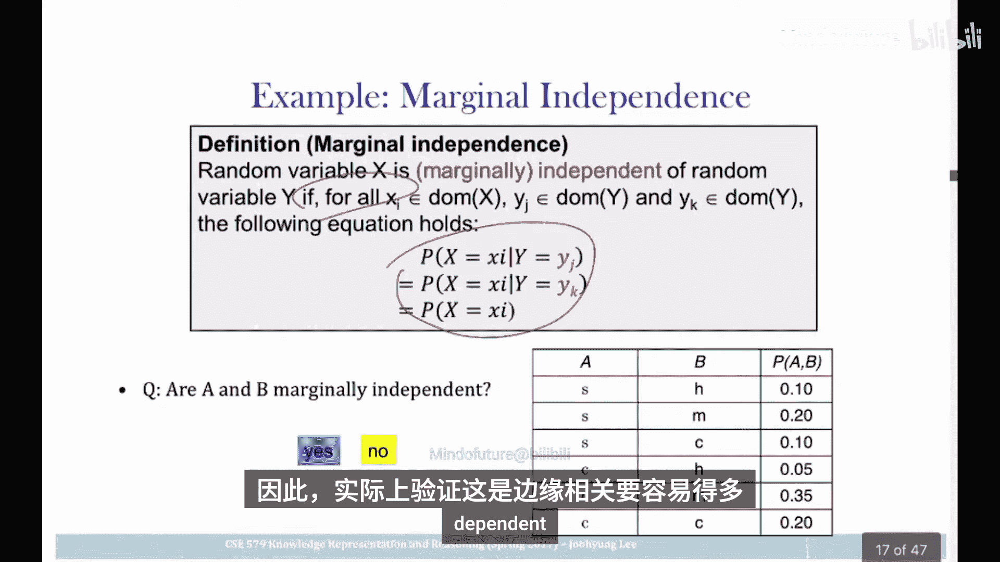

K。All right so I give two examples， one for dependent and one for non independentdepend。

 there is a similar notation called conditional independence and the only difference is here we actually no additional fact。

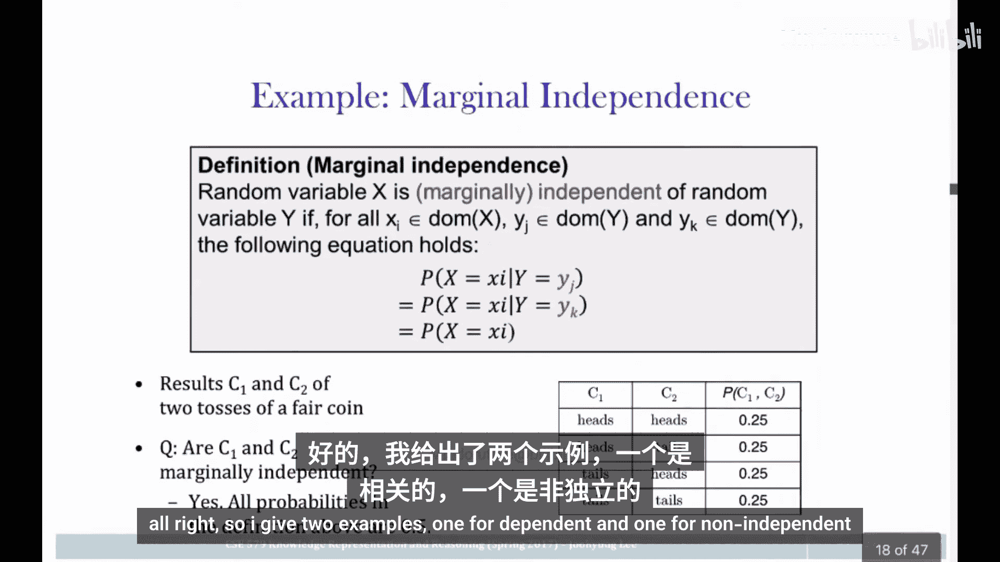

Where we don't actually change these observations。 So knowing the z， I mean having the z。

 okay knowing which value of y actually does not affect the probability of x and that we say that x is conditionally independent of y given z。

Okay。Are we together。All right， so let me test you。These two question。 Yes， are no question。 Okay。

 let me use the specative to。Do that。So， let me show you。Okay斌。

So just answer the two questions true or false。So first question is if x and y are conditionally independent。

 given some Z is x and y marginally independent？And the second advice was if you know that x and y are marginal independent。

 are they conditionally independent given any Z？That根。Don't speak。 I mean， youre are using Soative。

 right。这单。Okay， so let's。Check it。Okay， false true， No， yes。 false true， false true， false true。 yes。

 no， yes， no， amazing。Very few people， maybe one person got the correct answer。没我比较 wrong。Okay。

 so what is answer is actually false force。S这样。Okay。嗯。Well， I'm not going to prove this。

 This is actually easy to do。 Yeah if you come up with a counter example。 Okay， so well， this is。

 so let's see。So I'm giving you just some intuitive example。

 which doesn't necessarily mean that is the case， but as you see from this these variables。

These two notions of independence do not actually entail each other。Okay。

 so all possibility is there。You can read the example。

Okay so the reason that we are talking about conditional independence is because this is actually very essential for understanding base network。

 so so far we are done with the basic idea of probability but let's now see why this pure probability theory was not adopted in AI in the early days so people wanted to compute the probability of certain event which is very natural thing to do so I want to compute P of a B C。

 what is the probability that A has certain value B has certain value C has certain value and D has certain value so I can compute this using this chain rule or product rule。

OkayNow if I want to compute this way， what is the size of my joint distribution table？

Let's think about it。So if you want to represent a P of A。Okay。

Let's assume that all values are boolean for the simplicityimplistic。

 Okay so if I want to store the information about probability of a， what is the size of the entry。

 How many entries do we need。嗯。图。Not necessarily one because it's either true or false if you know the probability of true then one minus that is the probability of being false so to say these things。

 we only need one entry in the joint distribution table okay so the size is short what about the second one P of B given a so here we are using the random variables A and B but what it represents is actually the probability table so knowing the value of a。

 what is the value of B right how many entries do we need in the probability table too so here for instance。

 I need to know when a is either true and。A is false， right， so in this case。

What is my priority of B？Okay let me write this way so a equals true a equals false and probability of b equals true so this is the kind of probability table that we are talking about right if we notice this A is true this can be 0。

6 or this can be 0。2 okay then you can infer that probability or P being false。

 what is the probability here。0。4 and 0。8 so you can infer this later by doing the probability axioms。

 but this is an essential entry that you have to store right so you need two entries okay what about the next one？

 what about the next one？Hey， so if you add up all these things， how many？That's a 15。

 so you need 15 entries， okay？Now。As you can see， in general， discourse explanation。

It's actually two to path4 minus-1。Now， if we happen to know the conditional independence and let's say one dependence that we know is D is conditionally independent of A and B given C。

 so if we know C， then knowing A and B does not affect the value of D。Okay。

 so this part can be simplified because since I know C whatever the value assignment for A and B does not matter。

 so what I can store in the priority table is only this information and what is the size here。2。Okay。

 so then I can save from eight to2， so this entry will be nine。Right， so one plus。

 these are still the same， I assume the others are same， so one plus 2 plus 4 plus two is nine。Okay。

 so as long as you can extract more conditional independence。

It has a potential to save the size of the priority table to be sort。

So this is called compactness under the independence， we can gain the compactness。

And that leads to the idea of Bayesian network Okay， so in Bayesian network。

 you've probably have seen this kind of thing before or if you don't， that's okay。

 I can just introduce the idea。It has two components。 One is a directed graph。

 and another is a property table。Now， the graph is to encode the independence assumption。

So that you can actually store the minimal information possible。Okay。

So here is this is actually the kind of textbook example in Bayesian network originally by JuD or Paul。

 so you can read it like some knowledge， so if there's a burglary it causes alarm to be ring。

 if there's an earthquake it also causes alarm alarm to be ring right and if alarm rings then John calls somebody and also Mary calls。

Okay。So。Here。What。So and each of this node is associated with the property table， so this node。This。

 this node has this information。Okay， so for the node that has no parents。

 you can actually just save only one information here， right， Okay。

 so I wrote actually two case when a burgary is true or burgary is false。Okay。嗯。

So this is actually one information for the earthquake， you can have this table。

For the alarm alarm has two parents， so depending on what is the truth assignment for the parents。

 you have different probability of the alarm， so here this node。

Is associated with this conditional priority table， conditional probability distribution。

 so when burgary is true and earthquake is true， then。The priority of alarmlum is 0。95。Okay。

And when burgloli is true， but earthquake is false， it's still 0。95。If both of them are false。

 then the alarm will ring in a very low chance。Okay， all right。And same for this now as you see。

 each conditional probability distribution only storess information about the what parents note will get the truth value assignment and in that case。

 what is the probability of that note。Okay。So it to us local information。

When you want to find out what is the probability of Joan Col。

 you don't actually have to look into the probability of burglary once you know that what is the probability of whether the alarm has rang or not。

 then whether there was a burglary or a earthquake does not actually matter in terms of drone calls。

 that's actually the conditional independence assumption that is given in the Ba network。

I'm going to actually talk more about it soon， but I'm just introducing the intuition for now。Okay。

 so let's actually think about it just as an exercise。Okay。

 so how many pro do we need to specify for this Bayesian network， maybe let's do this together。Okay。

 now assume the old thing is Booleion。Okay， then how what is the number。为 need。

So how many entries do we need for the taing？One， yeah， because it's just true or false， Okay。

 fire thing， how about alarm。Four， depending on which combination， right， true， true， true， false。

 false， true， false， false， smoke。That's two， because whether file is true， you get one priority。

 when fire is false， you get another priority okay。For the living。2。And for the report。2。

 so what is answer。12 okay， but now suppose we don't know this independence assumption。

 and if you want to know about if you want to store the joint probability distribution of taing fire。

 alarm， smoke leave report。What is the size of the table。期的。Okay， so 22， power6。

 minus-1 will be the answer that。So that's a huge saving from 63 to 12。Right。

 so that's a huge savings。你给。Okay， so that's it。And all these are just what I said。

 so I'm going to skip this， okay， so this is independent assumption in Bayesian network。So。

We call the descendant in the sense of when you look at the trees。

 so alarm is a descendant of tempering as well as living and reports are the descendants of Ting okay now the independence assumption that we are making from this graph okay graph so the graph encodes the independence assumption。

Okay， so each variable is independent of its non descendants given its parents。

 So if you look at the alarm， Okay， so alarms descendants are leaving and report。Right。

No descendants。The tempering fire and smoke。 But if you look at the smoke， this is a non descendant。

 which is not par。Once you know the value of temperming and fire。

 then knowing whether there was a smoke or not does not affect the probability of the lung。

 that's what we make as an assumption in the basin network。Okay。

 and that's the reason why we store only the Ting and fire assignment when you talk about the provision of a alarm。

We don't care about the probability of smoke。When we compute the property of our lab。Okay。

Are we together。Allright。So this is just recap， so if you want to use chain rule to show that what is the probability of assignment to each of these random variable。

 then you have to compute these things okay so knowing the true probability of tainging given fire。

 T and F given a given T andF what is A and so on so forth。

 so we have to add all the preceding node as an evidence in the probability。Okay。However。

 if you use the Bayesian network assumption and you assume that the conditional independence is like as represented by this graph。

 what you do is， of course， this T is not a descendant。It's not the descendant of fire。

 so T is not the descendant of fire， so T knowing T does not affect F so we can forget about this。

Okay。Similarly， when you go into the okay， so let's go to next one。For the alarm。

 you have to know both through tempering and firing， so you cannot simplify this。However。

 when you go into the smoke。Then smoke only depends on fire once you know the fire。

 then you don't actually need to know about the other values okay so here T and A are not relevant if you know what is the value of fire if you don't know then it actually affects。

 but if you dont if you know the value of fire， then it kind of blocks the information flow so you don't have to worry about it。

And similarly for the other things， so if you have L okay if you know the alarm。

 then knowing these three does not affect， so T FS do not matter and if you have R then knowing once you know the value of living these four does not affect so T。

FAS， they don't offer。Okay。And how do you get so and this information is stored in the conditional probability distribution that we are given with the basin network。

Okay。So if you're wondering this is an example。给 so。I hope you can just follow this。

Do you want me to explain this？

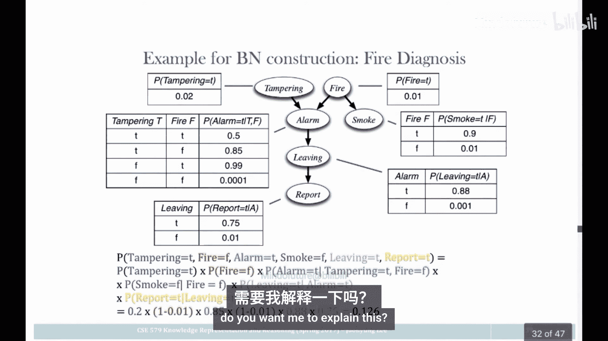

O。All so Baysian network is actually well used in AI for decision making。

So you can have more complex things about maybe insurance。

 what affects what factors and so on and so forth， and for some diagnostic reasoning。

 you have a car and let's say the car won't start， then how do you infer what is the cause for the car to be broken。

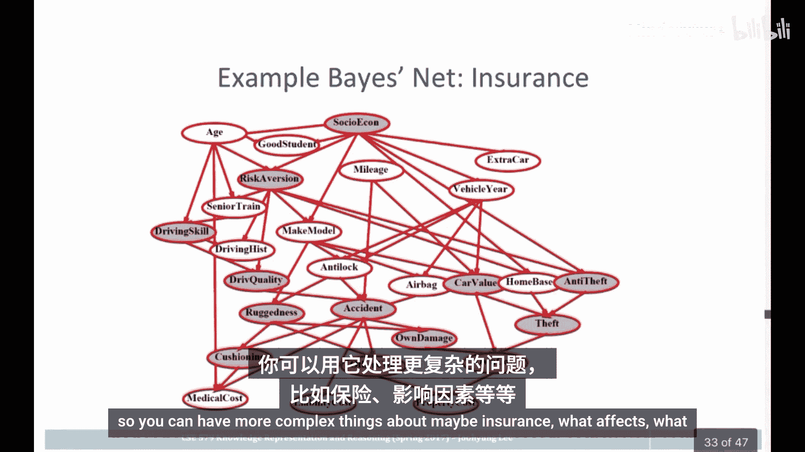

So like the base CRM， what you know is what causes the effect。But when you use this thing。

 you're observing the outcome and you want to infer the course。 Okay， so that's where the reason。

The base rule is useful。Okay any question about this， is it too fast or not？

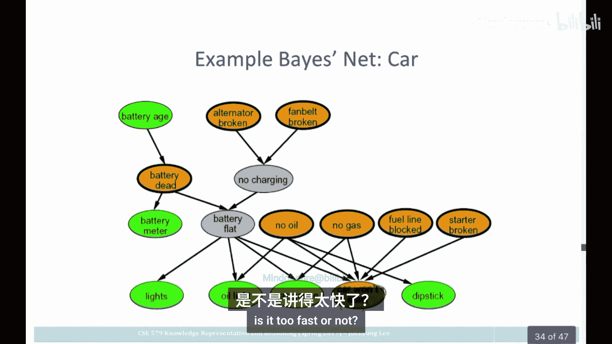

Okay， good so then we are going to Markrov networks Okay。

 so Markakov networks is actually another representation。

 How many of you have have learned Markov network。Some of you okay good。Right right。

 so many of you actually didn't do that because it's actually less taught in AI class。

So Bayesian network is a directed graph。The change here is undirected the graph。

Okay so it's a similar idea， but they are also different first we have given an undirected graph。

Okay， another thing is we are given the so called potential function that is not into the node。

 but into the so called click you remember all this click。When we do the ASEP。

 okay it's a complete sub graph， right？说。Some table is assigned to the click。

 so here we are we are considering just very simple example。

 so let's assume that this is a click okay and this is a click and this is click and this is click okay so each of click there is a priority table and at the priority table some distribution table and if you look at this。

The first part here is assignment to those random variables。

 so a being false a being true versus d0 T being false and D being true okay so they' are actually full possibilities and each of the four possibilities or four interpretations associated with some numbers now you look at this number。

 they are not necessarily probability and they are actually not probability okay they are usually positive numbers。

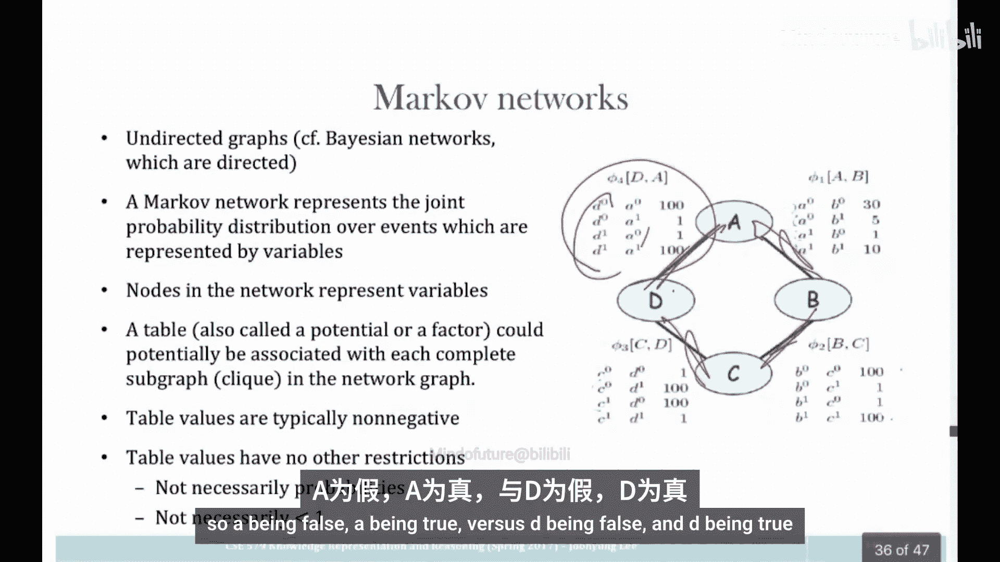

Okay， but they are not necessarily。Op to one。Okay。后嗯。Okayケ so。

So this particular example is so called misconception example。呃。失ぱ。Yeah， so。

So what happens here is this， so there are four students， A， B， CD。And。The professor said something。

Abiiguous。And it creates certain confusion。Okay， so here so each of them has either misconception or not。

 so a1 means actually the student A has a misconception。

And A0 means that students does not have the misconception。行。So。And the men are here。

Sas how strong is that mean。Okay。So for instance， here， if you look at the table for DNA。

They tend to kind of agree， right， So， so this information can be flowing between the students。

 So A and D talk together if a。Don't have misconception， and D doesn't have misconception。

 It gets the number 100。Okay， and if both of them have miscon， they also get 100。

 roughly meaning is they actually tend to agree with each other。Okay。

Now D0 so D doesn't have misconception but a has misconception has only number one。

 which is very low number so they don't tend to disagree， but if you look at C and D。

 then they tend to disagree， C and D are not agreeing with each other okay。Similarly。

 if you have B and C， they tend to agree and for A and B， when A and B both don't have misconception。

 it gets the number 30， and also if they both have misconception， they get number 10。

 but that's not symmetric。Okay， and this measure is actually less than the previous one。Okay。

So what this number represent？It doesn't have clear idea as Bayesian network in the Bayesian network。

 it was actually the probability of that node being true given the palace。

 but you will see that actually it didn't define the probability yet。

 but this is actually a bit more。In a sense it's more flexible。

 but also it's a bit less structured than the vision effort。Okay。So this is大学所これでですね。So。

Something to think about is。So note here that A and D talk to each other。

 but A and C do not talk to each other directly。Okay。

 but can we say that A and C are independent since they don't talk？

And I already gave the answer here， it's not because A may have talked with B and B may have talked with C。

So through this information， flow， A and C are kind of affecting each other。喂。

But what about the case if we know that？The value of B and D。

 if you know that B is has misconception and D has no misconception， for example。Okay。

Then the value of C does not affect the value of a。

So that's the assumption that independence assumption that is making in the Markakov network。嗯。

So here we know that if we know the B and D， then knowing C does not affect a and vicelosa。

 similar issymmetric way， B and D are independent from each other， if you know the value of A and C。

And this is a standard example that Bayesian network cannot capture。Okay， the reason for that。

 roughly speaking is actually undirected graph， there is no direction here in the beta network are you have to have a direction。

Okay， so there is certain difference there。 I'm not going to go into the detail about this， but。

If you are curious， there is actually a way to turn any Beijingesian network into Malakov network and also vice versa。

 but that translation involves some extra construct。Okay。All right。So yeah， I said as before。

 what does this factor represent？喂。So each of the node can have truth values right。

 either true or false and now when they have certain values， say a0 a is false and d is false。

 then you get 100 so what is 100 is kind of measure for the local interaction。Okay。

But how do we actually combine these local models to write to probability？

So this is where Markovnet is actually different from Bay and network。

In some sense it's actually simple， all you need to do is to just multiply those entries okay。So。

Let's see we will first define un normalizedmalized probability measure so I want to know the probability of maybe ABCD or false okay so I want to know this。

Okay， how do I know the value on normalizedized priority？Of this assignment。

 look at those entries that is consistent with this assignment。So here I get this one。And from this。

 I get this。From this， I get this。 I get this。 Okay， so for each and table。

Go to the entry that is consistent with this assignment。

Okay that all these values are false and then you just multiply the values。

 so you will get 100 times 1 times 100 times 13 okay so you will get 300000 as on normalizedmalized measure。

O。And。And you can fill out all the rest of this。Are we together？Okay， so。For each of these， you can。

Find this value。And how do you。Find the probability。

 How do you define the probability now once you know this？

You can actually add up all this unnormalized probability me， and that's the factor that you divide。

Okay， so let's call the sum of all these values to be Z。Okay。

 then the probability of the first assignment。Okay。Proity of a 0， B0， C0， D0 is 300000 divided by Z。

And you can do all the rest of these things。So in order to find the poverty。You have to know the。

Normalization factor， and that's actually very costly function to compute。哎。Okay， another thing。嗯。

If you do this， so you can get to priority here right， I didn't actually write。

 but if each of the entries is divided by the partition function， then that's the priority table。

I want to find out the marginal probability， I don't care about C and D。

 I want to find out the probability of A and B。We can do the same marginalization as before。

 and if you do that， you will get this table。Okay， so for instance， A 0， B 0。Okay。

s to marginalize this。You can。You can go to all the entries actually， that has A0 b0， right？

And you add up all the probability there， then you will get this number。Okay。

 same way you get this and。So I didn't actually compute。

 but this is actually a very mechanical step to do。On the other hand， let's look at this。

So priority of A and B， how are they agreeing or disagreeing？

If you look at the marginal distribution， then the most likely case is A does not have misconception and B has misconception。

 that's the 69%。Right。But if you look at the local table here。This is only five。

That's not the most probable case。Do you see what I'm making here？Okay。The local table。

And the marginalized poverty does not coincide。In the local table， the case at A0， B1 has only five。

 so that strength is only five。Actually， when both of them have no misconception。

 that's actually strongest case， right， so that has 30。So why is it this discrepancy there？こ给て。

Exactly， yeah， true， true。 So that's actually the point。 If you look at this information， this。

Liinnk is only about that particular local interaction。

But theres another interaction that you just pointed out。 It goes this way around。Okay。

 so let's actually look at this。 why this guy gets this much of probability。So A Z to B1。Okay。

 they have only five。Okay。Now。Okay， so a0 B1 has only five。But B1， C1。Has 100。Okay。And C1 d0。Has 100。

Okay。And these0。呃。A0 has 100。So if you go into this route， you actually have a stronger interaction。

Well， let's say this way， if you look at these things。BN so。

Here we are talking about why this is the case， A and B are disagreeing。Okay。

It's because B and C tend to agree。And C and D tend to disagree。And DNA tend to agree。So basically。

 they tend to disagree if you follow this link。Because they agree。

 but they don't agree and they agree。 So in the end， if you go this route。

 then A and B tend to disagree。Whilehy the local interaction is saying that they kind of agree。O。

Yeah， thats fine。 doesn't。 doesn't。Because you' are all multiplying the same number anyhow。さと。そうなですか？

It's because the priority is defined。In this way。Okay， good。嗯。So， let's summarize。

So in the Markroov network， we are given some random variables。And。

If you want to compute these things， you are just multiplying all the local interaction and divide by the Z。

 which is the sum of old normalizedized me。Okay。And okay， so that's one thing。那。

If it happens to be the case that all the probability is actually down zero。

And you can rewrite this probability in terms of so called log linear model。

 which is instead of just multiplying these functions。

 you can say exponential of this summation where this sum is actually linear。Okay。是吧。嗯，有。All right。

 so independence assumption Hin Markov network is actually simpler than the Bayesian network。

So here if you observe that A and C。Then B and E are independent of each other because it actually blocks the information flow。

 knowing A and C， if you know the A and C， then B and E do not depend on each other。

 same as D and E do not depend on each other， so the independence assumption is very easy to see from this graph。

Okay。See your solution。嗯。でに。就是た。We理。Yeah， that's true。This is just an example， one example。啊，然对。

Other thing is they also called Markakov blanket。So。Here in this picture。

 these surrounding neighbors are the Markcoov blanket of sea。

Meaning that if you know these assignments of the Markcoov blanket。

 then other values outside this Markov blanket does not affect the probability of C。Okay。

 so that's a dependence assumption in Malov network。

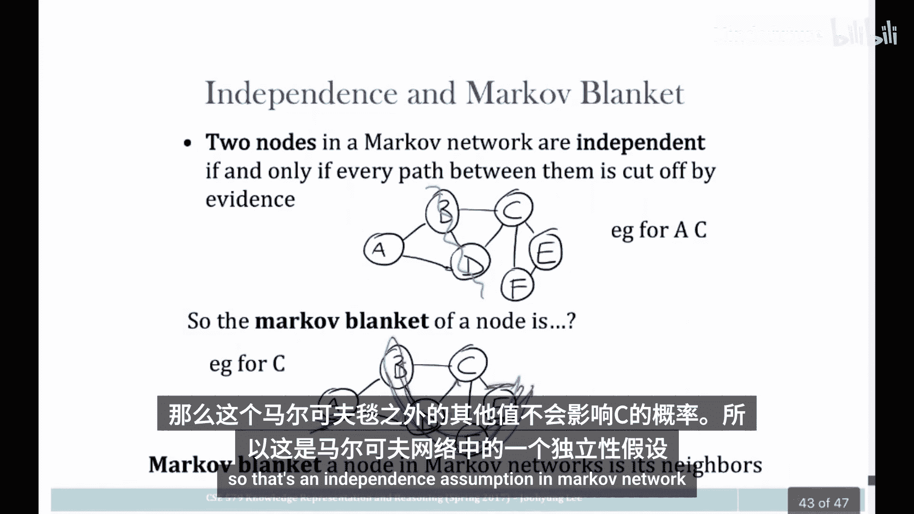