# 【亚利桑那州立大学】知识表征和推理 ｜ Asu Cse 579 Knowledge Representation 2018 p15 P15_Lec19 -BV1RTWyzfEQH_p15-

So what we are going to see， yes。嗯，系罗呢。That's fine。 I don't mind， okay。Yeah。

 because that was the last class sign and I couldn't close show。 Allright， so today we will do。呃。

The other representation of marov logic， which is to use it and view marov logic as a template for marov networks。

And if time permit we'll go into the inference， maybe we'll cover for some half of influence and the other half will be next class。

Okay， so lets recall call what was the Markov logic。

 So one view was it is just the first of the formula with weight。Okay。

 so we see that MLN has is just weighted first of the formal lab。And。When we say ground。

 it means there's no variables。And we talk about Hbl universe， Hobra interpretation before。

 one thing that we need here is to define the probability。

 we have to assume that the underlying Hbra universe is actually finite。

 in fact this kind of thing can be actually lifted。

 there are actually version of myco logic that allows infinite universe but we are not going to go over that kind of materials okay。

Now， the weight of the interpretation is defined to be exponiated weighted sum。

 okay and let's actually go back to the example that we had。

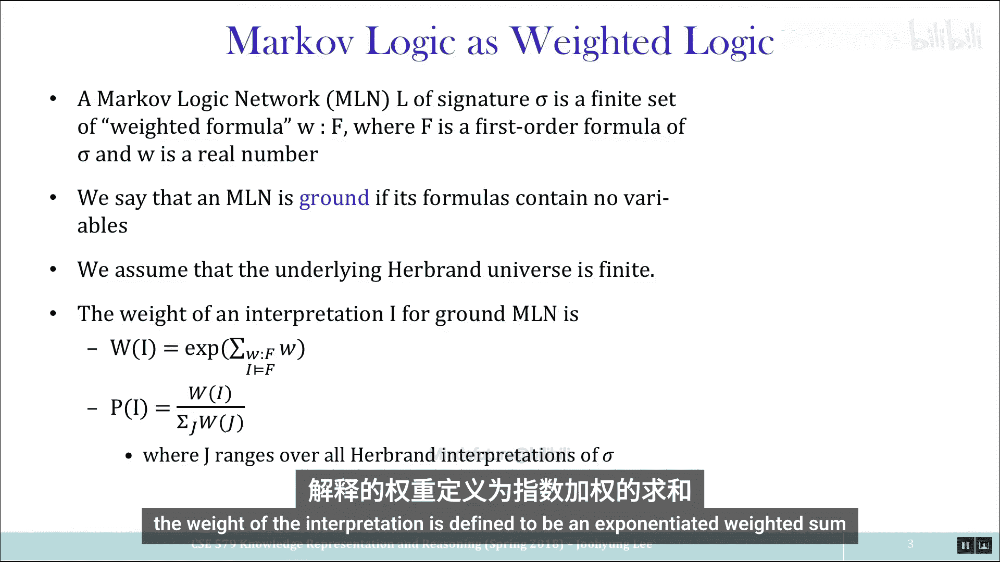

So here we had two formulas， France， a small cause is cancer and France。

Likely to influence smoking behavior。And if you have two constants， two object constants， A and B。

 then we can ground this formula and that gives us six ground formulas。

Okay and so there are actually many interpretations possible so two to the power six interpretations are possible。

 but among them is actually this guy so everybody is friend to each other and B is a smoker but A is not and both of them do not have cancer so how likely is this state so in order to find this we have to find the weight of this interpretation。

So for that， we have to go back to the idea of satisfaction。

 so does this interpretation satisfy the first rule？First rule in the ground， first ground rules。Yes。

 second one。Plus。So this is satisfy， this is not。This is。😊，satisfied because smoking is false。

 so false if and only is false， right， What about this？Yes。What about this？Friends A B is true。

 but smokes A is false and smokes B is true， so this is true implies false if and only if true。

 so this is false。And the same way this is false。 So there are among the six rules。

 there are only three rules that are true， and the rule also has different weight。

 So how can you find the weight here。So this is e to the power of 1。5 from the first one。Of and。1。1。

From the third。And 1。1。From the force。Okay， so this is the weight of this interpretation。

And this is only one of the 64。 if can go over all the other interpretations and sum up that gives us the partition function or the normalization factor that you see。

Okay。Are we together？Okay。So that's it， let's actually do one more exercises， okay？

So here I changed this to be the。So now， for some reason I said A is a friend so B。

 but B doesn't feel A is a friend， and cancer， B is true， but smoke B is false。Okay。

 and both of so A is now the doesn't have cancer， and A is also not the smoker。 Now， what is the。

AW of this interpretation。So。What is the weight of this interpretation？Okay。

 so we have to check whether this interpretation satisfy each of the formal lab。

 so let's go to the first one does it satisfy yes satisfy the second well let's say so this is true because it's what false if implies false right what about the second one yes。

What about to the next one？What about the next one？H next one。意思。

Smoke A is false and smokes B is also false， false， if and only if false is。是。复杂说清楚。嗯。What。

Last one이었 true。Okay。All right， so this is actually most likely state。

Because every rule is actually true。 So this is。

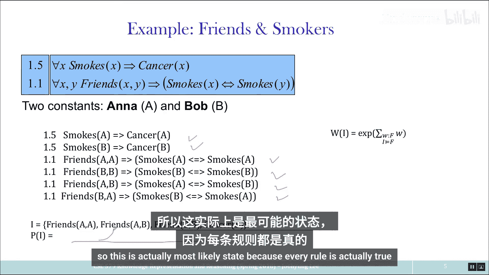

Okay， this is up。Not easy。

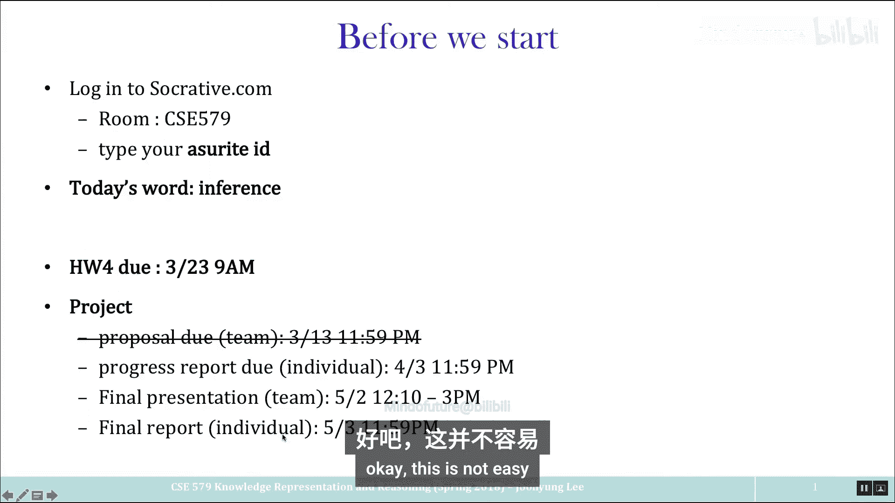

Okay。Every device tool has gotten。ウクness。So this one satisfies all of them， so this is 1。5 times 2。

Plus。不是。So each is the power of 3 plus 4。4。Because that's the sum of the old rate。Now。

 if you look at this， it's a bit weird actually， if you think about it。

This is highly likely the case。But。Be is not a smoker， but bees still have a cancer。

Okay so I'm not going into some weirdness in this language。

 but that's actually the next topic when we go into LPMN I'm going to revisit this example and see there's actually certain weird thing going on with this example okay so semantically there is something going on here but let me just stick to the current definition。

Okay。All right。

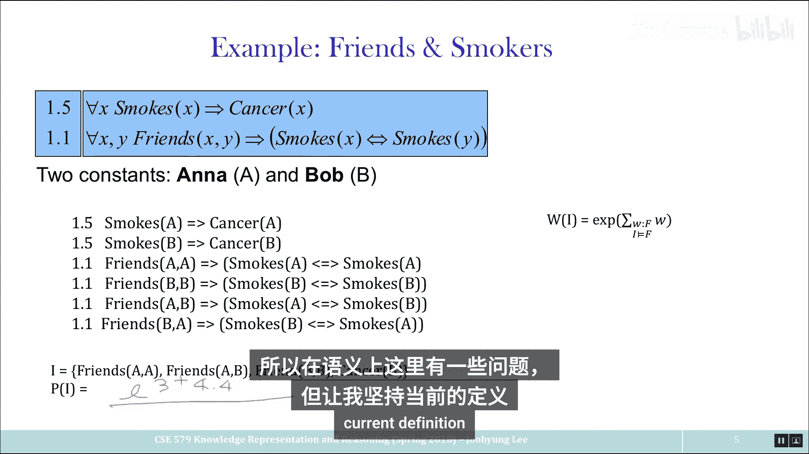

So that is actually the view that we had， and now we will look at the view in terms of Markakov networks。

So this is actually combining the logic and probability。

 so the previous view that I introduced is more close to the logical point of view Now the second view is more close to the graphical model' point of view。

Okay。So this is the slide that you saw before， so we represent this domain is similar to the example that we just talked about in terms of log linear model and I said that you can define so when you write log linear model you have the exponent of this function is linear function some over this WI times FIX now this feature is we assume this is Boolean so it's either1 or0 but how do you define feature when this feature becomes one。

And what is this feature becoming one means that can be up to you and if you do some way like this。

 so you can say that this feature express as one if smoking is false or cancer is true。Okay。

 so then in that case， this feature expresses， so it's one， otherwise features return 0。

Okay so that is one way to write the Markov networks and what we do in Markov logic is to take this view。

 so we'll define features in terms of the formulas。

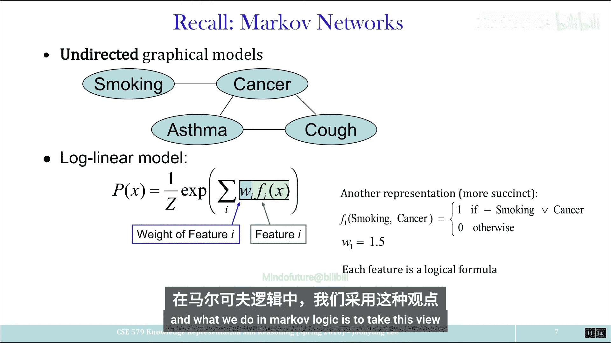

Okay， so how do we do？嗯。So we are given a micro logic which is a set of first formulas。

 and then we also say what is the ha universe， the set of constant object constants to denote individuals。

Okay，Now Markov networks is just a graph。 It has a node and edges。

 So each node is actually ground atom in the logic。Okay， and each feature is。

Each feature is actually associated with each ground formula。Okay， so let's actually look at。

 okay let me just go into this and I'll show the example in the next slide。

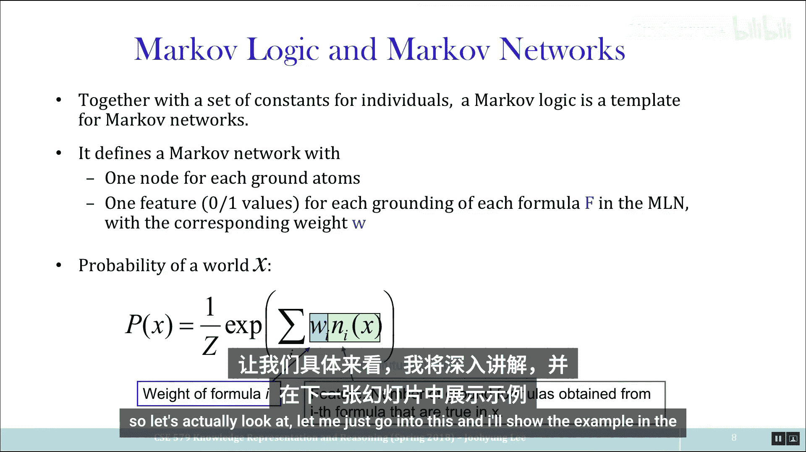

Okay， so I didn't actually define clearly yet， so this is actually the idea。

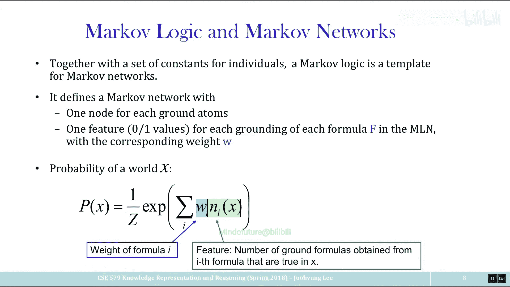

So when you do the weighted sum， Okay， so weight no formula。 So you in Markov log。

 you have the weight of the formula。 So this that weight is actually the weight in the Markov networks。

Okay。And the feature is now we will use NX to denote the feature and what is this feature。

 this feature is non ground formulas that is coming from the I rule。ForI formula that are true in x。

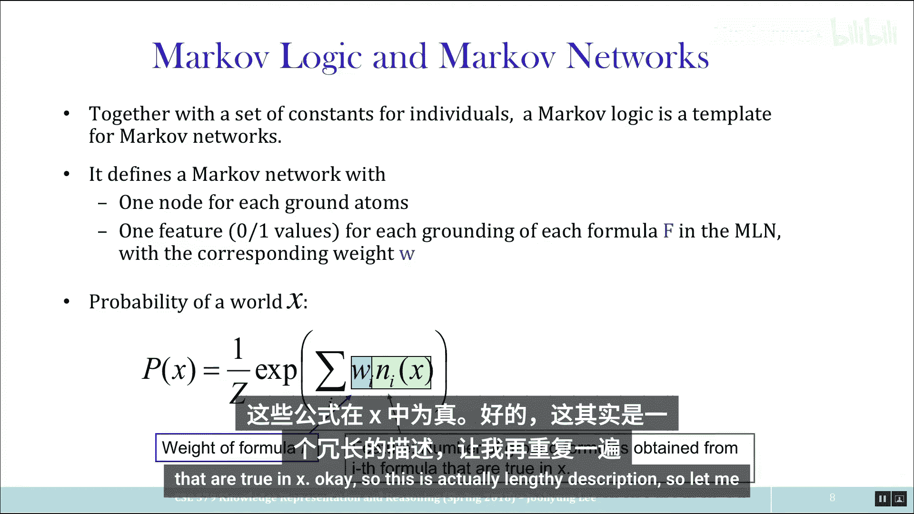

So this is actually lengthy descriptions， so let me actually repeat。

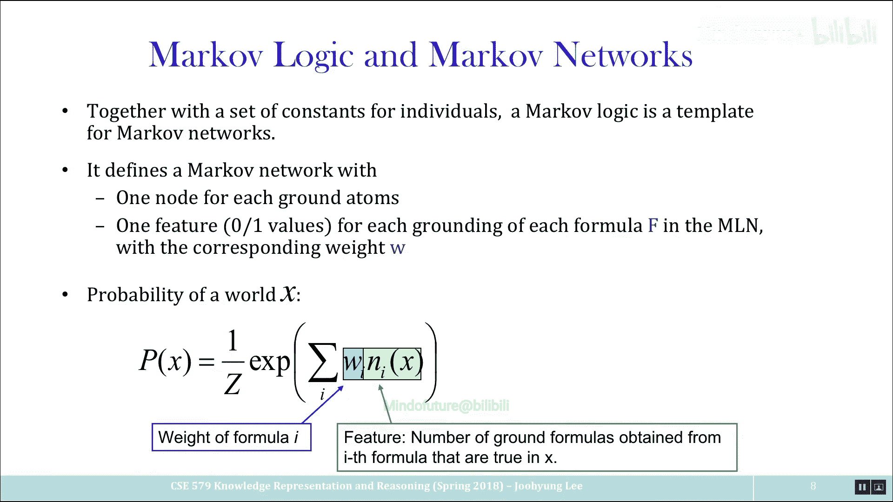

So in manco logic。You have W。

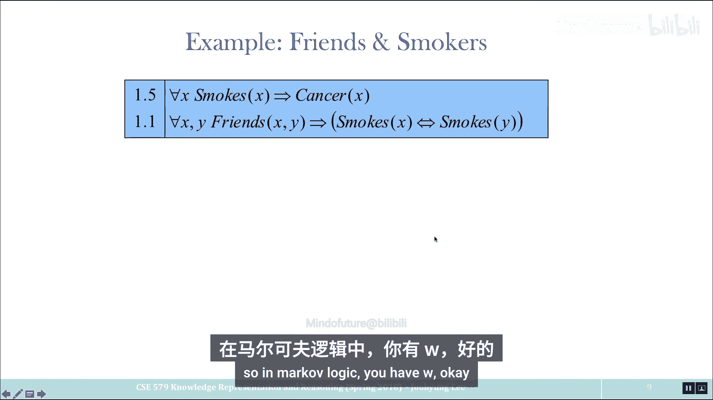

You have WI。F。Okay， so WI is a weight， which is some real number And F is a formula。 Now， this F I。

Is non ground formula。Okay， so going on Barakov。So when you turn this Markov logic into Markov networks。

 what happens is each of these nongr formula is considered in this weighted sum。

 this weight is actually the weight here that you write。And。In this case。

 you look at the number of ground formulas that come from FX。

 So if you replace the variable x with all ground instances。

 then it will generate multiple grand formulas， right， How many of them are true。

 the number of grand formulas that are true， that is the feature here。O。そう。

Let me actually go through the example to illustrate this idea。

 and then we'll come back to this definition to see。

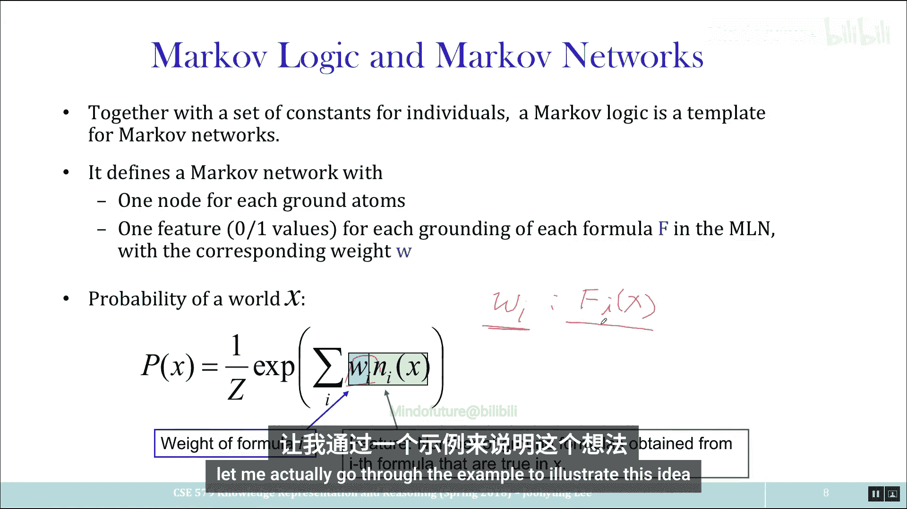

So now I'm going to draw the Markov networks。Okay。So before we are giving the ground formula but now let's look at Markakov networks。

So there are two object constants， Anna and Bob， okay so I said each ground atom is a node in the Malov networks。

Okay。So from the first one we have smokes A and Can A， smokes B， cancer B。

 though these are the nodes right from the second one we have friends AB， friends A A， A B， B A。

 BB right so this is actually all ground atoms in the Markov networks right？

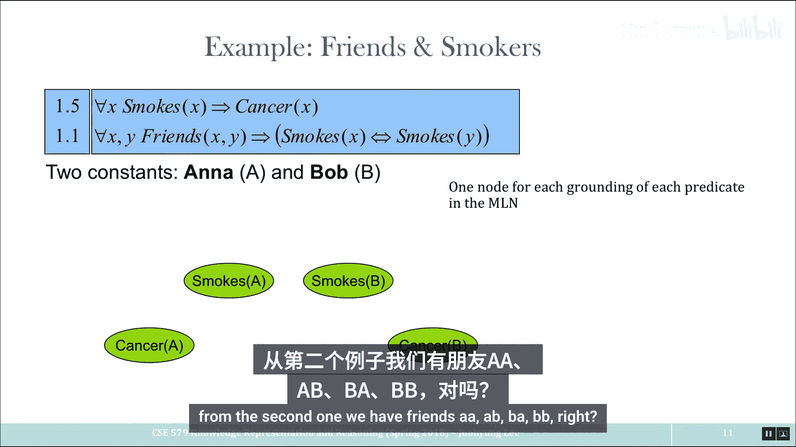

Are we done？Okay。So here we wrote all the ground we consider all the ground atoms， basically doing。啊。

Yeah， so。It's called holand base， but I didn't introduce that Tom， so let me not go into that。

 So this is just a ground at。Now we have to connect this node the way that we do。Is each。

Look at the formula， Okay， and the formula may contain multiple atoms。 Connect them with the edge。

 Okay， so for instance。If you。Have smokes， x implied cancer X from this。

 you can actually draw two edges。Okay， so what could that be。Yeah， so smoke and cancer are related。

 right？smokes A implies cancer A is one of the ground rules right， So from that rule。

 we know that these two atoms occur in the same formula， so just connect those。Okay。

 same way you have a smoke bee and cancel bee， right？That's it。 So from the first rule。

 if the ground atoms occur in the same formula， just draw the edge between them。

 and this gives the click。Okay。Remember， what we did in the Malov networks is to assign the potential function to the click。

 and this is the click that we consider in。Mar of logic， okay？All right， then the next one is this。

 or let's say smokes friends。What should we do， Let's actually look at x equals a and y equals B。

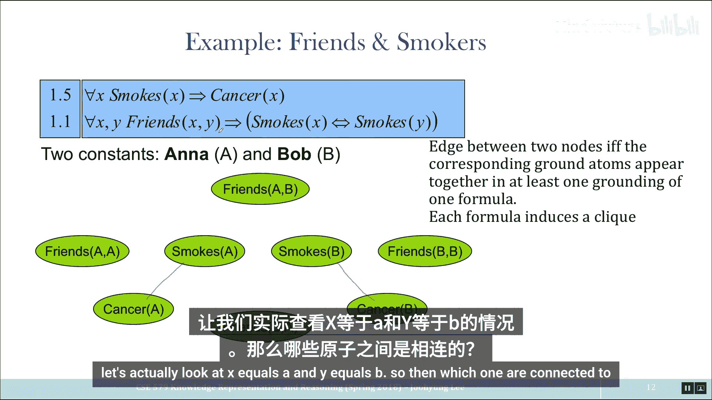

So then which ones are connected to each other？

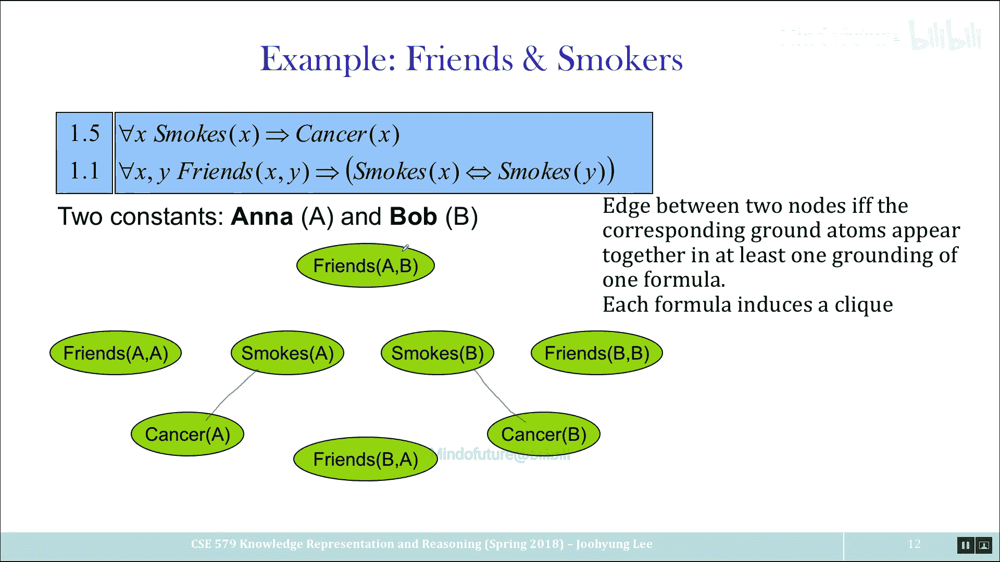

These three， right， Fri A B implies smokes A if smoke B。

 so these three atoms participate in the same formula， so we draw edge between them。

So this is another click and whose value potential function will have this value 1。1。

hich is not exactly 1。1， but this weight will be 1。1 okay， similarly， if you have friends B。

 then you have this， right？Also， it might be a bit on intuitive， but x and y can be same。

 so friends AA implies smoke A， smoke A， so that means you can actually throw this edge。

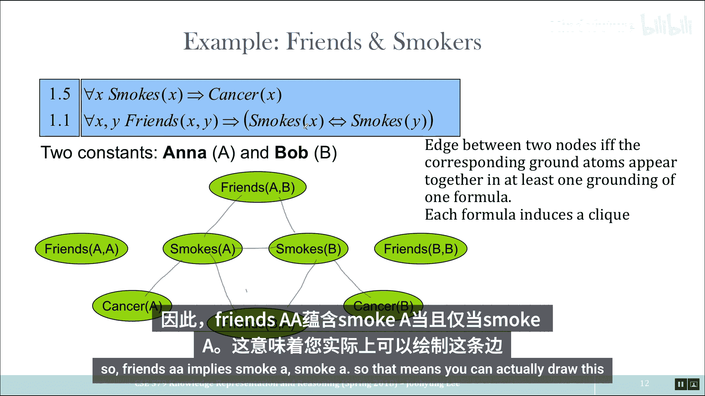

Right。

A we together now？Same way， Fri BB implies smokes B if and only smoke fee， so this is it。

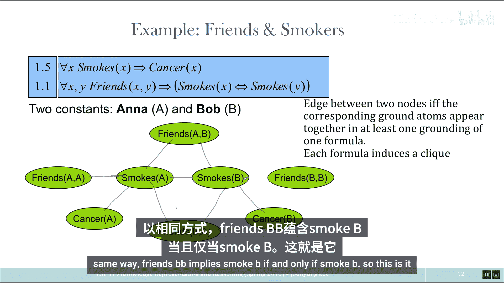

Okay， so when you write this thing， okay， you can now understand what potential function that we are going to consider for the click。

 so we look at this click and don't know that I can。

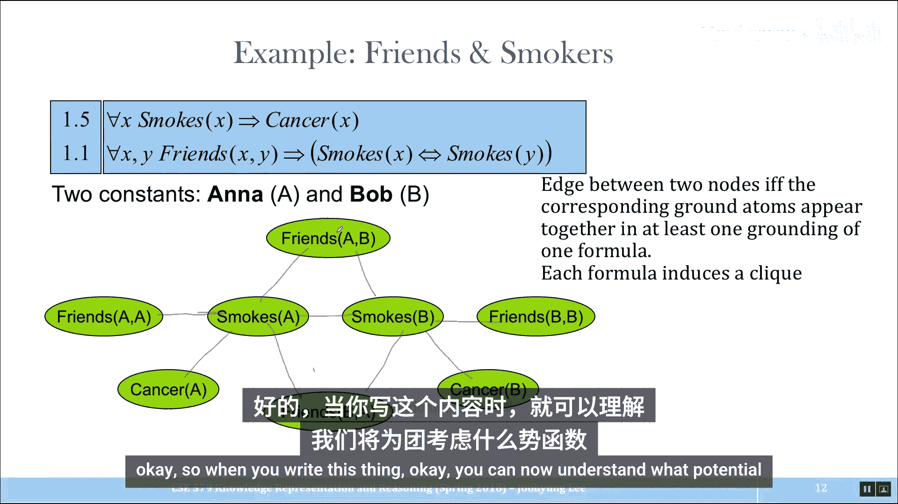

Chaing the color。 Let's actually not part the song。 So this is one clip。This is another click。

This is another click。 This is another click， another click， click。 So we have。this。Was this six。

 yeah we have six clickiques here。Okay。Are we together。So then it's just the monoov networks。

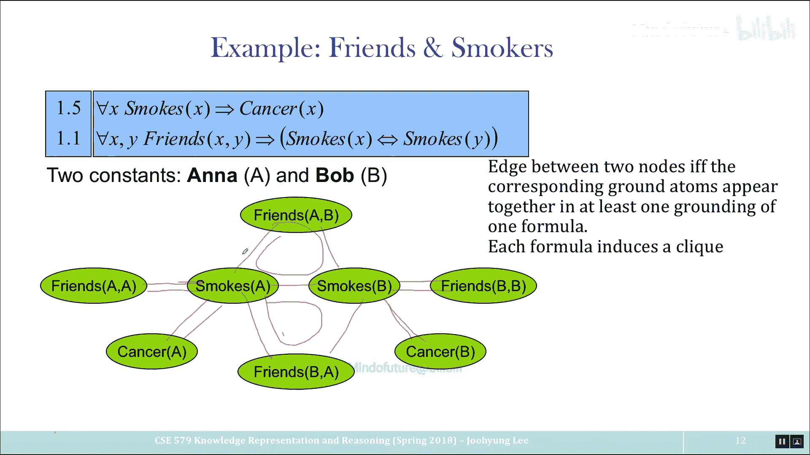

Okay。Okay， so let's see how this idea works。

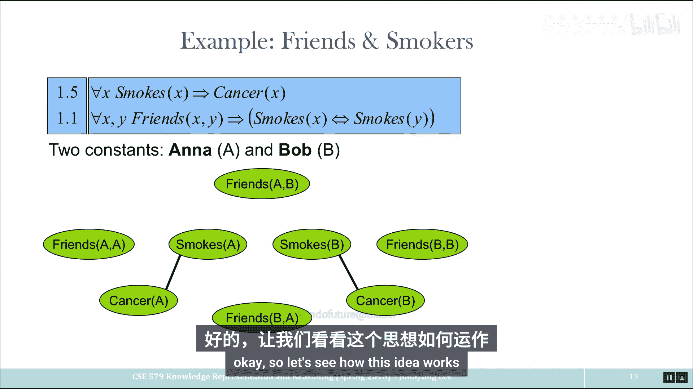

说。This is the same example， and note here that the function is now written in terms probability is written in this form。

 where this WI is the weight of the formula here， and NIX is how many grand formulas are true from the I formula。

Okay， so with that in mind， let's try to find out the P of x。 So here I give this。

So I denoted what is the true value of each item， so it's actually the same as what you saw before AB is everybody's friends to each other。

And。B is the only small cup。Okay， so this x。It's an interpretation。Where啊。Friends。

It's not actually that easy to。Right。B A。And。How can one write？利息。Okay， and smokes。毕。Okay。

 so this is the interpretation， same interpretation that you saw before。

 So now let's actually look at the P of x here。嗯你 know me justス 스파イ on the go。公开。So， p of x。嗯。Okay。

 so this is a big number， so I'm not going to compute this， but let's look at the thing。

 so this is actually the weight。But we added up before。

 but it's actually that slightly different way。 So we look at the first one。Okay， so W1 is 1。5。

 right？Okay so it's 1。5 and I have to multiply this with the number of ground formulas that come from the first rule that are true under thisinpre。

 So how many grounds will start coming from the first rule？Two， smokes A implies cancer A， smoke B。

 implies cancer B， How many of them are true under the current interpretation， one， okay。

 so that gives me one。Plus。Now w2， okay so when I equals2， w2 is 1。

1 and I have to count how many grand formulas from the second rule is true under this interpretation。

 how many are true？推。3。不。No， we did the same thing before。That's actually22。Okay。

This is the exact same I mean， result， it's just a different way to calculate okay。

If you are confused， you can go back and check。All right。Okay， so let's do another exercise。Okay。

 so this is a second interpretation that I showed you before。Okay。嗯。Now with this one。啊。

Friends B A is no longer true and smokes B is no longer true， but cancer B is true。 Okay。

 so remember the second interpretation。 So we are going to do the same thing。

 but now what changes here is this right Okay， so formulaula 1， how many ground instances are true。2。

 right， Ss A implies cancer A is actually true。 Ss B implies cancer B is also true under this interpretation。

 So it's actually true。 What about the second one， how many ground formulas from the second rule are true。

4。そうで is。And of course， it's actually the same result。Yes。Yeah， this is a some。Okay， so the sum here。

Was for W I。W I and I right， and there are only two formulas here。

 which means that I have w1 times and1 x plus W2。Times2 x， that's what I show you here。咋没事呢？

A you talking about this or Z yeah， so Z is the sum of all interpretations I mean all the way that we so this is just one of them。

 but you can do the others okay， they're actually one， two， three，4，5，1，1，2。

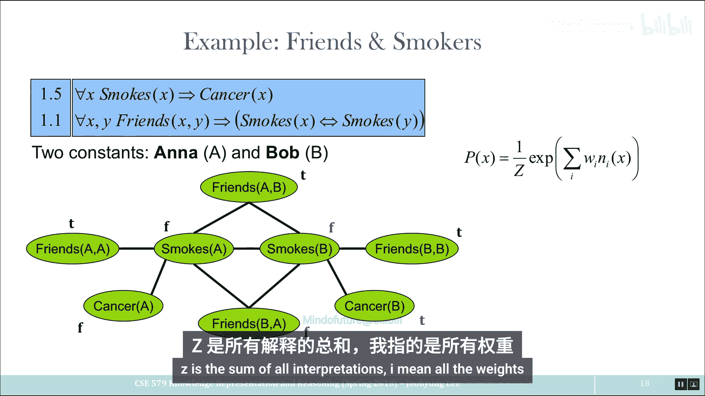

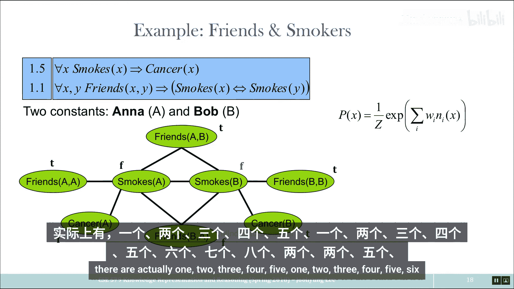

seven2 two eight interpretations that you have and I don't have time to write everything here。

And that's actually an interesting thing that priority computation is actually not that simple。

I am only writing the numerator， but for writing the denominator， I have to sum up all such weight。

Of each interpretation。And that's actually explanation。Okay。

So we'll actually go into that thing later。When we do the probability computation。

 we cannot really generate all possible interpretations and compute their weight that's invisible to do。

Most of the time。 So what we do is to use the same thing。

So you'll see later talk about how do we use the sampling to find this z value。O。All right。

 so that's see it。

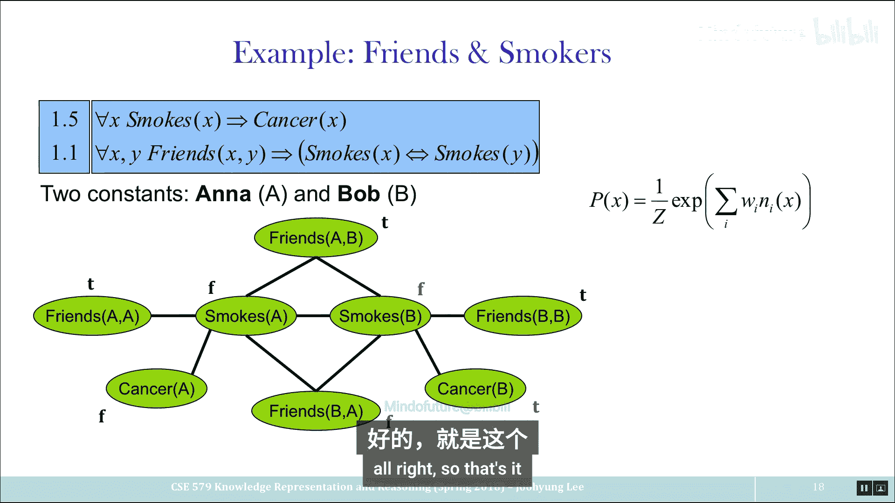

Okay， so when we look at the inference， how are we doing on time？属 good。Wice。So， for the inference。

In logical formalism， we used DPLL like algorithm to find exact assignment that makes all things true。

 but I just said it's in feasible to do that in the probabilistic setting。

So inference here is actually a bit different。What we do is to use the standard method that was developed in machine learning community okay with privacy graphical models。

 so there are two types of inference most of the time one is actually finding the most probable state。

Okay， so this is also called the map inference maximum posteror。

So finding the most likely state of the world consistent with some evidence。

 that's the one type of the influence。Now to do this first one。

 you don't actually need to know the probability， you don't need to know the z values as long as the weight is the maximum that you are done。

Okay，The second one is actually more difficult， you have to compute the foundational probabilities。

And for that， you need to know the partition function or the normalization factor。

 which is very costly。In most of the time。Okay。Now what I just said is probably two simplified thing。

 so of course， in principle， you can use the Markov networks influence to compute Markov logic。

 but there are actually more。

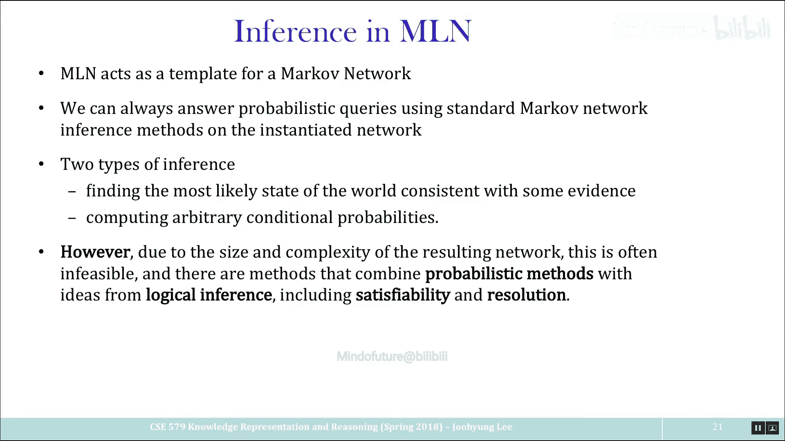

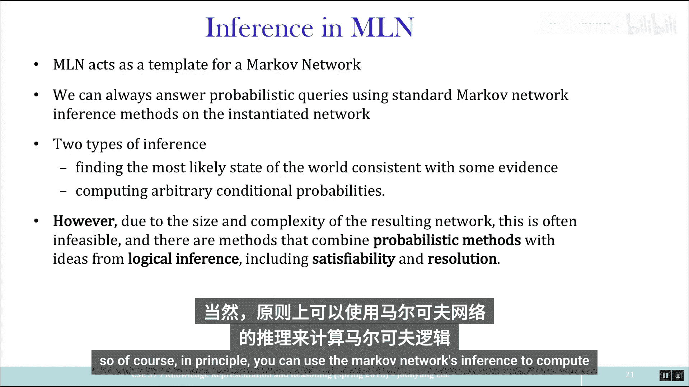

When the size becomes bigger and bigger， then that method also suffers。

 so people have found out that actually there is a better way to compute this using the combination of first logical inference and the proistic influence so that's like more advanced inference method that exploits the logical inference feature。

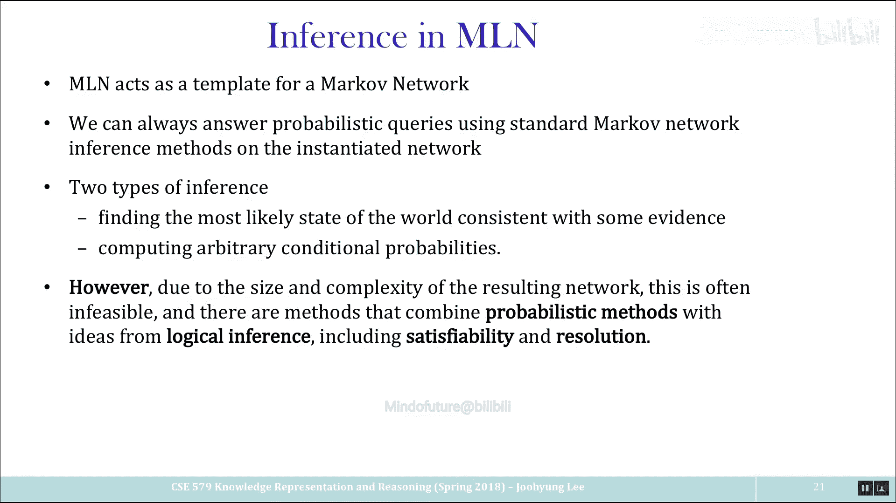

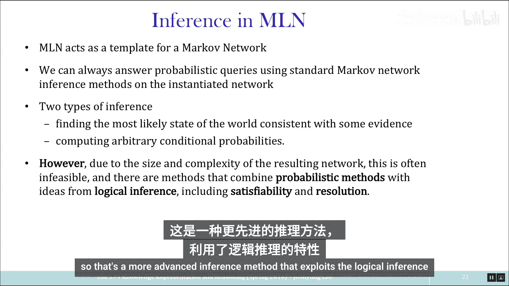

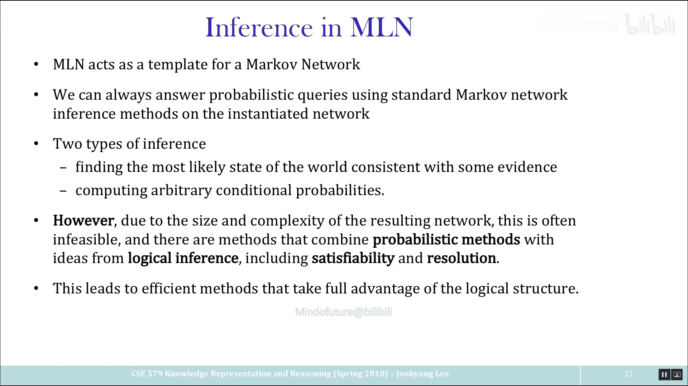

All right， so we'll talk about each of these two influence。

The first one is map inference and the problem is to find most likely state of the world given the evidence。

 in other words you know certain atoms are true or false。

 some subset of atoms are true or false and you need to find out what is the interpretation that gives the most highest probability。

Okay， what is the most likely situation given observing these evidence。

You can formulate the problem with this way arc max of y。嗯。Of probability of Y given x。

 So what is this thing。 So it' a conditional probability。 We are given evidence X。

And you want to know the probability of why being true。 Now。

 we are not actually interested in the probability of Y itself， but we are interesting。

 what is the assignment of Y to make this probability to be the maximum。That's what ArgonmX is about。

 his argument is actually maximized。The argument is to contribute to the maximum value。

So it looks like a probability， but it turns out that we don't necessarily need to know the probability to find out the value of y。

Okay， so let's see。Actually， let's think about。うドです。So。Let's just unfold the definition。

 So if you have Agon Max。喂hy。Okay， what is the probability of Y given next， How do we write this。嗯。

So this is。By definition。This is I W， I。And I。I'm going to use x as an observed variable。

So when I write N XY means the ground formula where x is already having this fixed value from the evidence。

In the same way， I'm only looking at those interpretations where x assignment to x is consistent with the given one。

Okay， so this is how you write。Okay， are we together here？Okay。

 so just look at the interpretation where the assignment to x is consistent with this x。

 we only look at those interpretations， we add up only those formulas。

Only those formulas wait and divide by the sum of all of them。Okay。So if we have this。

 what you will realize is actually， this is actually constant。Okay。

 once you have the x assignment of x is fixed， this is constant， so you can forget about the。Okay。😊。

Why isn that？Okay。So let me write here。So we can forget about the denominator。

 and we only look at the numerator part。But also if you look at the numerator。

 there is an exponential function， but we can forget about that， we can only look at the inside。

RightBecause exponential function is monotonic function。

 So if the argument your exponent is actually maximal。

 then the exponential function is also maximal and vice versa， so we don't need to worry about that。

Then what we do here， we don't actually so finding。This is actually。

So finding the value of y that maximizes this one is actually the same y that maximizes the probability。

So we don't have to consider the complicated Z and exponential function。

 You can just look at the linear function here。Right。So this is the writing and if you do that。

 this is actually just like a weighted max set problem， which I'm going to explain soon。

So we know the satisfiy problem， which is given the set of causess。

 you need to find the satisfying assignment。OkayNow weight is set is some of the clauses will be。

 I mean， those clauses will have the weight， and you want to find the assignment that maximize those weight。

Okay， so it's actually exactly the same problem here。Okay so for instance。

 in the weighted set problem。You can say like1， P or Q，2， nu P and R3。就国。完じないです。

Now you have to find an assignment that satisfy all of them， but also next， I mean sorry。

 you have to find an assignment that gives the sum of the weight to be the maximum。Okay， so if I。

Satifies these two， then this eye will get to weight five。If this eye set is are only these two。

 I will get to values three。So which are is the better eye。The first one。Okay， so in that sense。

 they can try to find the maximal。meanThe interpretation that gives the maximumim weight。

Now in this case， you don't actually have to satisfy all the formulas as well。

 so this is exactly the same problem as Markov logic。In mar logic。

 there's actually more more to this when you go into the probability， but as long as you look at。

Map inference， then the problem comes back to this weighted set problem。O。

So one of the well known solve is max worket solve， and we'll look at the algorithm now。

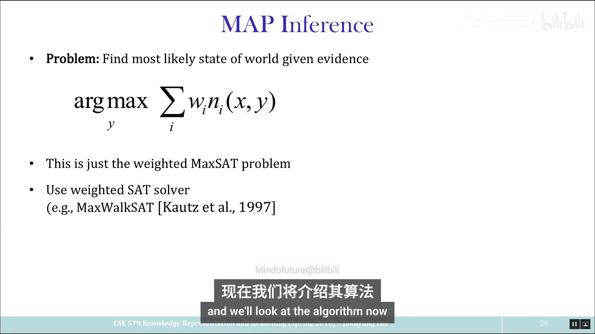

Before we do that， we'll first need to look at the W set algorithm where the max walk set comes from Max walk set is actually the modification of this algorithm。

Okay。Alright， so let's look at this algorithm together we will do。The exercise， or example。First。

 we already know one way to find the。ASatiing assignment that was DPL right in DPLL。

 the interpretation that you found satisfy all the clauses。Okay， now in the worket。

This is not necessarily so。Okay， or actually let's say this way。DPLL is a deterministic algorithm。

So you can if there's a solution you can always find。

 But this algorithm that we are going to look at now is the sarcastic algorithm。

 which means if you're lucky， youll find solution pretty quickly。 but if you're unly。

 then you may not be able to find。Some solution， okay？All right。

 it turns out that this algorithm is quite simple。It's actually simpler than the DPL。

And sometimes it works actually better。If you know that finding the solution that satisfyis all constraint is invisible。

 then this works algorithm works better in that case。On the other end， of course。

 if you want to do some formal verification， this kind of stochastic algorithm does not work because you may be just unucky to find the violation of some critical failure So the one that we evaluate here is the。

Number of satisfy clothess。If the number of sat clauses is actually the close。

 then this is of course the solution that is also generated by DPLL。

But here you may not find all solution it may not find an interpretation that satisfy all clothess now how do we go。

 so the first one， okay， so first， just randomly assign the truth values to atoms。

So input is actually the closest， same as D， and you have to find an interpretation that sat all clauses or most clauses。

So。First， you initialize the interpretation to be aing。

Okay and then you repeat this from J equals1 to max flips。If your solution。

 current solution that you have satisfy all closest， then there's nothing further than you can do。

 you just return the solution。 This is a happiest time you randomly guess and the guess guess is correct。

 Okay， if satisfy all solutions or all closest， then you're done。But most of the time。

 it will fall into this case below。So。Some clauses may not be true in that case。

Randomly select some clause that is false under the current interpretation。And call that close C。

Okay， pick one close and that is currently false。Okay。And with probabilityp。You do one of these two。

Okay。One thing is if this P in the first case is。You flip。One of the variables in C randomly。Okay。

Or you do the other thing。嗯。Find the variable in C that maximizes the number of satisfied clauses。

Okay， so let's look at the example。嗯。To be on the safe side， let me write the board。

So we are given this close。Okay。O。So let's assume PqR is。True or false， okay。Are we together。Okay。

 so this is just a random truth assignment。Okay， so let's go。

So does this interpretation satisfy the first course？No， second。是。Fourth is。O。

So there are three clauses that are currently false， actually， let's check。This is false or false。

 so this is it， false or false， okay， false or false， yes。あなき輸しょそ談です。This oneそに。Now。

 we have to randomly select。From close， okay。So let's actually see， so these are three possibilities。

 so you have to do random selection， let's actually choose this guy。Soq or I。Okay， and。

So that's our current C， the core C that we selected。And with probability PPP。

 we can do these two things。嗯。So let's assume that we are in the second case。Okay。

So you can set the EP in some ways so let's say 0。5 and you flip the coin and if it is hand。

 you do the first， if it is tail， you do the second。

 so it turns out to be the tail so we'll do the second one because that's actually more difficult。

So what we have to do is we have to look at the current variable and see that maximizes the number of clauses when you flip it。

Okay， so let's consider two possibilities。If you flip Q， that will be the one， one0。If we flip r。

 then will be 101 so each of them is coming from the current1 right so current1 is 100。

 If you flip Q， then it 110。 If you flip R it will be 101 are we together。Okay。

 so we have to choose among these two interpretations that maximize the number of satisfied clauses Okay。

 so let's check this if it 110 is it true？你せ true。Is it true。Is it true？O。So。

The number of sat causes is actually a tool here。Let's go to this101。放次。101， this is false or false。

 so this is false。是。その。不错。Okay， so which one should we select？

R because R gives the more number of closest to be chosen。

 so we will forget about this and we'll select this as our current solution。Okay， and then we repeat。

Okay， so let's go back。So now we have to find again whether this current solution satisfy all causes。

 is it， of course not。The first one is not very fine。

So then we have to select randomly select the clauses that is not certified。

 but there's only one uns close， so there's no randomness here， so we have to select this one。

Okay and then you flip to coin and it turns out that this is head now。Okay，So what shall we do。

We have to select random thing here， right？And it turns out that you feel lucky。Let's just flip P。

Then we will get 0，0，1。Right。And then， repeat。Let's diss satisfy the first course。Yes， second close。

3。好是。都原判。So unlike DP的。きあ巨大にビと。So only just three iteration， you can find the solution here。

Theres actually some reason for this thing， So this is kind of really search' trying to maximize normal close。

 It doesn't necessarily mean that find you'll find a solution that are all there。

 but you're trying to maximize those local。啊。Part， it turns of that you are looking。

 if you are looking。肯定是。Which line are you talking about。で。別来。C。

 randomly selected process as a default in， are you talking about that？

There are times when we randomly flip a variable and there are other times when we flip to maximize this。

So this line is random。This line is just randomly select。

 so that if there are three random clauses three clauses that are not true。

 then you randomly select one of them， right？This thing。Is。The current's close， this is close。

So for instance， we have Q or R。 There's a clause。 It has two atoms Okay。

 and choose one of them randomly and flip is value。 So if Q was here0 and 0， right。

 you select Q and flip it that becomes one and other variables are the same I't understand random flip maximize that's a probability So I said before with probability P。

 meaning that you have something probability in mind this is a you before。So let's say 0。5。

 if it is had， then do the first one， flip randomly directly called variables in C。其实听。对。

It's not necessarily the case， if you only trying to do that， this is a green search。そいうなくけにするか。Okay。

 so you have to sometimes do。3 here。So you can think about it if you do the climbing on the hill and if you try to reach to that only。

 you kind of stuck there so you can actually find a better solution if you do that。

So that's a random list there。Yes over。base solution that we call and we that。

If we don't find the solution。By the next please。Yeah， then yeah， that's actually interesting。

 so that's actually my next slide。So you do all these situations， so next flip was done。

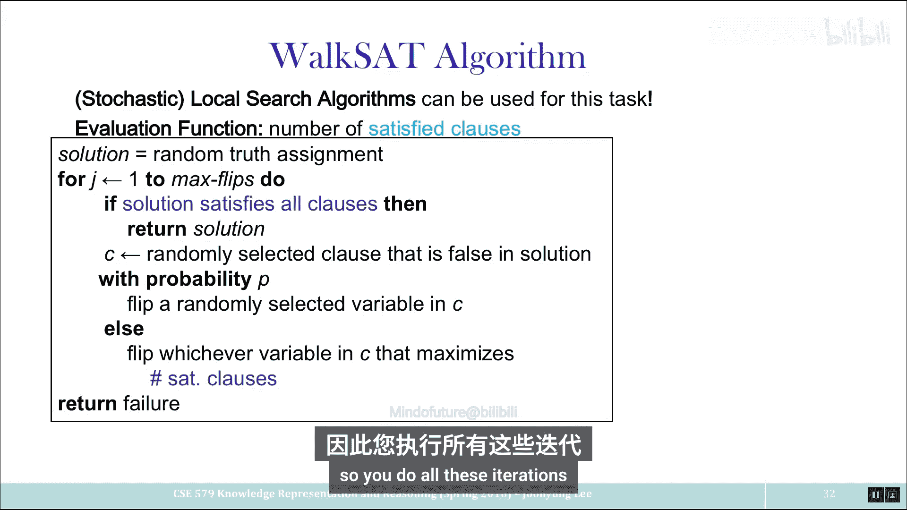

Okay。O。So what is the thing， Let's do actually the socrative。Yeah。So， let me just open it。No。

This mortgage춰 있어。Okay， so let's see。The question is。

If the workSa algorithm returns failure after it tries max flip times， it increaseses all the things。

 what can this conclude？Okay， have we done？ Alright， so let's look at。真是。Okay。お是一。Okay， I don't know。

 Nobody selected C， okay， the answer is actually B。😊，Okay， and some people say yes， let's see。

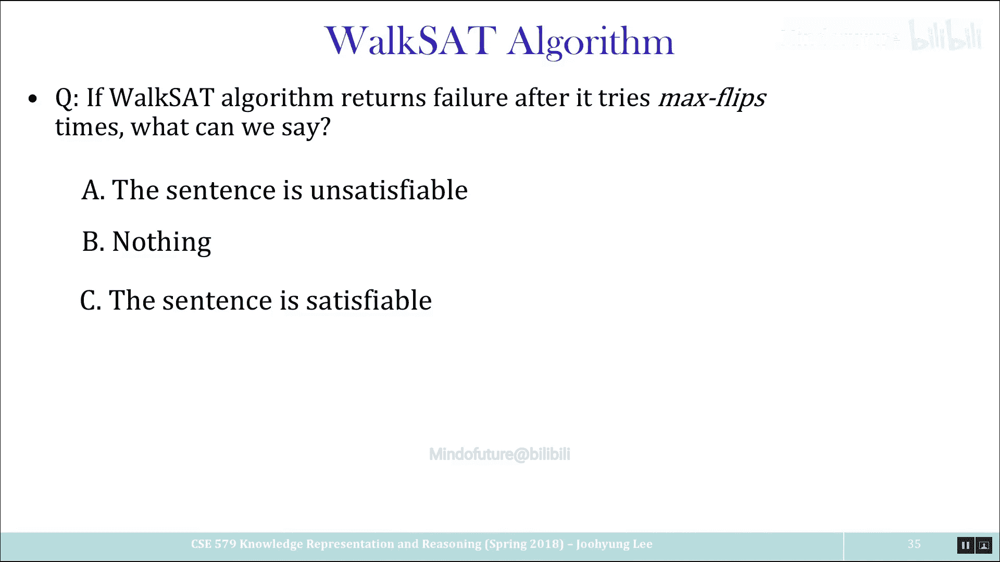

So I mean it's actually obvious to see if you look at the algorithm， if your max split is too small。

 then you don't actually have chances to reach to the maximum。

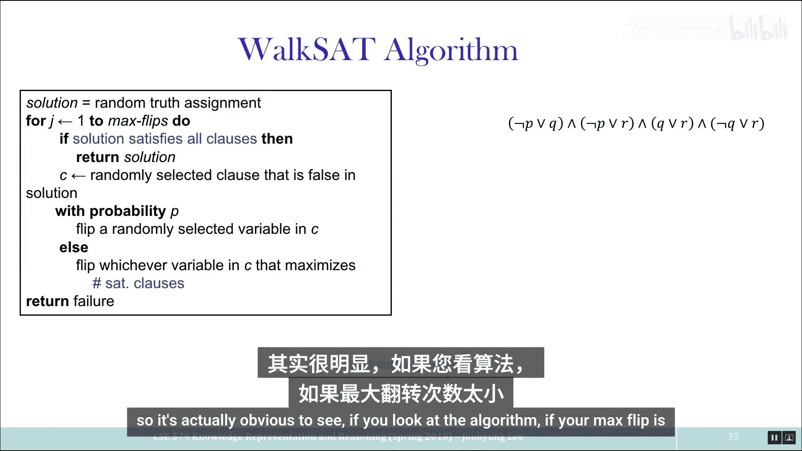

So that doesn't necessarily mean that the sentence is unsatisfiable。 You were just unnucky。

 You didn't try hard， okay， you didn't walk too much to go into the peak of the mountain。

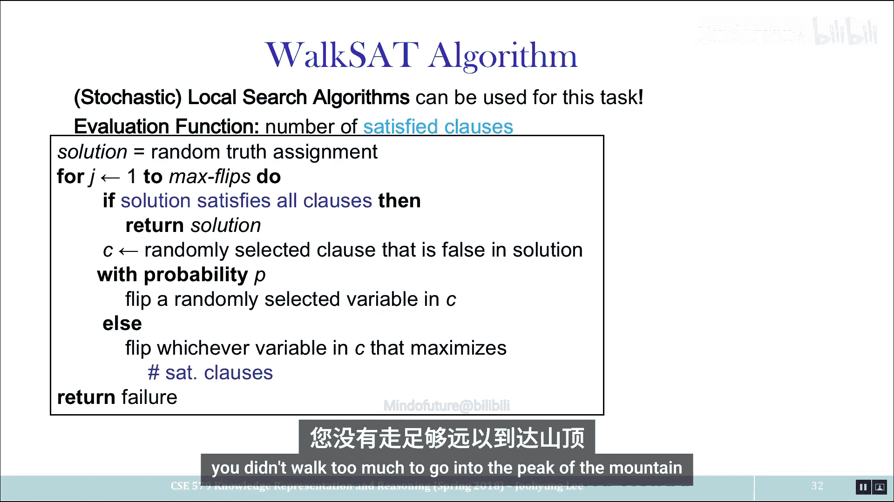

Okay。So you can actually say nothing。Of course， if you happen to find a solution within the next minute。

 then of course the sentence is definitely static viable because you found one example。Okay。

So this algorithm is actually very difficult to say when it fails。

 you cannot really conclude anything， there is no solution possible unlike DPLL where you exhaust all the search and you can prove that there is no solution。

So like the Home problem that you did， it uses something like that algorithm so that when you do the internal checking。

 the curry checking， there was no stable model。Unsatisfiable。

 meaning that the impairment is always true。That kind of reason cannot be done with theox。

On the other hand， of course， it has different application like the map inference that we do。

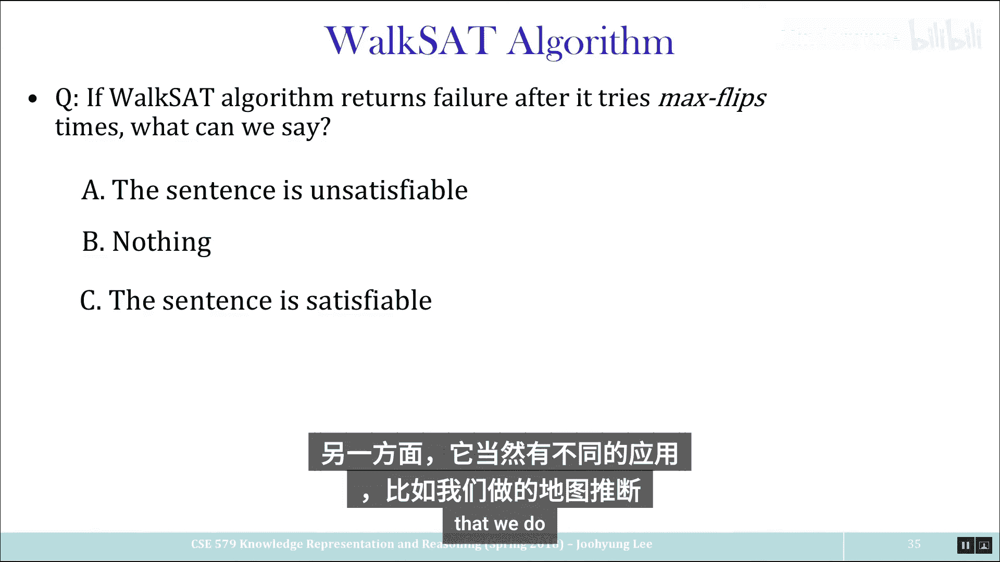

Okay。All right， I didn't introduce Max walket， but the algorithm metric is very similar。

The only difference is to what we want to maximize。So in the works and algorithm。

The what we wanted to maximize was the number of。そうです。

But now is the number of ways that we want to maximize。Okay。Let's actually play with that。Okay。是哦。

Maybe we can try to use the same example。嗯。Let's actually give the weight for each of the causes。

 so this is one， two。3。4。Okay。Can I find a better marker。All right， so let me just write。

 this is wave1， this is wave two， wave three， wave four。And let's say the threshold is 10。So。

 the threshold。都是 ten0。So that means we have to satisfy all clause。Okay。

 you can set session to be lower and that that's also fine。 But for this example， let's say 10。Okay。

So it the same way， but now we are changing the we changed the evaluation function。

 So initially P QR is 1，0，0。Okay， so what is the。ANumb of ways of the certified clause。Okay， so yeah。

 so look at this one now instead of this， I'm what I can。C。So weight off the sentence psycho。

We are not counting the close now we are actually getting the weight of that satisfied post。

 so this is actually cool。so currently we are satisfying all the courses。With weight 4 and。Now。

 we go into。So we check the if closes right， so is this greater than 10？No。

 so then we cannot return the solution， we go into the next thing。C。

 randomly select clauses that is false in the solution。So it's same as before。

 we already checked this。So here these are the false clauses we select random myth。

 but let's just choose the same random miss， which we select this one at see。Okay。

With probability DP， we do one of these things， but let's actually choose the second ratio as if it was a tail。

So click each variable and see that maximizes the weight of number set of causess。

 Now we actually consider these two before right Okay， so if we have this guy。

 then what is the sum of the weight。That's one plus three， which is all if you flip it。

 you actually don't improve， right， What about one。01。没的。Yes these guys are true。

 so two plus three plus four which is nine， this is better。

 so we don't choose this guy savings before we only choose this one。

Okay so we are flipping the R not the flipping the Q okay so then we go back to this and check whether9 is greater than 10。

 but9 is still not greater than 10， so we have to come back to here to select random closes that is false。

And that is actually only this one the same as before and let's pretend that we flip random neighbor let's flip P okay so then we get this right So if we do that what is the sum of the wave。

That is10 and when you do the upper part。10 is greater than equal to 10， So we promise this。

If we set the threshold to be nine， we could have finished it here， which is some optimal。

This is actually not very bad because we are only losing one from the sum of the weight。

So you can actually change this threshold if you don't even bother with this。

 you can be satisfied with these things。Okay。Are we together？Yes。You。Oh yeah， okay I forgot。没在这什么。

You can change to greater than or greater， but yeah， to be precise， yes， I meant。

When I do this illustration I was meant I had in mind this was greater than info。喂れ。

Any other question。

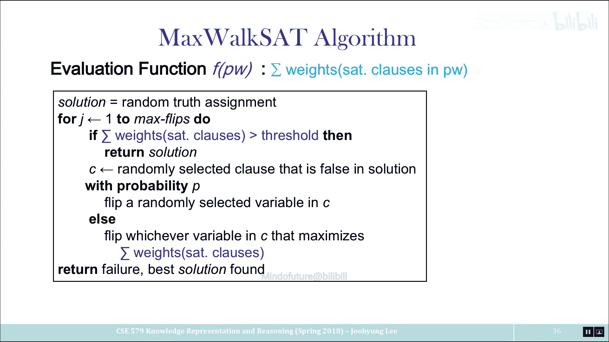

All right so I guess that's the perfect time to finish the next thing is the harder half of the inference which is how to compute the probability okay and then we're actually trying to use the LKE system that actually does this computation for you so you don't have to do this manually all the time okay so let me stop here and let me open the Soative。

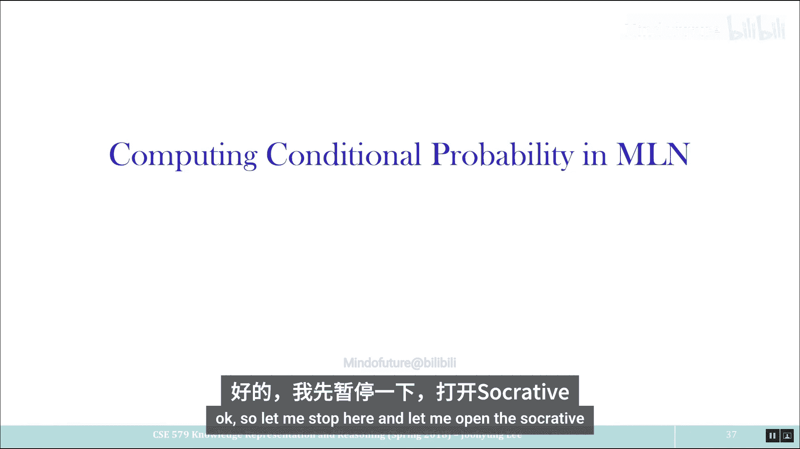