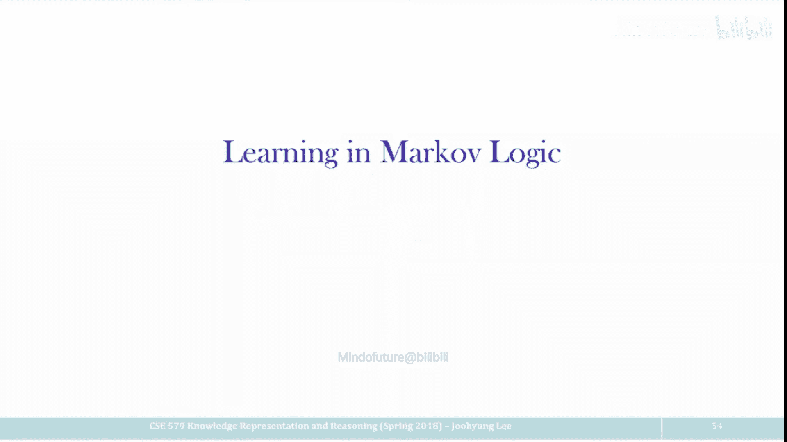

# 【亚利桑那州立大学】知识表征和推理 ｜ Asu Cse 579 Knowledge Representation 2018 p16 P16_Lec20 -BV1RTWyzfEQH_p16-

lecture 20。 so we'll talk about the second type of influence in Markov logic and I hope I can show you some demo on how to use alchemy。

 the system for computing Malov logic to do some inference。Okay。

All right so let's recall what was the inference problems in Markov logic。

 so Markov logic combines logic and probability， now we are exploiting the connection to the probability。

 so Markov logic we saw that this can be viewed as a template for specifying Markov networks。嗯。

So after you construct Markov networks， this is actually a there's a rich literature on computing influence in Markov networks。

 so you can use the standard method on those things in computing Markov inference。

 although it actually doesn't work out of the box so you have a lot of progress has been made in this area to find better inference than the typical standard Markov Network method。

We don't have time to go into all those things， so we'll just give you some talk about some glimpse of this idea so last time we talk about two things。

 one was finding the map state， so a most likely state given I'm sorry。

 most likely state that is consistent with certain evidence。嗯。Now。

 the other one is actually how to compute the probability。

So here is the conditional probability computation in Microsoftov logic。

So let's talk about very general things。 so first you're given some formula。

 you want to find the probability of a formula。Okay。

 so I give a separate argument here MLN just to specify which MLN that we are looking at。

 but you can forget about that， this is something that we consider under this Markov logic。

 what is the probability of certain formula to be true？Okay。

Now what you know is what is the probability that each interpretation is true？

So how do you use this knowledge to find out the formula's probability？

So if you go into the very beginning of this introduction to the priority that we talked before that we do the way that we do is just to sum up all those interpretations that makes the formula to be true so it's very straightforward so probability of the formula is just to sum up all the probability of the interpretation。

Okay， that's how we do。The problem with this approach is to store the interpretation。

 you need an exponentially large size table， which is not feasible okay。

So in this in the reasoning setting， there has been a lot of work in sampling method because we cannot actually do the most of the time we cannot do the exact inference。

 so we have to do certain an approximate idea to approximate method to compute the probability so。

The idea here is instead of computing the exact probability。

 let's just look at the samples and compute， derive the probability from the samples。Okay。

 so instead of the general population you just look at the sample。

 so S is the set of samples that you generated and then how many of them satisfies this formula that is denoted by S subscript F so S is the whole possible sample all samples that you generated and S F is the subset of those samples that sat this formula okay so that's the ratio of these two things give the probability of the formula to be true。

Of course， it actually depends on the quality of the samples if we want to make this idea to be true。

嗯。All right， so let's talk about very beginning of the sampling idea。

So you want to use sampling to do a lot of prediction， okay？Now。

 the basic idea is you draw some samples from some sampling distribution。

And compute some approximate posterior probability。

 meaning that you know certain thing is observed among all the samples you know that this evidence is true。

 then you only look at those samples and from that you compute what is the conditional probability we'll talk about the examples soon but basically this number should converge into the converge to the true probability。

Okay so why do we do samples so sample can be used in two ways。

 one is to do the inference as we speak today and next week we'll talk about the learning we use samples to do the learning Now for the inference。

 as I just said its invisible to compute exact answer for the most reasonable size domain so we are going to use samples to do Now learning can also use sampling when you don't actually know the underlying distribution so you you write this probability through probability from these samples okay。

All right， so how do we do the sampling？So the first step is just to find any sample some random sampling so let's say we have0 to1 okay just pick any number from  zero to1 you can implement this with any python code python function like random okay now this a number that you between zero1 is an arbitrary random number okay first of finding true random number is really difficult problem in theory and as well as in practice but let's assume that this can be for now but then after you do this you have to map into the sampling distribution so here's an example to illustrate this so we know that when you draw some maybe balls。

There's a 0。6 chance that you get the red ball or 0。1 chance it' green ball and 0。3 with blue ball。

 so suppose this is the underlying probability distribution that you know okay so how do we generate samples from this distribution？

The idea is we are going to map the U that youve extracted in the first step into this mapping。

 so if U that you got in the first step is between 0 to 0。6。

 we'll draw red as a sample and for the other two cases as similar。Okay， for instance。

 you've flipped a random generator and it gives a 0。 a3， then you will draw the sample， which is P。

Okay。So if you do sampling， the idea is when you do this first you got 0。

83 as the random numbers you got this one， the next time you got maybe 0。

1 okay as a random generator you got the first red and maybe also 0。2 next time。

 so you got the second red and so on and so forth。So if you do this in eight times less of that we get these samples and from this we can forget about the priority distribution table。

 we only look at the samples and to the posterior probability so what is the priority that something is true given something is true what is priority that something is true for for instance。

 if I know that the priority of the ball is either。Glue or green。

 what is the priority that gold with blue？Okay， so what is the probability。

So if you look at the samples， there are three bowls that is either blue or green， right。

 so that is three。And how many are blue？2， who there a two third。

 What about this in terms of the actual probability distribution。

This is actually not the same right because you have the these two right so it's actually 0。1 plus 0。

3 over 0。3 so this is actually 75% rather than 66% so it's actually slightly different the point is when you have more and more samples。

 these sampling probability， the probability that you obtain from the sample should approximate the actual probability。

O。Are we together。Okay what。So there's a lot of sampling method and I don't want to go over all these things。

 we don't have time to do that and that's actually not relevant for this class so we will look at only one sampling method and one category first。

 so what is called MCMC method， Markakov Ch Monte Carlo method and among these there are several algorithms inside this family and we only look at one of them。

Okay， but what is actually the general idea of Markov chain Monte Carlo Me。

 you probably have seen hard dis name a lot， maybe if you took intro AI。

 you have seen those kind of sampling I'm sure there are a lot of sampling that you studied intro AI like rejection sampling or forced sampling or。

There are a lot of things。Now， this sampling method works well for Markov logic and as well as also many other domains。

Now the strange thing about dis sampling is you're not really generating the random samples every time。

 okay， you start with some random samples and initially， okay that reflects the true probability。

Well after then， you select the next sample based on the previous sample。

So when you do this sampling， the second sample versus first sample are not very much different from each other。

 in fact， actually they are dependent。So when you draw this thing。

 what happens is you draw the first sample and then you generate another sample based on the first sample。

You actually slightly change the first sample。And do this thing repeatedly。

 and this chain is called Markov chain because as the name Markov implies。

 the sampling here depends only in the previous state。Okay。

And they actually very much alike each other。Now， this seems to be not in the spirit of random sampling。

 but it turns out on the certain assumptions about the MCMC， you can say that sampling。

 the samples that are generated from this method converges to the probability。Trollability。

If the sample size is， of course large enough。Okay。So let's see actually how this works。

 we are going to see the algorithm statement later， but let's start with a simple example。

This is a G sampling。And we have only three node B， A。Okay so as I said。

 the idea is the sampling is not independent from each other， each sample is not just from scratch。

 okay you are actually making the next sample based on the previous sample and what you do is only change one variable。

In the sample。Okay。So between the two。Now samplesles， the difference is only in one variable。

ItCould be one variable， it could be actually the same。Okay。All right， so let's look at this。

So first we have these three variable BAC， let's imagine that we start with this initial sample。

 so B is positive， I deoteed by this plus B plus a plus a so every variable all the variables are boolean and they are positive so they are one。

Now we want to compute the probability， which is this conditional probability。

 where C is already observed to be true。Okay now we want to prove this one。

 so instead of the previous sampling that I said， just generate all the samples and then look at only those samples that satisfies the condition。

 this is actually different we only generate samples that that makes the condition to be true。Okay。

 that's actually one advantage you don't have to necessarily generate unreasonable samples okay。喂。

풀스이죠？Okay， for now for simplicity， let's assume that each variable can be sampled in uniform way。

 so half and half， okay if every thing is there is a choice then let's say half in half choice okay。

All right， so initially we are given this sample， so B is positive， A is positive and C is positive。

没。The procedure actually alternate between the non evidence variable here evidence variable is C C is observed。

 so this is called evidence or condition， and there are two non evidence variables which is B and A。

 so the procedure will alternate between B and A so B select the variable select。The value for B。

 and then select value for a， select value for B， select value for A as so as so first。Okay。

 and in all those sample C will be fixed to be positive。Okay， so this is the first one。

 you don't touch on the CP po， but let's actually start with B， let's do the sample B。As I said。

 it's a 50， 50%， so given this thing， A and C is to be fixed。They have fixed to be positive。

 but for B， we can select either positive or negative or1 or0。Okay， are we together？

So here it turns out that here the A and Z observed so they don't change when you do the sample。

 we are only sampling one variable and sampling one variable is actually pretty straightforward to do and it turns out that it is maybe the coin was flipped to tail so it is narrative so we got the next sample as I said the first sample and the second samples are almost similar except for the part B right？

Okay， good， now time and next time we are going to sample a。Okay， so so。

 so now the second sample is minus negative v plus positive positive C。

 So we are going to sample a now okay， and a has half and half chance to be true。 turns out that。

It was negative though。The coin was again tail。 So now we select another sample。

 which has B to be false and a is to false and Cs。To be sure。 So this is an example。Okay。

So we got three samples and then we repeat these things over and over， so we do the sample B。

 okay again you have to fix a to be negative and C is positive because that's the current sample and now we have to select B。

Okay。Turns out that B is again negative， so it is not really 50， 50 chance。

 but somehow even though it is 50 50 is is possible to generate this okay now you go to sample A。

 then you have to fix B to be false and C to be true and you have to sample a or this time again false okay sample B or this time is true。

えそ。Okay。So you got 1，2，3，4，5，6 samples。 So what is the probability of。啊啊啊。Okay。

 let's say what is probability that B is true， given C is true。唔。What is the probability？So。Yeah。

 we have six samples， so that's actually the whole sample， how many of them has be to be true？2。

I think it's true right， the first and the last one has be to be true。So there's a one third chance。

Okay。NowAs I said， I meant this to be half and half chance。 So that means P of。B。

 given C is actually the same as B because he's actually independent。Okay。

So so I was expecting one half， but from the sample I get one third， which is not very wrong okay。

But this is anyhow very small samples。O。We together。Goodそいう master oneテれ。All right。

 so here is an algorithm for keeps samplinging。Okay。

 so just to recap what we have done in the example， so first we call it state。

 okay each sample can be called as a state， so first we actually do random assignment。

And then we are going to generate a number of samples and samples is the whole number of samples that we want to generate。

And what we do is for each random value x， sample x according to。

X a probability of X given is neighbors。Okay。And this X。We'll update the current sample。

 so that will be the new sample and we iterate this over。Now。

 the algorithm actually doesn't say about the condition part， but you can actually easily add that。

And when you say for each random variable X， we only talk about the random variables that doesn't involve evidence variable。

Okay。Are we together。Okay， good。All right， so let's look at another example for this。And actually。

 before we do that， I told you that sampling one variable。

 given the current sample is actually easy to do， but let's see how easy it is。Okay。So here。

The idea actually works well if we can compute the next sample easily。Okay。

 there are some cases that MCMC Meso does not work when finding the next sample is not that easy。

And also， it doesn't reflect the assumption about MCMC。

 but we are not going to talk about that here today。General idea， again。

 repeating this for given the number one to n， we are going to sample the value of Xi given the rest of variables while fixing the evidence。

ok。是吧。嗯。Let's actually look at。How we find。啊。The priority。Of a， given B CD， So this is actually。

 let's say the first step， suppose you are going to sample a based on the current assignment to PCD。

O。Are we together。Okay， so here a small letter ABCD represent particular values assigned to the random variables。

 capital ABCD。Okay。So what is this probability？Now we are talking about this， okay。

 we are giving an example of this probability。So， here。This is conditional probability。We know。

The priority of A，B，CD。Div by the case when a is either true or a is false。阿 together。So here。

I'm going to write this as a。This a can get to value either 1 or0。

 and we have to add up those two probability。Okay。So in the numerator denominator， you have P， A，B。

C D when A is true。While BD has a fixed value， plus a is false and BD again have the same fixed value。

Are we together？Okay。Alright so。In fact， it turns out that we don't actually have to look at the probability。

 we can actually look at the unormalized probability because the denominator for each probability is the same。

Okay， so let's actually just look at this a normalizedized probability。

 Do you remember how do we compute the numerator？How do we find the property of。

ABCD in the gift distribution like here。Multiple life so。This gives me51。AB。Times。5 2 B C。Times。5。

3 CD。By4。D。And that takes write 80。Okay so this is the numerator。

 The denominator is also the same where it actually has two tos。Okay， so here a。I want。Maybe。Myイ2。す。

3。For。你。Okay， are we together here？No， surprising thing。What is the price here？

What is a surprise in this equation。Okay， let me show you what this that。They have the same factor。

actually two。Common factors。This can be canceled out。Now let's look at what remains。Okay。

So if we do that。You will get。51， a。548。And the numerator here。I's just。Okay。

 let me just write real when here because it's not small， so51。Positiveivity。B。I for positive A。Plus。

Nivity。Okay whatever the value of B& D is。Okay。So if you want to compute the probability that a being true。

 then one of them is already in the denominator。so what you have to figure it out is actually only these two guys you have to know。

What is this value and what is this value， then you can compute the probability of a being true given。

Okay， so in other words， what happens here is all these things。Re啊。Okay。

 is's actually proportional to。です。Okay， so the last equation。Okay。

You can say that the priority of a being2 given BCD。Its proportional to these two factors。Okay。

 multiplication of these two factors。Okay。Which means。When you look at a。

 you don't have to look at Z， I'm sorry， you see， sorry because。B and D are the Markov blanket。

 and that gives enough information about A， you don't have to know。

Now let's think about this in a bigger picture， so suppose a is related A is connected to B and D and C is connected to maybe 100 other nodes。

They that here。So what this sampling means is you don't have to look at all this 100 plus c node when you do the sampling。

 you only need to look at the neighbors of A。To find the next sample。

Wwhich is typically small in the worst case， of course。

 it could be the whole if it is fully connected graph and the markov blanket is actually to whole the rest of the network。

 but in many cases it can be localized。And we actually talked about this before when we talk about the。

然后啊。The theorem。That guarantees between the independence assumptions and the Gi distribution。Okay。

 so this is actually the same idea。Perhaps it's easier to look at the examples， so let's do that。

 but I want you to remember this fact。Okay， so given the whole derivation。

 what comes after the last step is to find this next example， you only need to know the relationship。

 I mean we only need to know the anomized。But very do。啊。Lastて。あ未置中で。Okay， so from here to here。Okay。

 so。Okay， so if you want to know that P is。What is the sampling to be positive given BCD？

Okay so B and C and D has certain particular values， 100 okay in order to do that。

 what the last thing is saying。Is you have to know51。Positive A B。P4 positive A。

 D by by p1 positive AB， which is the same， I think， as the numerator。Okay。

 when this is the probability that you're going to get to positive a， there's also the negative v。

 which is this。So to find this value， what you need to know is this number and this number。

 then you can find this number。O。You actually asked this before when we have。Independence assumption。

 how does it change the normalization factor right this is actually this instance when you can isolate the graph the normalization factor also changes but it cancels out in both numererate and denominator okay so the probability remains。

Okay， so maybe that was a bit unclear if you have two complex equations。

 so let's actually look at the particular example。Let's imagine。That。

We want to compute the priority of。A being true or false， given C is false。Okay。Actually。

 you know what？That's actually。Forge about this。Okay。

 let's forget about the evidence let's just generate the samples， okay。

Let's imagine that we are given。This sample。Okay， so first random initial assignment， okay。

 so A is false， B is false and C is true and D is true。Okay。

 we are going to do the keep sampling on a， which means that the next sample will have fixed value for BCD。

 which is the current one， but we have to find the other one according to the equation that you just saw。

 the probability for finding the next sample。Is this one， B， P of a given。Given what。你。

So I have to find。And this only depends on B and D。 And B is currently。 false。

And D is currently true。So I have to compute this probability right F of a being true or false even B is false and D is false And as I said before。

 we have to know only two values Okay so one value is let's say a normalized probability measure for。

嗯。A being false， given B 0， D1。Okay， actually， I don't have to even do this， let's say some factor。

Okay，Because probability is just a multiplication of this which respect to whole this revision， okay？

Another thing is of course I have to do something about it。

 I'm going to use just the same name from here。actually， let's say台aiu Taiwan one。

To do not fall into。So this will be1， B 0。I have to compute these two numbers and then normalize it。

 okay？All right， so what is the this one， I can only look at the factors or potential functions related to these random variables。

 so that gives me phi1， I believe。Aゼ。Bゼロ。たます。And。This is the right。So， pi 4。第。1， a 0， right。

What is this number。这是你这次。30 times one， so that's actually 30 good。Okay， the next one。Is 51。Okay。So。

What is the 5，1， a1， D0？So， let me just copy。です。一工。Okay， say it again，1， okay and 5，400。 So that's。

So then what is the probability of a being true？Even B is false indeed long。Her depends to。3 디바 by13。

3 a of3。喂。So that's the probability distribution， that's the probability that you have to sample the next one。

So it is very likely that a sample will generate a to be true。Right。However。

 that doesn't necessarily mean that iss always the case。아 두た。Okay。So。

Let's see because here it seems more probable， let's say we chose a to be true。

 then what is an example？The sample is， of course， a1。B0， C1 D1 Now when we look at this sample。

 we didn't so when you find from the first sample point from the first to second sample。

 we didn't bother to look at C， right okay？Now after this step， we have to iterate this。

 so let's say we are now going to sample B。Okay which means we are going to compute the priority of B given the rest of variable to be fixed。

 but we don't have to look at all the rest of the variables。

 we only need to look at AC and currently there have they have a1 A to be true and C to be true Okay we have to look at the two numbers okay so the first one given B is true。

Given A1 and C1 is true and the second one， B is false I'm sorry's is false false A1 is true。

 C1 is true。 B is true。 A 1 is true。 C is true。O。And I believe that you can compute this number saying in the same way。

 are we together？Do you want to do this exercise？Okay， let me open the so teeth。

And find this probability of B to be true given A is true and C is true。Okay， well before we do that。

 any questions？Yes。A。Will have to calculate。Poibility to generate sense。Yes。这是三个来。一期担保第三次担保。

So when you select enough samples that it going to。全的。哦，我是。啊。

What is the size of the quality table that you have to score here？いやあんな時の方じゃな。

So that's actually a very good question， why do we bother with computing this property？

Each of the time， of course， we have a compute。对个。没个3。Because we have fixed on other。

 You dont need need。Multiply to breakfast。In comparison。

 if you have to know of priority label for the full variables， then you need to explanation。做嘥。面这。生后。

是他第一也。这是。So are you talking about why do we bother the computer？

I think it's the same we compute all of these possibilities beforehand。But note of that。

 maybe I'm not getting the question here， but let me think for the sake of the time。For here。

 each part competition makes you。O， now在 thank our。你在这个。理ろになてとあいいろな。Des every time。

 because once we know this， you can something。出だ。On other time if you want to compute。

Abitory probability in the center。Then I I don't know quite what very the conditionsデ。

And what how manyウ。So we can talk of mine， but I guess there's something。要。

I that that's a good question。 Just the thing is， if you want to do in the general setting。

 then the is too actually。But the detailed thing we can talk offline。All right， Okay， so then。

Let me open。The soative。So this should be one number。 So let me just say。This one。Okay， let's start。

 Let me show。Do this again。 So we are。 So the question is， what is the。Dis， let's say。

 what is priority actually be true？Okay。So what this fluid will be is true， given a1。

 A is true and C is true。Yeah。You can talk with your peers if you want to。O， let me。Check on that。

twice。嗯。How many of you could submit？Yeah， you did， right， So any problem？Oh， okay。

 maybe I just set up to be unlimited response so you can update if you want， but。

If you have submitted， don't worry。Okay， so I got 76 cents or 17 that should be enough。

Or 28 then so now。 So everybody actually voted。嗯。What。We're talking about。So what is the answer。

Thousand0 by thousand1， okay so。Let's see。Yeah， looks like most of you did good。

 There were two third。 Okay， so there's a minor mistake。 Okay， I don't know why two third is there。

 but basically that's answer。 So just follow these computation。 You will probably get easy。

 So I'm happy with that。 So let's move on to the next。Okay。Yeah。All right， so then the next thing。O。

 so then the next thing is。So previously this was a simple graph and we iterate over now sometimes you don't actually have to worry about the whole graph okay。

 so let's imagine this we want to compute。Okay first。

 the general case is we are going to compute the probability of something some formula to be true based on some other formulas to be true。

 but most of the time what happens in the Pro of security is you're given the evidence as a conjunction of ground atoms or ground lit loss。

And you want to know the probability of a single variable， single lit okay so for instance。

 if you know that a is a smoker and B and A are friends to each other then what is the probability that B has a cancer so this is very typical way to do so usually this part is a single atom instead of general formula and again the condition is also just a conjunction of these。

Literals。Now， if you know this one， the nice thing about this simple form is we know exactly what is the value of Markov blanket。

So we can actually construct the graph network that is only relevant to the query。Okay。

 you don't have to look at the whole graph， okay。So when to answer this query。

 we have to look at the whole ground network and I just said its not you don't have to look at for this particular query。

 you can only look at this part and I'm going to explain a bit more about how to find this ground network that is relevant to the query but as you can imagine these are the observed variables right so they actually cut the information for so knowing these values does not affect the probability of cancer of B now the other values that is not cut like smokespe and Fran BB。

 you still have to consider in your network okay。But the nice thing about this is this part。

Has fixed value。 Okay， And this part。Is to be sampled on。

 but they are actually a small number of samples to do， and when you do the gi sampling。

 you just iterate over these three node。It that's enough。Imagine that if you have thousands of node。

 you don't have to look at all the give sampling going over all the thousand variables。

 okay you only look at even then you only look at the three variables。Okay。

So this is actually the algorithm and I'm going to talk briefly about it and we are going to look at the example again。

 so initially the network to consider is empty and theres a queue that we have to consider and the algorithm is actually very simple its basically just going to the front just its adding more node that are connected to the current node except that the node is actually observed variables or evidence that you don't have to go beyond that okay。

So first， what do you do report repeat is。Take the note from the queue， okay？

And this queue is now removed this node from the queue， and each time you add Lu node to the network。

If node is evidence， then you skip this part， adding part。

 but if it is not an evidence you add the neighbors of the current node。

 so you expand this node on and on， but if it is evidence you just stop there and you do this until queue until every node in the queue was emptied out。

So maybe that's actually too much。 So let's actually look at the example。Okay。

 so here we are given this brown node to be the evidence node， okay。

 so we know the values of these because that's actually what we have。And we want to know the。嗯。

Can be given this， right， so according to the algorithm， let's actually imagine。Network。And to here。

Okay， so first， what is the current queue？So Q will be initialized with this security node。

 so that's a cancer。Okay let me write COB Okay， so this line put the。C or B to the Q。

 Now we are going to do the repeat， okay。So first node will be now selected to frontier front of the Q。

 so the front of Q is actually COB， there's only one， so the node will be COB。Okay。

 so we are done with the first line of the repeat。And we have to remove node from the Q。

 So now the queue is empty。OkayNow add node to the network。

 so the network will be we have COB and we have to check whether this node COB is evidence or not。

 it is not， so what we have to do is add neighbors of node to Q so what are the neighbors of the cancer B that's only one neighbor which is smokes B。

 so we add smokes or B to the queue。So we done with the first situation， are we together？Okay。

 so next repeat this。 now note will be initialized with。啊。Lad will be the front of Q。

 which is now SO B。And we remove node from the queue， so Q is now empty and add node to the network。

 so SOV will be in the node。So node is not in evidence then we have to add the queue。

 so what are the neighbors of SOB？They're actually four。Ex for the cancer that we did，So， friends。

 A B。Friends B， A。Smokes， A and friends。B笔。So now the network contains these things， okay？

And we have to。I'm sorry， these how I screwed up。啊， these were all。

Should have been going to the queue， right。Okay， let me。AndLet's go back。So this is fine， right。

 We have to add。The friends。AB。Smoke a。Friends B A。Friends B to the Q。Okay。Are we together。O。

Allright， so that's the Q。And we are done with the current iteration， and then we go to the next。

 so node is now front of Q。Okay， so now know this front ofque friends of A B。Okay。

 and we remove node from the queue， so we removed it and add node to the network。

 So that's the friends of AB。Okay， and。If the note is not evidence that we add。

 but friends of baby is actually the。Evidence， so we don't do。Okay， good， so we stop there。Okay。

 now we go to the next one in the queue， which is smoke of8 in the same way。

 this one doesn't increase the。Q， but it only consumes the queue， so this will be smoke to Bay。

 same way， Fri of B is also the evidence so friends of B will be there。Okay。And in the last tab。

 I'm not going to actually bore you here， but the last step， this one will be added。To the network。

Okay， but there is no for the neighbor to add。 So we are done。So these are the whole network。

 which will be the network shown here。And when you do the gi sampling now， these have a fixed value。

 so we don't need to iterate over these random variables， we only iterate over these variables。Okay。

 are we together？对。后来。So。Unfortunately this gi sampling is not actually the main approach to compute microov logic。

 there are some problems that I will probably not go into the details。

 but in Markov logic some rules are e rules so some formulas has to be always true and Markov aov chain method does not actually work well if the probability distribution is not smooth so there's actually some slice sampling that we have to use here。

So。In the end， you don't have to worry about a particular method but there' is actually a way to solve this problem using the idea of logic plus the probability。

 so we have seen the walk algorithm so there's an algorithm called MC set that combines the idea of the MCMC with Wet algorithm and I do have slides so if you want to take a look at it you can do but let me actually skip this。

No。The reason that I'm bringing of this algorithm is because the Archchemy uses this as a default inference。

 okay， it's not the gift sampling that we use。All right。

 so remaining time I'd like to talk about the alchemy system。

This is an open source software managed in the University of Washington。

 actually the group which invented Markov logic， so we are going to use this for inference and weight learning。

So these are the programs we are going to use these two programs in for and learned ways。

And there are also options that is good to know。And there are some options that we have to know versus some other options that is good to know。

Okay。You have to supply two files， one is a Markologic network file。

 and I'm going to show some example， and there's also the database file。Here's a very simple example。

So there are three atoms， P1， P2， P3， and P1 gets the value。I'm sorry P1 gets the weight 3。

 P2 gets to weight 1， P3 gets the very negative one。Okay， so if you look at these things。

 so P1 P2 P3， that each of them can be able to， so how many interpretations are possible？你说A你都可以对象。

But now we can actually say which interpretation is more likely than the other。

So won is which one is the most likely？Which interpretation is most likely？Obviously。

 the one that contains POMP2。RightBecause if you start to include P3。

 then you get the penalty negative1， so the most probable model is P1 and P2。Okay。

 so this highest one。What is least likely？P3， because it's actually the negative。

If you don't select any of them to be true， you still get the zero as a weight or e to the power0。

 but this one is actually smaller。Okay， so how to encode this into the input language of ourchemy。

 So the syntax is vitally different from。A SP， is this， in some sense， similar。

 but it's also different in the sense that。Most confusing part could be the constants is now capitalized and the variables is in low case that's opposite to ASP okay so first what we do is we declare the objects so the number is from one to3 okay so we write a set notation to say number goes one to3 and the predicate declaration here we use we can just write a predicate name followed by the some placeholder okay now this thing is actually the this number here。

Okay。So this declares that there are predors to consider P1 P2 p3。

And then you give the weighted formula， which is return essay okay。Now， you can actually keep。Yeah。

' stop here， yes， Christian so the de limit is just。い？Yes， yes。

 there is no period at the end except for the last one that I want to tell。OkayYes。

 did you mention those two that are same or they are different。Those two。Right， and then you like to。

SoThat's just a precate dec declaration。そ it先生一見 take。Yeah， yes， I believe so。

Although I'm not sure actually， that's we see the。Yeah， I think that's the case。Yeah。

So that's actually the types， so when the P populates the argument。

 what are the possible values there？All right， so unlike ASP， we don't have to。

 we shouldn't actually end with period， period has some special meaning。

 there is something called heart constraint， which basically means the weight is infinite。

So in in plastic。 So this one must be true。If you don't satisfy the had constraintsstrain in theory。

 what that means is the interpretation gets to weight0。Okay。Are we together。

 So now let's think about it。 if I give this one in addition to the previous weighted formula。

 what is now the most likely state most likely。马总。嗯，P文。M2？It's no longer。Okay， so。I said this one。

This explanation is actually ne。Okay， and the care symbol is actually the comma in ASP。

 So what it means is P1 and P2 cannot be true at the same time。Okay。

 so then the most probable model becomes P1 only。If you include P2。

 this interpretation will get the way to the zero。Well。

 you can say it gets infinitely negative penalty。All right。Good， so then I think you're ready。是。Okay。

 so。Here is a command line。So in four is the program name to use and dash I is to specify what is the input file。

 so I called the previous file to be example that M&N and you have to specify the a file。

 so DR and then give any output， I just happen to give it out。

And dash E is a database file specification here we are not using the database yet。

 so we have to give some file which is actually blank file and I call it empty do Db so this file is just a blank file and then I have to give a query predicate I want to know the query for the want to know the probability of the P so if I execute I think it was the。

嗯。Second program okay。If you do that， it will show the marginal probability of each of the ground atoms。

 So P1 to be true is most likely P2 is true is 0。73 p3。喂。Are we together。Yes。

Now we're just right there， is it basically saying？So you have a set of possible。スももう。

And that number is there。It's the probability of that。😔，原来个我。包条平。

所以他是 everyday all the interpretation。没希方。你都马上活我已经。可。All right。Soう。Next one。

So I want to flip the coins， so there are actually2 coins and want to express the thing that it flips ahead。

Now。This is actually a very simple program where。You specify。

These two lines okay first this first design sign is actually for the comment okay now we declare the flip has the one to 20 and we have ground atoms of head of flip。

 but we don't specify any rules so what happens。So if you want to do this。

 then we are not giving any information about whether the each of the coin is head or tail。

 so we expect that this is actually a uniform distribution so head of1 and head up to head of 10 should be 0。

5。And in fact， actually that's not the case。By the way。

 these examples are coming from the alchemy tutorial okay so you can look it up there。

 what I want to tell you is actually the unlike contrary to what they say in the tutorial。

 this example actually doesn't work。嗯。不 see。没。I see that大ping。Okay， so。Okay。Okay， so。If you。

So that's actually the uniform thatidifier that you just saw。Okay， it has segment fault。Okay。

 so it doesn't work。So instead of that， what you can do。

It turns out that different from what they say in the tutorial， you have to give certain formulas。

 so I give here head of F is head of F guess to weight1 and not head of F guess also weight1。

 so that's actually equally likely。So actually let's use this file。

So this is the whole program that I give。Okay， so。完毕。

ut output so until here is actually the console output and the output file will contain this。

 I just appended to show the output directly。 And as you see there actually， I put only the five。

Yeah， so I only gave five coins so that's why it shows only five head。

 so each of the properties is actually 0。5 about 0。5。As you see。

 this is using MC set sampling we briefly mentioned。嗯。So it's not actually exact computation。

 so that's why you see sometimes 0。51， sometimes 0。49。Okay。Okay， good。Then。

Let's talk about binomial distribution。 So here we are not necessarily saying that。

The priority of coin is mean the coin is actually fair， so it could be biased coin。

 so how do you model the biased coin？It's in fact interesting to see that how are you going to say the formula。

 so the formula is now head of F0， but what weight had we have to assign so that the head。并。

AHe of point being true is 0。 let say 7， 70% chance， how do you specify the weight？

You cannot actually give a 0。7 has。F， this does not work。喂。

Because the way that archacheic or MN computes the way is exponiated somehow。0。

7 as a weight is not a probability。Okay， so if you call 0。7 there。Okay。

 what will happen to this property？Is e to the power of 0。

7 plus when this is false e to the power of 0 over e to the power 0。7。

 this is the actual probability that has will be true。

Okay go back to the definition of the probability。Okay。Now， instead of this。

 what can you do if you can give？If I want to say pad is 0。7 chance。

 what you can do is give log of 0。7 over 0。3。Okay， so this is has of it。

So which means that each hand will get 70% chance to be true。Why this works？😮。

But let's look at the probability。 The probability now will be e to the path of。Lo of 0。7 over 0。

3 when the head is true， that's actually。Here， right？Over， when this is false。

 what is the weight that it gets when it is false。ゼロ so you canてす。Okay。

 I think I probably need more space， but let's say this way。So what is this probability。

What is this number simplifying this number that' 0。07 over 0。3？And 。7 over 0。3 plus1。

 Now if you multiply everything by 0。3 in both numer and denominator， then you get 0。7 over 0。

7 plus 0。3， which is 0。7。Okay， so。Assigning the weight is a bit complex because it's not a probability that you record in the way。

 but you can actually model the probability using this equation。Okay， are we together？Alright。

 so then using this， how can we。どです。Make sure let's skip this part。

You can actually compute a log of 0。7 over 0。3 and you can do。

 I don't know what is that numbers I didn't actually put it here， so let's actually skip that okay。

But heres another example。Suppose you give 0 S to weight。What would happened。

What it happened to the poverty of head being true or false？要真话就。すごいですね。When you give0。

 when the formula is true， what way do you get each to power 0， yes？

What is the weight that you get when head is false？言ってます。So that's some have。

So you can actually have to fail a coin if you put zero S to8。Okay。嗯。你。If that。

What much time do I have？Okay， what？Because yeah okay multinoial distribution now not only we have only two values but let's suppose to dice we throw the 20 dis and each of dice has six phases how do we do that we can't say the types is throw throw is one to 20 runs or 20 throws and phase is one to six and the predicate is outcome which means said in the first row we have maybe one as a phase or second throw we have two as a phase things like that so these are the predicate that we throw。

Something that we have to say more is each of the throws should have exactly one number associated with it it's a function right。

 when you throw it it only returns only one face。And that's a kind of uniqueness and existence assumption that we did in the ASP。

For each of the throw， there should be a unique outcome so if you have。

If you throw it and there are two if you throw okay and it returns phase some phase and there's another phase F1 that is different F prime that is different from F then that outcome should be false so we don't want to have outcome of one comma1 an outcome of one comma2 to be true at the same time that's not possible so we have to say this and also each of the phase each of the throw should have a phase at least one phase this is the existence constraint Now in if we did this kind of thing use cognitiveity constraint there's no cognitiveity constraint in the mouth logic so you have to write the full formulas。

Okay。So this is the file that you can write， okay？啊。In fact。

 there's some technical reason that this solution is actually not ideal， although it actually works。

 so what they introduce is instead of writing those existence constraints you can write you can declare the predicate this way so that then this is same as writing these two lines okay so theoretically they equivalent。

对。But if you do this way， then Achemy knows more about the distribution so it can compute the sampling data。

Okay， are we together。Okay， so let's look at the example。So for technical reason， again。

 if you look at the tutorial example there it doesn't work， this is actually from the tutorial。

 but you can actually easily introduce some bogus atom I and just give zero as the weight of that。

 so just give any。Simple formula there， and then it should work。actuallyly looking at。I行。So。

So this is doing the sampling and then you see。At the end。You see the outcome of this。Okay。

 so each of the run， okay， you see that the chances are one over six， which makes sense。Okay。

All right， so let's actually go a bit more than this smoking example that you saw before。Okay。Okay。

 so this is how you encode the smoking example a and actually to answer ours question more correctly。

 ourche actually can find out what this person ranges over when you look at the database file。

Okay so you don't always have to pre specifyify the range。So let me actually show you that example。

So this is smokingking。tmln， which contains the rules that you saw before。Okay。

 now this time we are going to use the database。And here database is written in this form which is very simple one。

 we know that I didn't pre declare， but there are ABC， D EFG that is mentioned in the database file。

 so Archchemy knows how to populate these variables and we say that A is a smoker B is not a smoker and C is smoker and we give the bunch of friends relations okay。

Okay， so how do we compute。The singful。嗯。Again， you give input file。And output。

 you can name anything Now evidence I have to give themoking。 Db as the input。Okay。嗯。And Curty is。

Maybe。Smokes。And maybe I can also say cancer。Okay。And house。So this is the priority distribution。

 so as you see， not all of the people are here because those people are observed。

 so we know for sure that somebody smokes or not so that's either one or zero。

 so Achemy that's not show for other people there's a chance that they are smokers depending on their friends to the smokers and these are the cancer rate。

Okay。ほらいそ。That's how you do next time we are going to learn how to loan this weight because I give just way to be negative 2。

9。For four， I believe this is actually yeah 0。05 chance。 if you have log of。

If this one is actually a log of 0。2 to 5， 0。95。Which means that 5% chance this rule can be true。

And the next one is actually 30%。But this is actually what you pre specifyify。

 I know some of you want to learn the weight okay for that you are going to use the La WTS file and if you do that this weight is actually loan from the data。

Okay， so that's what we are going to study in the next class， any question？

Okay， so then let's stop here and let's。