# 【亚利桑那州立大学】知识表征和推理 ｜ Asu Cse 579 Knowledge Representation 2018 p17 P17_Lec21 -BV1RTWyzfEQH_p17-

Lcure 21， we are going to study how learning can be done in micro logic and how can we use Rche for learning okay。

So let's start with a very general introduction for introductiontro to learning。

So what we are going to utilize is MLE method， so for those。

 how many of we are familiar or not familiar？How many of you know about this MLE？

How how many of you don't know。Okay， so people okay， so let's recap what that is。

 so likelihood is the matter of quality for different parliament values。

What we want to do is to find the parameter values that maximize the likelihood。

And this is called MNE， I'm going to actually talk about the example， which makes a bit more clear。

So for instance， you are given a coin and you see you toast the coin 100 times and two third of the time that the coin is had and one third coin is tail。

 is this coin fair or biased？What is your expectation here？It's kind of bias right。

 it may be also a fair coin but there is some chance that this is a bias coin。

 what we want to know is given the data we want to find out what is actually the probability of the coin to be on the head or tail。

Okay， so before we are doing the inference where we already know the probability distribution from then we want to find what is the probability that we will get 66% of points to be head and so it is three points three whatever percent is tail What is the probability so you can compute this probability right so you' are given the probability distribution and you have to explain how why the data。

 what is the probability of getting this data Now learning is actually opposite direction you' are given actually the data and you don't know the probability distribution underlying it so you have to find out what is actually the parameter for this probability。

嗯。So if you have this kind of。T， so suppose you have some parameter set that you don't know the maybe the distribution there or probably the distribution there。

 But you know something about。The observation。 So let's say you observe some data X1， x2 up to。

 say x n。对。And you don't know what determines these data distribution。

 so there's some underlying parameter， so it's like bias in the coin that probability could be a setta。

Now， if you have that parameter。This and assume that all the throw is independent and identically distributed。

 which means that you're getting the head in the first has nothing to do with getting the head in the second so each event is actually independent so then you can write this in terms of multiplication of these individual instance okay。

啊。Okay，I'm going to actually use semicolon because。

People often use bar there but it may be confusing with the conditional probability okay so this semicolon means that the parameter of this F is actually x1 through xn but it is actually kind of conditioned on this parameter setupta so as I just said if you already know the setupta value then you can find out the probability of the coin being tail head tail right so you can figure it out。

Now， likelihood is actually the opposite way to look at the same function。

So instead of fixing the parameter and finding how the data is derived， we are actually。

 let's use a different function name。Here we are observing， say， the data。

 and we want to find setta value。Okay， so here is exactly the same function is just that what we want to view as a varying things。

 so x1 through x n are now fixed， so you are given this data data is fixed。

 but what set will best explain this data， so which value of set that you want to draw。

So this is exactly same。嗯。Function as this we are just looking at from the different angle。Okay。

So let's actually look at an example okay so now we flip a coin we get hail， head。

 tail head before you actually answer this question。

 let me ask you if this coin is not biased okay it's a fair coin then what is the probability to get HH。

好。1 is right so we each them are independent so one half is for the head， one half for tail。

 one half for the head right so you just multiply those things this is actually how you utilize the first equation but now we want to do the other things okay so we are going to fix these data so HTH is actually fixed and what is actually the best explanation about the probability of coin to be on the head Of course this is not a significant data but let's assume that let's use our intuition。

What is the priority of getting the ahead？都为。嗯，不可。Two over three， right， so 66%。说。

How do we compute this， Well roughly what you do is of course you use common sense here but。

If you assume that this probability to your head is P。

 then this data can be explained by p times 1 minus p times P。Which is P square。Mus P。Right。

 so p square minus Sp Q。Now， you want to find out。The value of p that maximizes this likelihood。

 so this p square minus p3 is actually the likelihood right what is the value that maximizes this p the value。

 what is the value of p that maximizes this p square minus p cube。有。

So that's actually the two third when P is to serve this value gets the maximum。Okay。All right。

 so that's actually the intro。 and we are going to see how you use maybe derivative。

 as somebody just said， so we'll talk about that soon。Okay。

So one thing that we want to utilize the likelihood in M N， we are not going to。So。

 let's say what we are going to do is we are now going to fix the data and then try to learn the parameter。

 So what we are going to learn here is actually the weight of the formula。

Okay so before we are fixing the weight and given this weight what is the priority of this formula to be true that's the inference。

 but now you're given the data and then you want to find what is the weight that can be associated to the formula so that best explains this data that's what we are going to do so we are going to learn the weight and for the Markov logic we know that the weight scheme was using the exponential function so it's much easier to manipulate with look like。

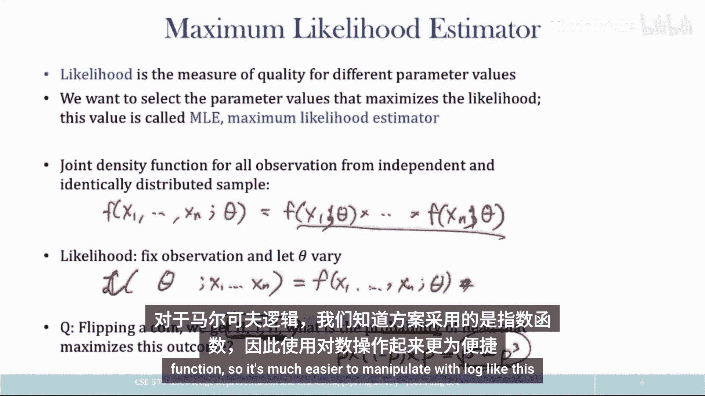

So instead of。The main。Fction we are going to use a load linear model。Okay。

 so what is the general log linear model， We had something like。Px。Let's call it W。

 so W is actually the parameter setta in the previous slide。

And local linear model has this form where we have one over these is a partition function。

And we have explanation of allDI and W， F， maybe some D。

So I'm talking about the general Microsoftov net where you define the potential function in terms of the weight and feature。

Okay， it should be familiar to you。Now， what we will say here now is this z is no longer constant because when you change W。

 z also changes right， so z will now be a function of W。Because here we are not going to fix the W。

 we are going to learn the weight that maximize it。有嘞。So this is a log linear model。

And look likelihood function。Here is just to put the log on top of this， right so log of Px。

So what does this function look like？So I assume that you're familiar with calculus right。

 so if you have log of the fractions， so what do you get？Log of the。一。이늄merator。Do know numerator。

Okay。Minus log of。right。有。有一个。DI is actually the。啊。Potential方 so the。

Part of X that participate in the click Okay so if you are curious about that。

 I can actually change it to Xi， which was probably the one that we used in the previous slide Okay note here that the feature doesn't have to necessarily cover all X So it's a part of X。

Any other questions。Okay good， so let me also change that to Xi。

 so this Xi is actually not the individual X， but it's a part of the X that forms this clickique。

Okay。And obviously log and exponential cancels out so then you get。Yes。Okay。

Now this is actually for single data。Because I fixed one particular x。

 x is just a single interpretation。 and in fact， in marov logic。

 we are going to actually learn the parameter only from the single interpretation。Okay。

 and even that is actually a very powerful thing to do。O。Any question up to this part？All right。

 so I may confuse you today if I start from derivation。Okay， so。

Let me know if some study is not clear one thing to note here is look likely it function is concave。

 so what concave means is basically it is if it is 2D。

 it looks like this is going upward okay if it is maybe you can also draw this way where here is actually the highestist。

Region， okay。So this is concave， which means that any local maximum is actually the global maximum。

So you can just use standard gradient as method to find this maximal value。Okay。

 many of you don't know what this gradient has sent。How many of you know what is gradient accentcent？

And。The rest don't know whether you don't know miss Okay， all right。

 so I have some quick slide for that if you are curious you can actually look at some of the references。

Okay。All right。So and basically the idea is very simple， so I can just explain in one slide。So。嗯。

For the lo likelihood， for the lo linear model， since this is a concave。

 you can just iterate some steps and basically the step is very simple and let's actually look at the 2D like this。

So suppose you are at this side of the hill， okay so let's say this is actually where you want to go。

 this is actually the value of the parameter that maximizes this function。

 so I want to find out this value say P。Okay， but right now I'm in say Prime。

What I can do is I look at the gradient of this function and gradient is actually going upward。

Okay which means that this is not yet a maximum， so you actually climb a bit okay and then check the gradient again。

 the gradient in is actually the derivative is actually smaller than the， but it is still positive。

 so then you actually repeat going for step to the right until you hit maybe the gradient to be0。

Or if you are here， then gradient is actually negative， right， so it's actually going down。

 so then you have to go this direction to go here。So regardless of where you start。

 if you follow this gradient， you can find a maximma。That's the basic idea。Okay。

So what do we do let's just initialize the weight with maybe arbitrary weight for the beginning and repeat the following until the weight converges。

 so the equation is actually very simple， so for each of the WJ so Wj is a weight okay you just add。

This value to the current weight。Okay， until the weight does not change much。Okay。

So what is this thing， this Lada is called learning rate。

 which you can actually give different values， it's like how much how long should be one step。

 if it is very big， then you actually jump a peak if it's not， then you go slowly。

And this is the partial derivative of the function。

 the partial derivative log likelihood with respect to the current weight WJ。Okay。

So many of the machine learning algorithms can be actually computed by gradient SN method。

 especially in neural network， this is actually the standard method to use。Now。I mean， some people。

 I mean， usually more often we call it the gradientian decent method because we want to minimize the loss function。

 but for the sake of this class for today， we don't have to go that route。

 we will just call gradientian ascent。Okay。All right。

 and basically the same as the gradient descent of the negative of the low like liquid。Okay。

 so that's the equivalency， but you don't have to make more complicated than necessary。嗯。Now。

 this method works well for some cases where we cannot simply find close form solution for the problem。

 So， for instance， here， when we talk about。

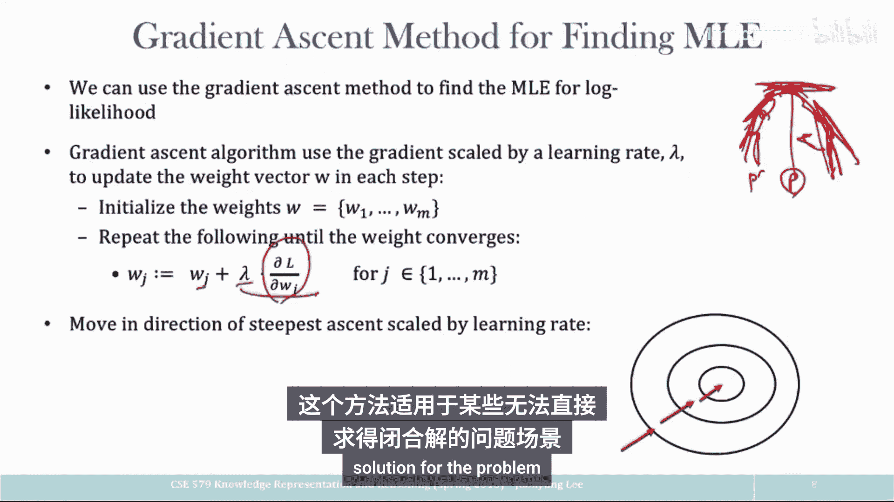

This question， we can actually quickly find a solution even without using gradient SN method。

 if you use the derivative derivative of this function is 2 p minus 3 p square and that of course p equals2 over3 is to what that makes this derivative B to be0 so often if you can find close form solution like this then you don't even need to the use the gradient SN method unfortunately this is not the case with Markov logic there is no close form solution like this so that's why you have to use some iterative method like gradient Scent。

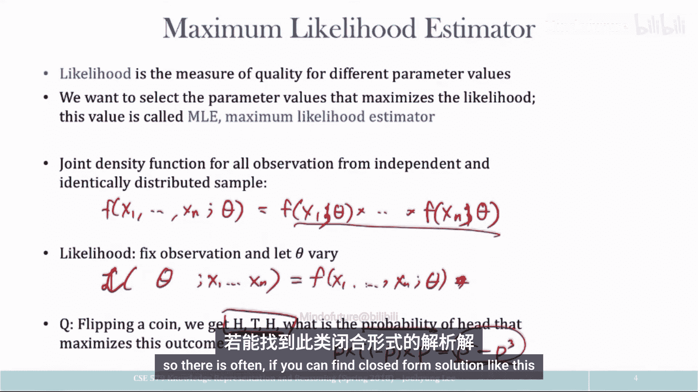

Okay。Okay， we actually didn't talk about marologic yet。

 we are just talking about the general introduction to Grianness and Messo。

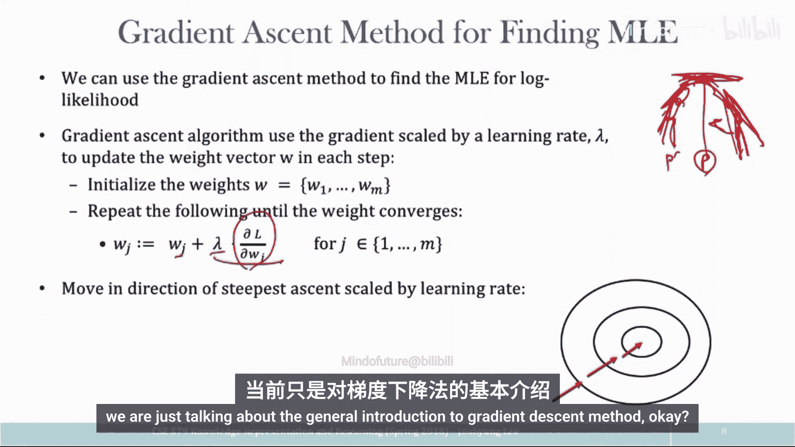

Okay so here is one example of gradient essencecent。

 so this is same function that you see p square times 1 minus p and if you draw this function it actually looked like this。

 but if between 0 and 1 it actually works like this。Okay， so we'll just look at this portion。

And of course the derivative is actually 2 p minus 3 p square， and I use Excel to just compute this。

Yeah， so it's just simple function， you can demonstrate。So initial value is 0。

4 and the gradient is actually 0。32， so it is something like here， the gradient here is actually 0。

32， which is still positive okay so you have to move now the learning rate is 0。

5 which means that you multiply this number by 0。5 which gives 0。

16 and add it to the previous value of p so that I can get 0。56 and at 0。

56 which is probably somewhere here compute gradient again which is 0。1792 okay and multiply by 0。

5 and add it to the previous value here so 0。5 times this value plus the previous value will give 0。

57。Okay， and you repeat over and over again and as you see the gradient here goes down because gets smaller and smaller and peak gets actually the bigger and bigger I actually didn't go through the all the way but at 0。

66 you will you can find out of course this gradient is 0 and we can stop there so that's actually somewhere。

Here， which is the maximum value。Okay， very pretty simple。All right， any question up to this part？

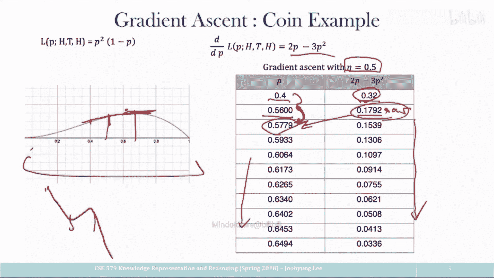

All right， so now let's talk about how to adapt this idea to the marcophologic learning。

 so in marov logic we will get the data and we'll assume the data is a relational database。

 which can be given as a set of facts as in what we did in ASP。Okay。And for now， assumeoom。

 we say that this database that you give as an input is actually understood as a single interpretation。

Okay note here that database in relational database。

 the concept is you can enumerate all the positive fact as a positive relation as a set of fact right and you can also view this set of fact as an interpretation。

Okay， so you can identify the database with an interpretation， are we together？Okay。

So we are actually going to see a simple example， but just want to give a brief recap。

 there are different learning problems here and we will not actually go over all of these。

If you're interested， you can take a look at the reference that I posted on the Blackboard。

 we will focus on actually the learning parameters。Okay。

So we are going to use some method that we know from the Markov network and Learning。

 which is actually the advantage that Markov Lo Network has because it is defined as a template for MarkovV Network。

 in principle， the algorithm developed for MicrosoftovV network can be used for Markov logic。Okay。

Now there's another thing which I which we are not going to study in this class。

 but if you're interested in， you can actually learn the formulas itself。Okay。

 so in the first let me just recap so here the learning parameter means that I give the formulas and but I don't know the weight of the formula and if I supply the data。

 then the learning system will learn the weight of the formulas that explains this data。Now。

 the user actually gives the formula here。But the more ambitious goal here is to actually let the system come up with the formula together with weight。

 so you just throw the data and the system will just learn the rules and the weight automatically。

Okay。后来。Okay， so here's a quiz， so be prepared。So without saying anything to you。

 but just given the intuition that we just talked about。

 which is the best explanation for this data and let me open。The so。

This is actually a multi choice question。So， we'll see how it goes。Okay， so these are the formulas。

 W1 has a variable Py， and I give three formulas here。

And you have to choose one of these four possibilities。

 I actually didn't include W1 because of the reason that。I will explain later。Okay。

 I'll give you one minute to think about。Okay， are we done。That's good。嗯。Okay。Interesting。75% is a。

13% is C。How come this happened。嗯。HOkay， so majorities A， the second is C and then D and B。 okay。

 let's see whether this is the case。嗯。So。This。Oh，Actually， what a stupid question that I ask。

I didn't give you the data。Oh my， okay， let's do this again。😊，Okay， I mean。

 how can you do that without having the data？Okay。I'm sorry about the confusion。

 but you should have asked me， wheres the data。Okay， let me open this again。So the data is here okay。

 note here that the exclamation means it's anation， so P1 and P2 is true P3 and P4 is false。

 what is the best assignment to the weight that explains this data？In other words。

 if you think about the intuition。我的是。AVue of W that gives highest。嗯。

Unormalized or high probability to explain this data。Or way。

 what is the value of the assignment to the weight so that this interpretation gets the maximal value？

Maximal weight。Okay， so。小斌。Are we still。O。Let's see。Okay， so the majority is now C。

 followed by A B and D。 Okay， good， let's see why。This is the case if you look at the。Forula。

Let's see what formulas are actually true and what are false。 So forget about W1 for now。

 but what is this one is it true or false。This is an interpretation。 Remember。

 data is an interpretation。 Does this interpretation satisfy this formula， Yes， what about this one。

のオロバーテスパン。Yes， so according to the intuition， we want to maximize those weight that is actually true。

 so W2 and W4 should get the same means highest weight here。O。All。

 so of course I didn't actually introduce the formal details， so let me do that now。

but the answer is actually see here。Okay， so we'll talk about two different types of learning first it's called generative learning and the second is discriminative learning okay what is generative learning is basically what I just told you about is about maximizing the likelihood of the interpretation。

O。And I'm going to talk about a discriminative learning soon。

 but that's actually a very minor modification to this。嗯。In principle。

 the database that you consider may encode multiple training examples。

 but for now we'll assume that this represents a single example， as in the previous thing。

 this is a single example。Okay， now we are going to learn the weight from the single example。

And the likelihood of random variable x is given by this formula， okay nothing special。

 the only difference from the previous one is the feature is fixed to be the number of formulas that are true under the interpretation x。

 that's only different from the general setting that we just saw versus the Markov logic setting。

Okay， so this is actually Markov logicing。And in the same way。

 you actually can see that a low likelihood of x is given by this formula。

And all you need to do is to find the value of W that maximizes this value。Okay。楼梯的DW。

Which is also in the Z， they are not fixed yet。Okay。

 what value of W that you want to assign so that this whole likelihood value is the maximum？

That's the goal here。A we together。Okay， so how do we compute a gradient of this local likelihood。

This is a bit complex elevation， so let's actually do this carefully。嗯。

So we are going to look at the gradient of this log likelihood function which refer to some particular weight WI so this is。

W I。Paion duty to expected W I。Not log off。Okay。Okay。

 so we will look at the gradient of this log likelihood。Okay。

 so what is the partial derivative of this likelihood with respect to W I。

 a particular weight of W I。So that is just unfolding the。Definition。We get， we have to replace this。

 but less's。see we we can distribute。This derivativeive。So， we gives。Okay。

And the first time is actually simple， this is actually sum of all the W1 and 1 plus W2 and 2 W3 and3。

 but we are differentiating with respect to WI， so this will give only the coefficient of WI。

 which is NX。Okay， and the next one is derivativelib of the log。 will give one over C and then。

To这个 tip of。See。Okay， good。Now， what is this C Z is。The normalization factor。And that is。

 for the whole。嗯。Interpretation。What is there。嗯。Wait， so we add up all those things。So， this is C。

So I'm going to。For this definition。 So this will be N X。Minus。So。1 over。

Let me actually use X double prime。Range over all the interpretation。Okay， so this is one over z。

 and then I have。This part now。Actually， let me just write here。 This is。Dirative。Of。The Z。

 the same Z。 but this time， for the reason that will be clear。

 let me use X prime to range over all those interpretations。Okay， so that gives me the same one。Okay。

So we have x and x double prime and X prime。So if you look at this derivativetic， this is。

Some of exponential functions。So the derivative of this will give the exponential function and then derivative of the argument of the function。

So。The， this will be。His。Okaying。And this part becomes now。Function inside。The same。Function。嗯。

But then we have to multiply with the derivative of this inside。That will be。

That will that is actually N I X prime， same as what we did before。Okay。

 so we have derivative of the whole， which is just give this one。

 which was right here and then derivative of this one multiply， which will give a NX prime。

And then what we。Right here is an X minus。I'm going to slightly rewrite the numerator。Because now。

 the Z po。In the denominator is actually the constant， So we can actually have x prime here。And then。

 right。The numerator here。Multiply by。Okay。I think again， I'm running out of the space。ああ、そう。

Let me just change the color。So what is this whole。Sing here。If you look at this， this by definition。

 this is the probability of the interpretation x prime。Okay。

 so the blue part is same as Pw under the current weight。

 it is x the probability that x has the value x prime。

So the whole thing here can berite written as NX minus。The sum of x prime。PW x equals x prime。

Multiply with N I。Okay。And this value is actually the expected number of grand formulas that are true on the。

The Markov logic network。Okay。So youll see in the next slide。

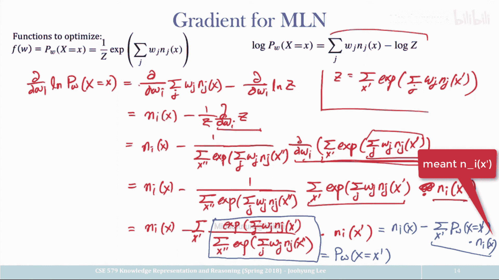

Okay。So。So what we actually compute in the previous slide。Is actually this equation？Okay。

 so I mean if you。Didn't follow some part of the derivation is okay because it's actually complex derivation。

 and I shouldnt have studied that here， but I will actually give the derivation in the slide  type in this derivation。

But basically the message is this， the gradient here， although it is's a bit complicated to compute。

 is actually the end result if very simple。Okay， so this is actually what you get in the previous slide and what it means is。

This part。Is expected value。expected a number of grant formulas that are true under the interpretation。

Okay， so let me actuallycap。 So what are the things that we have now？The first time。

Is number of ground formulas that is obtained from the I formula that is true under the interpretation X。

Okay。So， let me repeat。So x here is the database instance that we are given as a single interpretation。

Once we know the interpretation， we can find out how many ground formulas are true on the X。

And we are not actually looking at the old ground formulas。

 but looking at the ground formulas that come from the if formula。Each formula may have a variable。

 and we are only counting how many ground instances of I formula is true under the current interpretation X。

 that's what NX is about。Okay， the next thing is。We are going to do with all other values of all the values of X prime。

 not necessarily the current database， but all possible values， all possible interpretations。

 but we are going to multiply this with the probability of having that data。

Which gives the expected number of ground formulas that are true the interpretation under this MN。

Okay。好来啊。Let's actually look at an example Okay， but before we do this example。

 I just want to make sure that you follow up is these。

So just remember this and I'm going to show an example in the next slide。Okay， so NX。Note that in MN。

 there are actually multiple formulas， right？Let's look at only I formula。Okay。

 i formula is maybe non ground， you may have a variable。Okay， now， given the database。

 given the single interpretation in the database， how many ground formulas coming from this I formula is true under the interpretation？

That's what NIX is representing。Okay。And this value is actually not just for this particular interpretation。

 but for all interpretation， what is the expected value of the ground formulas coming from this。

 that that true。Okay， so try first interpretation。And that gives me how many ground formulas are true under the first interpretation right now this first interpretation may be associated with certain probabilities。

 so what is correlated to have the first interpretation times the number of ground formulas that are true under the first interpretation and we repeat this for all the other interpretations。

Okay， so let me actually show you the example。

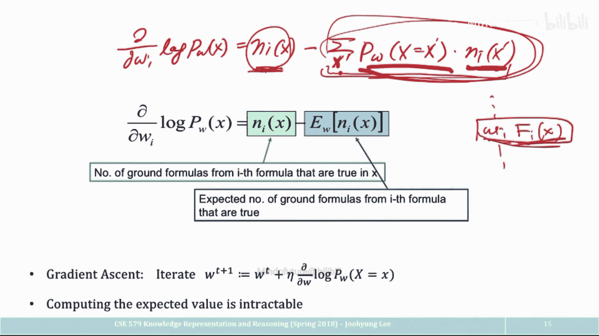

喂。So this is the same example that not the same。 It's actually a besimplified example。

 I I have only three formulas here。 Okay， so P of x is ground。

No ground formula X is available the second answer are ground formulas。

And according to the gradient SN method， we are going to update each rate according to this equation。

Okay， so if you don't know what was the derivation， forget it， okay。

 but just focus on the meaning of this gradient。Okay。

 so we are going to update each weight by this term。Now at is the learning rate。 You can set it。

And this is the gradient we just talked about。The color what is the how many formulas are true under the interpretation X。

And this is how many what is expected are number of ground formulas that are true。Okay。

 so having that in mind， let's actually look at the example。Okay， so if we have three atoms like P1。

 P2 p3， then we have eight possible interpretations， right？Okay， now suppose our data。Is。P 1， P 2。

And now peaceful。Okay， so suppose you give this as a data， which I'm going to denote as 110。Okay。

 this is a single interpretation。Okay， now n1 x means look at the first formula and consider all ground formulas that can come from the first formula。

 how many ground formulas there are satisfied by the interpretation 110。Okay。走。Just look at this one。

This is the first formula， how many ground instances of this formula？It's true under this data。Yeah。

 so first there are three ground formulas， P1， P2 p3 that can come from the first formula here。

 right， and among them two are true and one is false。Okay， so n one of x here。Okay， it's2。Okay。

 this is the value that we plug in here。Okay。The next value is actually very difficult to compute。

 but since this is a small example， I actually generate all of them。Now。

 let's not only look at this interpretation， but look at all other interpretations。

 so there are eight possible interpretations。Starting from 000 to 111 and each of these interpretation。

Has a probability。Right， according to the current way。Okay， so you are given。

This current Markov logic， so you can find the probability of this interpretation under the current Markov logic。

Right。That's what you did in the influence。How do you do that？Well。

 E to the power of all the sum of the weight that are true right divided by the normalization factor。

 so I'm going to skip that part， but this is actually the value that I compute。Okay。Now we's this。

I can also look into how many， if this was the interpretation。

 how many ground formulas coming from the first formula is true on the first interpretation there。

Nothing， right， because now the interpretation says all are false。

Okay so the ground instance of this is P1 p2 p3， but none of them are true under this interpretation and one value for this is zero。

A we together。We can do the same thing for 001， for 001。

 how many ground formulas are true from the first one， one。

And the probability of that interpretation can be computed to this。

 and you can actually finish up all these things。Are we together here。

 Can you actually write this table if I give you this as a homework， can you do that。是个。嗯。我做一。好，如果。

Okay， so we'll get there， but I just want to make sure that everybody followed this table until now。

Okay。Okay， so。Let me to go continue。You actually compute everything。Okay。

 then you can find expected value。Which is just a sum of all these things。Right。走。This one gives。

Pro probability of having the first interpretation multiplied by is n on value。

Okay this is the restrict to second interpretation and so on and so forth。

 so if you add up everything here， that's actually the expected value of n1。Okay。

 and that is actually 2。7941。Okay。そう。That is 2。7941。And assuming that the atta is actually 1。

 and initial value of W1 or1， this is actually the value that you are going to compute。

 and this determines the next value of W1。Okay。아위투에서。Yes。一かの。稍微做 interpretation。

Can be computed by the definition of my。哪个诉。So you can go back to the previous slide， but it was。

Variety of x equals。E to the power of。By。WI， NX。Be by by the normal fact。Okay。Yes。公司。没有的。都没。I。这是在提。

中华人民。Like when we're trying to find new effects。Oh， that is actually the inferencing。

 which I don't discuss here。But that can be computed by adding up all these things for different xs。

This is the probability。Property of the interpretation， right。

 and you're talking about the weight of the rule。Okay。

 so initially I just randomly gave and not the randomly。

 I just gave the way to be one and I'm going to update this。Okay。喂。

So the very first iteration here gives me that W1 was too high。Okay， you have to update to 0。2095。

Okay。Let's look at actually， the next one。啊。

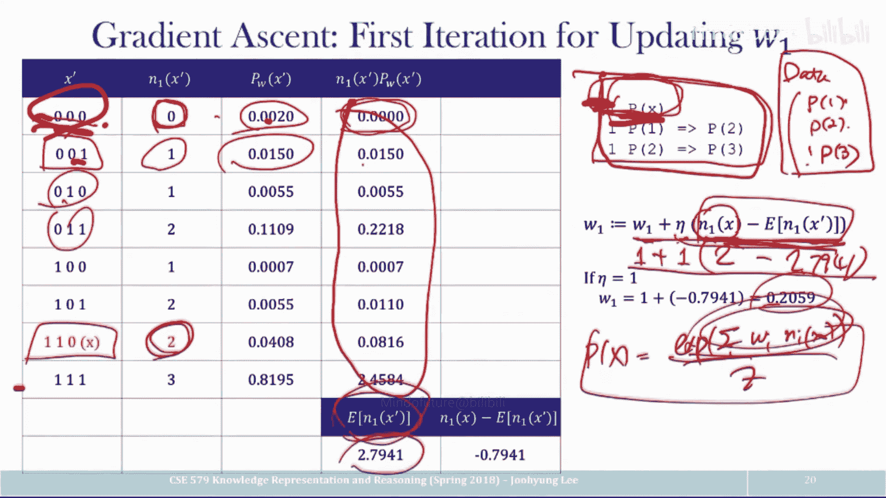

Okay， that is about the second one， second week。Okay。是不。This is actually。

 we are going to do this in parallel， so we are not actually updating the W1 yet， okay？But W2。

 assuming that this is the current way， W2 will be updated by the similar equation。Okay。

So here you can see that 110 is the current database， right？So now we have to look at the second row。

How many ground instances？Where actually it's already ground。

 but how many rules coming from the second rule are true under the current database。

They only one or0， right， the second rule is either true or false。So 110 means p1 and p22。

 so it sitifies the second row， so the number of ground rules that can come from the second row is actually1。

And this one rule is already true under the interpretation。So this is a true one。

But you can also repeat this with to all other interpretations。

And each of them will give whether interpret each of them satisfies the formula level or not。

 if it is satisfied， it gives1， otherwise it gives the value0。And besides。

 you can also compute the probability of having that interpretation under the current way。

Which is the third column that you see。And then you can compute the expected number of grant formulas that are being through and that gives me decades 0。

99。Okay。So the update we now have one class。This is actually current value is one， atta was 1。

 and n2 x is coming from this， this is1， and this value comes here 0。99。Okay， so then you get this。

Okay。And you can repeat。A we together。就是他不是的。L rate was just a arbitrary here。

 yes there's a hyperparameter you can set separately。Obviously， this is artificial example。

 running rate one maybe too high here。Okay。And yeah。Okay。

 I just want you to be familiar with this method。And good news is。

 of course you don't have to compute by hand， but I want you to get the feel how complex is this update。

What is the bottleneck of this computation？是一个没。So it's pretty simple to compute n1 value， right。

 So you can just see how many ground are true， although it's not really that simple and reality is actually。

but finding the probability， you have to find the normalization factor。

 okay that means you have to do the exhaustive listing。And that is actually very time consuming。Okay。

All right。And this is actually updating the value for the start rule and so on。Okay。

 so here is are actually the。

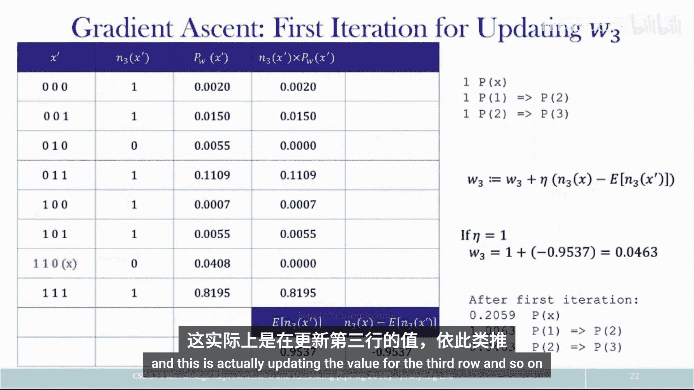

Lning example。Actually I can show you how to do。So this is a simple example encoded in the syntax of alchemy。

So you declare norm to be  one23 and P of norm is a precate declaration。

 and then we have these three rules encoded。Now this time we have to supply the database。

 so EXDb contains this interpretation。Okay。And now youre going to use this command line to compute。

呃呃。To compute the weight。Now here I gave the just one。

 but this is not the weight that explains the data best。

 so we are going to use the tool to compute this weight。

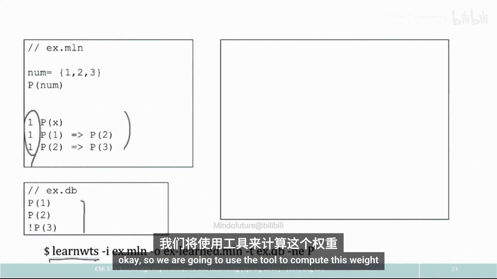

And。was I do too long。

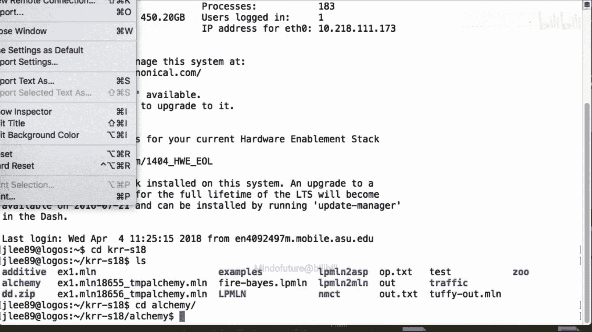

justす。

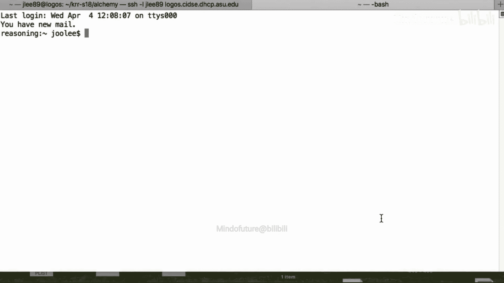

The next homework will involve using alchemy and it actually runs on the Linux machine。

How many of you don't know how to use Linux？Oh， you can on the man。 Oh， that's a good idea。 Actually。

 I don't know how to do。 I'm just。Logging into my laptop so but if you know how to do。

 why don't you share that information on the Piazza， that will be helpful。 Thank you。

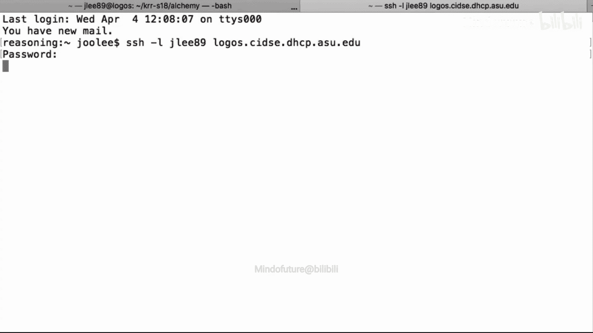

Yes。So you can run on the Mac tool， we just want。

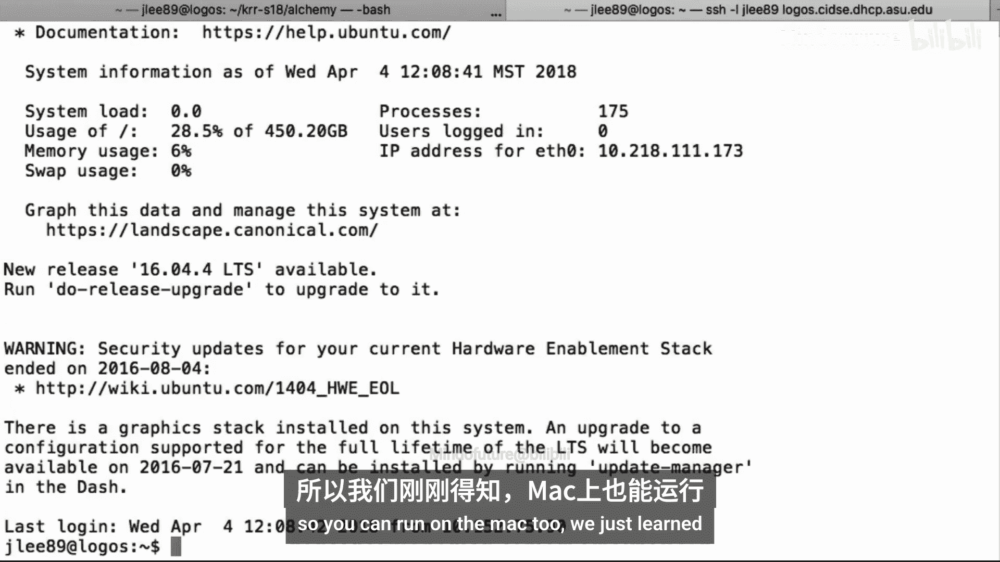

对个。Okay， so。This is EX。mn。And。This is。E extra TV。 So how do we do this。 This is long waste。

And we have to give the input。And output。Of the learning。 So let's actually say。

So the output is actually MN file， okay， it will be very similar to the given input except the weight will be updated。

And I'm going to use the training example to be the EX TV。And this is called the Cury predicate P。

Okay， so I'm going to explain this last option later。

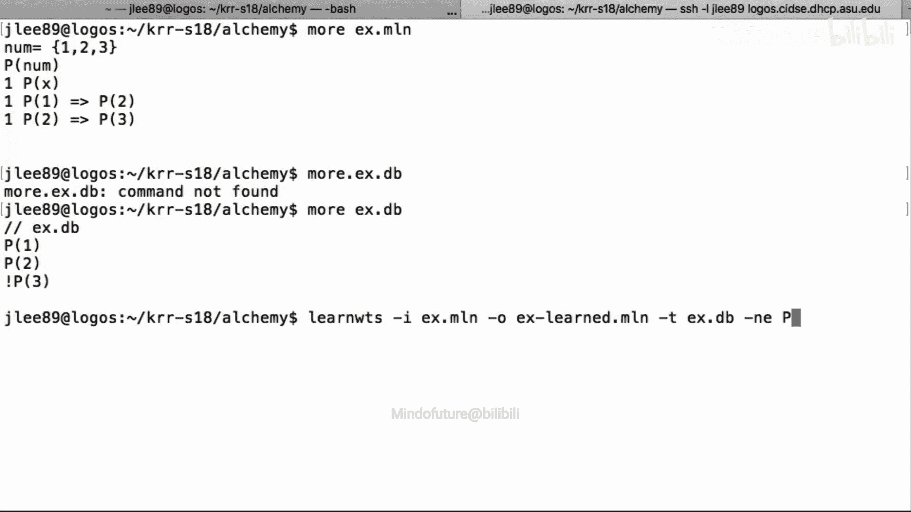

But if I do this。Okay， it'll do a lot of gradient accentcent iteration。

 and it computes at the very end。 Okay， so the outcome is actually the。

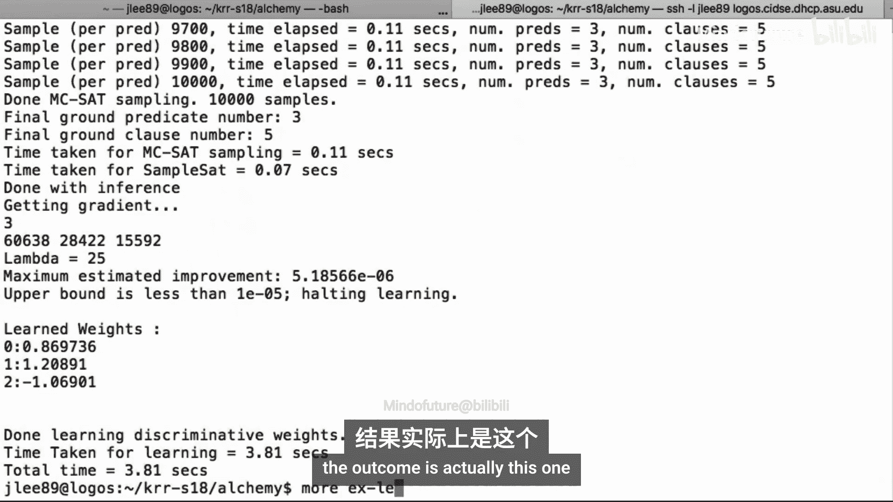

This one。Okay， so as you see， this is。Similar to the one that we saw before。

 the input actually has normal equals one to3， but the alphaifier doesn't actually need that。

So there are actually three rules in this program and for the first one it learns the way to be this one。

 now a1 is also variable okay。And for the second and third it actually gives this now as you see this database had P1 and P2 true。

 but P3 is false， so under that assumption this formula should not get a high weight because this formula is violated。

Okay， so that's why it gives the negative weight here。While P1 implies P2 is actually true。

 so it gets a reasonably high rate。

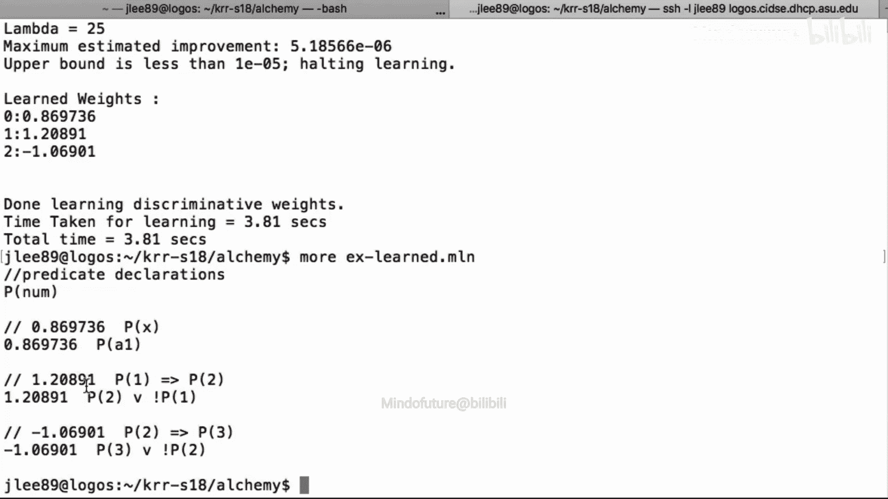

Okay。Allright， so that's how you do。

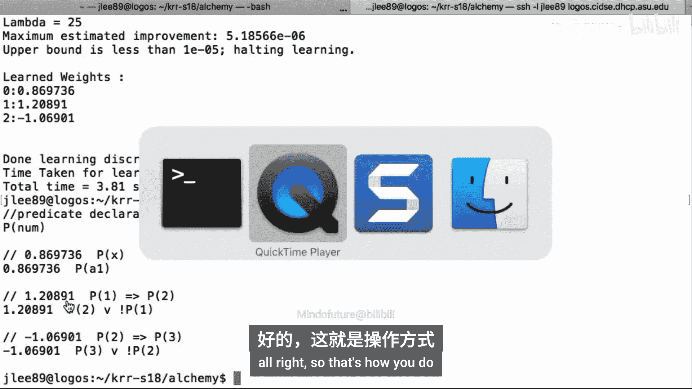

嗯。今。SoDC是2。Okay， one thing that I don't want to actually go into the detail。

 but I just want to tell you。Computing the probability or expected value is actually very high。

 it actually interable， and because of that， the actual system uses pseudo likelihood instead of the actual likelihood。

this is something that is close to what we discussed before。

 instead of the likelihood as we saw before， we are going to simulate this with this function。

 so it's a multiplication of each random variable x gets some value。Even is Markcoov blanketett。

 and as we saw before， if you know the marov blanket。

 then it becomes actually quite simple to compute this probability because you only need to compute these two values。

and that is actually much easier to compute than the whole expected value。Okay。

 I'm not going into the detail here， if you're interested， you can actually follow these things。

Unfortunately， this idea， this method actually does not work well when the dependency chain goes。

 long because it's not actually。Something that can be easily covered by amatoov blanket。

So the value becomes very distorted if you have more complex dependency。

But that is actually trade off if you want to compute the given one that is actually hard to compute。

 so you have to wait for a long time while this one returns the value quickly。

 although it is not very correct。O。

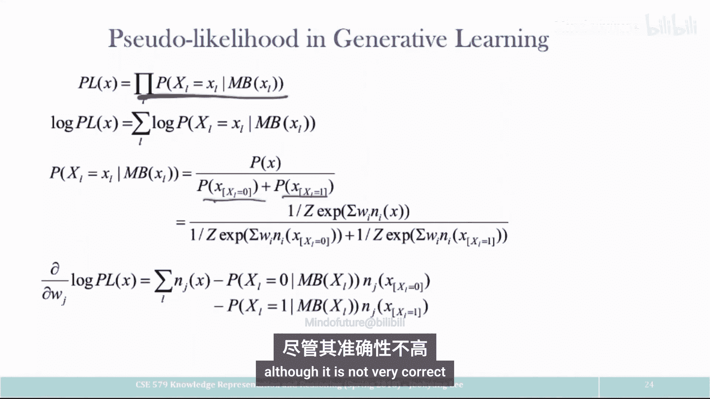

All right， so I'm going to now talk about the discriminative learning。

 so the concept here is we want to distinguish between some atoms that are evidence。

So we assume that some atoms are always known to be the evidence and we don't carry over the probability。

Okay so there are many applications that this is actually fixed。

 so for instance in the collective classification problem。

 you want to compute the probability of the class given the attribute now attribute is actually fixed you don't want to learn the weight of the attribute in that case you can designate it a designate this attribute as evidence predicate and you can only focus on the query predicate。

So what that means is instead of the likelihood that you saw before。

 we are going to maximize the conditional likelihood。Where the evidence has already fixed value。

And we are going to only maximize the conditional probability of y given this X。

And this actually works well because we have less parametermeter to line。Okay。

In terms of the equation， this is actually pretty similar。

 except that now the normalization factor should be only dose that is consistent with the evidence。

Okay， so when you sum up all the weight of the interpretation。

 you don't do that restrict to all the interpretation。

 but only look at the interpretation that is consistent with the evidence that's what the subscript X is saying in the same way this NX in the previous slide before is replaced by NIX comma Y here Y is actually the query value。

The value that we want to compute the probability and X is the evidence。

 so NIXY is the number of grand formulas that is obtained from the I formula and is consistent with the assignment x equals X。

Okay。All right。

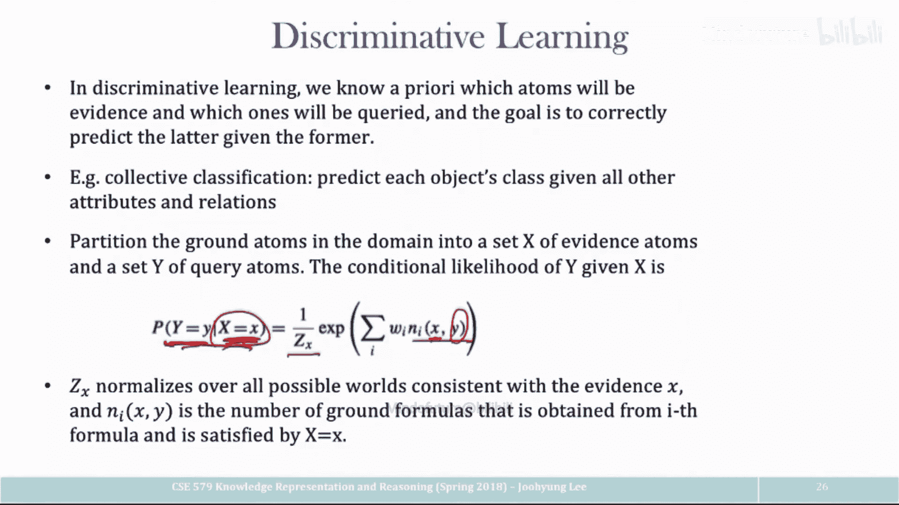

So in descriptive learning， what is the function that we want to optimize is a lot likelihood of the conditional probability。

So， it is。Okay。And as we saw before， this is。This one。Okay， and obviously to optimize this。

 we can actually do better or easier if we do the log likelihood of this。Conデal probability。So。

 that is。This one， which will be。Okay， so then the gradient here is the gradient of this slope likelihood。

And I'm not going to assure you the same derivation as before is actually pretty similar to the previous derivation。

 except that we have now the evidence variable here。You can derive in the same way as before。

 This is。Let me just write。The thing。Some of。All those conditional probability for different y values。

Give a next。Okay， so Army is going over this。And if it write one more step。This is。

Same as expected value of y prime。The number of the。Gund formulas that are true from the ice formula。

Okay。Okay， let me go through a few more examples。So。Learning multinomial distribution。

 so here we have the dice and we throw 20 times and each dice can return either one of the value from one to six。

Okay， so how do we learn the weight of this？Now， this time the data will be given to us and it's actually some bias distribution。

Okay， so this is how you are going to do。This is actually the input file。Okay。

And you don't actually give the weight， you can give the initial weight as I did before。

 but you don't have to do， so you just write these formulas okay。

So here we are given outcome T1 means I want to learn the weight of this formula。

 how likely to get the phase one。And same for the others。And the data is actually here。

 and as you can see， is actually quite biased。嗯。Most of the time it returns actually always returns either one or six。

Okay， so what do you expect the wait to be？Obviously。

 these two should get to high straight and all the others should get to low weight， okay？So let's。

See how we do that。嗯。Did I have that。

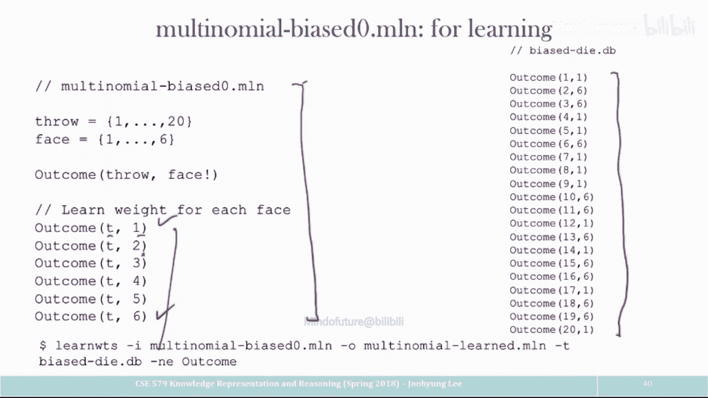

So。It's actually another very complex example， it has only 20。T， but it takes this much of time Now。

 of course you can actually control this run time can you can see that these iterations are repeating right。

 so as in the gradientian asscent you can actually set this iteration to be a particular number okay or even in the。

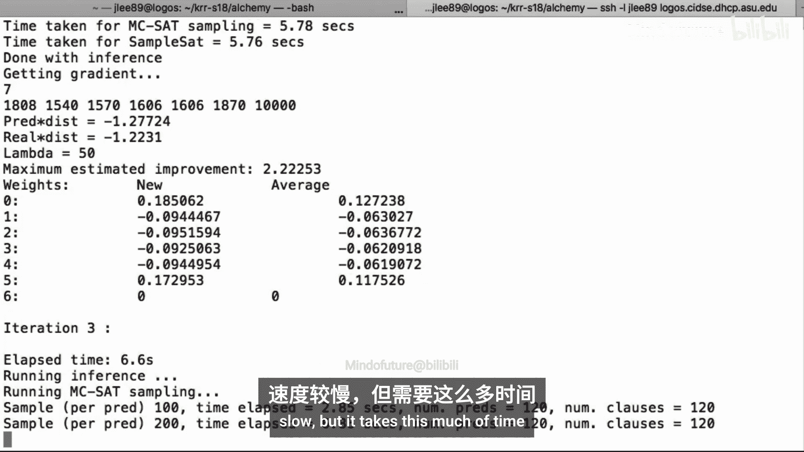

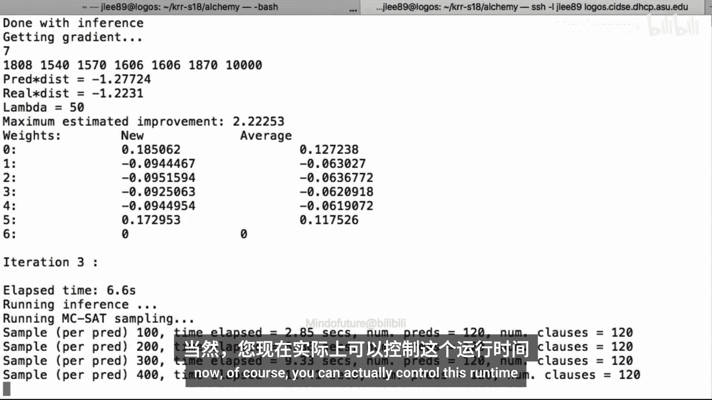

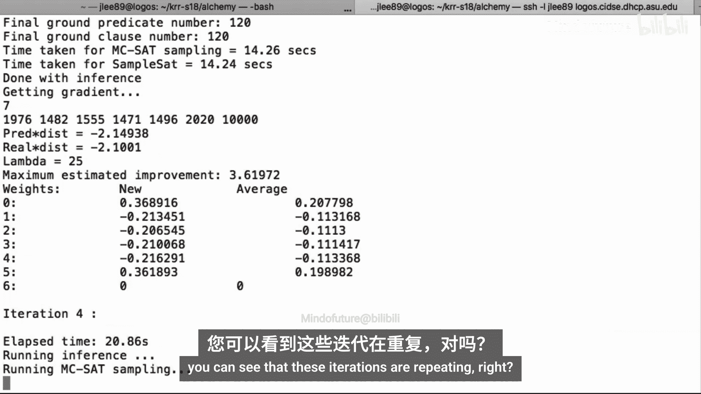

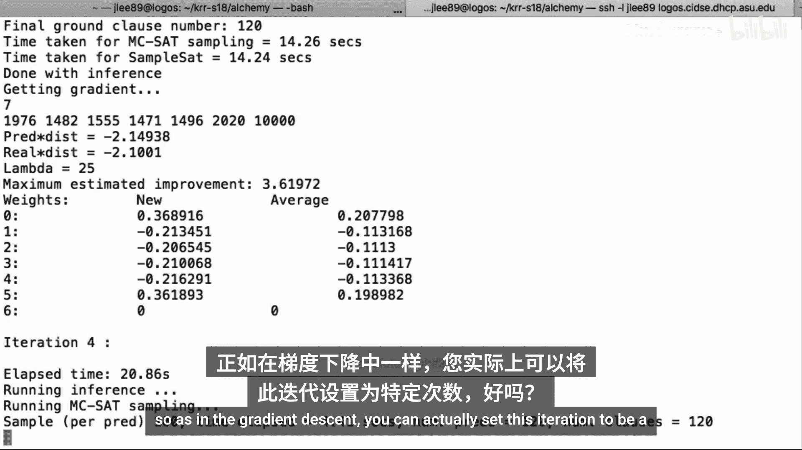

Now sampling that is actually internally used using M sets。 You can change the parameter there。

 So you can actually change the timing。 Sometimes you can also give the。

Maximum number of seconds to be run。 So then the outcomecade will check whether it exists at times threshold and if it is。

 then it'll just term Okay so I didn't actually give any restrictions， so itll just run。This much。

But as you see， it's already pretty close。

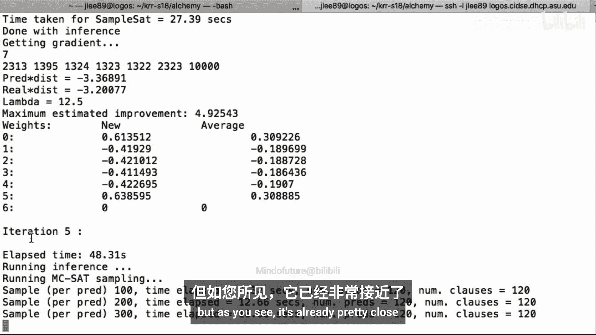

The first one and the last one has the highest weight。

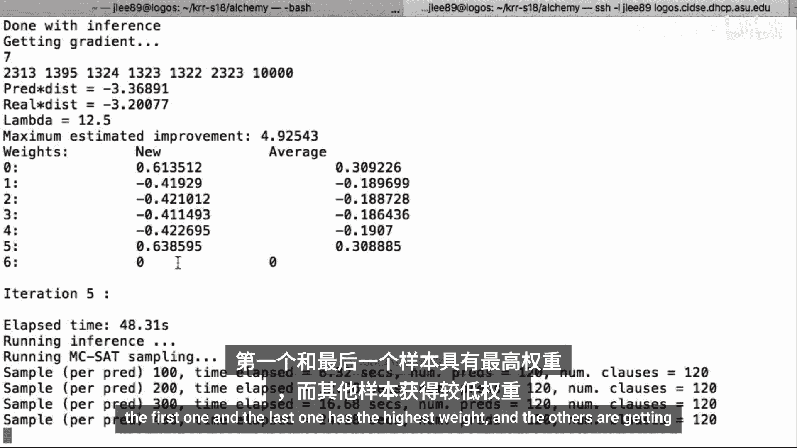

And the others are getting low weight。Okay。

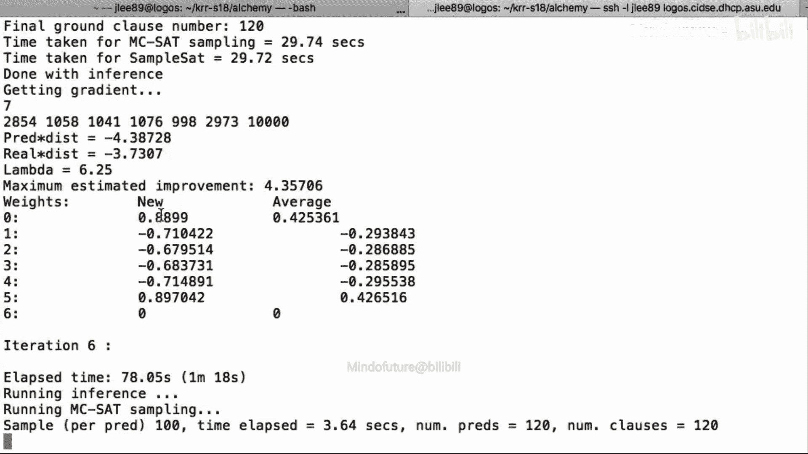

Okay， let me kill here。Because that's actually not the best way to compute these things。in。

Pinciipple， we know that each throw will have exactly one phase。

 and I didn't specify that in the previous run。 So if I give this。

Seeing that exploration mark means that each throw will get exactly one value， right？没在点二的。

I remember all actually I already did。 Okay， so sorry about sorry about that。

 So it's just the same thing as before。 but instead of writing these multiple rules。

 we can write this one rule where you see this plus。Upon seeing this。

 it will expand this line into six line， depending on the values of F， so here F has six values。

 so it'll be replaced by T1。T 2， and so on。Okay。And then learning will be done here okay。

 to learn the weight of this this notation is actually handy when you have a lot of instances there。

 so you don't want to actually enumerate all those predicors。Okay。Okay， so if you do that。

 this is actually the final outcome that you learned。

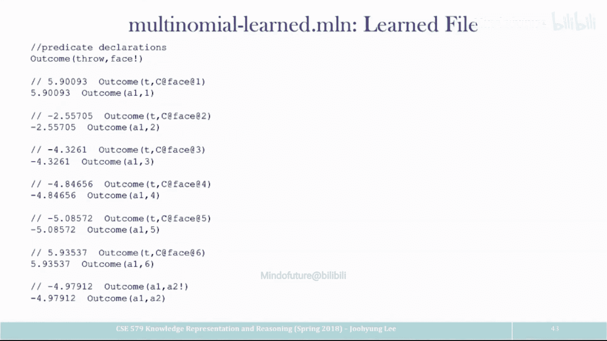

Okay， for the smoking example， we already talk about this， but here at this time。

 we don't actually give the weight here。Okay， and we use the same mechanism。嗯。To do that。

And here we gave the training data and this is a small training data， okay。

 so friends and smokes and cancer relation， and if you do that。

 the final outcome will be these things or either alone this rate。

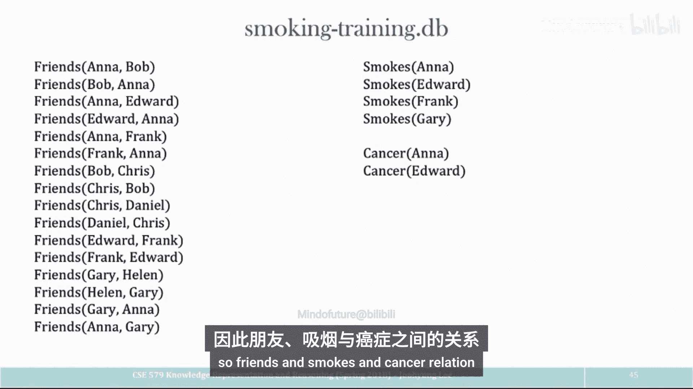

Okay。Okay， any question up to this part so I know the derivation of the equation was a bit confusing。

 so let me actually type in and post that slide so that you can follow。

 but even if you don't follow the derivation is okay。

 something that I want you to understand is the meaning of the gradient。Okay。

 so what is that term in the gradient means so that you can actually compute by hand if needed。

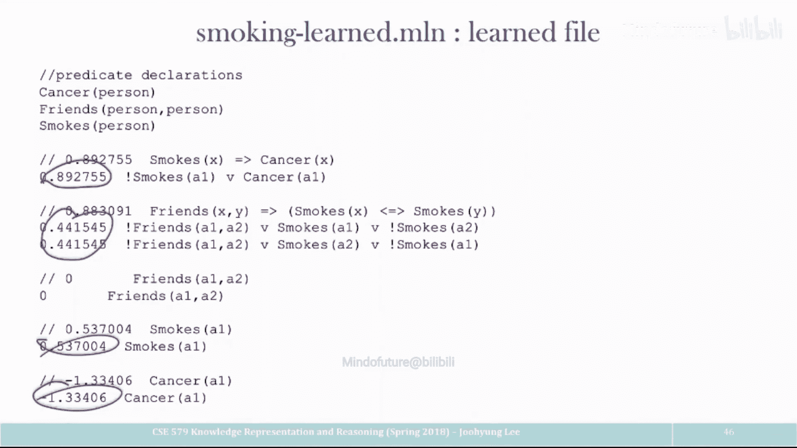

Yes。可开个。

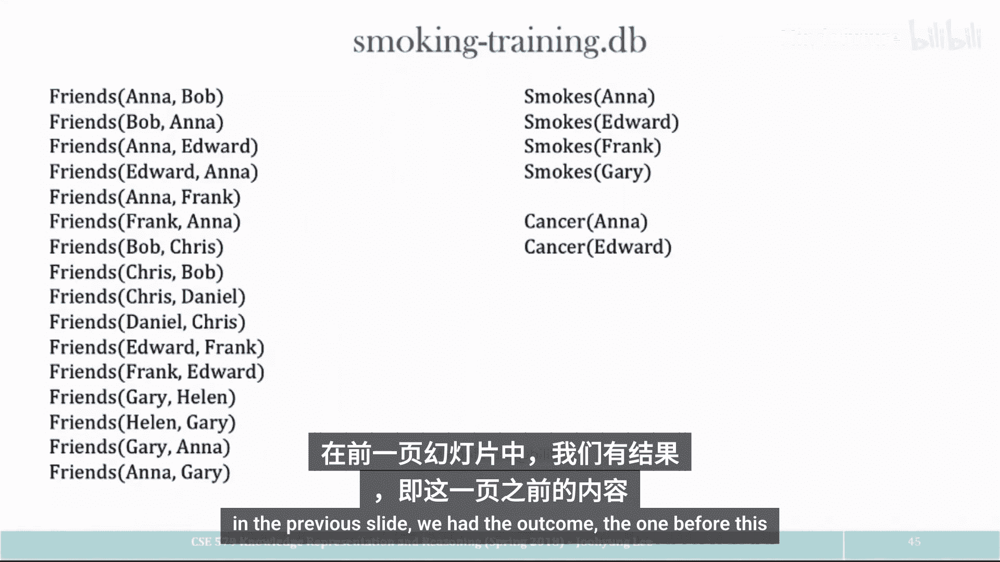

We had the room of个。Right。应该好的是。这个费。Does the example。

So how do we know which value that it has to instantiate well。

 I don't know particular about that algorithm， but I presume that ourche is actually good at finding the。

The domain， so if you have given this weight then obviously for sure that you have defined outcome as a predicate that has faced as a second argument。

Okay， so then it can actually look into this value to populate this。Yeah， the second， this one。

 this one is a declaration， so yes， actually knows which values to use for that argument。

But sometimes I do see that this is actually not needed。

 ache can actually look into the database to grab those studies。Yes。没是一个。This was actually。啊，家都最做。

But even if you look at this as a distributed with money。If you make the evidence to be empty。先生で。

ほらい。Any other questions device let me open。

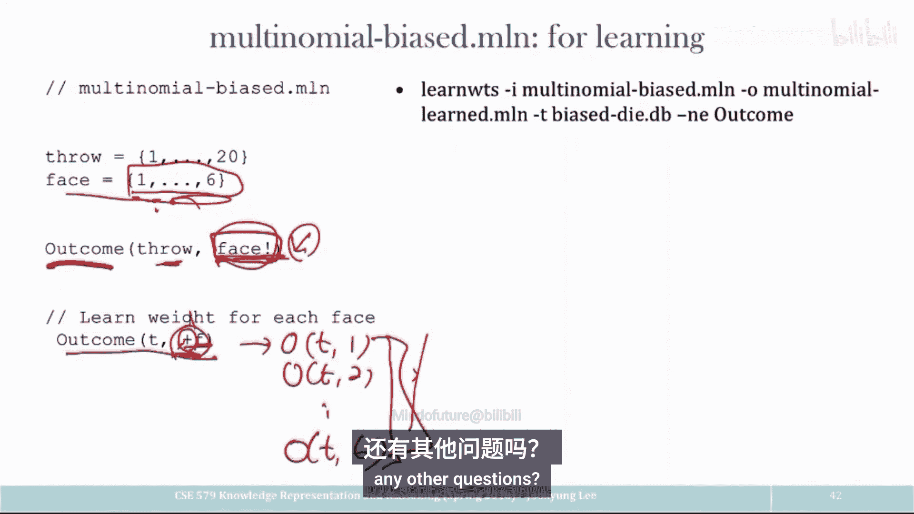