# 【亚利桑那州立大学】知识表征和推理 ｜ Asu Cse 579 Knowledge Representation 2018 p18 P18_Lec22 -BV1RTWyzfEQH_p18-

Okay， so lecture 22， we will close up the Markov logic。By the way， the today's keyword was LPMN。

 was shown in the previous slide。Okay so and we are going to start the next formalism。

 which is LPMNN so it looks like we are covering a lot of different formalisms。

 but in fact you'll realize that these are all kind of connected to each other in fact in particular LPMN will derive from ASEP and marcoph logics so you already know the component so it's only how to glue these two together。

Okay， so we talk about the language of Markov logic， how the inference works。

 and how the learning works。And we saw how to use alcheme for inference。

 so today well look at the application of Markov logic using alcheE。

So actually there are a lot of applications and these are just some of the items that I get from。

The Domingos and Lou book， which was linked from the course of Blackboard。

So if you go to Cha6 of that book， they'll list these applications and of course。

 you can also find other list of applications。We will not cover all these lists but just look at this there。

Applications on collective classification， so I'll note here that the main point is actually the collective one because this is actually what narop logic brings in a unique fashion。

 therere also social network analysis in fact smoke and friendszy example than you so it's kind of small example for social network analysis。

 entity resolution is a problem about how do you match the two different entities maybe in the text or maybe in the vision。

 whether this is actually the identical one or is this referring to the same abstract object。

Information instruction is to get the page for the keyword that you type in。

And core reference resolution is similar to the entity resolution， but in the context of。The NP。

 there's also robot mapping and link based clustering and semantic network extraction。

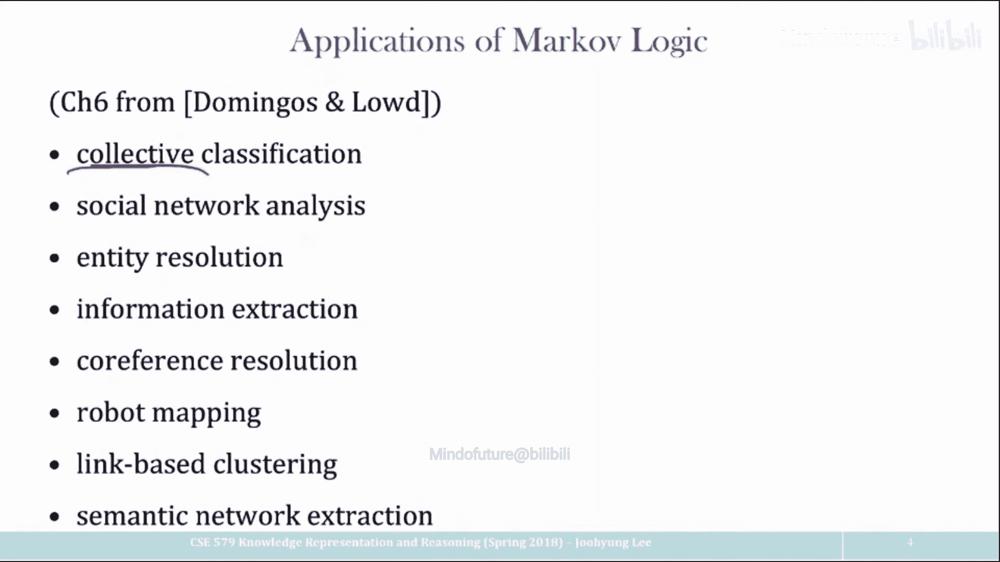

对。All right， so let's look at one particular domain entity resolution， as I just said。

 you are given certain observation and you want to know whether they refer to the same real world object so if you say that there is some name for entity which is possibly stored in two different or two or more different ways in the database and you have to identify whether they are actually the same thing。

 or if you want to say noun phrase or co reference resolution in an you have to know that whether this refers to the same individual and same for the video。

So it's actually kind of the basis of many applications because you first need to identify those objects in order to do some more reasoning or more processing of the data。

 so this is actually one of the basic things here the example is about the bit entry so if you have the papers。

 the paper has cit so the citations of papers at least also title venue okay and some other informations okay so MLA format or itT format。

 whatever format that you use there are certain informations that you have to store that。

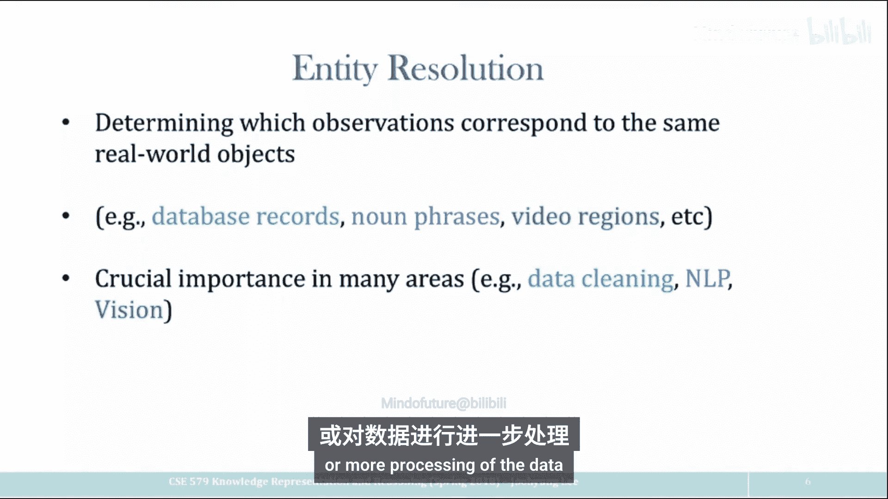

Now those are not written by machine， so human write those things and sometimes you can easily identify those two papers actually the same paper but it's very difficult process for machines to understand so first there are two first two papers they actually have the same os okay actually all those for papers really have the same os but to know that these are actually the same oes。

 this is really not easy to do and also are they really the same paper that's not easy to do okay so the first papers says unsupervised as semantic passing as the title now of course there's a capitalization which probably can work if you do certain simple manipulation that is not a very big problem but if you look at the venue EM andLP versus the proceedings of 2009 conference on empirical method in natural language processing which is actually the same venue EM andLP。

But human right is in different ways， and there are actually millions of different ways that human right can write the same venue。

 and that is actually quite a problem and you cannot predict all these possibilities and storing the database and matching the pattern there that is not really possible to do。

Now， let's look at the next two。 So the next two。Is。Okay。

 of course this authors are written a but differently but also the title is almost similar but it actually not exactly the same on superviontology induction from text。

 but somehow in the next paper the prompt text is missing on the other hand for the venue who are knowledgeable about this conference they actually refer to the same conference so in fact there are four entries here but there are only two papers。

Okay， so two are all those are written by the same authors。

 but the first two are the same papers and the next two are the same papers and each of these two sets are different papers。

So then how do we know this you can write any classifier for doing that。

 but usually when you write a classifier it works on those particular entries and you only considering whether this is same bibliography or not you're not actually making a collective inference。

 so here let's actually try to do this in Markov logic and see how it works there。

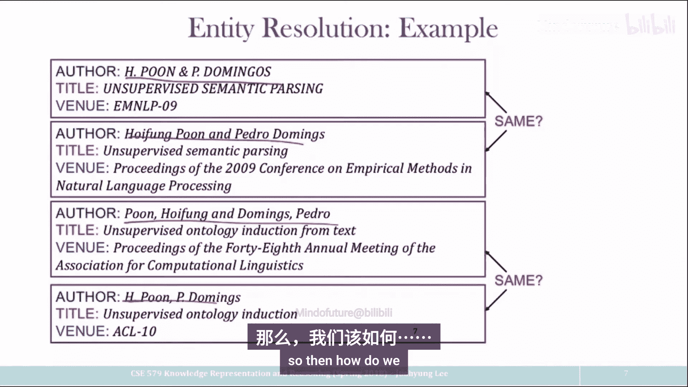

All right， so the data structure that we use is author title and then you go these are the predicates that we've got from the database。

 note here that the evidence file in the Marcos logic is actually a relational database so you can understand the relational database can be written as a set of these predates。

There are additional preddicate that we declare， so B is actually the paper and also title venue are the values of this predicate。

Now there is also has word， so also okay the string of also contains some word and also title contains the word venue contains word okay so which word are there？

And these are the things that so these are actually given in the input。

 so the first part here can be derived from the database it' actually the database stack。

 and this is something that you can easily populate looking at those evidence okay。

Now so this is kind of input or evidence or the condition or observation。

 whatever that you call they actually being different names for holding this。

What we want to impfer is this thing， whether these authors two different authors string is exactly the same one。

 or the books are having different title， but whether they are actually the same， same book。

 or whether the two venues on the listed on their bibliography are actually the same thing。嗯。

Actually， this is actually only the title equality。

 but of course one can write the two different papers the same title but that doesn't mean that they are the same paper if their authors are different so same is actually the final thing that we want to really say that these two big entries are the same these two papers are exactly the same paper。

Now if you write some individual classifier， you will say that maybe the papers are they have the same titles or you may identify as the same thing。

 but if their authors are different， you infer that they are different papers。

 but for the classifier's point of view， which only classifies the title。

 they cannot differentiate between those two papers。

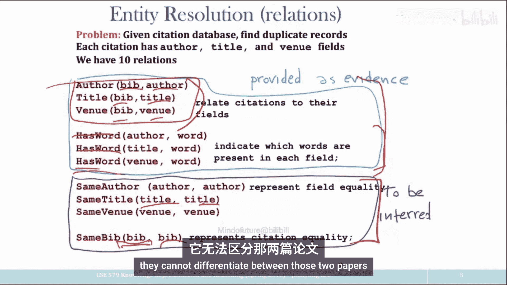

And that's actually where the micro logic is better than those naive approach。Okay。

 so what can be what we can do usually when you write a class you have to write some lengthy code。

 but for now we can just write a couple of rules in Malov logic and that's it Okay so what is the rules what are the rules that we have to write so the rules are actually quite intuitive you can say that the title。

B1 has title T1 P2 has title T2 and T1 has this word and T2 has this word and they are the same bibliography Now note here that this is unweighted rules and the weight will be learned from the data。

So if you see that those two papers with the same the title。

 they actually will be instantiateated with the same word。

 then there's a high chance that these two are the same biep， vventry for the same papers。

On the other hand， this is not a definite knowledge， so it can be actually overwritten， as I said。

 the title simply being the same doesn't mean that the papers are the same so the weight of these rule could be probably high。

 but it's not definitely infinite。Okay。The next one is a specific instance of this。

 this plus word symbol， I think I introduce this in the inference part。

 when you write a plus then achemy will ground this plus word in corresponding instances。

 so even if you write this one rule， Archchemy will convert into many rules where word will be replaced by specific instances and the weight of the rules will be learned from those grounded rules。

For instance， the word can be Bayesian for instance。

 right so this rule in the case when word is grounded to Bayesian means that the two papers that have this two papers B1 and B2 that both mentioned Bayesian might be the same paper。

 that's what this rule is saying。Okay。Are we together？Okay。And you can do the same thing for authors。

 the two authors name contains same string same string， they might be the same person。

It might be wrong because they may share the same last name but their first name may be different okay so that's one thing and for the venue there's also the case so you can write many of the rules and that's pretty simple to do。

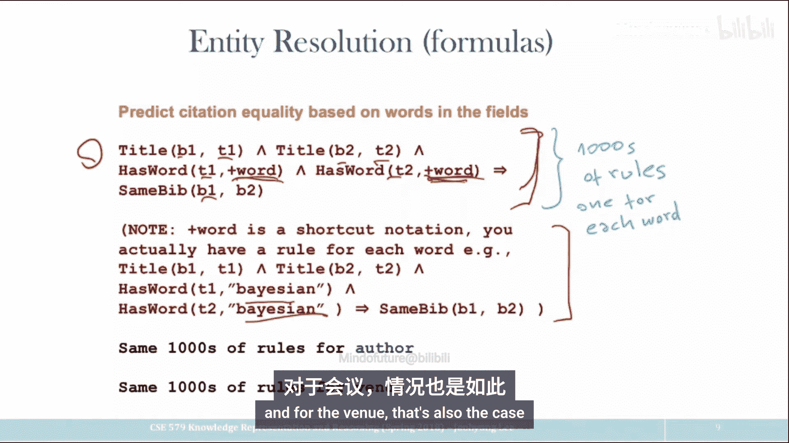

Now we need some additional rules here which is about trans relation。

 what is transive relation if it's basically reachability if you say or equality you can also say if here equality might be better to look at so if B1 and B2 are the same paper and B2 and B3 are the same paper then we can infer that B1 and B3 are the same papers right so that's very natural to do okay。

Of course， if you don't say this， you can。Identify only these two。

 but you cannot connect between B1 and B3 unless you use the rules like this。

Okay so typically when you do the classifier， this part is actually at the meta level。

 you find all the same bi and then you do some closure on that to derive the set of same papers but you don't have to do that at meta level in Markov logic you just write the rules there。

 then this can be done at one time and also you can actually help because now if you know that B1 and B3 are the same that can actually infer another new fact that the individual classifier could not handle。

Okay， same for the authorss， if the A1 and A2 are the same authorss and A2 and A3 are the same authorss。

 then A1 and A3 are the same authors， same way you can do this with title and the menu。

So there are four rules that you have to write like this。And then。

You can now also link from the Bep to the author， okay so if you know that the paper B1 has A1 is also B2 as A2 as alsoA。

 and B1 and B2 have the same paper， then we infer that A1 and A2 are also same o。Again。

 this is actually not necessarily true because there may be multiple courses who wrote the same paper A1 and A2 maybe the two different courses of the same paper。

 however it is also possible one of the example that we saw was writing the last name in different ways。

 Pe versus what was the other one。Let's say a okay just making the name so these two happen to refer to the same paper if you class that that now actually tells that these two strings of authors are actually referring to the same individual。

 so not only you go from the same authors to same bibliography。

 you can actually go back with if you once identify they are the same papers you can actually understand that the authors named are written slightly differently but actually they are the same person now of course if you have very small data it may be very wrong。

 but if you have massive data then those person will be on the multiple occurrences of those papers so even if there are four authors of course that he wrote the same papers with but he may not be necessarily writing the old papers with same set of course so that when you know that some papers are the same you can actually learn that there are multiple different ways to write the same authors's name。

Okay， so that's what this rule also tell us。So note here that this is not a per class。Resol。

 but it's actually once you identify， once you learn this class。

 it actually helps to learn other class。Okay， so this is called collective classification。Okay。

 so the others are also the same if you know that。This is actually kind of reverse if you know that they are same Mos。

 then we only be two are the same papers again， these two rules are not necessarily true。

 but there is a high chance that they may be true。Okay。

 same for title and same for venue that you can write this for。Okay， and。In fact。

That's all you have to。

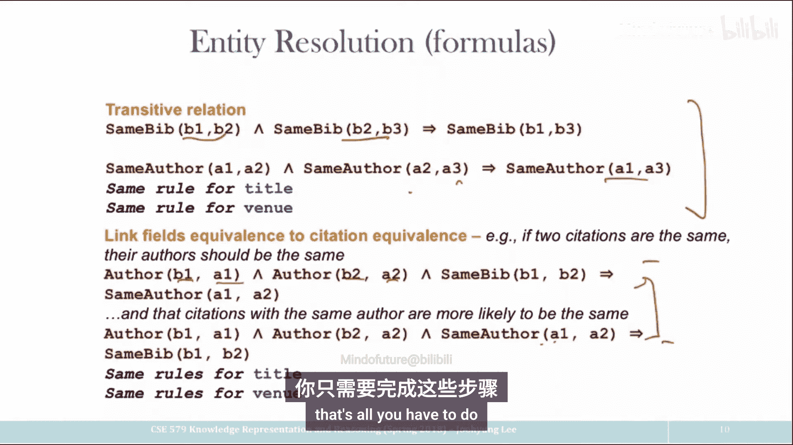

住。Okay， so these are the all rules that you have to write in the Markov logic on weighted formulas and of course you have to fit in the database and evidence and you execute this comment。

 then the Markov logic program will be learned。

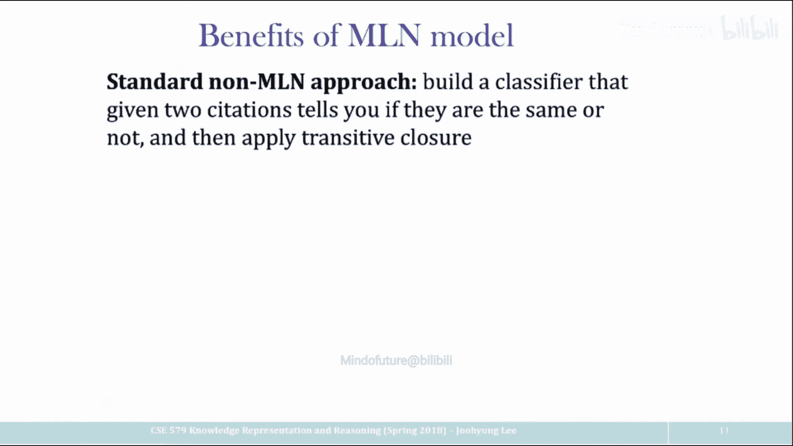

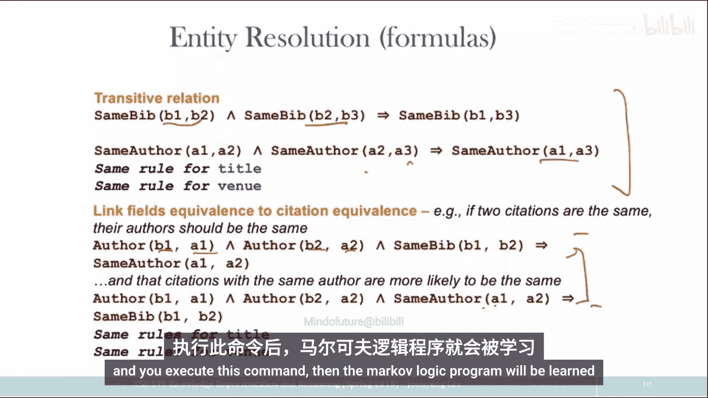

Okay。All right， so as I just said， the standard nonmarov logic network based approach is to build a classifier that。

 given two citations tell you they are the same or not and then apply certain expensive clue on that。

 but in MN we do collective entity resolution， where resolving one pair of entities helps to resolve the pairs of related entities。

Okay。That's what we did。Now， a question about the first。Application。

So the other applications are all in the same vein that you don't have to write a lengthy code。

 but write you describe these knowledge and the way it can be learned that makes and using those learned the way you can do the inference。

Okay， so what is the probability that these papers are actually the same？

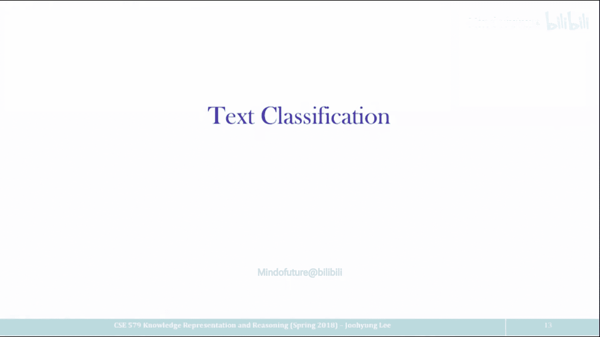

Okay。All right， so this is what I just said， but there's also other application of collective classification。

 so one is actually the webKB where you have the text of web pages from four different universities。

 and you have to classify whether each web pages belongs to one of the class course page or faculty page or research project page or student page。

 given the content in the page as well as whether the page linked to another page that is related。

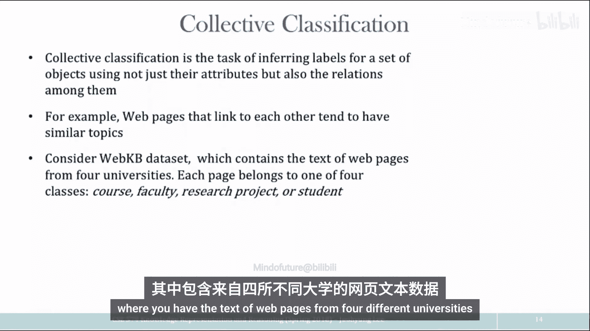

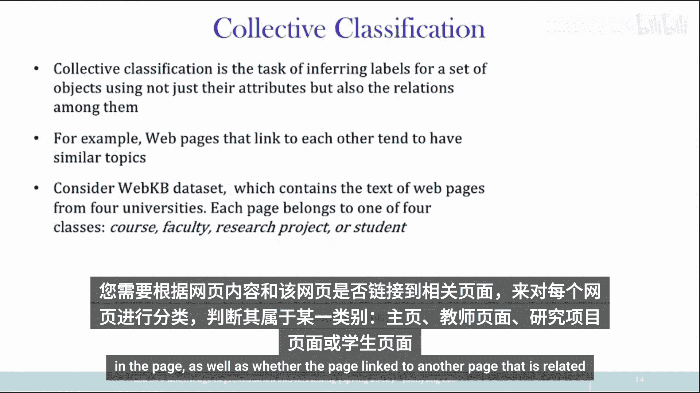

Okay， so this is like page rank algorithm like thing if you have the same paper page linked to another page。

 there may be the same class of pages。Although we may not necessarily be true。

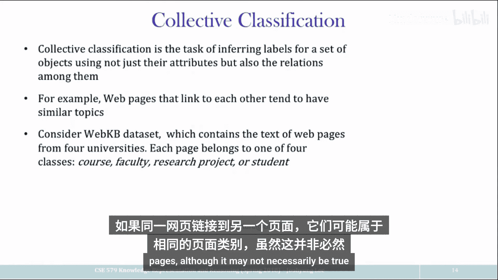

So this by the way， these examples are coming from the。Icheit tutorial。

 so if you go to the tutorial there is all the data set available there so you can download and try to run by yourself。

So the WebKB data contains these information。我对的。呃。Actually， I think this is the yeah。

 this is the page and this is the word in the page。So for each page。

 you can grab all the words in the page， so this is actually quite huge file。Okay。By the way。Yeah。

 you also have this information that this is the department topic department。

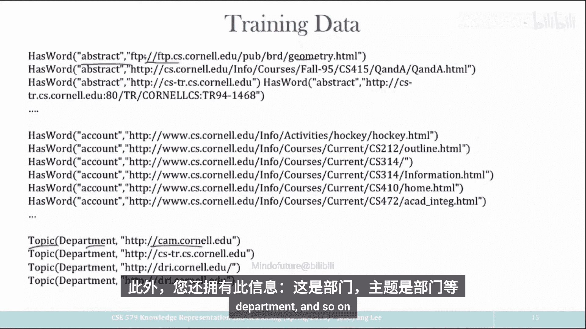

Okay。All right， so you want to classify those things。Now there are two precates that we introduced。

 as you saw in the previous slide， so whether the page has a word。

 one page may have multiple or quite a lot of word there。

And we have some label here that this page belongs to this class。Okay。

 so this is a training instance and of course the goal here is to learn given any page that is not in the training data to classify what topic is。

Okay all right， so what is the thing that we do is quite simple you just write two formulas here。

 so the formula here is if the page has to work then the page may have this topic now by doing this plus W and plus C will instantiate to all possibilities。

Okay， so word maybe be 100，000 word may be there， while the class may be four。

 so for each of the word and page you map into the topic。One of these are four topics。

OkayNow the rules may have different weight and the highest rule will give you what the topic of the page is。

ほ来说。The weight of these rule will be learned the second rule is actually the unit clause is simply saying that if this is not true then you have to say that the topic for this CP relation is false for the topic so you just write unit close there okay in fact actually alchemy insert the unit close all the time so you can actually skip it and this will be automatically edit by alchemy。

So what the alchemy will learn is the way of this each of these role when becomes positive topic。

 when becomes negative topic。Okay。So by default， you can say he's negative。

 but if there's an evidence like has word， that makes the topic of the page to be true。Okay。위투。O。

So these are the command line you saw in the previous lecture how to use the long weight。

 so here we use HDD to represent discriminative learning where we know which predicate belongs to the evidence and which predicateates are the cur。

 we already can distinguish them。For this domain like Haworth is already。

The word that we know for as evidence， okay？So that's why we use disc primminative learning。

The input。Is the file that you saw in the previous slide。

And the output will be generated by a microphologic alchemy system where the rules have the same but the weight will be learned DT is the training data it's actually quite a lot so I don't sure here but you can go to the alchemy tutorial page to see how big is fired。

Dash& E means that this is non evidence predicate， so as I said evidence predicate here has worked and non evidence was you can call a query predicate his topic so you want to know the priority of topic from this Markoffl network so that's why you put D& E topic。

Okay。The difference between the evidence predicate and the query predicate like topic here is for the evidence one。

 we don't infer the probability though that's already fixed to be true。

 so whatever that you write in the evidence file for for instance， has word。

 they are all true and whatever the pair that are not mentioned for the has word will be assumed to be false by close word assumption。

Okay， so in the evidence file， you only need to en listlist the positive relation of has。

If you don't write anything there， by automatically。

 they are assumed to be has between the two entities assumed to be false。All right。

 on the other hand， for the current predicate， this is not assumed。All right。

 so the next thing is to classify so once you do this。

 you learn the weight of those rules and then what you give is。

You feed in this output file that was learned from the learning as an input file for the inference。

Okay， and。You put the test data into the this TV file。

 so just write some page that you have not seen before and this page has this many words so you write has words。

 this page has this many words okay and then you call the。

Inference engine and it will say the priority of this topic。

 so it'll show the four probabilities because there are four classes so for each of the topic what is the chance that this page will be in that topic。

Okay。Any question。Okay good。So if you take any machine learning class。

 you can easily build classifier with just few lines of code and you can cheat， maybe I don't know。

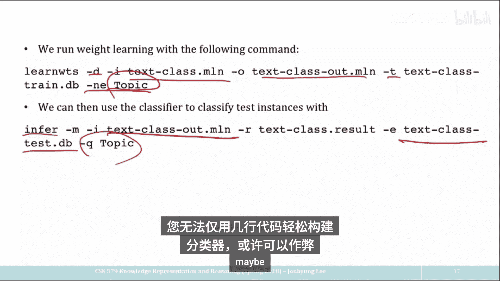

All right， Hytext classification is actually very minor extension to the previous page。

 previous example here by Hytex， it means that we also know not only the page has this word。

 the page can link to another page， so knowing that as I said before。

 if you know that this page linked to another page。

 then these two pages may be related by the same topic。Okay， although it's not necessarily true。

 So youre given now these additional。Information， there two web pages are linked。

 so theres a link from this the first page to second page。

 so this data will be actually given to you so how do you use this data？

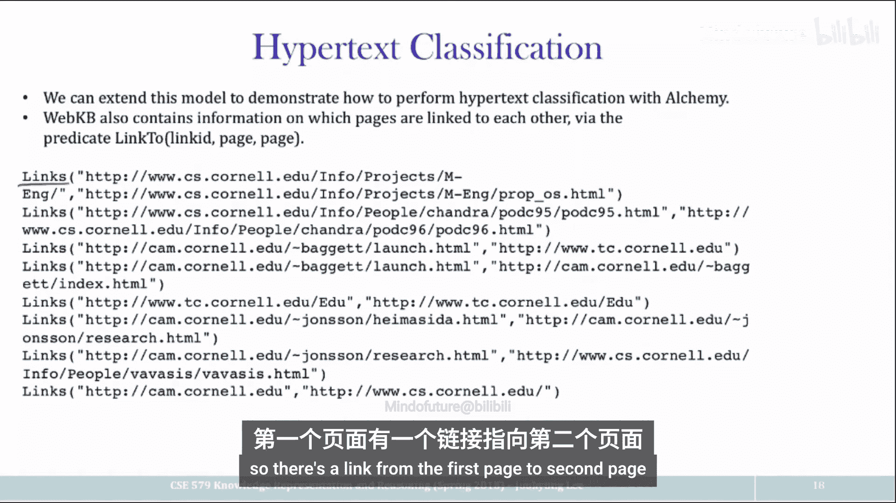

Now， this is actually hypotext classification5 in Markov logic。

So the first few lines are actually exactly the same as before， the only difference is the last one。

 the last one is saying that if the P1， the page P1 has topic C。And the P1 is linked to P2。

 then it's likely that the P2 also has the same topic C。Okay。

Now I said it's likely because we don't know the weight here。

 if the weight is high it's probably very much likely， if the weight is low。

 then probably not much likely。Okay。Right， can the question here？O。There is some。Graph in the book。

 but I didn't copy here， I don't actually remember them， so you can take a look at that。All right。

 so okay， another thing is information retrieval， so here you want to find page given the word。

 so like search changing。So there's a precate word， so this word is in the curry right and of course。

 like same as previous pages， we know what page has which word。

OkayAnd to note that these page is whether relevant or not。

 so this probability of this relevant pre to behind is that the page is very relevant。Okay。

 so these are the things。And there are only two rules that you can write。

 so let's say in the query it mentions some particular wordW and if you happen to have the same word in that page。

 then this page is classified as relevant。That's a victory based case if you find a page that mentions the cur keyword and the page is relevant。

 but not only that the page is relevant， but if you link to another page。

 then that page is also relevant so you can actually show more pages than the initial finding。

Now note here that of course the weight of this thing will be different according to your training。

 so it's not a very simple retrieval like just grab all the pages that has this cur word and then just find all the linked pages。

 it's not like that because if you do that of course youll have an enormous amount of pages that are not really relevant to your cur。

O。All right， any question here？

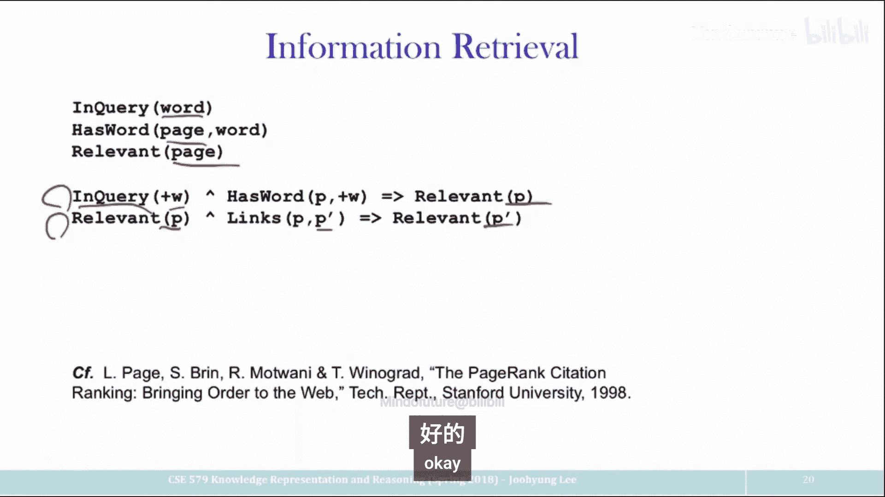

All right， so there are actually quite a few MLN applications。

So I don't bother to go over all the details， but you will get some flavor here。

 so basically the idea is you write so you're given the database， relational database。

 which you can store as a fact predicate subject object or maybe to predicate with some terms so these are the data that you are given。

 and you write a few couple of rules and learn the weight of these rules。

Okay now this is actually only one side of the learning because so this is actually learning the weight from the data。

 the other thing that I actually didn't go into in this class is actually the structural learning which is to learn the formula itself so in the previous examples humans are writing these formulas。

 but what if the machines can automatically write these formulas for you so this is actually another side but。

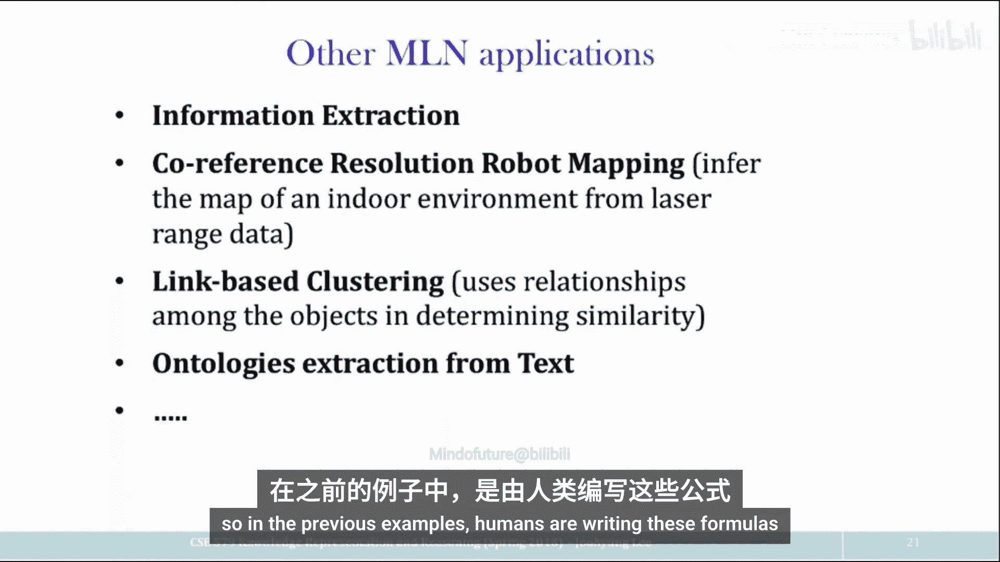

Maybe if you're interested， you can take a look at the chapter in the book。

 okay that I link from the course page。Allright。And note here there's something that becomes a bit different from the maybe AST and classical logic based knowledge representation。

 the rules that we write is actually not necessarily true and we know actually it's price nonsense right so for instance。

呃。We had this kind of example that the， the same word appears in the two title and then say they are the same papers。

That doesn't make any sense， right？Okay，However， these kind of rules are actually quite useful although it's not necessarily true。

And many times it is actually a false， but these kind of rules actually help us to aggregate more information to classify better。

O。So in the other way that we talked before like ASP， if you don't actually exactly match this thing。

 it doesn't work， it just breaks， you don't actually give very much information。

 but here this kind of loose or soft blue can cover more cases。

And that actually helps to derive some more information。We'll talk a bit more about this。

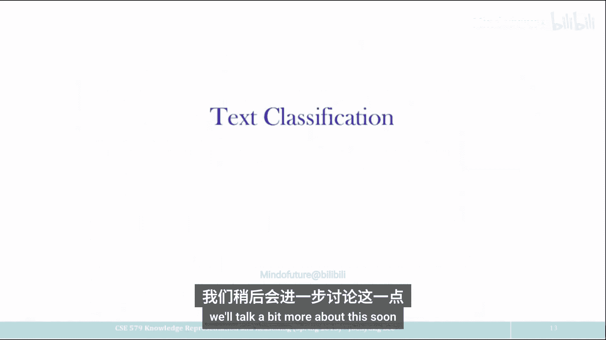

Okay， so what where are we now。So starting from classical logic， okay we talk about SSA programming。

 reasoning about actions and we here then we into here so is the time to connect these two。

 so that's actually the topic for today。Yes， how many training data do you？

It depends on the application domain me。嗯。Not necessarily。

 of course not I mean that's actually I don't think that is actually a special thing here， okay。

 so more data may not necessarily mean better， but what can be said is you can actually guide such better guide learning better if you give the right rules。

Okay。

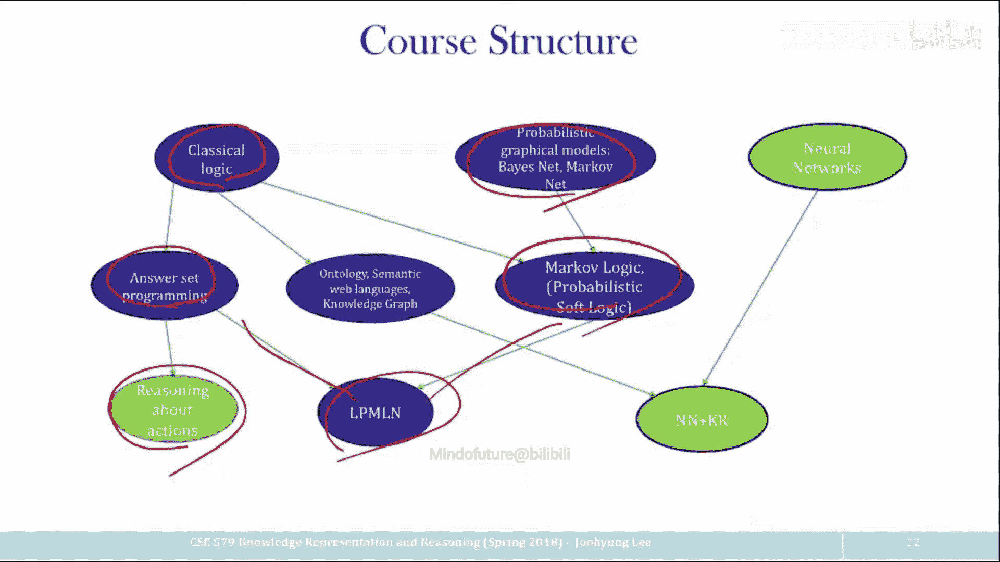

嗯。Yeah， so sometimes what they claim is。Even with some small number of rules。

 you can a small number of data， you can do much better than the na approach。Okay。All right。

 so today we'll start this language and so by now we have certain feel about these languages。

 so Markov logic is based on classical also logic。嗯。

What is good about Markovologic is uncertainty is handled very naturally there。

 it's just a weighted rules if you know for sure then the weight goes up if it is not and way it goes down and you don't have to control the weight unlike the expert system that people have done a long time ago。

 the human doesn't need to curate those weight， the weight will be learned from the data and it's doing the learning much better than what human can do。

So that is actually a nice thing on the other hand， if you do some programming in Markovology。

 youll soon realize that it is actually much more inconvenient than ASP。There is no aggregate。

 there is no choice， there is no constraint， no generate and test paradigm there and no causality and no inductive definition。

 so some of them I'm going to mention a bit more， but the rules that you write in micro logic are usually very simple rules。

And in fact， we are going to see some examples where the microcophologic is actually semantically going wrong。

 so it does not actually make sense if you look at marcophologic。In that way。でね。All right。

 so that's one side， while ASP is actually good there's a lot of knowledge representation construct that we can utilize。

 the nice thing about it is actually rule- based formalism。

 so rule is actually much more natural for humans to express A is true if D is true。

 although Markco logic seems to have a rules but I also introduce why this actually fails in an intuitive reading。

Okay，The most problem of ASP is actually it does not handle localcal probabilistic uncertainty。

Theres actually something called qualitative uncertainty， you can actually model in ASP。

 let's not go into that much of detail， but just probabilistic uncertainty cannot be well handled in ASP。

嗯。So here's an example， the smoke example。So it's the same one， so I don't have to repeat this。

But let's look at this graph。Okay， so the graph is saying that a is a smoker。In fact。

 the red color means that a is the only known smoke color。

And A and B are friends and let's say their friends are a mutual relation now。

 so A and B are friends A and they are friends A and D are friends。

 theres another cluster ENF and G are friends to each other。Okay。

 now what you know is A is the only non smoker and friends relationship shown in this edge。Now。

 if I ask you， maybe I don't。Do have a space。No，O。So you can actually type in this in the input language of Archchemy。

And if you cur the probability of the smokers and cancer， this is what you get。

What is actually unusualus here？Can you see that。So let me repeat this graph looks like this。

TheA is a center of BD。And EfG are another cluster。

Okay so a is the only one that we know that he's a smoker。And for others， we don't know。

and we give this inference query， what is the chance that other people are smokers and other people having cancer？

第一几个说有。EFG。So some may say that EFG， why do they have cancer？哎。And first。

 the cancer ranges are usually high。That's actually one thing。

And if you look at the smoke correlation。嗯。In fact。The B。D。啊，对。

It seems to be having higher probability for those smokers， while EFG are not。Okay，On the other hand。

 their cancer rate are not very much different from each other， although E FG are slightly smaller。

So why this happens？The reason that this happens here is the rule here。

It's actually not the rule itself。So what happens here is suppose you know that。嗯。So here。

Suppose you don't know anything about some person K K is not here yet， okay。

 but let's assume that there is a smoker K， what is the probability of k being a smoker？喺呢度。嗯。

那那 quite快。😊，They1 bike。What is that number。走。No， if you just forget about anything。

It just I mean this is what we did before。So。If you don't know anything about this person。

 then the chance。Of this person to。Get the okay， let me actually not go into the detail here。

 but let's say the chance that the person will be a smoker is actually relatively high。

 it could be actually 5050 if it has zero weight， if you don't know anything about this person and let's say you give the zero as the way。

 then it's actually 50， 50% that he will get even be a smoker。嗯。Now， in general。

 the predicate here will be understood under the open world assumption。

 meaning that if you don't know whether this is true or false， then it's bias to say that 50。

50 chance。On the other hand， maybe testsis are actually， I don't know， some people may argue that。

 well if I don't know whether Xiananggyu is a smoker then 50， 50% chance。

 but that doesn't necessarily make the population to be biased in some ways， right？Allright。嗯。

Actually， so this is a bit different， but maybe less actually consider this example。

So instead of small bird fence。And cancer， we have contact test virus and sick。

I给 the social networking。And if somebody has virus， then he gets sick。

 Pama was sick before his she has a virus， but not necessarily everybody who has a virus is not necessarily sick。

 so they may be virus carrier， but they may not be necessarily sick On the other hand。

 if you have a virus and if you contact another person then he or she may get the virus。O。

This example is exactly the same as previous one。Except for the name change。

Why do I do that because it seems to be now more that this thing about microcoth logic becomes a bit more weird。

 because if you know that a is the only known one who carries virus，Then。

When you have EFG they should not be affected by the fact that a has a virus okay so as ourend said in the beginning。

 we assume that given this only assumption， we try to close the predicate in the sense that A of course it has a virus that's definitely for sure that's poverty1 and B and C and D。

May have virus because of the second rule， because they are contacted by a person who has a virus。

On the other hand， there's no reason to say an EF and G have virus because they are never contacted by the person who has a known virus。

Okay。So in this case， we will try to say that EFG do not have virus， although it may be also false。

 but it's more natural to say that they have very little chance to get the virus。

 so they are also not sick。Another thing。I。Here， the sick is only caused by heitis。O。

so if you know somebody is sick， you can infer that he has a virus。Right。On the other hand。

 if you read this as a mark of logic。If somebody is sick， doesn't mean that he has a virus， right？

Yes， if sick is already true， it does not actually matter whether he virus is true or false。

 so knowing sick doesn't mean that you can infer that he has a virus， it may be true or false but 50。

50 chance again。So this kind of thing is actually abnormal in microcophologic。

It doesn't actually work in the way that you expect。

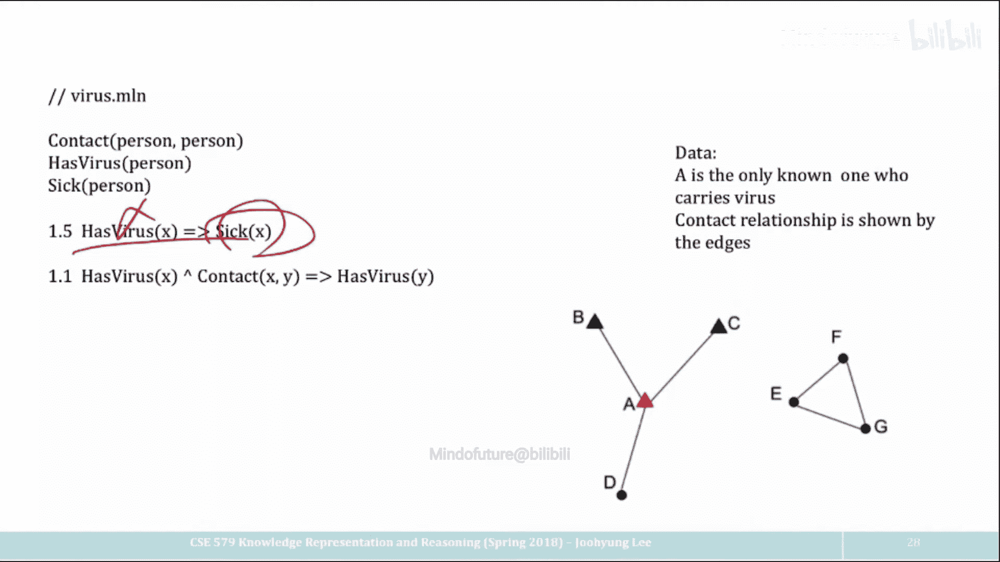

Okay。Allright。So disclaimer， actually this language was created in my research lab with my PhD student。

So I'm not going to brag too much about it， but I have personal bias that this is actually working good in many cases。

 it does not solve all problems， but it works good because it inherits the vintage of both ASP and the micro logic。

Okay so but in order not to bore you， I'm not going to spend too much time on this language。

 but I want to just show you that these languages are connected okay。All right。

 so the main idea of this language is it overcomes the weakness of ASP to handle uncertainty。

 and also it overcomes the weakness of ourov logic in handling some reasoning aspect okay。

So stuff from the classical logic， as I said， classical logic is the basis of most K formalism。

And so set is for the provisional case and is first of the logic。If you look at ASESP。

 this is almost like Proal because when we use the variable。

 we all refer to the proportionalization of the language。

 so we only look at the proportional image there。So that's actually pretty similar。

 except we spent quite a lot of time to learn what is table model instead of classical model。

 so the main difference between ASEB and SA or FOL is the notion of models。

Then we talk something called stable models， but these are all belonging to the same dimension called deterministic language。

Okay，Now if you go to the other direction， other dimension。

 then Markov logic can be also viewed as an extension of satellite wave foil。

 but the extension here is actually probabilistic extension。Okay。So that's what happened there。

 Now what LPMN is about is it tries to connect these two， So this link。

Means that the way that LMN extends Markov logic is actually very similar to what ASP extends said oil for。

The way that LPMN extends ASP is actually very close to what MN extent said or employer。

so then it becomes quite natural to do many of the interesting problems。

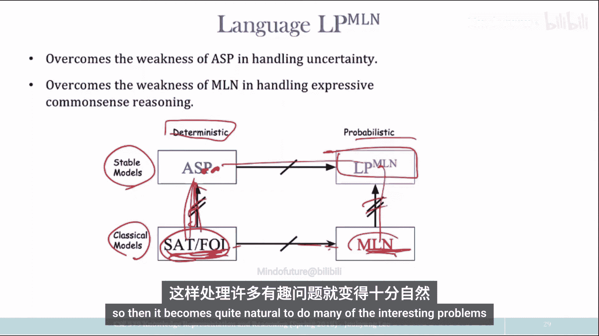

そう。What is this， So you already know the ASP you already know what this then。

 just how do you combine these two ideas？In ASP， so let's start ASP rules， you're given the rules。

What you need to do now is you only need to prepare the weight in front of the rules。

So that's it for the symptoms， so take any cllingal rules and you just prepared wait there。

You can also write infinite weight meaning that the rule is a definite knowledge which correspond to the previous ASP rules where we have no weight there。

Okay， now I'm going to define the semantics in the next slide。

 but basically each answer set guess weight from the rules that are true in that answer set。

So answer set now doesn't have to satisfy old rules。

 but the more rules are true then more likely to be the answer set。

 same as actually what we how we describe micro logic。And so in this language。

 we use a lo linear model in MN。嗯。And as I said， it actually overcome some semantic weakness of MN。

One thing interesting here is MLN is based on Markov networks， which is undirected model。

 but LMN is actually a directed model， and the direction is not actually coming from the proistic graphical model。

 but it's actually coming from the logic site。Because ASP， we know that the rules has this direction。

 you can derive this information from the condition。Okay。

 but it's very similar to Marov logic instead of usingPR like DPLL like algorithm in An set。

 you can actually use sampling and optimization that was developed for Markovp logic。

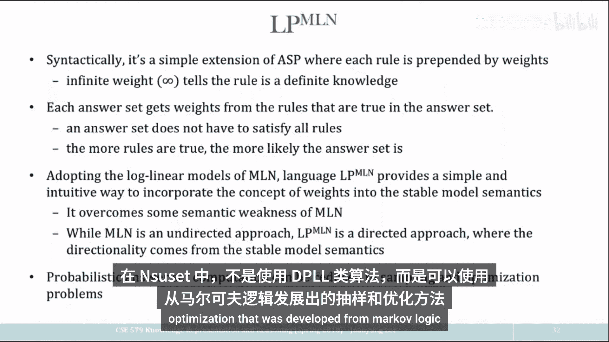

So here we study this very simple example。It's a knowledge based， so bird of x。

 if x is a resident bird， x is a bird effects is a resident bird。

 x is a bird effects is a migratory bird， and we know that no bird can be both a re bird and migratory bird at the same time。

And then now we have another data source， let's say KB2。

Knowing that maybe this is something that we learned from some information extraction module that Joe is a resident part。

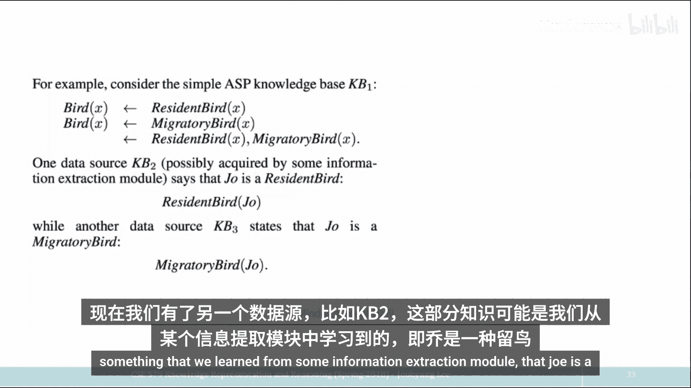

Okay， whatever the joy is。Now there's another data source， Kb3 that says Joey is a migratory word。

And you put all these together and fit into Klinggo， what does happen？どうしてる。

No stable model right because this is inconsistent。

 you cannot find any stable model that're satisfyfi all three because these two together with the last one it actually make a conflict。

 so as we saw before when there is a conflict okay then the knowledge base can entail anything if the knowledge base is inconsistent it actually entails anything that means this is not useful。

O。O。So this is what we just said。On the other hand， if you look at this kind of domain。

 it's actually quite natural even if。It is logically inconsistent。

 but you can assume that there is a high chance that joy is a。Why。

 why do you infer this kind of thing if somebody says well Joe is a resident bird and somebody else was saying to you that or's a migratory bird。

 but you somehow say well Joe may be a bird。How can we get this maybe idea there。嗯。I mean。

 what is your intuitive？Reasoning that you are doing。I somebody raise hand。对吗？

You're given two pieces of evidence。Joe might be resume。Right。

But why are you not creating the inconsistency in your head and blows up？

Why we are okay with this kind of inconsistence information。嗯。😊，First rule。First two rules。

 but why can you use first two rules， which you are already making an incon nonsense from the West？

Why are you not bothered with the nonsense？Yes，开了。In this case。

 both of the Nazi at least agree on the class。So， yeah， so。

You can derive these things right the moment of which one that you use。

 you can derive this actually birth right so the human think that if you're impressional human then you say one of these source may be wrong。

 rest birth may be wrong or the micro be wrong。No matter what case that we are in。

 we can still derive this income。That exits joys of book， right？

So you are kind of tolerating this inconsistency， you're actually kind of ignoring some information when you derive the fact that joy is a birth。

And K does not know how to do that。So we have to teach how to do。

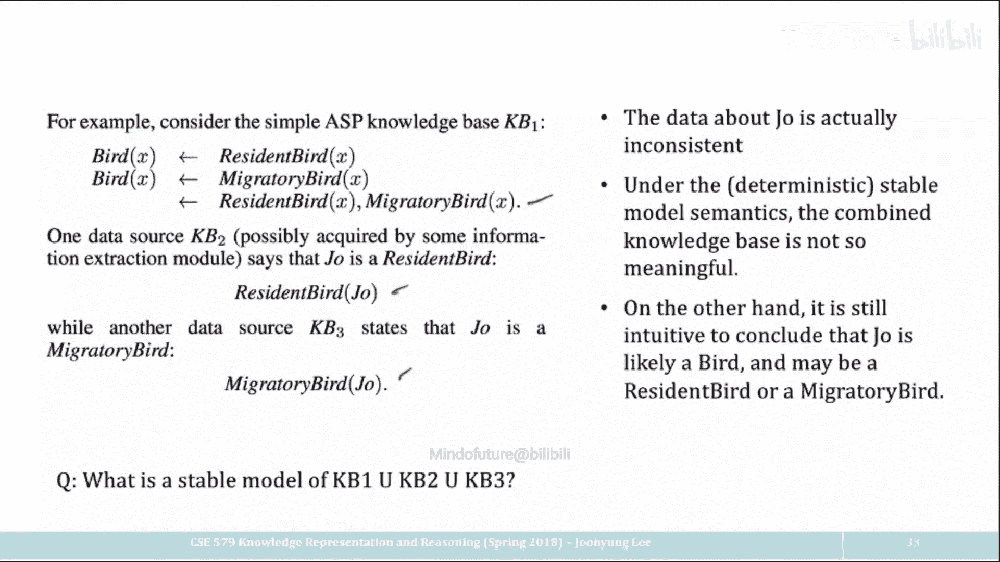

Okay， so let's look at the detail。So the syntax is simple， just put the weight in front of the rules。

Same as before variables are on the suit in terms of grounding。Okay， semantics。

We're going to introduce this P subscript I is' not a readout， so be careful。

 this is now the set of rules that are true in the interpretation I。Okay， keep。

Remember this one because we are going to use this thing for the next few slides to derive the semantics。

Okay， so like marov logic， we are going to say the un normalizedmalized weight and then the probability of the interpretation。

 so first， the un normalizedmalized weight here。It's a bit more complicated。So what happens here is。

嗯。Given any interpretation， what we are going to do is to check whether I is a stable model of this。

P sub I。Okay remember this P of eye is a subset of the program where the rules are true。年系。

So if rules are not true， then forget about those rules。

And then you check whether I is a stable model of that subset。Okay if that is the case。

 we do the same thing as in Marcos logic， collect all the rules from that pi subscript eye where the rules are true in the interpretation and aggregate as sum of all the weight and make an explanation。

Explanation is some of this rate。Okay。アドバイス。If you start this and then。Find this subset。

 but this subset， the I that you started with is not a stable model of this subset when you are in the second case and give weight zero。

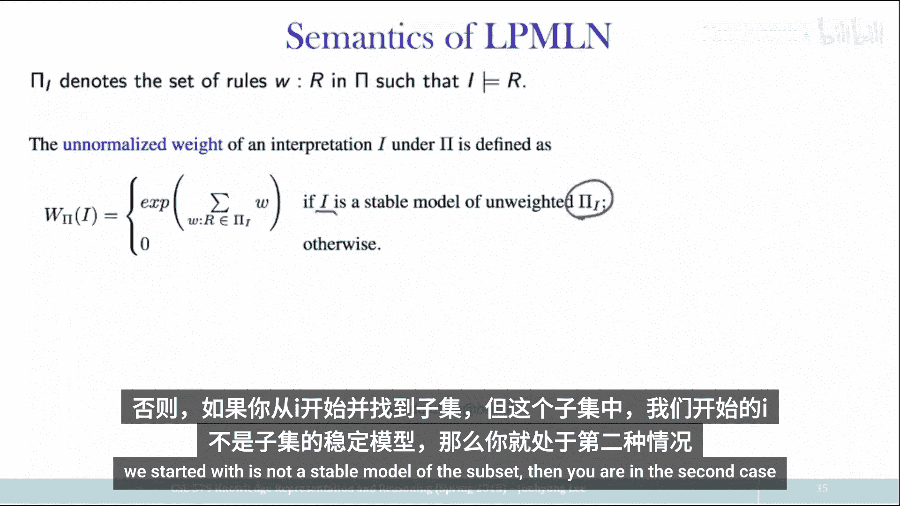

Great question。We don't need to find the rules I satisfy because I will satisfy all the rules in Pi。

ぱでね。Yes， I didn't say you have to find orders。Or did I？Okay。So yeah。

 only look at the rules that are true， okay， pretend that that's the only rules that you're given and check whether eyes the stable model there。

 if then， as you say， collect all the weight from that subset and make an exponiation。

Let me actually show you the example in the next slide and that might be clear to go。嗯。

In the normalized way。Is actually the probability Okay。

 so let's keep that in mind and we'll actually do the practice Okay， so I copied this definition。

 so there are actually four rules here。And let's do this together。

So how many interpretations are there？How many interpretation are there aid interpretation？

So obviously， I'm not going to write all of them。Let's do some of them。嗯。

Let me actually help you to find this thing， and then we will。Do this， okay。Okay。

 so let's start with empty set。What is pi subscript I in other words。

 what are the rules that are true under the empty set？Okay。So I give the label Al， R2 r3， Al4。

Does MT cell satisfy Al1？Yes， because false implies false is true。Thus MTS satisfies R two， yes。Are3。

No areそ。有。Are we together or is this it too fast？You should know by now how to check the settings liability the very basic things that we've done。

Plus okay， so then what we do is now look at only the R1 and R2 and check whether empty set is the stable model of R1 R2。

I it。So empty set。does satisfies it and there is no proper subset than an empty set that satisfi these rules。

 right， so this is an answer set for a stable model。So what is the weight now。

 the weight has to be computed in the same way by looking at these two， right， So what is the weight。

E to do power of two， because it's one plus one。Good， are we together here？

Any question up to this part？Okay， let's look at the next one P。Okay， so what about pi subite。

 does P satisfy the first rule？Yes。Does it satisfy the second rule？No。

 because P is true but Q is false， okay。All right， what about the third rule？

What about the first all？Yes yes。False rule is also true because peace is true or not peace is false。

 false implies anything is actually true。So look at r1 r3， r 4。

 don't look at the r2 okay now as P is P a stable model of these thing。

 so let me actually right here p implies  Q p implies not r。And I if not。Okay。

So is P a stable model of this program？It is one。Yeah， one of it is actually not that important。

 You need to say whether this is a stable model this。

 I should say checking all the stable model of this program is not important。So P is a stable model。

 actually let's actually recap what we do， so to check if P is a stable model， what do we need to do？

因もと那个。So the redup， right， So this is pi I the redup was。어디어 우리나라ina？So PQ is true。

 same as before because theres no ne， What about this？被告人。Pf。Top yes， and the next。R is bottom Okay。

 so is P the minimum model of the redduct， Yes， so P is a stable model。

 So what do we do What is to redduct now， what is to wait now。E to the power of。Al once wait。

Are three sweet？I fourth weight。So that gives e to the about 6。对。Very good。Okay， what about your。

 Let's do this for the last， okay。Does this interpretation satisfy the first one？在看到吗。所的啊。No。

 first one。嗯。Okay， so this is the only one that is being satisfied。

 so that is Q a stable model of R2。6。Q is not because Q satisfies all。

 but is not the minimum one because empty satfi this R2， so this is not a stable model。

 What weight do we need to give now zero is0， This is actually the second case otherwise。O。

So there are actually five remaining case I didn't go through， but you can feel the rest。

And of course， the normalization factor is actually adding all these numbers。O。So那 not's new here。

Okay， so let's go back to the。For the example， let's assume that every knowledge is definite。

 so they have infinite knowledge。Okay， infinitefin weight。Okay。

 so actually I wrote all these things for you， so using that Habra universe is Joe and this is the thing actually。

 let's check some of them。What shall we do， Let's actually look at this one。

So this means that Joe is a resident birth and also a bird。Okay。嗯。Now。

 the rules that are true here is。I want R2 RF4。喂hy。It our5 is not true。

R5 says that Joe is a migratory boy， but the interpretation does not say that。

 so when you consider the interpretation， you temporarily assume that r5 is false。

 you forget about r5。Okay， and then if this thing is a reasonable conclusion that you can derive from the reasonable part of the program。

 then you can give the weight。Here is actually e to the path for alpha because there were four rules here with the alpha as the weight。

Okay。Allright。Same way， now if you assume that Joe is a migratory bird and joy is a bird。

 then you actually forget about that joy is a resident bird for the time being。

And you can still do this。Okay。And another one that keeps the same weight is actually Joey is a resident bird and migrtor bird and Joey is also a bird。

 which rule should we forget if you consider this is a reasonable assumption to make rule three。

 rule three， let's assume further temporarily that this rule three is actually false。Okay。

 so then you can get all those four rules to derive this as a stable model。

 so you get the weight to the e to the power4 alpha。Okay， now let's actually look at something else。

Resident bird， Jo is a resident bird。This time， which rules should we forget？啊。Okay。So。This time。

 actually， we have to。

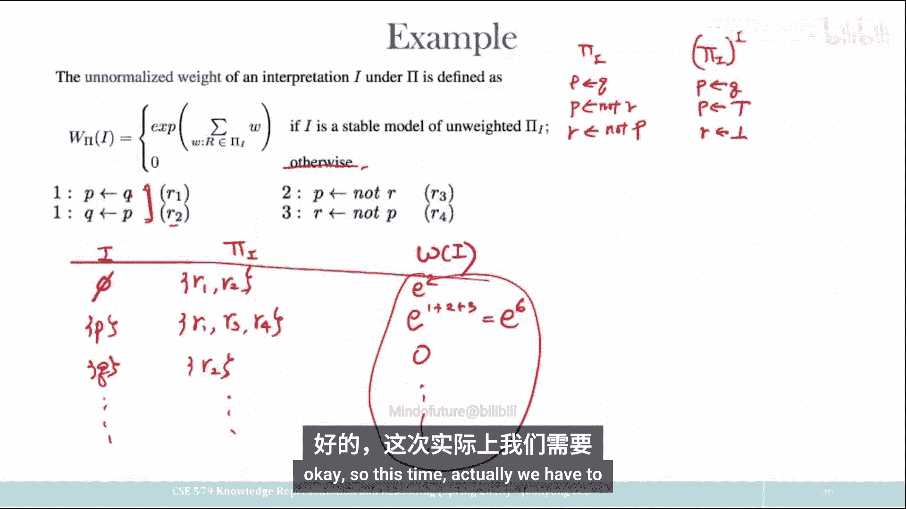

We have to forget tools， okay， so compared with previous one， since Joyce a Reg bird。

 we have to forget about this R5。But we also need to forget about I1 because I1 is saying if joy is a original birth that Jew must be a birth this。

Interpretation doesn't say that。Okay， so we have to forget about these two， and because of that。

 you also only get e to the PA 3 alphapha， one less than before。给了。Now something interesting here。

 what about this interpretation， Joe is a bird？Then。How many rules do we have to forget？Actually。

 these three are fine。It isati by the assumption that Joce a birth。

 but this is actually not fine because we don't have that information in the interpretation。Okay。

 so we get these as the relevant subproing。But then there's no way to derive Joe is a bird from this without knowing that Joe is either migratory bird or a resident bird。

 so getting that Joe is a bird without no evidence is actually wrong， so this is not a stable model。

 so that's why we penalize it with the weight zero。

 this eates difference from the Markov logic in a Markov logic， if as long as it's true。

 you get the old weight， but here we do an additional check。If the rules are true。

 but you cannot actually use that rules to derive this information。

 then this interpretation is not stable， so you get the penalty0。A we together？Allright。

 let's do thequi。I gave you these three problems and I hope you can answer。

And I will show you this table。人民。For some reason。Okay good。特本就。啊。So let me ask you to。

Solve all three problems。 But before that， let me。Open this。Okay。OkayI think you should be open now。

 right？Okay， answer these questions on this priority table， what is priority of job being a bird？

Okay。ふ。😊，And what is the probability that Joe is a birth given that Joe is a resident the birth and joy is a resident the birth。

 given that Joe is a birth？So write three probability。Oh， by the way。

 one thing that I didn't mention。Is when you normalize it。Okay。

 this is actually having all the infinite weight alpha， so you have to make alpha to go infinity。

 so limit of alpha goes infinity。O。So that's actually what you have to use to derive this。

 so even if this was e to the poweru 3 alpha， it gets to probability 0 because normalization factor is actually three times e to the p。

啊4阿法。Okay， let me actually go slowly， so why do we get the probability of zero here？仁是市人民。

A far to the infinity。What is the normalization factor， actually。

 weight is actually e to the power 3 alpha right here。normalmalization factor。So we have three times。

E to the power of 3 alpha。Plus three times e to the poweru 4 alpha plus e to the poweru 2 alpha。

 this is actually the normalization factor， right？Okay。But if you compute this， what do you get？

What do you get。It's  zero， because。You divide by this， it means。はいです。オッケー。

I'm not showing you all the calculation， but it cancels out and actually the alpha termss。Okay。

 gross infinity。对。Actually， this goes infinity， so the whole thing close to zero。

So having that in mind， okay， so what is these probabilities？阿没 done。Okay。

How many of you do what time？No， one two。Okay， let's just。What。给9年。And only two hands were raised。O。

ダ目なしです。Okay。only 10 answers are here。嗯。Okay， let's do this together。 It shouldn't be too hard to do。

 So what is the probability of Joe being a bird。So you have to add up and basically you are doing this thing。

 add up all the interpretation that makes this to be true right。

 so the interpretation that has to be birth actually one， two， three， four， actually too complex me。

Raise this。Okay。そう。So these things as Joe is a birth， right， if you add up， then the properties。我。

Okay， for this one this is conditional priority， so you have to know what are the interpretation that has choice original ver。

 so you only need to look at that， so this is this one， this one， this one， this one， right？

So among this， what is the authority of that choice are good？In fact。

 has all three non zero priority as joys of work so this is。问你完。

Now what about this guy that joy is a bird， given joy is a bird， that means you have this guy。

 this guy， this guy， this guy？Okay，Among this， what is variety of joys a resident bird？One makes。

 That's what makes。So we have actually two things， this guy。And this guy。Okay， so that add up to。

2 over3。You need to look out the world which has going probability it zero。Yeah， you don't have to。

It is off to you。All right。I mean， in principle， based on how you make your sound。

 then by the definition you have to develop it， of course it's zero so it doest make any difference。

All right。That's good so using this， we know for sure that Joe is a bird and if Joe is a regional bird we know for sure that Joe is a bird。

 but if Joey is a bird doesn't admit that Joe is a original bird because it has a chance that Joe is a migratory bird Now the second example is to make this a bit more interesting now this one is now uncertain knowledge where there's a high chance maybe Joe is a original bird。

 but it's not a definite knowledge on the other hand。

 Joe is a migratory bird is also has certain chance although it's not as high as the other one and if you do that I'm not going to go through all these things。

 but you can calculate this by yourself。

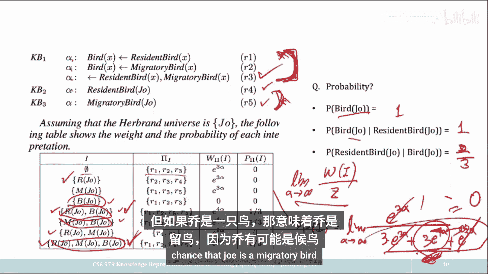

And this time。嗯。The priority actually changes this way。Okay。And。

When you ask droppinging a bird is not necessarily one now。

 because it is possible that these two can be also false。

So there's a 39% of chance that these two are false。

So that you actually get a 91% of trans central ether birth。And also if you look at this。

 the probability of that Joe is a resident bird is actually higher than Joe being a migratory bird because of this weight difference。

Okay。All right， so let me actually use a couple of slides。

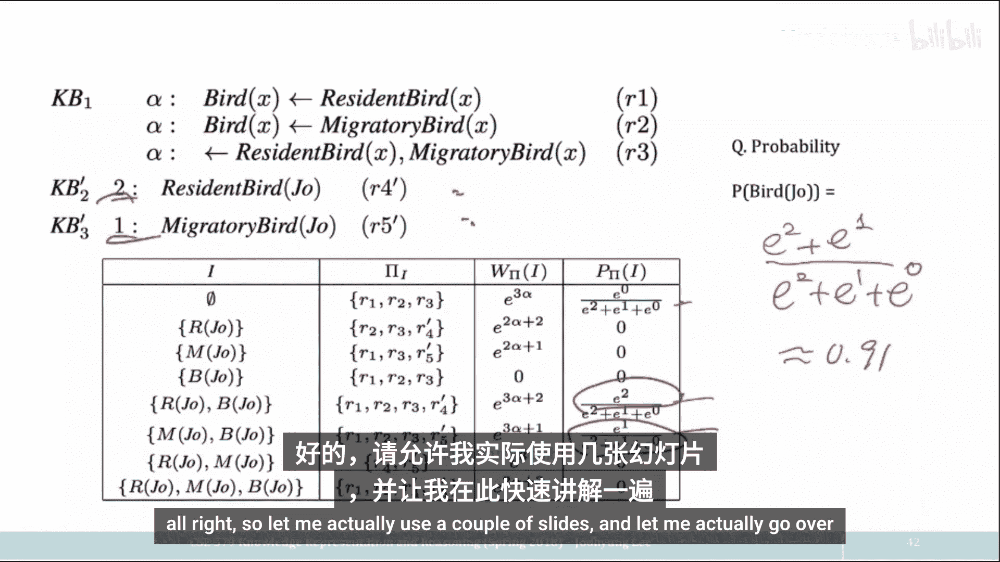

And let me actually go over quickly here。This information。

 this tree can be actually used for doing the graph problem。

 which is actually your homework problem in your homework file。嗯。

But you don't have to use IM and you can use mar logic。So here。

 one interesting question is given that you have a graph and each graph。

 each edge has a probability to be true， whether probability means whether these two edges are these two nodes are connected。

Okay， so what you can do is you can give have a this query。

 given that there is a path between the nose， what is the likely shape of the graph？嗯。

Or you can have some question like you're given the two node。

 what is the priority that there exists a path between them？

So you can actually make the Hamiltonian cycle as a proluralistic version。

 so each node has certain probability of connection and you want to find the probability that whether this cycle will be more probable than maybe another cycle。

 you want to find the most probable Hamiltonian circuit that is also possible to do。嗯。

And let me go this next time in detail。And I have a couple of slides that I actually prepare for today。

 but this is almost done， so next class we'll finish off on the semantics of LTMN and then going into the inference。

 so that will cover most of the LTMN language。Any questions about today's material？

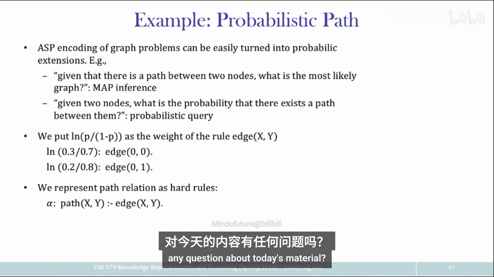