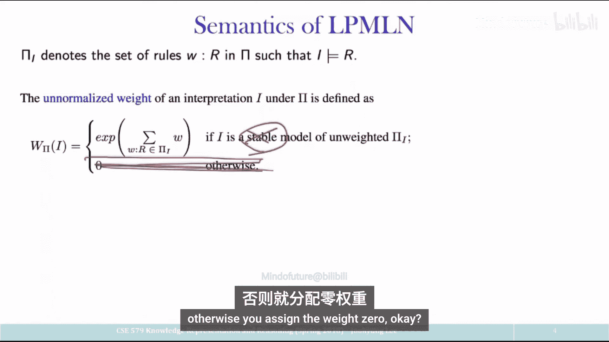
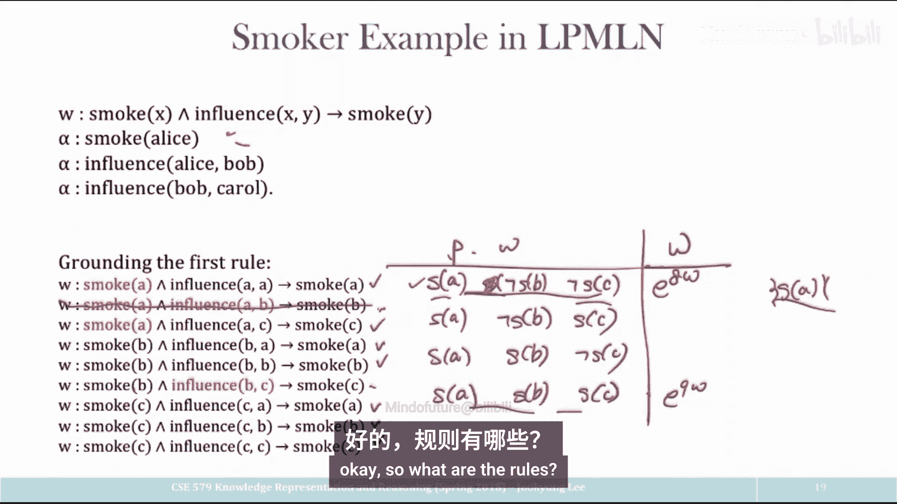
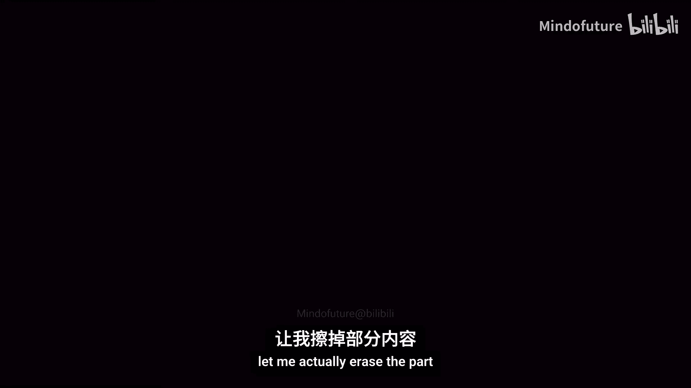
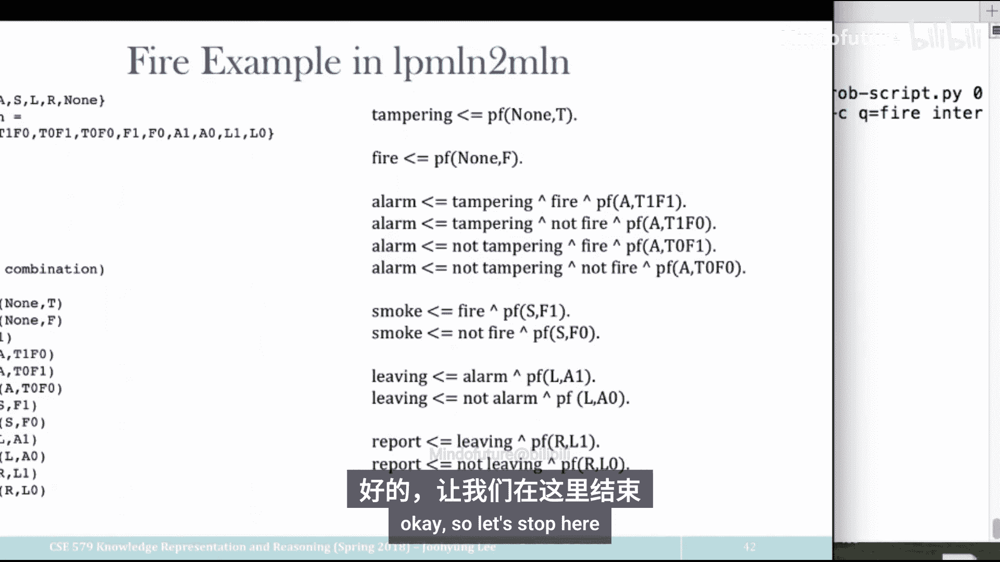

# 【亚利桑那州立大学】知识表征和推理 ｜ Asu Cse 579 Knowledge Representation 2018 p19 P19_Lec23 -BV1RTWyzfEQH_p19-

Okay， lecture 23， so we'll continue the discussion of LPMN language。

 I'm going to show you some examples and also tell you about some systems that compute this language okay。

So as you saw last time being the idea of LPMmin was to combine the advantages of both ASP and mar logic。

So let's recall， what was the semantics of LPM？We start with or by the way， syntax is simple。

 so it's weighted and subset rules。And we define this auxiliary notion high subscript I which is not to be confused with the redux this is actually simpler than the redux in the sense that you just collect the rules that are true under the interpretation I okay and when you find an unormalized weight this is in two cases so you can given an interpretation you can find what are the subset of the rules that are true under that interpretation so look at that subset and ignore all the other rules that are not true now within this subset that are true under the interpretation if I is a stable model of that subset then we do the same thing as in marco logic so collect those weight add them all the weight of that satisfied rules and make an explanation。

And that's one part but now it happens to be the case that I is not a stable model of that subset that you talk。

 then the weight guess is0， so this is actually what distinguish this from Acoov logic so just in case if you actually forget about this stable model。

 you say that I is a I is a model of weighted unweighted subset then。This case does not arise。

 Okay so then this definition reduces to a marcoologic definition。Okay。

 so the difference between Markov logic and semantics is about requiring this subset to generate a stable model。

 otherwise you assign the。

ばいいですよ。

Okay， so that's how you actually compare the semantics with macroologic。All right。

 once you have that normalized weight also called probability is just this。

 okay you just add up all the weight of the all interpretations and that's the normalization factor。

So we talked about this example before， so for each of the interpretation you have to find which are the subsets of the rules that are true and this subset can be different among depending on which interpretation that you choose and after that you can get。

The weight from each of the rules now not here that sometimes you have non0 weight。

 but if this is the case in this case is actually not a stable model。

 this interpretation is not a stable model of these rules。

 then the weight gets zero so that the probability is also zero okay。So this is what you can do。嗯。

And when you have the probability questions， this is actually same as the basic notion of probability。

 so how do we know that what is the probability of bird of joy is true。

 then you go all the interpretations that satisfies the formula bird of Jew。

 so for instance for this query， bird of joy is satisfied by these interpretations。呃。One， two。

 actually， three，4， okay， so there are four interpretations that makes word of to be true and you collect all the probability you add up all the probability that becomes one。

And for the conditional occurring this is also also the same。

 you have the probability of bird bird of jo and resident bird of jo divided by the probability of the resident bird of Joe okay so that's how you do the conditional probability。

 there's actually nothing different from the basic probability theory here。Okay。

Now note here that when we use alpha， our intuition is to make each of the rules hard。

 which makes definite knowledge， so everything has to be true。

 but if you go into a different weight like two and1 this is not alpha so it's not an infinite weight that we capture so it's kind of certainty factor with different degree so if you do that you will get some different probability okay。

But the priority computation is actually same as before， once you have this。

 you can normalize res to the same idea。And same computation。O。

So what alpha makes a difference is we make alpha to go infinity when you compute the probability。

 so if you have more alpha to be satisfied， that interpretation dominate the other interpretation that satisfies less alpha and that those other interpretation becomes actually zero in terms of probability。

Okay。All right， so now let's look at some examples of LPM in language。

And how that can be useful so here we want to talk about the path problem and we did these problems in ASP。

 we had Hamiltonian cycle problem or coloring or clickique there's a lot of different graph problems that we did in ASP Now you can actually easily extend every problem there in terms of the probabilistic setting so you can actually assign a probabilistic uncertainty there。

So for instance， suppose you have a graph。Actually you know you don't know what is actually the graph there okay so you don't know whether the edges are present or not。

 but you know that there is certain path between them okay so for instance if you think about some network connectivity。

 you know that from this node to another node there is a connection but you don't know what is actually the path that they are following okay so you can actually find out using these pro。

LPM language。Also you can say that given the two nodes with certain probability of the edges。

 what is actually the probability that paths exists between them。

 we are going to show this more specific examples but for now this is the kind of query that you want to do in terms of probabilistic setting。

 knowing that you can describe graph in terms of ASP problems。

 the only thing that you need to add is actually probaistic information。

Now how we do that in terms of these passes we don't know whether the edge is there or not okay so edge has the probability okay to be true or false okay so for this kind of thing what we are going to do is just add this fact that when you describe edge relation so let's say there's an edge between 0 and 0 with 30% chance what you do before was just to write edge of0 comm 0 meaning that there is a self loop there right and that's definitely true but now you want to make it uncertain how we do that you put the log of 0。

3 over 0。7 and we actually talk about why this particular number before you。

Do you remember this part right， I don't have to repeat。Okay。

 so if you want to say this is a 30% chance that this atom can be true。

 then you can encode a log of 0。3 over 0。7。Similarly， you can do with the edges not edge 01。

 or 0 and 1 are connected by an edge with 20% chance。Okay。

So this is actually what you need to do in terms of saying the edges。

 but other than that the pass relation is just the same ASP rules that you have written before。

 so it's a recursive destination so if edge is true。

 then that makes path to be existing between x and Y and x to there is a pass between x and y。

 if there's a pass between x and z and z to y and say y is' different from Z actually just last essential but sometimes it helps to search。

Okay， are we together？Okay， so just take most of the ASP encoding， actually。

 all we did in class in terms of this graph problem。

The graph is represented by a set of nodes and the set of edges。

 and you can always turn the edges into a proistic effect。Okay。All right。

And you can easily do the probilistic trail length salesman problem so we had this Hamiltonian circuit problem and we had there we have how do we find a Hamiltonian circuit from the graph。

 now you can actually say well these nodes are not necessarily connected。

 there is certain chance that there's a edge between them or not。

 you can make it as probilistic version which is typically more difficult than the deterministic version but you can easily solve it using the system for computing LM。

Okay， all you need to do is just to change the edge relation to be probabilistic。Okay。

 other rules are actually the same。And there is also interesting thing I don't have slide here。

 but you can easily imagine when we do the traveling assessmentism problem there was a cost function。

 so each edge was represented， each edge is associated with the cost and we want to find optimal plan right and this optimality optimization of the cost and this probability is kind of alsoous things so you can actually make a so-called decision theoreticalore version of this problem so you want to say you want to find the Hamiltonian circuit with let's say 50% of chance that exists but the cost is optimal。

Okay， so you can actually create the combination of these problems。All right。

 so let's actually look at a specific example here。嗯。Just to illustrate this idea。

 this is a bit different from the previous slide in the sense that now what I'm going to do is to turn the node to be probabilistic。

 but you can imagine。It similar idea here Okay so are two there are four node here， so1，2，3，4。

 and they are connected by this graph as in this graph。And for node one。

 we want to send out the signal。And each of these node。

 you can think about as a station that received the signal and for the signal。

 but each node has certain failure， okay， so node 2 can fail with 80% chance and node 3 can fail with 50% chance and node4 can fail with 20% chance。

Okay， and the graph is actually shown here。Okay。Now how do we represent connectivity。

 well same as before x and y is connected if there's an edge between them。

 but now we want to say if each of nodes are not failing。IfEach of node does not fail。

 then these nodes are connected。 and of course， x and y are connected if vi trans if closer。

 if x is connected to z and z is connected to y。Okay， so let's think about it。

 What is the According to this description we are going to actually run the system to check this。

 but according to this thing， what is the。Probability of age 1 and2 to be connected。

20% that's actually given here， right？Okay，80% is the chance for the fail。Okay。Actually， yeah， okay。

 good。How about note2 and 4？都都愿做。Somebody says， 16%。Is it。

 because both of them has to be not failing and that's the chance of here。

 this is actually a success。Right， so 0。2 times 0。8 is 0。16。

 16% of chance that no two and four are connected Now the real question。

 what is the probability that one and four are connected and that is something that we want to do with socrative。

Okay。So this time I actually gave a multi choice。有。我先 justす。こ？O。So。Think about it。

You can discuss with your peers， if you want。比と关点。通。说死议。确实。Okay so。A we good。こ。Okay。

ho know啊 who need什 more time。Okay， let me give you one more minute。close。Yeah。Okay。

 let's see how we did。Okay， quite diverse。Somebody really chose E here。Okay。All right， so 45% A。

 but B and D are also。OfOkay， so let's actually look at this together。All right， so。

Note1 is always successful， so there's no fail on this。

 so we can just enumerate the possibility of each node to be failing。So。

Now we have to still connect it。 So if not。2 is。Let's say false， okay。Then in order to be connected。

 three and four must be connected， right？So this is one possibility when node2 is false。

So not to fail， actually， I should say。Let's actually use。Fail， okay， so this is fail， successful。

 successful。If no two fails， then the only way to connect it is through three。

And four must be also successful， okay？Now when two is actually successful。Well not failing， okay？

What about the case。Well in that case actually we don't need to rely on node 3。

 we can actually directly go from node 2 to node 4， assuming that node 4 is actually successful。

 in fact actually for all cases node 4 must be successful so here node 3 can actually fail。Okay。

 but also those three can also be successful， there actually is only three possibilities。

And you just need to compute to probability and adult Okay so what is the probability that you get not to fail？

And three and four successful。That's 0。8 because that's the failure rate。

And success is now looking at this one， so 0 point。5ive times 0。8。Okay。And for the second case。

 node2 should be success， so that should be 0。2， and then fail， that's actually 0。5。

And same as before 0。8。Okay， and all being successful， that's a 0。20。5 also 0。8。 Actually。

 the third is actually 5050， so it does not differentiate。 So if you compute everything here。

 that is actually this is the first one is 0。32。 the second is 0。08。 third is 0。08。

 So the correct answer is。诶。Okay。A'molute， this is not。What did I say。Actually， I got wrong here。

 right once？6。I suicide said 0。48。喂。Yeah， I think I did calculation error here。

So the correct answer should be 0。4， sorry about that， so actually E was right。😊。

Well that's not my intention， okay， so sorry for the confusion that looks like E0。4 a is correct。能住。

嗯。Okay， so then。That's actually。Checkです。This is actually the system that you can use。

 We are going to talk about this system in a moment when you do when you run。The program。

 you will actually get this output and in fact， as I just said， 0。414 is actually this one， so 48%。

 so I don't know why I didn't copy the right one， but this is the。

Now as you see even for this simple problem there are a lot of different cases that you have to consider right so in AFP the strength there was you can actually enumerate all possibilities but the limitation was all the possibilities were treated equal。

 but in many cases like this example the possibilities are not equal sometimes there something is more possible or more probable so by doing LPM at anyway we can actually differentiate between those possibilities and we can get the probability。

Now， if you actually try to feed something like this。Into alchemy。Okay。

So I mean syntax is a bit different， but basically you treat this rule as a formula。

 so if the body is true， then it implies to head， okay you can encode this in achemy and if you do that this is actually what you will get as an author。

Okay， now something is actually onintuitive because。Here we don't actually have。

 according to this recursive rule。We cannot actually connect one to one for instance。

 because there is no edge from one to one okay so connected one to one comm one cannot be actually be derived from the program。

 but according to the alchemy， the head can be always either true or false。

 actually the body doesn't necessarily have to be true to make head to be true。

Because implication is true when body is false or head is true。Okay， and because of that。

 you will actually get these many possibilities。In fact。Connection between 14 is actually 36%。

 which is actually not correct。Okay， so this is how you get The point is the Aranees based MN Barov logic is based on first of the logic。

 and the first of the logic is known to be unable to capture the notion of transive closer。Okay。

 so this is actually a well known result first auto logic cannot capture the trans closer。

 if you want to capture it， you have to go to the second order logic。Okay。Okay。

 so that's actually the limitation of the Mark logic for reasoning about transit closure or reachability or connectivity problems。

O。Next。We also know that NSA said programming can be used for the planning。

Okay we have formalized some blocks wall domain and monkey and bananas。

 one thing that I used to give an assignment was actually the wolfsh cabbage problem。

 this similar to the problem of missionaries and cannibals。You can actually encode this in ASP。

But here let's consider a variant of the problem。So the original problem is saying that if Wolf is left this sheep without the farmer。

 then wolf will eat the ship， and similarly the sheep will eat cabbage if nothing a a farmer is not around。

But now let's assume that sometimes Wolf does not always eat shit because maybe he's not hungry。

So what you can do is you can formalize this domain as a deteristic ASB。Okay， so for instance， here。

 you can say about the effects of the action。Okay， so if something is on the board and location Im sorry。

 is actually indirect is a state constraint， if something is on the board and both is at one location。

 then that object is at the same location。This is inert rule that you saw before。

 usually the things will stay in the same location。

And this is an action if an object get on the boat， then on boat will be true in the next time。

 if you move the boat to the destination， the boat destination will be at that destination。

Now here we have the things at wolf and sheep， but the boat is not there。

 meaning that the farm is not there， then sheep will be eaten。Okay。

 but we actually do write this as a soft low with weight that is different from alpha。

 that means sometimes this can be actually violated。Okay。

So there are some other rules that I think I skip， but you can say in the next step。

 in the next step， wolf and sheep and cavaation should be all in the destination L2 and sheep should not be eaten okay this is what we call success and we want to find the plant that is successful。

Now original problem actually takes 17 actions of cross。Okay。You can try a few one， Okay。

 this is similar to the mission it's kind of well puzzled as we did。But with this elaboration。

 you can actually get 11 step solution。Where the wolf does not actually eat sheep。

But this is actually less probable than the deteraristic plan。So if you want to be risky。

 you can get shorter step solution。Okay。All right， so this is it。Okay。

 let's go back to the smoker example is actually the slightly different version of smoker example。

And here is anothercrative question that we are going to do， so let me first explain the domain here。

 so forget about cancer and forget about friendship okay。

So here instead of that we have influence relation so if x is a smoker and if x influence y。

 then y is y smokes。O。Right。So this is actually a soft rule， this w represents a non alpha weight。

 so it can be some a real number。Okay，Now there are also rules which we know for sure。

 we know for sure that ElIS is a small。And we know for sure that Alice influence Bob and Bob influence cattle。

 but nobody else influence nobody else， in other words。

 these are the only true relations in influence and all other pairs doesn't satisfy the influence relation。

Given this。Easily， we can see that with。This Markov loging network。

 the probability of this smoke of El is one because this is actually hard rule。

 you can easily compute this one。哦。What we are interested in is we know that Alice is smoker。

 but we don't know whether Bob and Carol are smokers。

 but we know Alice least influence Bobb and Bob influence Carol。Okay。

 so what is actually true about the probability of being smokers。

 so that's what I'm going to ask you now。Again this is multi choice。But there is no tea。Andい。Okay。

 so think about this。If you have done the homework。And if you understand the Mark logic in semantics。

There should be enough to answer this question。は。If you don't have any idea。

 just have a random guess。Now， I should actually say W is a positive number， otherwise。

 maybe opposite。Okay， do you need more time， No， Okay， so let's see。Okay。

 majority think a and some people say。See。Okay， the answer is， of course， C。If you do say。

 I would not have asked you that question，Okay but why this is tricky。

 so intuitively a makes sense because a is closer to B Bob is closer to El so his influence her influence may be stronger than Bob influence Carol。

 right， so that's actually what you intuitively expect。

 but what happens is actually not according to the American semantics。嗯。

So this is actually where you actually have to relate the difference between firstso logicmantics and the s modelmantics okay so all these things are actually connected。

 what you learned in the in the semester is actually coming up again here。

So what we know for sure for this domain is s of a must be true because this is actually the hard rule here。

And influence A and B is true and influence B Q is true， but other influence relations of all false。

 so the key part is actually this rule， this is the soft rule。

 and since we have three object here three persons here， this rule will generate nine possibilities。

So 34 x，3，4 y。Okay， so if you ground this first rule， you will get nine ground rules。

 are we together？Okay， among these nine ground rules， some rules that。Obviously， true。Okay。

So which rules are obviously true？嗯。😊，What are the obviously true rules？The first one， is it true？

Yes， why？Influence E is false。 and incident is false。 The whole thing is true。 The second one。

 we are not sure yet， because it depends on。Pace of smoke or not。 Okay， so let's skip that for now。

 third one。It's also true same reason influence AC is false because that's what we said here。

 all other values pairs of x Y influences false， so this is false， false okay。

Antic being false means that implication is true， so these are true。

In this one we don't know for sure yet， so let's skip but the other things here are all sure so among these nine rules what matters could be these two rules okay so since influence relations have fixed interpretation。

 let's actually look at the smo possibility。So we want to say possible。Worald。Okay。So， here。

What are the possible world， So influence relation is fixed and smoke。

Is actually fixed for theiries and this is known to their smoker， right？

How many other possibilities are there then？Four， because depending on whether B and C are smokers or not。

 so there are four possibilities。是吧。For all four possibilities， at least it's a smoker。8。

Is not a smoker and Carol is not a smoker。喂。So this is one possibility。And。Bobby's a smoker。

And Carol is not a smallr。Okay， so Bobby is not a smoker and Carol is a smoker。

 and all of them are smoker。Okay， are we together？All right。

 so now let's talk about the weight of this interpretation。Okay。So there are I1， I2 I3， I4。

 there are four interpretations let's look at the last one because that's part simple。

 what is the weight？Of this last interpretation。What。What is the weight of this interpreting。

 We are looking at manco logic。Okay。You to the puff。9 W。Times。

E to the half of k alpha because alpha rules out there， but let's forget about alpha rules。Okay。

 so let's only look at this one because all the interpretation will satisfy the same set of hard rules。

 so it'll cancel out when you do the probability。So let's actually look at only the weight coming from the ground rules here。

 the last interpretation satisfy all of them。Okay， so 9 w is the sum of the weight。

 so the weight is e to the power of 9 w， right？Are we together？

Good now let's actually look at the first one so A is a smoker and B is not a smoker and C is not a smoker the only two rules that we are not sure is actually the second one and I think it is successful okay the second one is it true under the first interpretation？

It is false because smoke A is true， but smoke B is false， so this is true， true， but this is false。

 so true implies false is false right so this rule is not satisfied。

By the first interpretation are we together what about the sixth rule the sixth rule is about smoke B implies smoke sea both smoke B is already false。

 so the antecedent is false， the whole thing is true， so what is the weight of the。8W。Okay。

 the only one that is not satisfied is actually this one， Okay， the second one。Good。

 what about the next one？这个。6 so。Now， the second rule is actually true because smoke A and smoke people of them are true。

 but if you look at the six rule。Smoke B is true but smoke C is false， so the formula。

 the6 formula is。False， So the way is。Yeah， good， what about the next one？

So this is the same as the first case right so smoke is true but smoke B is false。

 it does not satisfy the second formula but all other formulas are true。

 so you get actually eat to the puff double。O。嗯。Knowing this， let's go back to the probability of。

But being a smoker。What what is the product。 now， look at this table。Okay， can you。

Say what is the probability？Or the bar a smoker， which interpretations make out to be a smoker？

Second and fourth， right， so from this we get e to the P AW plus the second one， okay e to the P AW。

 the last one， e to the P 9 w。And the normalization factor here is the sum of all the weight here。

 so that's three times e to the power AW plus e to the power 9w。Okay， are we together？对。

What about the priority of Carol being a smoker？So we have to the denominator is also the same。

 so that's wholesome， I don't need to worry about that now if to look into the case that Carolroll is a smoker。

 which interpretations may Carolroll to be a smoker。Third and fourth。

 So what do you get as the numerator？E to the power of 8W and e to the power of 9W。

And what do you get？They are same。Okay， that's what microcoologic tells you。

 the reason for that is obviously because of the semantics of implication。Okay。

So the next question is。If this is actually the type example， you can compare it。

Now let's actually go back to the LPM N so in the case of LPMN what I can save is I don't need to say for all other pairs of x and Y they are not they don't have influence relation。

 I don't need to say that because by definition a dis model minimize this extent。

 so if I don't show this then for all the other pairs of x and y influence relation is false。

So that part I can say， but other than that， I'm trying to capture the same thing。

So what is actually now the probability？And here you will see that the answer is actually a。

 and let's actually check Y， so doing the same example and doing the same computation。Okay。So呃。Again。

 this idea is coming from the first rule， it generate nine ground， Okay。

 so we'll actually do this together。Okay。嗯。It's possible law。So one is。

A is a smaller and B and C are not small， same thing as before。嗯。Okay。This is possible， Lord。

And we want to have the weight。Okay。Now for each interpretation， again， same as before。

 we know some rules are definitely true or false， so let's actually check that again。嗯。

So which rules are definitely true？So this one is true。This one is true。This one is true， true。

And true。Right again， so it's the second one and the sixth ones are not known yet， okay？

Let's actually look at the last one。Okay。So what do we do in the LPMN so if you apply the last interpretation we have to find all rules that are satisfied right。

 actually all rules are satisfied okay now but we have to check whether this one is a stable model from the coming from this。

Subpro， right， which is the whole rules， so is this one。A stable model of the subset。Yes。

 it is because we know smoke a is actually true and if smoke a is true then this one makes smoke B to be true and if smoke B is true then this one makes smoke C to be true so this is actually the minimum model that satisfy all of them right okay so here let's ignore all the hard rules rate but same as before well get e to the power 9 w good now let's go to the first one so this time is actually the same subset that we are looking at right so I don't remember what was that I guess the second rule was only the thing that is false right if you apply the first interpretation okay？

Now， so ignore the first one for now。Okay， now let's check whether this interpretation is a stable model of the eight rules。

 is it？Okay。So smoke A definitely is true because of this one。And smoke B doesn't have to be true。

 and in fact none of the rules actually can derive smoke B。Right。

And S C also doesn't need to be derived， so in other words smoke A is the minimum model of this program right there is actually no negation so you don't have to consider the V。

We just need to find the minimum model。Are we together。In the case of ASP。

 we actually used this notation more than this way。

 but you can identify okay so SA is the minimum model of this program。

 so what is standard the weight now？Yes， the way is actually the same as before good。

 what about the next one？So smoke A， but smoke B is false， S C is true。这你们。Okay， so let's。First。

 look at what subset that we have to look at， right？Okay， so what， let me actually erase the。

Part。

Okay， so these are all。 So which rules are。False under the second interpretation。Rule 2 or rule 6。

Rule2 is false right so this is actually the same thing as before。哈哈。And。Okay。So then is this？

So we found this subset。 Is this a stable model， The second interpretation is a stable model of the。

如是。Why not。We already called。Yes， that's actually one way to say the difference here is whether we are asking for the same program。

 whether this is a minimal model， but this is not， okay。

We already found that SA is actually a minimum model。

 another way to say is smoke of C doesn't have to be true。

Because only rules that make smoke see to be true is these rules， but their ancedent is false。

 so you don't have to generate smoke of C， so the minimum model is just smoke of a。

 which is different from this interpretation， the second interpretation。Okay， in that case。

 what do you assign for the weight？0ロ。Okay， Christian， here。Yes for。成活。Youre the first one？Okay。

 the first one was actually looking at the same rules， so just forget about this， okay。

And you're trying to use。So S A， does it satisfy these rules？Okay， so first。

 one thing that I have to clarify is I actually omit all the discussion about influence relation because that has fixed interpretation。

Okay， so when I say smoke A， I actually mean smoke a union with all the true influence relation。Okay。

 so if smoke， whether smoke A is actually the minimum one together with the fixed influence。Yeah。

 because smoke A is true here and if smoke a is true。嗯。Yeah， that's actually we already have that。

 but other smoke B and smoke C doesn't have to be derived。Right？Are we together there？嗯。

Smoke or B does this has smoke A in the head。So the first three rules cannot be used to derive smoke B。

 right， the only rule that can， I'm sorry。The only rules actually can derive smoke P is this one this one or this one right。

 but we know that this is already false， we forget about it。

 this is not a subset that we have to look at and this one。

 the antecedent is false so we don't have to derive smoke P， same for this guy。O。食边。

Second rule was not satisfied， so when we check， remember， we are only looking at the subset。

So first step is we ignore the rules that are false and then using the remaining rules to check whether the eye is a stable model of that remaining program。

Okay， so that's what you get。Okay， so I think the idea is clear if you got confused it's not really complicated things。

 you can actually go back and compute by yourself， let me know if you have difficulty in doing that。

 The last one is actually similar you will actually get into the power of AW。Okay。

So then let's actually think about the priority of Bob being a smoker。

 what is the probability note here that one of the interpretation now gets weight0。

 so the normalization factor is2 times e to the5 8W plus e to the 9 w。

And what these product be bo to be a smoker actually。The third yeah last one。

 so e to power of AW plus E to a power 9 w good what about smoke cattle to be a smoke so that has the same denominator。

And what about the case that KS sees a smoker， it's actually only one now。Okay two。

 but one is having the weight to0， so this one is e to the power of 9 w。😊，So which one speaker。

The first one。So this is bigger than this。Okay， now why this happens？

In the case of stable model mantics， note here that this does not make sense。Okay。

Because we know that smoker is a chain relation， if a is a smoker， then B is a smoker。

 if B is not a smoker， then you actually get the penalty because you don't satisfy some rules。

But there's no way that cattle can be a smoker without opt to be a smoker。

This is not possible because there's no cause for hero to be a smoker。

 that interpretation is unlikely to happen。So that's why the weight is zero there。And if you do that。

 then the poverty actually makes sense。O。All right， so I think this was kind of heavy。

 heavy in the computation， but let me actually entertain with some other things now。

Let's actually talk about the system that you can play with。Okay。So。

There are two versions of the system， two different implementation of LPMN。

 which you can download from this link。The first one is to use Klinggo as an engine for LPMM。

 the second one is using acheE as an engine for LPMM。Actually。

 we also support other Markovologic network implementation， which is Tfi and Rocket。Okay。

 so there are actually options that you can call with LPM to MN。Okay。

 so probably next class we are going to talk about the underlying algorithm for this system。

 how you can translate LPMNN to ASB and MLN and so on， but today we'll see how to use this system。

 so the first version LPM Min to ASB。The input language by the way these two systems have slightly different input language because their target language is either ASP。

 Klinggo or Markov logic network implementation， so the syntax slightly different in syntax coming from those target implementation so first implementation is air to ASP so the input language is actually very close to Klinggo。

 in fact what you will see that the only difference is you can actually assign the weight。

 you can prepare the weight in front of the Klinggo rules。Okay，Otherwise。

 these are actually the same。Soft rules are clinicalling rules with the weight prepened and every rule must end with period this is slightly different from alchemy in alchemy if you have a period with no weight that's a hard rule。

 if you have no period with the weight that's a soft rule okay but here。

Every rule must end with period because that's what Klinggo request you to do。

OkaySo so here's an example， the bird example that you saw and the only thing that is different from the klinggo rules that you saw before is actually you can assign the weight if you don't assign the weight。

 then we assume that this is hard rules with infinite weight。The rule is alpha。

If you want to know more about the command line option。

 then there is a help file or help option that you can see all the options of the system。

 but I'm going to show you how to run this system。是。因为 the。programgram。嗯。

So the same program as they see。The input command line is very similar to alcheE。

 so you specify the input file which is for that lMN and you specify the DR output file and that is the database stack here or evidence here this is actually empty but you can also query the predicate so predicate with no argument。

 that's actually how you call alcheE tool。Okay， so if you type this， then you will get this output。

Okay。I think it's clear on let me not just type in these things。Let's go to the next one。

 so this is actually the example that you can see one of the question that we talked before was what is the probability of job being a bird if you know that joy is a resident bird okay so how do you specify this condition the condition can be represented in the evidence file so now you use the non-empty effect。

Here。You have to have a double litigationation， which means actually the positive。

So one restriction is whatever data you put in the database fact must be a constraint。Okay。

 not the positive rules， but always have to start with this colon dash。

Okay so this dash arrow nu means that resident bird must be true。

 so knowing that resident birth must be true， what is the probability of bird d a bird。

 so the difference now is you specify this condition in the evidence file and you carry on the bird and then you will get this probability。

Okay。All right。If you do the opposite way， you happen to know that Joe is a bird。

 then what is the probability that Joe is a resident bird。

 okay this is not necessarily one because you might be a migratory bird too。

 so if you do that way you will get 73% of chance that Joe is a resident bird。Yes。So， but。OP。ELP系我。

Ping。Is there any difference？第。In the original Al。发了。关下。

Will it' still be parts if I decide just to run that I minus。The E burnout2， but instead。

It was great。Oh， you put the constraint into。Inside。Yes。

 it would actually make a difference in terms of proper。So if you put there inside。被告。

What LMA computation will do is it will compute two probabilities one。啊。So if we put that。可算。

We don't have to guess。 My guess is probably different。But off the top of my head， I cannot be sure。

Okay。Okay， so this is the file， So let me actually type in what we just talked about。嗯。嗯。嗯。Yeah。Okay。

 so this is one。St it together。Actually， let's used tool。So this is the thing or we have to query。

Regnt， so knowing that Joe is a bird， what is the that is a resident bird。 So this is 73%。

 So what Skyla suggests。Is。Instead of doing that。Let's call this。Yes。So this time。

 instead of that database， I'm going to。Call the empty database。I get the same。都 maybe think。Okay。

Yeah。In the evidence， he added a not。looking at a constraint， it doesn't make something true。

 always can social models， right。I didn't get things told just by acting you are saying that。

Because I didn't see the choice to say that。So the rest of thing is already giving us the whole possibility right。

 so think about the main file to generate all possible world。If you put the constraint。

 you only look at those interpretation that satisfies it。So' the conditioning。There's no choice。

 I don't have to give a choice there。Because that's what the system is already doing inside。Okay。

 so we'll talk about that maybe next week， you're guessing is right。

 choice rule will be actually used internally， but in terms of the input language you don't need to do All right okay。

 so maybe。Let me。Go through the other one， another thing is this。

You can actually feed the ASP rules ASP program directly。

 so what you see here is you can view this as LTMN program with all hard rules or you can just think about this as typical standard ASP program now in standard ASP program if you give this thing and fit into clinicallinggo clinicalling or we say un satisfiable however。

 in LPM implementation you can actually，You can actually give this option so to translate all hard rules。

 so hard rules can be actually violated。Okay that's what we said before。

 sometimes we want to forget about the last rule to say that Joe is a registered birth。Okay。

Or you can forget about the second to the last rule to forget that Joe is original。

 but if you forget that rule， then everything else becomes consistent。

And another option is you forget about this while making all others to be true。

 then Joe can be both re birth and bygrary bird at the same time。

 so actually there are three ways to resolve in consistencysistency here。Okay。

 if you forget each of the last three rules， then you will restore the consistency。

So how do we actually utilize this in debugging ASP？So you call this L to ASP with dash HR。And。

I mean this all is actually to give the probability。

 but if you don't want to know about the probability， you can skip this option， if you do this one。

 you will actually get this guy。Okay， so there are three ways that the thing can be resolved。Okay。So。

And， in fact。So each of the case。You can see that one of the last three rules are ignored。Okay。

So if you put this， then it will show this one， if you put this， it will show the probability。O。

All right， good。Let's actually go to the Bayesian network， So recall Bayesian network。Actually。

 one of the homework problem， too。But I ask you not to use the implementation。Okay。嗯。

So how do we represent the Bayesian network in LPMN so it's actually quite simple you can encode the conditional probability table in terms of this probabilitybabil effect so here you see this one entry right priority of taing become true so let's introduce or called PF atom this is socal probabilistic fact so the temping become true with 0。

02 chance right so this thing can be encoded in this line。Okay。And。Of course。

 this one will be encoded by this。Let's actually look at this one。So this one is when smoke。

When fire is。True， what is probability that smoke is true， and that is actually presented by this。

Okay。So the convention here that I use it doesn't have to be this way， but the quality of smoke。

When fire is true， F1 means fire is true。 Pro of smoke is true when fire is false。Okay。

 that's this problem。Okay， are we together？Okay。So let me actually do almost those things。

 so this thing can be represented by these four lines。

This gives me four possible combinations so tempering is true， fire is true and true false。

 false true false false right so for each of them it generate it has a probability。

 so for each priority each priority is represented by each of these line。

 so this is a priority of alarm being true when tempering is true and fire is true that's a 5050。

And same for the others。Are we together。Is it clear。All right。

 so this is actually the part that you encode the table。

The next is to encode the graph and graph encoding is actually simple。 It's just a logic rules。

 So if taing is true。Then probably effect is true， then tempering becomes true。Okay， same as this。

Maybe this is easier to see。Alumm can be true depending on these tool right prevalence。

 so alarm is true when tapering is true and fire is true。

 in that case you have to use the probability effect that tells you that what is quality alarm being taing and fire are true。

There's also a lot of possibility that alarm can be true when tempering is true。

 but fire is not true， then you have to use different probability effect， A1 F0。Okay， same for this。

If it's not tempering about fire， then use T0 F1， and if it's not tempering not fire， then use t0 f0。

Okay。And that's all you need to do to encode the Bayesian network。Okay。

So I give these specific instruction， so if you didn't follow what I just said。

 this is actually the formal translation， but I usually find the example is actually good enough。

 you don't have to look at all these notation， notation is a bit more complex here。

So now let's look at the encoding in LPM to ASP， unlike acheE。

 we can actually use log function directly， so this saves your effort to compute in acheE you have to manually compute and fit that negative number inside。

 but in LPM to ASP you don't have to do。Okay， so I see。

So this is the quote think you just saw in the previous slide。And maybe。

Let me skip this one and let's do something。Yeah， okay， so one thing that we want to do is。

diaiagnostic influence， so what is diagnostic influence in Beijing network。

 so we are given the effect and we want to find what is the cost， what is the poverty of the cost。

 So for this example， suppose you see that people are leaving。Okay。

 then can you infer what is the probability of fire true。Okay。

 the cause of the fire or this probability of fire to make people to leave and if we want to represent this given the formalization in the previous slide。

 now we have to give the evidence the evidence is this one we observe that people are leaving okay and then you query over the probability of fire okay so let's actually look at this。

Solf fire case。Okay， so this is the code and as I said。Actually， I have named。In different database。

Okay， so this is just one9，5 is true， okay。So， let's look at the case。If you can also specify this。

 I think we can actually skip the output file in LPM to ASB。Okay， something is wrong。Yeah base。哦。

Maybe my evidence file is actually wrong。This is actually。Sorry， this should be actually diagnostic。

C， so it should be not he should be leaving that the fire。 so let me actually use different。

So you get the probability of fire to be 0。3 pi。Okay。嗯。Next。Predictive cur。

 this is actually what I showed， so this is actually opposite now you know that fire is happening。

 then can you infer the poverty of people leaving the building？Okay。

 so you know the cost and you want to predict what will happen as an effect and doing the same this is the opposite direction right so you're giving that the evidence is now the cost and you want to find the probability of the effect。

Okay， good， you can also mix this inference， so this time you know that alarm。

You know that fire is true。And also leaving is true， and alarm is actually in the middle。

 right what is the probability of a to be true？Again it's the same thing。

 no matter what kind of inference different reasoning that you do， the end method is same。

 you put the basic file， but evidence now contains this fact。

 so phi plus false meaning that constraint of fire， okay arrow fire。

 leaving equal culture true is arrow not leaving and if you do that you will get probability of alarm to be 93%。

There's also intercosal inference and I think probably little yeah， okay。

 let me just borrow a few minutes here。The interqual relation is this。

 I guess everybody who took some AI course knows beta network can do this kind of thing。

 so let's actually look at this thing。嗯。Am is caused by tempering and fire， right？Okay。

So probability of fire to be true given alarm versus probability of fire equal true。

 given alarm is true and tempering is true， which one is higher？

So if you don't know anything about the Ting and if you only know the alarm， it's true。Okay。

 then there's a southern chance that fire is true， but now you happen to know the taming is true。

 then that explains away the cause for the alarm。So it's less probable that fire is actually true。

Okay。So this is actually the output that you do if you compute without knowing that taing is true or false。

 but you know the alarm is true。And if you ask the product of fire， you will get。0。

36 36% of chance to be fired， but now in addition， you know that tempering is true。

 then the probability of fire goes down because probably it was actually the taing that calls this alarm。

Okay。But if you actually give a different query， now the third time。If I is true。

But alarm equals true and taing。Equs false。What do you expect？

The high very high chance to have the fire okay， so let's actually do that as the last thing。

So what I have here is。嗯。This one， so we only know alarm is true。嗯。So then you get 36%。Now。

 the second curry is。You know that alarm is true， also taing is true。So， if you do。This evidence。

Eals to 0。005， the chance to be firing is very low because tempering might be the explanation。嗯。

But now you give this information， meaning that alarm is true， but taing was actually false。

Then price of Phi is 99%。Okay， so that this explanation。 So the fire and taing are independent cause。

 But if you know what happens to the effect， then these costss are not no longer independent from each other。

 They actually influence the other things。 that's called intercoal inference or explaining away。

 and that was the。You， okay。All right。Now I think there is actually another thing about using LPM into a minute。

 or I'm going to continue next time， any question？Okay， so let's stop here。

