# 【亚利桑那州立大学】知识表征和推理 ｜ Asu Cse 579 Knowledge Representation 2018 p20 P20_Lec24 -BV1RTWyzfEQH_p20-

Let's start lecture 24。 So today。Actually， we cover the L and we have a few slides left there。

 but mostly the content is there， so we cover the L language in two class days and today what we are going to do is to actually connect the recent formalisms that you've learned。

So actually， let's first finish up what we were doing for the NPM meetingden system。So。

This is one use of LPMLN system， if you have a base net。

 it can be easily encoded in the language of LPMLN。And you can use the system LGM into ESP。

 which we will actually talk about on the principle this class。Basically。

 this system translates LPMN language into the AnA programming language so that you can use Klinggo to compute the LN language。

Now from the user's perspective， they don't need to know what is underlying language， I mean。

 it's possible that users don't know about Klingo language。

 but he can actually view this as just LM minute。So the first part is we define the probability distribution。

 so given the table probability distribution table we can encode this as of fact。

 so if you have like 0。02 is the probability of tempering is true。

 then we can write this line to say the tempering is true with 0。

02 chance and we talk about this why this particular encoding works log of p over 1 minus p when it is chosen then the the weight it will receive is e to the path p over 1 minus p so in general if you have log of p over 1 minus p of certain fact if this fact is true then the probability will be e to the path。

Log of p1 minus p， which is actually P over 1 minus p versus if it is not chosen。

 then it it the power of0。So the relative strength is this is actually same as p over 1 minus p versus01。

Now， if you normalize it， what happens is this is actually same as P over1 minus P。Okay。

 so you can use this encoding to say that this fact is true with probabilityp。

And we did that some time before， if you are not sure about what I'm talking now。

 then you can go back to that slide， that will introduce this way okay。

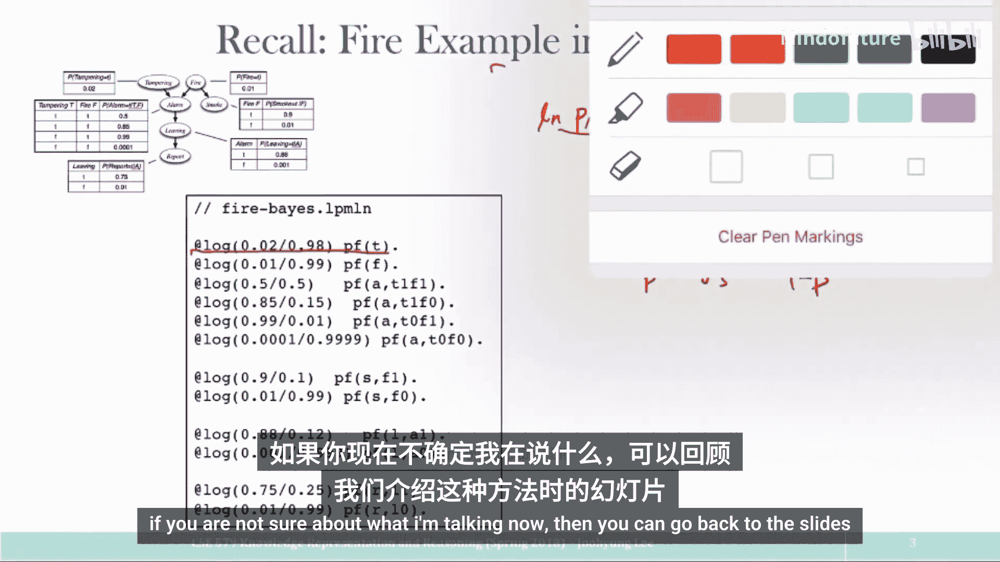

All right。Each of the entries in the priority table can be represented by one di， as you see here。

Okay。And the deck part can be represented by this rule。

 so the parent comes into the body and the child comes into the head。

 so tapering is true if this fact is true。OkayIn the more general case you will see like this one alarm alarm becomes true when taing is true and fire is true。

 but also you have to check that the product effect associated with this condition is true and same for the old other combination so in basically one edge in here which is。

Actually， these two edges can be represented by these four lines。

Okay so each of the edges keep true or false， so when you combine it。

 it has two times two possibilities， so there are four rules that you can write。Okay。

 so otherwise including is actually pretty straightforward。

And we talk about how to use the system to compute the probability， so quality of fire being true。

 given that alarm and tempering is true， we write into the database fact that。

The evidence part that alarm is true and tempering is also true。

 and then we call the system using the user。Com line， as we know in Alchemy。Actually。

 this should be actually fire， which was actually。好。Show you it by the picture。Okay。

So that's actually what we need to do if you have negation of tempering。

 then all you need to change is from this positive fact into the negative factor。Okay。嗯。

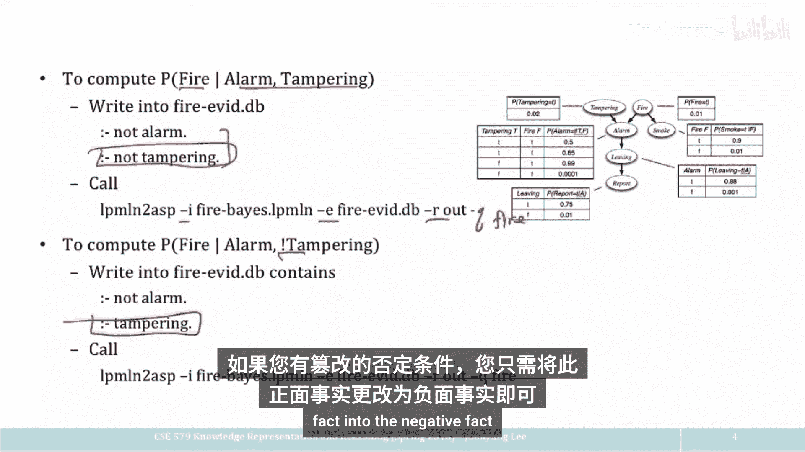

And so basically we have seen this kind of thing， what if we know that there is nothing。

 we know what is the probability of fire and if we know then we give the condition and as firing being true and we can give this and depending on what you put into the condition when you put query you get different inference so sometimes get you have the cause and you want to know the probability of the effect or you can also go vice versa and or you can also reason about the other cause。

 so if fire is if tempering is true and also alarm is true。

 then what is the probability of fire okay so those intercosal inference can be also done。

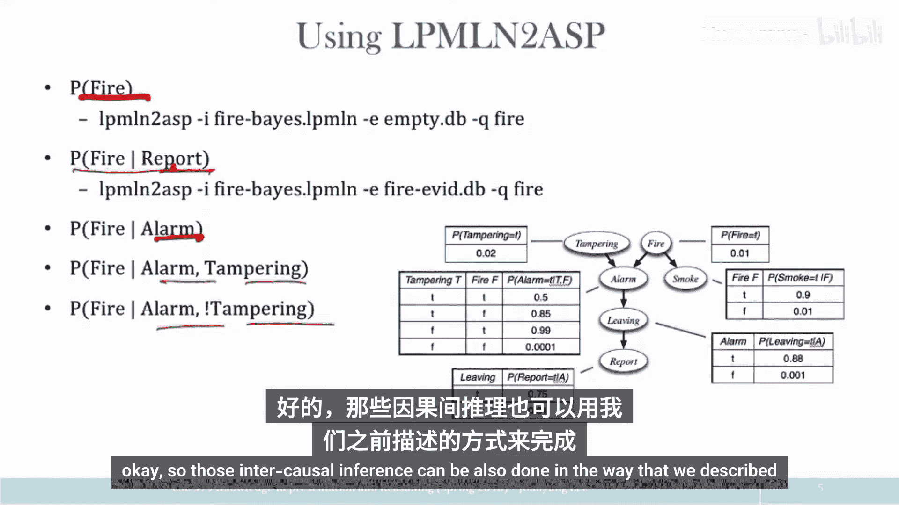

The way that we described before。What we didn't say last time was the same domain can be represented by different implementation of LPMN。

 which is called LPMN to MN and as the name implies we can also convert LPMNN language into the MN so that you can use Achemy to compute。

So underlying solve here is actually RKE or there are actually two other inference engines for MN that this system actually uses。

 as you can see。The input language is somewhat close to alchemy but also is somewhat close to ASESP。

 so let's see the beginning part is actuallyim to alcheE so we declare the domain sort and object and these are the predcate declarations。

 so this part is exactly the same as alchemy。And actually these are also the same in the input language of AcheE。

 we don't have this function log， so we have to actually compute this manually and then feed it here okay。

In the rule part， you see that we are using this symbol to representarrow。

 which is actually what in alcheimate correspond to this direction。

But the language is actually versatile， you can use it write in the back row or forward doesnt matter。

 but this is the symbol for the arrow。And the other things。Actually also yeah。

 there's not much things to notice there are a couple of conventions that for the ASI notation instead of comma as in the previous language or in ASP in ArchcheE uses this car symbol so we have to write conjunction in this way but that's all however so the input language is actually very similar。

 but the computation is actually different so let me actually show you how it operate。

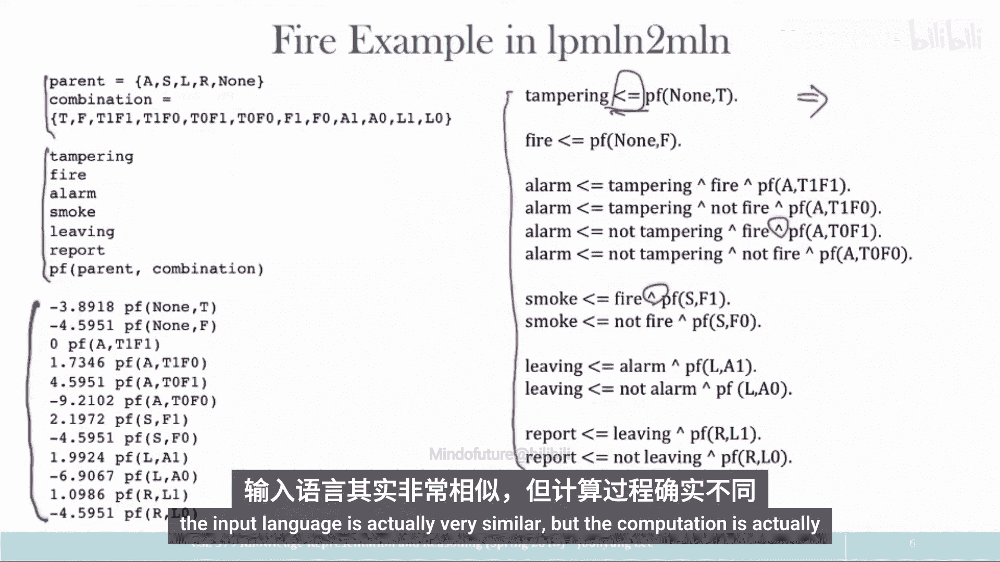

So。Okay， so this is the program that you just saw。Okay。Okay， so how do we call。

So this is a command line。Let me。Over here。Okay， so first。

 we want to find out the probability of fire being true。Without knowing anything else， okay。

 so I gave the empty file。Other than that， this command line is same。The alpha that you see is more。

As you guess， it is coming from the Archchemy。There is a long part here。

that you will probably not be able to read and you are going to actually talk about what all these things are about what happens in the system is there is a certain conversion method from the LPM inner language into the input language of alchemy and so these part are something that the system adds automatically。

Okay， and then。And then you calls alchemy and doing the sampling， and as you see。

 the fire is actually here。Okay。So you can actually give different condition。And， let me just try。

This is。Okay， so here in the database， we actually put the same database fact as in AlcheI。

 so we don't have to write this colon D as in the input language of ASP。Okay。

 so we can just write either positive fact or negated fact is just exclamation mark followed by the symbol。

 Okay， so I can actually write。Report and maybe not tempering。

So you just give as much information as you know。

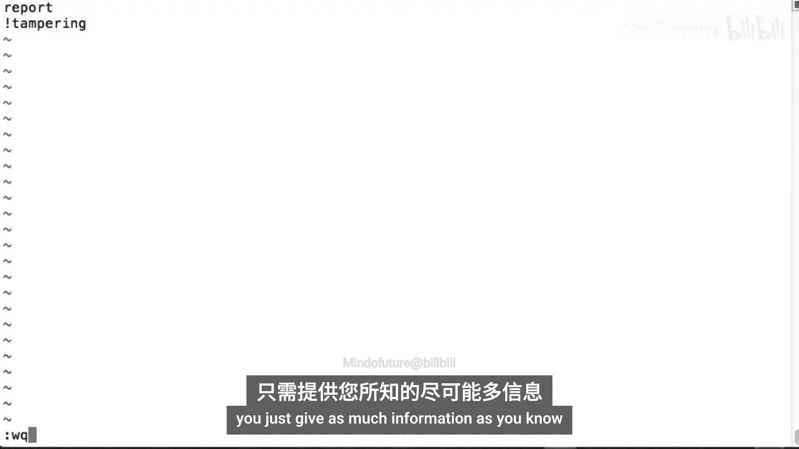

Okay。If you call。Yeah， the fire is actually 27%， it's actually more increase。Then4。Okay， so。

What we will do today is actually how this is done。

 so today will be the class that connects these different formalisms。

 so we have covered ASP and Markov logic and coming into the language of VPMN。Okay。

 so I mean having done this actually how are they related so some direction may seem obvious maybe by now you know how the these can be related to this okay but let's try to make it more formal。

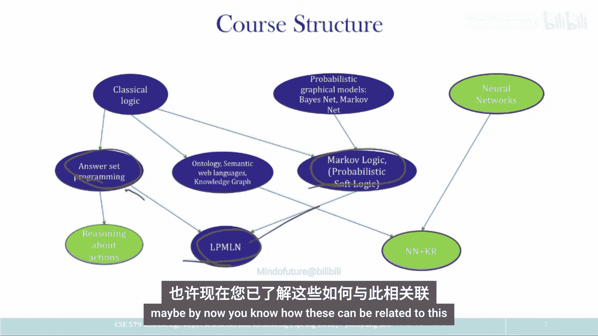

So today we are going to see many different translations。

It's in fact possible that you can understand ASP as a special case of LPM Min， as no surprise。

 microologic as a special case of APM Min， a bit more surprising but not too much。

What's more interesting is actually LMM can be converted back to ASP and as well as microcoology。

 and then you may wonder then what's all these things， why do we have all these different formalisms？

Well ultimately the program that you are running is converted into the machine code and binary code and you will be run at that level。

 so it's actually whatever the high levelvel programming language that you use it does not matter in terms of machine point of view is actually what human is the problem there right。

 so what way that human can program better same as in knowledge or representation。

 so some languages are good at modeling this concept， some are doing better for the others。

 you may guess maybe when you do the homework you may have some idea that what works well in ASP actually doesn't work well in Malco logic。

 because the implementation that you work with doesn't have those choice and aggregate。

 which might have been useful if you're there was not in the language of Archchemy and also vice versa if I taught AcheI before。

And then colling go later， you will also encounter a similar issue。

 I want to express certain uncertainty， but there is no natural way to do that in there， okay？

And LMM is also there， but who knows this also has certain weakness it has to overcome。

SoBut in the end， it's actually interesting that people develop this kind of language。

 they focus on certain aspects， so try to make it more versatile and try to say a certain aspects of knowledge can be encoded nicely in this language。

But when they compute， it doesn't necessarily have to follow the original language。

 and that happens a lot in the history of knowledge presentation。In fact。

 we covered Sasovers TPR algorithm before and although the classical logic。

 the proportional logic is very simple， but SAovers are very powerful so what happens is you can actually convert those languages like ASESP or Markov logic you can convert them into the input language of Saovers and you compute certain things from there so from the human point of view proportional logic is too low level to work with。

 it's like assembly language。But in the end， when you model this in terms of higher level language。

 you can actually compile that into the low level language and the low level implementation can actually work better。

Okay， so rather than designing proprietary implementation of the high level language。Okay。

And this is not only in the of course， in the knowledge representation。

 if you work with any kind of computer science， there is a notion of reduction so you can reduce problem A to problem B so that you can use solver for B to solve problem A。

So that's actually very often in the case。Right， so we are going to see some instances of that fact today。

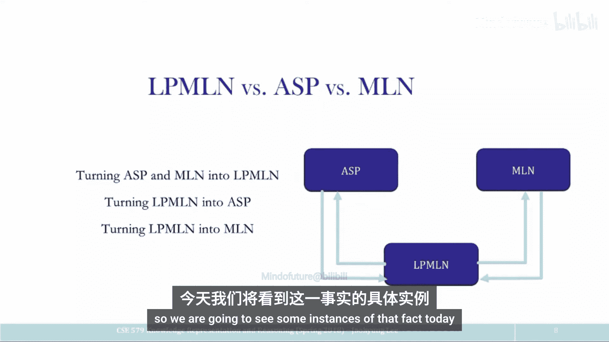

The first direction from ASP to M&N。Okay， so what's your guess here。Can we translate ASP into LPMN？

Everything is infinite。Then can you capture that？Okay， let's see whether that's actually true。

I can give you some head up there， it's not necessarily true。

 so I'll ask you at some point when does that break。But anyway。

 this first thing to note here is so suppose you have AnE program P。

 we can view this as a special case if you assign infinite weight to each of doodles。Okay。

So let's look at this example first， this pie is ASP program。And we can translate or convert into。

Pretty much similar rule in LPM N where the rule has infinite weight。Okay， but that's good。Now。

 what the theorem says。Is this， okay， so that gives the hint to the question that I'm going to ask。

So for any answer program pi。To determiningistic stable model of pi。

 which means just a stable model of Klingo program that you saw before。

 are exactly the probably six stable models of LPML program P Pi。

Where PiI is obtained by this simple translation。Now， among the oldest price stable models。

 you only look at the stable model whose weight is e to the path of k alpha。

 where k is the number of all ground rules。Okay， that seems to be too long statement。

 so let's actually look at the example。So how many interpretations are possible if you have P and Q in the signature？

货屋奇佢。So let's actually play with this。嗯。By the way。

 we know what are the stable models of original program， right， We don't have to。Compute。

 what are the stable models。So there are two stable models。Singleton set P and single ten set Q。

 Okay， there are two other interpretation empty set and the total set P Q they do not make。

Thatテる model。All right。Let's see。Now what happens with each of these interpretation？

Let's start with the。Empty set。不变。So empty set。How do you find the weight of the interpretation empty set？

Let's look at this one， Okay， this program。Okay， so first， we have to do what。

Subpsset that is true under this， so what is that subset？

So emptyT set means  Q is false and P is false。So does that interpretation satisfy the first of rule？

看都。No， right， because false and negation is true， so this is true implies false。

So the first rule is not satisfied， second rule is also not satisfied by the same reason。Okay。

 so the subset is actually am。Okay， empty， okay。Good， so after that， what do we check？これ。嗯。

If empty set is the stable model of。The empty rule。Is it。一。别算弄。So， for this one。

Pi subscript I actually I should say P Pi subscript I is actually empty that's what we just checked right so what do we do we have to check whether empty set is a stable model of the empty program。

AndAnd it's obviously true， right， That's the minimal information that you can derive from the MP program。

All right， so then what is to wait？So， E to the puff。The number of rules that are true right。

 so we have to add up all those way but theres nothing to add， then what is the identity？

E to the power zero， so we get e to the power zero。Are we together？Okay。

 maybe this is a two corner case， but there's actually nothing special if you just follow the definition。

I do you want me to explain this again or not？No。Okay。So let's go to the next one。

 so what is the subset here， subset of the program that is true on the P。The first rule is true。

This is true。What about the second one？Okay， so this one says p is true and Q is false。

Then this is actually true because P2 is in the head， so obviously this is true。

And this is also true because not P is in the body so that's obviously true。

 the whole implication is actually true， so the subset that we have to look at is the whole program and is P a stable model of this subset。

Yes， then what is the weight？必须的多少。E to the path2 alpha。对。The second one is metric。

 so it should be to the power alpha， now the next one， PQ。

 does this set so what this what is the subset？It is true under this PQ。Are you sure about that？

Both of them。Right。Not Q implies P， this is true， this is true， the head is true。

 so no matter what about is true or false， the rule is true。So the subset is also the whole program。

Are we together？Is PQ a stable model of the whole program， obviously not， so what is to wait？ゼロゼロこ。

イスナーディートゥズゼロ予サシゼロ。 so there's a slight difference between the first case and the last case。All right。

 good。So as you see， what the CRM says is when you do this translation。

 not all the progressive stable models correspond to the original stable model right these two。

I mean， these two correspond to the original stable models right from the original program。

 but this is actually the additional thing which doesn't correspond to the stable model in the original program。

Okay， so that's why this is actually important， the weight should be e to the poweru of k alpha where K is the whole rules in other words。

 you have to use all rules in the original program。Okay。Are we together good？Allright， so。

Another thing is this if pi has at least。啊。Excellent， I should actually skip。Do things。

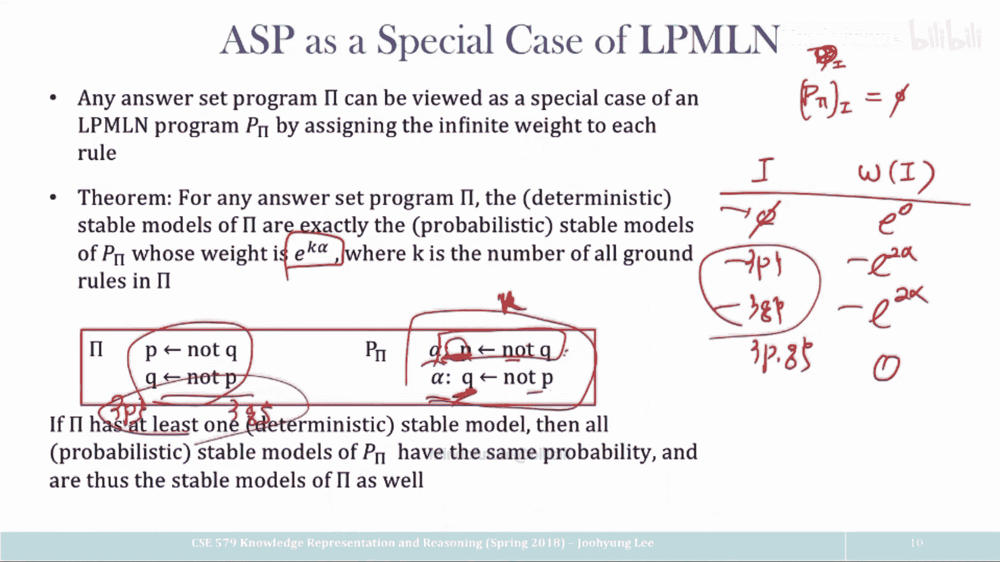

This is actually incorrect， so let me actually skip this question。ButAnyway， so from ASP to M N。

 we know that we can use the。嗯。で。Actually， no， something is。

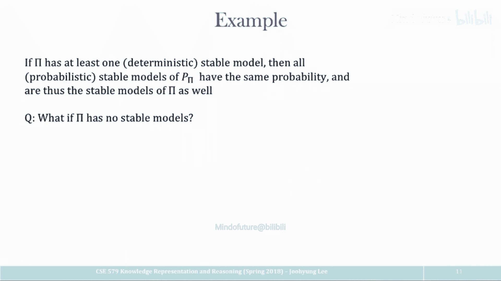

Okay， let me actually add something here。W is actually be tricky。Now， if you look at the weight。

 of course， this guy does not correspond to the original program。

 what I didn't actually say yet is actually the probability of by。Okay。All right。

 so what is the probability in this case， fluity has to be normalized， right？

So what is the priority of this guy？没了。It's actually limit。Half a wing to infinity。

 e to the power of 0 divided by the whole weight， which is e to the power of 0 plus2 times e to the power 2 alpha right and what is this value？

0， so this actually probably gets zero。Okay， same way of course this is obvious0。

 what about this guy。好。This guy gets half and half。So although the weight is actually not zero。

 a weight is not zero， but the priority can be zero because of these hard rules。Okay。

 so this additional sentence is saying is' not about the weight。 That was about the statement here。

 but about the probability。 you can actually look at。The probability of the interpretation。 in fact。

 when we translate ASP into LPM andN， all the stable models with nonze probability will have the same probability。

Okay， so P and Q has both non0 probability and they are equal。Okay。So each each of them。

Is actually the stable models of the original program。Okay。Are we together？嗯。

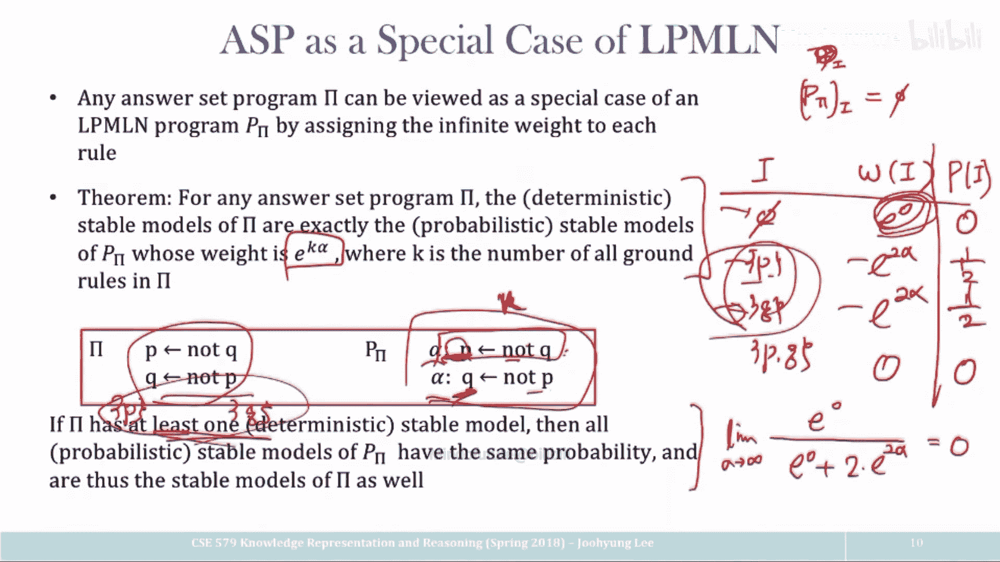

So the last statement was actually assuming this condition if pi has at least one determined stable model。

So in the previous example， the original program has actually two stable models， the stable models。

 so this condition could apply。However， the condition is actually critical if you miss this condition。

 the next sentence is actually not true。Okay。Can you find out the reason。Okay， what I just said was。

In the previous example， okay， compute all the priority。 So if you see。

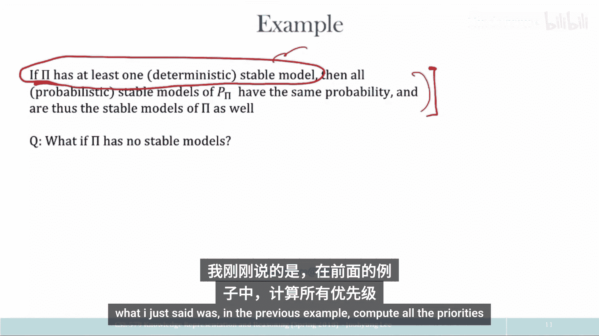

Let's think about this way So suppose you have very weird case， you don't have ASP solve。

 but you have LPM solve okay now you want to compute ASP using LpM LpM over。

 how can you do that you translate ASP into LPMN and then calls LPM and solve and it returns some stable models that has nonzero probability and they happen to be equal okay they should be equal so you can actually extract the stable models of the original program by looking at this so the stable models that has non-ze priorities P andq so P andq must be the stable models of the original program so that's how you can solve ASP using the implementation of LM and over。

Okay。

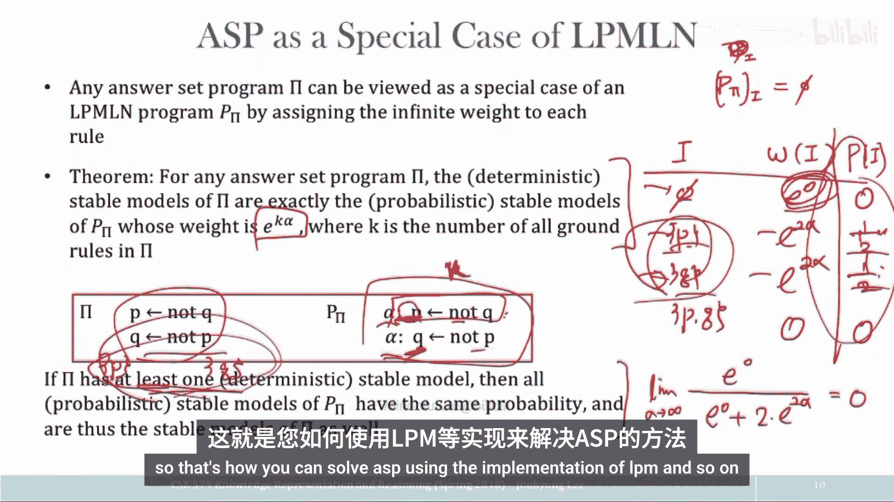

But what I'm saying is。That's not necessarily true if this condition is missing。

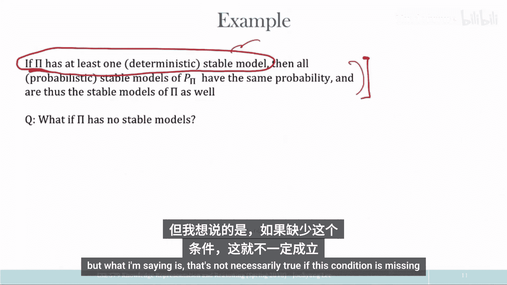

In the previous example， the pi that you started with has at least one stable models。

 it's called consistent， okay， so there is at least one stable models。

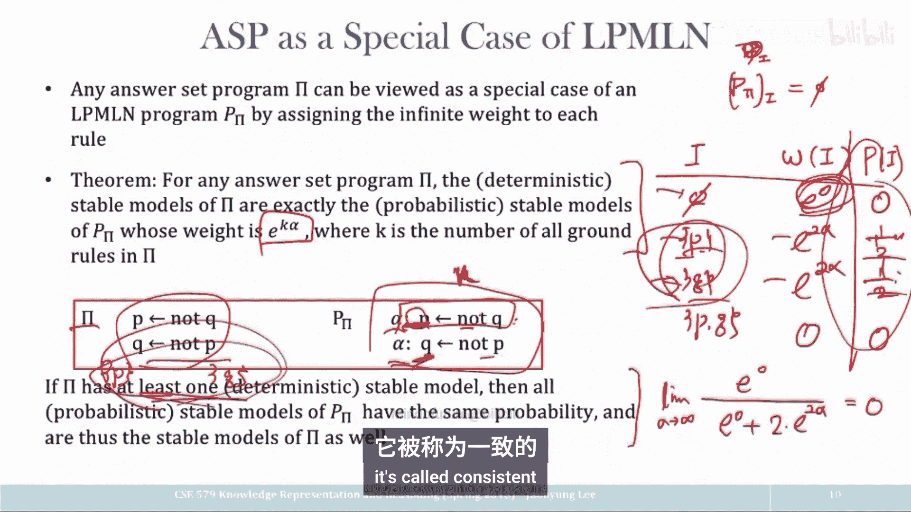

But if the original program doesn't have stable models。Then something goes wrong。

Something goes wrong here。就给。For theseistic generation can be more than the number of civil。

If nothing can achieve in gear。中さ。同记る部。Okay， that's fine。

What does it have to do with original program。O。Let's actually look at this example。嗯。

So original program， what is the same model of regional program？嗯。This one。

 if you call cleaning what will happen。I's unsatisfiable， no stable model。

 So this is actually there is nano。What about stable models here， do you recall？好。

How many saving models are there。There was three。Okay， what are the three。

 if you forget about this rule temporarily， what stable model do you get？is an important。

So bird of joel， resident， bird of jo and migratory birth of jo。

 right because when you forget about the subtle rule nothing contradict okay， so that's one thing。

What about now forgetting about the fourth rule？What do you get。Migratory bird。

 but now you cannot derive that choice original bird because you forgot about the fourth one or ignore the first one and if you forget about this one for now。

 but then you get another thing，So。OkayAnd you will see that each of them will share the same probability That's one of the slide that we had before Okay。

 so these are the pro in stable models， but they not correspond to those in a program because there is no stable model there。

Okay。All right， so this condition is actually critical for the correctness of this statement。

Are we together？

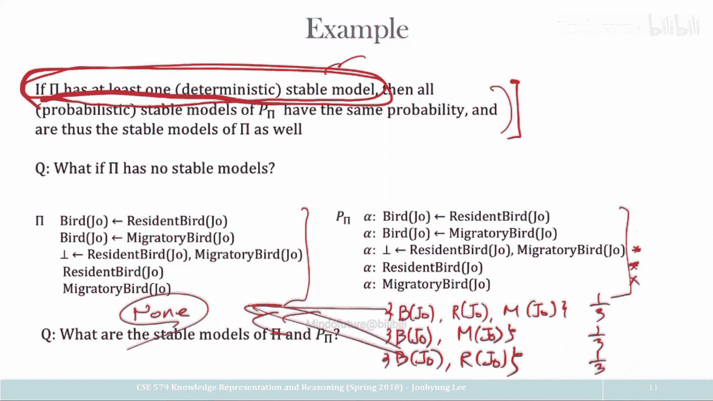

Okay， good， Okay， so then we go to the next one。So M M into A PMM N。Can you guess。How can be。

transranslate MN to LPMN， so again， suppose you don't have alchemy。

 but you have some system for computing LPM AN， which means you can use that system to compute MN。

 How is it possible。Anything， actually， you already know some hint here。

 we covered the similar thing before。Now forget about the probabilistic component of each of the language。

 then LMM becomes like ASP and MM becomes like proportional logic or maybe first of the logic。Right。

Do you recall the connection between ASD and the classical logic？嗯。

There was some critical thing that we did。

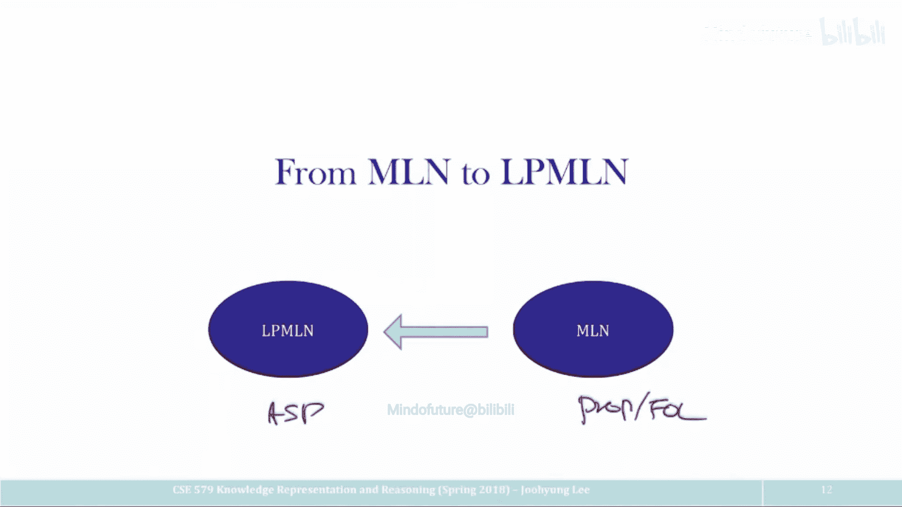

Yeah， yeah， okay， so lecture 11， go back to lecture 11 page 14 has this slide。

 I hope you can still remember this。What happens is， do you remember this example， so PRQ？

And P or Q has three models if you。So you want to compute these three models using ASP So。

RightNow you cannot do that by directly calling Klinggo on this program because then the stable models are only the minimum models。

 but I need actually the models that are not minimal because PQ is a model there so how can we use Klinggo to generate these nonmin models？

Yes， that's actually the idea there and how do we generate all possible cases？Choice rule。

 so write choice rule and then write this。等觉旦。O。Thats what对。Covered long time ago。 Now。

 I'm going to tell you actually some a simplification of this method。

 You actually don't need to convert into the constraint。In the presence of choice rule。

 I can actually convert into this way。So all I need to do is to take the original formula F and add choice rule for all atoms。

That's it。 And if you call the Klinggo on this program。

 you will get the models of the original program。Yeah。Are we together？

So you can easily use cleanlinggo as a set sofa。Okay， or for computing propositional logic。

 I give you the formula in Proal logic。How do you use Cllinggo to compute， you just add choice rules。

 that's it。ItsThe same thing actually happens here。啊。So why do I have second example？Okay。

 let's just work on this。 So what are the models of this？The first one， not Q implies P。我咋都没到死。第一次。

有病。How many interpretations are possible？4， okay and how many of them are true？3。オッケー。So。

When P is true， this is true。When Q is only true， that's also true， P Q is true。That's also true。

 The only thing that cannot be is empty set， empty set means Q is false and p is false。

 that means true implies false， so this is not the case。

 So there are three other city interpretations models。Okay。The exam is coming next week。

 so you better remind yourself。what are the stable models of this？And again。

 this is according to the steer that I just talked before。 you can actually call Klinggo to do。

 You will see that there are also three。Sable models。O。So the idea is this。

 you are given some formula。Okay。And。You're translating this into another program where this translation adds choice formulas。

Now， what happens is when you look at the models。Of F。

Are exactly the same as stable models of this translated program。In other words。

 we reduce the professional logic into the language of ASP。O。여기 두 개다？So。

This is actually just repeat of the CRM except that I'm simplifying the constrained part。

 so you don't actually have to write even constraint。So basically。

 if you want to compute the models of proportional formula， just add choice formulas as。

 and of course Plinggo。And。So that's actually the case when we have no weight， how can we use this？

To embed Mn into Fn。

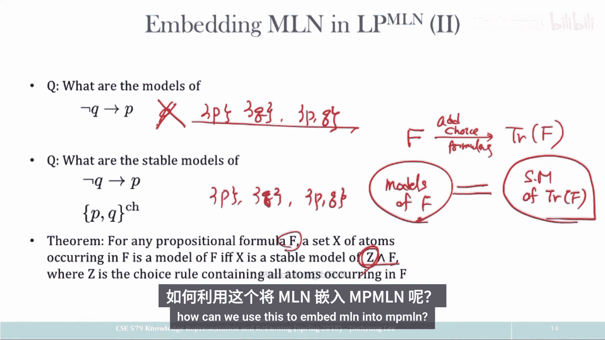

So this is the statement。The translation is actually similar。

 except now you have to talk about the weight。 And turns out that。

What weight that you assign is actually not important？Okay， so you just add choice rules。

Same as before， wait， what weight do we have to assign to the choice formulas？Just assign anything。

Okay。Okay， so this is a statement。 once you do that。By the way。

 here is a comment that effect of adding the choice rules is to exempt the atom from the minimization under save modelmantics。

So the CRorM here， any MN and ESLPMNN counterpart have the same probability distribution over all interpretations。

Okay。So in other words， if suppose you have the。This Mn program。Okay。

 how do you convert into your PM N？Just' copy the formula and then add choice rules。

So you can write any way， okay， doesn't actually matter。这是。O。

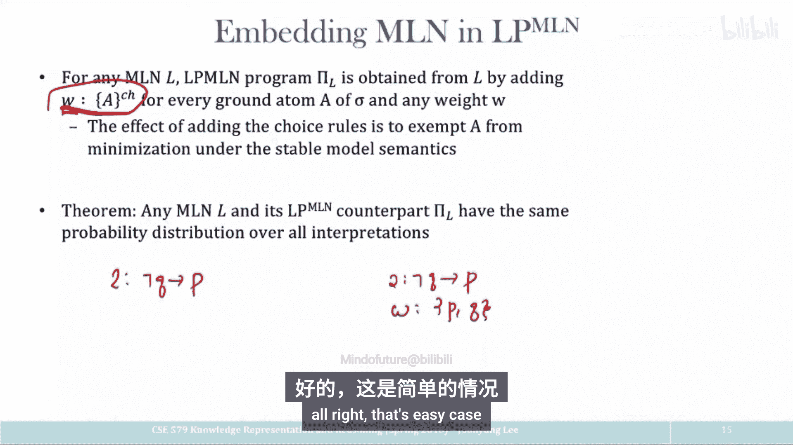

All right， that's easy case。 Now let's actually go to the hard case。

So easy previous cases because they were coming from。

The way that the AM was designed because the AM was trying to capture both of these languages。

 so that was actually a design goal to embed each of these language but what's interesting is actually it's also a way to go back so we are going to talk two things AM to MN and L to ASP。

Yeah， I hope I can cover。2 okay， so let's see L PMM to M。

This process has a long history in knowledge representation called completion。

So what can be done here is to adapt that well known techniques into this new setting of LPMM。

 but the completion process is actually well known in the literature。

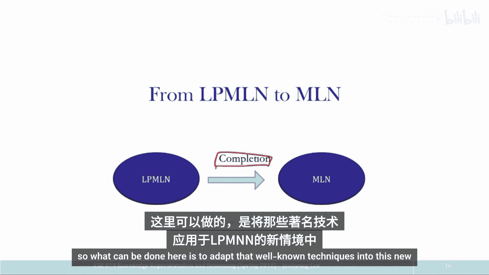

So。So forget about the wait for now。 Let's say what is counterpart here。

 Can you actually think about how to。Convert ASP into Proal logic。レそにトバ this。Okay。

 what is your guess how So we learn all this ASP， okay， now it looks like I'm telling some lies。

 why do we bother with ASP if you can convert back into Pro logic？

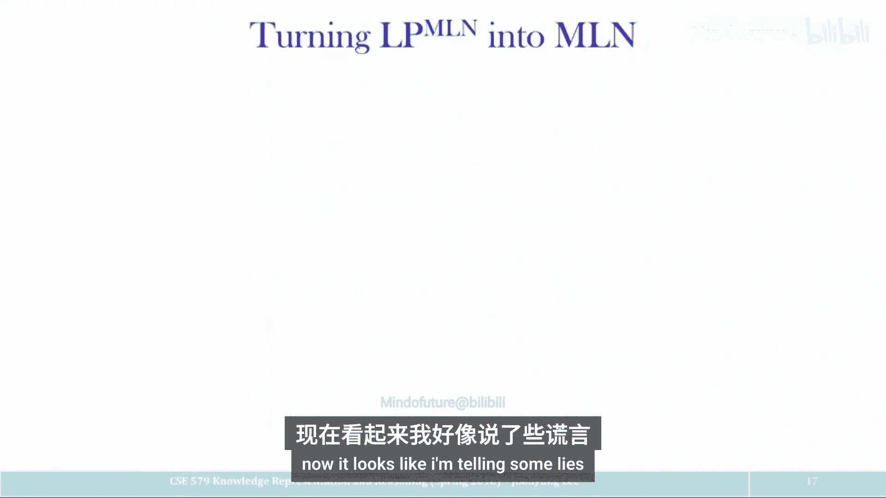

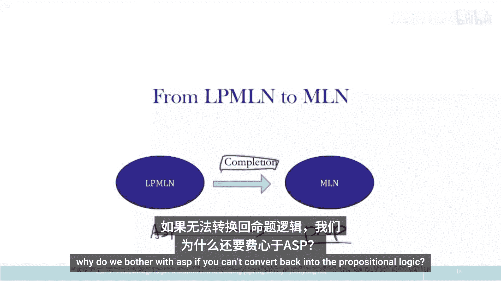

All right。So。This process is actually not very simple。

 so it takes some effort and this is actually typical problem that I give in the midterm because this is easy to grade。

To see whether you are following the material， so this is a process that turns ASP program into preutional formula。

Okay。Again， the idea is the and of the original program are exactly the models of F。

 So the processes now looks like this。 you start with the pi。

 you translate into the professional logic。Now， you look at the stable models of the program。

 they're exactly the models。Okay classical models of。This translation。This is the go。Okay。

 the reduction now is to reduce AST into set。我不不想了解。

Now this process that we are going to define works only for some fragment of ASP。

 although it can be extended to the general case， but for this classes concerned。

 we will only look at the special case known as T program。喂。So as I said。

 it can be generalized to turn any LPMN program into MN。

 but there is actually a problem with computation blow up。

 so we are not going to cover that in the class。

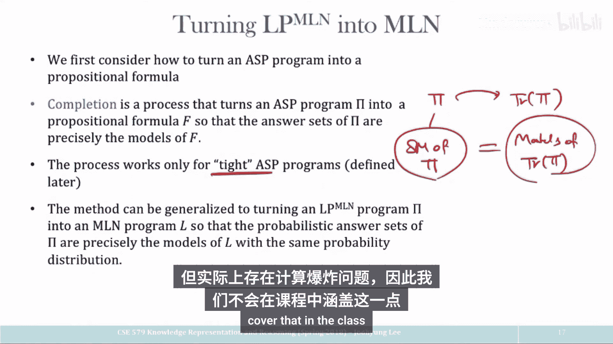

Okay， so completion what is the completion so think about ASP program written in this form。

 so it has the form of a if body so we are not looking at the general ASP program but the head is a single atom A and it appears only one time in the program。

Okay， each atom appears exactly one time in the I'm sorry， no， let's forget it。

The atom can appear multiple times in different parts of the program。

 but every hat must be a single atom。Okay。In fact， we can also allow constraint。So。啊。

Let me actually just ignore the constraint for now， okay well just assume this special case。

 so every hat is a single atom and body can be any formula， that's fine。

So the completion is defined to be this one。So collect all the bodies。That has a in the head。

 and right backward implication or reverse implication。 So if you have body， for instance。

So let's actually look at。This one， so suppose there are two rules that has。A in the head。Okay。

 then the completion is this formula， starting with a going reverse。And dis over all such parties。

So this is called completion formula and the whole completion is the all such rules。Okay。

So we'll do exercises in the next few slides， but the CRM is saying that for any tight stable NSet program。

 the stable models are exactly the models of the completion。

I didn't define all this tight program yet， and I will ask you to figure it out in a moment。

So let's actually look at the examples。We want to compute the answer set of this program。

 what are the answer set， by the way。不 justテで。Singleton setP and singleleton CP， that's what we。No。

Okay， this time， we are not going to use the method that we learned before。

 but we are going to use the completion。Okay， so what completion does is copy the original rules。

Okay， this is one part。But nowadays a reverse arrow。

 so starting is P for each atom P you are going to write the implication that has p in the antecedent。

 so p implies something the reason that P can be true is because there was a reason for P to be there and the reason is not Q so we write here。

Same for Q， the reason for cube to being here is because of this rule， so this is it。

You can actually understand this way so suppose this is kind of cause and this is effect so not  Q is there it causess p to be there in the stable model right if p is there then theres a cause for that which is not  Q so this one is saying the other direction if there is p is true then not q must have been true because that's the only rule that can derive P。

Okay。Are we together， So you need to know how to write these to additional formulas but if you're done with that。

 that's already okay， that's the whole story。All right， so let's simplify this if you have these。

First and third， how can you simplify or how can you combine this into one？Yeah， it's a double arrow。

 which is P is equivalent to not view。Same way， not P implies Q and  Q implies not p。

 so that same as Q is equivalent to not p， but by the way these two actually equivalent。

So the whole thing can be simplified into one formula how many models are here for P is if only a P equivalent to AQ。

Two P， satisfy this as well as Q satisfy this， and they happen to be the stable models of the original program。

A together。Yous a very simple algorithm。Maybe if you learned this method before。

 you could have saved some point in the midterm。Instead of computing the reader， you may have just。

did it this way，All right， so let's do one another exercise P， if not  Qq， if not R。

 what are the same models？对了 you。因于说。If we don't know yet。 Okay， so let's。

Check what are the stable models。First， we copy the original program。

Now for each of the atoms here we have to write where this co is coming from right， so for P。

 what was the cause？Not true， so I have to write not true here。For Q was this of course。

So I have to write for R， what is the course。Nothing。Empty dysfunction is。맞ter。Okay， that's it。

So then呃。Let's simplify this formula。 mean the nice thing about this method is once you convert into Pro formula。

 you can use many techniques or many simplification method that you know for Pro logic right So again。

 if you have these two formulas， how do you simplify。嗯。

P is equivalent tonacu because there are different directions ofarrow here， same for this。Q。

 if not R。 And this one， how do you simplify our implied button is same as。It's just not， right。

 The a is false not。Alright， so what other the models here are， Can you be true。No， if R is false。

 then Q must be。True， if  Q is true， the N must be。 So how many models are there， one。

 and what is that model？Q。This is the only one and of course you can check with respect to the readout way。

Okay。Are we together？So here we talk about the models。Which she is this。

 which is same as the stable models for answer sets of the original program。Okay。是。All right。

 so then now the next question， so this method doesn't work all the time。

 I said it works only for tight programs， so what would go wrong？If this condition is not met。

 since I didn't actually say what is type you can actually imagine。

 can you find some program that this method would not work？Well。

 I will give you just the example then。What are the stable models of this program？P Q Qf P。

 what is the minimal belief that you can derive here？MT set。Okay。All right。Okay。

 so what is the compil， So Pf Q。Q ifB。Okay， now the completion is。P implies Q Q implies p。Okay。

 so this is same as just P equivalent to Q。 What are the models of this。Empty set。Is one model。

 but also PQ。Okay。So there is a mismatch。Okay。What is special about this program？That's true。 Yes。

 completion actually didn't give more than what we know for the formula， right？

So we we add something before what happened was when we add competition。

 we actually give more constrain。そ、モドはなあですけども。我应该 reduce。我度细 send啲晒。后ム。说。This case。Iで。

Andそメ isそな exampleゃ that。It's not necessarily a conclusion or not。我识唔知咩啊心城。

It is not sufficient to guarantee the statement。嗯。The basic idea here is theres some circular dependency。

Okay。So what happens in the example is for P to be true， Q must be true， for Q to be true。

 then P should be true。And under the stableable mono semantics， of course。

 there is no reason to believe both P andQ because they're soly dependent。

 but if you turn into the classical logic like this， there's no way to get around this problem。

It's basically saying that P is equivalent to Q because P and Q are the same。

 but there is no such thing as minimizing those extent。

So this idea actually does not work it's because theres some circular dependency。Okay。

So there's a notion of graph theoreticaloretic notion to define this class of programs called type programs。

嗯。So let's actually imagine that we have programs of this form where there's a head and positive body and the negative body。

 positive body means that there is no negation in failure。

 these are just positive atoms and these are the negative litals so negation followed by the atoms。

Now we are going to draw an edge based on this program。First， if youre given the program like this。

 there are three atoms， PQR， each of the atom forms the node in the graph。

And there is a edge from P to Q if there's a rule P if Q， So look at。To rules。 So for instance， here。

 you can draw an edge from the head to the atoms in the positive body。Okay， so for this rule。

 there will be M edges be from a to A1， from a to A2， a to A3 up to A to AM。So for this example。

 you see this blue rule。Contribute to this blue edge。This red rule contribute to this red edge。Now。

 this rule does not contribute to any edge because there is no positive atoms in the body。Okay。

 so the only dependency is between the head and the positive part of the body。Now。

 once you have this。You will see that there is a loop。Okay， that connects something okay here。

The formal definition of loop is a path of9 zero length。

 but basically you can easily identify from the graph， so there's a loop here， PQ。

 there's a cell loop。嗯。So。This program has cyclic dependency， so this is not a type program。

 the program that has no cyclic dependency。There's no loops， they are called tight programs。嗯。So。

 going back to。The examples that we have。

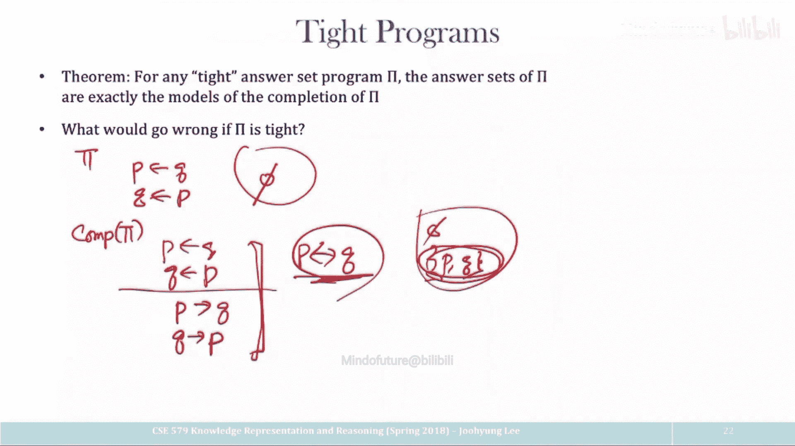

So， this one。How many edges are there in the dependency graph？の how many edge。The two node PQ。

 the edges go from the head to the positive party。Positive， only positive atoms in the body。

 So how many edges are here， nothing。 How many loops are there then。Nothing。Okay。

 so this program is called。はいいそル。こロバですハに。哪在的呀。3， how many edges are there。Is the program tight？Yes。

How many those are here？How many edges are here？How many looks are here。So this program is。 Okay。

 so youre ready to take thequi now。Okay， so I'm going to ask you to find all tight programs。Okay。

Let's see。Interesting。Okay， so this is actually choose all， so I cannot use。The same。Okay， good。Okay。

 so choose all。Tight presence。Okay， are we done？Okay， good。So what is the solution。是的意思。Okay。

 so some people said ABC， Some people say C。D。Okay， surprisingly， there are four people。What that。

And also see， okay， what。So answer is actually ABC。So， let's see right， I mean， obviously。First one。

 there is no right， so this is tight。Second one no edge type right。

 so here actually this one is also easy because if you forget about the last one it same as what we just did。

So there is a loop So this is not tight。 What about this P Q R， So from P to P to R。

 so from the first one you get two edges， the second one Q to R okay and Q to S and from the third one you get nothing but this one doesn't have any loops although it has some edges okay so theres nocycl dependency。

 So this is also tight， So theres three type programs。

 which means that the completion can be applied to these three programs to find the correct solution。

 it doesn't work for the last one and what happens here is actually the completion is not actually strong enough。

 So there is actually more generalized version of completion it actually get the right stable models。

What will happen is when the completion is not strong enough， you will get some models of completion。

 which is not the stable model。All right。So， this is。What we did actually， now so。Yeah， question。

えでに有。え告人。W want reachachability， strengthive closer。Itter anti program。

So there's a lot of NH program that is actually very， very useful。Okay。All right， so。Yeah。

 what I just said is should be clear， right， when you have Hamiltonian cycle problem。It has， right。

 so you cannot avoid that thing。Many problems are actually cycling。All right。

 so then how do we use this idea so far we didn't talk about LMNN and YMN， right there's no wait。

 we are talking only about how to convert AS to proportion logic。

But now having known this classical result。How do we translate it。完了。

Assume that LPMM program consists of this kind of tight program。

 so you can have certain weight with some rules A if body。Completion is actually the same as before。

 but what we assigned for the completion formula is infinite weight alphapha， and that's it。Easy。

 right。Okay， so I don't have example because it's all。Sttraightfor Okay。

 so take any rules that you have before， I mean if you want the example， I can just simply write。

So this is LM in a program。How do you convert into MN program。Have this one。And then。Right。

The completion formulas。And if you give to AcheE， it'll compute stable models of the IPMN original IPMNN program。

Okay。And that's how， actually the。System was developed。

 so this is called LPMNN to MN okay so the architecture looks like this。

 you have LPMNN program as input， of course we have to assume this is tight and the definition of T is exactly the same as before。

The output of the system， it can compute marginal and conditional probability or only return the most probable stable models Now of course you can say that if you compute the priority then looking at the probability you can find the mostable stable model。

 but this computation is often saving the time， if you don't need to know the probability。

 or you only need to know what the most probable stable model。

 then this can be much faster than computing the probability。

Because it uses optimization techniques rather than enumerating all the probabilistic information。

Now inside the system， obviously there is a translator， LPMN to MLN compiler that turns into MN。

 and in this class we use Achemy as the main solve。

 but there are also other versions of other implementation of MN called TFfi and Rocket。

So this system can be used and each of the system has different algorithms implemented。

 so some system actually works better for some benchmark problems so there's no I mean that they actually。

啊。Are more less compatible to each other。Okay。All right， although actually some problems。

 those other systems actually work much faster。Okay。By the way， if you happen to know these systems。

 they actually have slightly different input languages， so what translate。

 what this system is doing is，Compile the MN input into a few different ways。

 so the users don't need to know the subtle of difference between the input language of these systems。

Okay。

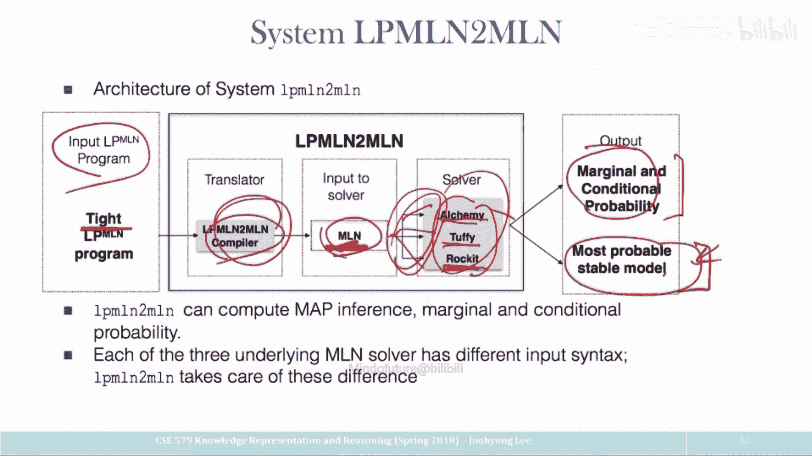

🤧。Okay， so this is an example that you saw earlier there。You have to repeat。Very quite the same。

Thing that we did with LPM into ASP last class can be done with LPM into MN as long as if you work with type programs。

 by the way， basenet， is it tight program？In the base net by definition， the deck is acyclly。

 so if we model the base net using the MN rules， this program is guaranteed to be tight。

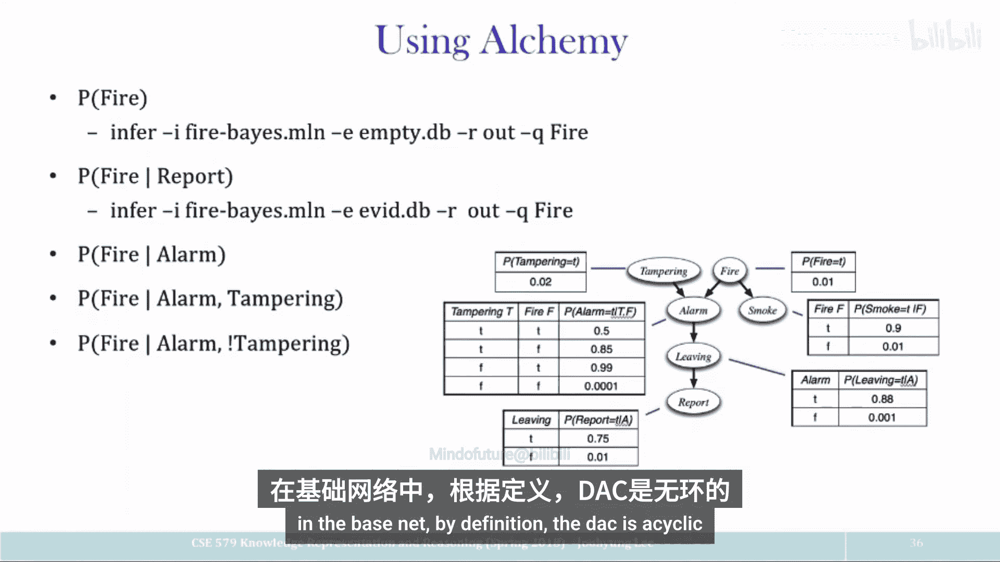

Okay， so that works well。

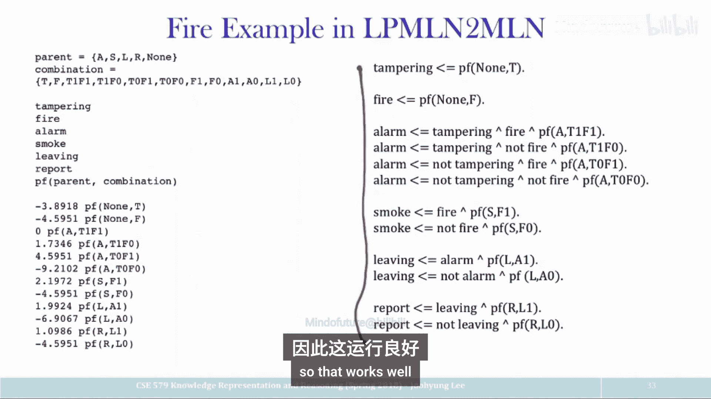

All right， the next topic is actually L to ASP。 I'm not going to。

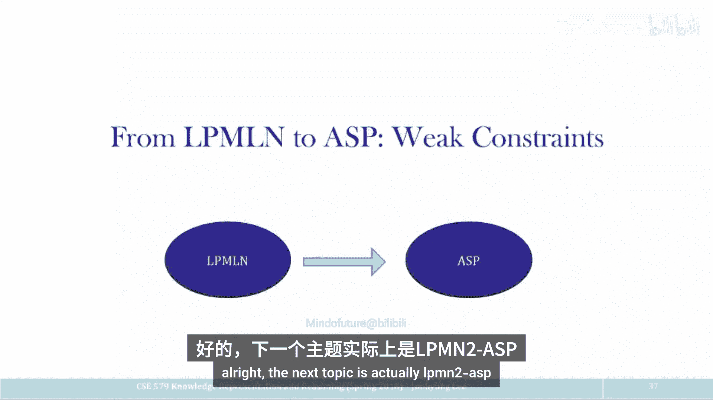

Going into the detail， I don't have time to do， so we'll come back to this later。

 but let me just mention to you one thing。

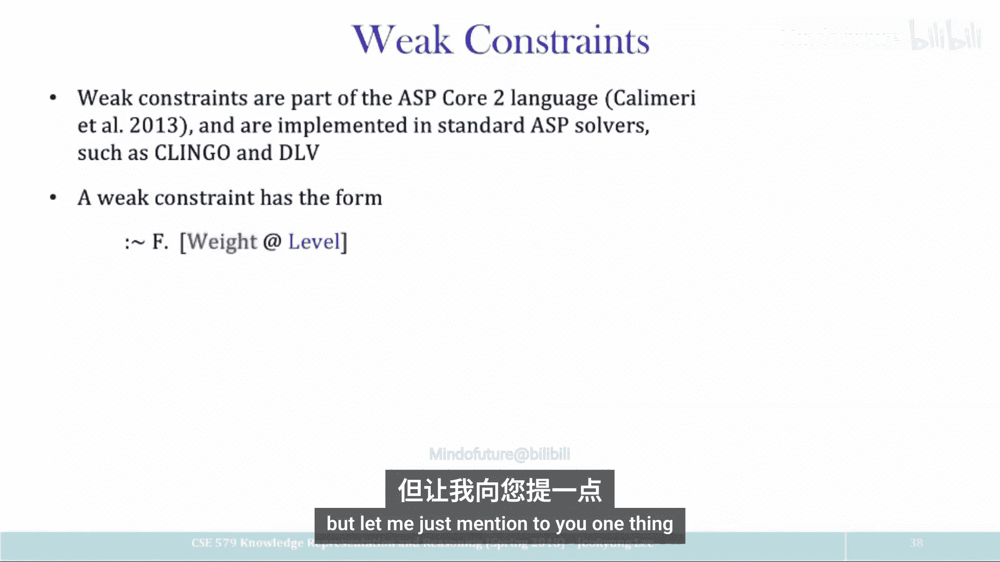

嗯。In the case of LMA to MN， we know that this is limited to the TI programs。

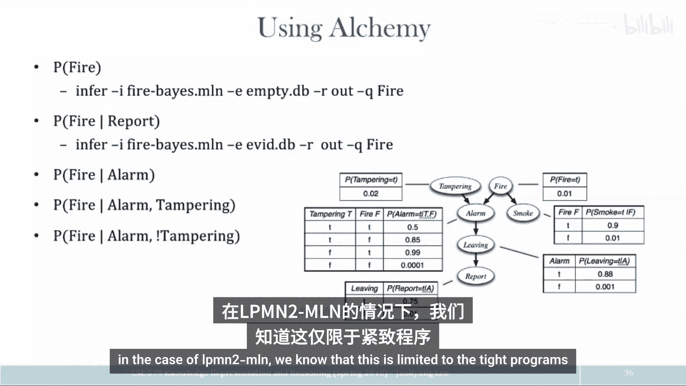

For the nine Pi program， this method does not work。

It's actually active research area where we can actually generalize this computation to N type program using the method of ourcheI。

 but based on computational bottleneck so that's a bit of problem for now。

 but it's actually another translation that we do into we turn SPMA into ASP。

 so then we actually don't have that issue， we can use A resolver directly which already handles the N type program。

Okay。そ。That's what we are going to cover next class。

And I guess it's a good time to stop here Any questions about today's material？Okay。All right。

 so then let me open the soative。

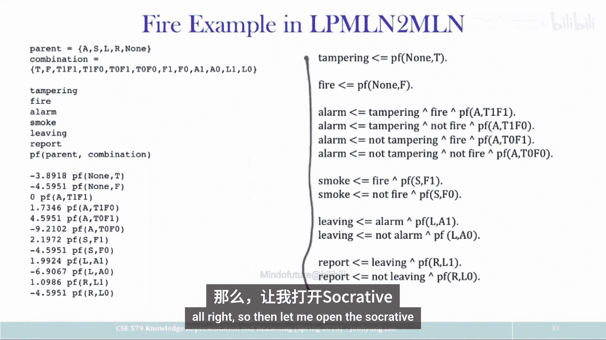