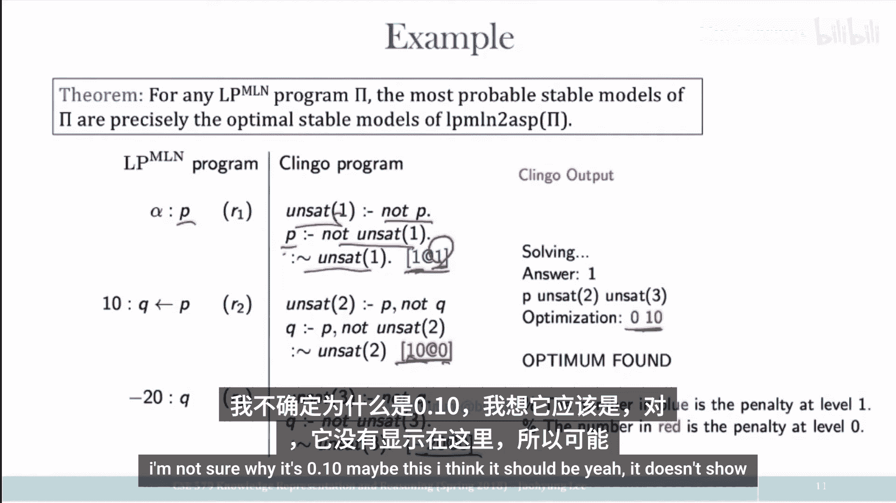
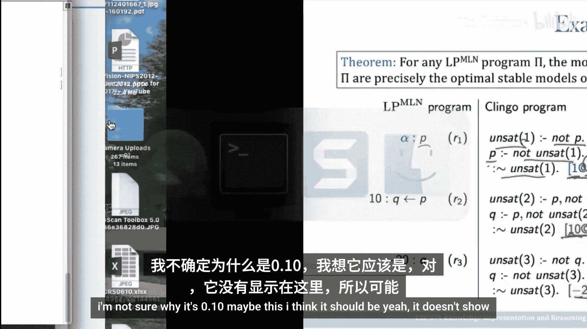
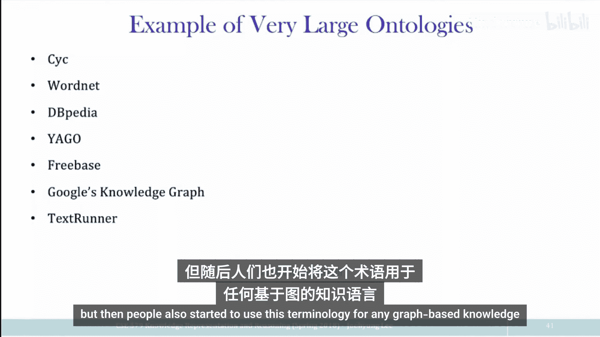

# 【亚利桑那州立大学】知识表征和推理 ｜ Asu Cse 579 Knowledge Representation 2018 p21 P21_Lec25 -BV1RTWyzfEQH_p21-

我Q。Nextction 25。Okay， so today we'll finish off the translation of LPM into ESP and start the next item which is ontologies and description logics。

对。So the only thing that was left in the relationship betweenM MN and ASP was only this one。

 so how do we convert from LPMMN to ASP and the translation uses so-called weak constraint which is defined in the standard language of NSSOs。

So this is part of the ASP core2 language which is the standard that more than ASP solve follow。

 so it is actually built in construct。So this is probably that you haven't seen but it's actually quite simple to explain this is called constraint so like the constraint that you saw this one。

 okay it doesn't actually introduce new stable models when you do this you're trying to differentiate some stable models so in the so-called heart constraint that you saw before。

 adding the constraint if the stable model violate the constraint they will be removed now with weak constraint the stable models are not eliminated by violating this reconstraint but they will get some penalty。

Okay， so that way you can distinguish between which stable model is more optimal than others。

Now reconstrain itself doesn't have notion of probability。

 its it in fact quite simple assignment of penalty to each stable models。

 but we will look at this one first and then use this construct to show the translation from LPMN to ASP with weakconstrain。

So what is the syntax， so here F is a conjunction of literals。

 so by literals we mean that atoms and their neations， okay so P or NOTP and their conjunctions。

Now weight is an integer， so there are actually two numbers that you put in the scale bracket。

 so the first one is weight and it is any integer you can have negative numbers as well the second one is non negative integer so starting from01 to3 now the second one denot by the level so this is the level of the preference so when you are getting into this level。

First， I'm going to explain this in a moment， but roughly speaking there is some notion of levels and each level you will get some penalty okay and in the end you will actually consider both level and weight to see which one which stable model is gets more penalty and which are more less penalty so least penalty stable models are the optimal stable models and that's whatlingling compute at the end。

All right， so the idea is this when F is true， when the stable model satisfies this conjunction of litals。

 we say the weak constraint is violated， same as what we did for the heart constraint。

And at that time， we don't actually eliminate the stable models。

 but we apply the penalty of weight at that level to the stable models。Okay。Now。

 the level is going from 0 to12。 So if you have higher levels。

 that means you have that thing has more priority Okay， so you don't want to。

If you can do so suppose there are two stable models that breaks level 1 and level 2 okay so two different stable Model1 violate level 1。

 the other violate level2， then you prefer the one that doesn't violate level 2。

 so you prefer the level 11。And inside the same level of the weight it will determine。

So we'll actually look at the semantics， formal semantics。

So let's assume that the program is union of these two， so one is pi1。

 which is the usual ASP program that you have seen before and now pi2 consists of only the weak constraint。

Okay。And when we say a stable model， we're only looking at Taiwan， the standard on ASP part。Okay。

And then for the stable models of Taiwan， we are going to associate it with penalty。

 and penalty is defined by this function penalty I comma L。

 where I is the interpretation and L is the level。Okay。So this is the definition。So at particular L。

 this must be capital L。A particular level L。So suppose you have these。

We constrained that talk about this particular level L。

 and the interpretation happened to satisfy this conjunction of literals。

Then we will assign W or some of the old W that satisfies at that level。

 the penalties at that level will be some。Okay， so look at all the we constrain that mentions level L。

 this particular level L， and look at where this interpretation I satisfies the conjunction of literal there。

 if it is， then add W into the current accumulation。Okay。

We'll look at the example in the next slide or here。So that might be easy to see。嗯。

So here we can think about this as pi1。And this is pi2 right。

 so pi1 is the standard program or how many stable models are in pi1。There are four， right。

 So this is a choice rose。For everyone。Is。So everything is a safe model。All right， so。Let's。

Look at the table。Interretation， okay， or stable models here。

 so there are actually four stable models。And for each of the stable models。

 we are going to compute the weight at each I mean a penalty at each level， so penalty at levels。

Zero because this constraint has level zero constraint。

This one is level4 level1 so they are actually two different weak constraint okay so let's compute this together so when I is empty set okay what we do is look at for this entry okay look at the level zero we constraint which is only the second rule here right so what is the so we have to see whether this interpretation sat P does it。

So empty does it satisfy5 P。 No， so then this constraint is not violated。

 this only one level0 constraint is not violated， so you don't actually get the penalty。

 That means you're getting the number zero。O。What about level one， so for the same interpretation。

 level one we constrain is this does MTS satisfy out this cu， No， again。

 it does not get the penalty so it gets zero。Okay。Okay， so the next thing is going into P。Okay。

 so does P satisfied the level 01。Yes， so what is the penalty that it received。10。

 what about level one？0 okay。Because level1 is about Q。 So P does not satisfy Q。

So it does not get the penalty， what about the next one？0。 now this one is5 and this one。10。By。Okay。

 good。 So these are the。okay， so we can compute levels penalty at each level。Okay。

 now the next thing is we didn't actually say how we select the optimal stable model and this is a definition before we define the optimal stable model have we are defining which one is better okay so we'll talk about the relationship between the two stable models so say we have I and I prime。

We say that I is dominated by I prime。If this relation holds。Okay， so。First。

Penalty that is assigned so it is about some level， so they exist some level L such that the I。

The penalty of I is actually bigger than the penalty of I prime。

Then we say that I is dominated by I prime。Okay in other words， I cannot be the ultimate one， right？

是。On the other hand， you also need to say that about the levels。

 how these each different levels are actually related， so all levels are greater than k。

 their levels， their penalties should be the same。Okay。

 so are what we are doing is checking at the highest level if they are equal。

 the tie breaking goes to the next level and so on so forth。Okay， of course。

 if I is dominated by I prime in the highest level。

 this second condition is vily true because for all levels greater than k there is no such k。

 so that means this condition doesn't have to be checked。Okay so in other words。

 if you want to find whether I is dominated by I prime。

 go to the highest level and check the penalty at the level if there's a tie。

 then go to the next level， if I penalty of I is greater than I prime than I is dominated by I prime。

Get that level， okay？If not， then you continue continue your hit。Are we together。

So a stable model of pi is called optimal if it is not dominated by another stable model。

 in other words， if there is no other stable model that has less penalty。Okay。Okay。Okay。

Let me skip this one for now。Okay， so how we use this idea to。Due to translation from LPM N N to ASP。

 So in fact， this translation is very simple Okay each rule in LPM A N is replaced by three rules in ASEP。

Okay， so we'll see how it goes。So given the rule of this form， WI had body。First。

 what we are going to do is note here that this rule has a potential to be defeated。

It can be untrue or unsatisfied right so we say on I is true， if party is true。

 but the head is false。When that happens。Then on atom becomes true。

And we use this on atom in the body of this rule。which is similar to the original program。

 but now we put onset into the body。Okay， with negation and the second rule is red like this。

 so head if body。If the rule is satisfied。Okay。Co， let me repeat。

If this condition if this body fires， that means body is true and the head is false。

 the rule is actually false， the original rule is actually false。In that case。

 onset atom becomes true， now when onset atom becomes true， then this body becomes false。

 this whole body， these two will be false so that this rule does this rule can be ignored。

When the body is true and hell is false， we want to ignore this rule。

 and that is done by using this auxiliary atom called onset set。Okay。

Now let's talk about the other case， what if our body is either false or head is true？Okay。

 then onset is。False right if body is true， I'm sorry body is false or head is true。 Okay。

 then this whole here， the body of this rule is false so that on A I cannot be true。

 on I cannot be derived in the stable model。 if that cannot be derived， then this becomes true。

 N or T of onset becomes true。 So then when body is true， head must be true。Okay。

 so you can think about these two cases， case one， when body is true and head is false。

 then overall effect of this one is same as head body。Right。

But now when body is false or ahead is true， then the overall effect of this two rule is nothing as if you're just dropping this rule。

Okay。So instead of。Dropping or adding the rules as in Markovology。

 you can actually think in terms of the defusasibility in necessary programs。Okay， so together。

These two rules together。Doing the same effect as head of body when the rule is true。Okay。

 when the rule is false， the rule simply is ignored。Are we together。Okay。

So then that gives us one part of the translation where we can assume that the rule exists or we can also ignore this rule if necessary right now how do we assign the weight to this case？

Here is the case if onset becomes true。Then this rule will get the weight WI。The penalty WI okay。

 actually， I didn't introduce the level here yet when the levels are actually missing by default。

 the level is actually zero。Okay。O。So when onset comes true， it'll get the penalty WI。Okay。

So this is actually one kind of translation。In fact。

 actually two mode of the translation one this one is actually more complete。

 so let's actually do this。 The first one is same as what you saw in the previous slide。

 Now I put explicitly at zero。 This one applies when WI is any real numbers。Okay。

Now the weight here is alpha which is to denote infinite weight。

Then what we do is we put this into the level one。So when this hard rule is violated。

 then it' will get more severe penalty at the next level。O。And at that level。

 it actually does not matter which way does your assigned or we just put one there。

So I didn't actually introduce proof here and although this looks a simple translation。

 there are actually some subtle ideas behind it and if you're interested in you can go to the link to the paper that explains this translation。

 but otherwise I don't want you to be too much overhelm by all the technical details。

The main message here is using this default negation NOT。

 you can actually easily implement the idea of defeating the rules。

 okay so either including the rules or deleting the rules yes。And so。对嗯。关注。でみ。No。

 so that's an interesting question， as far as LPMN and semantics is considered。

 we need only two levels。Because in that by definition。

 the weight are all the real numbers in the same level。

RightSo all the real numbers weight are the same level level0。

 we only need that because those weight are total order。Right now when you go to the next level。

 you need the next level when you cannot compare or when this infinite weight dominate all the real number weight okay so that way you need actually two different levels to do。

 but as far as LK considered， you don't need。More than this level。O。At0 and01。

 So can we consider the second one was the hard rule。Kind of yes， that's a analogy。 Okay， in fact。

 when you use weak constraint， you can use up to as many levels as you want。

Okay note here that the difference between we constrain and this use of we constrain in the translation is this in the we constraint there is no notion of probability okay there is no notion of infinite weight okay。

 there is no notion of。AHow this weight will be converted into some exponential function。

 There's no such thing。 On the other hand， it is somewhat more flexible。 in some sense。

 you can have multiple levels。 The main actually I didn't have time to go into this。

 but the main use of big constrain is to。李 note。Some preference So you want to prefer this stable model of a that model。

 that stable model， then you can introduce any levels。So between the same levels。

You may have T right that's actually happened in many preferential reasoning。

 so if you want to if you prefer a over B versus you prefer C over D okay between A B and C D you have the。

A strict order there， but between A and C or A and D or C and B。

 you don't know which is more preferable。Okay， so that kind of preference can be represented by introducing multiple levels。

Yes。嗯下个。啊。暂实性。And I improve I say here。So that is same as saying if body to choose exactly what is to。

I'm sorry。 can you repeat of writing rules。Instead of writing these two rules。

It like choose the exactly one from andet I or head I keep the body。

you're suggesting some different incoding。A choice I could have written。

 which contribute to items Indian head。I think yeah， that might be possible。 in fact。

 if you go to the paper， there's a use of choice rules for the whole rules。So， they actually of。

fewew different levels of translations。 And this is the。Last translation from there。

 but in the intermediate level， we actually have the version that uses choice schools。よしです。

It should do all satisfied way。No we actually talk about this in the last slide last time when there actually sometimes we want to violate hard rules remember the word example sometimes you want to ignore hard rules in that case you need this so but the thing is this I actually introduce these two different translation that we only translate soft rules versus our doing both and as I said LPM into ASP support course mode okay so most of the time we don't want to violate hard rules in that case we will actually use this translation that's actually one of the mode of computation。

But sometimes you want to overwride also the harder rules and you go into these two levels。All right。

 any other questions？Again， if you're interested， you can try to prove it and in fact the proof is also given in the paper so you can compare this。

Okay。So。我一个片。So this is example for the CRM， so suppose you have LKMN program where we have alpha and 10 and minus1 has to weight。

So here we want to find most probable stable， actually， let's do the case。Okay。

 so I'm going to give you and you will need to answer what is the。Most optimal， stable model there。

Okay， you can discuss with your peers if you want。Okay。So， the question is。You have three rules。

 The first one is hard rule， then the second rules are。一。Soft tools。

With a positive weight and a negative weight。 So what is the most pro statement model。好了。Okay。

 are we there？我给你 need more time。Okay。Okay。We need 12 inches。Okay。

 so let's just look at what we have so far。PP，P， P Q， P Q， P empty set1。

 I don't know where the one comes from。PQ P okay， so PQ what？でソースキーワーになって。Okay。All right。So。

PQ seems to be the dominant answer there， is it？Actually， let's try the implementation。嗯。

She don't have this。是。In the input language， I can just type P， I don't need to type alpha。

 so 10 Q if P。Thats 20。Q。给。Okay， so this is L PM and 2 AP。啊， sorry啲啲啲啲。Okay， so the answer is。P why。

Why Pe is not an answer， let's go back。So P is actually the most probable stable model。嗯。

The reason for that is， of course。If you have a P， what is the weight that it received？

What is the weight that you get？So this one P， what is the weight of this interpretation P？

E to the power alpha， right， What about PQ？E to the path alphapha minus。10。Okay。So。

Let's actually see this is a translation and as you see for P okay so this is the rule with no body right。

 so when this rule is false meaning that P is false so not P and on one becomes true this one dens the rule index。

Okay and P is true。 if onset is false， meaning that if the rule first rule is true。

 then P should be true。Okay， and this one is saying that if the first rule is not true。

 then it gets the this penalty。Okay， the penalty here is one at one because this one is。The level。

 and this phone is actually just same for all the hardwares。

For the next one you get the same translation， similar translation except now this level zero constraint with the way 10 and similarly with this so if you do this it'll find this solution so here as you see the optimization will。

Give this value。Okay。那个那我。Yeah， not sure why0 10。

Maybe。I think it should be。

Yeah。It doesn't show here though。Maybe。Yeah， okay， anyway。

 forget about that and maybe there was a title for here。All right。

Okay so having done this that was only find the most probable stable model。

 you can also easily compute the probability and this is done by looking at only the onset atoms okay so in the stable model you will see that will'll generate this onset atom。

In the more general case， we are going to record the weight here as an argument of this onset and looking at this onset atom so the first index I is the index of the rule。

 Wi is the weight of that rule and C is the ground instance of the grounding of the variables in the rule so if the rule is nonground rule it will generate multiple ground rules so for the previous example we don't have variables so you can ignore this C。

So what that means is basically you look at all the onset atoms and extract the weight from there and add them up and doing P to the power of minus Now note here that this is not the。

Exactly the same way that you do the weight computation in LPMN it actually uses the reformulation of the semantics that you flip the value。

 but that detail you don't have to worry about but the point here is you can actually compute the weight of the interpretation which is actually slightly different version of weight。

 which is supposed called penalty based rate in this way。

 but after then you can compute the probability in the same way。

 you can probability of the marginal probability to just add up all those probability and conditional probability is also the same。

O。And that's actually the whole idea about this system so here the input LMA program is simply on modification of a clinicallingo program where you just insert the weight in front of it and the translator turns the LMA language into the SP language and this translation is basically turning each rule into three rules that's it。

1， PM to it to3。Okay， so it's not。Well， explosion in the translation E。And then you call ASB solve。

 actually the Kinggo is called there's a post processing module which is to look at the onset atoms and extract the weight and do the probability computation。

 so the output， it can be actually used for three different things you saw。

 it can be used for computing the probability as well as you can enumerate all the sr models and looking at their probabilities。

Okay， and it can also return only most probaable stable models。And as it' the case in general。

 this computation， most pro stable model， computation doesn't require to generate all stable models。

 and it can be computed quite quickly。Most of the time。哎。

And for this one the system actually support two mode。

 one is easy thing is you just generate all stable models and do the normalizationization so basically as you do in the homework you have to look at all possibilities and computing the normalization based on adding up all those weight that's actually what is being done in one mode but theres another mode which is to use the sampling so it generates samples of NSet and then approximate probability from the samples and that's again something that you saw before。

Right。啊，K。Yes。Previous slide。Do you count what？The first one。包。Or alpha is， yeah。

 just we come into one at one。All the alpha rules will be assumed at level one。

 and this one is actually arbitrary number as long as you give the same weight for all the ha rules。

In the next slide year。Oh yes， that's a good question。This one。ああ。Yes， we do。Yeah。

 so that will actually generate e to the power of alpha。

That is actually dependent on probability computation module。

 it actually computes that limit using Python。Okay。All right。Okay。

 so what we saw so far is this language is actually intermediateitent level combining the strengths of this front communities work。

 so in terms of knowledge representation， we actually look at the ASP there's also another version of language called PO that extends ASP with probability。

But we can actually capture these things into LPMN， as well as statistical relation learning， MN。

 we didn't actually go over Clock and PCM， but that can be also captured in LMN so if you go to the paper link you will see more translation of this kind。

somebodybody还是不够。Interventation or causal models。 So that's actually this direction。O。Right。Okay。

 so we are done with SPMM now and the next thing。Maybe 1。

 half lectures what we are going to do is this one and this one， we are not going to talk about this。

 we don't have time and this is our neural network course。

 but many of you already know some basics of neural networking and that should be enough。Okay。

 all right， so let's talk about ontologies。嗯。So what is an ontology？Its that philosophical termss。

 but it is actually。Kind of transformed into computer science terminology in some different ways。

 So ontology is a formal， explicit shared specification of conceptualization of a domain。

So what is a conceptualization， so it consists of these objects and the concept and other entities that are to exist in some areas of interest and the relationships that hold among them。

So basically you just talk about object and relation。

 and that sounds somewhat similar to what you learned before。

Do you recall what are the things that we what was the formalism that we talk about objects and relations？

In our course。We talk about。First of the logic。The first or logic we have object or individual。

 we can name them and we can have a relation which is a predicate that was the foundation there right so foundation of K languages that we talked about and no surprise the ontology languages are usually based on first or logic。

Okay， so this。The term is borrowed from philosophy。

 and we are not actually using the same idea basically like ER diagram or whatever the concept relations that we can do。

Okay， so this ontology today is a synonym for a shared knowledge base。

So ontologies are typically we expressed in some formal logic based language。

 like first of the logic。The problem with first logic is it's undecidable in general。

 so most of the effort here is to find out a fragment of first of logic that is still deable and can express ont。

There are actually are many different incarnation of this concept like semantic networks， frames。

 description logics， and RDF， RDFS， O that is more recent in the semantic web work。All right。

 so what is the actually main ingredient in ontology。

 but basically we are talking about something like object oriented programming where you have individuals。

 categories， class and relations， so if there is a member from the class then the member inherits the properties of the class and the members are related to another member through some relationships。

And some people view ontology as a taxonomy， so if you have a taxonomy of biological family stuff like genus or those I don't actually remember all those terms in English。

 but you see what is the same。Genus， yeah。Okay， so that's a taxonomy too， right。

 so that's what you see。😊，明白吗？I mean， that is actually used in many。

 many places if you go to library， there's also taxonomies right。

 you go into some way of specifying which section is to have what kind of books and medicine as well in biology same。

Okay， so。Now you can just read this， I'm not going to talk now semantic web was designed having this ontology in mind and the basic idea here was to build this layer by layer so if you have you have to start with some common vocabulary。

When you talk about some knowledge base you should have common vabulary right so first you have to say how to code this there some Unicode that you have to work on and everything has a unique name so that you can actually refer to then there' is some XML that helps a machine to read or understand what is this content of this field and then they talk about RDF which is to basically how these entities are related or connect it。

And then build some ontology based on this graph there should be some logic and improved interest this was the original idea of building the seman web so people started with working from button up and around this layer when this layer was actually being done it got distracted because research doesn't work always as planned right so。

It turns out that the ontology layer was。Hard to debate okay so what to put into the ontology layer basically it was not about really the new research area to pursue。

 but rather how to standardize those existing work in the research and people have different ideas on that。

So yeah so what was happening here is actually changing into evolving into this different way so theres RDF core okay so at that level what happened was our is supposed to be the ontology language web ontology language but then it becomes a bit too slow and our version1 was not really that expressive okay so people were waiting for next version but that's too long to wait so what happened was there's something called RDF schema we are going to look at RDF and RDF schema today basically the idea is you want to have a bit of ontological construct and somehow that seems to be okay for many money of the application so people didn't wait until our emerge so they just okay with RDF schema okay。

Now， also what happens is instead of our， people also find that rules are also easy to use。

 sometimes our has somewhat limited expresssivity because to capture the。Deciability issue。

 What happens in the allwl like language is if you have。This construct， that is decable。 Now。

 once you add one more construct， suddenly the language becomes undecidable。

 That happens quite often。 So there are many fragment of how that is decable in。Decidable。

 but has different construct。Okay。So and on the other hand， people thought， well。

 why don't we just forget about our and just going into the rules and we can do the same thing or maybe more expressive things。

Okay， so what is the idea of idea so we want to express a very simple concept Not here that this is not really difficult to do in any logic。

 it's just that what is actually standard way that facilitate the encoding effort so if you want to express that10 number seven is read what can you do。

There you can write red or pen 7。So to say that pen， seven is red。Now， it's easy to ask what is read。

Say in the QA system， you can say red of x。Okay， so this is called conjunctive query。

You want to bind it X with the instance。 So if you ask this query， okay。So this cur。

 then the system will answer like red and pen 7 and you see this axis is now bind to pen 7。

 that's the answer。Okay， that's good。 The problem is now。If you want to ask the different direction。

 you want to ask what is the color of pen 7， that this becomes difficult。Okay。

 because this x ranges over the object， the argument， right。

 it doesn't actually range over the predicate。If you actually want to range over the pred。

 that becomes actually the second order logic， it's no longer in the first order and second order logic。

Of course harder than for magic， okay？Right right。All right。

 so then people thought well let's now introduce these color prediiquecate so then you can say what is red and also we can say what is the color pen because they are kind of symmetric right so that is good but then if you want to ask what is the relationship between pen and red have。

What is the relationship， then it's difficult to get this again。

 the same reason that color is not quantifiable。O。You cannot ask about the code。

The natural idea is let's introduce very generic predicate called prop it's about any generic property and having this in terms of three tonsterern predicate so pan 7 has a color of red and then now you can talk about any of them given these two you can talk about what are objects that has red color you can return pen 7 or what is the relationship between pen 7 and red then it should be a color and also vice ver so you can have what is color of pen then it's red given the two you can cur the other and turns out that this is actually enough for many of many of the applications okay。

So this is actually the standard form prop object property value or sometimes you can say prop subject relation or subject predicate and object Okay so that is actually different terminology。

 but what is important is this is。嗯。Quite simple。To do now you can also introduce some other concept like a is a puzzle。

 Okay， so some object A is a par。Then。You actually need some special instances。

 so what do we mean by E okay so that has to be space some predefined。Property， so we say type， okay。

 this is not a user defined terms， so type is the reserved property name。

 so a is a type or parcel to say that a is a parcel。

And or you can also write this way a parcel true this parcel has a boolean property。Okay对。Okay。

So that's actually quite universal。Now the problem comes when you have to represent something like this。

 so section 2， of course， CS 422 is scheduled at 1030 in room CC 208 Now this is one way that you might write in ASP fact that has now for argument。

How can you do that in this RDF that has only three argument？

So what people found out is let's introduce some generic name for this whole predicate。

 so let's say B1， two，3。So instead of one fact， we are going to say this property。

 this is kind of socalled reification， okay， so introduce some kind of auxiliary node and this from auxiliary node you have course CS4022。

Se is two time is ten so it turns out that if you do this way。

 you can express any complex conjunction。Okay， the only problem is of course。

 you have to do this reification and sometimes you can write this easily。

 you have to break into many lines， but who cares？OkayThe nice thing about this is because it can be actually understood in terms of graph theoretical way。

 so instead of these things， so this probably a very generic thing， so object property value。

 object propertyvalue okay so the three thing three argument corresponds to node edge node。

And turns out that graph is actually very powerful。

 KL formalism as well in the sense that you can actually link all these constructs and somehow these are all connected。

 so you can say like this is subject relation and object or。Property and。pretty。

objectject property value。So here you can say， well， comp。Maybe this is particular computer name， 23。

47 is a model of Le laptop， is owned by Craig， whose room is R 107。

 which is in the building computer science。Okay， so by connecting these things。

 you can actually connect a lot of knowledge。Okay and what happens is of course you don't have to build a huge knowledge base from the beginning。

 some people only build this part， some people only build this part， but then you can connect it。

 you can merge them to talk about those things。Okay， so that's actually quite an interesting idea。

 Now， this is RdF。How do we turn this idea into ASESP？this right this。It's a。 It's just a fact。

 There are a bunch of fact。 There is actually no rule。 Okay， Its a prop this。Subject relation。

 object。That's it。Now， one thing to note here is there's actually no meaning of these symbols。

You just write any thing here delivered to model， but what is the meaning of deliver to。

 what is actually brand logo， what is the meaning of color， there's nothing in LDF。

 AlDF itself is just a structure， It doesn't give any meaning。

And it is okay because that was supposed to be the goal of RdF。It's not the total page。However。

 this is where the RDF schema comes in。So RDF schema is actually not an extension of RDF。Actually。

 it's a restriction of R。😊，It's not a new formalism。

 but it's just some more structured way to talk about ideaF。

So what happens in the RDF schema is not really the schema of RDF。

 but it's just adding some pre specified predcate。Okay， so what are they。

 I don't know whether you can read， Can you read this？Okay， or maybe I can。Okay， so in the RDF level。

 you have everything there。 doesn't matter what that means， Okay， you can introduce any predicate。

In RDFS。It's actually based on RDF， you can use this designated predicate。

You can talk about these preors。Has the domain and the range。

Doomain of rent is a person and the range of rent is a residential unit。

And this domain and range has precise semantics。You don't actually define it。

 it's actually given in the semantics of our DFS。And you can also say about sub propertyty of。So。

Actually， let's look at subclass offers。So apartment is a subclass of residential units。Okay。

 it's like an object on into program。 You have a subclass relation。Okay。Another thing is。not here。

 but okay， another thing is a sub property。Now后。Not only the class has sub class relation but the predicate has sub property relation。

Okay， so reside that is a more general concept of than the rent， right。

 so reside that could be actually owns。Can contain the own's relation as well as men's relation。

 okay？So this。These two are the predicate， but this predicate。

Contains all the extents of the lower pre。Okay， so that's what you can do that's somewhat different from。

The object oriented programming。Okay， so then the question is， how do we？Under this。Meaning。

 how do we actually define the meaning of the subclass class of this domain range？Well。

 you can do that in formal language like in ASP。So。What do we mean by。This is we are going to。

 how do we define the meaning， we just add a bunch of rules to talk about this。 One thing is here。So。

Let's say this class C。Dase of class name。And the object。Is a type of this class。Okay， now if。This。

Clas。Has some property in。Then object will also have the property app。

So if class has property end then every object that belonging to that class also has the same property end。

And that can be expressed by simple rules like this。Okay。

 so if the object is suppose you have this arc from class C with the property P to value n。

 so suppose you have this link here。Okay。Then。We want to also say that object with that object of the class also have the same value n。

 it can be expressed by this rule。 So if the object is a type of class。

 an object will also have the same property， with same value。Okay， so let's think about some example。

So let's say we have。Lemon laptop。We。10000。Okay， so this is some object， right， and you can say that。

And this is actually a class， actually， you can have a class。嗯。So this one means。

So this has some property。 So let's say this laptop has。Light weight， so you can express this way。

 right？from in the RDFA， you can say this class has weight that is light。

You can also say this computer， this laptop packing。It is cardboard glass。Now。

 I know some particular computer， So let's say C1。Okay， is's a lemon laptop computer。

 so what I want to do。Is just introduce the note here that C1 is。

A member of Lemon laptops on Saturday。 But once I introduced this link。

 according to the semantics of the。ALo property。What we get is。

Since this is the type of this lemon computer， it will also have the same packing as this class。

According to this rule。So every C1， I mean， C1 is actually a particular computer。

 we as long as we know that this is a type of lemon letter1ag。

 we know that it is lightweight and it' packing as cardboard dos。

And you can do with many other computers here。Okay。A we together， yes。Why is lemon left？S instead of。

As the object。X is any object， right， So here。This one means this is subject， predicate and object。

 So theres a if there is a link from x to。At this an edge from x to lemon left 100 labeled with type。

The excess weight is also light。That's what it says Okay so you can instantiate this with C now。

 as I said。The X can be anything， right， so you can have any members of that class。Okay。All right。

 and now we can actually talk about more things。Actually， there is。Okay， so the next slide。

Is you can also do the inheritance from the subclass relation。 So if S is a subclass of T。Okay， and。

You know that x is a type of S， then you can also say x is a type of T。Right。So， in the sense。

You can have introduced， say， subclass。Of relation。 now， if you know that this is a subclass of。

 let's say， lemon。Laptop。Not the 10，000 part， it's a lemon laptop。嗯。By decing this。

 you exactly you also let say this has。Manufacturer。To be thele蒙。Okay。Now。

 you can see that with the rules that we just saw， C1。Is。Of course。

 lemon laptop one is a type of lemon laptop 10，000， but now with this link。

 we also know that C ones manufacturing is lemon。Okay。

 because that this is actually a rule that guarantees because if x is a type of s and s is a subclassus of T。

 we can also say x is a type of T。Okay， so if x C1 is a type of lemon laptop 1000， I'm sorry 10000。

 and lemon 10，000 is a soft class of lemon laptop， then x is a lemon laptop。This is what the says。

Okay， so the meaning of this predicate is precisely defined in a formal way。

 and you don't change that。And this is actually another example where you can see that there's a minivan。

 minivan is a subclass of van， and van is a subclass of motor vehicle。

 okay so you can have all the class hierarchies。Okay，And as long as you define some property here。

 that can be inherited to all the way down。Okay。Right， cool。I have。Okay， a few。

Minute so let's so this is actually non technicalical slides so recently there has been a lot of work in developing very large ontologists that captures various areas of human knowledge and deploying this knowledge in applications such as search engines for question answering so one of the examples is a Western system that uses this kind of ontological。

Fact。Okay。And so these are the examples， Psych， WordNe， DVPDia， Yago， Freebase。

 Google's Knowled Graph， and Texorana。In fact， the terminology。

 the term knowledge graph is actually very confusing。In fact。

 what happens was Google introduced this term to talk about their big proprietary format their。

Companies are product。But then people also started to use this terminology for any graphic graph- based knowledge languages like LDF and so today we see all the mixed up and I don't know whether you can read it but let me say so these are the definitions of knowledge graph from different sources so the first one is saying that a knowledge graph mainly describe real world entities and their relations interrelations organized in a graph and are defined possible classes and relations allows for potentially interreating arbitraryary entities with each other and covers various topical domains so this is one attempt to define knowledge graph。

 other things are knowledge graphs are large networks of entities， types。

 properties and relationships。

Okay， now this graph could be in as a network of all kinds of things which are relevant to specific domains or organizations。

And another thing is we define an Rd graph as an RDF graph， blah， blah， blah， okay。

So so what is common in this definition is basically it is about some graphical representation of knowledge。

 it requires so here is one summarize a knowledge graph requires and integrate information into an ontology and apply the reason to derive new knowledge that's actually what we do in knowledge representation。

Okay， so。There are a couple of examples of knowledge。G。Which I will colleagues introduce。Next class。

 okay。Any question about today's materials。Alright， so then let me open。The subative。

