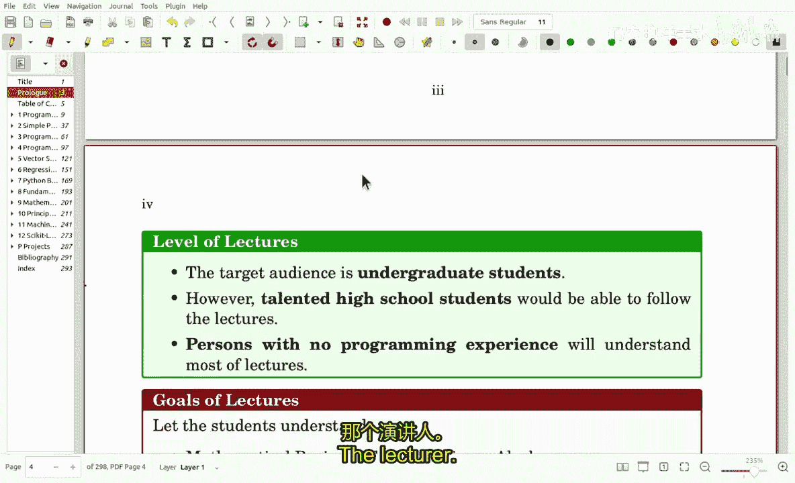
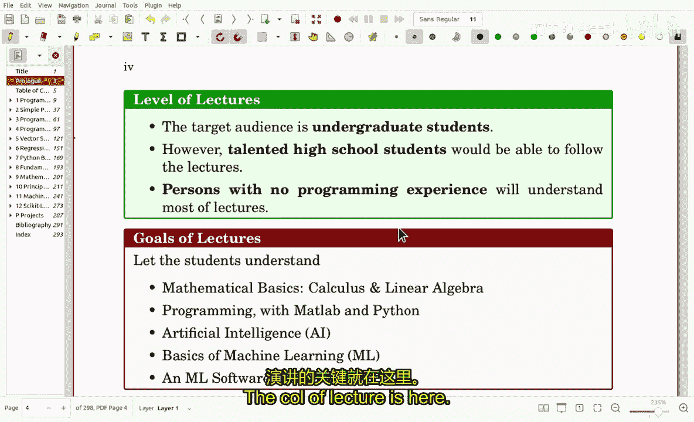
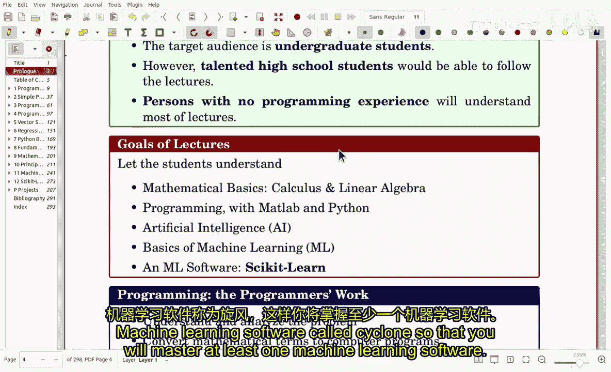
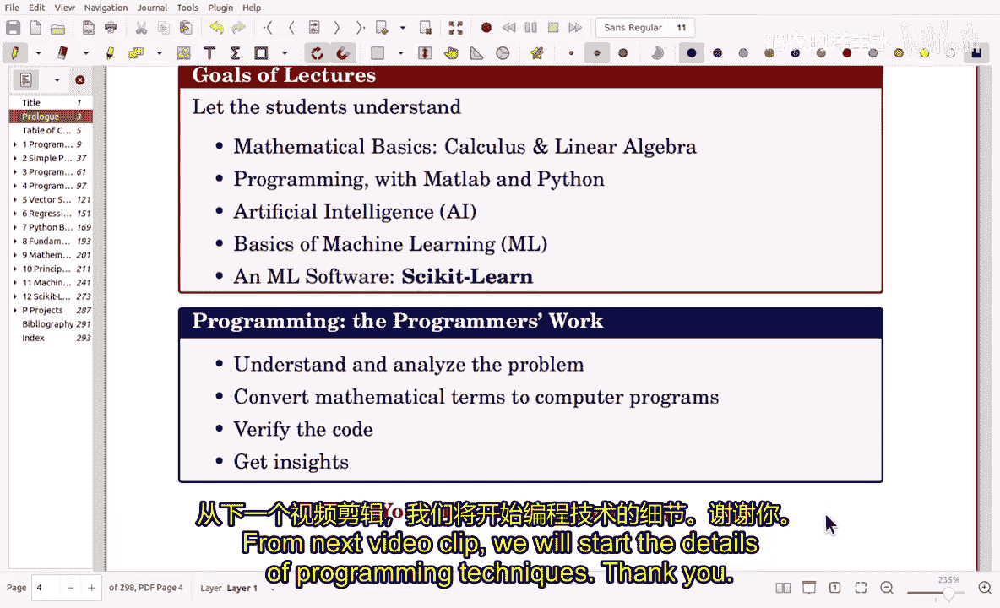

# 【全集-附课程讲义】密歇根大学-人工智能编程-EECS492-中英字幕-p01-Lecture-1---科学计算与编程导论--BV14JqfBNEAS_p1-

This is a class of modern scientific computing， And I am T。 Soja Kim。

A professor of mathematics at Mississippi State University。Let's begin with the scope of lectures。

We use by E entitled Programing Pasics and AI。With metalla and Python。

If you start learning programming。The computer language must be simple。If it is complicated。

Then it'll be very hard for you to focus on mathematical loging。Programming is larger。

Along with a simple Egyptian learn language math lab。You learn programming。

Focus on mathematical logic。 And then you learn Python。To become a better programmer。

The electron is not as complete。I added some subjects later on， however， although way。

 itll be freely available。Okay。The lecture。

Will be delivered in this rain。The target audience is under courage disturbance， however。

Talented high school students。Will be able to follow the lectures。

Persons with no program experience will understand most of lectures。The course of lecture is here。

嗯。I want you to understand。Mathematical basicx， calculus and。L algebraella in particular。

And which song。I want you to understand the programming。With metal lab and Python。

 and also artificial intelligence。Andward saw some basics of machine learning。And finally。

The lecture will deal with a。Booslish learning software called Cyone so that you'll master at least one voice learning software。

Here， the programming。Is to understand and analyze the problem and convert mathematical terms to computer programs。

And。Or verify the quote finally。You have to get insight so that along with that， obtain the insight。

 you can expand your knowledge and your。Programming capability。Through the class。

 you learn programming。Okay， that's the end of introduction。From next to video clip。

We'll start the details of programming techniquess。

Thank you。