# 【全集-附课程讲义】密歇根大学-人工智能编程-EECS492-中英字幕-p02-Lecture-2---什么是编程或编码--BV14JqfBNEAS_p2-

Let's begin with Chapt 1 programming basics in this chapter， you learn。What program mean？

Or quite years。And how to convert mathematical terms to。

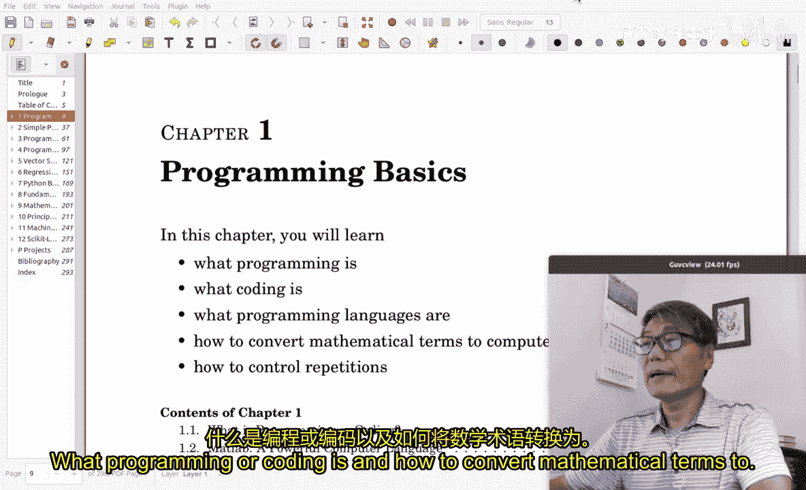

Computer programs。In the second section。We'll see a little bit about Mat lab。

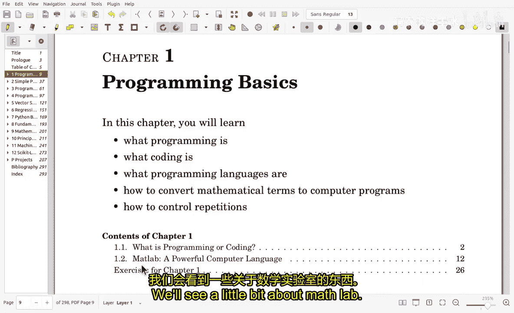

Okay， here we have Section 1。1。 What is programming？

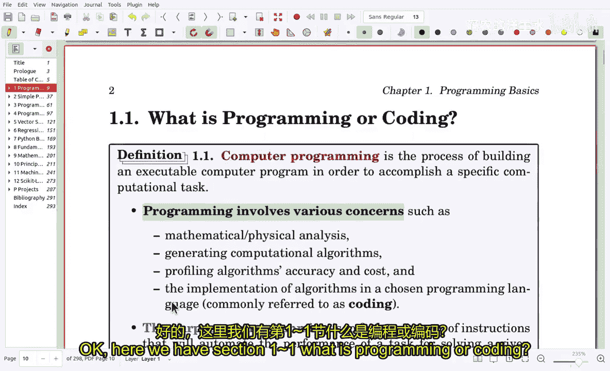

Or coding。Computer programming is the process of building an executable computer program。

To accomplish a specific computational task。So programming involves of various concerns。

Mathematical or physical analysis and。

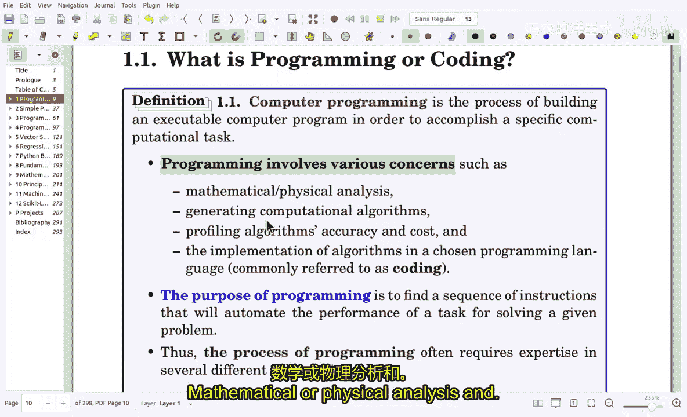

Generation of computational algorithms。And also， analysis for efficiency and accuracy。And finally。

 we have to implement the algorithm， and that is called coding。

The purpose of programming is to find a sequence of instructions。

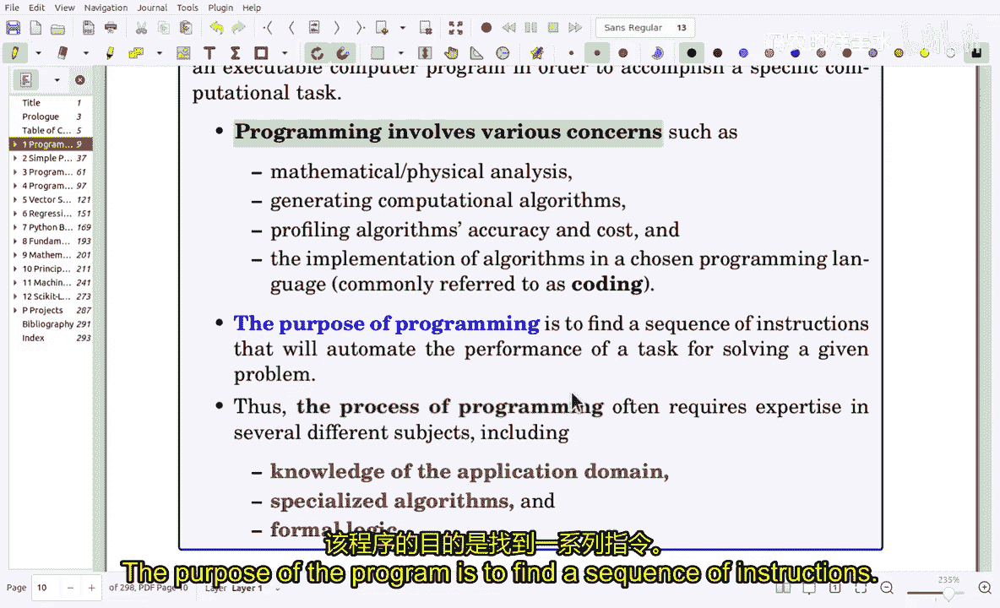

And。So that the process of programming often requires expertise in several differences subset。

Such as knowledge of the application domain。And specializedize the algorithms， and former。

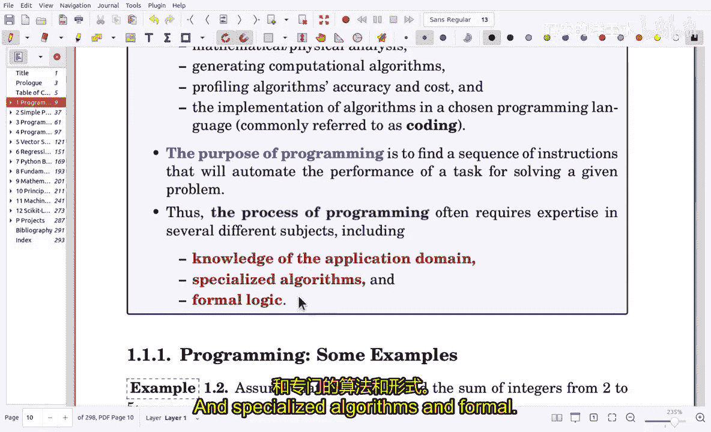

Lge。Okay， here we'll see some examples。Or assume。We need to find the sum of integers from 2 to 5。

And to get the solution， we may start with the first one and add three。And add4。And add of five。And。

That is。嗯。Mind assimilation in this way。You can get the answer and answer must be 14。

So start with the first one。And add one。One other one and another one。

And in computing implementation， you will do in this way。So programming is like a fitting。

So what you think effectively。Will be。😔，Realized in computer programming。

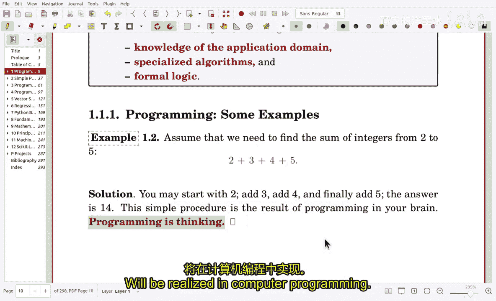

Okay， let's go through。Another example， let's try to get Sch to file。

And if you are using your calculator。And if you hit5 and square root key。

 then you'll get the answer really immediately。The question is。

 how can the calculator get the answer？It is not saved， in fact。嗯。

The re is computed and exactly like this one。

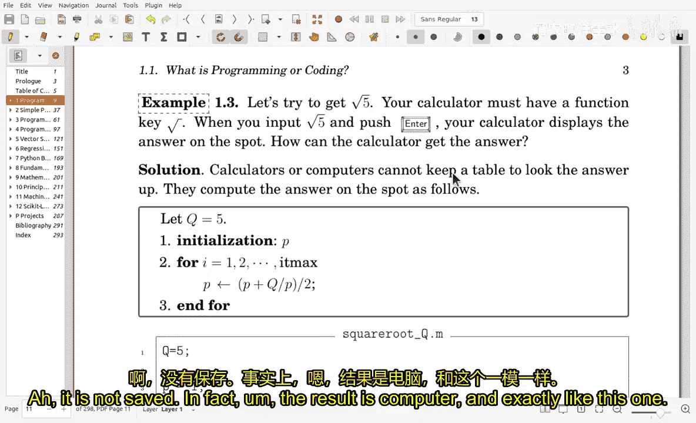

Here， the Q， the input is 5。And to get the solution。now。We initialize over a variable P。And then。

Yeah P is updated。And here P。Plus Q over P and the average then。2 values are。

Average bill for keep pay and update。And this iteration is done。She eat mad times。For example。

This is real programming in Matland Qify now P initialized。To be one。

 you can initialize some other value。 But anyway， yeah。Initialized to be one。

 and we have now8 iteration。有皮。Plus Q of P divided by2。 and now P is updated。To see how P is updated。

We try to now print on and along with I， the Etion account， and update the value。Okay。

 start with one in the beginning so that that will be p0。And here， P1， P2 and updated。

 you'll see here now， and it is approaching。To a sum number。After6ition later on is not changing。

 That means that。Just in60 situations。The algorithm has converted to。To any timal digit accuracy。

Here we are。Priining out 20 digits。So after6 tn， the algorithm got the solution。

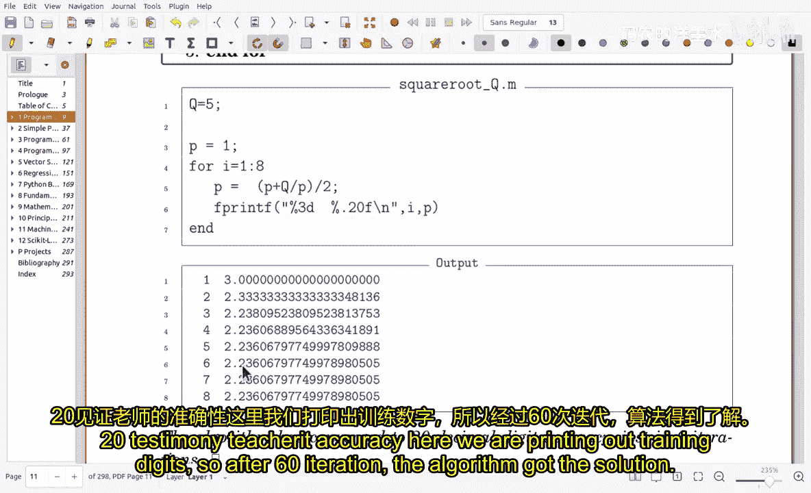

That is severe happening in your calculator。Or computers。

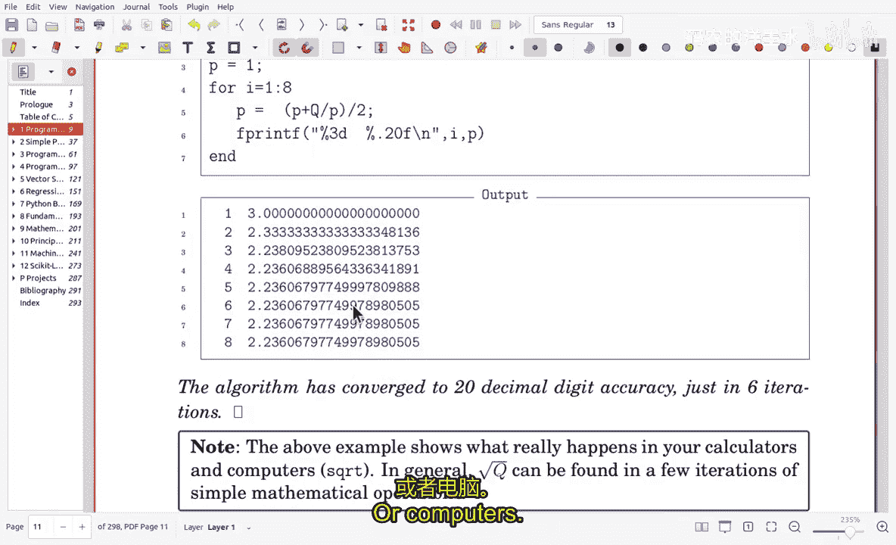

Okay。Here， the 얼굴ism can be。Interpreted as follows。Okay， we can rewrite this one into that ring。Here。

 we you to find。Some number。P such that P square is Q。So that first。

 we tried to make a peace creative。And measure the difference from Q。

And skill the by twice the current value。And。That is becomes a correction term。

And collection term is now subjected to。Opdate the value。

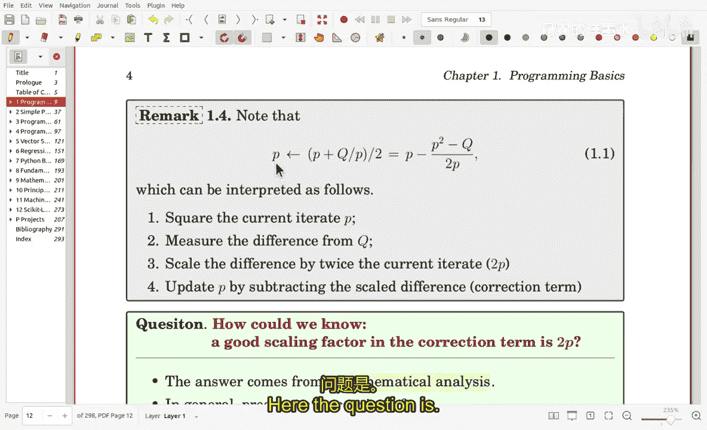

Here the question is。嗯。This is killing factor。How can we know a good scaling factor。

Took at the correction Tom。And how can we know this 2 P is the right correction term？

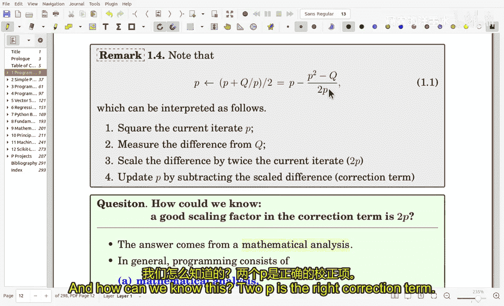

The answer comes from mathematical analysis。

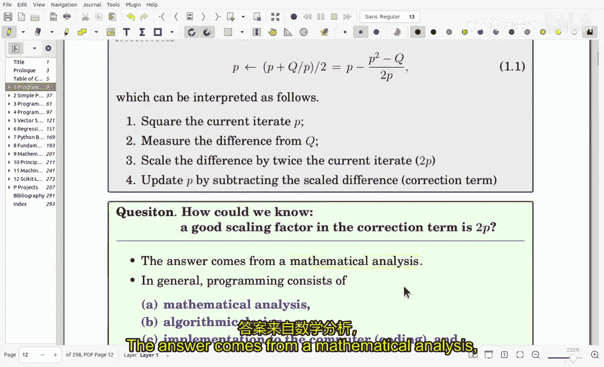

And later on， we'll see。Mathematic， mathematics to gap such。A scaling factor。

 but at this moment here the thing is that to get a good algorithm。

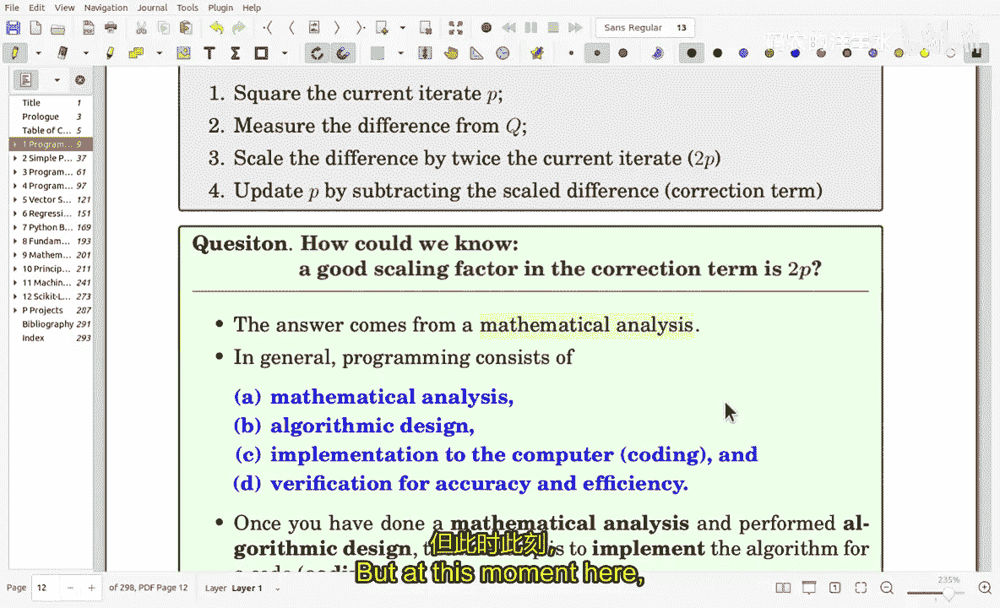

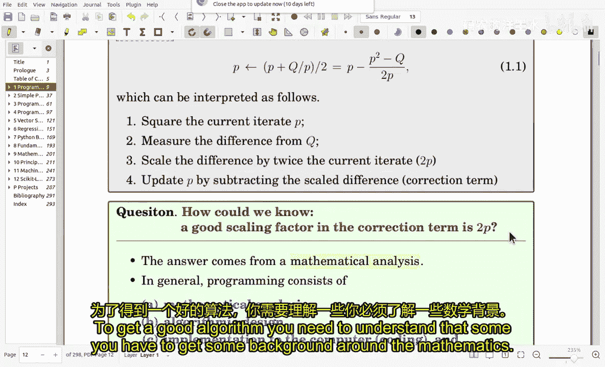

You need to understand that。SomeYou have to get some background around the mathematics。それ。

The programming consists of mathematical analysis。And algorithmic design。And implementation to。

Computer。嗯嗯。Algorithm， and that is called coding。And finally。

 you have to verify the algorithm for accuracyre and efficiency。Without verification。

 it may have some error。 So you have to verify your algorithm and coding。

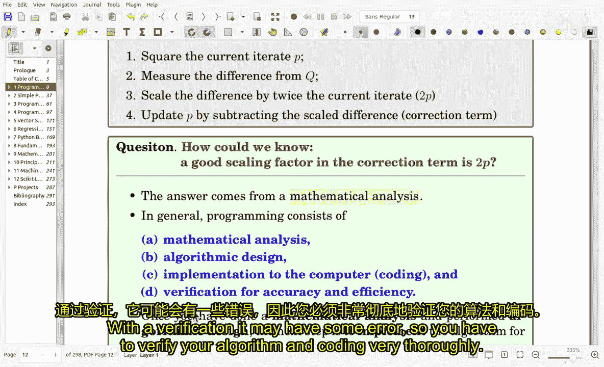

Fure thoroughly。Once we have done。Mathematic analysis and。Performed。Algorithmic design。

 the neus step is to implement the algorithm for a call。Which is called reporting。For implementation。

 you may use one of computer languages。And such as Matlab， Python， C， C plus plus。And Java。

 which the some other languages can be used there。

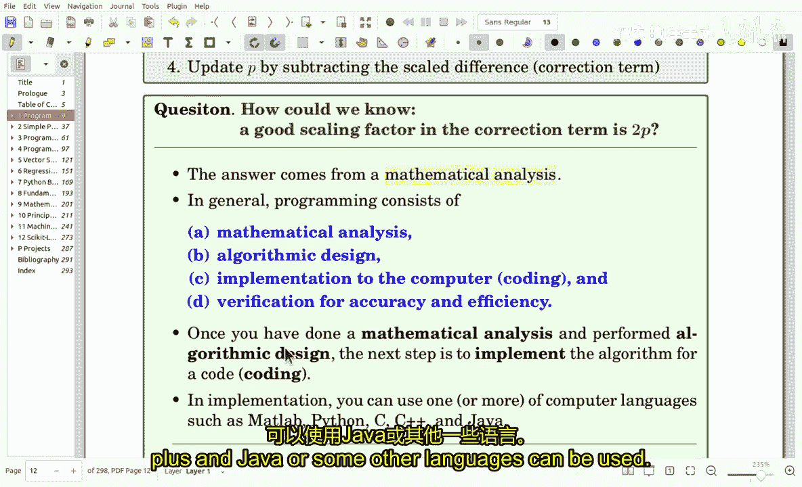

嗯。Yeah。You learn through the course。And programming techniquess using simple languages such as Malab and Python。

Why we。Do we choose a simple language as。To focus on mathematical logic and algorithm。Deign。

If the computer language is complicated。Then， because of this complication。哦。

It'll be very harder for you to focus on mathematical logic。 So we'll begin with the MA labb。And。

You will focus on larger。And after that， in the middle of the semester。Will move to Python。

Because in modern society。Of AI and machine learning。

 Tython is the most popular languages so that you have to learn。

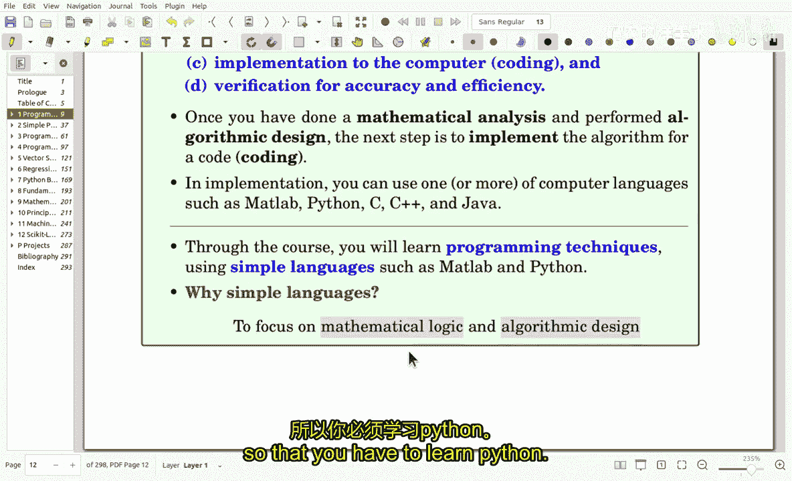

Pythhone。

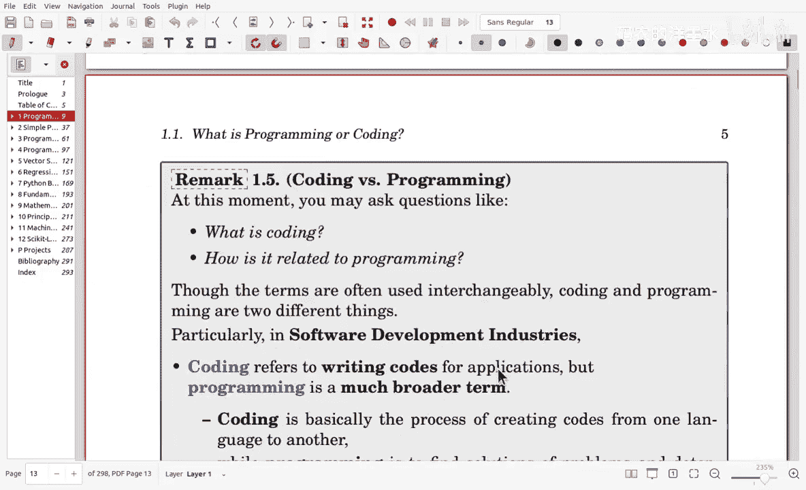

Liang。Now we have a remark at this moment you may ask questions like what is coding。

How is it related to programming。Coding and programming are often used interchangeably。However， in。

Software development industry is。The coding refers to writing codes for applications。

 but programming is a much broader term。Coding is basically the process of creating codes from one language to another。

While program is to find the solutions of problems。And determine how they should be solveed。

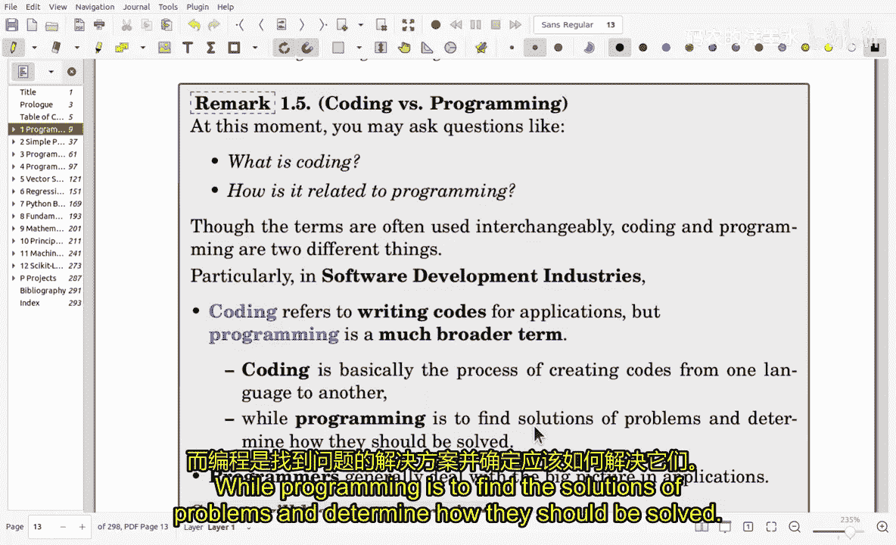

Programs generally deal with the picture in applications。So you will learn programming。In this class。

 Okay， this is end of part one。 will continue in。The second part。

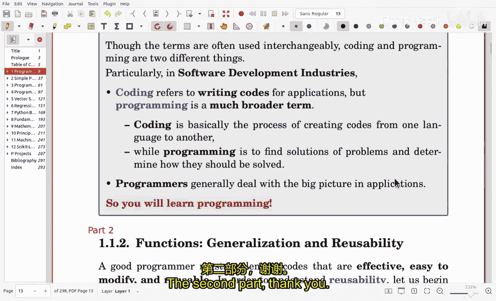

Thank you。