# 【全集-附课程讲义】密歇根大学-人工智能编程-EECS492-中英字幕-p03-Lecture-3---函数的泛化与可复用性--BV14JqfBNEAS_p3-

It is part two of Section 1。21 functions， generalization and reusability。

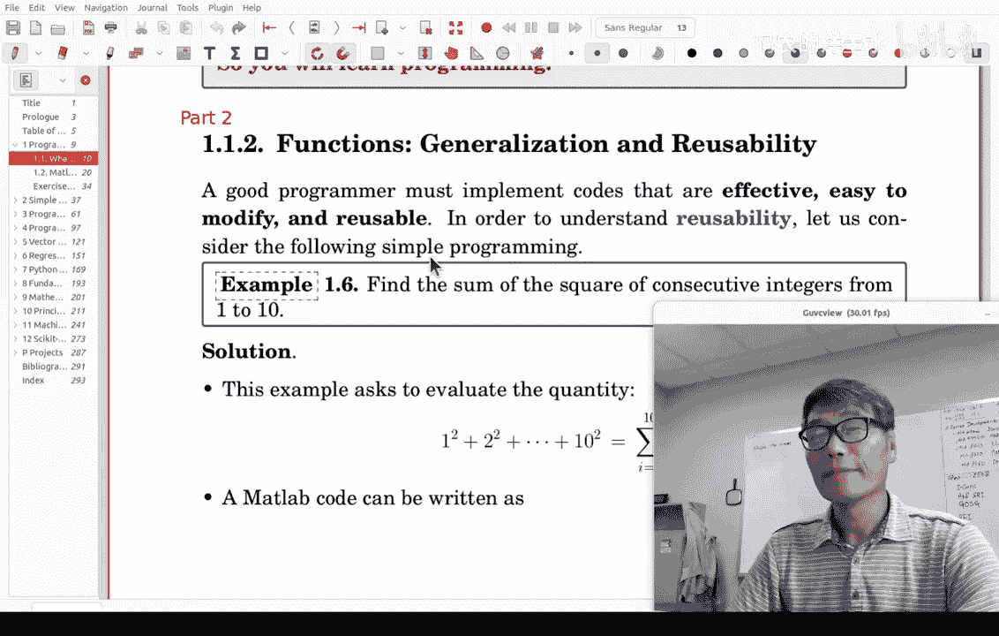

A good programmer。Would implement quotas such that they are effective。I it to modify。And reusable。

To understand the reusability， let's consider the following simple example。

Find the sum of the square of consecutive integers from。1 to 10。

The problem asks to evaluate the quantity。One squared plus2 squared and up to 10 squared。

 Again sigma notation， we can write in this array。For this problem。

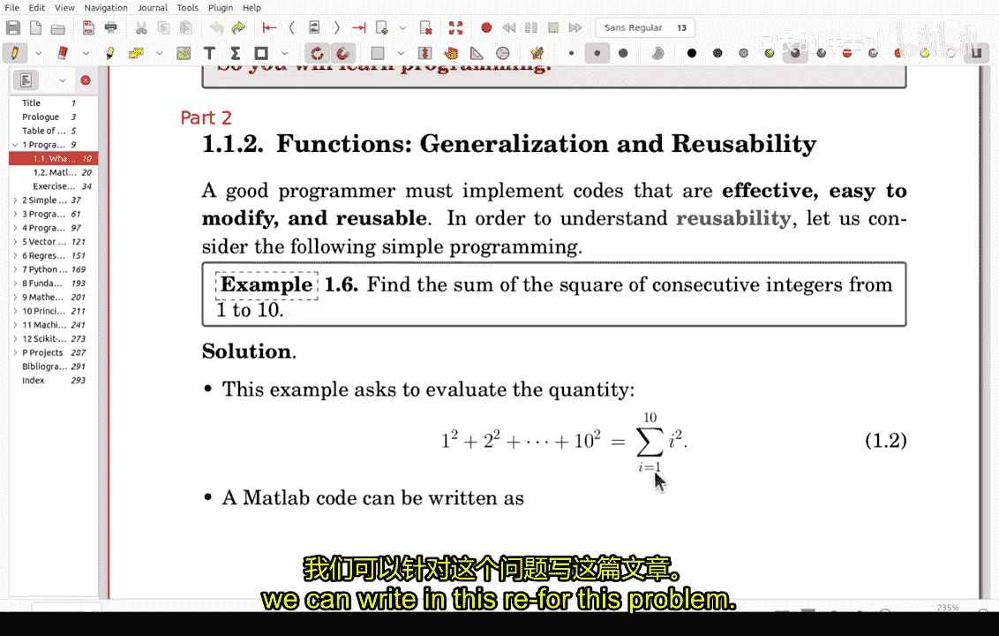

We can write a MA code。As in this box。

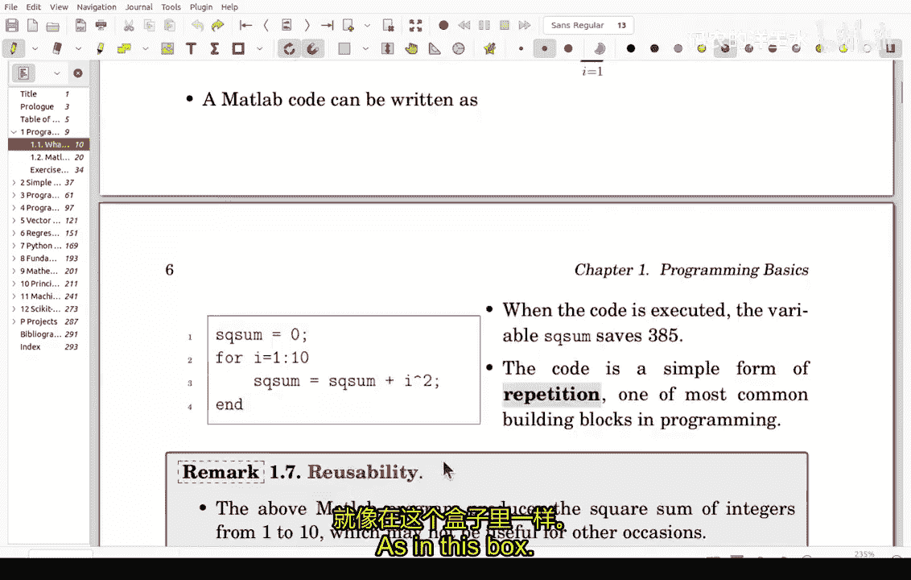

First， we initialize the s song is Siro and through this petitionition。

A full loop that we tried to add and one scared， two scared，3 scared and so on up to10 scaredd。

So that after passing these lines。The sam will have value 385。This code is a simple form of repition。

One of the。Most common building blocks in programming。

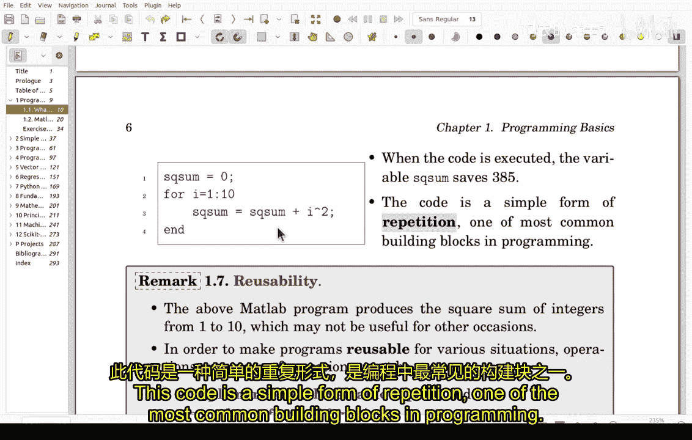

Here， this MAler program probably as a right answer。However。

 it is not really reusable if you try to get s some from some other number， for example， 10 to 20。

Or a pen to 100 van。 You have to read it， and we have to adjust this one。For the new task。

So that here， we have to。A right of function and reusable for various situations。

And in order to do that， we have to implement code with variable input。And now。

The program portion must be saved as a form of function。So let's try to channelize。

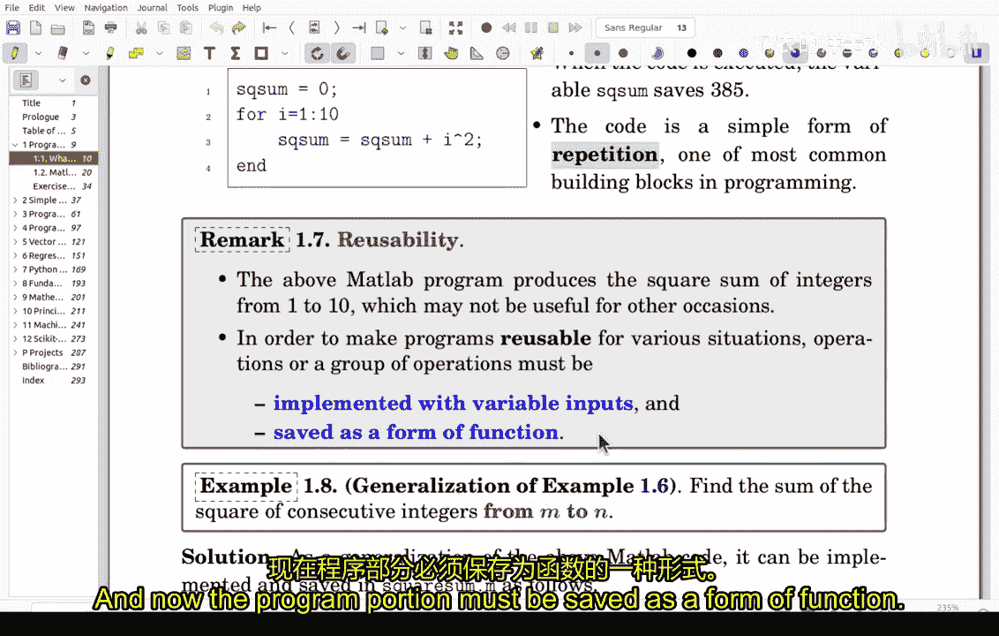

This program。Now， the same problem find the sum of the square of consecutive integers from。

And rather than one to 10， now we try to use variable。

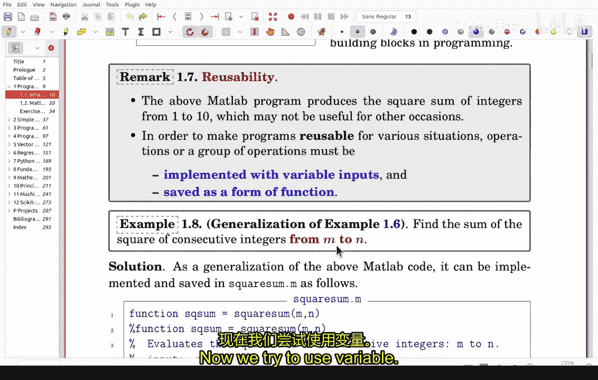

Amrenne。Now that is the program。Yeah， sphere sum dot M。And the file La is Ssome。m。

And now the function is organized in this range and function。 So it' a declared Now in below。

 it is a function to be defined。And secure some there's output。That is the function name。

 This is import。So by using this input。This command will produce calciumone。Now。

 this portion is exactly same as earlier that one， so the inocence if you。

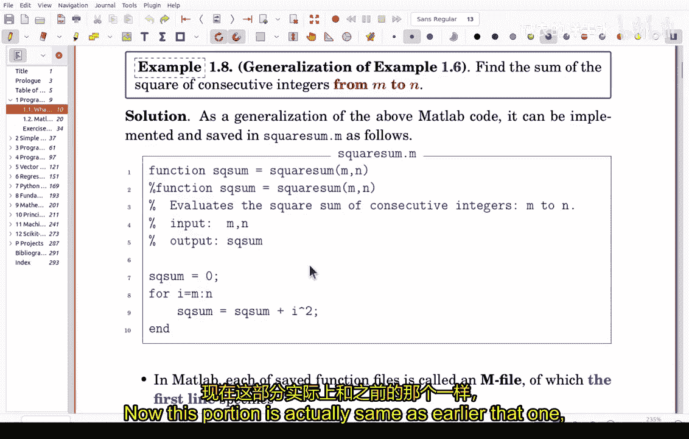

Iplement code， then just wrap up with。This。Haad push and save into as a function。In a separate file。

 then that is a function。Okay， such file in Matle is called M file。And here。

Let's try to run this chor。

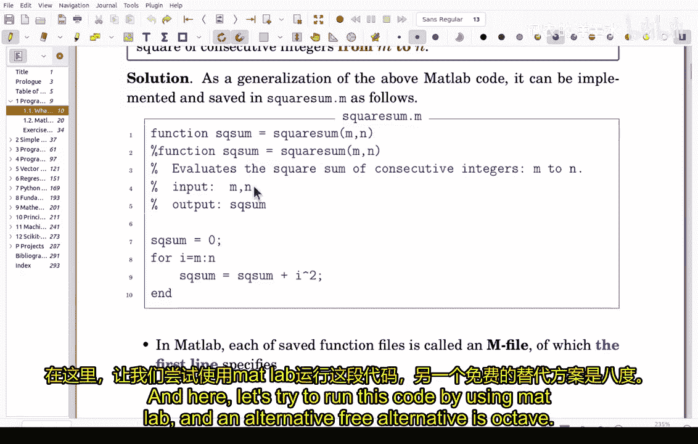

By using a metal lab。And an alternative， free alternative is octave。Here we have in the trajectory。

You can see here now， secure some。And。Okay， that is implemented here。In this structural。

 now we'll go to comment window。And。Here are， earlier。I tested this one。 S some12 10。 It is already。

I I did this so that it is keeping the memory。 so S some 1 to 10， the answer is 385。

 Also for that on， help with S some。Thenen。Now， these are some extra lines， but that portion。

Is coming from。The program。 Okay， let's go over there。 This portion is also sort of。

That documentation for。The program explaining。About the program。 So you are included this portion。

 Then by using how to command， you can see what it is。 So here you have to explain what it is， okay。

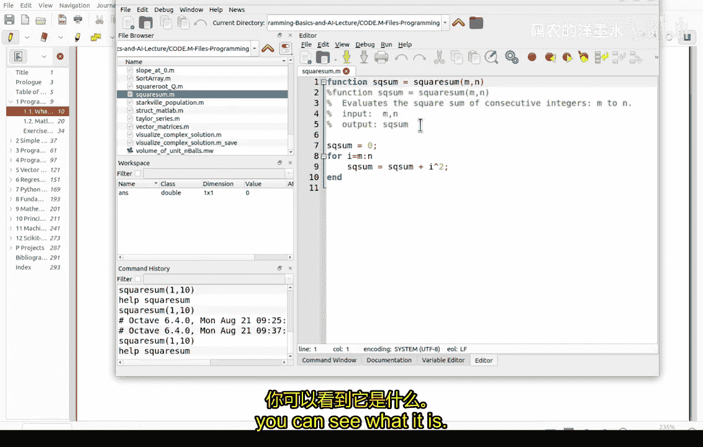

Okay， that's the  Otave learning Mat code。Okay。Now。Here the first line is specifying the function A。

 which is a square sum and input variables and an output as now SQ as sum。

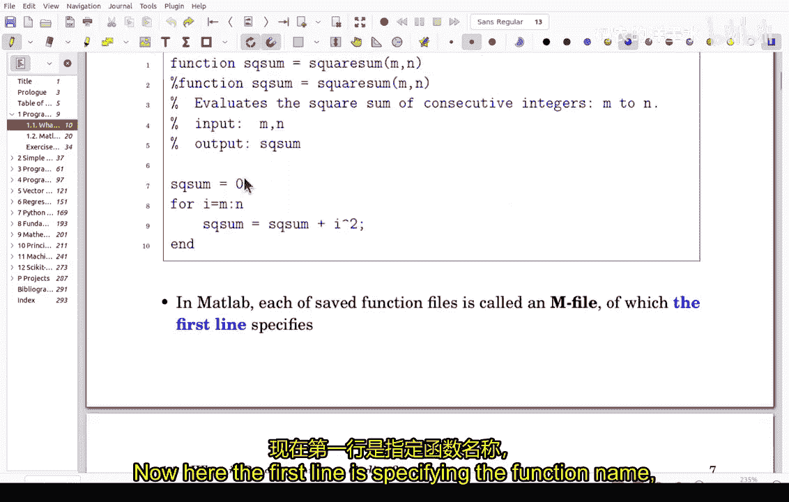

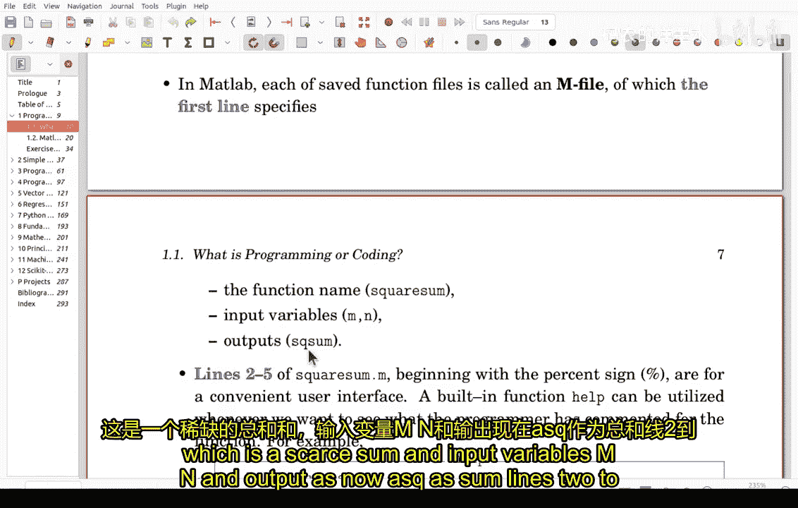

Lice 2 to 5。 Okay here from here to there。 There is a kind of。The help， along with the help。

 you can get it。 already I explained that。 if we put help， then you can see this output。

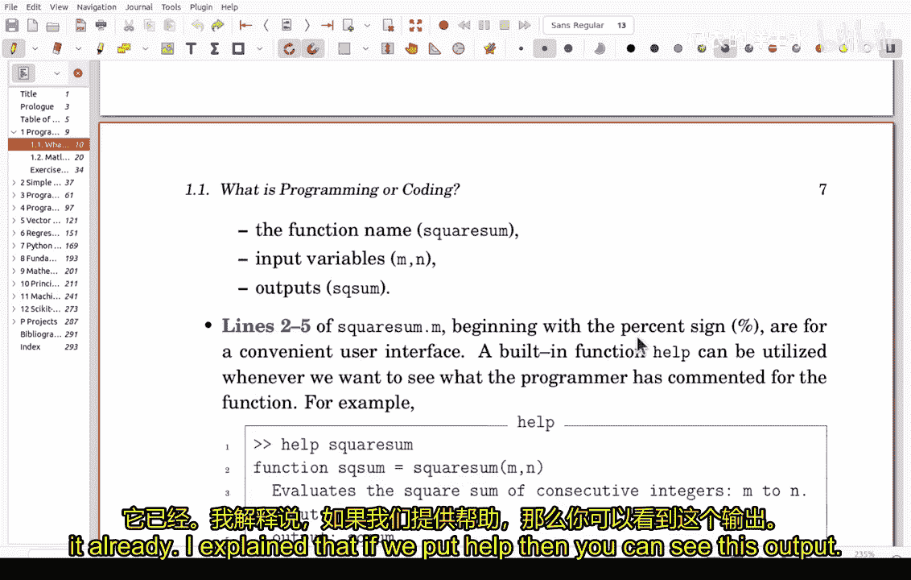

But in  Otave， some extra lines are coming out。 but if you are using Malab。

 just simply will see all this regions。And last four lines of the algorithm include the required operations for the givenn task so that that portion is the main part of the program。

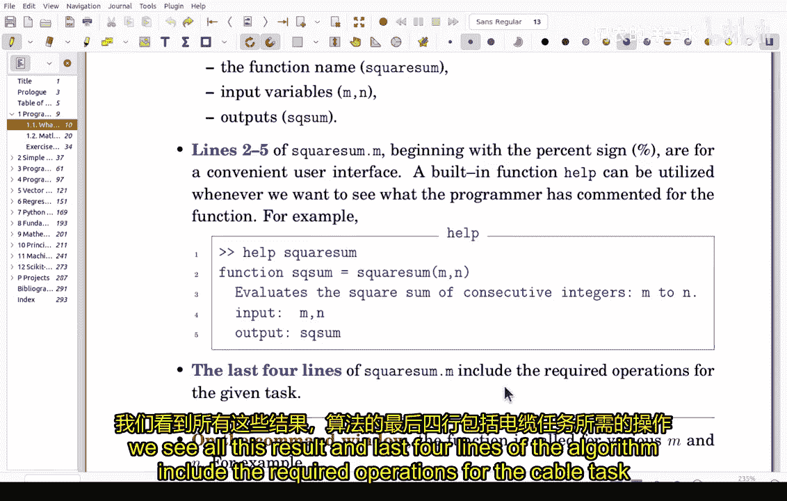

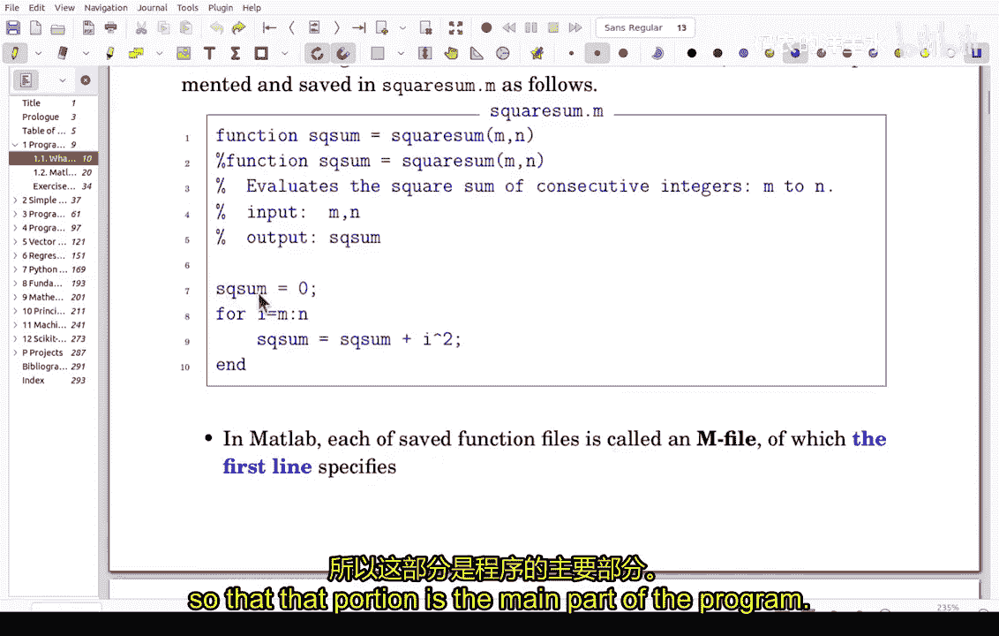

And on the command window， and if you write down S sum 1 to 10， then answer S 385， we already。

Experience of this along with O pave。Okay， this the second part， thank you。

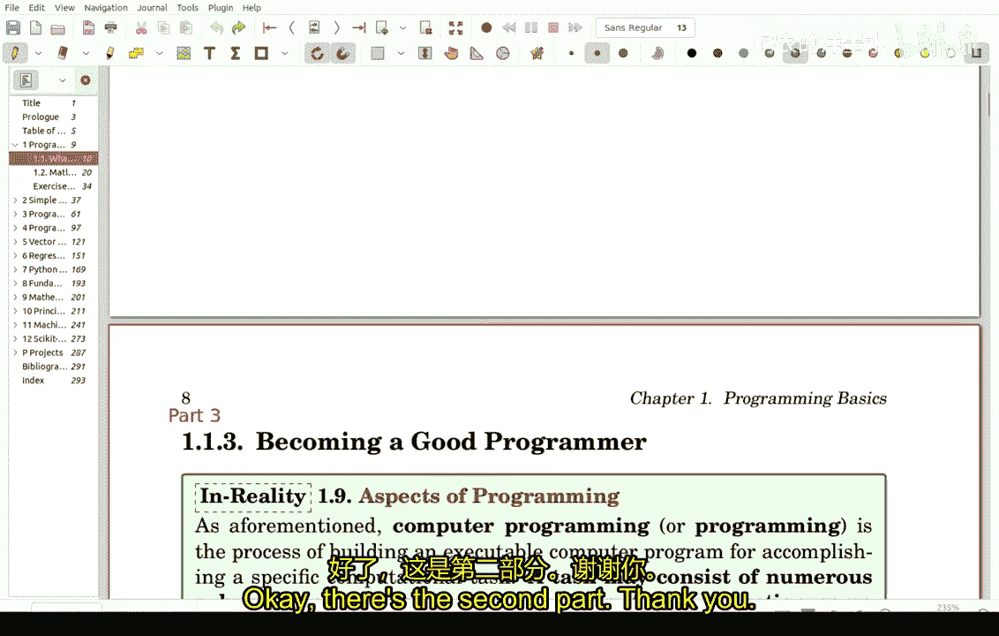