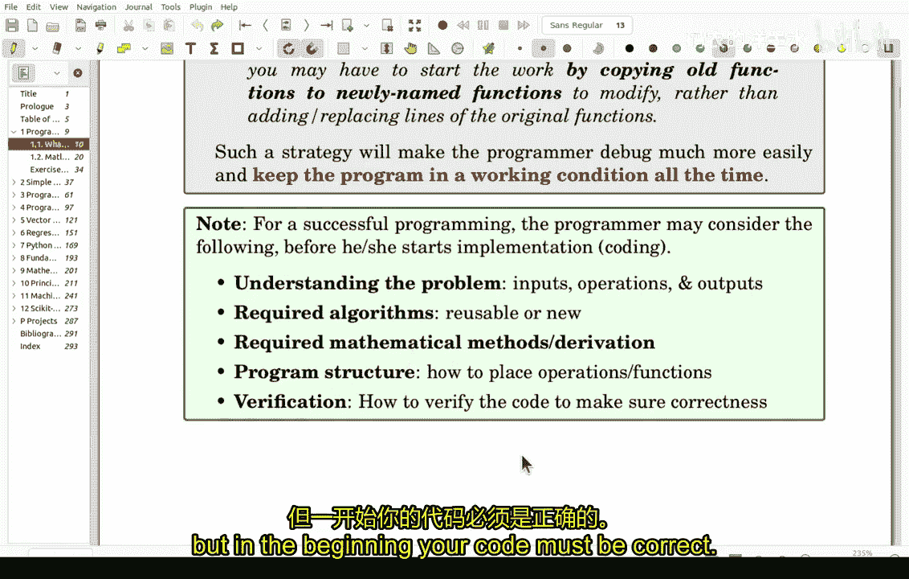
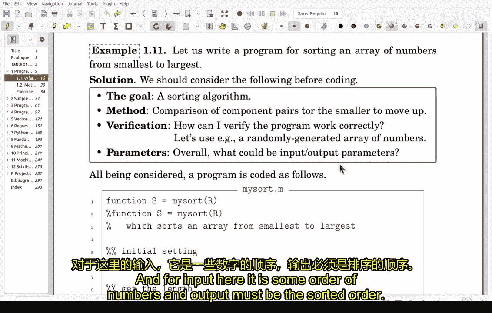
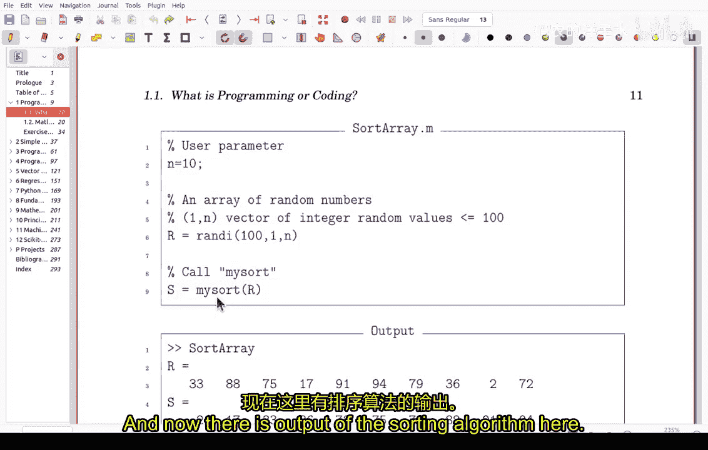
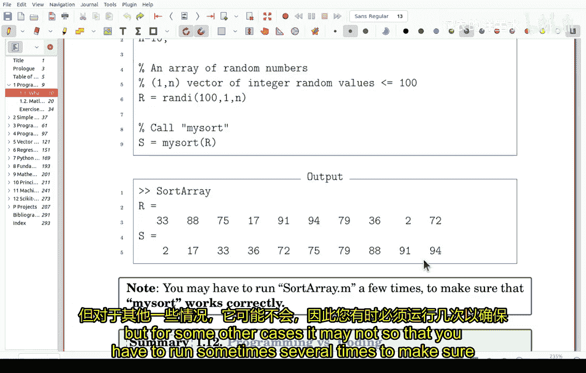
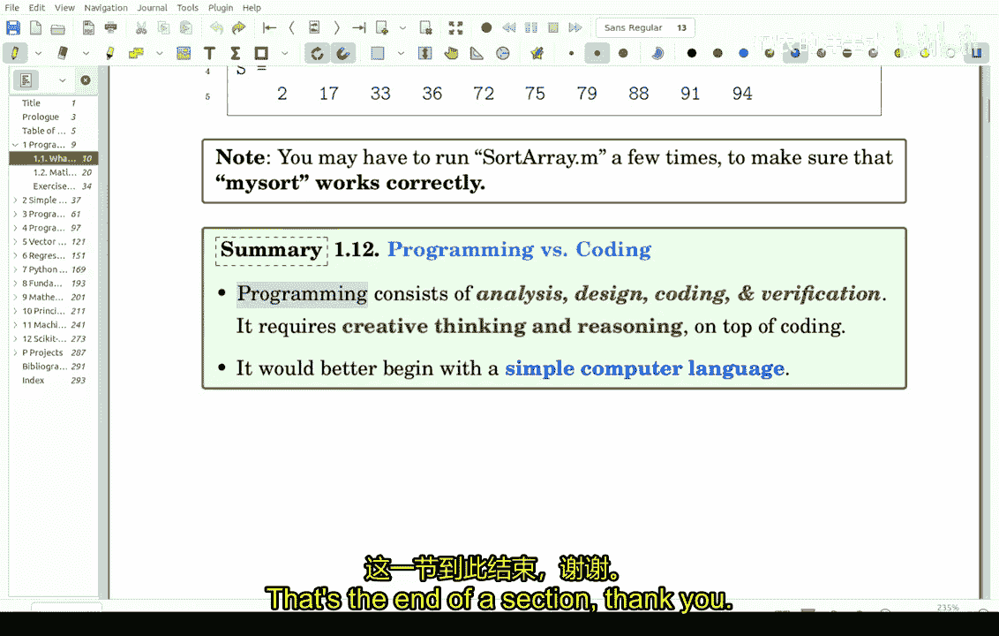

# 【全集-附课程讲义】密歇根大学-人工智能编程-EECS492-中英字幕-p04-Lecture-4---成为一名优秀程序员--BV14JqfBNEAS_p4-

It is part of Section 1。21。Becoming a good programmer。The key to becoming a good programmer。

Is your passion。Nothing is better than passion。If you are passionate on programming。

Then you will become a good programmer， you know， fairly short time。To help you。Become a programmer。

We consider some aspects of。Programming， and also， I'll try to give you some tips on programming。

As A mentioned。Computer programming or simply programming is the process of building on。

Executor will complete the program。For solving computational task。

A task may consist of many subtaskers， each of which can be implemented as a function。

Some functions may be used more than once， or repeatedly。In a program。Yeah。

 you should consider the following aspects of programming before。Accordinging。

And task modularization。Is about parting of the given task。

The given and computational task can be partitioned into small。Several subtsers。

 each one is called a module。And each of which is manageable， convenient to end。

Effectively in both mathematical analysis and computer implementation。

 that means that each one is easy to handle and easy to implement。The major core of。

Task modularization is to build a backbone programming。Task modularization is quite important。

 You have to set it down。The given task into small subtsers。Now， you have to consider。嗯。Now。

 development of algorithm。For each mu。You have to develop a computational algorithm。

And save the algorithm into function。And here， and。Practically， now。

 in order to implement a a program， you have to choose a computer language。

 You can choose one of computer languages。So that you can implement quite effectively and conveniently。

Here， occasionally。You may implement the subpass。reUsing more than one computer languages。And。

By doing that， you can maximize the performance of the digesting program。And also。

 you may minimize your human efforts。If you separate a given task into several subtaskers。

 then for some subtsaskers。Some program available。 Some functions are available。

 then you can use them。But the program is readinging in。Some maybe some other languages， for example。

You want， you want to use。嗯。See， but for some taskers， its a bit in for。Than， rather than。

Wtiding sea code， you may。And downloadownload the fortune code， and you can use it。

So that to minimize human effort and to maximize the performance， you may use。

Some more than one language here， by the way。Yeah。Fuan is the fastest language in scientific computing。

Forron is about 20% faster than。A see。And here you'll use it a MA labb。

 but a MA labb is about twice slower than C in many cases。And even in scripture language。

 the math label is so fast nowadays。 And without compellingil， we are using。Mala script。

 And now it's about twice as slower than C。 And that is really amazing。

 The speed of matle is so good。If we are using， for instance， Python。

Then it'll be about 50 or sometimes 100 times slower than C。

So that inside pi of the Python and the core portion are implemented in C or Forron， so that。We can。

Here， accelerated the。The performance。 And so that in many packages。 And here。

 the core portion is usually implemented by using very effective language apps。Okay， so eventually。

 even though you are using Python later on。越 are越 saying。Not only Python。

 but also you are using some very effective languages。Okay， once you implement a program， the code。

 then now you have to verify for。Correcting years and effective years。

And such a process about finding and resolving defects over issues within our computer program is called debugging。

And it's occasionally the case of that。Ferification and debugging takes a much longer time than implementation implementation itself。

For a small program， you can finish implementation in a day。

But sometimes the degging debugging tax more than。Oh weak。 and sometimes more than。Month。

So you have to start with fairly mathematical logicging。

You are thinking it's not logical then easily you can add some mistakes and because your logic is not clear。

 it's not easy to find the place where。The mistake is involved with them。So that you have to think。

Ptyologically and with a clear logic， you can write a program much more effectively。Okay。Now。

 here we have tips for programming。It's quite simple。If you want to add functions。

 then try to add functions one by one。Building a program is not a simple problem。

About a difficult project。In particular， when the program should be constructed from scratch。

And once you start from scratch， a good strategy for an effective programming is add functions one by one after modular digest。

Each module can be implemented。As a function， so add a function and step by step and check if the program is correct。

Each time。Adding function。So after adding a function， check if it is correct。In this case。

 you will focus on。The last function you added just added it so that check if the function is correct。

 then move to the next function。So in this way， the programmer should keep the program you know working condition for the whole period of time and implementation in this way。

You can minimize burgers so that you can minimize that debugging time。

And here use our modification of functions。Sometimes you have to modify and use all the functions used the form。

Similar pro。 So when it is the case， you may have to start the work by copying all the functions to duly name the functions to modify rather than adding depling lines of the original functions。

If you。Try to keep the original functions。 Then it's quite easy to debug。

And here you'll keep the program in working condition all the time more easily。

To reason is that because you have the background。 and then now along。

Using that one once it is not working， producing some unexpected expected results， then。

You can check your logic and programming so that you can。

They'll make it correct quite easily by using the older one。

 So don't try to replace or add some lines to the original functions。

And just copy it to duly name the function， for example。If you try to copy。Ajust， for example。

 S sum earlier we considered then copy it to S sum 2。And try to adjust secure sum2 and reform。

The' scare sum， the original function， and if you need。Okay。Okay， that's the tips。

For successful programming， the programmer may consider the following before。

Beginning implementation。First of all， you have to understand the problem。And then， you have to。

Consider what inputcoing and what operations。Could be involved them。 And what outputs could be。

And also， you have to organize the required algorithms for each module。And sometimes for some module。

You can use all the functions， but sometimes you have to implement newly。And now，2。嗯。

Make the program， degening program working effectively and correctly。You will have to。

To deco the mathematical method and mathematical ju so that you can design the algorithm much more effectively。

 And also， you have to。Consider program structure。And practically。

 you have to place the operations and functions in a right position in right order。

So you have to consider program structure。After finishing implementation。

 you have to verify your program。So that you have to consider how to verify the code to make sure correct is。

In the beginning。At least the code must be correct。

 and then later on and when you are dealing with the real data or huge data， if it is that efficient。

 then you may modify your program。To get better the efficiency。But in the beginning。

 your code must be correct。

Let's consider this example。Let us write our program for sorting an order of numbers from similar to largest。

This is now a computational task。Here， so that before coding， you have to consider the following。

What is the cornn， the courts。To get a sorting algorithm。And sorting back for them。

It's not competitive of。Oh。The component pairs。For the smaller to move up。

And that is because we are sorting from similarest to largest one。So that the method must be。嗯。

The tro in this gra for each two number appears。And we compare them。 And then。

The small one will call the front。Okay。Now， if you write down a code， then how can I。

 you have to ask yourself， how can I verify the program work correctly？And。Here。

 you may use a random niary to the order of numbers and test in。Now。

 when we are implementing a code then and you have to consider also parameters。

 what could be input and output parameters。And for import。Here， it's o of numbers。

 and output must be the sorted O。

Okay， here we can implement a chor in this way。 There is a mis to that M。Noo。😔。

There is a function name on the first line， you have to specify the clear function。

 that is function name that is input that S output。So now we have this dark portion。

And that is when you are using help to commander， then you will see this portion。Now。

 once input R when order is given， then we copy it to S。And now we check the length。And phone。

The last one。Yeah呢。Okay， that is。Last one。 And from beginning to。The one last one。

 And we compare two values， consecutive values， so that。Now， that is large， larger than the next one。

 Early one is larger than next one than we change the position， the swapwab。And in Metrola。

You have to do in this realm。 You can save one value into temporary variable。 And then now。

The Pi one is saved into earlier one。 and the Pi one is now getting the value in temporary value valuable。

 So in this way， we can swap。And so that after passing this line， now that will become a larger。

 The next one will become larger。 So through this one。Now， for each J。

 and earlier portion of the early。It's trying to get a largest one so that the largest one will be saved to J。

 So we repeat J from。Now， and to go down to2 so that eventually the largest largest will be the right most one in end one and smallest will be the beginning value。

Now， that's the implementation。And here。Now。We'll try to verify。The function we implemented。

Now here we choose a1。Donna， we try to make。A randomand order of 10。The values。

 but each one will be chosen from one to 100 them。So that each one。And now one by 10，1 by n。

 so that is rh vector of 10 ands。And is 10。 And then here， the each value is between one and 100。

So art is made in this ring and then here by passingsing my sword。And now， that is output of the。

The sorting algorithm here， the here we have output R is a randomly generated in this range。

And then here， after passing， after calling my sort， it is so from smallest one to the largest one。

It's working nicely for this or。But you may have to run this myot algorithm。

 And by using So2 array dot M， have you may have to call this So2 array do M a few times to make sure that。

My sort works correctly。 So once it is happening correctly， but for some other cases。

 it may not so that you have to run sometimes several times to make sure。

The your code works correctly。

Okay。Here we have a summary programming for such quo。Programming consists of analysis， design。

 coding and verification。It requires creative thinking and reasoning on top of coding。

 So coding is simply building。Acord。Now， programming is here requires a more than。According。

Practically， you have to think of very creatively。And also requires some clear reasoning。

 so mathematical logic。Ass the major thing。It would better begin with a simple computer language。

 to focus on。More on analysis and design and verification。

 your language must be simple if your language is complicated。Then。Yeah。

 you will spend more time on debugging so that your analysis and design is not much shining。

So the solution will use metallabe in the beginning， okay。This the end of the section， thank you。

