# 【全集-附课程讲义】密歇根大学-人工智能编程-EECS492-中英字幕-p05-Lecture-5---Matlab-Octave--BV14JqfBNEAS_p5-

It is a section 1。2 metla， a powerful computer language。Matrolabs stands for metric laboratory。M。

Is a multi paradigm numerical computing。Environment。

And a proprietary program and language developed by math works。It is not free。However。

It is quite flexible， and you can do also some symbolic computations。

And it is easy to learn and easy to use。Along with the mat lab， you can do metric manipulations。

Pluting of functions and data。And also， you can implement algorithms。

And you can create user interfaces。 and also。You can call some other languages。Such as C。

 C plus plus C sharp， Sava photoron and Python。And particularly。

 metric is very good at metric manipulations。And we so。You can do。Computer algebra， that means that。

You can do some symbolic computation。And we can say that Ma is about most convenient computer language to learn and to use as well。

For each of the programming languages， there are four essential components to learn。

The first one is looping。That deals with a repetition。And second one is conditional statements。

Dealing with cases。And oraw。We have to learn how to make input and output。And finally。

You have to make modularization and safe。The functions into functions so that you can use later on for similar projects。

 So that is。About reusability。And also， in this way， you can finish implementation very effectively。

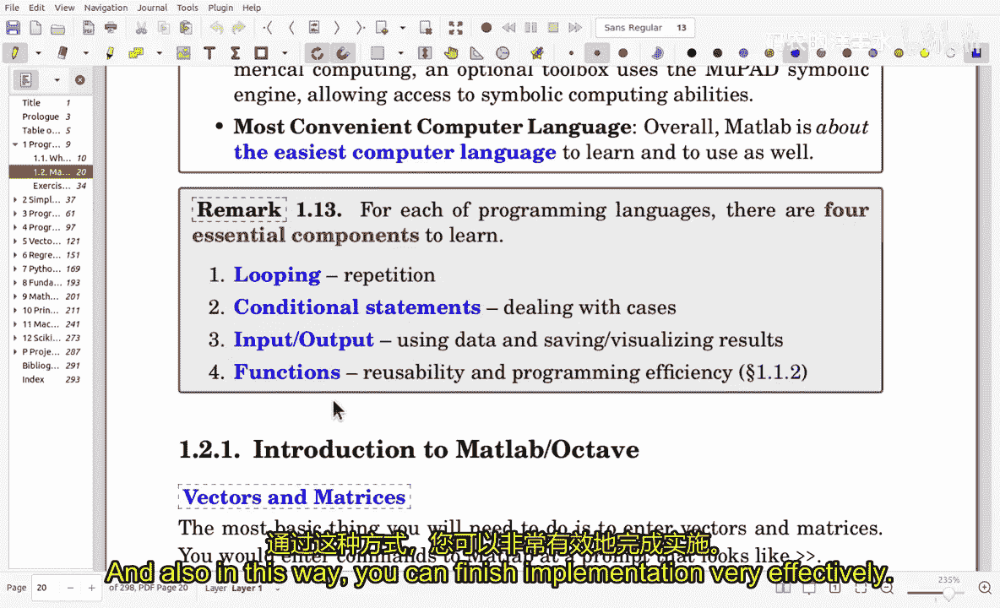

Okay。Yeah。Introduction to MAla or octave。Ooctave is an alternative。To Mat lab， it is free。And。

The mentally programs can be run。In octave， in most cases， without any modification。

 they are not exactlyively the same， however。In most of the cases in your level， it'll work。Yeah。嗯。

Vectus and Marics。The most basic thing you'll need to do is enter vectors and matrix。And if you use。

Comment the window in mat lab。 Then you will see such prompt。

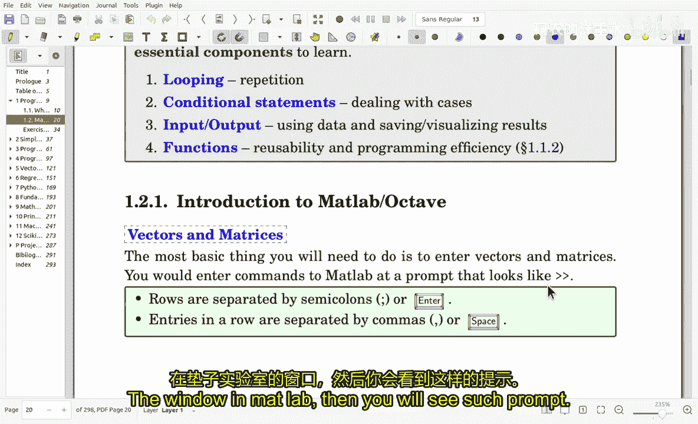

And okay， let's see O。Okay， this is octave window。And you see here the pro。Here。

 you can give some comment， for example。Now， we try to define。Formetric。Okay， that is one and2。

 and in the second row， you say 30 and4。Then you can see the result a is this metric。In this way。

 you can。嗯。

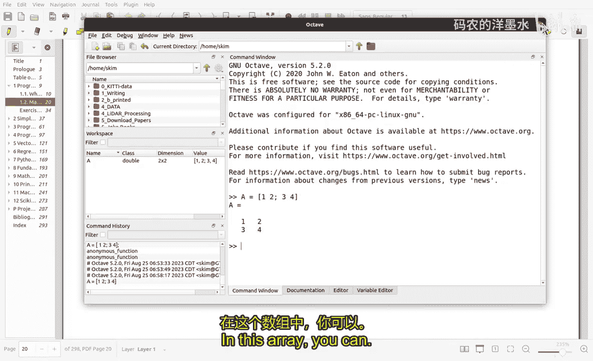

De and roots are separated by semico or enter new line。

And our entries row are separated by commerce or space。 Okay， we'll see the detail。

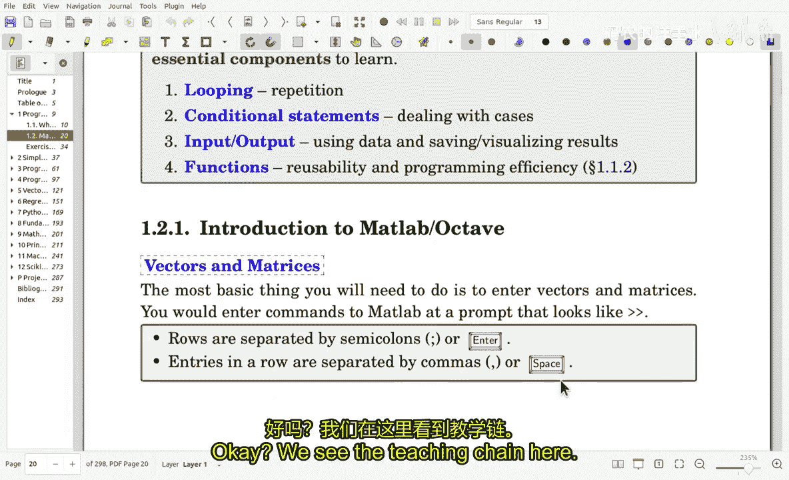

Here，1，2，3， along with a cot， then because it's new raw so that itll be a vertical vector。

 So it's a column vector， okay now。The W is 567 a。And just we separated， there is no raw。

 new role so that it is a raw vector。And now2，1， semico，1，2。 then along with this a semico。

It'll make new rules so that it'll become a metric。

And either space or commma can be used still so that this one and that one will produce the same。

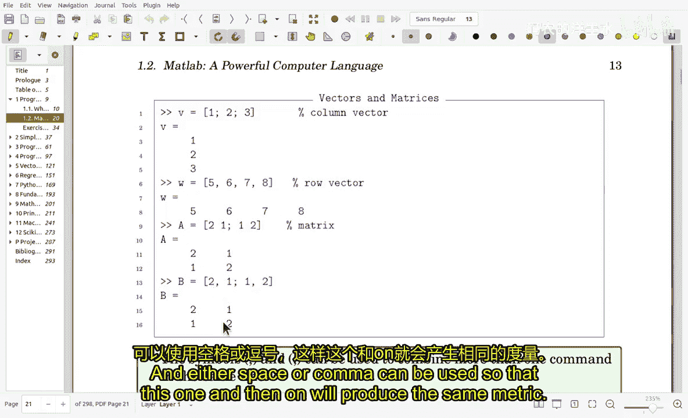

Matrick。The symbols， the coa and semico can be used to combine more than one command。

In the same line。And if we use a semicolon， methyl assesss the variable。

 but does that print the output？If we are using semicolon at the end of the commander。

 then it is happening。

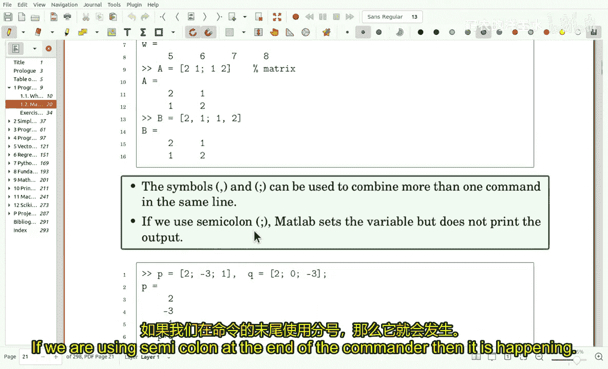

Here we have。P is 2，-3 and 1 that make a column vector。And also it makes a column vector， however。

The coma。呃。Its indicating we have two commands。But for the second one。Along with this is a semicolon。

It is executed quietly so that the output is only about P。 Q is are also defined， but。

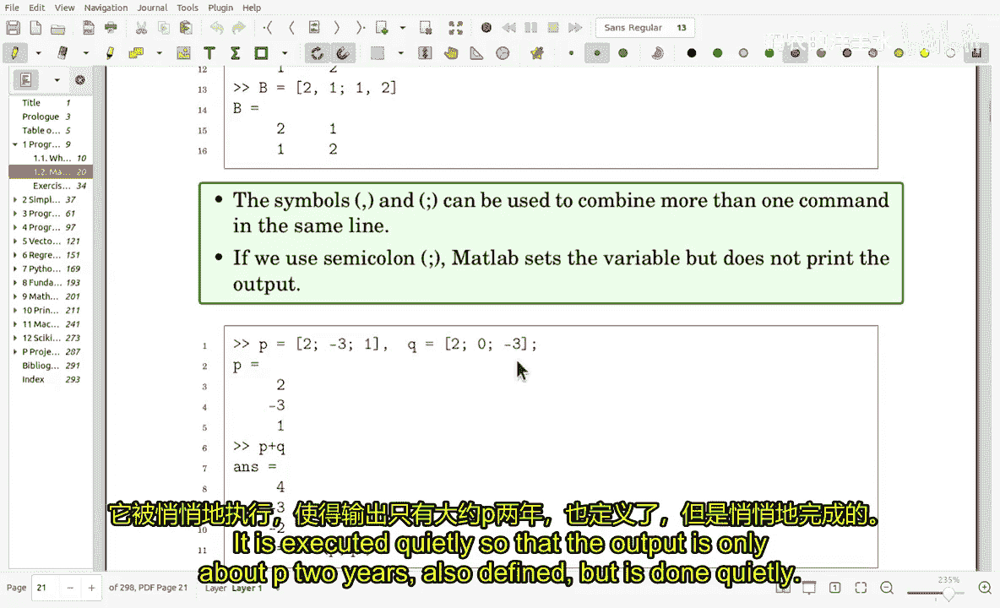

Is done quietly。Now， P Q， so you can easily see that。Now， p Q is the P， the output。

 so compared wisely it is added two plus2 is a 4 and minus 3 plus0 is a minus3 and 1 plus minus3 is minus2。

Oh。Okay， also here。Now that that product between P andQ is computed and saved to D。But。

Because of the semicolon。It's done quietly。Okay。Instead of entering a metric at once。

 we can build it up from either its roots or its columns。 you can。呃。Build a metric and part by part。

Okay， here， C1 C2 are vertical vectors， the column vectors。

 and these two column vectors are combined the two make mat。 C1 is wanted to。One column。

 and C 2 is a 34， another column。 And we combined them to make a metric。Now， see3。As another column。

 we can combine behind the here， the original metric M so that M is now expanded in this rank。Okay。

 here。呃，西坡。Yes。Defined as to be C1。And， and then now we defined overall role having four components。

So that now we try to add behind M and C4， which will be a C1 so that this result will make these first two rows。

 and then now。嗯。At the bottom。We are adding one more role from our3， so that。

We can get it in this way， so。Now we use another notation so the n becomes this 3 by4 metric in this way。

A metric can be built part by part。Oh。Here we have with vectors and mat。

Mtlab uses the symbol verplication sign。For both scholar multiplication and matrix vector multiplication。

In Metro Lab。We can access the IJth an3o metric。By typing M J。

If you want to retrievetri more than one element at a time。Then。

You can give a list of columns and rules that you want。For example，2 to4。Hiss same as 234。

And if you use use just column， and then damage is all。 So here M。I call on， then。

In vertical direction is I through 1， horizontal direction。

 there is all of the raw so that this means the I through of met dam， similarly。

And Hollon G means the J column of M。

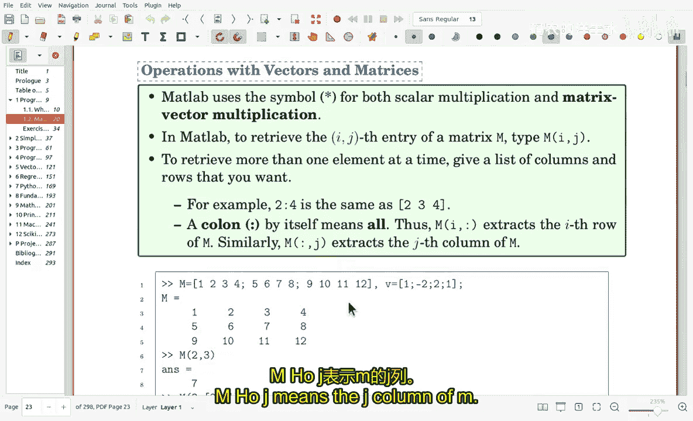

Okay。We first define here the metric。And。And now we try to access 2，3， then second row。

 through the position， it must be7。Now， here for that one， the row and。Inside of bracket。

 we choose 2 and 4。 damage means here further row and second one and fourth one。

 So that 10 and 12 must be the answer。Now， for this one， now everything and。The second column。

 which means that there 1，2，6， or 10， there must be output。Now this is a vertical vector。

 so it's a column vector。And time security。Then for each component。3 is multiplied。An envy。

That is this metric times the vector， then you can see here the answer okay。

To multiply two mat races in Matfl。 Also we can use symbol here， as， as to disk。

The M by N identity metric is formed with the command， I N。Thattter make n by N identity metric。

 the diagonal main diagonal is one， and of diagonal entries will be zero。

You can ask Matlab for its listening。And using the command why。But， unfortunately。

Math lab and very often takes。嗯呃。The edge to the end give us a random response。 So it is quite funny。

Okay， here。A is2 by2 met and B is again，2 by2 met and。Your a time being。Can be made now。I S I3。

 so it is a3 by3 identity network。Now， C is again，3 by3 network and。

We can make inverses of this metric by using O many inverses。And here。That must be same as here now。

 I。 and that means same verse times I。So that eventually C inverse 2 and C inverse must be the same。

 they are practically the same。If we multiply sea inverse。To see then must be id with， okay。Now。

 quas with MA labb。In metal lab。The most popular graphic comment is plot， which creates。

2D aligned plot。WithTta in y forces the corresponding values in x。So， here。

The plot command was given in this rain。And pla and X 1， Y 1， and。And lines spec and X and Y N。

 So you can plot。And separate in curves。 So that is typical。

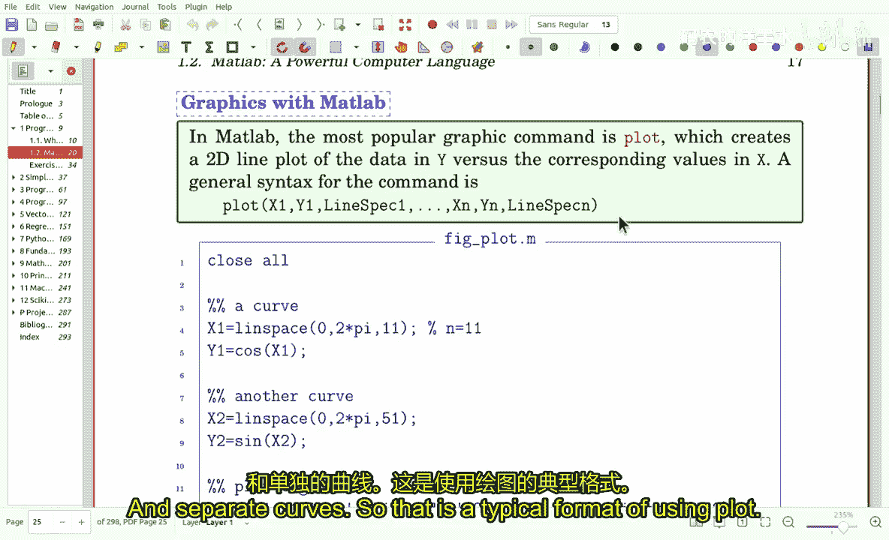

AFor of using pla。Okay。Here。For。This one， Okay， let's go to。

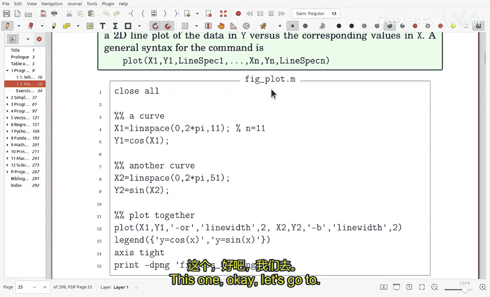

Oh。Okay， and here。Okay， in this directory。

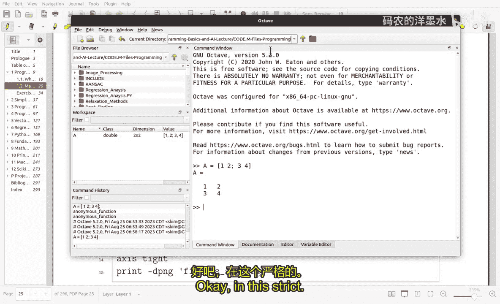

I guess， okay， let's see。 The name is fee plot dot M。

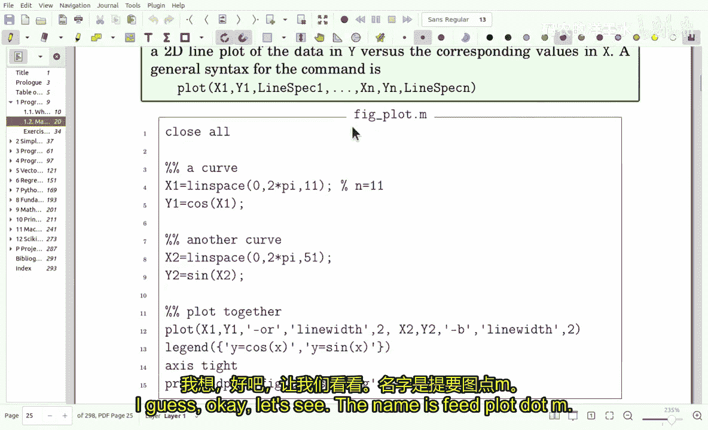

And let's see if we have that。ok。There here， figurepl dot M。Then I can see here now close on。

 so once you are running this program again， again， again。Then。You may have many plot open。

Along with a cross or， you can destroy all figures open。Then you can make newly through this command。

Now， that is x1 is。The points and。And it 11， that means from0 to2 pi， we are choosing 11 points。

And the first point will be 0， and last point is two pi so that we have 10 serables equally spacedr and y1 is cosine x1 so that not y1 is cosine values of these 11 points and we can make another curve by using。

Now，5 to one points。And now second one will be a sign curve。So that here。

We want to plot out an x and y1， that is cosine curve。And there's a line spec。And there is a solid。

 and o means。Try to add a mock O and allwl and rather。And line width must be true。

And x to y2 reaches for sine curve。And。Theres solid and blue。And lion， if it's true。

And we are trying to add。The legend。And X is most bit tight。Okay。

 and the figure can be saved in in this file。 Okay， here we can execute by clicking。Run here now。

 saving5 and run which is same as F5 so that here。From。And here now I hit F5， then。

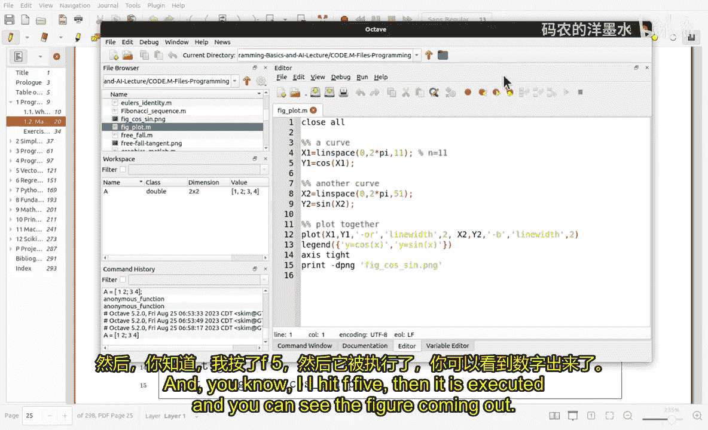

It is executed。 And you can see the figure coming out。Okay。That is executed and also you can check。

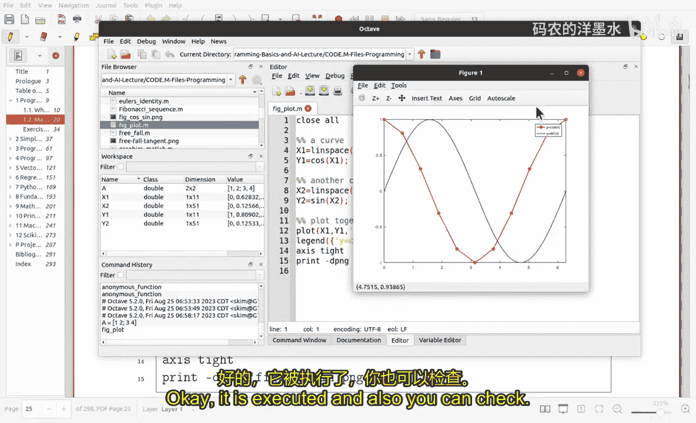

The execution from Command window here， figure Pla is executed and。You saw the figure。Okay。Okay。

 so I put the figure here。

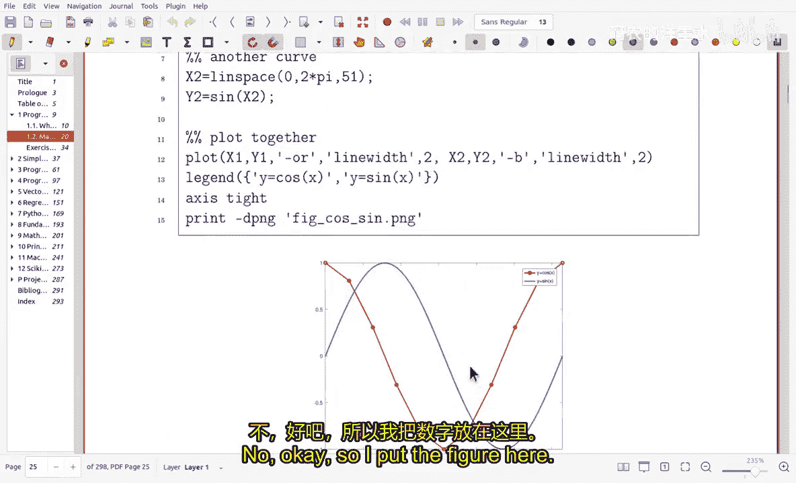

Okay， I explained already about。

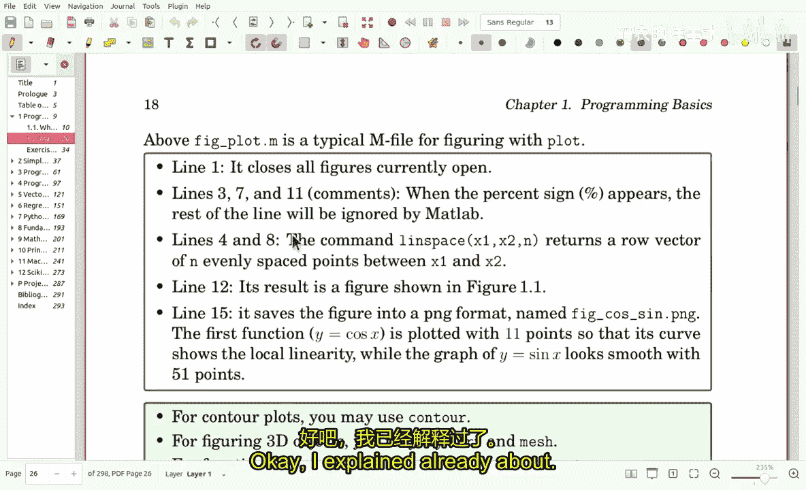

Oh。The 오퍼션 쓰고。Okay。Now， I in Mat lab and for。Contour plots you may use here。

 Cantour commander contour。 And for filtering 300 objects objects， you may try， surf and match。Once。

The function is given rather than data in this case。

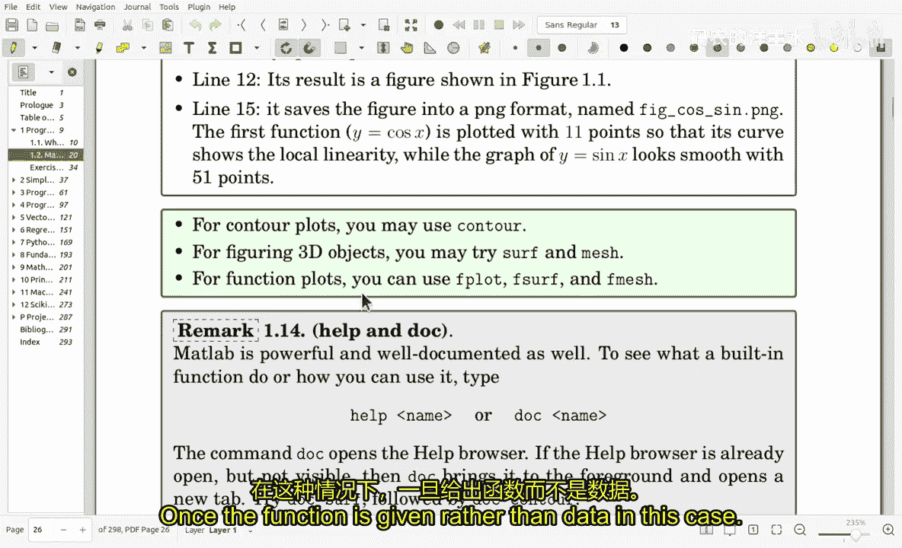

We are making data here。Now， x1 and y1。 So there is discrete points and we make your data。

 but we may use cosine x directly。

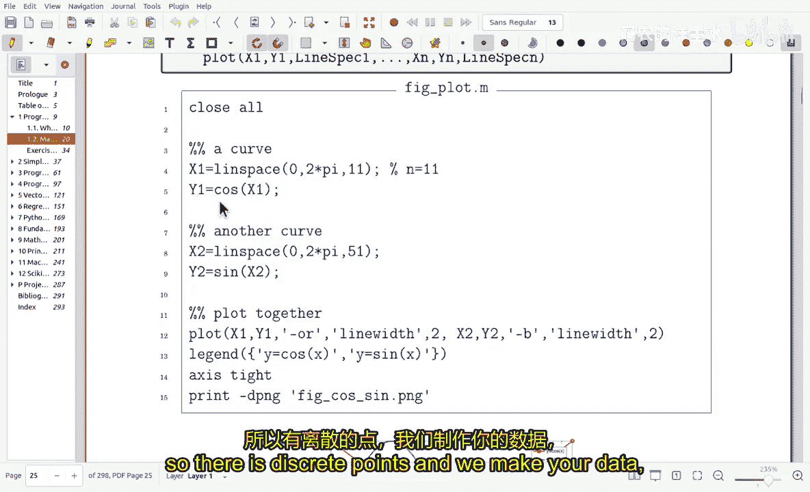

So if you are using function and try to make plot and 3D or 2D or 3， you can use here。

 along with F influence of the。Comd F plus， then then is a function plot and F serve and F mesh and 3D plus will be produced。

The map lab。Is quite powerful and well documented as well。 So by using either help or D， you can see。

The what it is。 and you can get the information。 Let's go to。

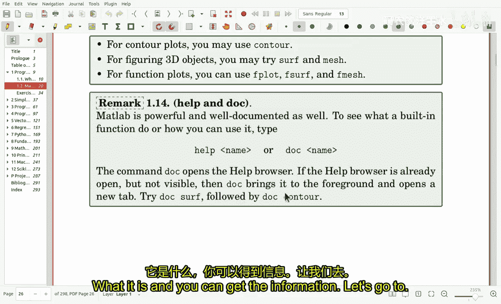

嗯。Here now come the indoor and if you give here help and。Pt。Then you see such output and。

It is explaining。How can how。To use a plot command so that this is typical example。

 And now it is explaining all the way about。Go。The specs， and you can choose from this one。And then。

You can get。

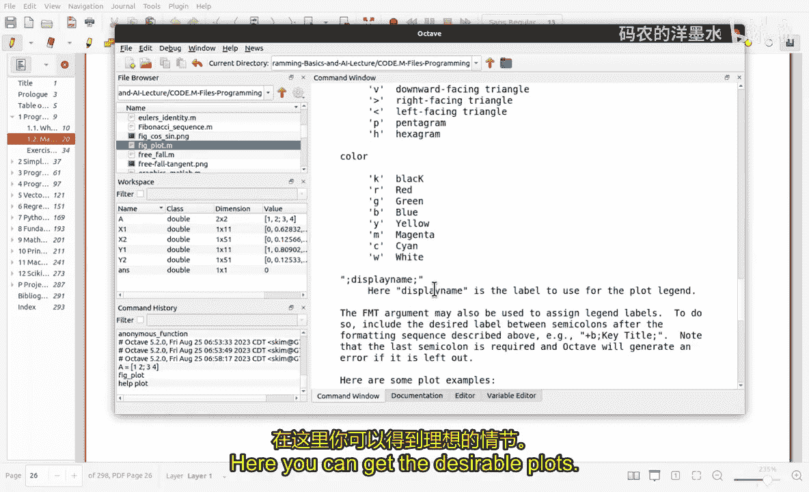

The desirable plots。Okay。Okay。That's the first part and we'll continue in the second part， thank you。

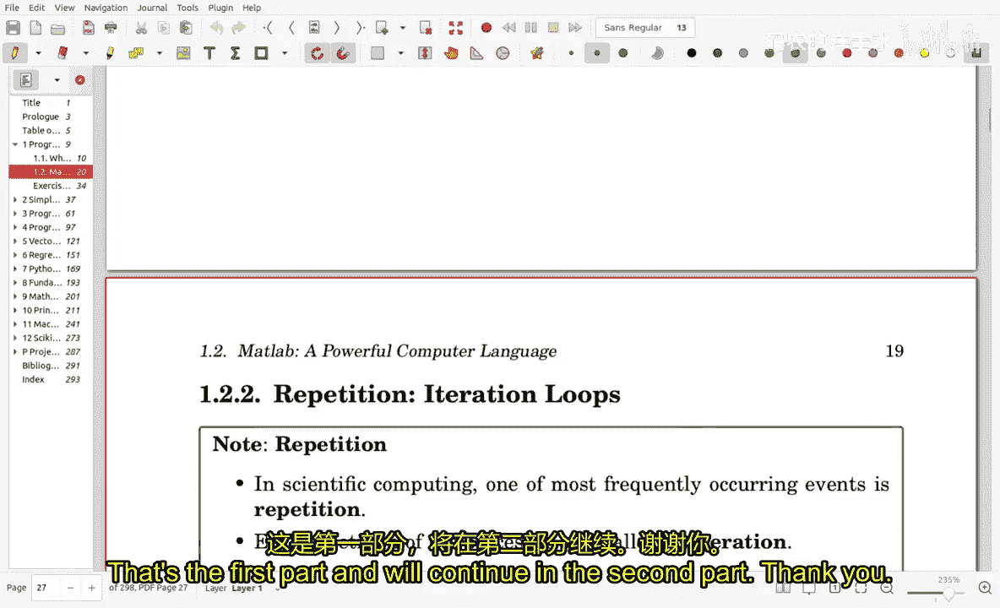