# 【全集-附课程讲义】密歇根大学-人工智能编程-EECS492-中英字幕-p06-Lecture-6---重复迭代循环--BV14JqfBNEAS_p6-

It is part2 of Section 1。2。Repetition， iteration loop。Let's begin with a recall。

For each of the programming languages， there are for essential。ACompon to learn。Looping for rep。

Conditional statements， input output and functions functions are for reusability and programming efficiency。

We already treated this one in Section 1。21。Here we will consider the three items and focusing on repetition。

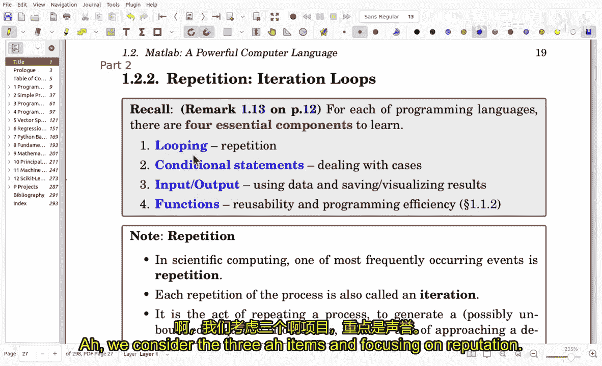

In scientific computing， one of most frequently。According events is repetition。

Each repition of the process is also called on iteration。It is the act of repeating a process。

To generate。A sequence of outcomes。Or to get final quantities。

And so that itition must start with an initialization and perform a step by step marching。

To get the result。

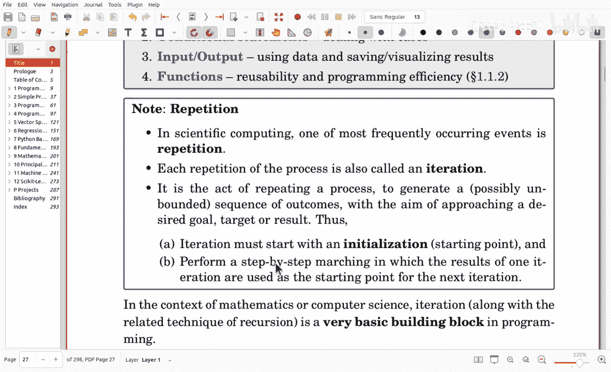

呃。The reputation is a very basic building block in programming。Here。

 the Mat lab provides a few types of loops to handle looping requirements， including。W loops。

 full loops and nastyed the loops。

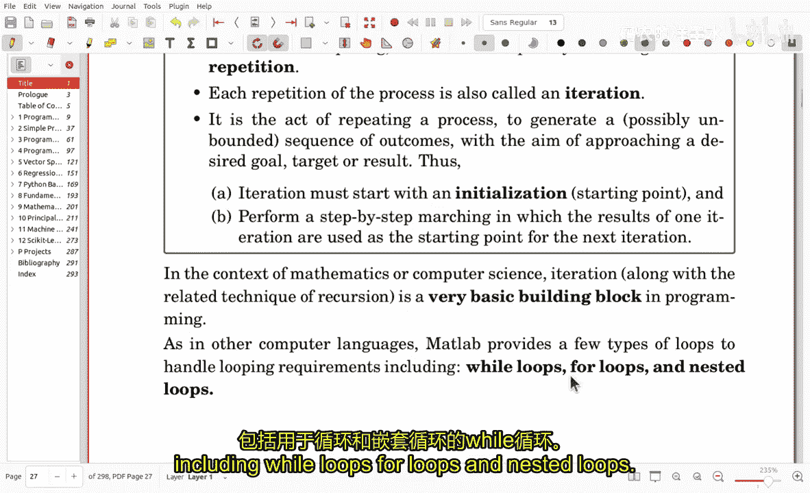

Okay， here。W lo。W loop is formulated in this range while an expression statement and end。

Once this expression is true。Then the statement will be executed。

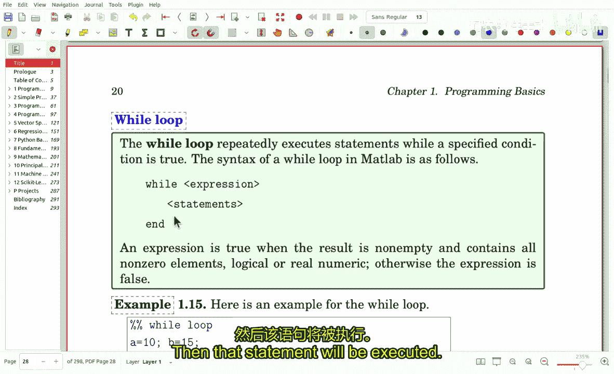

Okay， let's see this example。A0 is 10， A is 10 and p is 15。

 and after printing out about A and B here， Y loop is given in this vein。

If a is less than equal equal to B。Then the value a is printed out。 and after that， a is added by 1。

Then。Each duration。A is increasing from 10 and an 11，12 by 13， so that。

It will become 15 then this luus。 That is true， because up to 15。That is true。

And then after printing out a 15， now a becomes a 16。 then is not true。

 So that like in this output here。This loop will print out from 10 to 15。

A value becomes stuff from 10 and finally 15， and once it becomes 16， then that stops okay。

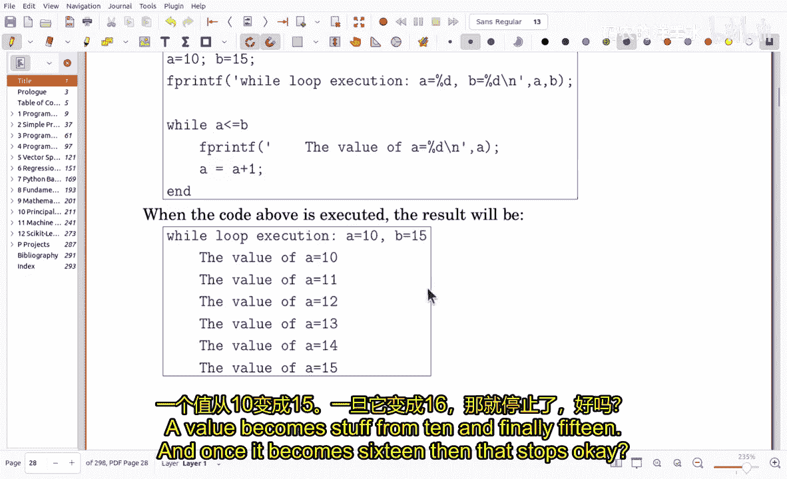

How about four loop。Follow is executed for values from here， this order。At this list。And。

For each member in this list that has now become index and by its index here program statement will be exced。

Here value can be any list of numbers。 For example， you can make in initial value and end value。

 For example， one column 4， then it will become one to 4 the。

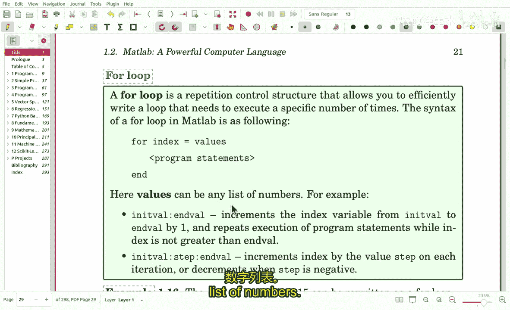

The natural numbers integers， or you can make here initial value and step and add the value。

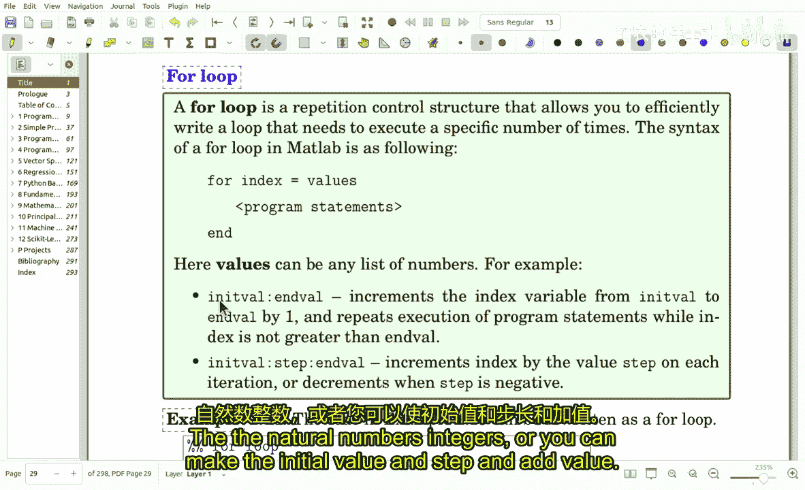

O， we'll see later on some examples orange。

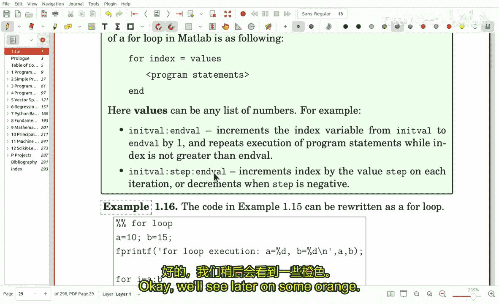

Here we have now similar the environment。And A 10 and B is 15。 And here after printing out A And B。

 the values and the full loop is given in this way。 I is from A to B。 So a 10， B 15。 so that this。

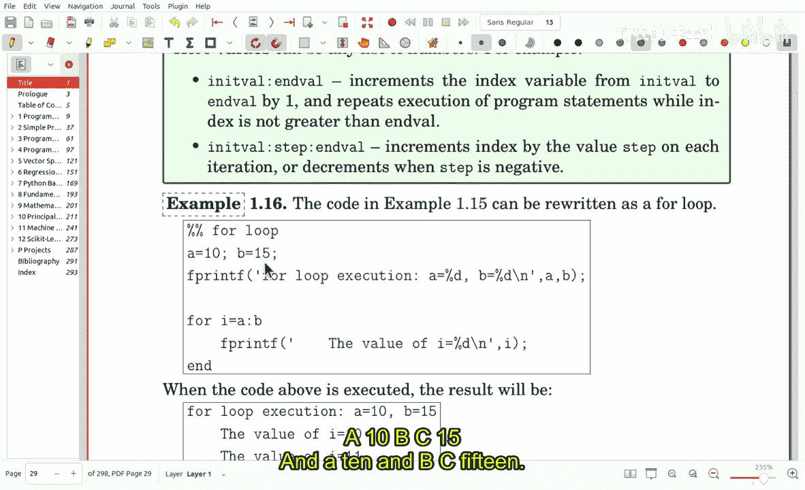

A to B will be same as there is same as the list here from 1011，12，13 and 14 and 15。This is。

The list of these numbers。 So I will be chosen from this list。 So in the beginning， I will be 10。

1112 so that for each eye now the value is printed out。 So you can see here now I is 10 to 15。Okay。

Now， the loop can be。Organized so that another loop can be inside of one loop。Over there。

 that is nested the full loop。And。We have one。Loop and inside again， we can put another loop。

 Such loop is called a nested loop for while lo。 Also， you can make a nested while loop。And。Now。

 also you can combine full loop and while to get nest to the loop。And also。

 you can put more than twice。And deeper loop can be made。

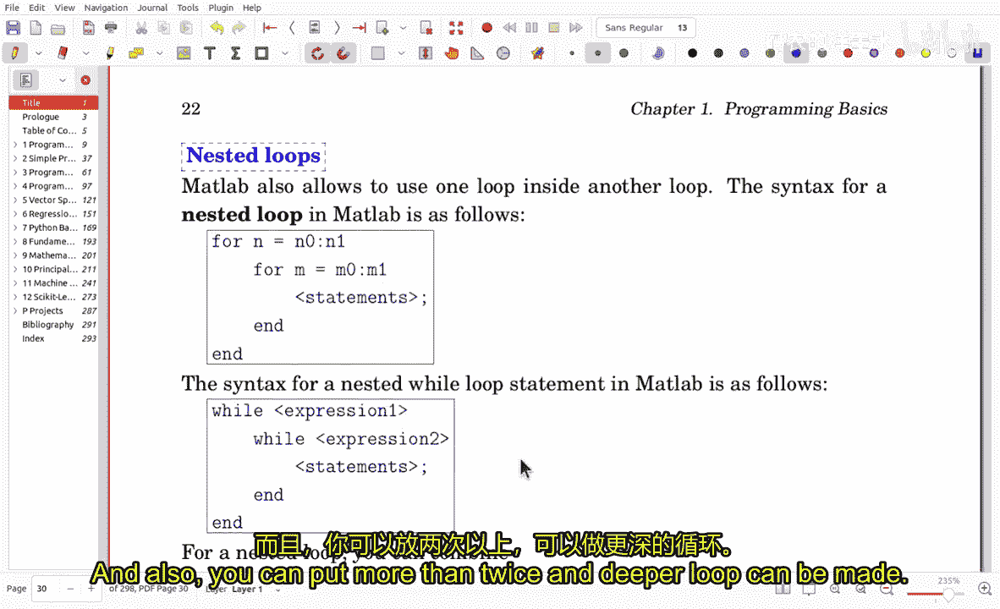

Okay。Okay， here we have loop control statementss。And。AFrequent used one is braketataone。Once。

The break， the loop meet a brick。 Then the loop will be broken。

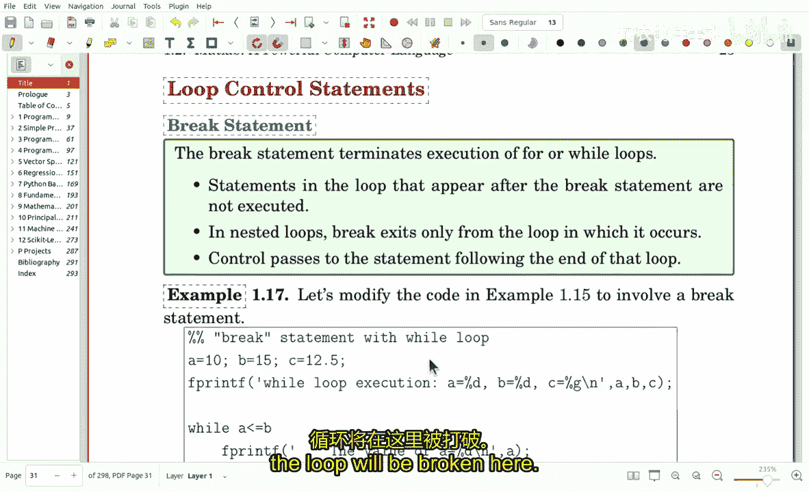

And here， let's see this example。We modified the code in example 1。15 to involve a break statement。

 Okay， now we add。Another variable C，12。5。And first， we print out ABC valuess and for this y loopbe。

And now， okay， we added this one。Here。From the code in example， 1。15， this is extra one。

So after printing value were adding。Now， once a is larger than C， C is 2。5， so a is for example。

 a 13， then this break statement will be executed so that the while loop is stopped。Okay。

 so here the result is now once a is 10 is not true because C is 12。5 so that it is not executed。

And once a becomes a 13， then it is true and brick is executed so that and stopped this y loop。

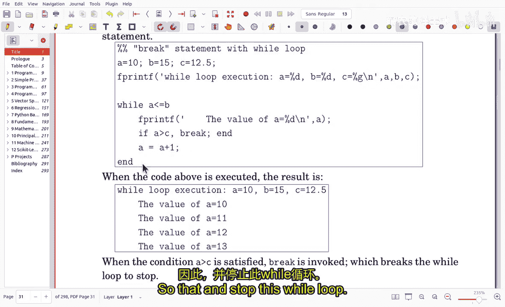

Okay。Okay。Now， continue statement。Sometimes you want to break the loop。

 but sometimes you want to continue ignoringing below the。Some some position。

But you want to continue， or then you may try to use a continuousinual statement。

So they continue applies only to the party of the loop where it is called。And。Yeah， in dusted loops。

 continuous caps， remaining sta only in the body of the loop。

So that you can run the program continuously。 here。

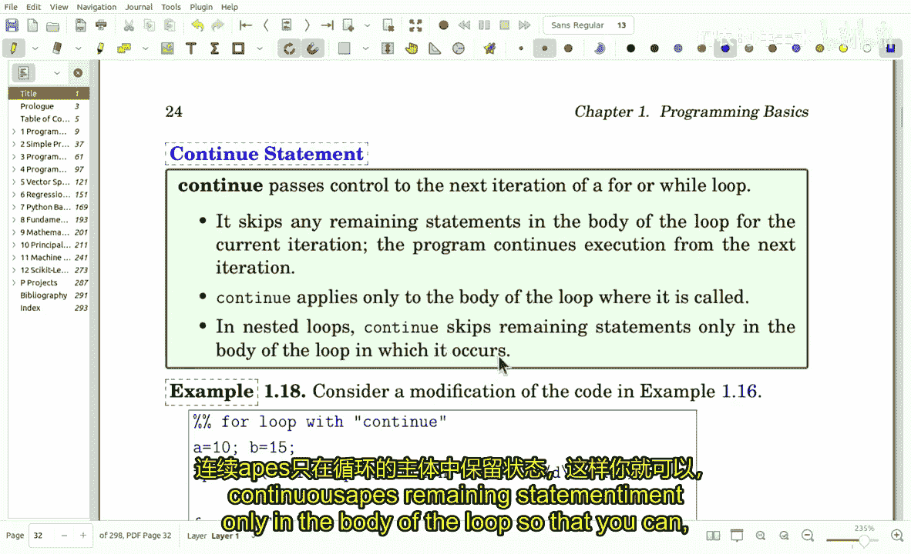

Now we modify the code in example 1。16。 And this is a full loop， along with this full loop， we。

Add the continuous statement。A signal A is 10， B C 15， the same here as in the codedon example 1。16。

And exactject the same also here。 And then now we added this one。 If modd this modular function， I 2。

The output is， the remainder。When I is divided by 2。 So the output will be 0 and 1 if I is even。

Then the result is one。You。Digital is 0， and if I is odd， then digital will be1。

So that for art number I。And the output is one， so it becomes true and continue will be executed。

 So skip this portion。Okay， so only for even I here because it。

 it is not executed so that it will be put into the hour。

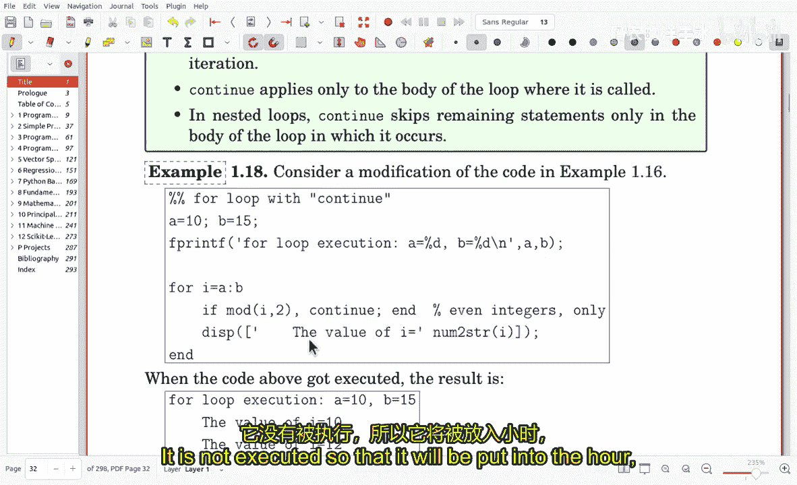

The original is given exactly what we expected。Okay， so it is odd than thatll be one and。Continue。

Is executed， so let's skip this one， but only for even here we can see the result。

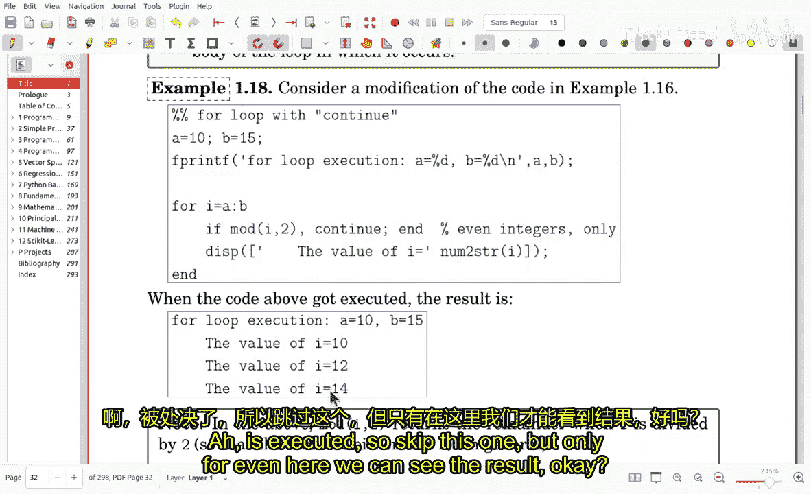

Okay。In the above modern， I2 returns the remainder when I is divided by 2 so that the result will be either0 and1。

If it is zero， then it is4 and if。One， that will be the same as true so that it is executed。

In general， mod A M returns the remainder after a dividing division of a by M。

Where a is called the dividend and M is the divis。And this model function is often called the module operation okay。

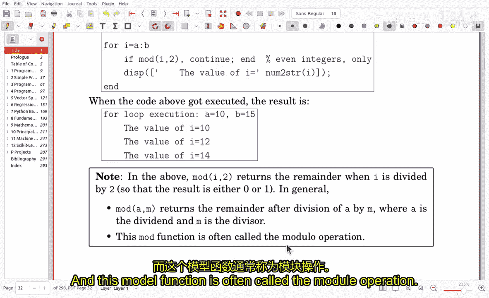

Now in Matlab， we can define an function。And which is a function that is not stored in a program file as an M file。

Here we define on anan function F is okay。At sign and x damage means that X is variable。

 and this is a function body。And here， we tried to print out。F1， so that there's no semico。

 so if you execute to this program， then F1 will come out and x capital x is defined from one to six integers。

And now， bycing F E。For function F。And for this point，1 to6 is evaluated and saved them。

So that now with a semicolon， their fixed values will come out and also。Here for this F。

 we try to get integral。If you are familiar with some clus integration。

 then this is a definite integral for the function from one to 3 and output will be saved to Q。

 and here there is no semicolon so that youll see the visual。 Okay， let's try to see this program。

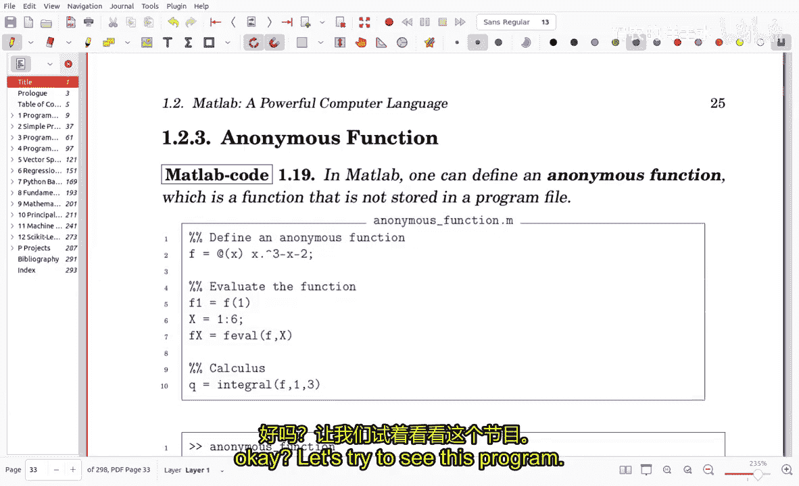

Okay， here， this is Ota。 and in the directory。We have anan function。

That is rejected the same program。And in the top close all， clear all。

 once you run a program again again again and you may open the plot again again again so that by using close all。

 you can close all the figures， and sometimes if you change variables， then。

The variables you used earlier will be demand in this running so that bioynclial or， you can。

Eliminate the old variables in the beginning。And here， format long means that in output。

 once it's not integer value， then along with a long format， it is printed to the output okay。Okay。

 we can run it， which is same as F5 from keyboard， so I'll hit F5。Okay。

 then it is executed so that we go。

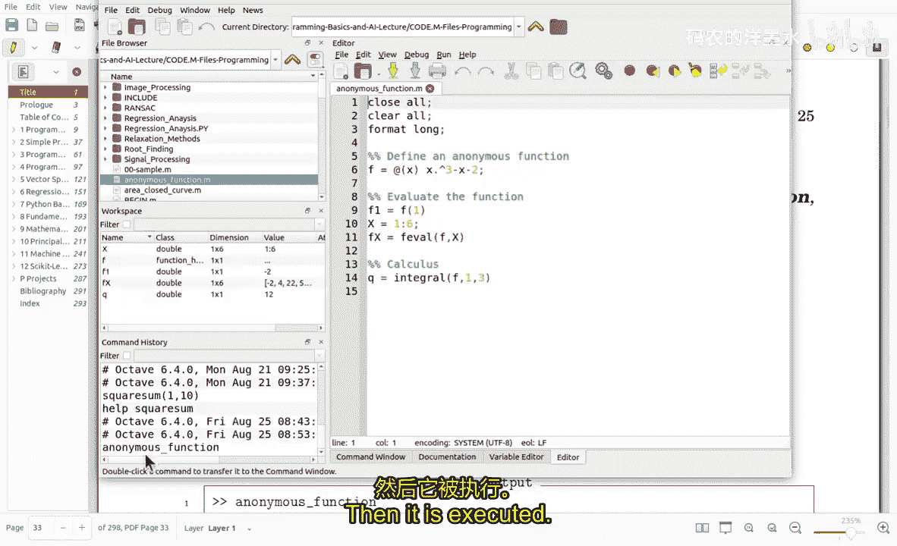

Comiting though， that is now executed unan function， and F1 is minus2 f of x the6 values。

 and this the last one years for the definite integral of F from 1，2，3。Okay。Okay。

 there is exactly the same output。

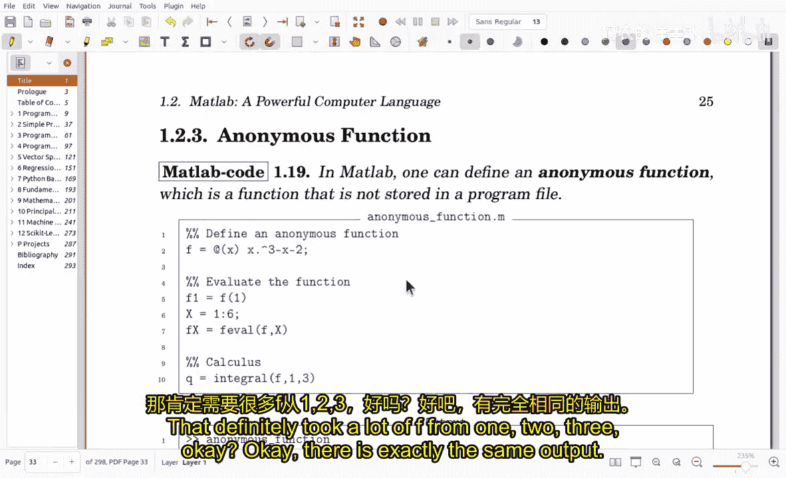

Now， finally， in the section， we'll consider open source alternatives to MALb。Yeah。

 you just saw Otave， Otave is the best known alternative to Matla。In fact。

 octave and me are not exactly the same。However。And a most of a program will run。In Ba lab。

And also in Ota without modification。And sometimes you need a little bit of modificationification。

 but you can easily understand where you have the change。So here， buy some octave， you can。

Do the MAtro program。And in Python， and Nompier is the。Abs sorryute。

Its the main package for scientific computing。In Python。It is quite well organized。

 and you can deal with an general array and complex matrix transforms and linear fluid transforms and。

Now， also， you can use it to call some other languages， C， C plus plus and forron， particularly。

It's quite easy to include future and programs。And as a matter of fact。

 among the computational languages， Furan is the fastest one。

And the nuier is organized to mimic a mat La so that once you understand the mat La， then later on。

 you can use numpier very easily。 We consider the Python。Basics in Chapt 7。Okay。

 this is the end of the section。 Thank you。

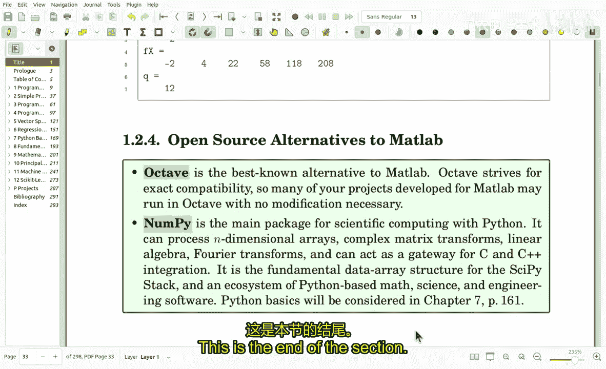