# 【全集-附课程讲义】密歇根大学-人工智能编程-EECS492-中英字幕-p07-Lecture-7---闭合曲线定义区域的面积估计--BV14JqfBNEAS_p7-

In Cha 2。Well consider some programming examples。Aarly estimation。Visualization of complex value。

 the solutions for quadratic occasion。And this。Fulier transform。

Along with short time for the attorney forms。Then we'll study computational algorithm and they conate。

And finally， in the chapter。Will consider。Inverse functions。

Along with exponential functions and logarithmic functions。

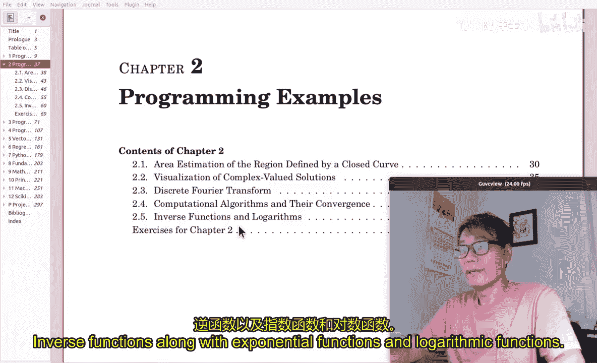

Let's go to section 2。1。A estimation of the region defined by a cluster curve。Here is a problem。呃。

It is common in reality that a region is saved by a sequence of a points。

For some end part tip number。X 0 y0。X on y1。 and then the final point is x and y n。

 which is the same as the first one。Then this point will represent a region。For example， this region。

Can be approximated by this point。 So maybe this is x 0， y 0， X and y 1， and so on turn turn around。

 And then the last one will be x and Y， N。Here the question answerss。

If a sequence of a point that represents a region， how can we compute this area accurately。

Such a problem is quite common in reality。Partticicular。Once you are are working on medical images。

 such as。The X of ray images or。The co section of CT scan or MRI images。

 then you may get segmentation to recognize some cells like a cancer cells。

 and you may try to get the area。And rather than comparing。The area， just by observation。

 if you can get the mathematical quantity of the area accurately。

 then you can make a better appeal to patients and then。

The medical treatment can be more accurate and more reliable later on。Okay。

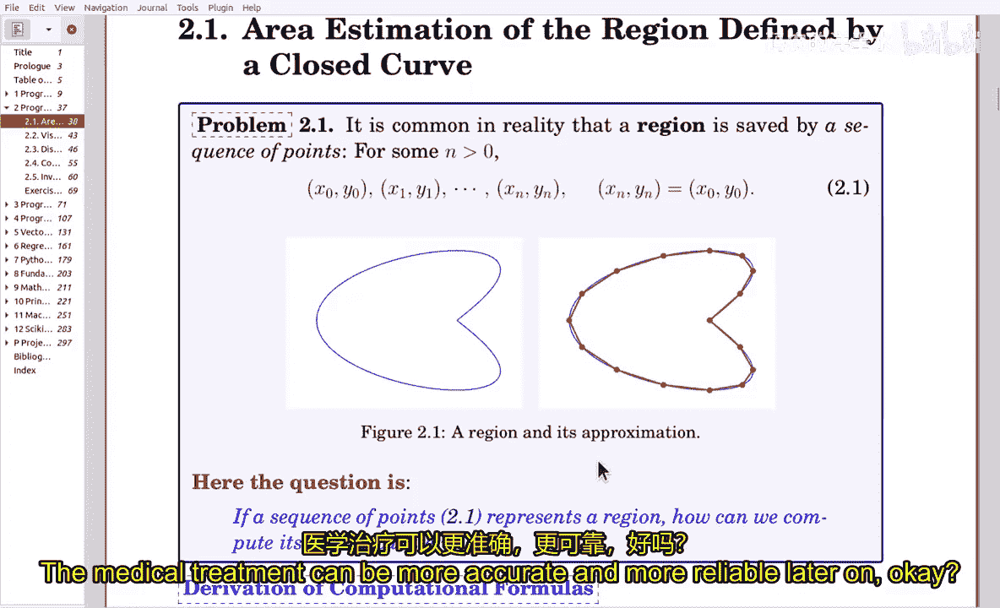

Now啊。To derive the computational formula for the area computation。

Let's begin with a very simple example。Find the area of rectangle。

AB in x direction and in y direction from C to there， then these four points。Okay。

We know the area is horizontal distance and vertical distance multiplication。

And this quantity can be written in this form B times t minus C minus a t minus C。

 and we read it in this way。Okay， from here。Now B， okay。

 that is a P value in x direction and y direction T I see is change in y along that vertical line。

Segment。And also， when x is a， the c minus d is a change。And why if we try to turn around。

In in distraction， that is changing Y is this one， changing y is C minus there。So it looks like。Here。

 x value times changing in y。 So we make as the area as given in this rank。So you are this years now。

For each line segment， the center value of x。That is I line segment。

 so the center X is now for thereron， and then changing y。Is here is0。 So it has no contribution。

 but for that one， center value of X as same is always here now B and changing y is d minus C。

And here， center value of Xs， in fact， AB over 2， the addition over 2， however。

 changing y is0 so that there is no contribution。Now， here for。

X value me the point of x as now a and changing y is c minus D。 that is exactly this formula。

 So we may guess this one Now for these case， let's check the the liability。

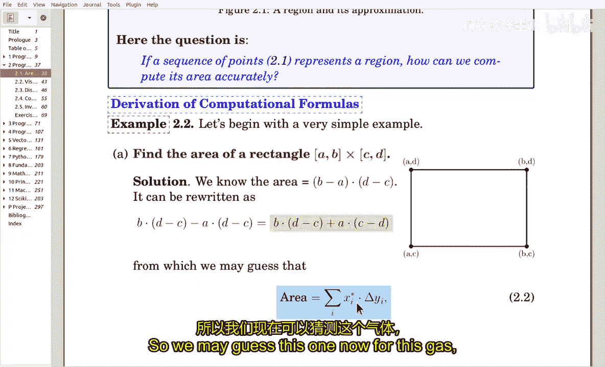

Okay。And now we try to find the area of triangle。Now we know the area that is half p minus a。

The length of this bottom and T I are seeing is now the height。

 So the half times power length times height， We know that。Now。

We'll try to check if this formula is correct， okay。

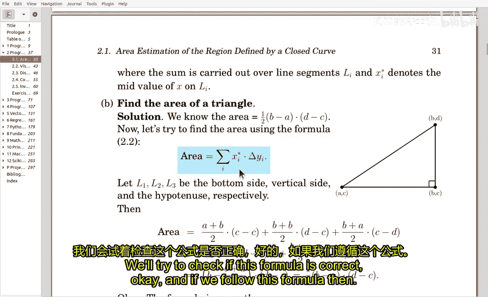

And if we follow this formula， then here。Centivalialback for this aligned segment is a plus B over 2。

And in y direction， the value is C and C。 So the C minus C。 Okay， for that line segment。

 So we are always running in this counter colorwise so that if we run along with a boundary， then。

You can see the region left inside that rotation。And it's called positive orientation。Anyway。

 for that on， the center value of the x is b plus b over 2。

 and that is b and b over 2 and changing y is d minus thing。Okay。

 now for final segment from here to there。That is now center value of Xs。

 A and B addition divided by 2， and changing1 is c minus 1。Okay， the first one is you know。Now， okay。

 that one is P times stma minus the C。And then now that is now the same here。

And we rearrange it and by using some algebra， we can we this one。

 and then eventually we can get the same result all let we know yeah。Yeah now we have。

Not here horizontalja line segments makes no contribution to the area， okay？

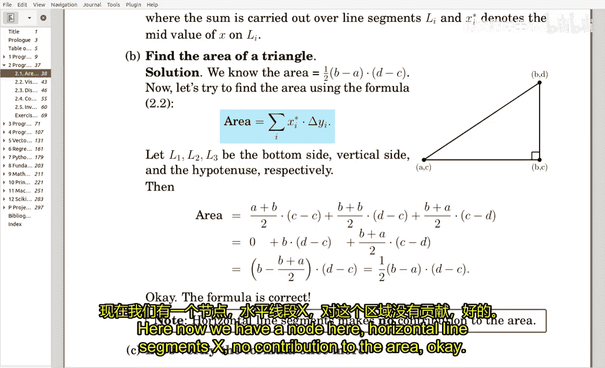

And here saw that for this example。Our cast the formula is correct。Now， let's verifytify once more。

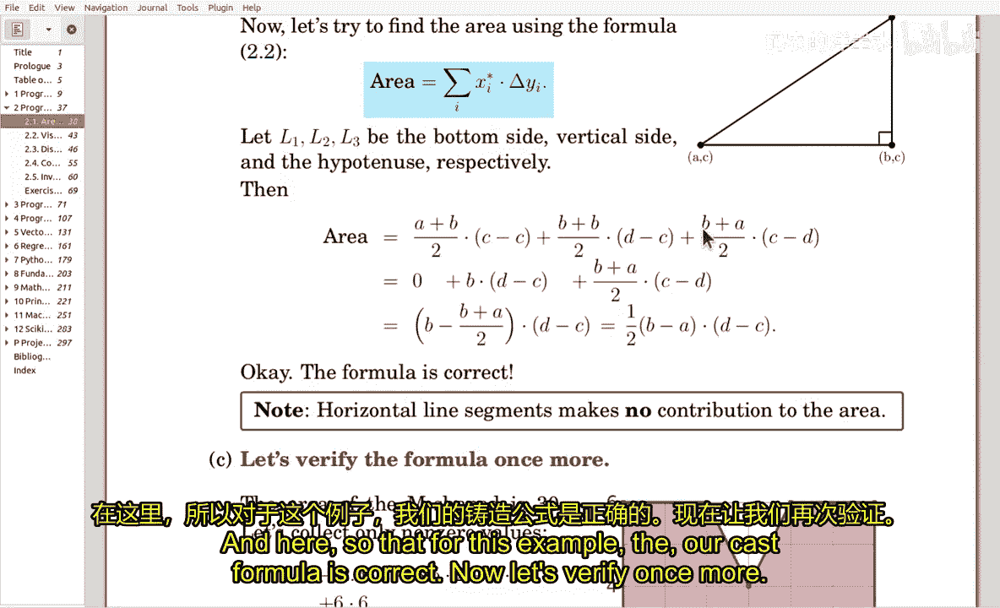

Okay。Now， for this region， this is quite similar to the mark for Mississippi State University。Okay。

 for that one， the total area of this rectangle is a 36， and the area over there is 2。

 and there is 4。 So that 30 minus36 minus-6 is a 30 so that the。This shaded religion。

Is in modern color， the area is 30 okay。Now， let's begin from here and then let's try to collect just non zero contributions。

 Okay， zero contribution for that one is now access to y change 3， that is exactly that on。

For this one， now middle point value， middle value will x 2。5。

 changing y is minus-2 is called down by 2。For this line segment now be the value will x is 30。

 of5 and changing in y is2， and for that on be point。X value is4， and changes3。

So that there is subjective this one， no contribution。

 and then x values is 6 and y changes a 6 so that this one。Now。

 for there no contribution for this one， now x value。Be the value so 30。 of5。

W changes-2 for this one。Now， media value will access a 2。5 and changing Y is 2。

 so that is exactly this one。ok。And here there is no contribution and be variable x is C do。

 and even though changing Y is negative sec。Ex is see so that for that verticalical line segment。

 there is no contribution。Okay， now we simplify these quantities， then we can get 30， okay。

So even though very complicated shame， the formula must be correct。

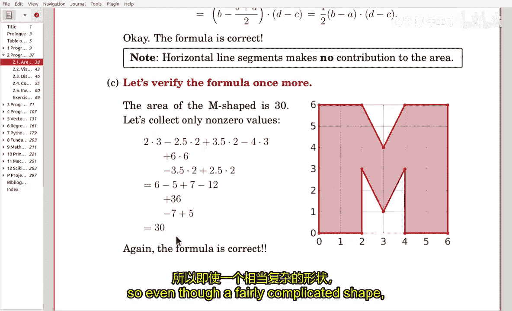

Okay。

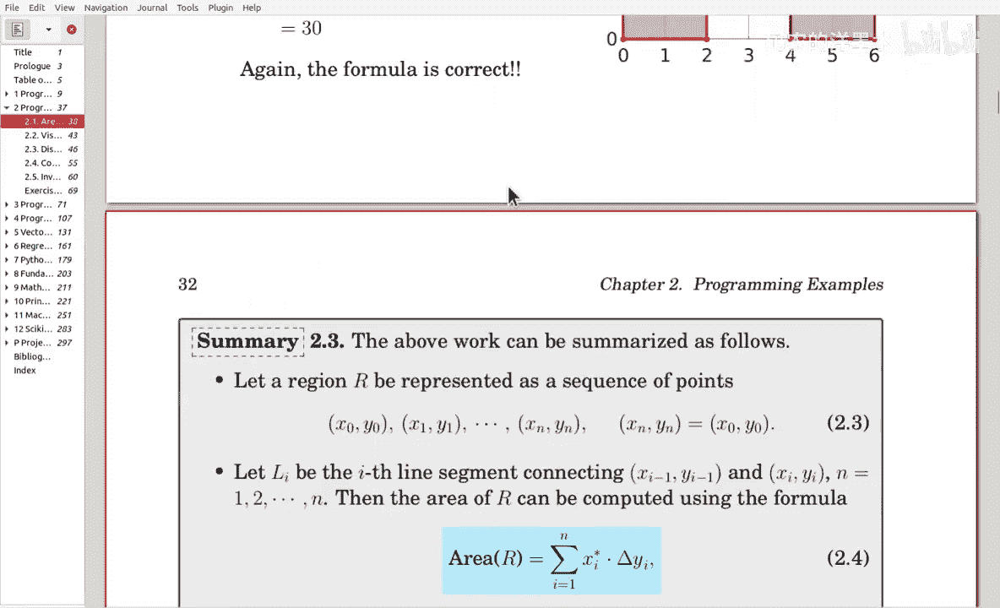

Here， so we summarize the of work in this range。Let a region R be represented as a sequence of points。

And x is 0 y 02， x and y on y N， and the first and last points are the same so that eventually these points will make a closer curve locally line segment。

Okay。Now， the airline is the either line segment connecting。X I minus1 Y， I N， X I， Y I。

 so there are n line segments。Then the area of all。

 the region can be computed using the formula here。For each legs。Line segment for in this case。

 I through1 X I star as middle point of x。And Tta YR is inchan why。

So that's the formula and it'll be correct for any shape。

And once the region is representeded by as a sequence of points in this range。

 then it can be used to get the area inside of the curve。

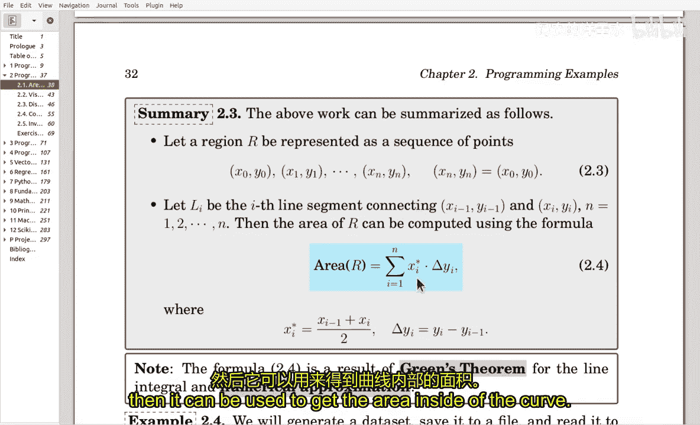

The formula is result of greenfiem。For the line integral and the medical approximation。 Okay。

 if you go。To vector calccus， then the。And as the application of。The greattheorum。

 you'll see here now， Eoria。Of region D。Is now same integral close curve and X D。

If you learned already。The factor capital then you， you may。Memorize this one。 Okay now here。Okay。

 see。Is the curve and。D is a region inside of a curve。So it is an application of。The current theorem。

 And once the boundary is a locally line segment， piece wisely line segment。

 then this formula is exact formula。 Theres no error involved them。

But usually the boundary is not local linear， Then you may choose very dense point along the boundary。

 and you may try to approximate the boundary。With。Locally linear。Okay。

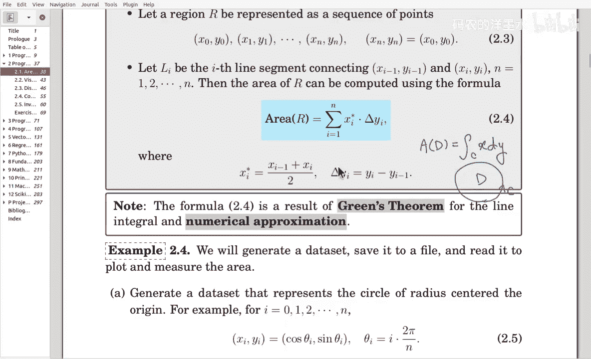

Okay， we'll see another example here。Will generate a data set。

 save it to a file and video to plot and measure the area， okay。

Let's generate a data cell that represents the circle of radius centered the origin。And reddius1。

 then we can make in this rank X I， Y I as now this is cosine theta and sine thera I。

TheTheta R is i times2 pi over n。Then here， the first point and last point must be the same。

 so it is presenting the circle and locally linear。

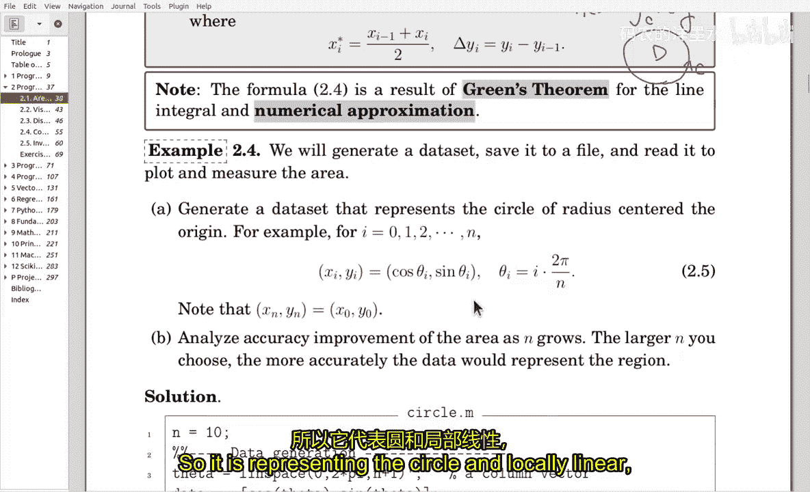

Okay。And we try to analyze accurate improvement of the area as N grows， the larger N you choose。

 the more accurately the data would represent the region。 Okay， here we have program。

Now we start with an equal1， So1 sub intervals， and we make here。Now。The the， okay， that is。

 we are choosing n plus one so that。Now， eventually， Thera， it's stuff from Thera 1 in mathla。

 but in mathematical notation， the same as a Fira 0， but 0 to2 pi。And M plus one point。

Which means there are endserv intervals， and along with that cosine theta， sine theta。

 and the data is made。So we get。And M plus one。The point。And the pleasure thing。And。

And servingian Ta。Okay， for that on， first make a figure along with a red one and solid deal curve。

 and then we save it now into circle that P andG。And also。

 the data is saved into circle data that TXT textify by using CSV right。

And here when you save the data and metric， and you can use here right metric。

 and then the limititer can be chosenn， the T4 to one is commma， but now in this case。

 if you are using this line， then。The space will be delimiter， okay。Now， okay， after saving the data。

 we try to load read the data by using load command and save the in data and first column will be X and second column will be Y。

 and again， we try to make a plot problem with blue color and dash the curve Okay， and we save the n。

And， of course， over there， bi area of course curve command。 Okay， that will be。

Iplemented separately in P， and we can get area here。And then the area is putting to the out。

 along with the the number point N。Okay。Here， that is the curve along with N equal1。

AndRepresenting the approachming circle of that is one。 And that is now the saved and red。

 And then here I make the the shape。 of course， two must be the same。Okay。Now here we have。

The output。When we are choosing and is 10，20，4080，160。 Then the area is approaching。

 in fact it increasing and an approach to pi。Here， we imagine the missfi from pi， and there is error。

And nowarrow is becoming similar， similar。But in fact。

 it become a quarter as the number of points is double do。So which is that it is。Second order。

 cubogens。

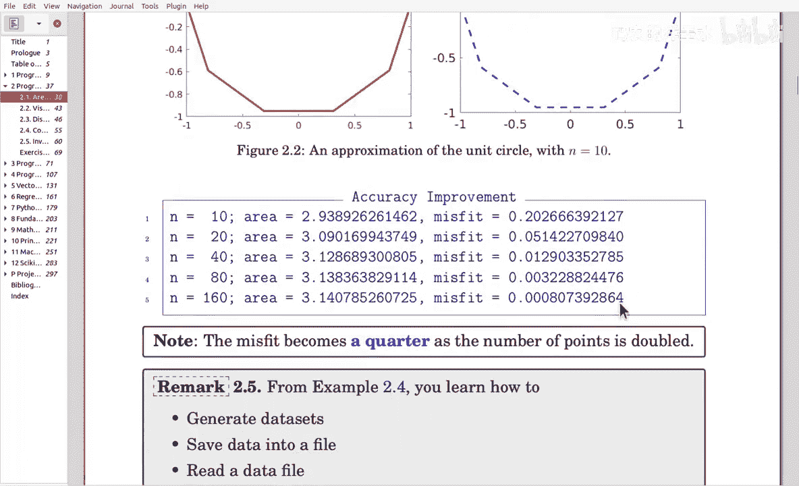

Okay。From this example， and you learn how to。Chaネルて테他 sound。

To save the data into a file and read a data file。And also。And we try to plot the data。

We should set figure environment so that you learn how to set figure environment and also how to call functions。

This is a simpler。Example of early estimation， defined by。呃。A close the curve。

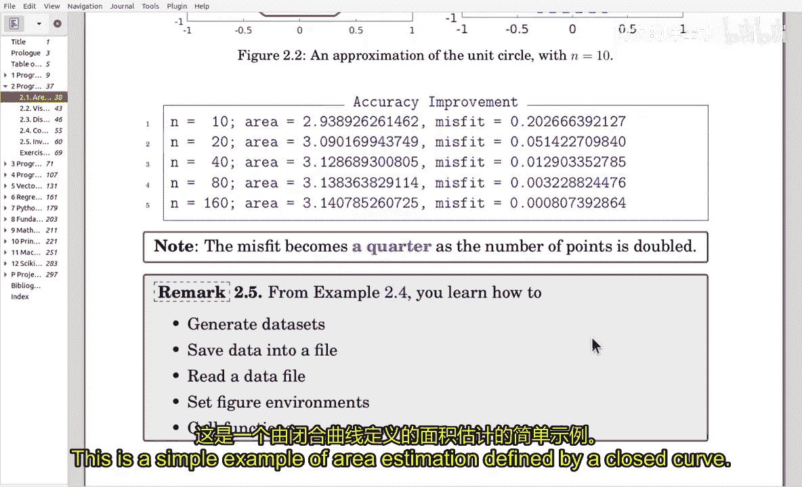

Okay。Thank you。