# 【全集-附课程讲义】密歇根大学-人工智能编程-EECS492-中英字幕-p08-Lecture-8---二次方程复值解的可视化--BV14JqfBNEAS_p8-

Section 2。2， visualization of complex value solutions。In this section。

 we'll try to visualize complex value the solutions of quadraticificationifications。For example。

 for this equation， x is sta minus x plus1 equals 0。

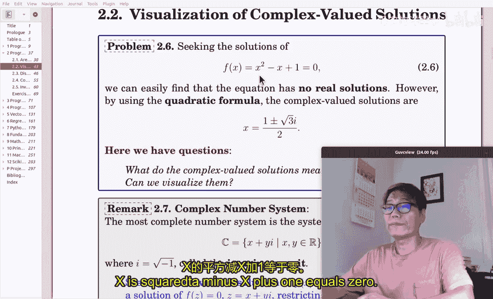

We can easily figure out that the has no real solutions， however， if we use the quadra formula。

 then we can find it the complex value of the solutions here。1 plus minus square of 3， I。Over to。

Here we have cushions。What do the compression value， the solutions mean。And can we visualize them。

We'll try to answer the questions in this section。

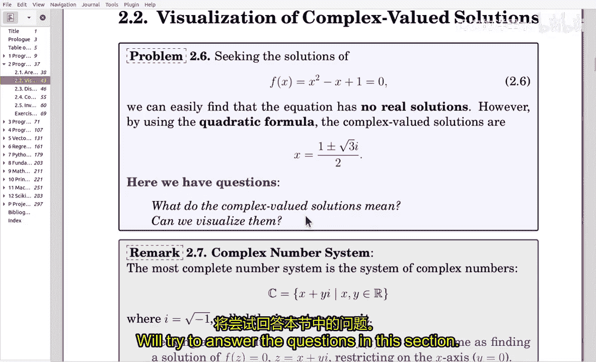

Here we have remark。About complex value from。It is the system of complex numbers in this form。

 x plus Yi。Where x and y are real numbers and I is square2 minus1 called the imaginary union。

Here we have observation。Seeking a real value solution of Fx equals0。

Is the same as finding a solution of fz equals0， z is x plus Yi and restrict the solution on the Xxs by putting y equals0。

So here， when we try to find the solution of f equal equals0。

 then we can find the compress value of the solutions and we can visualize them。

If we apply some algebra， then F over Z can be read。A plus B， I。

So that the compress value solution will satisfy here A and B are0。Okay。

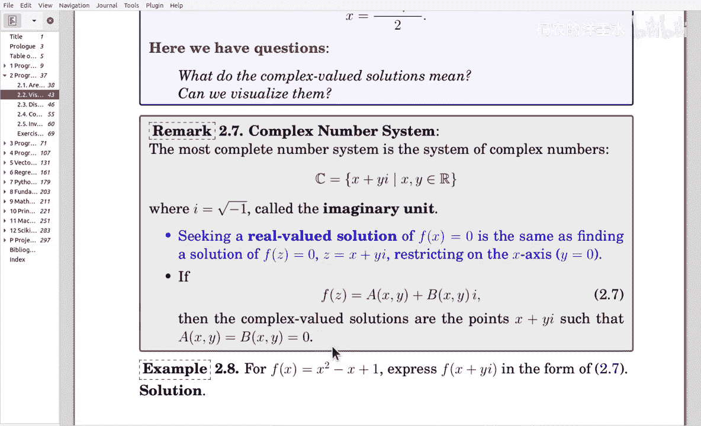

Okay， here for the function， we have to express F of x plus Y I in this form， a plus P form。 Okay。

 let's try to do that。Okay， here。Now， F of x plus Y I。Okay， then now for。X here。

 we are trying to pull x plus Yi， so that is x plus Y I squared。Minus now x plus Yi。And plus  one。

Okay。We expand here， then there will be x scatter minus y scatter and plus 2 X， Y， I。For thaton。

 there is minus x and minus Y， I and plus1。Okay。So we collect real value to terms。

 so that will be here now x is scatter minus y scatter and minus x and plus1。And。Now。

 we try to collect。Xiao。Image image really parts。 So that is2 X， Y and okay， minus y and I。

So that would be A and it must be B。

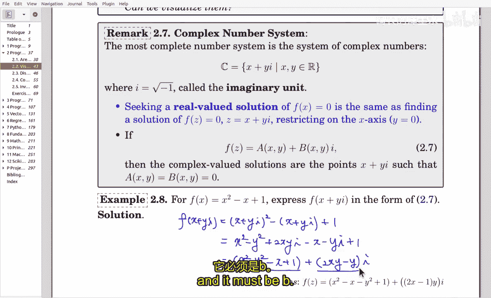

Okay。Okay， now we'll try to visualize the compress value solution of the equation。

 X scheta minus x plus 1 equals 0。By implementing a cord， a MA code。Okay， from the previous example。

 we know that F over Z can be written in this form here， A is here and P here。

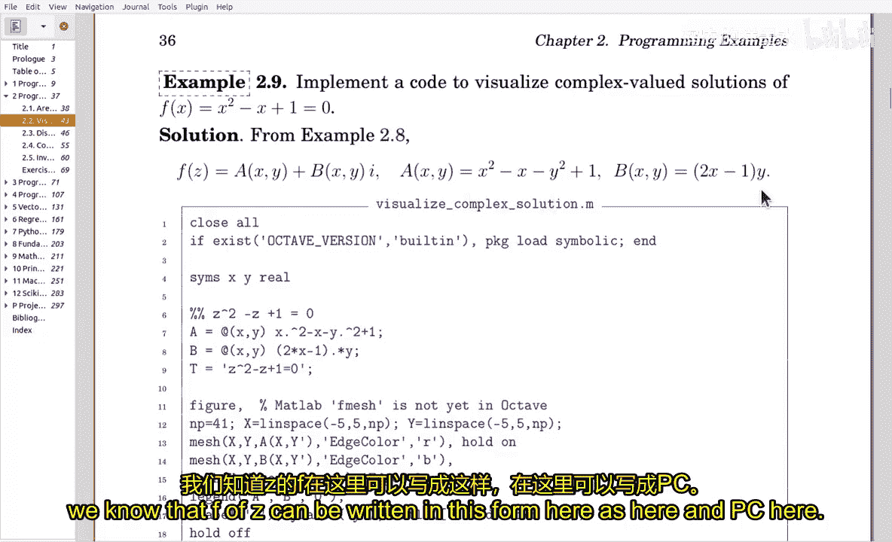

Okay。呃。And this term if exists the variable and as on a Pin function。But in variable。

 it it exists to Sudan， it is trying to unload the symbolic packaging。Is for O table yours。

And if you are open mat lab， then。The symbolic package will be automatically overed。 However。

 when you are using Otave， then some specific package must be overloaded by using such a command so that。

You can un the packaging symbolic for O。Of course， itll work because in。On del metala。

 because this variable is not defined。On matla so that this must be false and it will be ignored in on matla。

 okay？Okay， we define two symbols in a severe。Numbers and here we define A and B and following that one。

And we define a string will usually later on for printing out。

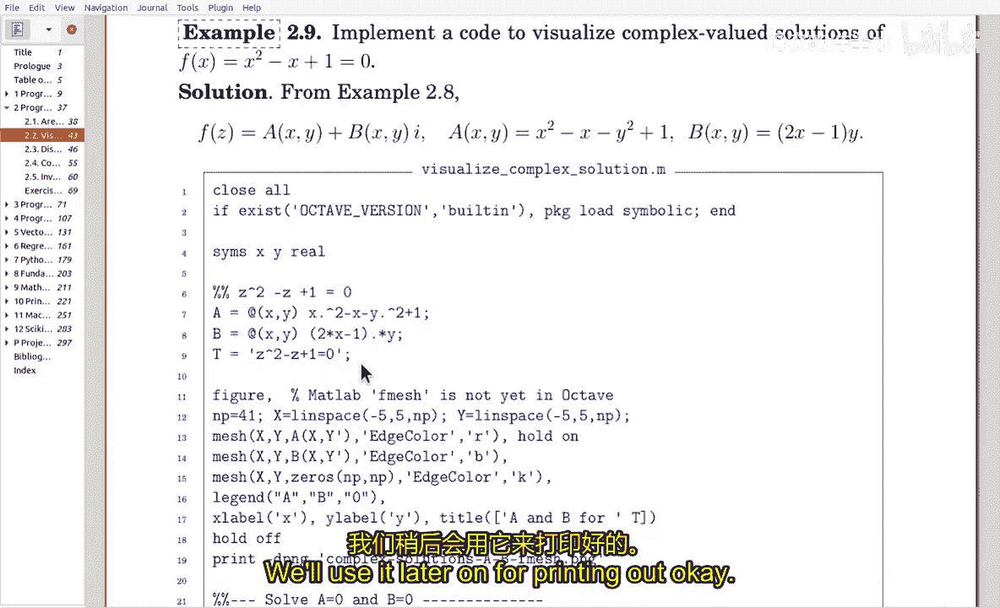

Okay。Now， here。For a， we try to make a mesh a plot。

R color and for B here mesh is made in blue color and that now third one is just the zero values is in just the bottom plane。

 flat plane in Pu color and we put legend and a label in here， save it into。can。

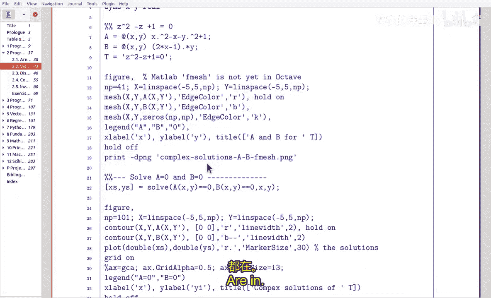

PG image。And after solving the problem so that now solution sh。That。에콜 씨로， 비콜 싫어어。

Is safety in excess and wireage。

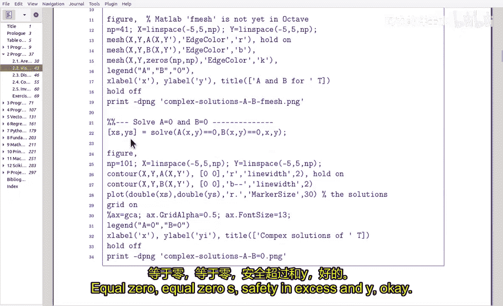

And here again， we make another figure。Now， that is controlour plot， so that。That is here。And。

A and0 and controllate so that the controlpl will。Make the。Will bridge the intersection between。

The A and the bottom flat。The plan。And which will be in red color。 And now again。

 one more counterlate。P and Zdo and。ItKeep in blue color。And then now the solutions are placed。

In red color。 And here we give some legend and labels。 And you say we are okay here。

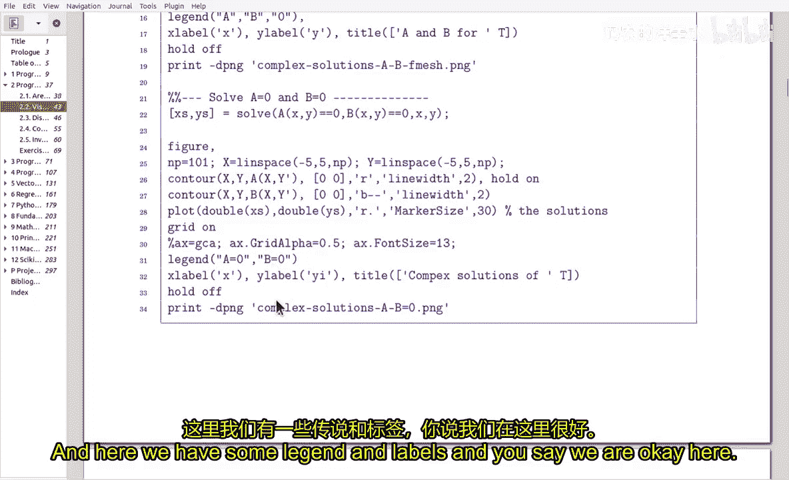

These two images are given here。

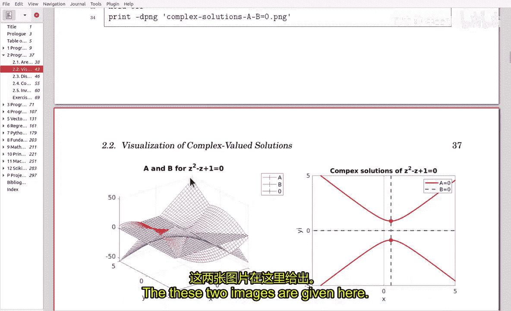

Now red one is curve of z equal a， the blue1 is now the surface of not curve。

 in fact the surface surface of z equal B and the black one is the bottom。0 plane。Okay。

 so here red one is intersection between。The surface and the flat plain。And now。Here。

 the blue dash curve lines is the intersection between here z equal B and z equal 0。So eventually。

 the solution must be intersection of these contour plots so that that one。

 that one must be the solution。

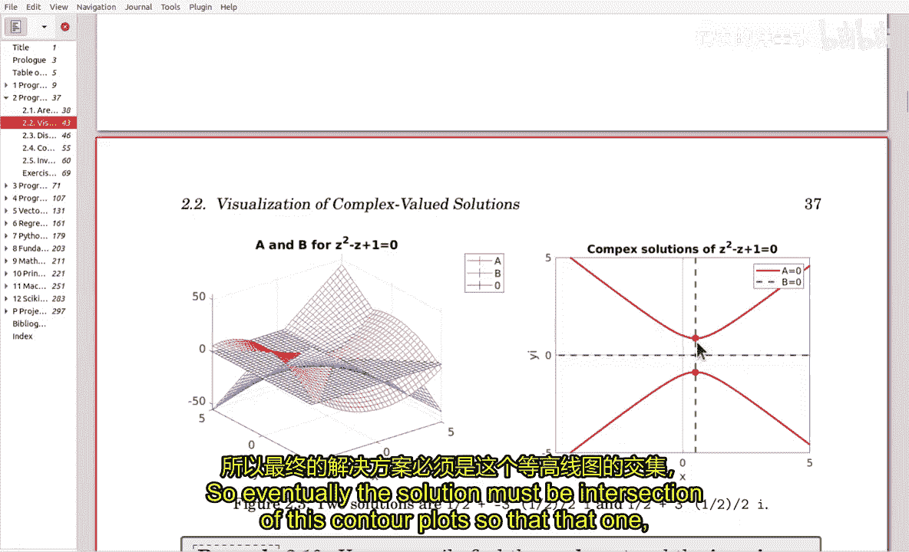

So that this tabn must be half the plus the square of 3 over2 I， and the bottom one is this one。Okay。

So we can visualize。The complex solutions quite easily， by solving。

The F z equals 0 rather than F x equals0。

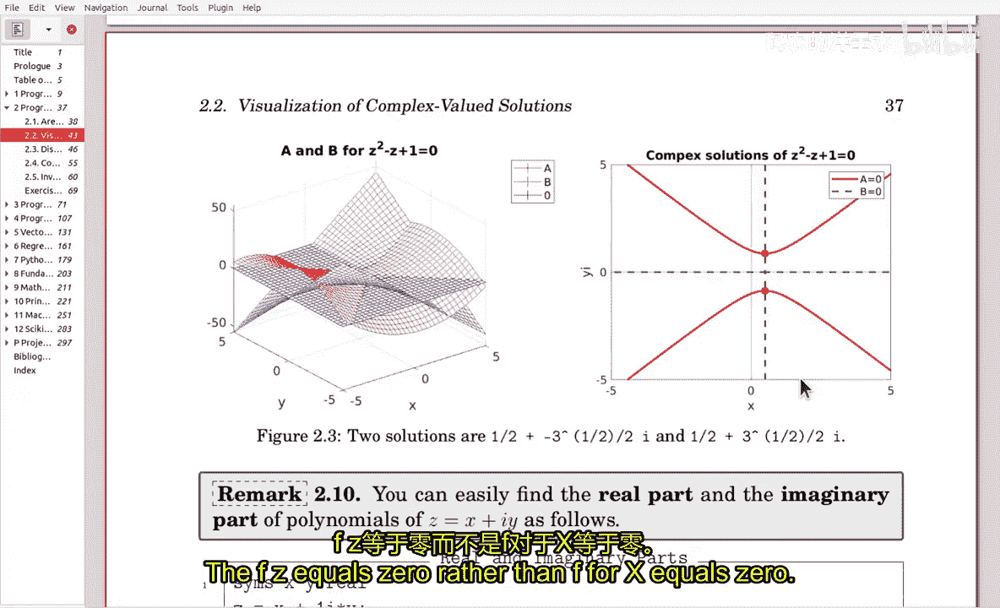

And here， when we try to get a portion and B portion， such calculation is done。

 but you can find this quite easily by using symbolic computation。

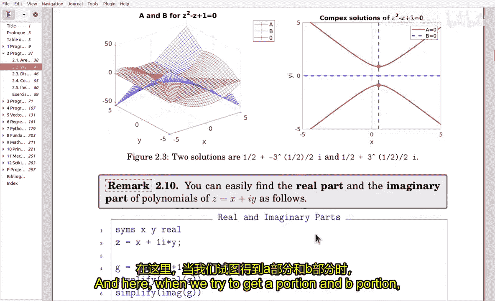

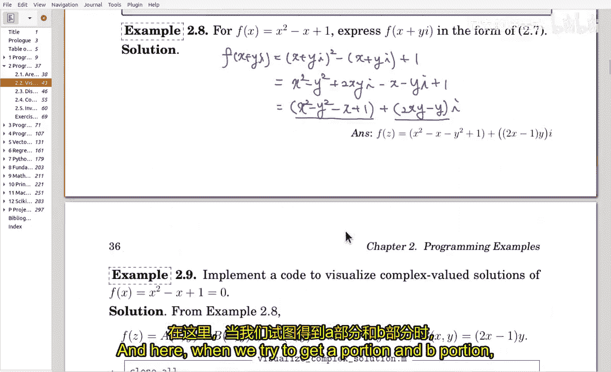

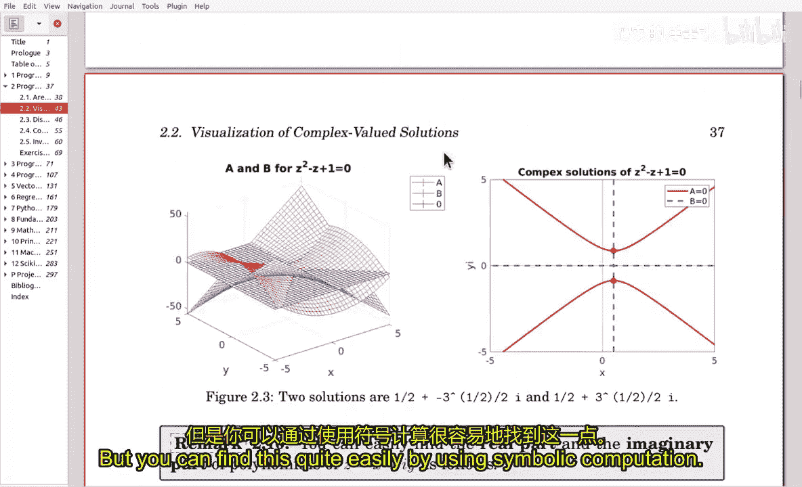

Now here。We open。 we declare X， Y as real。Oh。The variables and define z equal x plus I Y。 Okay，1。

 I means I。

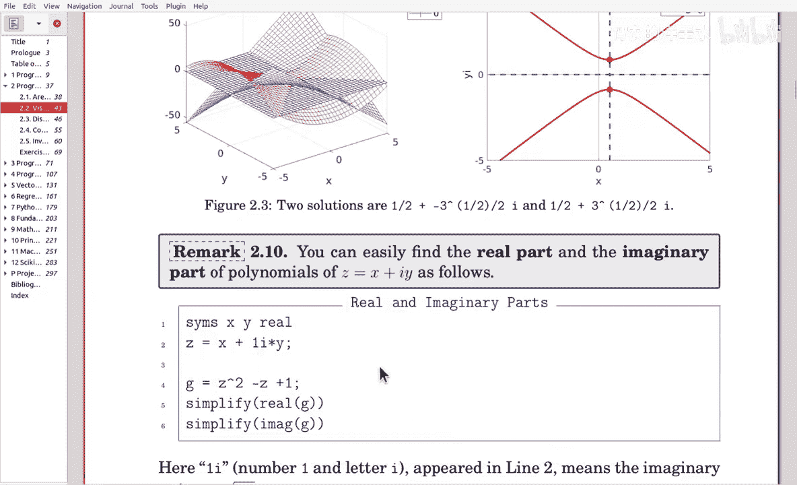

Okay， in metalla， we use a one eye。To。To be square over -1。The imageary union。

And Z G is z squareta minus z plus 1。 and then we try to get a real part and image part of Z and simplify。

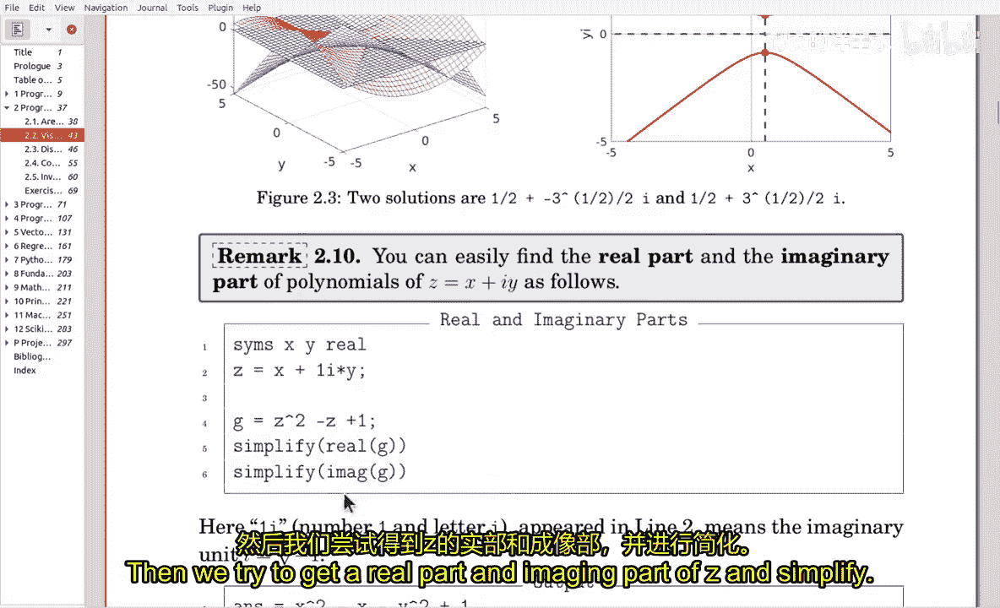

Then。The output will be here and that one。 So that is exactlyject the same one。

As what we obtained by hand computation。

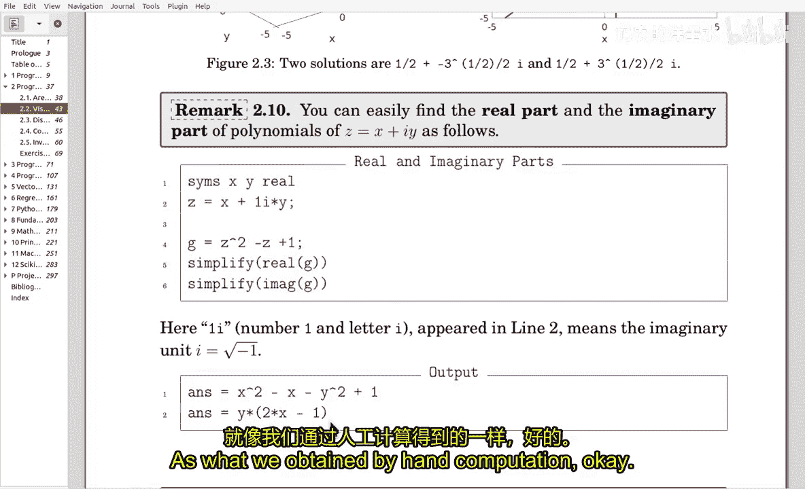

Here we summarize what we learned from this section。

TheViualization of a complex valued solution can be done with this observation。

Seeking a real value solution of fx equals0 is the same as a finding a solution of f z equals 0 z is x plus Yi re taking on the Xxs so that by trying to solve f z equals 0。

 we can find the compress value of the solutions and also sile we can visualize the compress value of the solutions of quadraification。

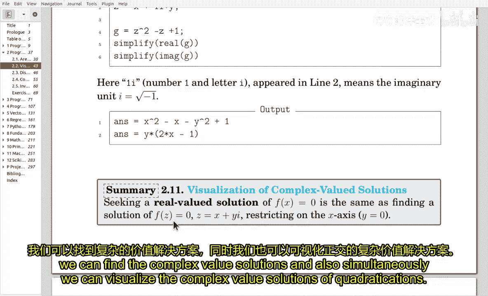

Thank you。