# 【全集-附课程讲义】密歇根大学-人工智能编程-EECS492-中英字幕-p09-Lecture-9---散傅里叶变换-DFT-FFT--BV14JqfBNEAS_p9-

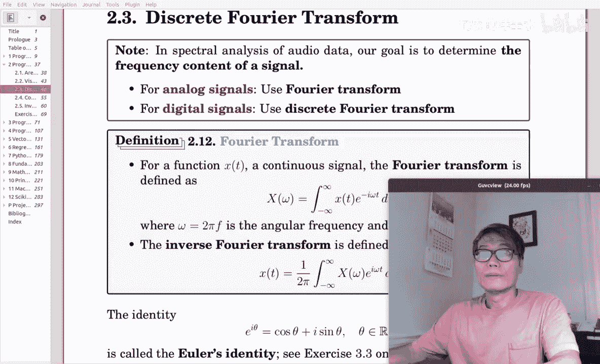

Section 2。3 is create fully transform。In the spectral analysis of audio data。

Our good is to determine。The frequency content of a signal。For analog signals。

 we use fully transform for digital signals， we use disc create。F you to。

We'll begin with the definition of a Fourier transform。For function X T。

Or continuous signal in the time domain。Fulli transform is defined as in this equation。엑소프트티 더 시그널。

Times each。Mus Iオomega T。Is integrated over minus infinite to infinitefinity。About time。And here。

 omega， the angular frequency is 2 pi F。F is the frequency。For each chosen戦5メガ。

This integration will make a complex number。嗯。These values are available for all omega values。

 then from the collection of capital x omega， we can recover the original signal in the time domain that is about the inverse Fourier transform。

Defined as in a basic Christian。Yeah， the capital x omega times E to the， I omega T。

Is integrated over minus infinite to infinity。About omega and scaleal by one over two pi。

 You can see a similarity between these two equations。Now， the integral is about T。

 and that integral is about omega。And now we have here。Negative sign。

 but here there is no negative sign。 and also we have here sckeic factor。Yeah。

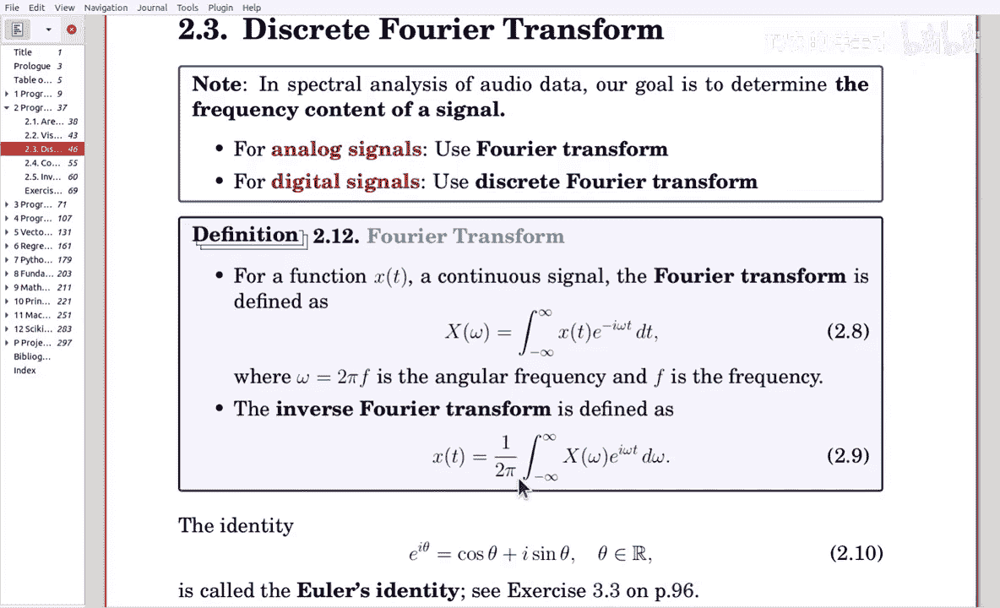

This identity e to the I thera equal cosine theorra。Plus， I s the for。

Real value of thera is called the。Oola identity will consider details of this identity in Cha 3。

And we'll try to derive it and we also consider applications of this identity。

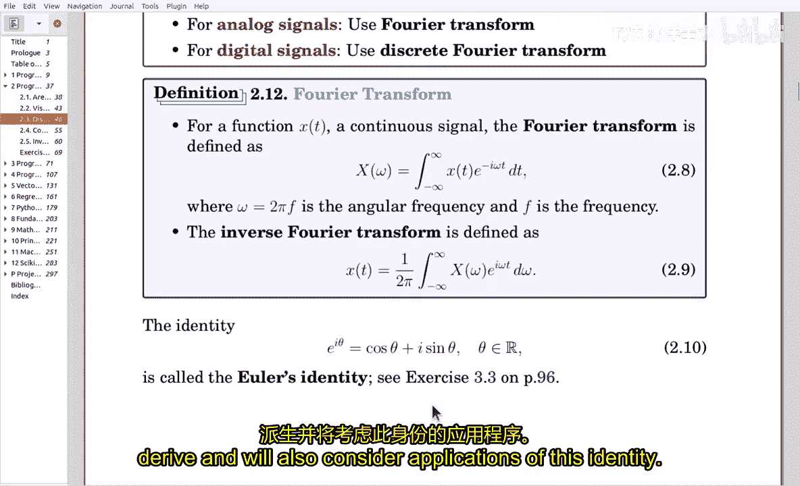

Okay。Okay， now we go to dis Fourier transform。In reality， most of the Sigma is in digital format。

So here， this is a discrete signal。Now， x and Tta T。And Delta T is a time interval between。And。

The sa， the points。So that x and thelta T is n value in sgon。All collection is a discrete signal。

For the signal that this fullyier transform is defined as in in this equation。Now， the Site。And now。

 E to the minus I 2 pi。Okay， K delta f deelta F is the frequency interval frequency in and2 pi frequency。

Is like omega and N delta T is discrete fusion of time T。Okay。

 that is sum over 0 to m minus1 for Shiiming， we have N T create the points。

And output is also n capital n values， each one。Is a complex number。And here well see details of the。

Notations， capital N is the total number of discrete data points。

 and capital T is the total sampling sampling time。And so here， deelta T is time between deta points。

Must be capital T over an。Telta F is the frequency increment。

 or sometimes called frequency resolution must be one capital T in hers。And for Sbsh。

Is the sampling frequency per second， so it must be  one over Herta T。

 and that is now capital n over capital T。This portion。In computation。

 this portion will be used again again。So once we try to simplify bying over there the ident。

 then k that I have。Times Nta T was be K N U capital and。Yeah。Now。

 you can see the similarity from this formula with。

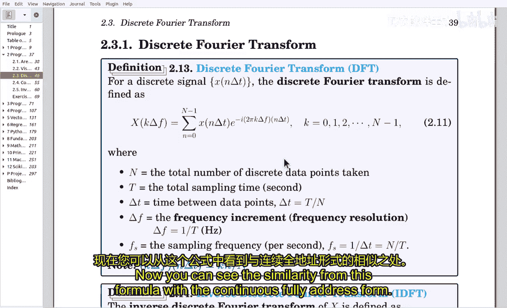

The continuous fully transform。Yeah。Look at again， this is a time domain signal and e to the minus i omega t and integration is over T。

 So here the sum is over n is moving from c to m minus1 so that sum is in time direction and theres an e to the is the analog of e to the minus I omega T。

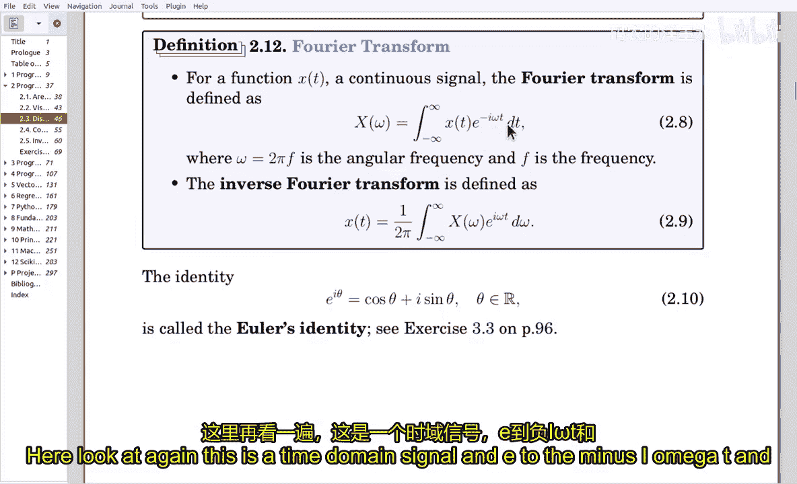

And also this has x of a t。And some is so that it make a complex value in。The transform domain。

 frequency domain。

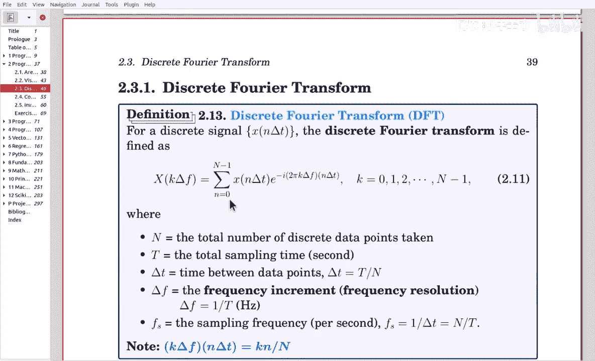

Okay。No。The similarity once for every K case from01 -1， this。Frequency domain value is available。

 then now we can recover the originalque signal。So that is the inverse this create fullyier transform。

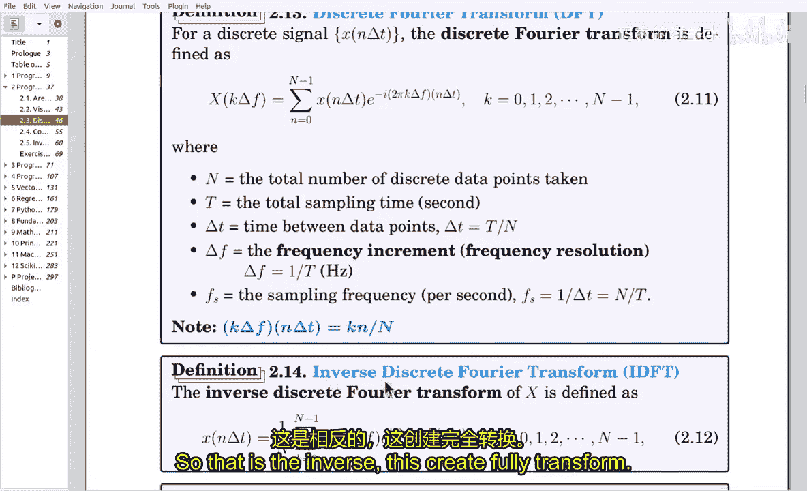

And here， you can see quite easily the similarity。 Now， the submission is over frequency。And。

That is frequency domain complex values。 and E T I。 Okay， this is about omega。 This is about T。

And there is no negative sign， and scaling fixture is now one over n rather than one over2 pi。

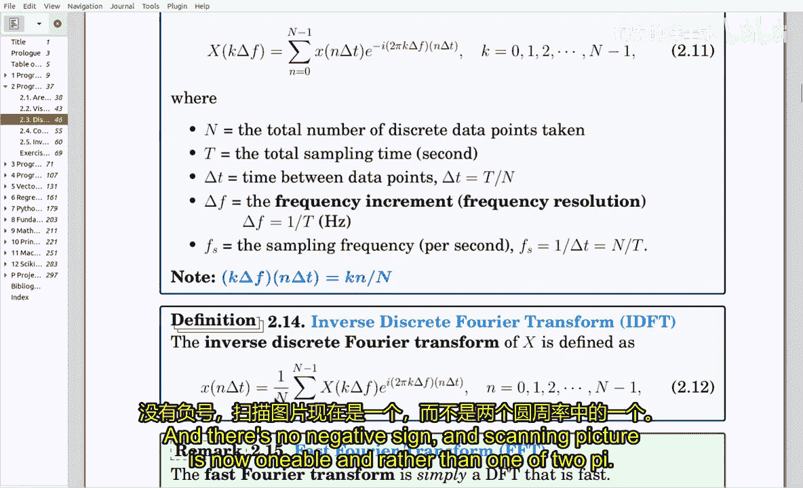

Okay。If you are working on this fully transformed， then you rem the phrase。Fast， free transform。

The fast fully transform is simply。But this caia transform， that is a falsester。

To get the value fast and algorithmically， it is manipulated。However。

 the reject must be the same as this could free transform。

So that all the rules and details about discrete create fullyier transforms。

Apped to fast free transforms， as well。Here， we have some restrict for some。FFTs。

The power of two restrict。Many transform fast to Fourier transforms， for example。

 the one in Microsoft Excel。Restrict and to be a powerful tool， such as 64。2 a。And 255 and so on。

The FFT in Matland has no such restriction。

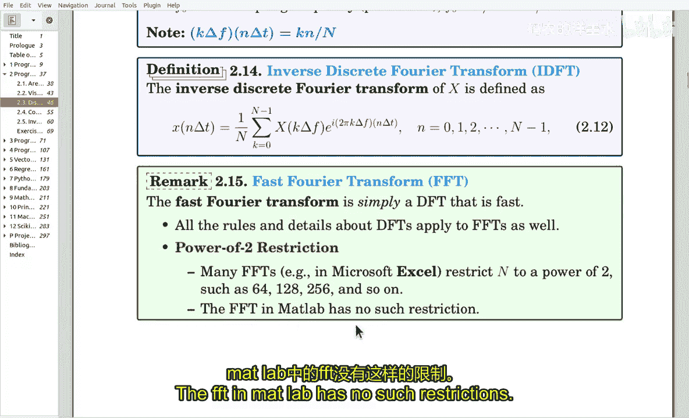

Okay。So that will not go to the detail about the faster free transform。

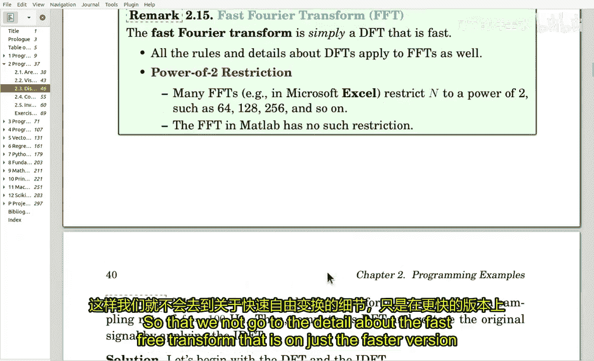

That is on。Just the faster version of。Disquify fullyier transform。Okay。

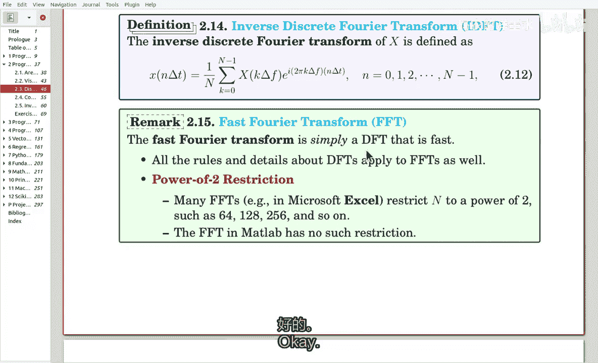

In this example， we will try to generate a synthetic signal for time is4 sort of during the four seconds and at a sampling rate 100 Hz damage that。

For each second， 100 points will be made and till the4 second。

 then compute as DFT and restore the original signal by applying the inverse discrete create Fourier transform。

Yeah， let's begin with。Thisically fully transform and is inver， okay？

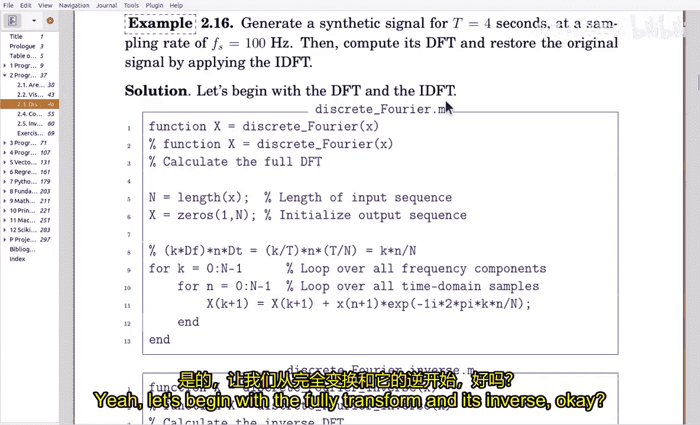

Now， for dis Fourier， that M， we define discrete Fourier transform。And here。Now。

 we count to the length and we initialize to be 0 for。The output。In。

The Fourier domain frequency domain。 And we already know that the quantity is the same as K N over capital n。

 So here we used to that on here， K N over n。So that minus I2 pi K N over capital n。That is now。

 but it applied with the time domain signal。Okay， in metal lab。

The index is stuff from zero from one so that we are using n plus one。Now。

 this loop is over all frequencies from02 and minus1。Now， this。

 the inner loop S loop of all time domain samples pro to M-1。 However。

 the early met lab and index is stuff from one。 So the solution we are using here M plus1。

 K plus1 yeah。So。For each K。Here， we from 0 in the beginning that we added these quantities for all N so that we get eventually。

This one will have the title product。Of this signal and the corresponding vector from here， okay？

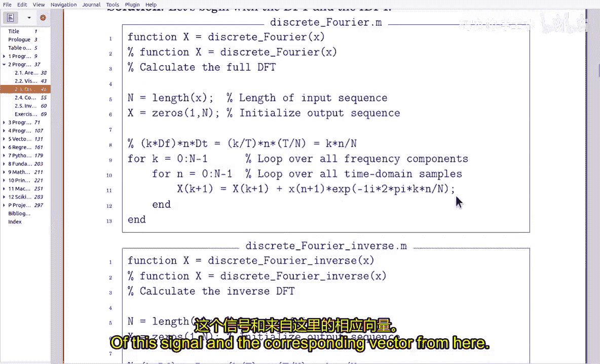

Okay， now this create foier inverse is now doing the inverse this to the Fourier transform。

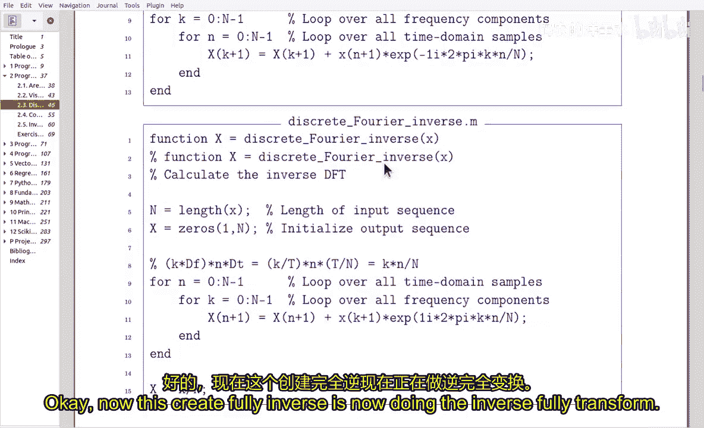

Okay， the same。 But now we are using Simalx， the capital X。 However， this similex will be。

The frequency domain signal and the capital X will be。

The output so that it must be time domain signal。Yeah， now in the loop must be。

Over frequencies and out loop for each time we compute this one， and then we go through all the time。

And here the formula。Does involved here negative sign。And。Okay， so that the output is making。

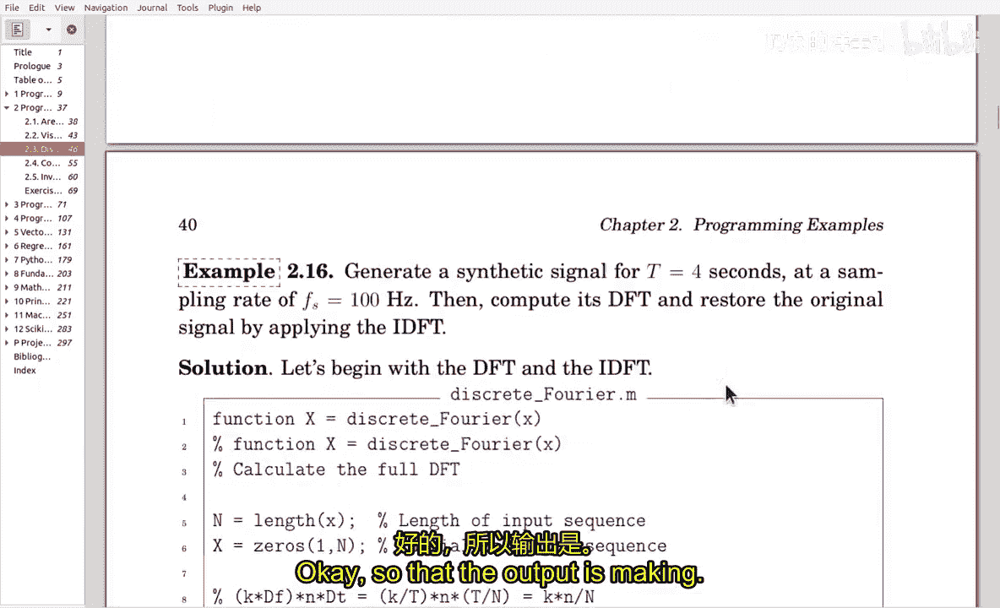

Here now， that quantity。For each N。 And then at the end， we are multiply one of n。

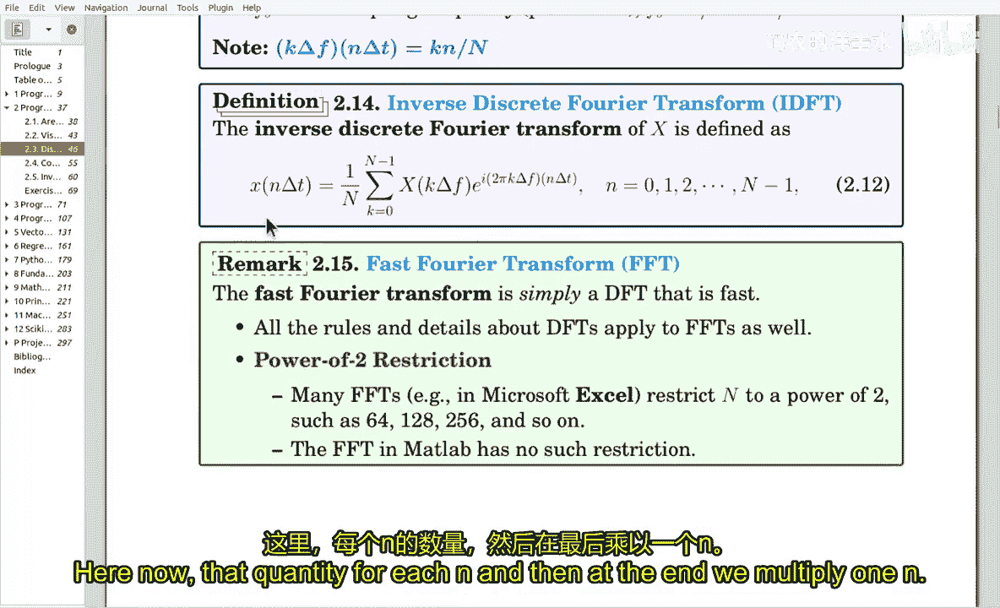

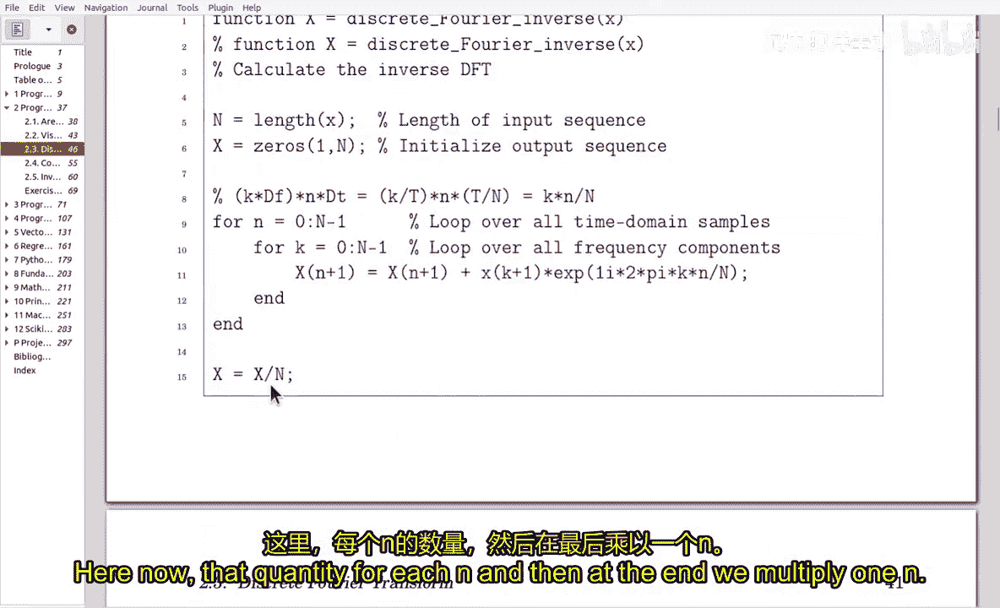

The scaling。Okay。

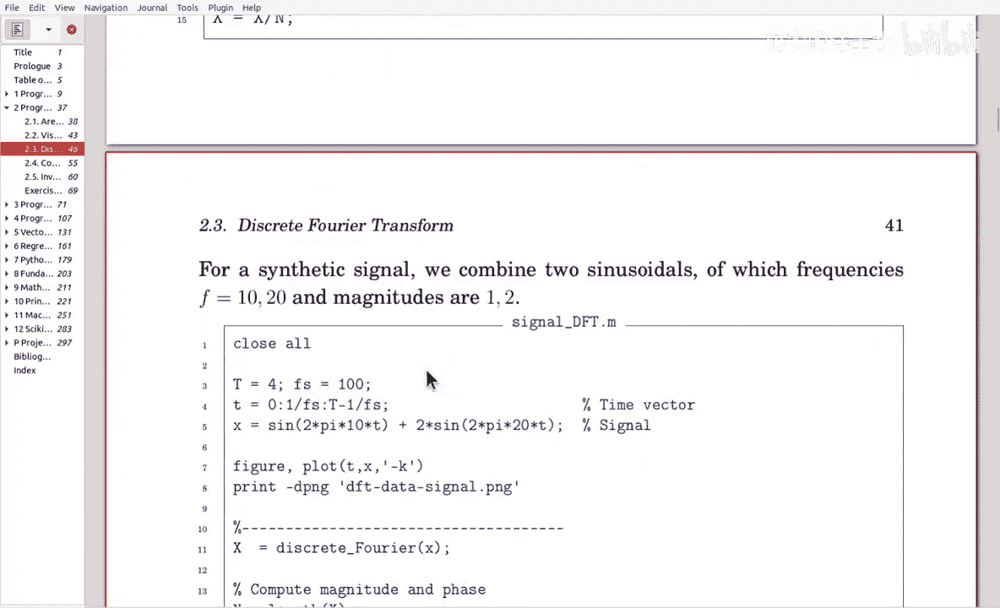

Now， first， we implement that。Tis carefully transform and inverse thisscriptor transform。

 and then we'll lose them。

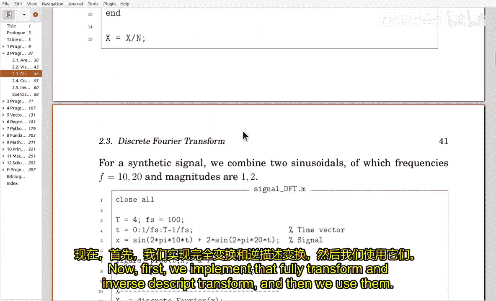

To solve the problem。Okay。We try to generate a synthetic signal。And we combine two sininoy dollars。

1 has frequency 10， D only has frequency 20， and also beuss are1 and 2， as in this line， s2 pi。10 T。

 So its frequency 10。 Now for that on two pi20 and frequency is 20 and back into this one back into the2 and combine them。

And of course， over there are tea capitalities for。Now。

The sampling frequency is 100 other than time vector must be given in this range so we can make a plot and here。

 save we yet。Now， by saying this could fully transform。We get frequent domain values。And from that。

 yeah。The magnetic to the sphere can be compute， and also face can be completed。

The face image that angle of the value and better the form if you。

Here identify the complex value in complex domain， then you can measure the angle from Pip Xx to the point。

 so that is the phase by saying high attention2 function you can get the angle。Component。Okay。Now。

And from capital X， that is a signal in frequency domain by using discrete Fourier inverse。

 we can restore in time domain the signal。So we try to measure the distance between original signal and leads to the signal。

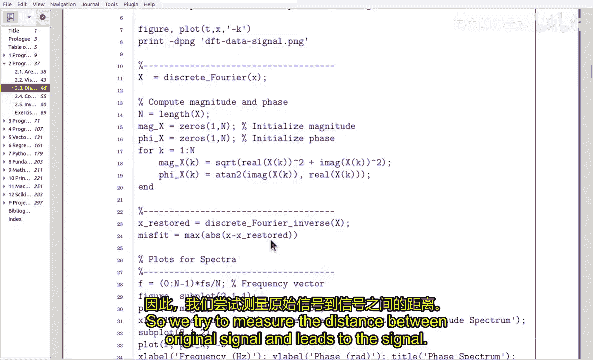

Okay。Now， the result top of that one is that one so that except the rounding error。

 it is real restored。Okay， here。Now。Here we。Try to okay for the purpose of figuring。

 we make the frequency vector and we make the per platform， the magnitude and platform。

 the phase and soo。In imaging， but with a subpl format。

 So thatll be on the top and that will be on the bottom。And。So that we have two images out of this。

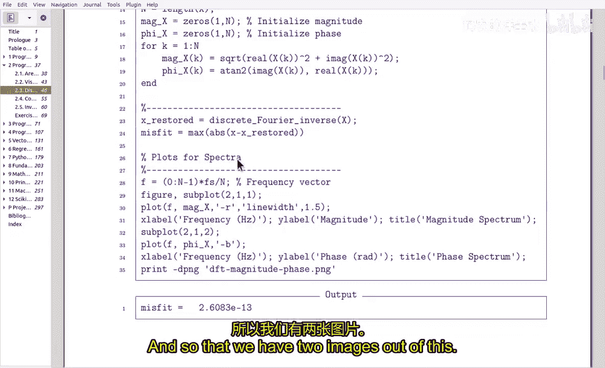

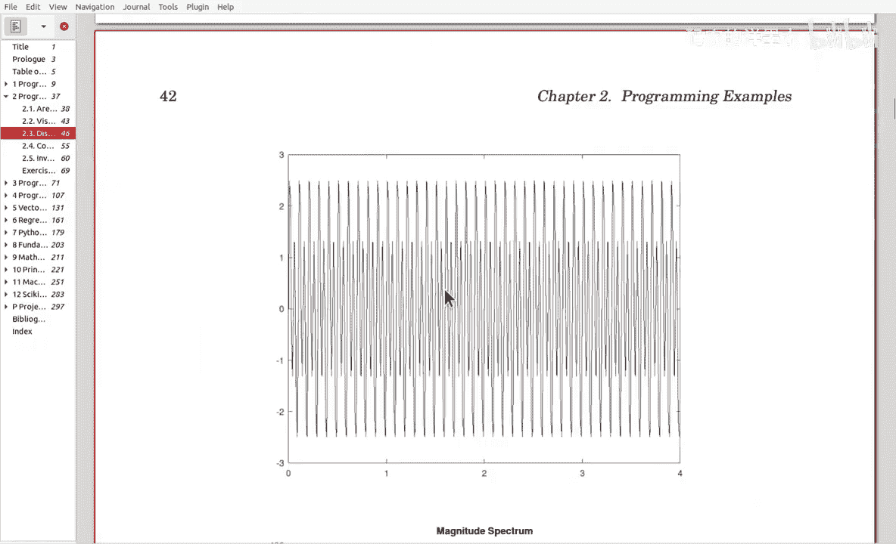

Program。That is the signal。 It is combined。 One is frequency 10。 The other is frequency 20。

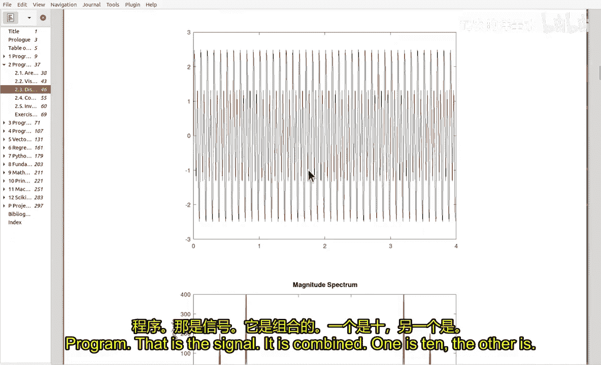

Now this is magnitude to the spectrum here we see clearly。Frequence 10， magnitude。

And then at the frequency 20。And again， 80 and 90。But in the data。

 we don't have frequency components for 80 and 90。This one is a kind of。Areasing。Effect， and。嗯。

So that when we try to transform this when happen so that， in fact， we have to discard this。

Last half， well see here later some detail around there。Now that is are the face spectrum。

 the angles。Okay。

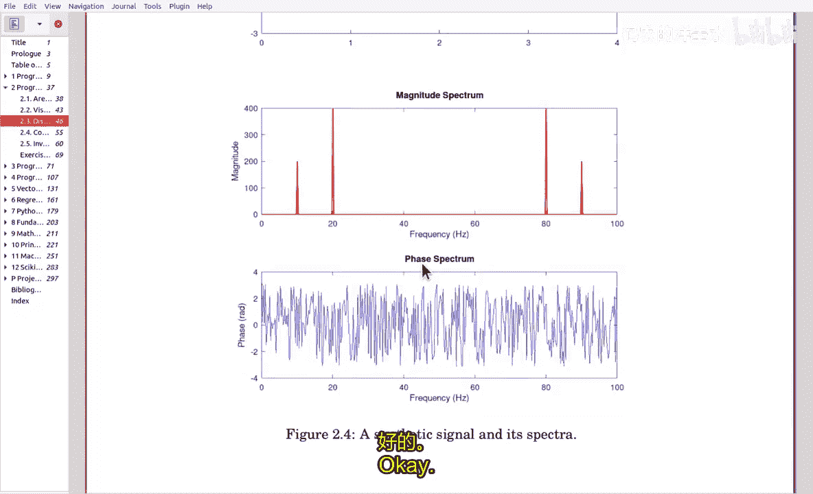

Okay， here， N criterion。It is important and this fully transform on cells。

 this is a nirouss queryraion。When sampling frequency add frequency F sub X。

We can obtain reliable frequency information only for frequencies less than episodes over two here。

 reliability means without。

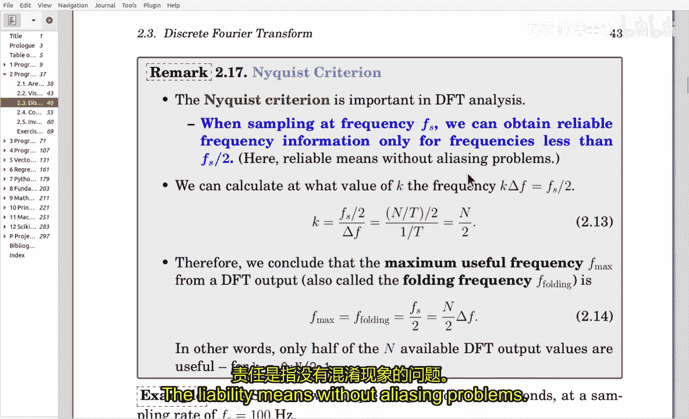

Aliasing problems。 So here now。We have here the information。

 excellent information because of aing problem。

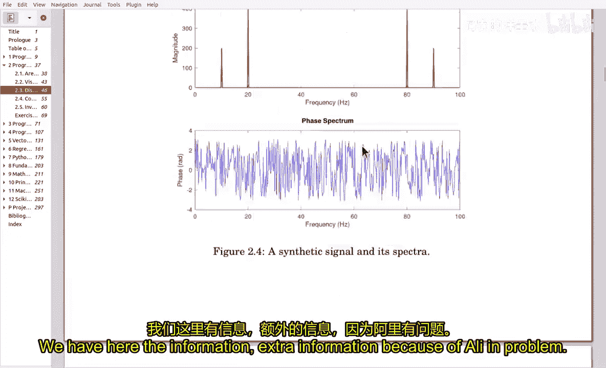

Yeah。Now that is N Christ。Criterion， so we can calculate at which value of K。The frequencyequ。K。

 that F is half of F sub。So from here， if we sort for k。

 then we reach this one and we delate this quantity and that one and simplify。

 then k must be n over2。So that now only four frequencies are less than this one。

 so that only4 k less than this value is a reliable， has a reliableable information。

So that in second half is not really reliable。Therefore。

 we can conclude that the maximum useful frequency of some max from the。T F T output。

Also is called a folding frequency。As yeah。E service over two， that is Sams and over two that I have。

In other words， only half of the N available。This cali transfer from output values are useful。

So your case moving from 0 to N over 2 -1 because its stuff from 0。

So that we have to put here minus1 okay。

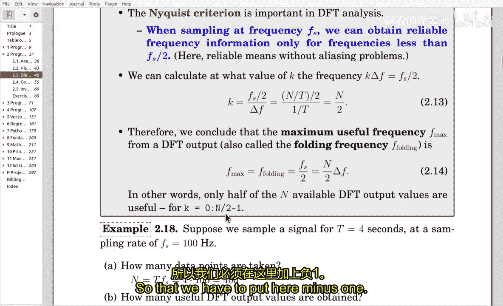

Okay， let's see this example。Suppose we sample a signal for Ts4 at a sample in weight of Evius equals 100 hertz。

 as in the previous example。How many data points are taken。

That is now by multiplying these two quantity， we can get 400 pi each。How many is for。

This fully transform output values are attained。 that is n of 2。 We only to know that n of2。

 there is 200 of them。What is Terta F？That F is one of capital T。

 capital T is4 so that in each in the output， the frequency inement is 0。25 hertz。

What is the maximum frequency for which the。T F， T output is useful and reliable。There is now。

The frequency max is N of2。Times Klta F。 so that in 50 Htz， that is a maximum frequency。

That is useful and reliableable。The other half of the output values and larger than the forwarding frequency。

So now。Or Eode。So if you try to use yet in later analysis then， it produces something wrong。

Okay some artifacts。 So you have to be careful。 But when you try to recover the original signal。

 then you have to use every。The values from the output， okay？

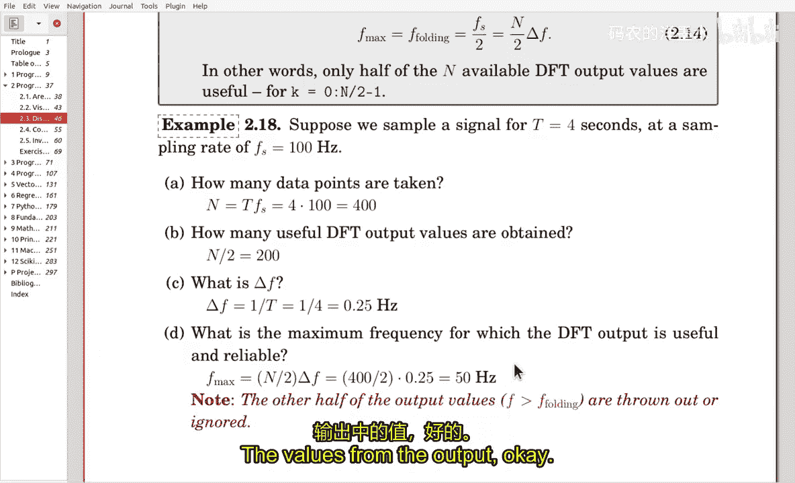

Okay， now well continue in the second part。 Thank you。

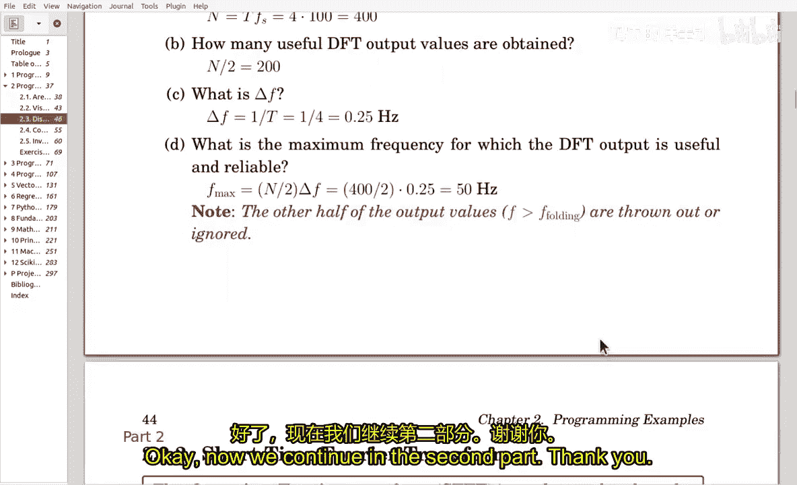

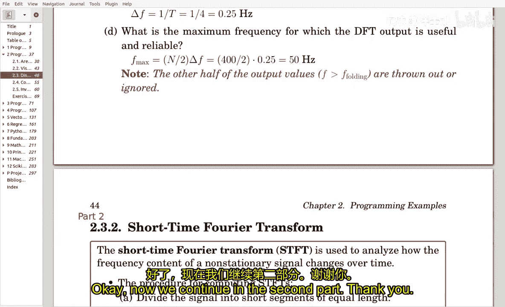