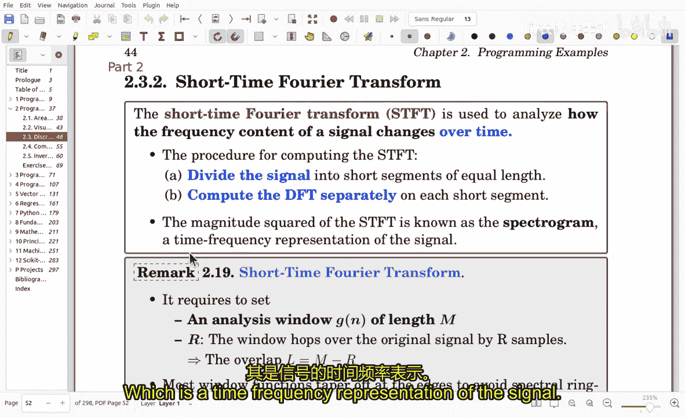
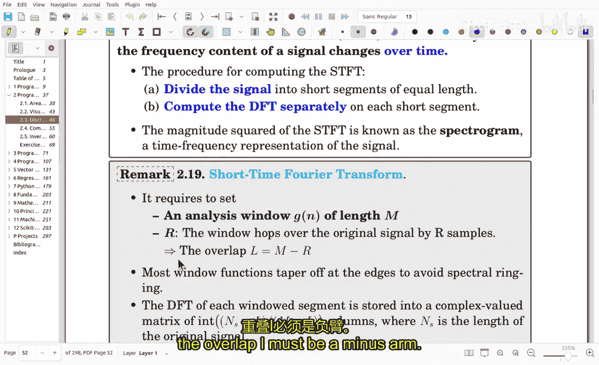
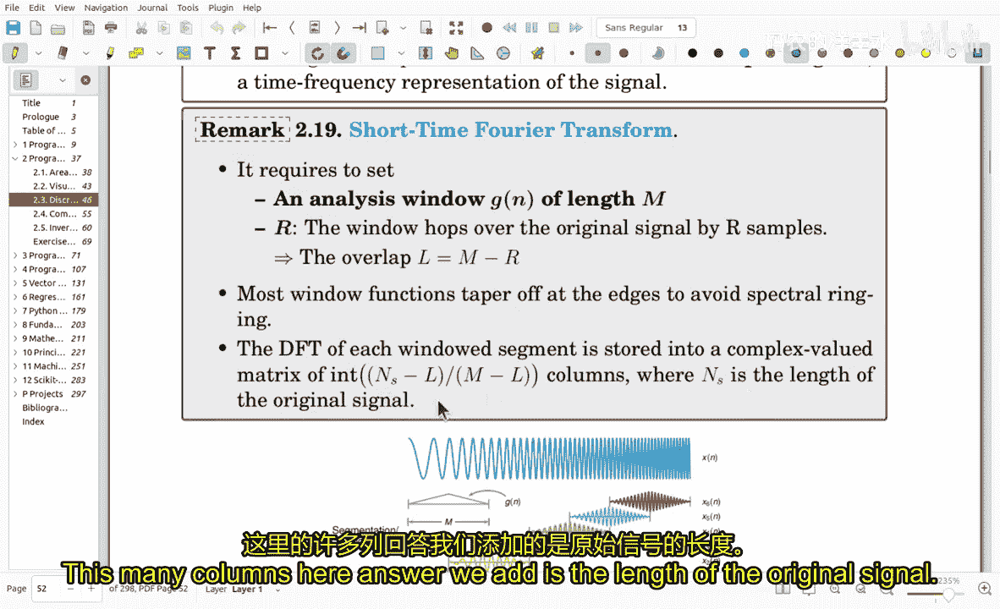
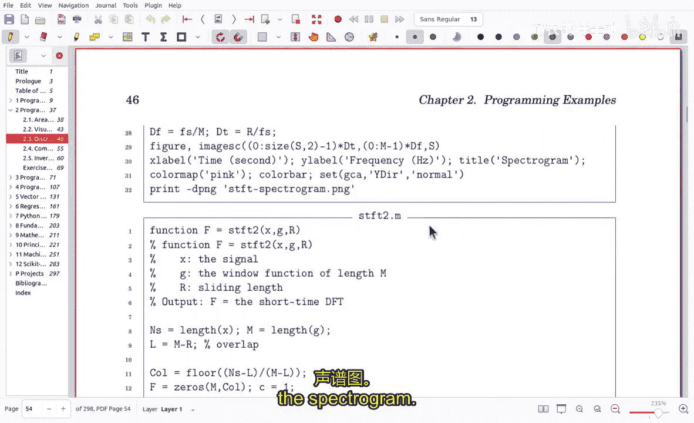
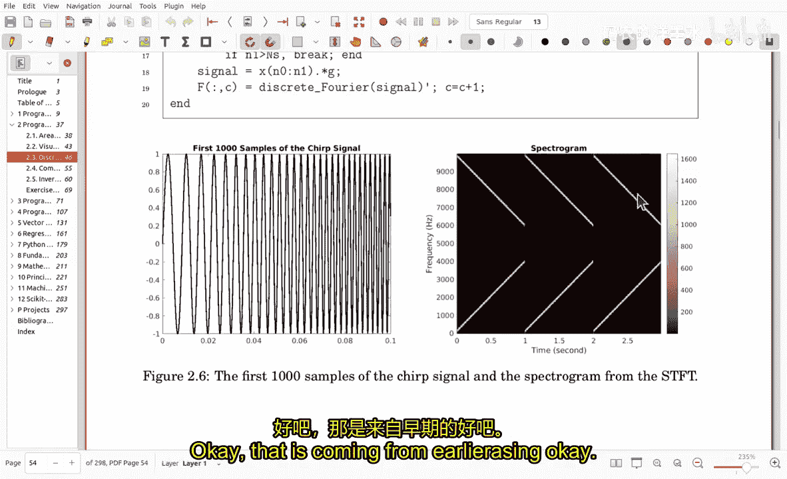
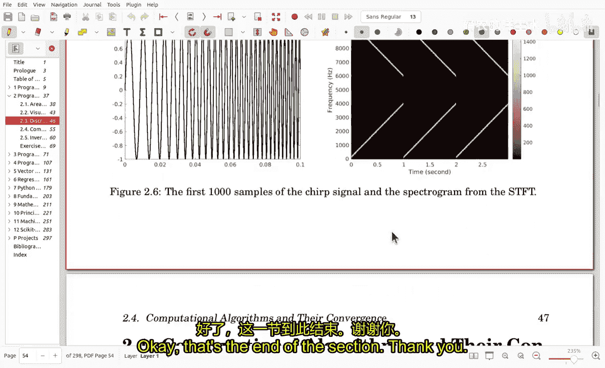

# 【全集-附课程讲义】密歇根大学-人工智能编程-EECS492-中英字幕-p10-Lecture-10---短时离散傅里叶变换-STFT-STFFT--BV14JqfBNEAS_p10-

It is part 2 of Section 2。3。 short time fully the transform。In the first part of the section。

 we studied the discretescript fullyier transform。We implemented it in Matlab。Also。

 we discussed the ninequier criterion。And we understood that。

Only the first half of frequency components。Is useful and reliable。Here will apply。

The disia transform。The short time Fourier transform is used to analyze how the frequency content of signal changes over time。

Here is the procedure for computing the STFT。First。

 we divide the signal into short segments of equal length， and then we compute the。

Thisis cria transform separately on each short segment。

So it is a simple application of the this Fourier transform。The magnitude squared of the。

STFT is known as the Spectrogram。Which is time frequency representation of the signalonome。

The short time， Fourier transform requires to set。On analysis Yu geovan of length。

So you have to choose a perimeter M。And also， you have to select In。G。And what song。

You have to set a parameter R。That is a sliding length。

The window hopps over the original signalar by all segments。In this case。

 the Ovalla held must be Emmamira's arm。

Most window functions tap off at the edges to avoid the spectral ringing。

That means the magnitude of G becomes small toward。Ess。

The discrete Fourier transform of each in de segment is stored into a Comp value the metric of。嗯。

This many columns。Here and sos， is the length of with the original sgonome。

Let's see this picture， I copied it from Balab information website。

This is the original signal having capital NS samples。Now， in the beginning， we choose M samples。

 so here we choose from here to there M samples。And but ply。There's In function。Here。

 this is a shape we had。And multiply window function then will have this signal。

And after moving R samples。That's our movement now here。We are moving from this one over there。

 So there's R。 So same here， R is this one。At a moving hour。Now， from this one。

We take M samples again， then multiply G。 Then we can get this signal。 We keep going。

And then at the last moment， we take M samples around the end and multiply the Yu function G and。

We can get this as signalgon item。For each of these signals。We apply this transform。Then。

The frequency components， the magnitude will appear。As in this portion。For this one。

 the frequency is low so that you can see the P in lower position of the frequency。And for example。

 for there run， frequency are high so that you can see a peak on high position and peaks are higher。

 higher， higher gradually， as we can see here the frequency becomes higher， higher， higher， right。

So this will be。Collected， and each one will make a column。And this whole collection。

Is called the spectrogram。The SDF T is easy to implement， of course。

Mela and Ove has the Pium function， but we'll try to implement detail here。First。

 we have to select on analysis Yudong。I chose such运 when M is 150， it is gotten in this rank。Now。

 I named it In cosine。The reason is I'm using cosine function。

First select the point from 0 to2 pi here， m point and then here bying cosine。

 we try to get the window function here at 0。55 minus 0。45。And times cosine T。

So that when t is 0 or two pi， then there'll be one so that。The quantity becomes 0。1。

 So here at each points， the value is 0。1。 Of course， at center， the value is 1。Okay。

 that's the window function。Now， this is。The main part of short time is fully transform。Here。

 we start with sampling frequency，10000。Now， capital T 0 is1。And for that on， now。

 time vector can be made in this way from 0 to1。 We select year 10000 points。For that。

 now we try to make a so called the chop signal。That is now。For sine function here。

 this is inement of the time。 Now we put here extra components that difference the frequency increase in the beginning。

The pre will be。100에도。Now。Yeah。When t becomes1， the frequency becomes the addition of this tool。

 which is 4000。Okay， this small portion of a chop signal is now duplicated 30 times。For the data。

So x0， x0， x0。 So we deal with this one。The corresponding kind victor。Yes this one。

 but it's not necessary in our computation， so I committed the own。Now， we choose M is 150。

There is window length。So from this one， by calling y course M， we get G， that is actually that one。

Now， the sliding length R is 6。And here by using the signal and window and sliding length。

 and we call STFT2 to get frequency components。And the beganity to the is spectrogram。

And below is for ploting。 Okay， let's see。This one。Is implemented here， quite simple。

And x is the signal。 G is the indoor function of length M。

 and R is sliding length and up F is the short time this transform。And first。

 we measure the length of the signal and M is the length of the window。And here， L is the Oval lab。

 and we compute the。The columns for the spectrogram。 And that one came from。Y。Thatb one。

The integer of this ratio。And it decided the number of columns。Okay here。So。

 we open the initial large the。The good。For metric， for frequency components and。

M rows and this Mo of columns。 Okay， now the column is one for the first column。Now， once。

So that from the signal will try to take。The M signals from。N0 2 and 1。 So in the beginning。

 for first column， now n0 must be1。But for later one。

 n0 will be moved in all samples and N1 is all same as n0 plus n minus1。Okay， after taking M samples。

 we multiply G so that that becomes the signal。And using this fullyier transform function and is truth is now saved into the column C。

 and we make C increased by  one。Of course， you can use full loop and see is moving one to that column。

 either way you can implement this portion。Okay， here， after passing that one。

 we have the frequency components。In MAlab， we have STFT function here along with two。

 I try to separate from the Pium function。Okay， let's see here the plot。

We try to save only the first 1000 samples of the truck signal。And in second figure。

 we try to save the Yuong。Fction。And， finally。Now here we try to save the spectroogram。Okay。

 so that's the。

First 1000 samples over the chop wave。And here the frequency is 100 at them。

And now once it becomes one one second so that later the frequency will become 4000 is virtually literally faster。

 faster， faster。 and later on， it becomes 4000。 this30 copies of this chop signal。

Is attached for our test signal。Okay， so you can see here the spectrogram。

For each second stuff from 1000 and then becomes to 4000，100， 400，1004000。

Only the first half of frequency components is useful and reliableable and the second half must be discarded in most analysis along with this transform output。

Okay。That is coming from Eliliasing okay？

Okay， that's the end of the section。 Thank you。

