# 【全集-附课程讲义】密歇根大学-人工智能编程-EECS492-中英字幕-p11-Lecture-11---计算算法及其收敛性--BV14JqfBNEAS_p11-

Section 2。4， computational algorithms and their convergence。Will first define errors。

Suppose that Pi star is an approximation to pay。Pist star can be an output of computational algorithm。

Then the absolute error is the absolute the value。Of P minus P time。

And the la error is the absolute error divided the bind， the magnitude of。The true value。Once P is90。

 then we can define there a relatively error， right？In reality。

 the relative error is more popular than the absolute error。For example， P is 1 million。And。Now。

 assume assume we have Pita such that。Absolutely error is about 1000。

Then the absolute error looks large， however， is has a relatively very small。

Lelative error is 1000 over 1 million， which is 1000。So that。In in percentage。

 it is very small so that we can accept the。Even though the absolute error is large and looks not acceptable。

But relative areas are smaller so we can accept here。And also quite reasonable， right？

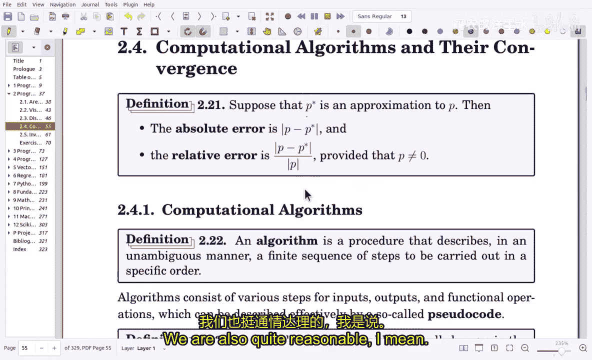

Computal algorithms， an algorithm is a procedure that describes。In on an ambiguous manner。

 find the sequence of steps to be carried out in a specific。Ororder。

Algoths consist of many steps for inputs， outputs， and functional operations。

Algothms can be described。Effectively。I should of call。Shouldukqui this showing。Major operations。

And easy to understand。And earlier。The algorithms are hidden in code by using C or forron。

 So it is a very large， long， long line subcoded。So arogence， it is not easy to understand， by。

Seeing a pseudo cord， we can understand it more effectively。But in modern society， if you are using。

Mtlab or Python。Then。The code is short up so that you can understand the whole scope of algorithm。

And the code quite easily， however。To describe the algorithm， more effectively。Yet。

 pseudo codes are being used。Okay。An algorithm is called a stable。

 if small change in the initial data。Input。Produce corresponding in small changes in the final design。

How婆。So stable algorithm will change small。In output， from smallchan in import。Otherwise。

 it is called unstable。 Some al groups are stable only for certain choices of potatota or parameters。

 And in this case， we call them。Conditionally stable。Crow rates of the error。

Suppose that E is an error introduced at some stage。Maybe initial this stage。

And EN represents the magnitude of the error F to N subsequent operations。

If E is basically n times sub easy， that means that。Here， in each step。

 around the easy long error will come out and have to end operations。 Now， basically。

 this is n times of the easy long。Butら 내 maybe。Around there， each step， thearrow is around there。

 However， it can be a bit larger or small so that we put here a constant see。Once error。

Its coming in this way。 Then the growth of the error is said to be linear。And in this case。

 the algorithm is stable。

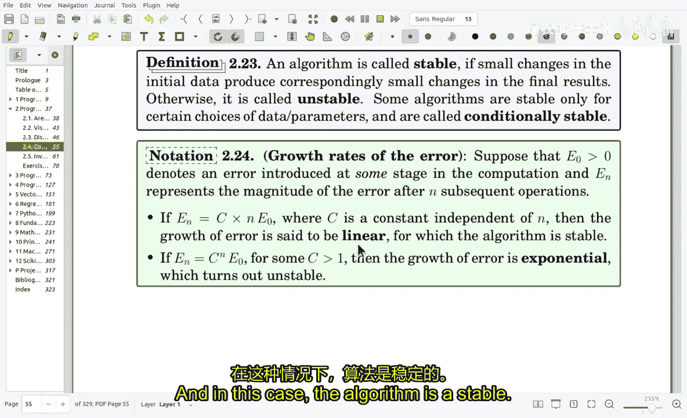

If Ean is given in this way for some C larger than one， then。哦。each operation。

 the error is exponentially increasing。So we say that the course of error is exponential。

And in this case， the algorithm would be unstable。Now we define rate orders of conbogens。

And X N is a sequence of real numbers tending to limit x's star。

And XN can be output of an itative algorithm。The rate of congence is at Li linearia。

 if there are a constant C1 S than1 and on integer capital n such of that。The error。

At M plus a forces step is bounded by c1 times error。Add an his tab。

So later error is bounded by an earlier times the C1， which is less than one， so that。

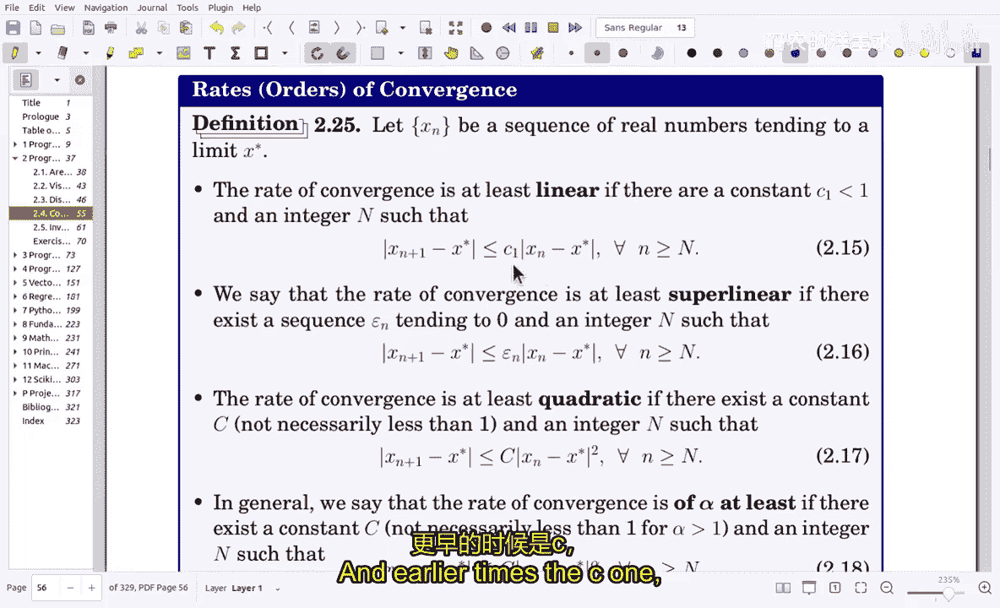

This one is smaller than that earlier error。 If error is shrinking in this way。

 then we say that the con of it is linear。So we say simplest linear convergence。

And if there is a sequence epsilon n tending to0 so that later error is bounded by Epsilon n and the earlier error。

Then the error is decreasing saying faster than this linear convergence。So here in this case。

 we say this is super linear convergence。And if we have here。

The convergence rate is given in this way。 Convergency is given in this way。

 Then we say it is quadratic because of power2 is given。And now in this case。

 C doesn't have to be less than one， but anyway， a small number。嗯。In this case， for example。

 once we reach the error is 10 to minus-2， then next error will be order of 10 to minus-4。And again。

 the next one will be 10 to minus a and again，10 to minus。16 and 10 to 36 and so on。

 So quadtic conence is much faster than a linear componentsence。In general。

 we say that the radio confidence is of alpha at least。If there is just a constant scene。

And on in capital N， such that。For every n larger than O equal to capital n。

 this inequality is satisfied here。 the power alpha is given。Once alpha is1。

 then these coefficient must be less than one。If it is larger than or equal to 1。

 then this inequality is meaningx。Once see is a larger than one than even though。

It is slightly larger than on。 It doesn't matter。 Eventually， the error will come you to a。Okay。

So it is。reded alpha， Cambogens。Okay。Let's say this example。

 consider sequence defined recursively as here， x1 is2 and Xm plus 1。Its XN over2 plus one over XN。

So from x2 and x3， the sequence is defined in this vein。And here。The question is。

 find the limit of the sequence。 I show that the convergence is quadraing。Okay。

To solve such a problem。 First of all， you have to check the。The convergence。

And you have to make sure it is congenent。And to check here。You can see a behavior of the sequence。

 So here I added。

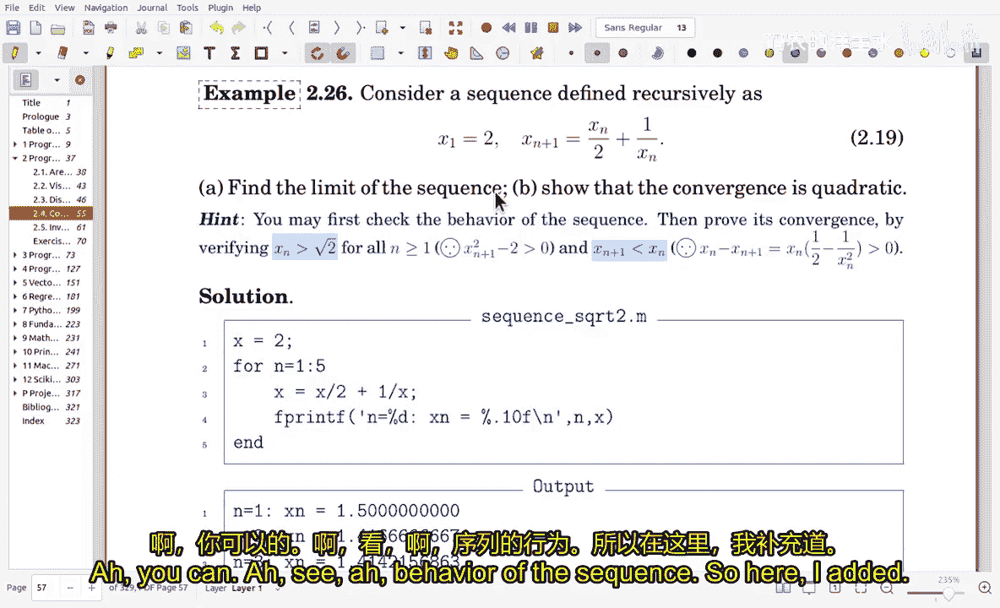

嗯。Program， and along with that， that is Matlab called。

And X 2 in the beginning and X is updated by using the formula here， X over2 plus one of edge。

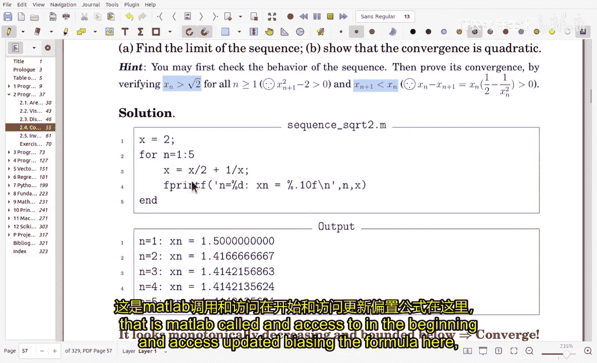

And it's updated。 So it's actually this line is representinging that portion and we try to print out。

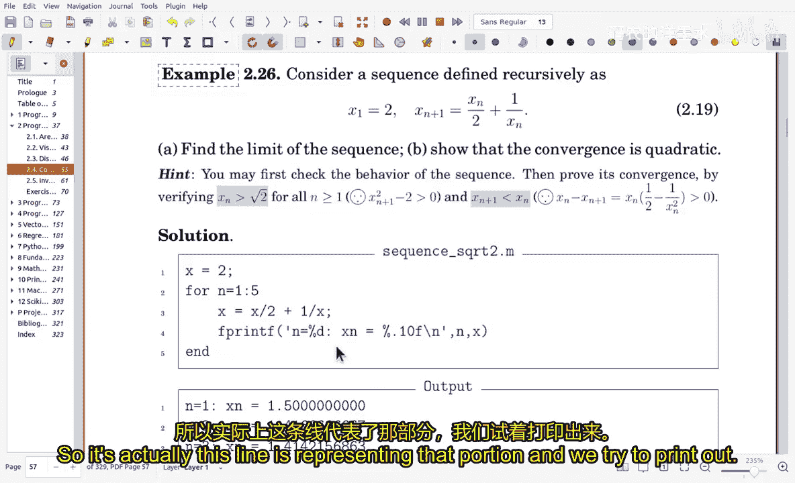

After one it， two it， and after five it， we have that。So along with the such practical computation。

 you can observe the behavior of the sequence。It looks monotonically decreasinging。

 so it is becoming stuff from 2 1。5 and this number and then number and that number and up to 10 digit accuracy is not changing。

 however it is monotonically decreasinging and looks like a pounded below is not going down。Below。

 certain number。Once the sequence is monotly decreasing and pounded below。

 then it must be convergent。Because it's going down and here so that from a certain moment。

 it cannot go down。So it should stay at some point。That means it must be convergenent。And。

If we want to prove mathematically。We can pull in this vein。Yeah， first of all。For everyday N。

 XN is always larger than square of the two。And you can check it quite easily。Now。

X n plus 1 squared the -2， then biasing this term。You can make this from this one。Some。

 some tos squared。 so that is a lot than Si。An old song。You can prove it this way。

 So this this inequality shows that that is a monoly di thing and that is bounded below。

 So mathematically， you can prove that of course， to prove with this one。

 you subtract then along with a little bit of。Egeic manipulation， you can reach that term。

And this is always positive because X N is now larger than script 2。 So that this term is positive。

 X N is now again， larger than script 2。 So the whole thing is positive。 That means that。Here。

 XN is a lot than XN plus one。Okay， you can check these portionions so that。

We know that sequence is congent。So， that。From this point， we can find the limit。 Okay， let's say。

 limit this x。Then， from here。X n is convertverging to x and x n plus1 is also conent to x so that once it is convergenent。

 then we can say from this one， x is same as now x over2 plus1 over x now。Ept to multiplying 2 x。

We can reach。 that is two x's scatterter equal。Exosscaleto and。Two episode so that that is now2。

Right， and by subjecting x is squared， now x is squared is 2 so that x is here。

The part the part is still up the two。So we can find here。The limit is speed of the two。

 but before writing this line， you have to make sure this sequence is convergent。Okay。Okay。

 we founded the limit that is script 2， and we have to show the convergncies is calledva。

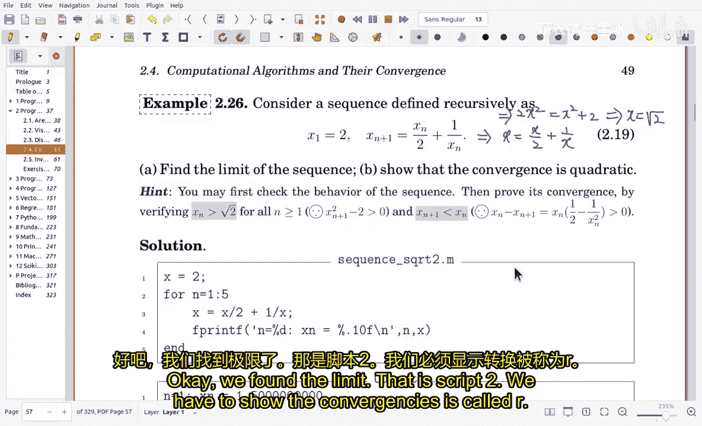

And maththematics beginss with a definition， what is quadratic conence， this one。

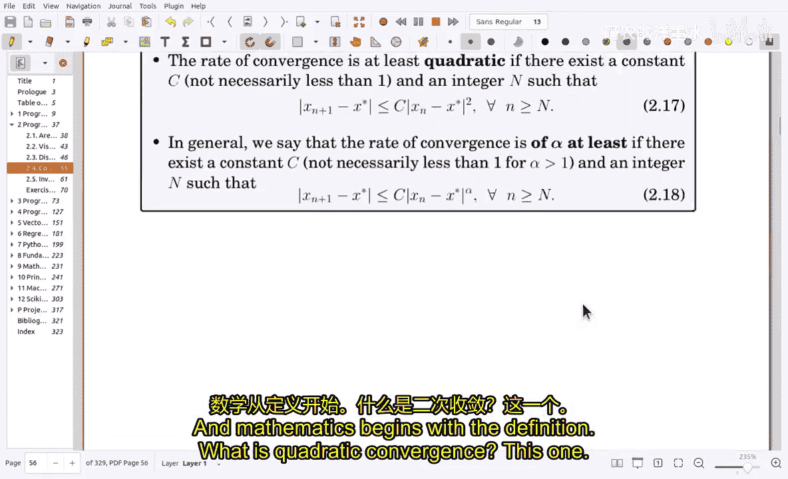

So that is x n plus 1 minus the limit。Ass bounded by some constant times that spirit。

 So only we found that X star is good of the tool。 So let's begin with here。嗯。At。

N plus one and minus scale up to2。Okay。Then lot is Xm plus 1。Here that is this one X over to。Okay。

That is。XN。Over2。Plus one over X N minus curve 2， right， okay。To deal with this one more effectively。

 okay， let's try to eliminate this pattern portions。By putting outside the。So if he out2 XN。

And then we multiply two x for each term。And that is。X n get in。Now， there is plusum。2 and。

Mus2 cut up to2。X n Ryan。Okay。Now， for this portion。And from here， we have Xx separation。

XN XN separation in fact， from this one we have a skirt to2 square2 separation， if we put here minus。

 then this simplification will make each one makes minus square 2 xN。

 so minus2 square 2 xN that means right side the same as one of。2 X。And now that same as xn minus2。

Scured。Yeah。Now， also we know here X n is larger than or equal to square of to 2。So that that is。Now。

 pounded by。Here， one of two script 2。 and then we write down here， X N minus script 2。Scarcaed。

So that for theirron， now， x n plus1。This one is always larger than this value。

 So it' the absolute value is bounded by this quantity。

So that is exactly the form of this quadraratic。

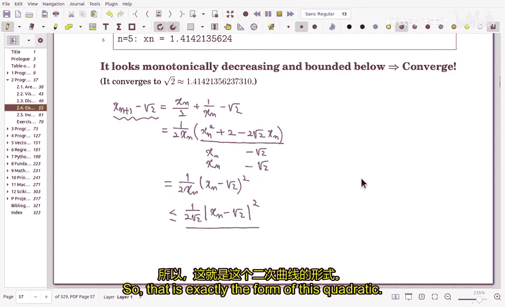

Conbogen， right， so we。

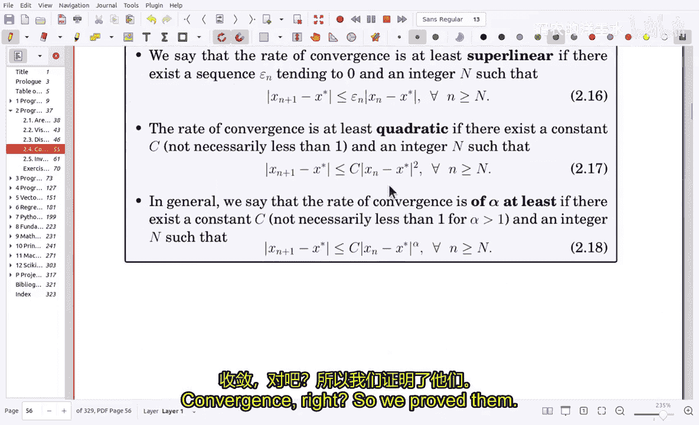

The quadraratic congence。Okay。We'll continue in the second part。 Thank you。

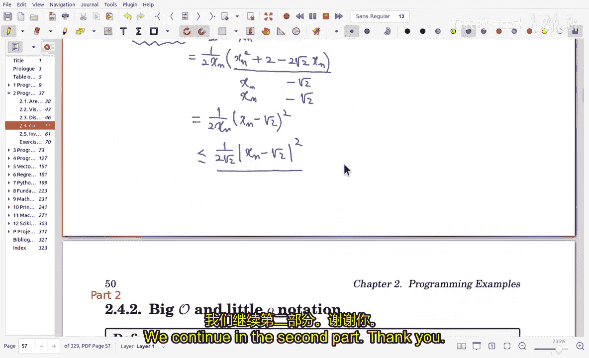