# 【全集-附课程讲义】密歇根大学-人工智能编程-EECS492-中英字幕-p12-Lecture-12---收敛顺序-大-O-和小-O-符号--BV14JqfBNEAS_p12-

It is part2 of Section 2。4。Big O and little or notation。

The sequence alpha N is said to be in peak of P n。If。There is a project number K， such that。

This inequality is satisfied for large end。Equily。The alpha N over。Paion in mods。He founded by Ca。

In this case， we say alpha n is in pi O of beian， and we are using。Here， the notation。

 alpha and in peak O。嗯。배 ora， we are using equality。Sine， alpha and equals Sp be n。

A sequence alpha n is said to be in little law of beta n if there is a sequence epsilon n comp to0 such that this inequality is satisfied。

For large and。That is same as this。The limit of alpha N over pet is serum。So that here。Now。

 alpha N is basically。Here now。If petion is increasing。Then here， Alp N is slower。So that anyway。

 this is similar than that。But in this case， and as n becomes a larger and larger， larger。

And is bounded by some number means that the same order， basically。If it causes infinity。

 then is bounded by K times of the increasing speed。So that。

And once they are both increasing then and。More or less the same order， but in this case。

 the Alene is slower。Okay。Anyway， in this case， we say alpha is in little low of a pet n。

 and we are using the notation alpha n。Is in D of Palion or the same we may use equality sign， Al。

Equals0 of perion。Let's see， examples。

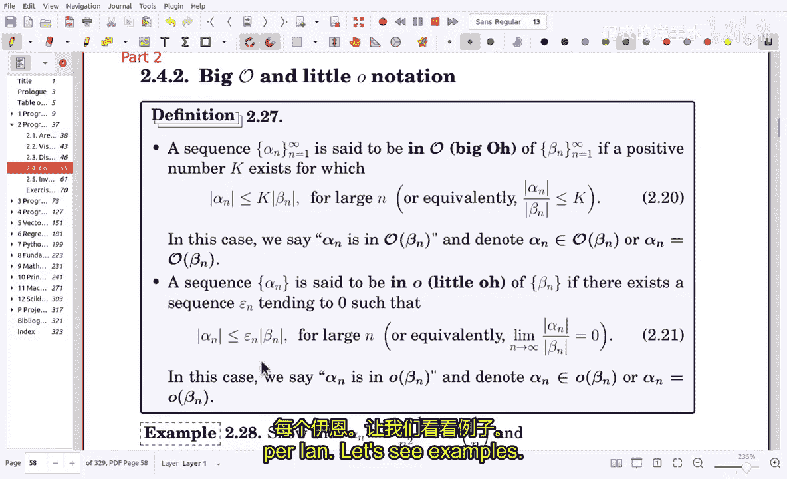

Show that this one and there one， let's try to show this a second part。

That means that here f of n is pi of n to d minus 2。And simultaneouslyous little n to the minus1。

So that we'll try to show two parts for this one。 there is a first part。

 and there is no second part okay for first part。Now， F N。Over that one。So that F N。M。Over now。

 entry-2。Okay， that one is same as okay， M plus of3 divide by the。

And cubeto plus are20 and schedule and divide the by and the-2。So that is sames now。

N square will be multiplied over there， so the n cube to plus 3 and square。Ouobo。

N cube plus trainingning。And scared， right？Okay， this is cubic and cubic。

So that here divided by N cubeator， we have one plus。

And30 over N Ti by the by the one plus chain over N S N。

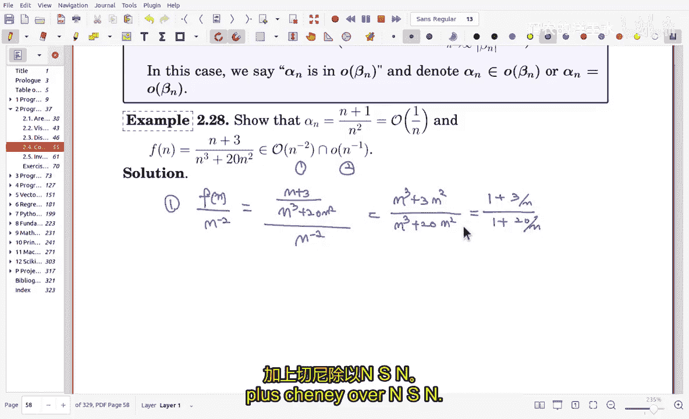

Appaches infinity。 These two termss will approachceone so that eventually this ratio will convertverge to one as n increases。

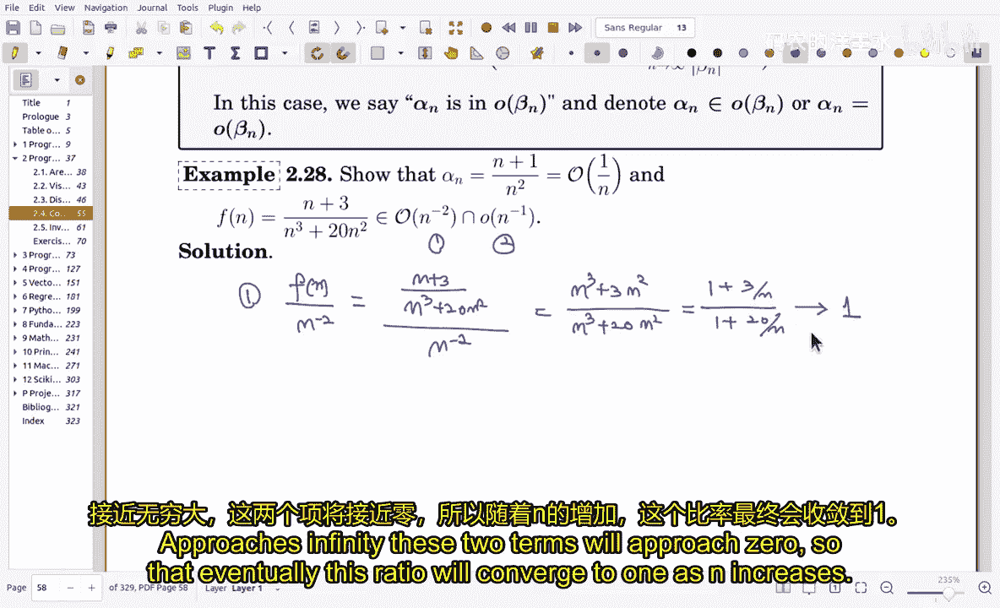

So here we didn't use absolute sign， but anyway， as an ops infinity。

 these quantities are positive so that without absolute sign here we have that。

 but with absolute sign well have the same result。So it is。

You can say that right now this is less than one。In fact， it's convert to one from below。

 So it's always bounded by one。So it is playing the rule of K。So the ratio。Ass pounded by。1。

 which is K， so that we can say this portion F is in big or up n to the minus-2。 Okay。

 how about the second part。Okay， here。Now we have to check the ratio。F n over n to the -1。

Or Fn divided by n the minus-1。Okay， then here rather than n to the minus we put here n to the minus1。

 then n will be multiply on the top so that there will be n squared plus 30 n divided by here and cube the same pattern here plus 20 and square。

Now， this is cubeia on the bottom and the numerator is quadratic so that。

Bottom includes much faster than this one。 So we know that that will convert to Cdo as an approaches infinity。

So， here。Now that is satisfying this one， alpha n over Pat N limit is 0 as n increases and approaches infinity。

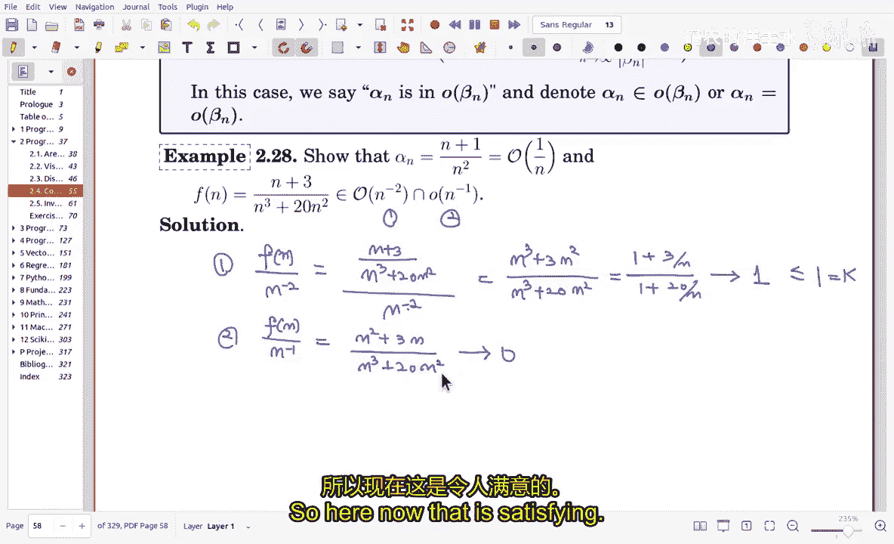

We can see that the risk show absolute value。As approaching 0。

So that means that F of N is in digital or of。En to the minus-1， okay。

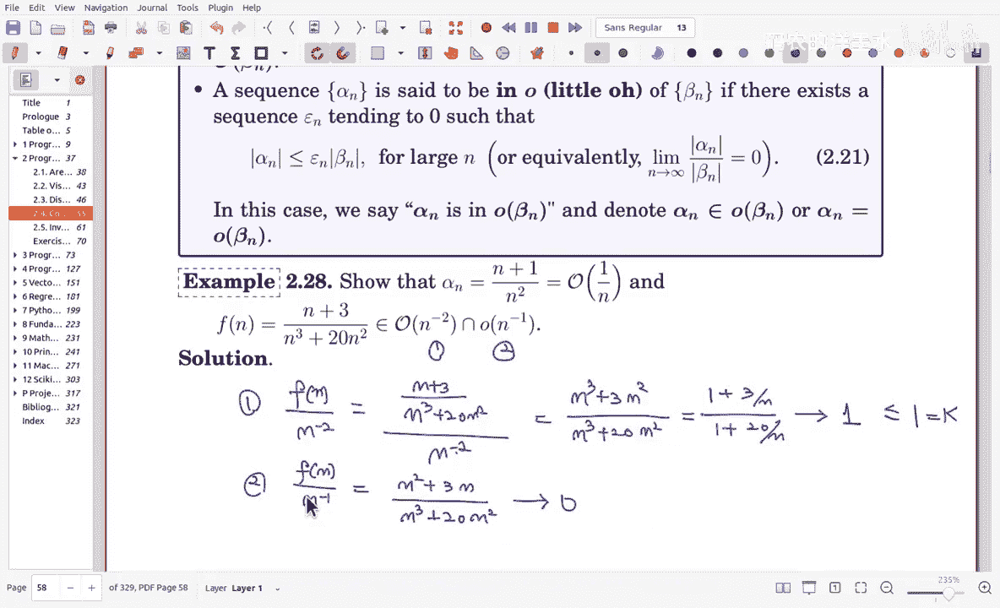

So we prove that。Okay。For the other one， you may check it yourself。

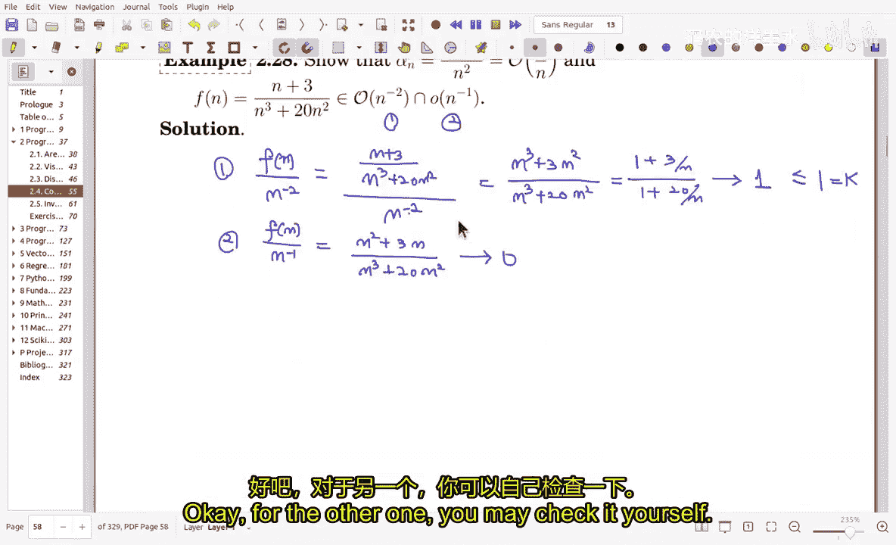

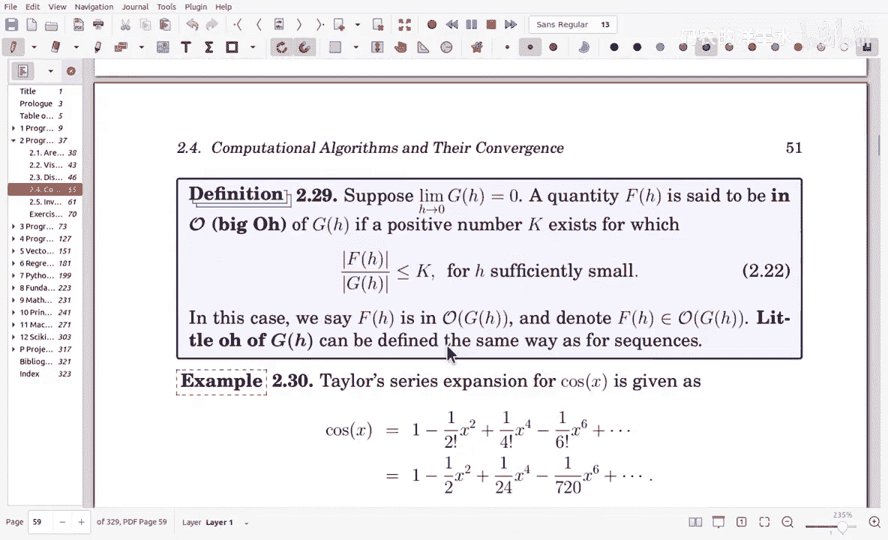

Now， we are define the little P O and D law for。

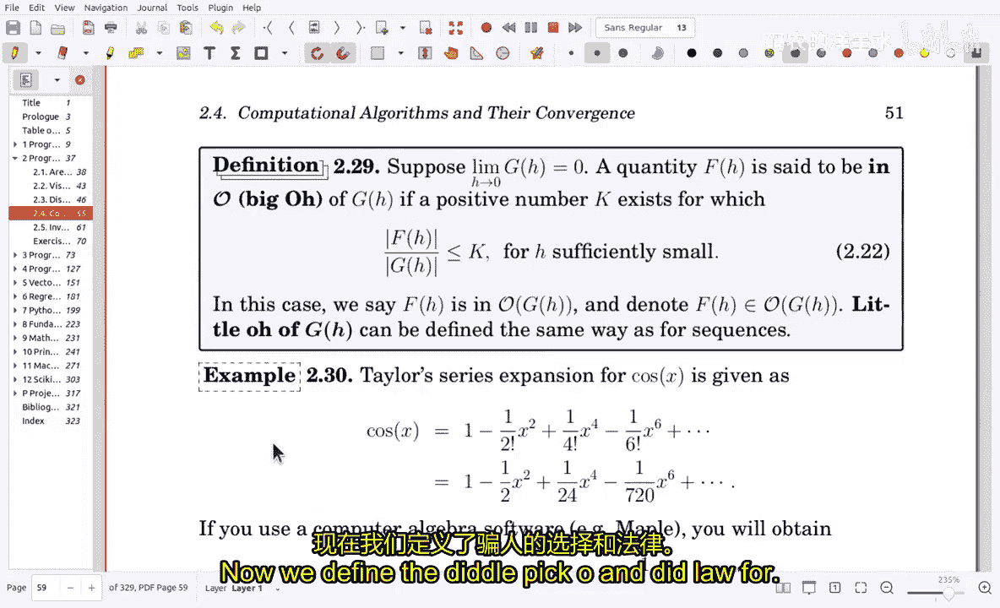

The the quantities sequence converting to zero。Suppose tube H is converting to0 as H approachess zero。

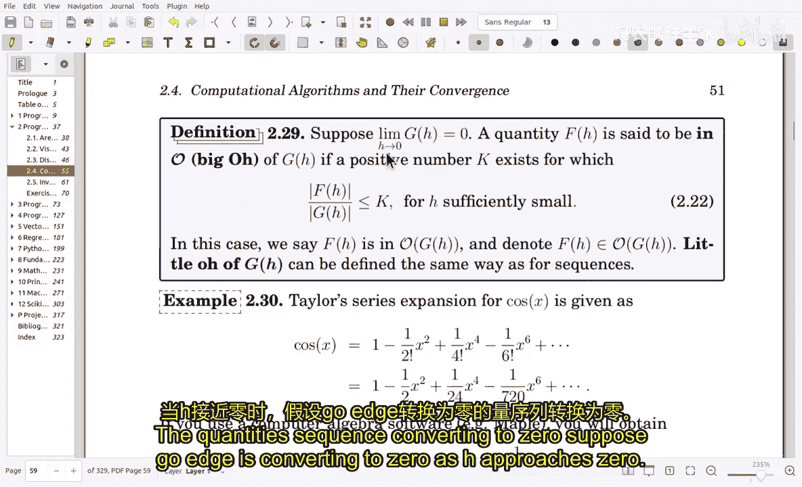

A quantityity F of H is said to be in P or of G， H if。There is a project number K such that。

FO with G。In modulus is bounded by K。For H sufficiently small。

 that means that as H approachess it down。In this case， we say that F H is in。APig O over G over H。

 And we are using this notation， or sometimes again， the equal sine。

little or of G H can be defined the same as for。The sequences， and in fact。

 the ratio cons to0 as H or 0， then we say that capital F H is in little material age。

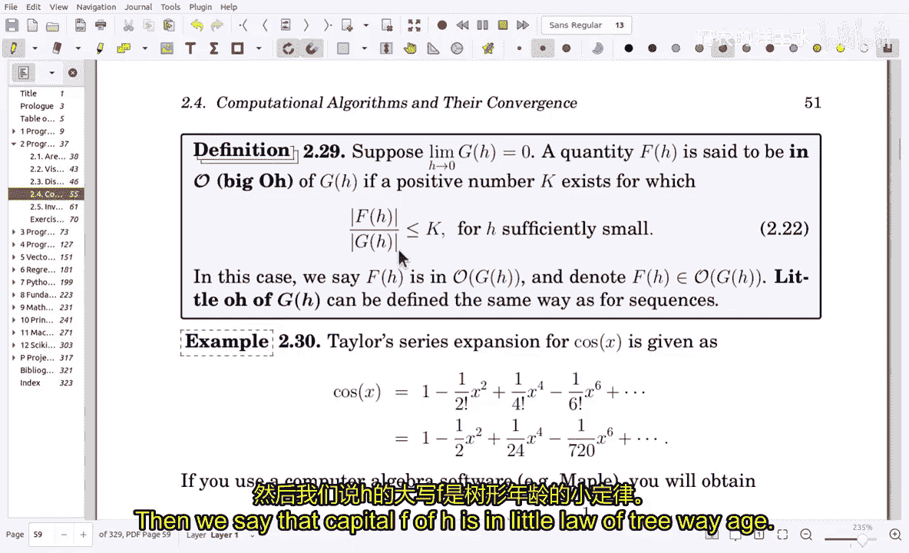

Let's see the city example。Taylor expansion for cosine X is given as here。Cosine x as now。

This is even function。 So in polynomial here you can see only even with the terms so we can write in this ring。

But if you're using。ACompital algebra So tail。 And if you try to get T expansion for cosine x。

And Abat Siam， And four terms。Then you'll see this one。Now， in fact， and linear term is one term。

 but equis so that。We don't have here。 and also third term with quo0 So that constant term。

 first term， second of term， third term， this four will make four terms。

So the for term expression is only this one， and then that is the remainder order the X4。

You'll see such output。Now。嗯。This means that the limit portion is now。

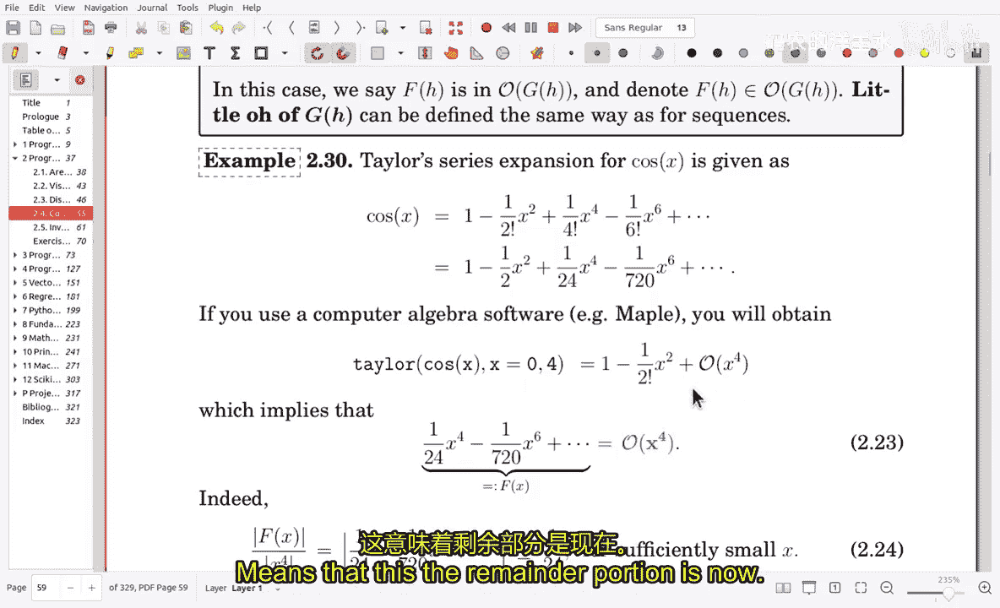

A p of x to the form。Now we'll check why it is given in this way， why it is in in peak of x to4。

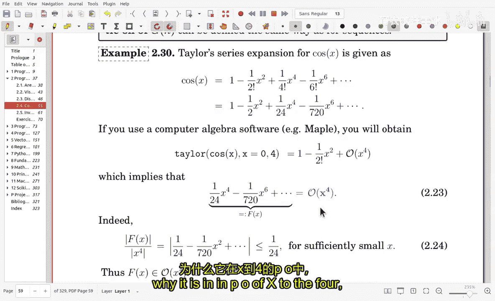

Okay。If we define this portion as capital F of x and divide by x to the4。Then。

Here we can reach this term divide by X 4， divide by X4 so that here we have these termss。

Now this is a mission， this is alternating series and becoming similar， smaller， smaller。

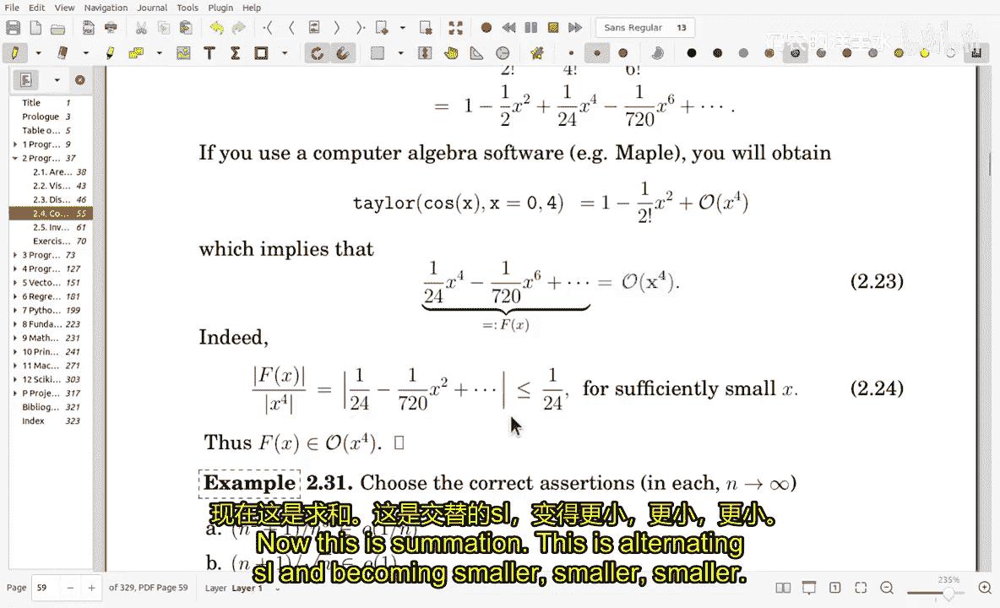

Also， x is approaching thedo so that later terms are much smaller。In this case。

 this summation is bounded by the first term， which is one over 24。

 This whole term for smallx is bounded by one over 24。So ratio in modulus is bounded by a number。K。

 which is one over 24 so that we can say F is in。Order， pick or of X to the form。So， the。

Computer output is given in this range。

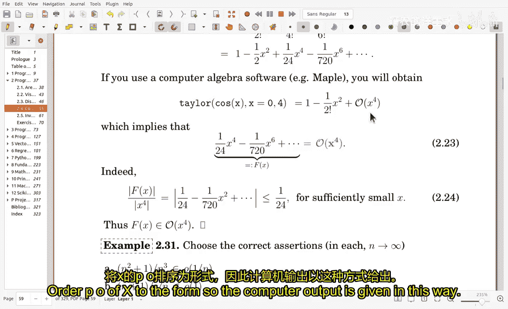

Choose the correct assert in it。And is of approaching infinity。Okay。Now。

 let's check if the first assert is correct。Okay。To check here， you have to check the restaurant。

Okay， and scatter plus1。Wval and Cubabe。Over， this is alpha N， thiss petian， vulnerable n， right？

So it can be written in this way。 There is now an cubeto plus N Tite bar here and。嗯。Ced的。喂。Okay。

This one is converting to one。And。And 4， but is slightly larger than one。And full。

Every N it is pounded by two， but anyway it is company to one。

So we can say that this term is in big all of one over N， but it is saying little long。

 so that it's wrong。For that one， okay， this term divided by one that is the same as this term now as n approaches infin in。

 that is pulling up。 So it is becoming larger and larger。So that it cannot be。Here little low。Of one。

In fact， what it cannot be。Pig O of one。 But for that one， if you change this on pick O。

 then it's true。Is correct。 But for that one， is wrong。Same way you can check that。

 And now let's go to fourth one， this one。Okay， that is， we start with the ratio vulnerable n。

logo and Ti D by one over an。Then we cancel one of N， and then here that is one of a log。And。

Demand that。Now， as an approaches impfinity， this one approaching zero so that。Here。

 this term is in little of the that term， right， So the correct assert is only this one。

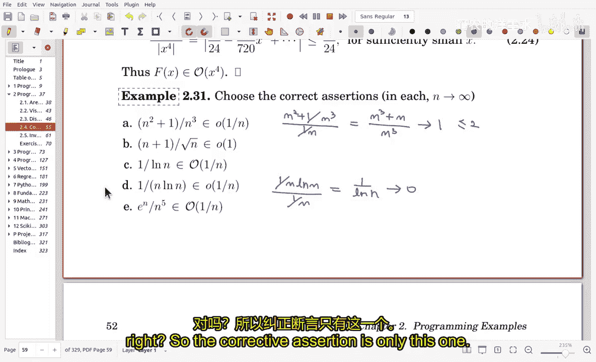

F4 H is defined in this way。 What are the limit and the rad components of F4 H？

Let's try to find the limit in the beginning， and then we'll try to find the rate of commence， okay。

Now， in part one， okay， limit is H apologies 0。 We can find it。 So it's the limit。Xiao。

H approaches zero F H。They're the same as the same limit。And yeah， one plus H。Mus E to the age。

Uber age。 okay。Now， A S H。Approaches 0。 The ta is approaching 0， and bottom also approaching 0。

So this problem requires a little bit of knowledge from cals。And 0 over0 share。

 And then you can use the group rule so that the limit is the same as now。

 the limit of ratio from each one。Here， you can get derivatives derivative this one S M is1 minus E to the H and over。

 and that is one。So if you can have background。

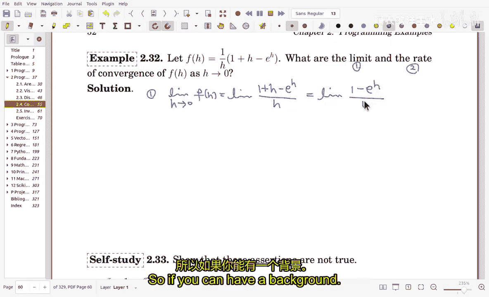

From Calalcu then， in Cha 3 will deal with。The calculus， so that by then。You may not understand it。

 However， later after finishing Chapt 3， if you come back here， then。

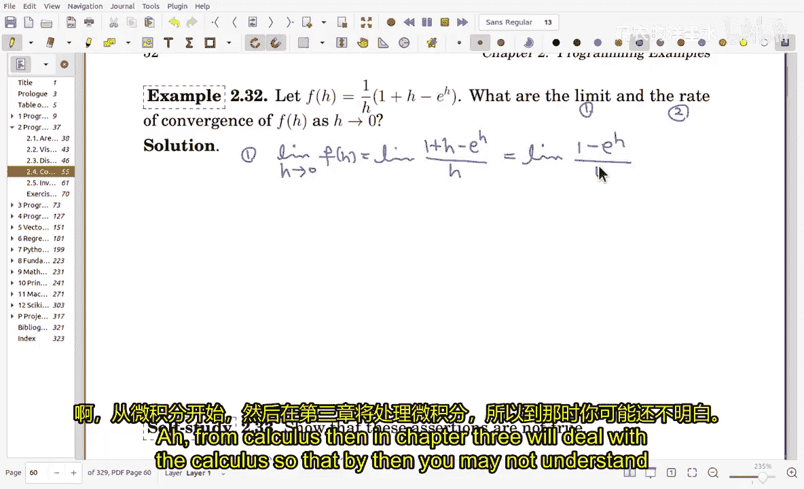

You can see it。啊，快递这边。Okay。Now， if H approaches a C。

 then here top approaches0 and bottom is1 so that that is0， so that limit is0。

Dam is that FOBh is approaching sit on。Now here。Secondly， we find the rate convergence of FO H。

That means that we have defined find here K such that F H as in big O of H T K。

So we have to find this K。So the problem is asking to find the rate of congence of FO H。

 that means that here you have to find a case such that F H is in equal of H to decay K， okay。

Now check to find the K exactly， we start with the definition， the ratio F of H。Now， F for H。

T buy the by， H D the K。Okay， that is same as。1 plus H and minus E to the H。

 And there is a1 H originally， and then H to K。 So that H K plus 1。Now。

 K is non negative number so that once H is0。Ban Xiao。

Tab is approach 0 and bottom approaches purchase0。So， that。Once you apply limit， then the limit。

Will be the same as the ratio of their deives， so the deduct is ta as1 minus e to the H and detable bottom is now K plus1 will go out and H T K here。

Okay。Now。For thereon， once H of0， then top ofpo0。 and here。And。To get some。

 So we have to find the K as large as possible。So once it is approach 0。

 then we can make bottom approach 0。 so that means that once k is integer。

 then k doesn't have to be 0， in fact， k can be larger than equal to。1。

 so that bottom goes to the shadow。Okay， so si open0。In limit so that again， we may make aive。

 then ta is e to the minus e to the h divided by now that is here K plus 1 the constant and K comes out and H to the k minus1。

Now。Tab is approaching -1。And so that。Now， it cannot approach to zero。

 So it must be a positive number and non zero。In order to do that。Here， if K is， for example，2。

 then H to one H is approaching so that the value will blow up。 So K cannot be 2。

And so we decide at this moment here， case1， then we know that。Here，0， okay  one。

 so that that is one。 So that minus-1 over。1。Times here， bottom and one plus 2。

 So that it approaching -1 over2， okay。So that take cany2， once2， then its per signal。

 so that quantity blowing up。 so we cannot say that。So here， case1。So F of H is P of H。

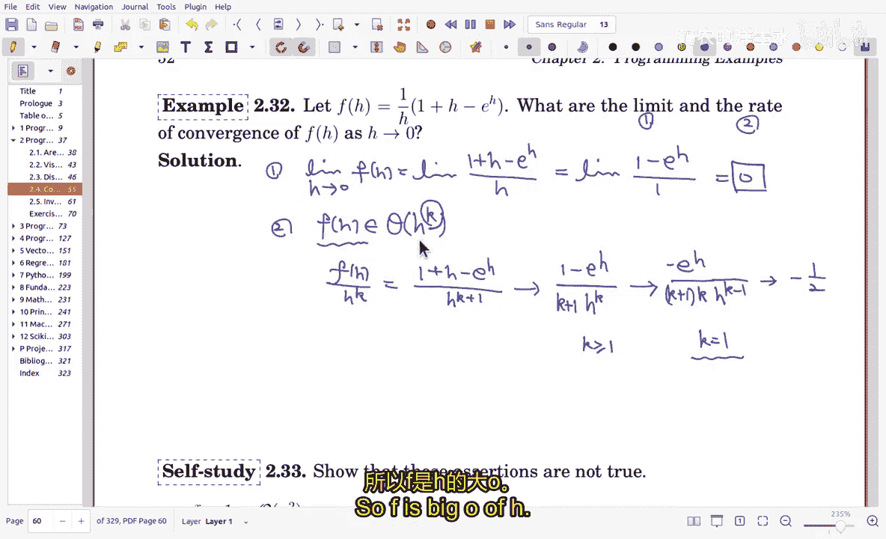

Okay， guess all bit complicated， but you can understand this one later on after learning calculus。

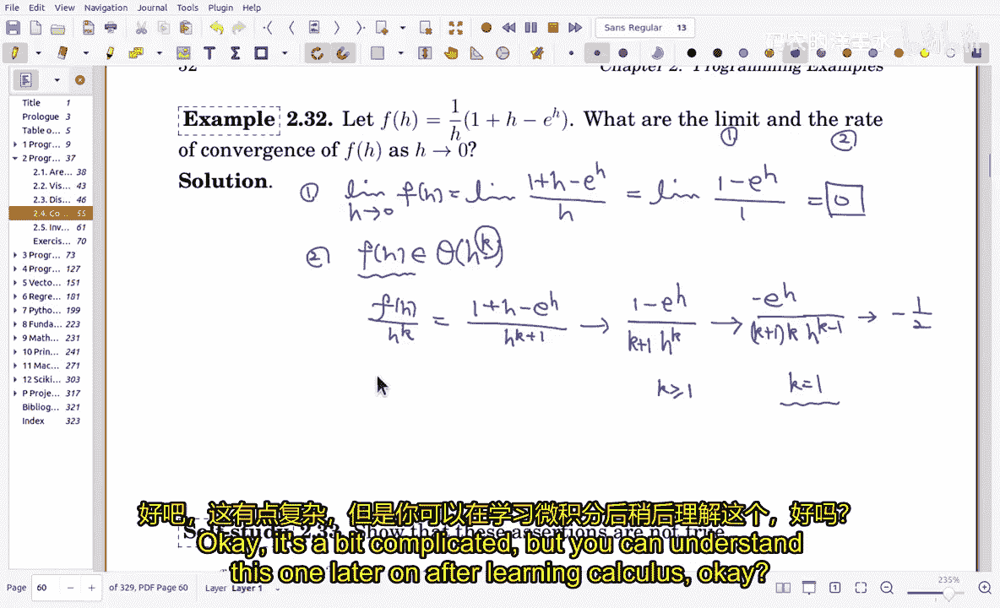

Show that these sessions are not true。If you have calculated background then biasing that I finish on this term dividedta by x squareity。

And this3 the that one and the ejector same。You can check there this all。Not true。Okay。Is fors。

You can check it yourself。

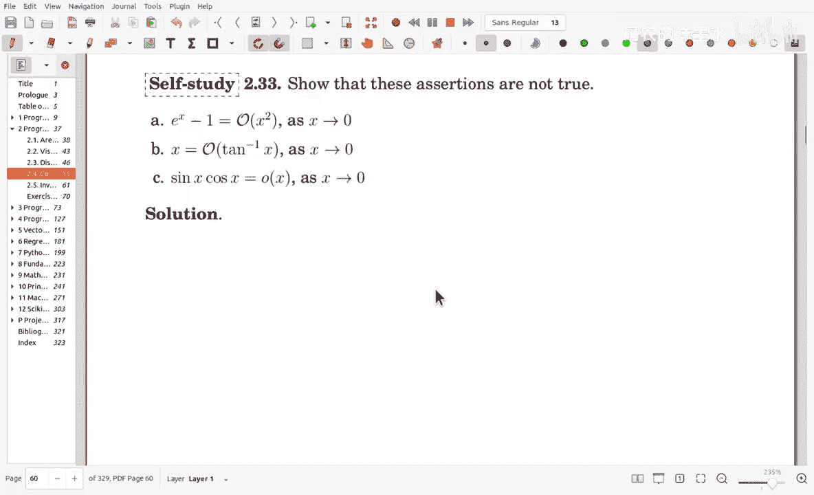

Okay， that's the end of the section， thank you。