# 【全集-附课程讲义】密歇根大学-人工智能编程-EECS492-中英字幕-p14-Lecture-14---对数函数--BV14JqfBNEAS_p14-

It is parted to our Section 2。05。Lowarmic functions。 In the first part。

 we studied inverse functions and。The exponential functions。

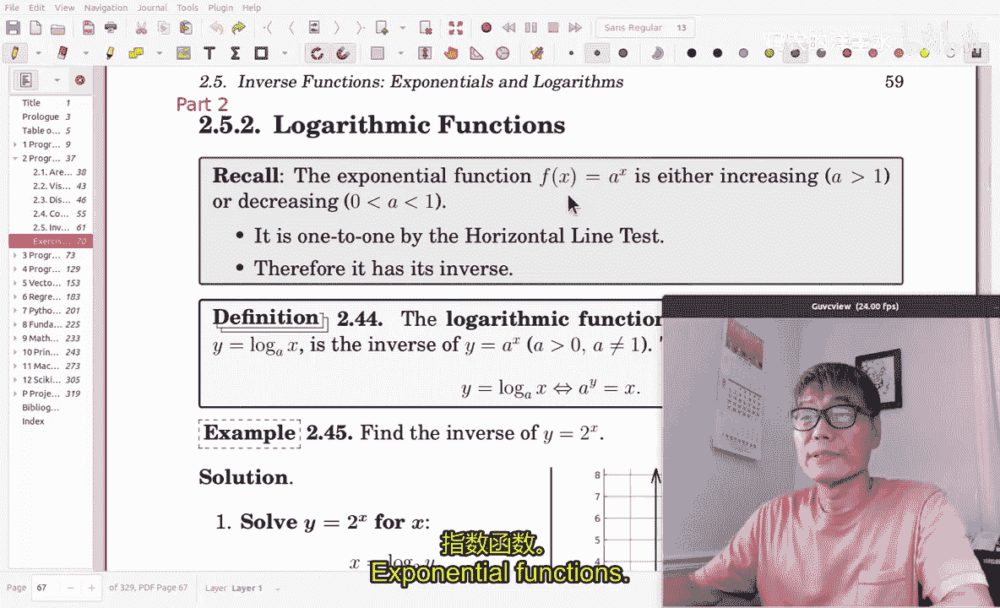

The exponential function， F of B x equals。A to the x is either increasing or T increasing。

So it is one to one by the horizontal a gentle line test。Therefore。The exponential function。

Should have is inver。Here we'll define logarithmic functions。

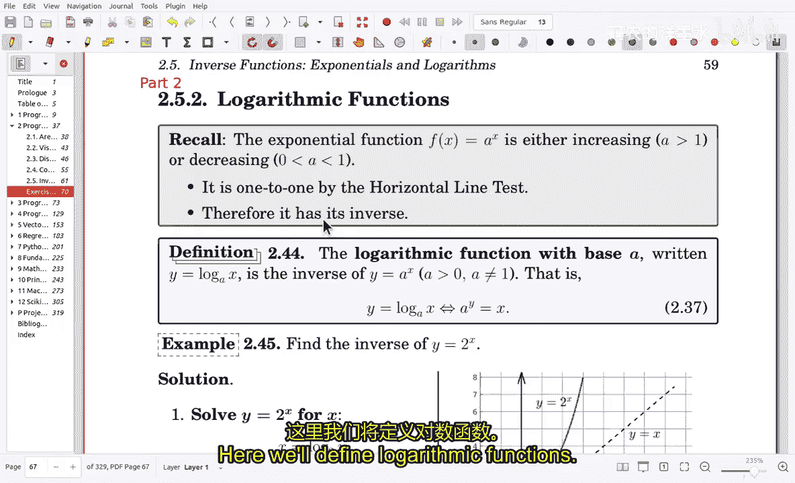

The log amic function with PC。Reading in this form is the inverse of。Y equals a to the x。That means。

If you see。Theres a logo at the Mag Christian。Then you have to understand the Christian in this way。

H to the y equals the x。Okay， let's see this example， through the example。

 you may understand the algorithm。More federally。Find the inverse。Y quotes to the eggs。

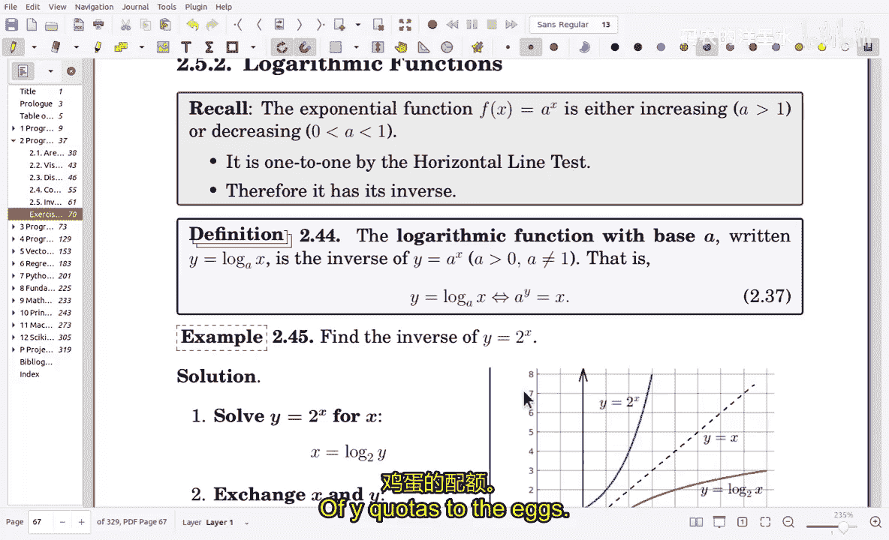

And to find the inverse。Of the question the function。You have to serve the equation of 4 x。

 that is the first step， and secondly， you can exchange x and y。And however。

 if you try to solve the equation fo X， then。Impossible。

So we may introduce notation law and we can write in this rank。Because it has its inver。Anyhow。

We should be ablept to solve for x。So that here we introduce a new notation and we write down in this array。

 and then now we exchange x and y。You may understand logism in this range just。

Just a new notation for inverse of exponential function。

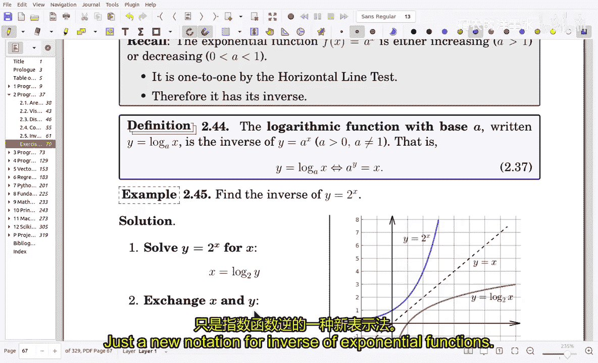

The Griff of vehicles callss。Lg base to x must be the reflection of the graph of this exponential function about y co x。

 as you can see in this figure。That is the given function and it inverse a log function。

 and there is a reflection about y callss x。Okay， here we have a note。Equion。2。37， that one。

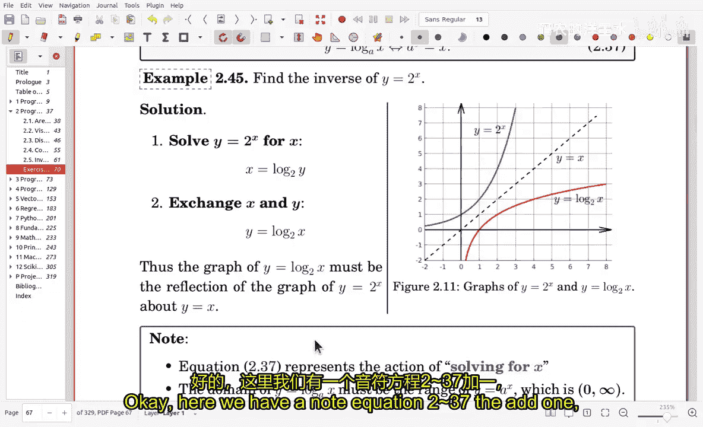

They present at the action of solving for eggs。And。

And the domain of y equals log than A x must be range of y equals a to the x。Which must be here。

0 to infinite。 the positive numbers。 That means that。Loered them。Acept only partial numbers。

 If x is 0 or negative， or then it is not defined。

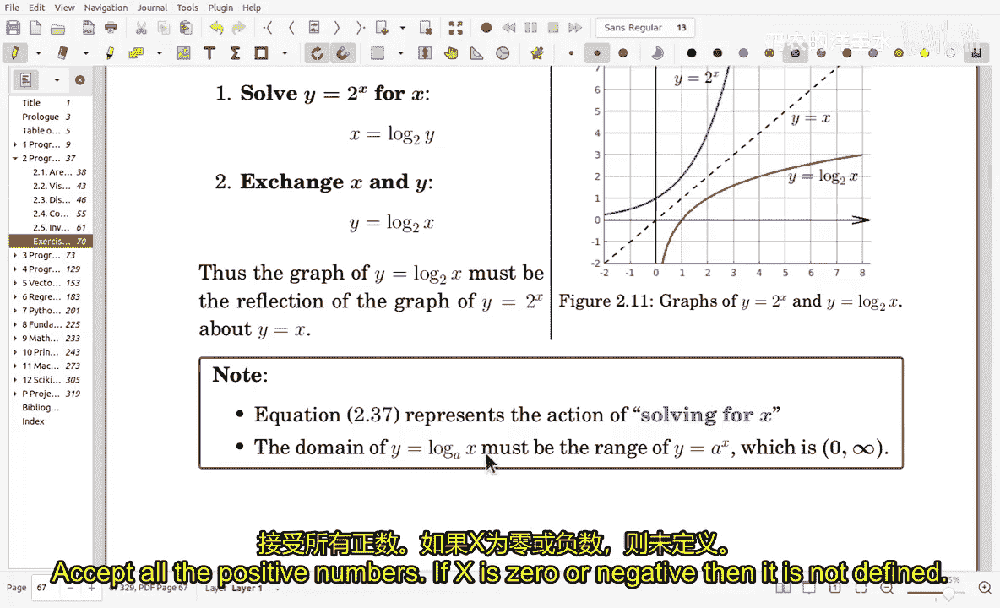

嗯。Here， natural럴 로가 and common 로가m。The logm with pace E。Is called the natural logarm。

And like of that and full。L E x， we write down in this way at an x。That means is natural logm。

 so the N L must be the observationbbreation。But in this case here。

 maybe people can be confused so that an S in log start with the L， so it's a change the order。

 so the LN is used for natural log。Once the base is 10， then the it is called the common logm。

 and we here。嗯。Discard the page 10。 But once you see this one in mathematical formula。

 then you have to understand that has this common log algorithm。

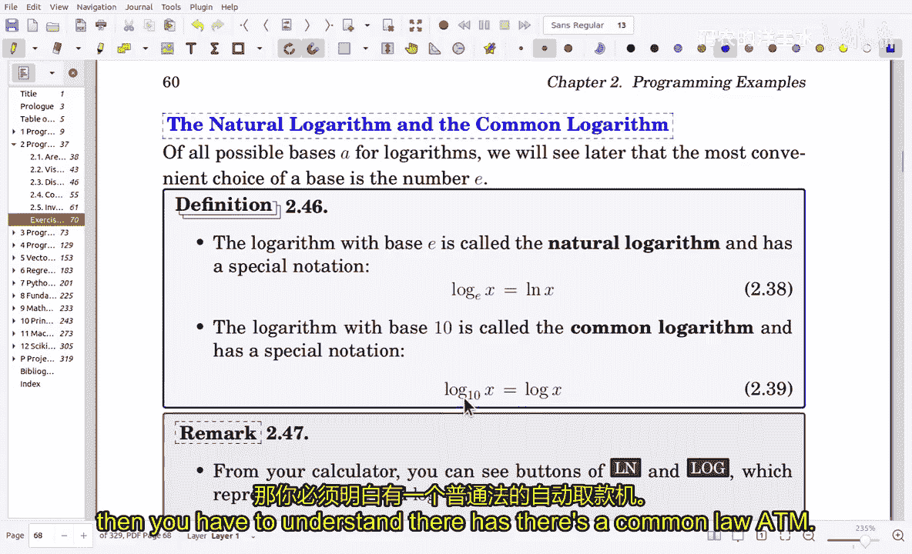

那。But when you are using。Here calculator， then that is rejected following the notation L N means a natural logarm log means a logarm pay 10。

Once you are using calculator， then。The same age is the following， however。

When you are using the computer program。And using some computational La。

 then function L N is usually can be quoted by using log。And for。Com on over them。

 you have to use log 10。So be careful， Laga means natural log and Laga 10 means that they come a log。

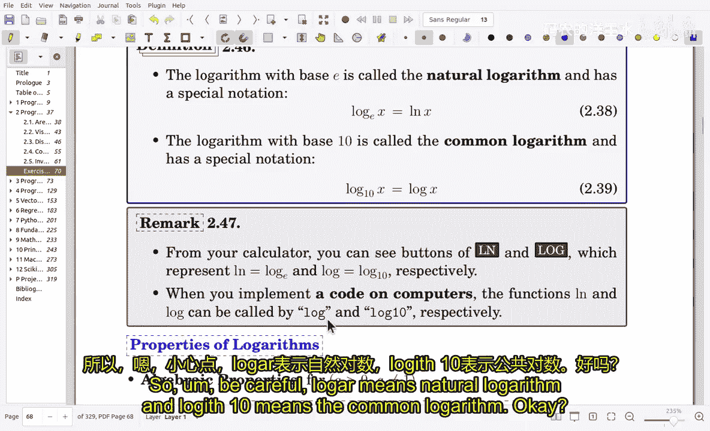

Okay。

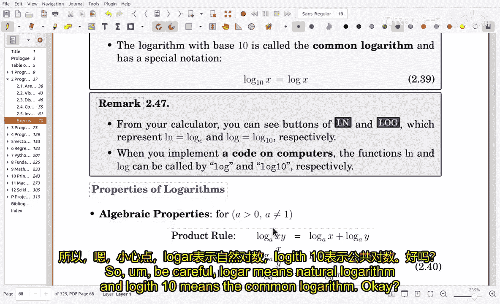

Here we have a prototype of logarithms， product to rule， question to rule。

 power rule and risk protocol rule。And I believe you learned this one from high school。

And so that just。Just read once and you can memorize here。

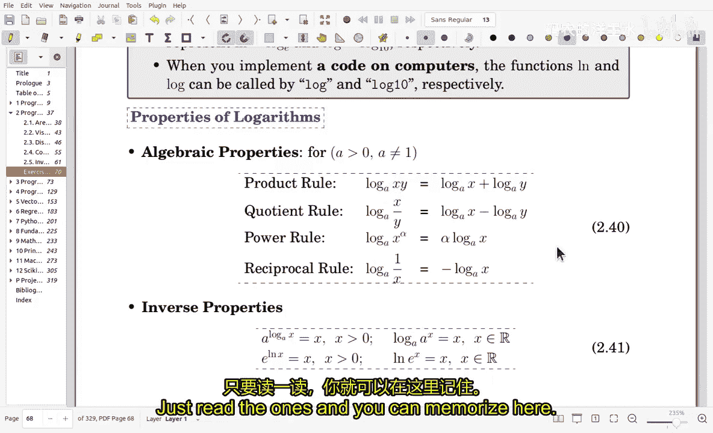

These rules。Inverse properties okay here Ae， so it is exponential。

And log A and logarithm so that A and log A can be canceled to become x。And which are the same。

Here La A and A exponential cancel them because they inverse each other so it becomes ads。

Once a is chosen to be E special cash， we can write in this way。Those the same if A is E。

 then we have here at N。AndE to the X equal equal x。

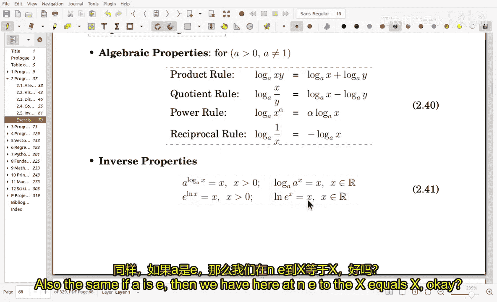

Okay。Now let's solve these questions， okay， let's try to solve one over them here part B。Okay。

 from this one， by using the product rule， we can write this left hand side。 that is now log。

Basically， and x and。Here， x minus2。Which is now the same as one。

But now that one is also can be change to them。Into。Like a log and past 3 and 3。And。

So that this portion is the same as that。So， here we can get。From this one。

 and x x minus2 is MsF 3 or。By using。This portion。Okay， by this portion and by the definition。

 this is the same as okay。There's a pa of3。 So you have to understand that this one in this way，331。

That is y you call deta x。Ex。X-2 by assuming the definition， you can reach that one or。

By changing one it's the same as log base3 and 3 can reach at that one either way。

You can get the same result。Okay， so from here now we have the sodi that is x together minus 2 x and minus 3 moving this into left hand side。

Yeah with that， there's x axis separation and one for the separation is a minus and plus。

Then means x minus be -1 and 3。 Okay， we reach this one。However。

Lower than order means only positive numbers so that here X cannot be。0 or negative so that。

This -1 cannot be。Solution and here if you think of 3。

 then here you can easily see that red defined both them， and then this becomes1。

 that becomes lag 31， which is the0 so that left hand side right and side the same。

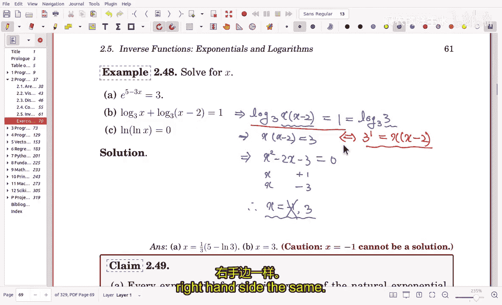

Okay。呃。We have a clam here。Every exponential function with some various bases。

It's a power of the natural exponential function。Here that is a to the x from this one， for example。

 intermediate term will become here now biing Pa E。

 and then log natural log and a to the x now biing power x can go out here so we can reach over there and this can be written。

As in this way， now e to the x n power lower than of V a right？

So that every exponential function like HVx。Its a power of the natural exponential function。Okay。

Yeah， every logarithmic function is a constant of the natural logarithm。Okay， log A X。

 page A can be written in this frame。And natural log x over natural log of a。

This formula is called the changeable base。Formula， it can be put quite easily。 we start with。

That's your log with x that can be leading in this way。 Now， x itself is the same as now thereron。

 H D log A X and now。Okay， that portion is power。 so the power can go out by using the power rule so we can wechat over there now for lag A X。

Yes natural logarith of x divided by thiss quantity so we can reachsha this formula。

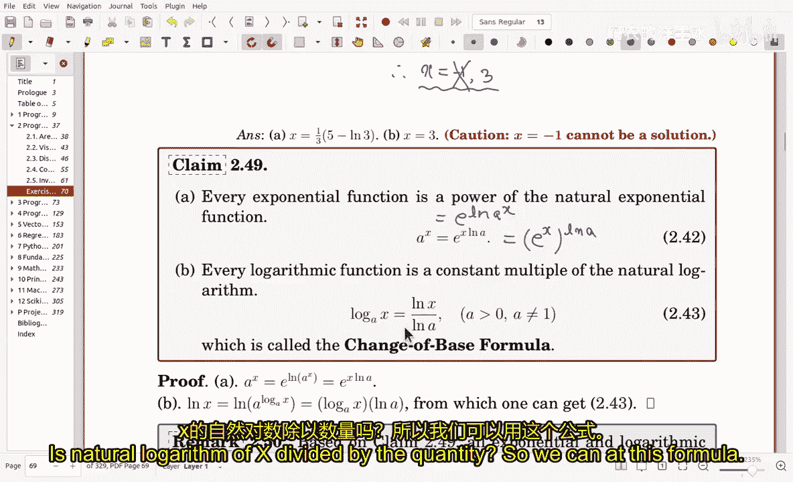

Okay。So here。Based on claim 2。49， all exponential and lowerithmic functions can be evaluated by the natural exponential function and the natural logarithmic function。

And they are here。In Matware， E XP and L G functions。Okay。

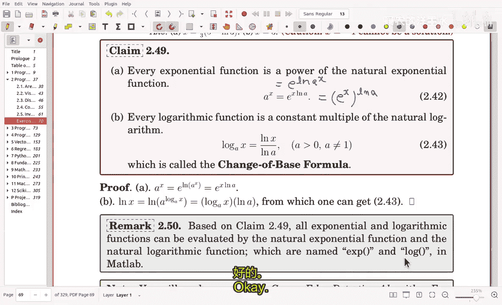

And this is end with the section and end up with the chapter。

 you will work on a project called Kenny A detectionction algorithm for color images。

 while you are studying the next chapter， next chapter is about the programming with。

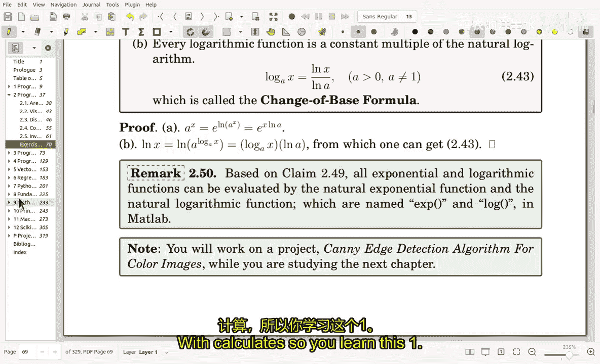

Calculators。 so you learn this one and。And now， before finishing this one， we will finish a project。

Okay。Thank you。

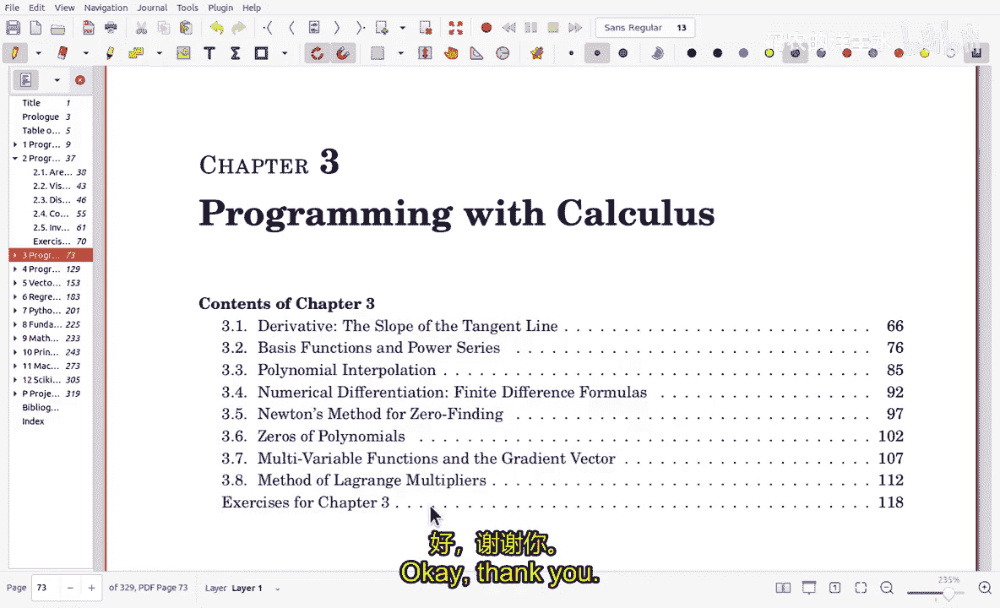