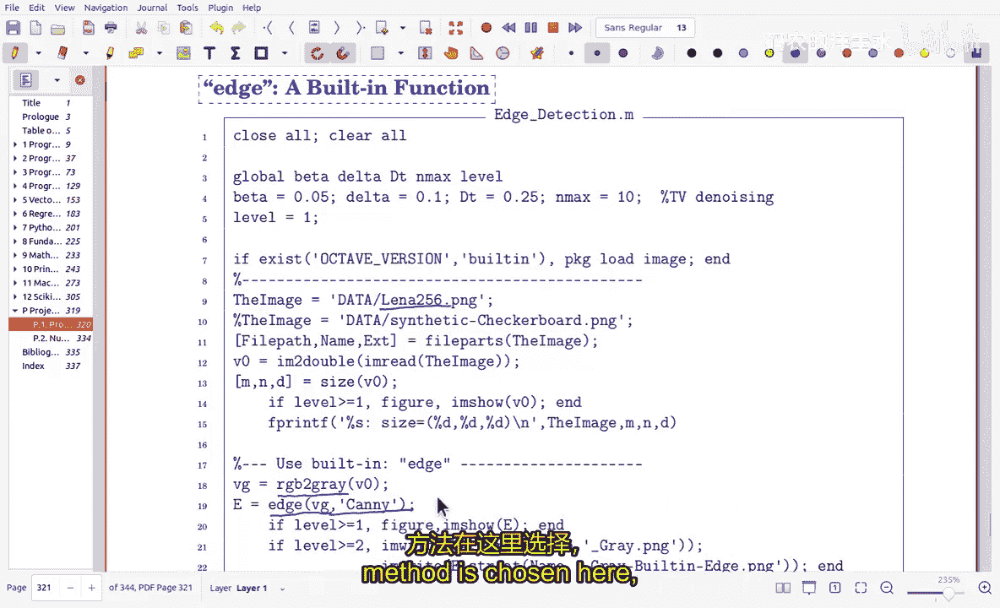
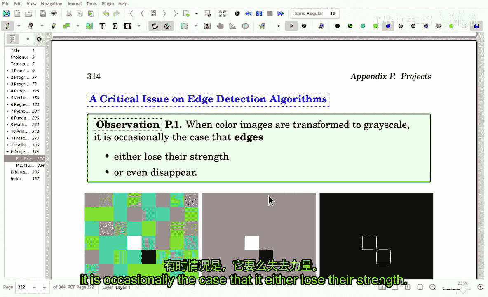
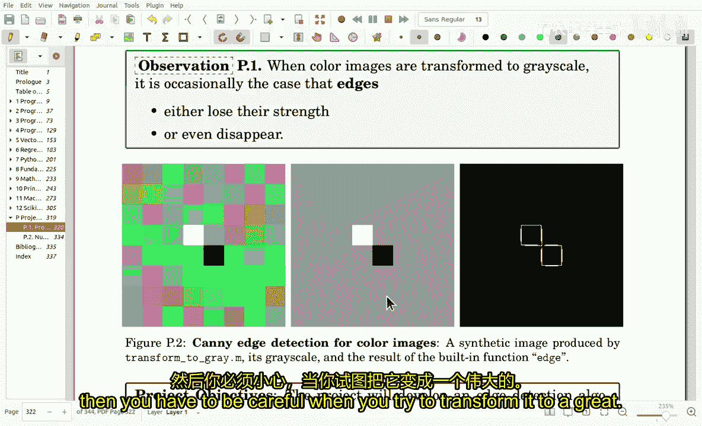
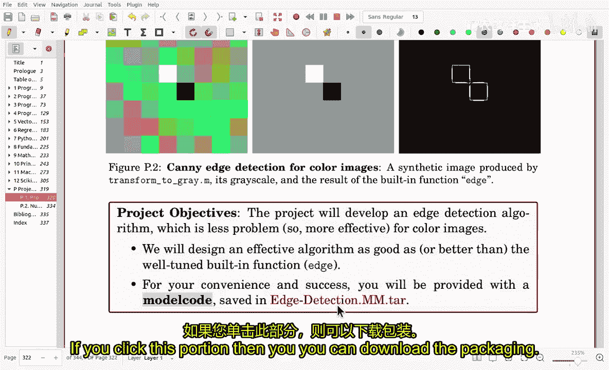
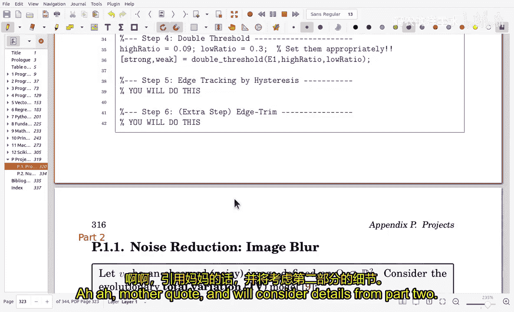

# 【全集-附课程讲义】密歇根大学-人工智能编程-EECS492-中英字幕-p15-Lecture-15---彩色图像的坎尼边缘检测算法part1--BV14JqfBNEAS_p15-

It is a project。Can you add detection algorithm for color images。

Toledo project will build on edge detection algorithm。

 which can sketch the edgesable objects on color images。Let's suppose try to answer the question。

What are images。An image is a rectangular audio with pixels for color images。Each pixel。

Has three values。RGB。Rer， Korean and blue。In the RGB representation。

An image can be considered as a function， defined on。이미지とめオメガ。For example， this is on image domain。

And the image function has three components。And each component is is non negative。

 so it can be considered as a fairly dimensional function。In reality。The image domain。

Is order of integers， and it is on integer value， the order。 that' is called the sampling。

And image values also are integers between 0 and 255。That is called the quantization。We the camera。

Is acquiringing。라이스 시그널 시그널。Is separated into LGB components， each component。Its a continuous signal。

Now， for effectiveness edge， the continuous signal will be partitioned into integer values。

And from 0 to 255。So that。The signal can be saved much more effectively。Into a similar space。

 And also， we can deal with the。The integer values convenient to them。

If we look at the imaging as an O， then。I isian M And D。

Here M is the number of roots and N is number of columns， and D is dimension。

Theres either one or three。If it is a three， then it is a color image and now if this one。

 then it is a critical image。The color images can be transformed to a classical image quite easilyly by using the formula。

 this is most frequently used formula and also in matlab if you are using LGB to gray then this formula is used to LGB30 values。

Aver， along with the that weight， so that the gray value is。Weed the average of RGB。Okay。

 this is about images。Most of a detection algorithms are developed for curacecycl images。 of course。

 you can apply edge detection algorithms for color images， however。

You should first transform the color image to。G kill one。

 and then you can apply the edge detection algorithm。

Eddget detection algorithms consist of few steps。For example。

The canny edge detection algorithm has five steps。The algorithm was published by Kenny in 1986。

Here are the fiber steps。ノイス リダクション。Cadient calculation。E치 thin닝， 더블 드。It tricking by hiss。

We learn can algorithm， implementinging。Every step in detail。Yeah， let's see。

A program using a Pin function called EG。But， let's。The main part。This path is a setting up。

Pmeterters， then here we choose the image。Sa in theter data， Lana image is selected。After reading it。

 we change it into an order of double precision values。嗯。

So here the image values will be scaled so that the values will be between 0 and 1 rather than from 0 to 2 to55 integer values。

But yet it is a color because each pixel has a30 values only。scaleator then。And biasing。IG B to gray。

 Now we have gray image。 Okay， the calling this one now we call。The Ptian edge detection algorithm。

Bying the critical image and method is chosen here Kenny a method。

Okay。Now we save then here we see the result。This is the Lana image in color and gray scale。

 and that's the result of the function edge。Lna don her picture to the image processing society。

And the image was used having been used for various image processing task。So overall。

 she contributed。😔，A lot to their society。 So we should。Appreciate her donation and contribution。

Okay。The edge is not perfect， for example。Around there， there is no edge， however。嗯。

It has some edge components。 It's not really perfect， however。It is acceptable。Okay。

So by choosing some parameters more reasonably。You can ignore this portion， but anyway。And that。

Many places where is now really perfect， for example， also。This portion。MainPos it must be ignored。

 but here you can see that portion。Okay。Yeah。That。There is a critical issue on。

Et detection algorithms， when color images are transformed to gray scale。

 it is a the case that edges either lose their strength。

Or even disappear。Let's see this colorful image。 And once it is transformed to career scale。And then。

 you have this one。And except these two blockss， everywhere else。

Various colors are transformed into almost the same gray value so that you see a very flat classical image except these two blocks。

So if you apply。The function edge， then youll get all of these to a block。So this is。A 토익 jumper。

 however。If you try to get edge detection for color images。

 then you have to be careful when you try to transform it to a clear screen。

So here。In our project， we'll do this here project。Objectives。

The project will develop on edge detection algorithm。Which has less problem。

 So more effective for color images。We will design an effective algorithm S could as or better than the well tuned Ptian function edge。

For your convenience and success， you will be provided with a model code saved in this file。

From the lectureal， if you click this portion， then。You， you can download the packaging。

呃呃Let's see。需要嗯。Mother code。Okay， in in the program。And last moment， we added a new trial。 Okay。

 there is a function named edge detection that M， and we call and color edge along with the color image。

 and that is for text processing。The name of。The image is。Now。Use still in this program。Now here。

 the color image that is a new trial。Here。Now there' is color image， let's see again。The major parts。

Okay。And here。This is step one and step2。And step one is image tininoizing or noiseis reduction。

어 이미지 몰라？And you can use the builtin function， ca filtering algorithm。Now， rather than that。

 we may try to use TV tinnoising。 Well see the details later on。Now， in step 2。Here are now。

컴포리터 와즐링 채널 by 채널。And for each channel case from1 to 3 a。Now呃。The tin oyster and save it into you。

 And now for each channel， we try to get the gradient magnitude by using the sobel gradient and save it into create and component wisely。

And now for each one， this is edge direction estimateator。 So Theta is made。So we finish。

Step one and2。Chahannel by channel， and then。Before going to step 3。

We have to make the gradient intensity。In one day here。We try to choose maximum out of the。

Chahannel by channel gradient。 and that is saved here that index。

 which is used to select the angle from the component wise angle。Okay， so that。Now。

 I to save it into。T， H， early T，And by using。The windy gradientad intensity and corresponding。An。

 we try to do active feeling using the method of non maximum suppression。

So we'll see details of this algorithm also。And in forces tab。

Here we'll do double threshold and here for this step。

You have to set these two parameters rule a higher ratio and low ratio appropriately。

 and then call this a double threshold。Then you look at。

The pixels indicator for strong edge and weak edge and the pixels are not relevant so that you can select strong and pixels for edges out of that also。

This function is implemented in the packaging。Yeah。The fifths tab。Which is the last tab。

Of the can edge detection algorithm。And you'll do this one by polymerating a function。

For historic years。And also I'll give you information in detail。And now we'll consider another step。

 X tab and step six， and that is at train， you will see why we needed that。Okay。Okay。

 that's the roof scope of the project and。Mother code， and will consider details from part 2。

Thank you。