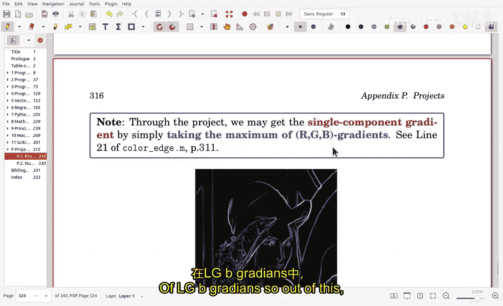
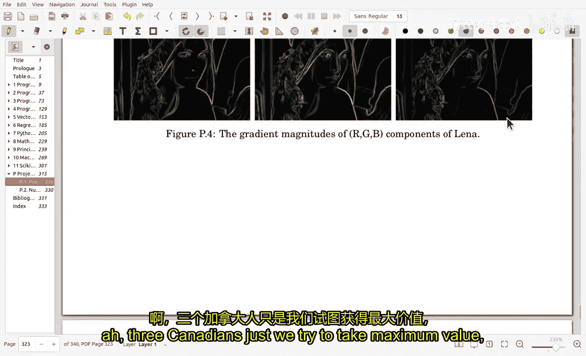
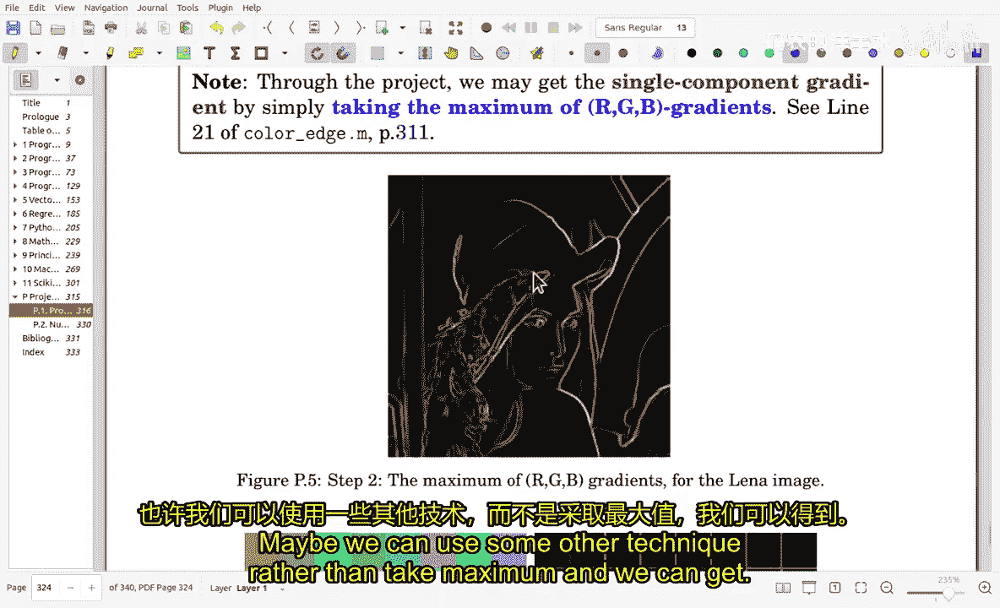
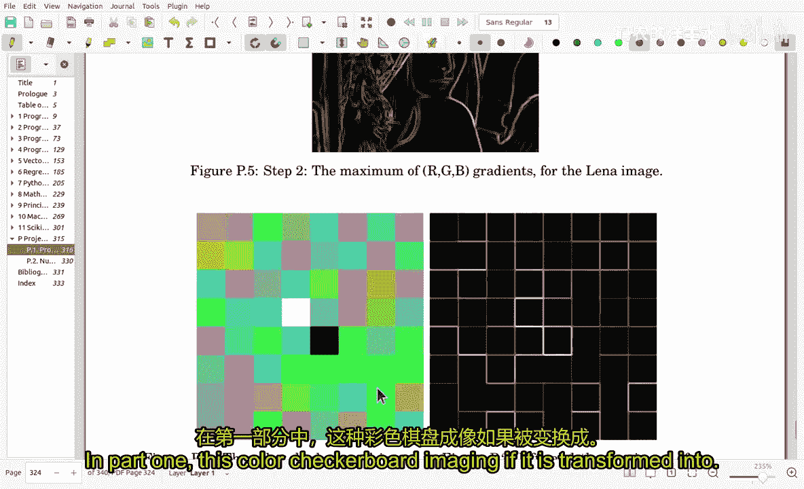
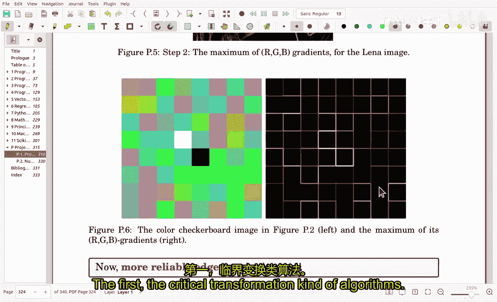
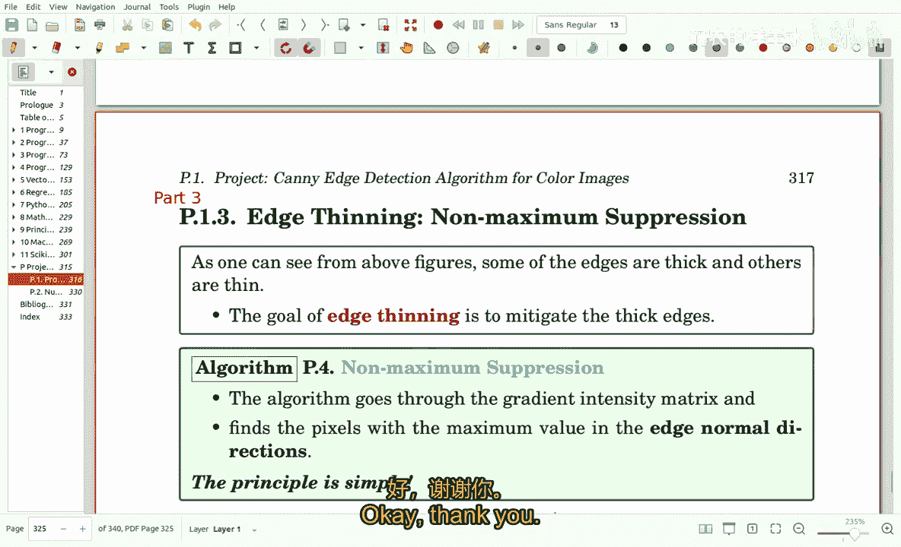

# 【全集-附课程讲义】密歇根大学-人工智能编程-EECS492-中英字幕-p16-Lecture-16---彩色图像的坎尼边缘检测算法part2--BV14JqfBNEAS_p16-

It is part two of the project。Can you edge a detection for color images。

The first part introduced the canny edge detection algorithm。The algorithm has fiber stas。And here。

 we begin considering。Teachers of each step， and try to。Find the new ideas。

For a better a detection algorithm。Here is the forcess step。Noise reduction。里面就不冷。

This step can be done by applying the cautionusian filter。This in cause felt as a piltium function。

 you can use it quite easilyly。It is a simple averaging algorithm and pluss the whole image。

And without distinguishing edges and。Non edge pig sounds。

 so it can make edgeitive strength the new curve， so we'll try another method。Here。

Will try the total various model， TV model。better。It is given in this PD D equation if you are not familiar with PD。

Then just to listen to me and。Try to understand the core idea of this model。Here。

 this is the mean curvature and beta。Its a constrain parameter， which is a kind of laggan multiplier。

And we'll study the teachers of Laranji multiplayier techchs in Section 30。 a。

Here is the major property of the TV model。The TV model tends to convertverge to a piece constant image。

Such a phenomenon is called the staircaseing effect。So the TV model can be used for both。

Noise reduction and simultaneously， it is happening。So， it can be。Use stuff very effectively。For。

The noise reduction without。Making edges are weaker。And we have to dis the P D equation to get the。

To get push me to the solution。And we may apply simple。Expositionition method。

 which is the for the Oer method here in anther level， and we try to get。The new level。

 N plus first level solution by solving that equation。So here。

 move this to right side and verticalply33 and move this to right side， we can get that one。Now。

This term is approximate them as a UN。Here， at Yuan。I approximation， in fact。

 your medical realizationization of the negative the curvature。So that。By。呃。

Taking some iterations using that equation we can get。哦。ノティノイタアゴルダム。The TV model and。P。1。

3 requiress2 set telta T sum for stability。 that means that you have to choose theelta T quite small。

If it choose a large kta then it at work， the solution will blow up。

It can reduce noise effectively in a few iterations。

Implementation details can be found from TV tune thatt N and。

The Coba chippiji that am in the packaging， in the mother called packaging。

Here we compare the Pofus of true method。For the Le image。And we try to de its component wisely。

 for each channel。 we apply TV， Dno saying。And also Ka filter and we saved it into UT and Ugene respectively and we here save the final image and here we see the result。

And this is the original Le image， and this is TV the the image。

 and that one is Kaohan filter the image。As you can see from this middle picture。TheTB。

Ass reducing the error and preserve the edge。Yeah， for example。

 around here and these are a little bit o today。 now， these small os almost disappeared。And however。

 edges are well well preserved。For caution filter。Now， everyday p， if we choose a sigma smaller。

 for example， one， then you can get less a p image。However。In any case。

 you have to be a be careful when you are using caution and filter。It blurs every year。M。

Now we have the second step of the canny。At the detection algorithm。Creent to calculation。Sobel Car。

It just correspond to a change of pixel's intensity to detect air。

The easiest way is to apply filters that highlight。The intensity chair in both directions。

Preal direction and the verticalical direction。Here we have algorithm for So Car。Soil B as。

Comput algorithm。For Cor엑 and Y directionional derivative。And by using saying。

Convolution with so called Soviet kernels。Here we have soal corners in x direction and Y direction。

Let's see what they are。Here we consider。Pixels。Okay。Rather than pixelels。Let's so sure that。

The image values are saved at each critical point。For this point。Now。The weight1 here。

 rate -1 means L this value minus this one。And that is。Here。

 they're presenting slope in horizontal direction。And。Once the length of pixel is one。

 then this value anthe divide by two must be used to， however， it is a kind of a scaling。嗯。

problemble， the scaling so that we go know divide by 2。 So this value minus this one is representing。

Use of X extraction derivative rather than one evaluation we will here。Here。Here。不り horizontal전ント。

Slos， and we make。Weed the average here twice of this one and once and once that is exactly this one。

Yeah， that slope twice and slope slow， and we have to also divide the by。4。

And because of full contribution， but is against scaling。 So we you know。

 and so this along with the that filter。Yeah。And along with you。The image and。

You apply convolution with the filter then you will get here user bad。

That is an approach mission of Exed of T。And for K Y， the similar you can consider that here。

 that's  one and -1。 Then is should be presenting。W directional trip tip and here， measure。呃，这里。

Of that slope。 and then one to  one weight to the average yeah。And with that fit trail。And。

By applying convolutional predator， you can get your survive。That's how。

The Soviet ingredient is measured。And have heading at just。But this length is。

Beganitude and here a content of U of Y overval U of X。 that is angle。

So this angle represents the normal direction of the edge。 Once edgeG is now running theang。

 then that normal direction。Is that the direction。And。In metal。

 At12 is built in and you can use in this way， okay。So implementation teacher will be found in Sobel。

Ced that。And also， you'll see on the next page。Okay， here。Okay， now。In in the program。

 the color H that M。The gradient magnitude is saved in E， and then it is normalized。

 but you don't need normalized to the value。And but a normalization is done only for the purpose of futing。

So we try to make the value maximum amount values 1。 and that is the。Yeah， double precision。

 the image value， the maximum value one so that we normalize it in this range。

 so in figuring you can make quite conveniently the figure of the gradient magnitude profile。Okay。

 here。If we try to get information about atton 2， then by using help command， you can see that。

 then portable output is given in this range。 Atton 2 Y X is the four quarterrant。

Arketion of the elements of X and Y， such that the result is between minus pi2 pi damage that is measured。

The architectant saw that in the coordinate。And here now。Yeah， from minus pi to pi is measured there。

Okay， so output value has some push on minus pi that means that， for example。This angle。

Then it is directing this direction。 If you add pi， then it will。Here。

 tieect the direction will be the upper direction if it is tie added。But in。And our competition。

 either this or that direction， it doesn't matter。 as can be the magnitude。Okay， in the beginning。

 the are magnitude over there。Angri is measure the bias saying， you sub why and you so bad。

But the magnitude is a trust。Contried。As a non negative number， so that。If you are using here。

And partly non negative number。 then it can be changed into that way。 So no problem。OkayBut anyway。

 the output is minus pi2 pi。Okay， here， this is so well created dot M。Okay。

 so your output is gradient profile and then here angle。Now， as you can see here now， for instance。

 U X is measured in this red for each point。Now。And we are using index P and Q in there is in the vertical direction。

 There is horizontal direction。And Q M is left point of Q。 Q P is right point of Q。And now for PM。

 that is now。呃。In fact， okay， that is a lower point to upper point because it is a vertical direction。

This is an left point right point， however， if it becomes a zero， then rather than we are using1。

 if it is larger than M than we are using M so by maximum mean， it is utterly or data。

 but main idea is PM。Is now P less than one。If it is not hitting the boundary。

And P P is P plus one if it is not hitting the boundary， the same A M and P are used to。

So here for U ads。Now， okay， P， P and PM。So that is first component。And then QM。

 QM and lower horizontal difference。And now the central difference， horizontal difference。

 And there is now op。 There is a P and P， So the op horizontal difference and rate。12 one rated。

 and also the similarity for you are， it is completedd。 and now here。The schedule of。

U X square plus U Y square has the save into。Caddian magnitude And now feel angle。

Yes has to say with from the digital Tu now at T2， UI and U。Okay， that's the Sobel code。

And after getting at。We try to see the magnitude。Of each of the LGB components here there's RGB。And。

 apparently。The G cream component has the largest magnitude。And。However。

 the pink coconuts has also around some of details。Okay， so this year is。매니 of。

LGB gradient components。For the learnna image。Okay。No。Through the project。

 we may get the single component gradient by simply taking the maximum。Of LGB Cor。

 So out of these 3 Cored， just we try to take maximum value。

Then we can see this one。Okay。Now， so here。We are trying to get the gradient， the channel by channel。

 And after that， we try to get single value， the gradient。In this case。嗯。

Maybe we can use some other tech， rather than tech maximum。And we came to。

Clearlyally， a much better algorithm， for example。In part1， this color checkboard imaging。

If it is transformed into。Chris came then accepted these two bowls every same gray value。So that。

The conventional method that can detect all of these tubeages and edges over these two。And however。

 if you are dealing with the。Channel by channel gradient on the end。

 try to get one single value to gradient out of that。 Then you can get such kind of room。

Credent profile。In this case， we are choosing maximum of its LGB， the gradient components。

 but here is reasonably good， so here we can get more reliable edges。

So that is the major benefit and major advantage。And overall。The first。

 the critical transformation kind of algorithms。

Okay。Okay， that's the part2。 and we'll continue。In part 3 and also step 3， step 4。

 step 5 will be explained。Okay， thank you。

