# 【全集-附课程讲义】密歇根大学-人工智能编程-EECS492-中英字幕-p17-Lecture-17---彩色图像的坎尼边缘检测算法part3--BV14JqfBNEAS_p17-

It is part of the project canny at detection algorithm for color images。

The Kenya algorithm has fibertats。Here we'll discuss steps of three。F and。

Fhi and what should we consider？What。You will do。Here is the furest tab。Eening。

 non maximum suppression。As one can see from above figures。

 some of the edges are thick and others are thin。 Let's see。

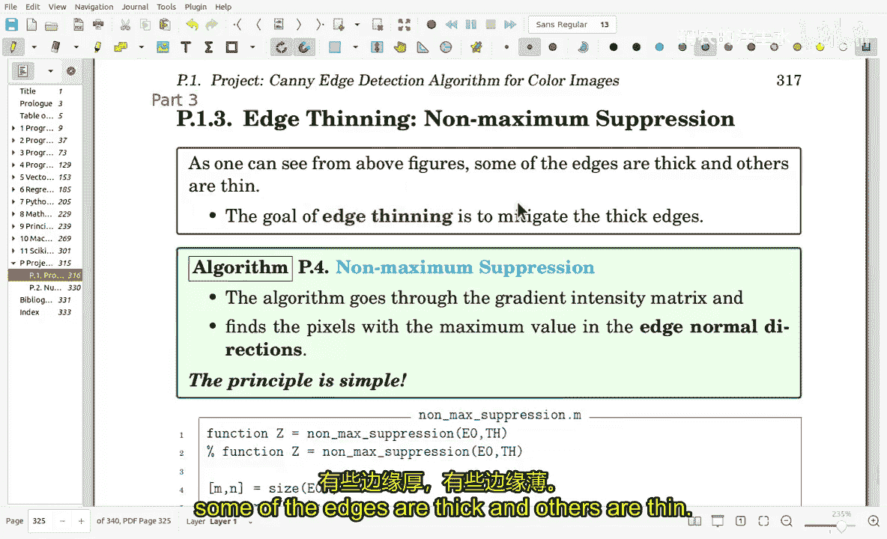

피기어， 그디언트 매그니튜드 figure기아。And some are thick and some are Theenna。And over there， thin edges。And here。

 the assumption is that。The atti center。Will produce largest gradient magnetium。

So that once it is a fair， then。If we measure along the normal direction of edge， then。Yeah。

 the edge center will have largest value in。Cadian intensity。So， we try to keep all the。

Maximum value， and。The non maximum will be a suppress。That is the idea。I was making thin edges。

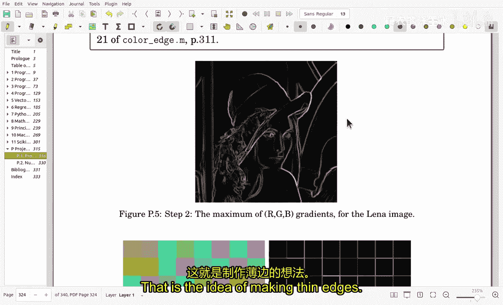

K。Okay케이 here the algorithm 코스。Crent intensity metric。

And find the pixel with the maximum value in the edge and normal directions。

So that the principle is quite simple， yeah。Okay， that has gradient intensity testest information。

 and this is angle information。Now， for that one， once it is negative， then we try to add the pie。

I already explained it。And here， once you look at the angle。Okay， in there on。 so that。

The theta value is from minus pi to pi。 So once it is a negative。 then along with that angle。

 now pi is added， then this is our project direction。

So as far as we are considering at your normal direction。

 it can be either this direction or that direction， it does matter， so we add pi。

To crunch the opposite direction now here。After to that。An。And。Paop add added。

And here divide the by pi of4。And we try to get4， which means integer value。

 And now we are taking modulular and with4。Okay， this operation is done because of the。 Okay。

 now so that。After adding pie here， the angle is from ciroto pie。Now。So for that one。

We need to get direction。 but only in pixel， we have 450 degree angle。 Okay， horizontal direction，45。

90 degree and that degree。So if you consider we example put the credit points like that。

Then only the possibility is horizontal direction，45，90，1，35 degree。Like that。

So by adding half of pi of4 and divided pi of4。 and that well put it on。We try to get。有。For this for。

Ans。And。Now， if we are using under the color then and。The middle of that， each one。

And we on pipe add angle。说 that。This area will assign0 and also it is a zero and this portion will be1。

 this angle will be2， this angle range will be a 3。So that。嗯。

It is kind of separating regions into four， So zeroism， which is around the horizontal region。

The angle。The edge normal direction is around the horizontalal。And in this case。

 actual normal direction is about 45 degree。In this case。

 about verticalical direction is about 135 degrees。So once it is see or around the horizontal。

 then we are trying to get。Or the gentle。Vues and left side， right side。The Cuba point， Ij point。

And if it is a 45 degree angle， then we are choosing in along 45 degree angle， A and B。

And once it is true， then in a horizontal direction， we are choosing two point adjacent points。

 and once it is a 135 degree， then we are choosing that directional the adjacent  two points and here。

Now， the current value is larger than maximum of this two， which means if this is maximum。

 then we save it。And otherwise， originally， is， it is a0， so it remains0。Not change them。

 So along with this。An algorithmgorithm， we select only the maximum。Value here。

 find the pixels with the maximum value in the agen direction。That's what this function is doing。

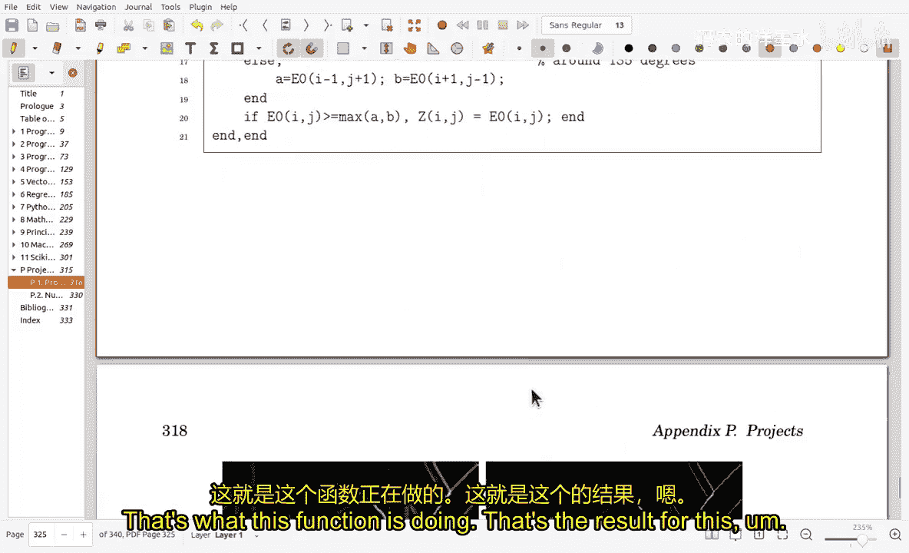

Let's see the result。For this。The gradient intensity after passing。The program we see here。

Fhin edges。 Yeah， for that one。Ass now thin here now， right。Okay， in this way。

We make the edges of the end。

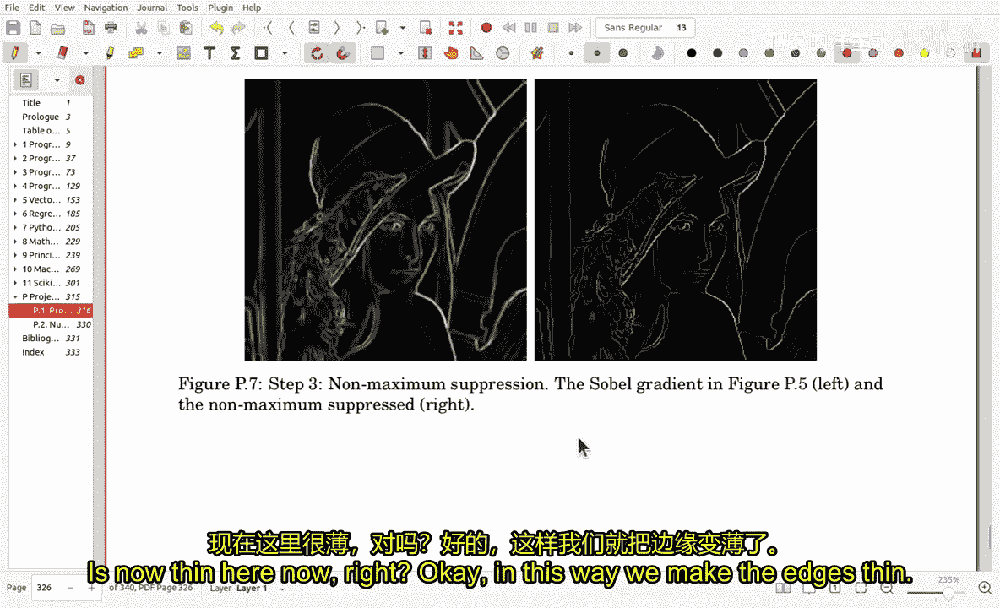

So it is a very good algorithm。And non maximum separation seems working fairly nicely。Okay。

Now we'll go step 4。Tuble threshold。 Now we are working on。

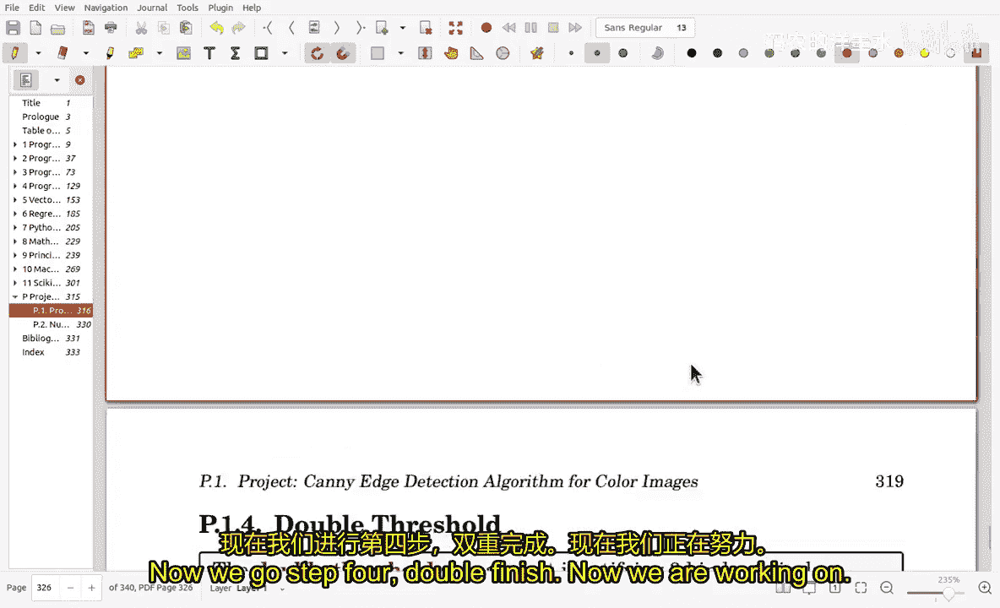

This result， okay， after。The edge is a thin。

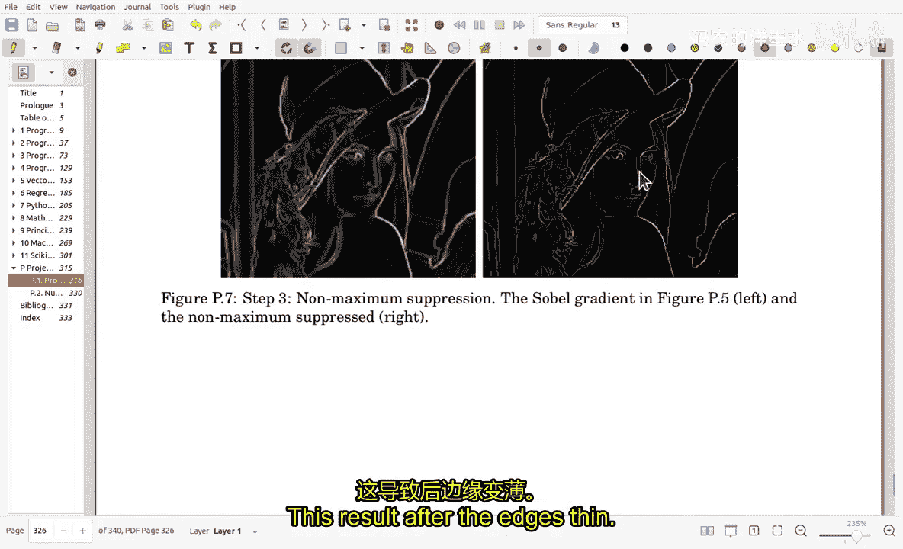

And we now apply double threshold， double threshold tab aims at identifying three kinds of pixels。

 strong rig and numb relevant。Sttrom pixels as pixels of high intensity。And if you are sure。

That the pointer must be contribute to the final edgeging。 then we。

Got the picture as a strong picture。So basically， along with the high threshold。

The pixel strong pixels will have the value larger than or equal to the higher threshold。

And weak threshold and pixels are middle range intensities not to be considered as nonle for the edge detection。

 and other pixels are considered as non relevant for the edge which means that the intensity is lower than lower threshold。

That's the reason， we call。This part， double threshold the。Okay谢。In practical implementation。

we start with in this way， set high and low threshold and high threshold is used to identify the strong pixels。

Lower threshold is used to identify the non relevant pixel pixels。

 once the intensity is lower than lower threshold， then we identify the pixels as non pixels and we discard them。

All pixels have intensity to pitch both threshold are flickked as weak。And in。In the fi step。

 last step， that is his the mechanism will help us identify the ones that could be considered as strong。

And the ones that are considered as non1。Through the last step， we distinguish the。Weak pixelels。

 some part of pixels will be added to strong ones and some part will be discarded。Okay， this is。

The reality in in here implementation， it is often the case that you should assign two ratios to set。

The high threshold short and low threshold short， for example。

U choose high ratio and rule ratio in this strain。 Then high threshold threshold is assigned by using the high ratio times maximum value of the gradient intensity。

And Ruth threshold， as now。From high threshold。We multiply here rural Russia， and we can set。

L threshold bying these two values， you can cut the gradient intest in3 parts。 T1 is strong pixels。

 B one is weak pixels and the bottom one is nonele， so it must be discarded。In order to detect。

We edges more effectively one can employ dynamic variable thresholds。 It requires some more research。

 but here。And。Yeah， detecting strong pixels。Is a快。And strong edges are easily detected， however。

Some very important to eat。Eject。Not easy to detect in this case。You have to use dynamic threshold。

 Right now， this threshold is constant static and everywhere。Apped the same value。

 but a dynamic thresholdial decay in region by region and point wisely。The threshold threshold。

 high threshold， low threshold will be a changing based on the intensity value。

I believe that will be much better， but it is a period of your。嗯。The class， so that here。

Maybe this one can be considered later on for some sense who has strong willingness to do some more work。

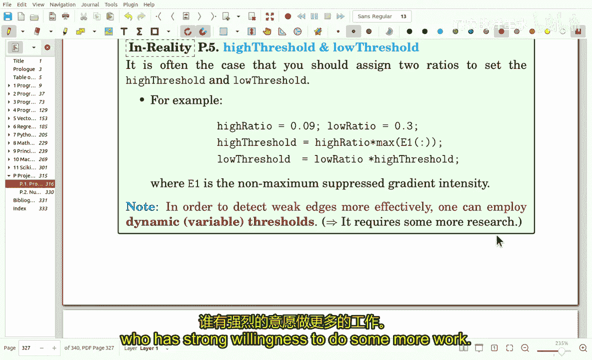

Okay。Okay， here。 and once high ratio， low ratio given， then along with that， we get。

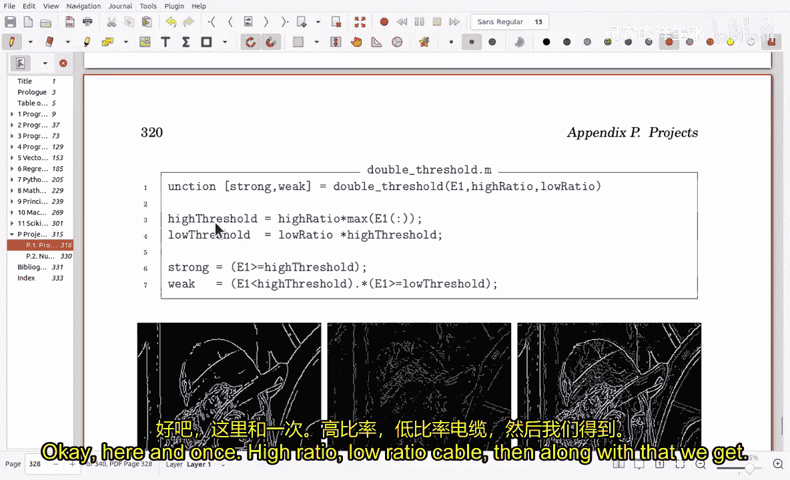

Yeah， high threshold or growth threshold。 In fact， these two ratios are given， as in this example。

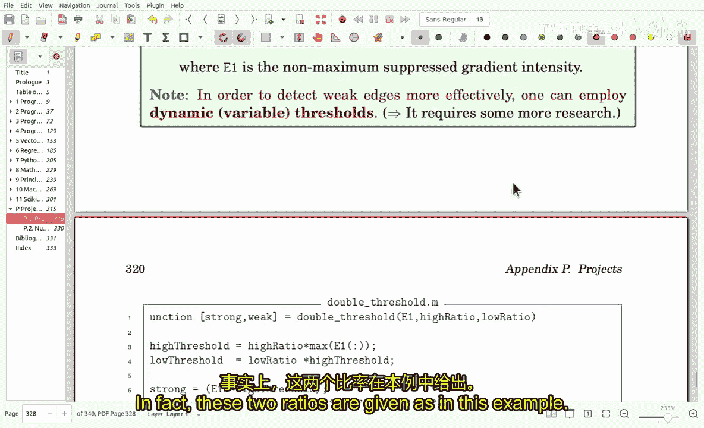

Then for that image here f at intense image。

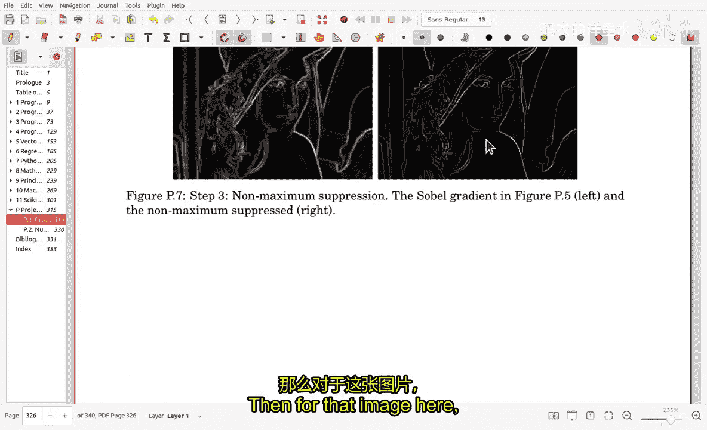

Now we try to get you。Strong pixels and weak pixels。 And this is combined there。Now。

The final edge will be more or less around there。From week address， some point will be added。啊。

From the last step， his says。And so that the final output will be around there。Now。

For this current step， you should select high ratio and low ratio。Appropriately， and also。

 you may have to eliminate。Isolated the pixels from strong pixel cellss。

Which can be carried out as processing here。This isolated。It is ping a bit。

 So you have to eliminate those isolated。Stro pixelels。Okay， the final sta。

Ety tracking by history says。Here we have。The edge tracking rule。In this step。

And some of weak Ps will be。Now， transformed into strong ones。That is hisians， So here。Now。

 we try to。Read the rule。The his consists of transforming。You pixels into strong ones。

 so some of them will be transformed into strong ones。If and Ol。

 at least one of eight surrounding pixels of each Pel is a strong one。And for。Selected the e pixel。

 Now， you try to search the surrounding8 pixels。 And at least least one of these8 pixels is a strong lawn。

 then。The current unique pixel must be transformed into strong one。That's the rule。

 And you will implement a function of。The edge tracking。Okay。Now here are what to do。And。First。

 download the mother code and from lectureal， you click this one， then you can download。

And you have to complete steps of four and five。And color I edge do am。For step 4。

The major work must be。To set approximately2 parameters， high ratio and low ratio。For step5。

 you will have to implement a function named the history sets。

 which realizes the edge tracking rule in algorithm P。7 there on。So for this rule。

 think very creatively and try to get a good function。That is requiringing your innovative idea。Okay。

Okay， now post processing。 and we add another step then step 6 implement a trimming function in order to eliminate。

Isolated edge pixels。 In fact， isolated are strong pixels。And or strong pixel cells of length。

For example， less than or equal to 3。And。呃You mean。Design， you have to design also a good algorithm。

To eliminate， yeah。There's strong Ps。 Once you try to do this one。And if you make a success。

 then I'll try to give you some extra credit。And single isolated at elimination is quite simple。

 however。If you try to。Major local length and local length is less than or equal to three。

And that decision requires some idea。So for this portion， you'll get some extra credit。

And run the resultingant code of yours to get the edges。

 and now download them some other another image and run new code and tune it to get more reliable edges for tuning。

You may try to use here a Ca filter with a various sigma rather than the TV tunenoising。So。

 you can use flexibly。Imaging the p operations。Try various combinations of high ratio and low ratio。

And。I believe you have to set this restaurant depend on images。 There's no universal here。

Rule for setting this two ratio。They must be as， depend on given image。嗯。Yeah， we have。

UnderAnother set of extra credit， another set for noiseisy reduction。

You can employ either the T deno model or the Piltin function image Cai field and along with the sigma。

And analyze effect of different choices of parameters and functions on edge detection。

 So if you can say some tendency or some the phenomenon。

Depending on your choice of functions and parameters。

 then try to add that finding to your final result。A final report。

 then I'll try to give you some extra credit。And here。

And another one is new idea for the gradient to intense day。

Right now we chose the maximum of LGB gradientians， and you can find it from line 21 of K H M。

And do you have any idea better than that？To give you test along with the some new idea。Then。Also。

 try to add you on。Oh。Experience。two the finalr reject。对。They put to what you have done。

 including duly implemented M files， choices of parameters and functions and images and their edges。

That's what you will do。Okay。Thank you。

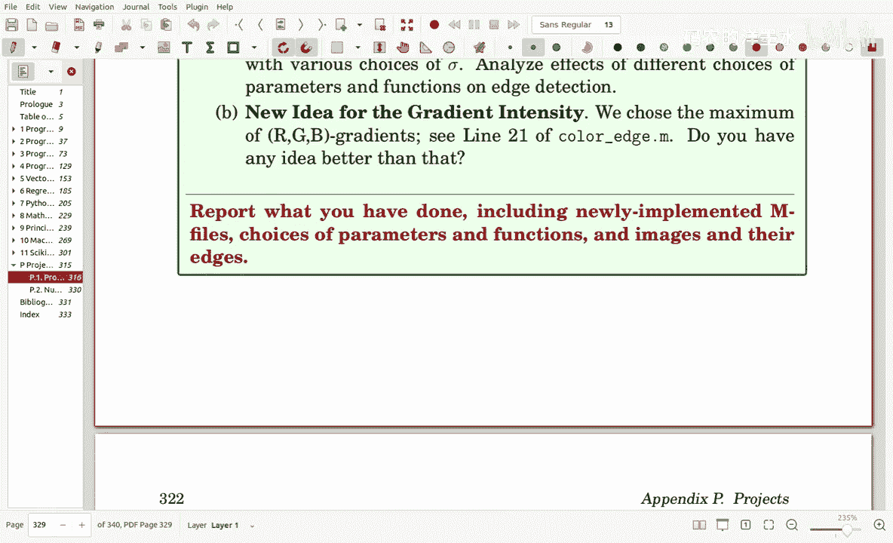