# 【全集-附课程讲义】密歇根大学-人工智能编程-EECS492-中英字幕-p18-Lecture-18---微分：切线的斜率--BV14JqfBNEAS_p18-

It isteto3， put a lamb with the calculus。In modern than scientific computing， particularly for AI。

Calculus and linear Ge play crucial roles。In this chapter。

You learn some selected topics in cals that are essential for or advanced still computing taskers。

We consider basic concepts and their applications as real。

So you don't need to get any prior knowledge on calculus。Let's go to section 30。1 de differentiation。

The slope of the tendered line。Of function。Y equals F x can be correct as a curve。

And many applications。The tangent line plays a crucial role for the computation of approximate solutions。

Here we have questions。What is the tang line and how can we find the end？

Let's see this example along with the average speed and instantaneous speed。

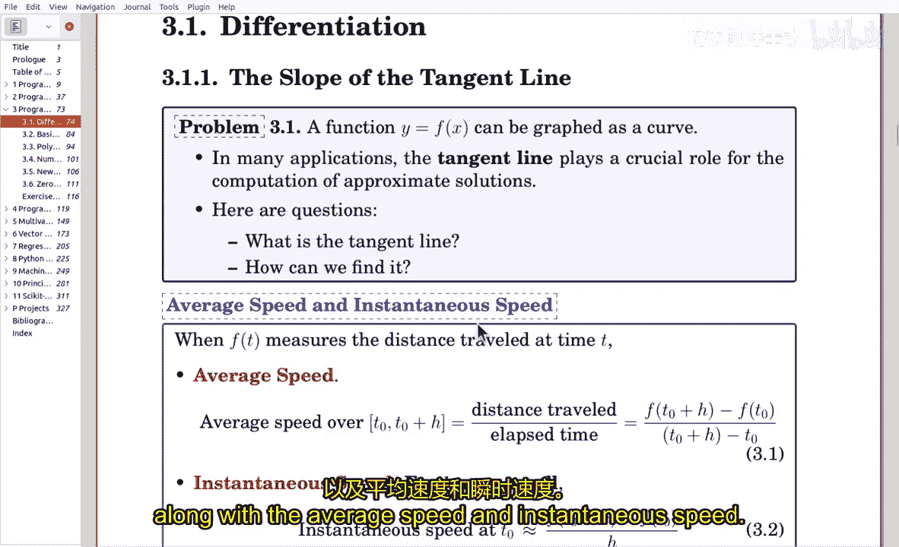

When F T T is time。嗯，FT。As a function of time measures the distant travel at time team。

The average speed is defined in this way。 every speed over T02 T0 plus H。

 that is this travel over the eip time。 and that is the question。 Let's see。Here。

 the meaning of this cushioned through a graph。Okay， now in timeline。We have here， Tro and。H。

 second later， we have T0 plus H。Okay， then assume here y called F of T is given in this array。

 then this value。Ass here， F at T 0 plus H and F at T0。Then we tried to get。

A secret line testing these two points。Okay， let's draw the single line。Then and again。

 we try to write down draw the right triangle。Like there。Then the bottom length will be this one。

티0 plusスエ minus 티즈。And this height must be same as this value minus thaton which is this numerator。

So that this question is the slope of this second line and average。Rate of change over this interval。

So because here now F measures the distance here， the quo is average speed over the interval。Right。

Now， how about the instantaneous speed？For H， very small。The instantaneous speedde at Tilong。

Is approximated by this value。Here at Tijion， instantaneous speed is related with a slope of this curve so that once you choose H very small。

 then this cushion will approximate the instantaneous speed quite well。Now we。

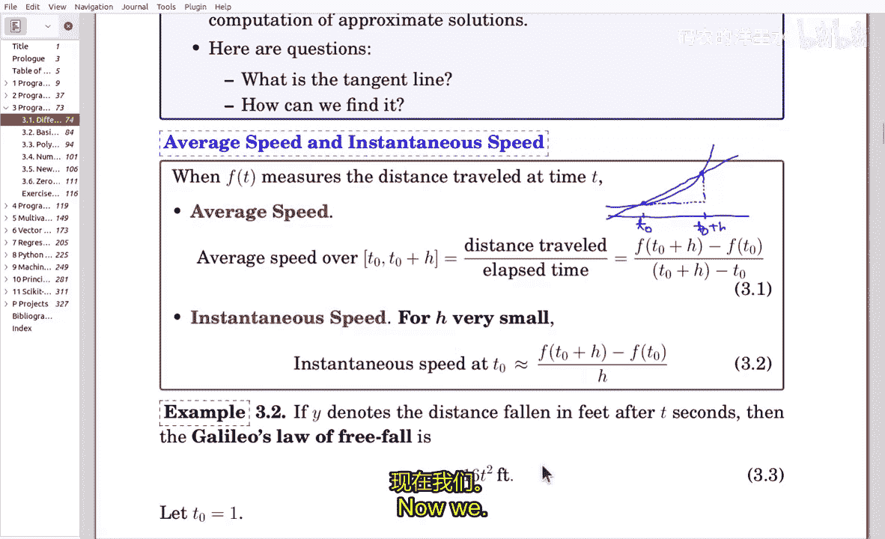

Deal with this example or with a specific function。Okay， why do you not that distance of fallen？

In fit of seconds。Then。Kli was a lower freeform is written in this way。Y equal 610 T squared field。

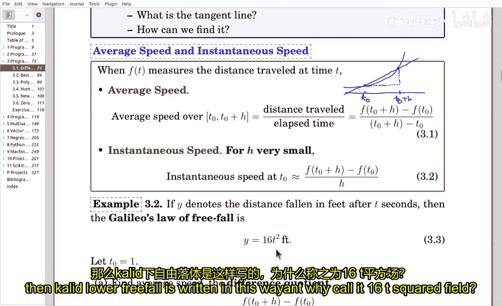

And Ts is one， and we had to find the average speed。The， the difference question。 Okay。

 let's try to find it from。

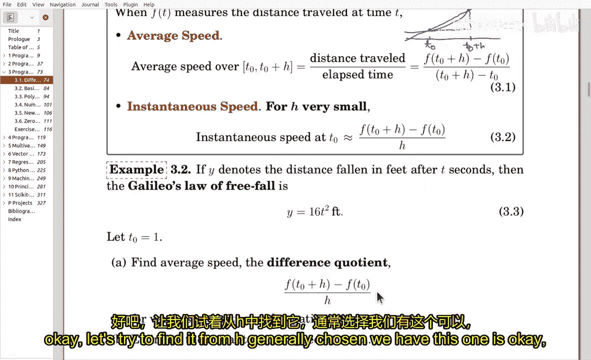

H generally chosenn we have this one is okay F is defined in this way。

 so that rather than t we are putting t0 plus H so that there is a 16 t0 plus H and minus 16 t0。

Over that is age。Of course here now， okay， I'm sorry we have to put here scared there。

And ts is1 so that I'm biasing that we have here now， okay。

 the dumiator is not 1 plus h squared so that that is a 161 plus h squared as 1 plus2 h plus h squared。

Right， and then now-16 over。H， okay， so this is 1。 thatron will be cancel out。

 and then the demerator will become here 16 and2 H plus H Sch divided by H。Okay。

 so that will be the the same as okay， H can be canceled。 and then that is 16 and 2 plus H。

 And we can rewrite this one，32 plus 16 H okay。For。H and fit is H。

 we can have the average period in this way。

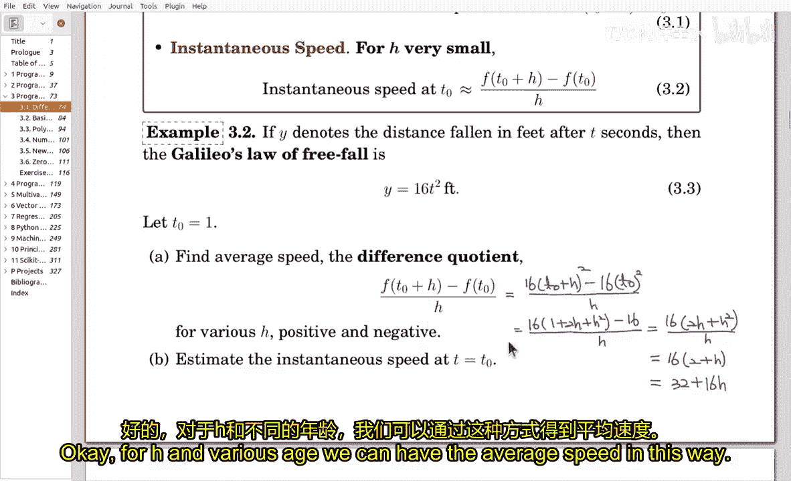

Now， estimated the instantaneous speed at t equals t0， t0 is 1。Now。

 instantaneous speed can be obtained when H is very small。

 so well try to choose H small and smaller H can be 10 to minus-10，10 to minus20。

102 minus-1000 and so on then this value will approach to 32。

 so we can estimate the instantaneous speed here，32。

Because this term will approach 0 so that diameterter term is a 32。

So we can say that the estimated instantaneous speed is at 32。

So that is the same as the slope at this point。

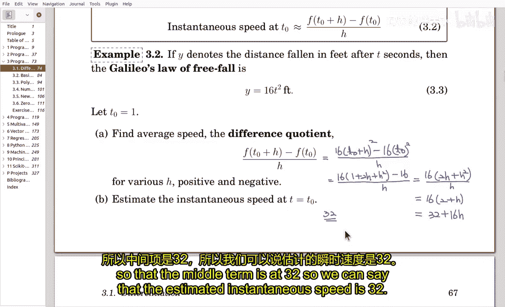

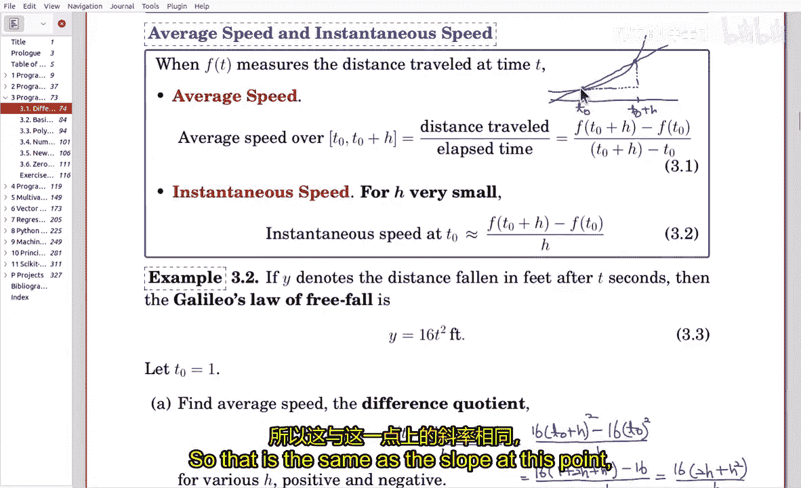

Good。Now， bi a me program， we can check in。Okay， this one is written for。Mela。

 But if you want to use it in Ota， then you have to load a package。The 그 for 로 패키징 옥비 기브인케이지。And。

 Lord。And you have to install， you have to load a symbolia。So that now you write in symbolic here。

And they said。 and then this package will run。 this program will run on O tape， okay。

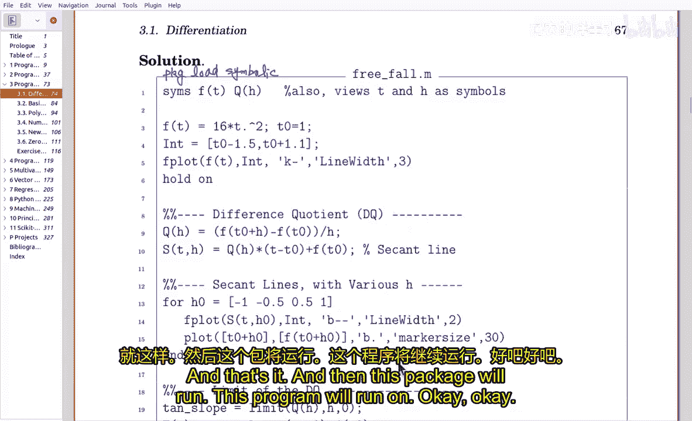

Okay， here there's F O T T is1 now here。And we try to get a graph interval between now t0 minus1。

5 to T0 plus 1。1。 This is for only graph purpose。And this is the quoed difference。

 And then also now we try to get the second line for given age and try to get second line that is now here。

 the slope of the second line and this is。Line。In point to slope form。

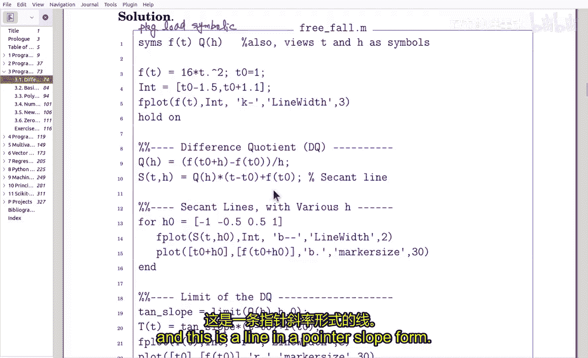

Okay。Okay， we， we made Plateia， and then we try to get now cube H。 So the H is opposing 0。

 So this is a Ping function for。The question as H approaches see do。 you can have the limit。

 and we try to make again here， ten line with。R state line。

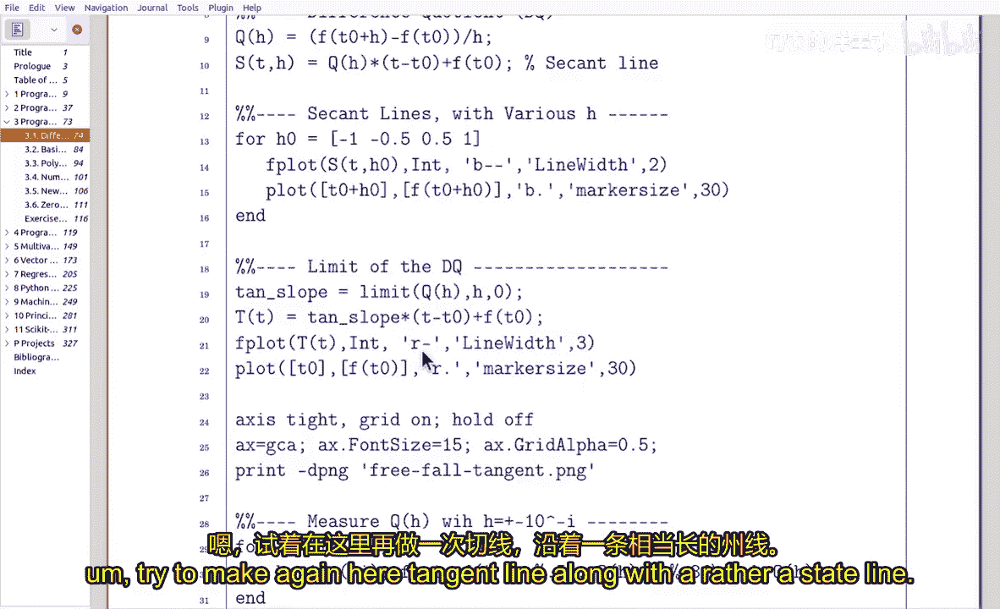

Okay。Now， here， this here is a picture environment。 and then here， full。Each H。

 And here we try to print out the cushion。And， and。嗯。The difference quoted。 Okay。

 that's the program that that is quoted。

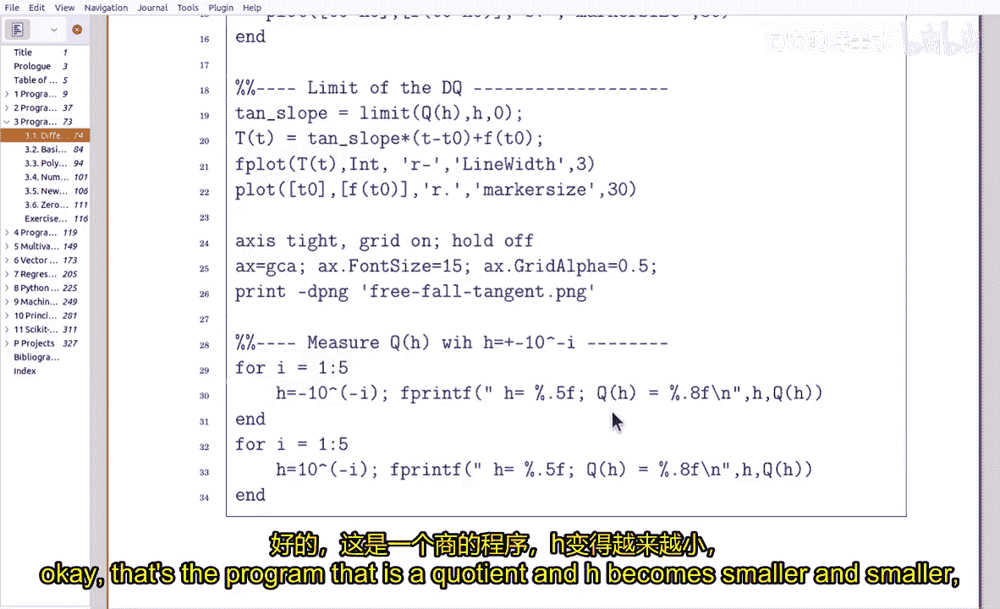

And H becomes smaller and smaller， smaller。 Then it is approaching to here，32。

And also that is from negative direction and this is from positive direction。

 it is approaching to 32。And this s figureia is also the blue test lines。The second lines。

 And now the red one is the tangent line at one， we can see the tangent line。

So the slope of the tangent line is the instantaneous speed。

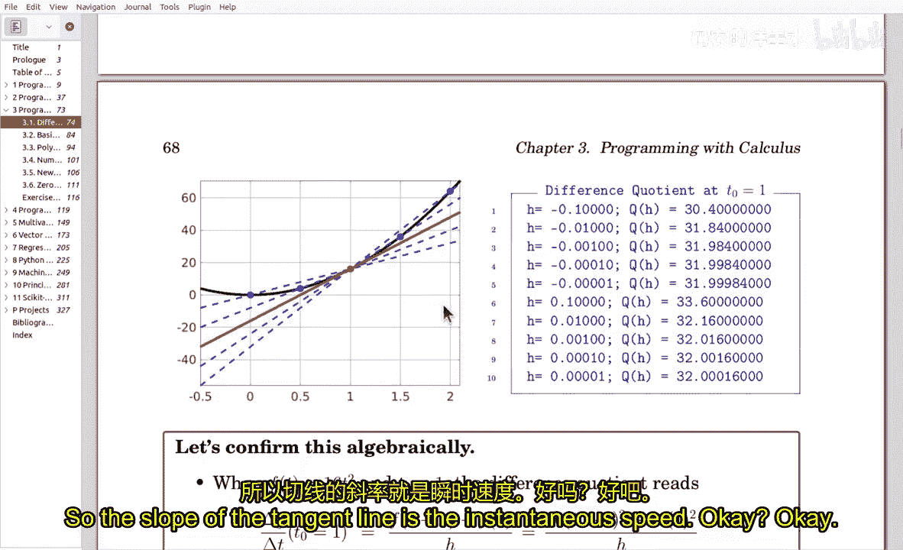

Okay。And here。

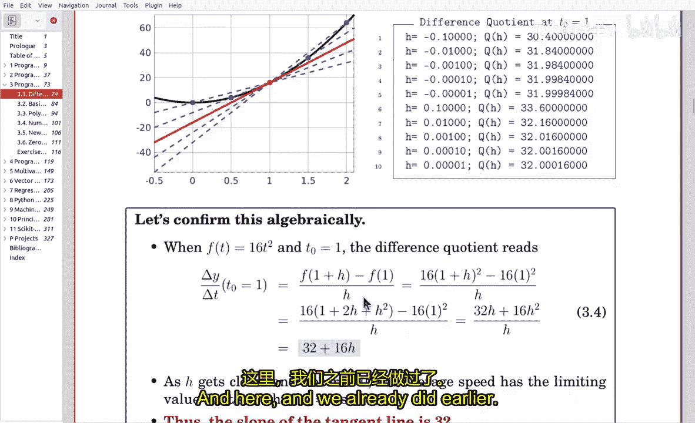

And we already did earlier。Now here， let's confirm this algebra co。And F of T is116 t square。

 and t is 1。Then the difference quots becomes in this rank， Theelta y over Theelta T is given here。

 so that after。The simplifyifying we reach 32 plus 16 edge。Once you choose H close to Zong。

 then this value will approach to 32。So that the slope of the tangent line。The estimated。嗯呃。

The instantaneous speed is a 32 okay？Find on equation of the tenent line to the graph of y equal x square and xger equal2。

 Okay， to find the the tenent line equation of tenent line， we have to know。Okay。

 line can be decided with a point and x0 is 2 so that x is2。

 then y must be4 because the curvevy is y equal x is squared2 squared is 4。Now， we need a slope。

 Okay， why is the slope。And here， measure the。The difference question and try to set H approach0。

 Then we can find the slope， right， okay here。So function is exos square and here now the quotient is F。

And x is 2 plus H minus F at 2。Okay， divide by H， right。Now， F2 plus H S， okay X is together。

So that that is2 plus H。Scario。And once x equal2， the values of4 divided by H， right。

So that for from here， we have a four。Plus4 H and plus H scatter。 And we have a -4 divided the by。エチ？

Okay， now we can cancel for minus-4 dividedta by H。 We can reach at here now 4。Plus， H。

 once H becomes smaller， smaller， smaller， then this value will approach for。So， that must be。

The slope of this tender line。Okay。So here we have the slope and the point。

 So point the slope form of line can be obtained this way， y。us4 y 0 equals s。

 That is a 4 and x minus x0 x minus2。 You can move a to the other side。 So that's the final answer。

 okay。

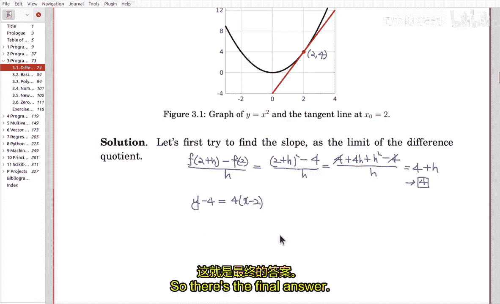

Here we define officially the syll with the curve。あ。For y call F of x at the point P x zero F of x J。

 a point is given。 then the syllable curve is the number。Here， f of x 0 plus h minus f of x0 over H。

Now we push H approach0。 So in this case， we write down this notation limit。H output0。

 That means that after getting this cushion， we try to take H very small and becomes a0。

And once the limit eists， then we use the number as the slopelo over the curve at the point。

And we are using the notation here F prime at x0 for that quantity， once this limit exists。

 then we are using this notation。So the tangent line to the cur F P is formulated in this way。

 y minus Fy 0。 in fact， there must be x 0。 I'm sorry there is typo。Okay。

F at x0 equal F primeate x0 and x minus x0 this is。

The slope point or point the slope form of the line。

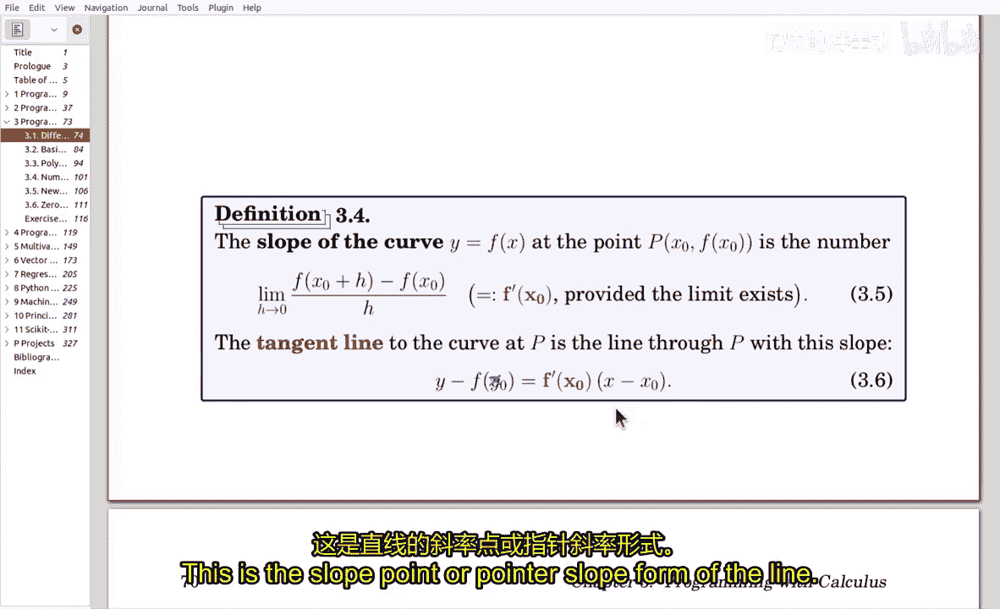

Right。Okay， here。Now。Can you find the ten line to y equal x squareta minus1 absolute of this quantity at x integral equal 1？

Once you try to make proof of the function， then here originally x cube the minus1 is made in this array because of this absolute sign。

 the negative part is reflected to the other side。So that here， minus1 and1， this cur has curss。Yeah。

 so here， once you try to get the slow。And and then you have to check the limit。

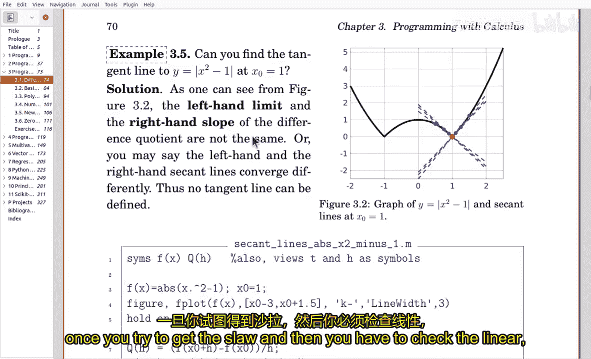

Now， limit， okay， here， H approaches see。 that means that H can approach the see from right side。

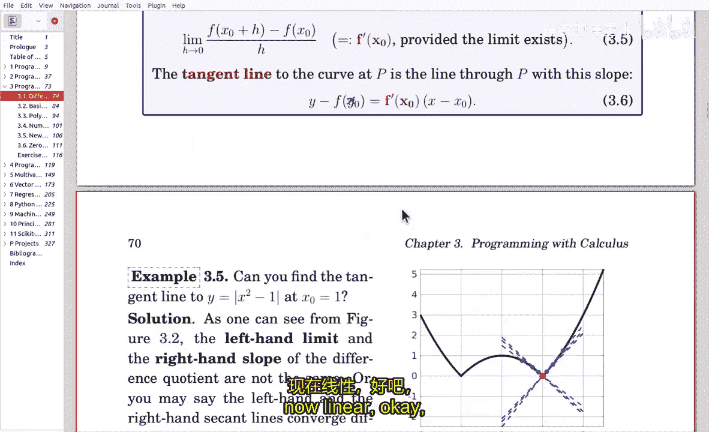

Or from left and side。 so that H can be positive。 H can be negative。

So that eventually x0 plus h is right side of x it on， and it can be a left side of x it on。

 so the limit must be obtained from both side。So the existible limit means that the limit from left to side。

 limit from right side， both existed and they are the same。

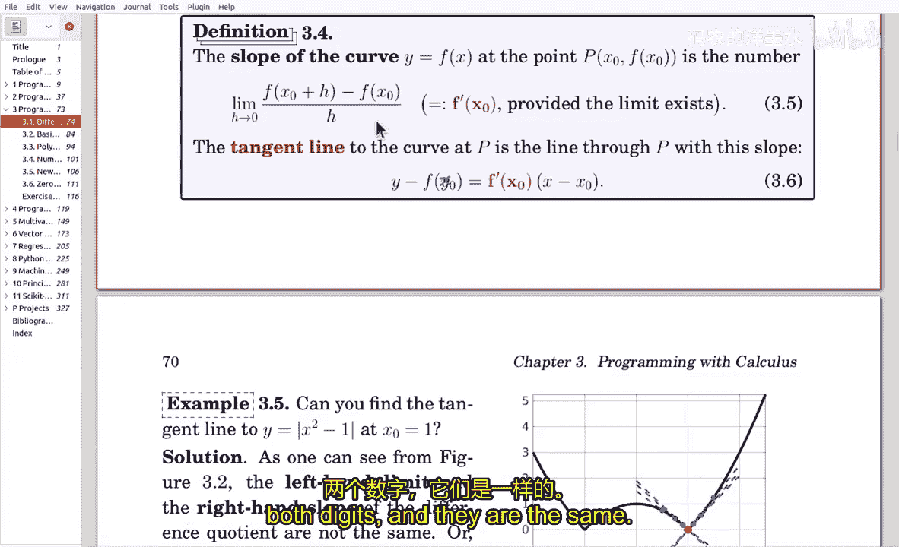

But here。For this function at one， if you try to measure。The limit from left and side。

 then the slope must be around this one。And if you measure from right side。

 the slope must be around this one so that they are not the same。So here。

We cannot define ten line at the point。And in fact， this point is cursor and the derivative， in fact。

 later on it。

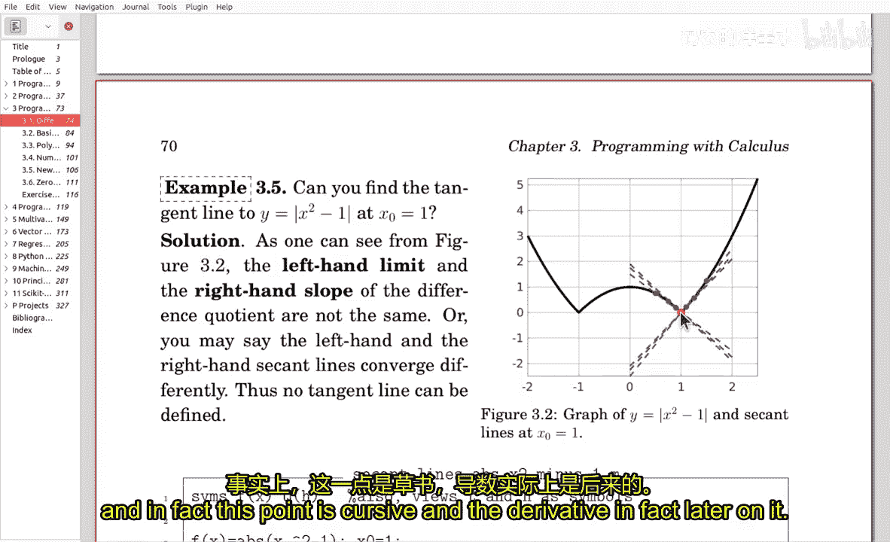

It will be called at the T tape and TF tape theegist。

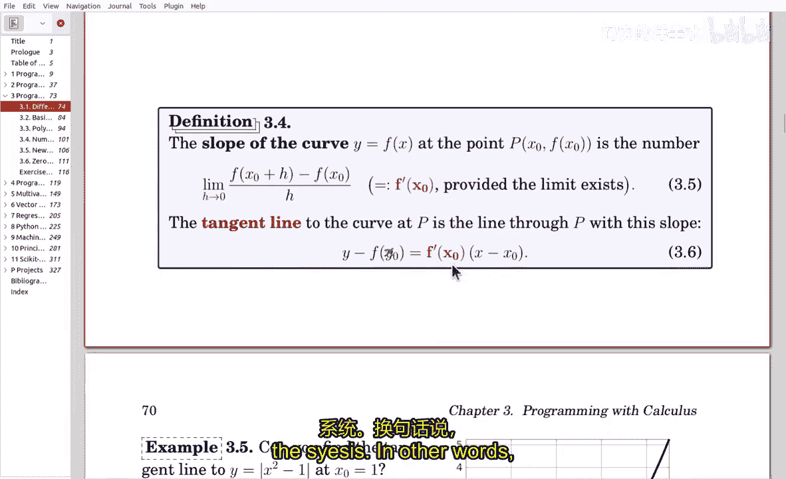

In other words， there's no tangent line we can draw。

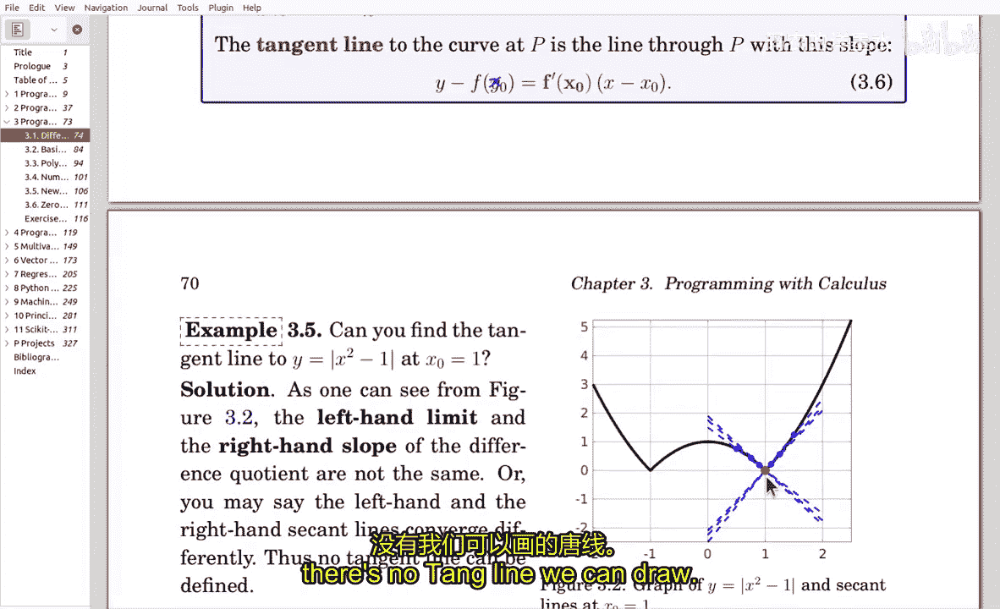

At the point。Now， the figure is made from this program again。

 it is using symbolic packaging and you can load symbolic packaging when you try to use octave。

 then it'll work okay。

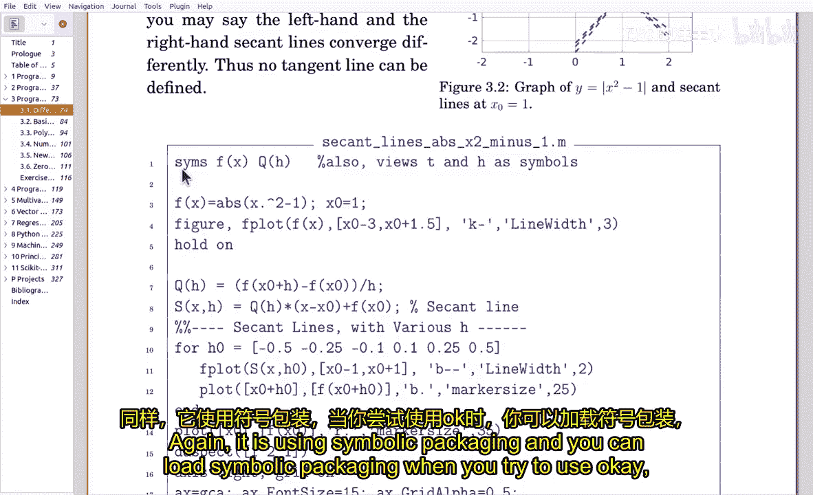

Now that's the end of part one will continue in the second part。

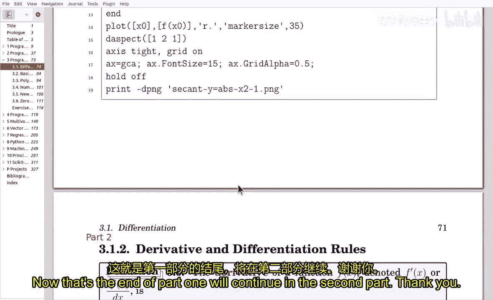

Thank you。