# 【全集-附课程讲义】密歇根大学-人工智能编程-EECS492-中英字幕-p19-Lecture-19---导数与微分规则--BV14JqfBNEAS_p19-

It is part 2 of Section 30。1， derivative and rules。In the first part of the section。

You learn to calculate every slopes for various interval length age and estimated the instantaneous slope。

By letting H a Portticid， here， we summarize to define。The derivative of Fengshan。

Here we first formulate the difference quotient。

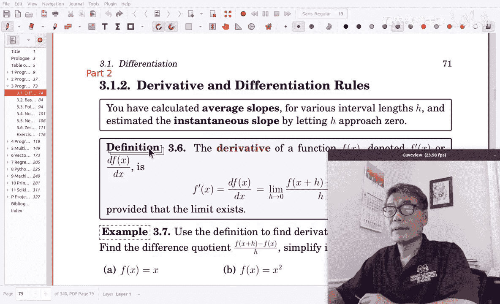

And take a limit。Once the limit existss， then we will call it。The derivative of the function F。

And we'll try to use the notation F prime over Tf over Dx。At x。

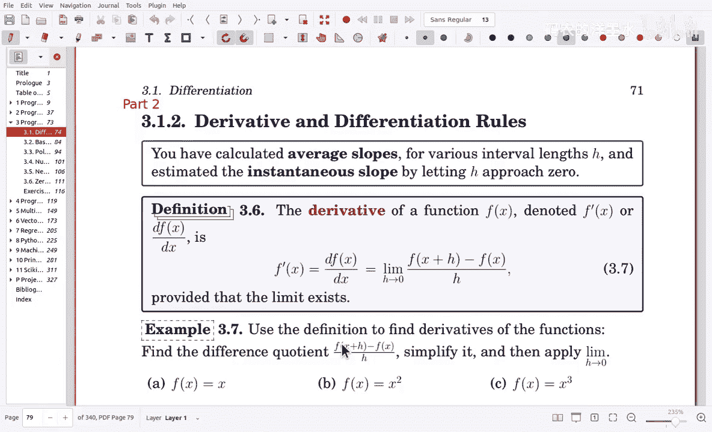

Let's see this example， use the definition to find the derivatives of other functions。Then mens。

We first find a difference quo。And simplify it and then apply the limit。 Okay， let's see T T aim。

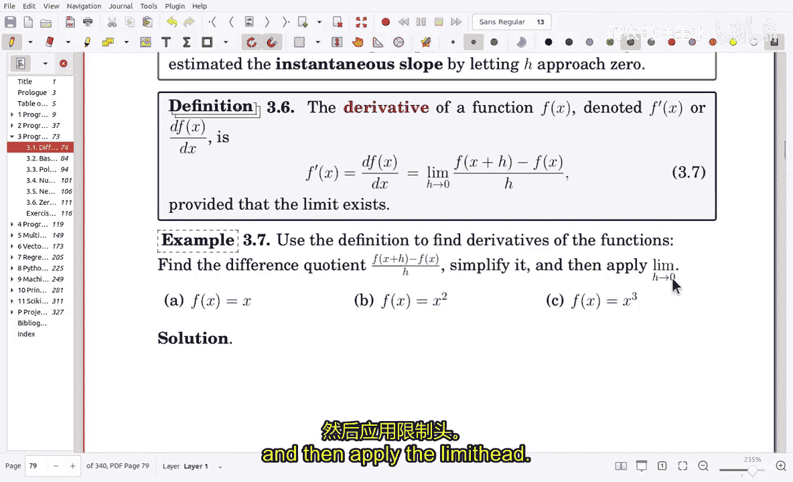

Okay， for this one。Now。F of x plus H minus F of Bx。Over。H， okay， that is same as F。X plus edge。

Because f of x is x， It is same as x plus H and minus and F of x is same as x divided by H。 Now。

 this x， that x will be canceled and。The middle part is H and over H， which is1。For every age is one。

 So if you are taking limit， then the the value must be one， which is there。And for this function。

 F of X is X， the tri chip is always one。嗯。For everyday eggs， right。Okay。

 now you can do this one yourself。 Now， we'll go to part C。 Okay， for this one。Now。

 f of x plus h minus f of x over H。That is same as now。Here， X plus H cube。 Okay。

 so x plus H cube the。Minus x cubeator。Overover age。Now they're the same as okay we。

Expanded this term， then x cubeter plus a 3 x Schalto H plus 3 X H Schalter。

And plus h cube de and minus x cube de and divide by。H。We can cancel this and this。And here。

Divided by H。 But here we have H terms， H for each term。 So we can cancel H。 Okay， that is now。

3 exscale。Plus30 x H and plus H scatterter。Now， that is the simplified。Terms， okay。

 now we are taking limit。 Okay， here， limit。H approaches 0。Then， from this one。

This one will remain unchanged， but that one will go this it on。And again。

 this one will approach zero so that we have three xs together。Okay， that's the。Limit。

 which means that here from this one， we can say x cube the。Tative is same as fully access security。

 right？Okay。For this one， if you do the same， then we'll see。

The derivativelutive of x square will be 2 x。 Here we。

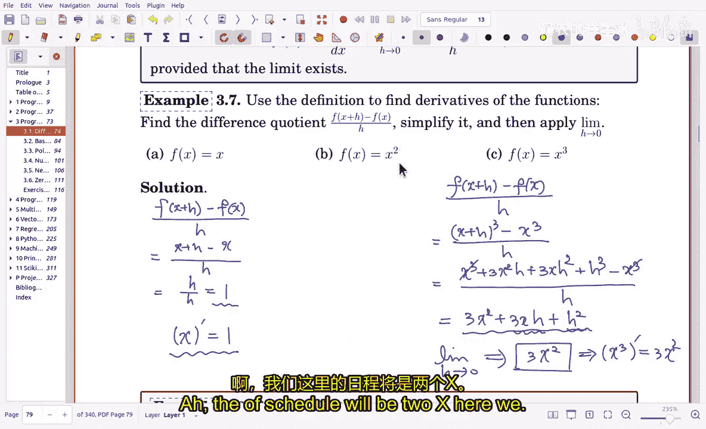

嗯。Wite down the results for x。iss32 as 1 we found here for x is squared is3 to as 2 x。

 and here we have x cube de is3 to B as 30 x squared in general， by using this techonic。

You can find here this formula for x to the N。Is derivativeive as n times x to the M -1 here。

 x cubedd3 will go out。 and3 is changed to。To here right。So in this way， you can find the formula。

But here n doesn't have to be integer in general for every real number， 90 real number。

 you can use this formula。Let's see this example。那。We differentiate the following power subwe F。

 once x to x， then， x to the x derivative。The same as 6 will go out， and then x to the 5。 Okay。

 for that one。If we apply。The de。Okay， the you two that on will be3 over two will go out。 and then X。

 and this power minus-1， which means one over2。Okay， for this one。

 now if we try to get derivativeluative。Then half will go out。 and then here X to the half-1。

 So minus。我能不죠。Okay， let's try to rewrite this one。X to the minus half is。

One of our skelettop acts so that we can rewrite this one， one of two skeottop acts。Of course， y。

X is negative， it is not defined。Also the same for this one。

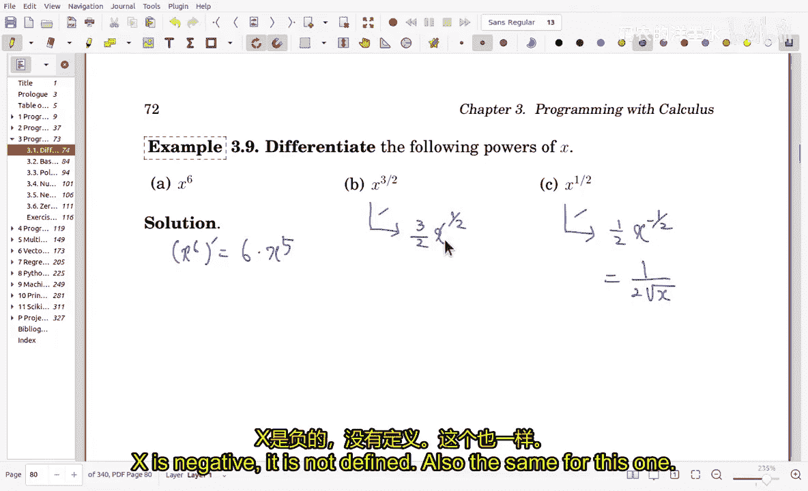

Okay。Now， we expanded the definition of the derivative lift for various functions。And。

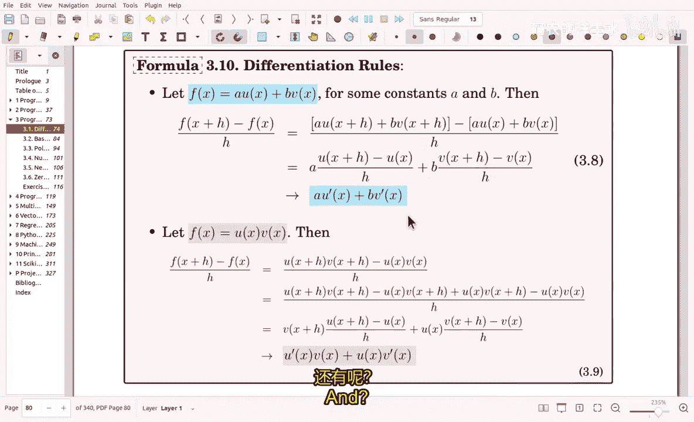

Here， these are just X to the sum power and for x to the。

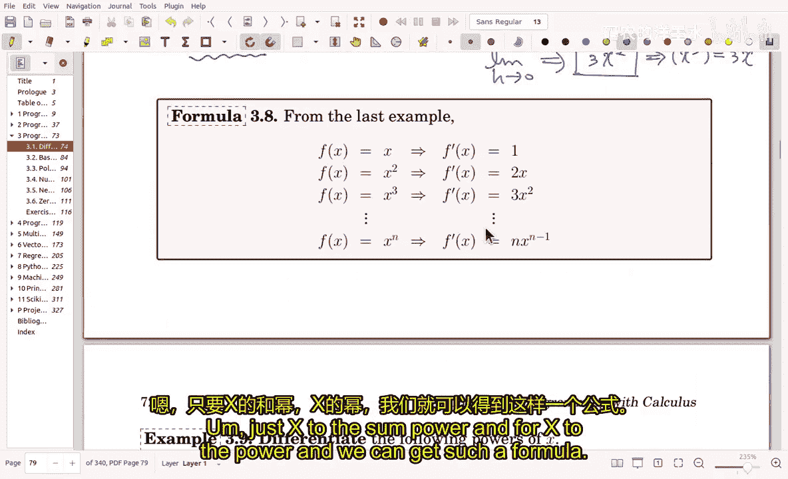

Power and。We can get such a formula。 Now， we'll try to apply。

The definition of derivative for various functions bying here some extra differentiation rules， okay。

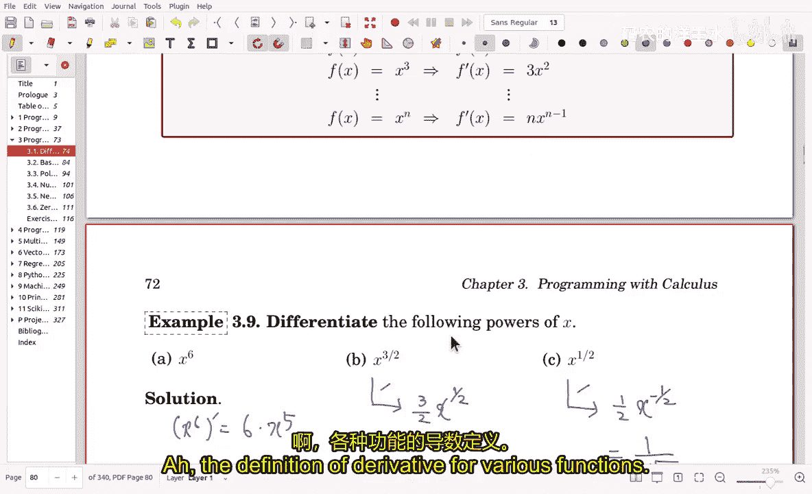

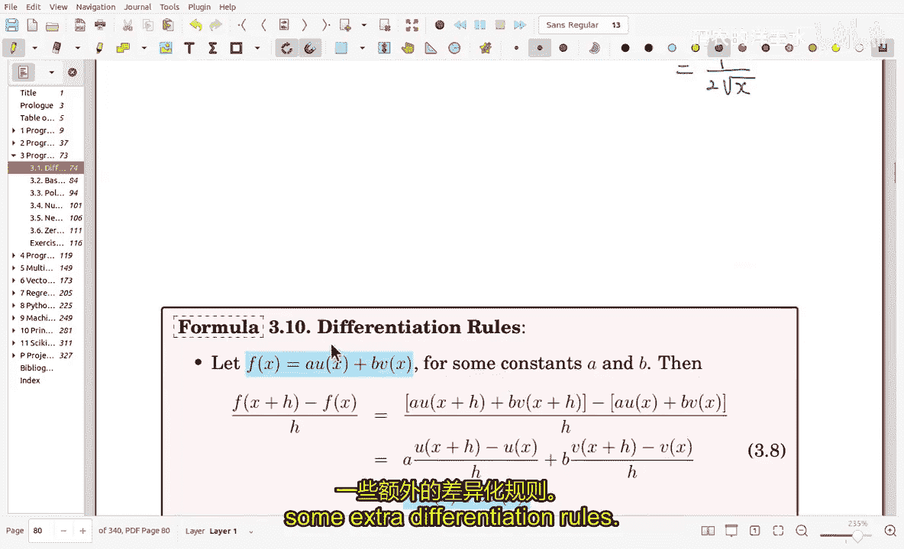

Let's start with a function。Keep as a linear combination of two functions， a times U of Vx。

Plus p times the V of the x and A BR constants then。Here， we are using the。The cushioned， then。

At x plus H， we can write in this way。 and at x， we have that divide the by h。

 Now we rearorrange in then here for a， we have this term。Minus that one here and for quotient to B。

We have our top is Vx plus h minus well with the minus B Vx， and we have H over there。Now。

 once H approaches 0， then assuming that the limit es that approach to U derivative， U prime。

 there will also approach to。Approach V prime。We're assuming limited existence so we can have this formula。

The linear combination of two functions。Is deive is basically just a linear combination of the derivativeives of each function。

So， in a sense。Here， a derivativeive is a kind of a linear operator。If you are in lineararbra。

 then you can understand the is。Of course， later on， in chapter 4， we'll deal with linear algebra。那嗯。

That F is given。As here， product of two functions。Then by using again the definition。

 and we start with this difference quot。Then， that is now。Okay， at x plus H， we have with this term。

 and at x， we have with that one。 Now we try to subtract this term。To the numerator and add this to。

 So these two are the same。And we separate out for this first two termss。 we have V X plus H。

 and we can go out。 We can put it here。And for。The last two terms now， U X is common。 So we put here。

And。As assuminging that in the derivativeors， that means here， limitors。As H approaches0。

 then here this term will approach to here U prime。And this term will approach V prime。So that。

If we apply limit h approachce， then this two term will convertge to U prime V plus U V prime。

So here we have a formula， the tip tip of the product。I can be obtained by using thiss。

One each time is differentiated。 And here the multiples are added。 That's the formula。

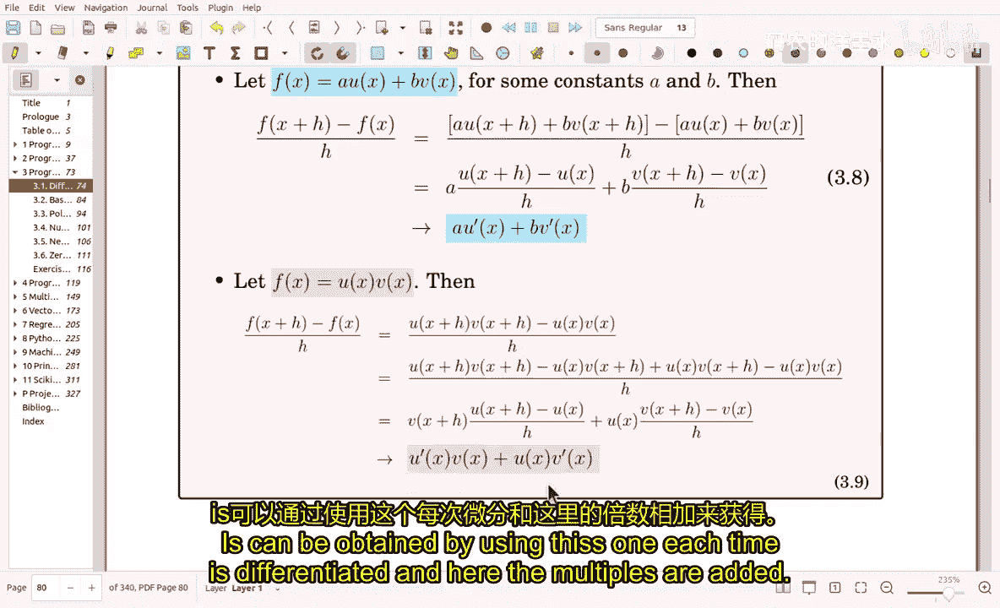

Okay。Let's。Try to get derivative of this function。Now， we'll try to check yet。The product to rule。

 Okay， if you try to get。For x to the6 directly。 then from this one。

 we have now six times x to the 5。Now， x to 6 can be read as x to。And times x to 4。Now。

 two functions are multiplied。 So by using product rule， we may try to get the derivative。 Okay。

 from this one。Now we differentiate first to， which is 2 x and x to the4。Now， plus and first form。

The same now t to was second term。 There is4 x cubeta。 from here。

 that is2 x to the5 from the first one。Second one， that is 4 x to the 5。So here we have6 x T5。

This term， this result and that result are the same。

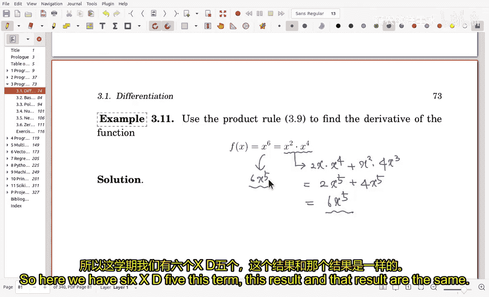

Okay。Now。Does's the curve Y corns。X to the form minus-2 x is squared plus to have any horizontal tangentity line。

Use the information you just found。

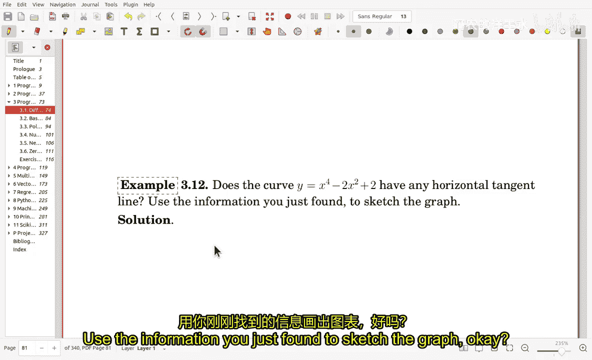

To sketch the graph， okay。Here， horizontal tangent line means that at the point， the slope must be0。

Right。And that is a derivative more space alone。So we start with the Y prime， the T tip。

About y with respect to x， which is same as4。X cubeto from this one。And minus two times 2。

 So there are4。X and the constantome。Okay， slope of the constant。And that is horizontal。

 If you consider this one early。Then if you try to get y equal2， the graph of that。

 then thereron will be here。 that is 2。 and there is horizontal。

 So sop of this function at every point must be。The see， so t of。嗯。The constant must be X。Okay。Okay。

 so we reach the derivative of given function。 and we have to find the points where。The slope is a0。

 So let's say， equals a0。Then。From this one， now4 x are common， and then that is x scatter minus-1。

Equals 0。 So we have here four times x times and x plus 1 x minus 1 equals0。

 which means that when x equals0 or 1 or minus1， then the1 line must be horizontal a gentle there is the same as。

Just a derivative is a0。 Okay， now we'll use this information to sketch the graph。 Okay。

 when you try to sketch the graph， you learned from high school that。And try to find the intercepts。

 X intercept and Y intercept。 and any。嗯。Other information so that you can get a better graph here。

Now。Let's try to use the information。O谢了。Okay， once x equals0。

 then there is2 so that it will pass that on。And then。Here slope will be 0 at 0 and1 and minus-1。

But once x equals on， then y value must be here， okay， once x equals long， then y value must be2。

 you can quite easilyly get y value from this equation， once x equald 1。Then  one-2 plus 2。

 so that here there will be one。And also。When x is -1， the same value， which is1。So that once minus1。

Then the height， okay， height must be here1。I should start with this one。Whi'ch higher。 Okay。

 let's try to change it And here。 There is 2。 And this is not one， okay。Okay。

 when its okay minus-1 then height is1。 It is passing this point， of course。

 passing this one and is one then passing that on。And testing。And。At this affiliateted point。

The curve must be horizontal。Whim is there？And here。Okay， that is passing this way。

And then now here the the solar must be 0。 So it is to start coming up and say over there and coming up like that。

 In fact， the graph of this function must be symmetric with respect to y axis。 So we have such。

ク the shape W。That' is the graph。 And we can sketch the graph by using。

The information we obtained from derivative。Okay。So， if you are using。Tative。The results。

 then you can get。

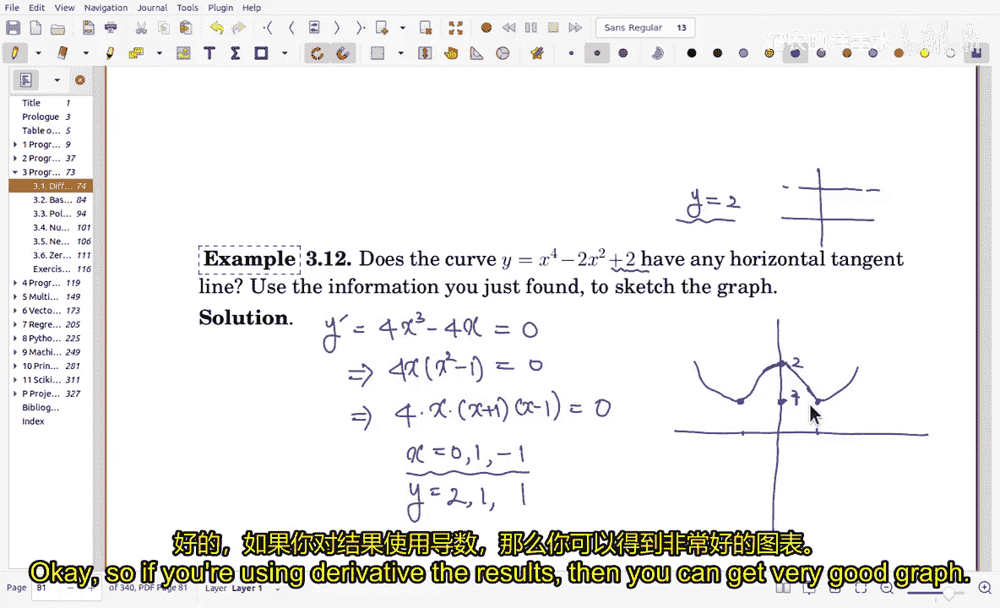

Very good could。In many cases， people are using also secondary derivative information to get a better graph。

 but we not go to。Teachers of such graphing techs。Okay。Now。Consider a computer program in Metrola。

 Now， here we do some symbolic computation and try to get a derivative by using the definition。

 First we。

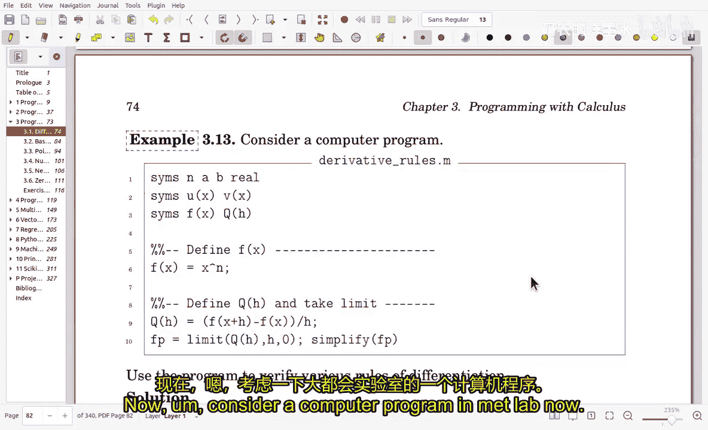

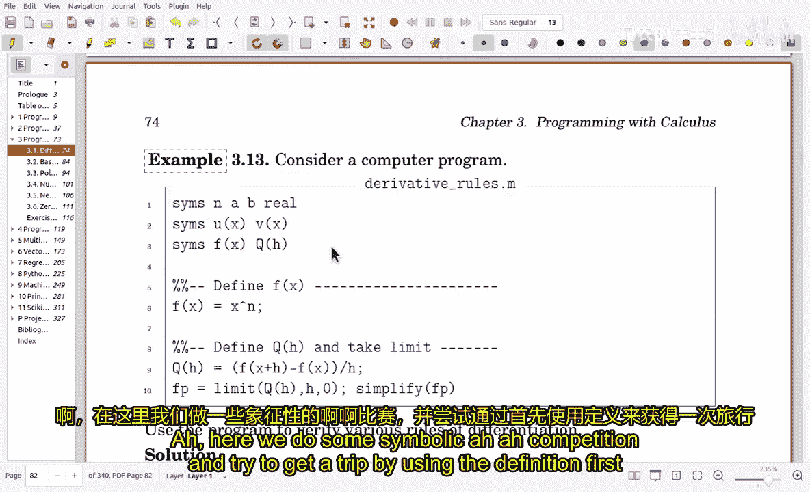

For given function， we formulate the difference quot and take a limit as H approaches 0 and。

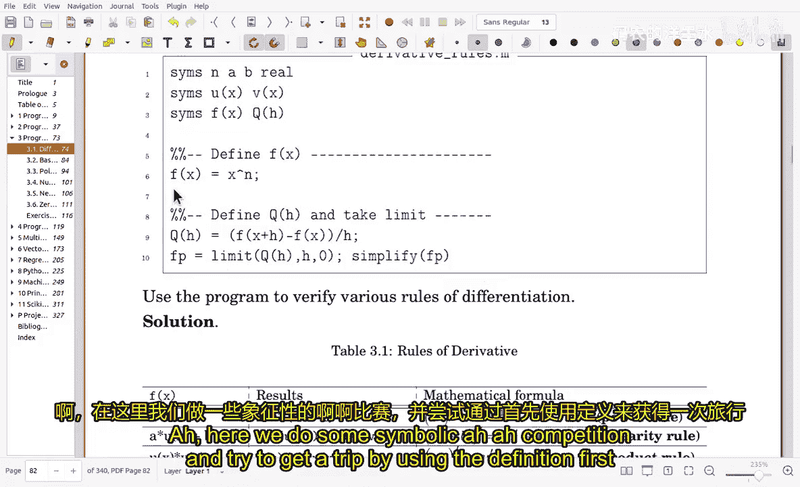

But the this result will be albeit messy， and we simplify。And we did， in fact。

And earlier when we are using the definition to find the derivative。 And at some point。

 we try to simplify。The formula， so exactly same we do in programming。

So we choose some various symbolic functions here， now that is only XN。

 but I implemented here a linear combination of two functions and product and questioned and that is component it。

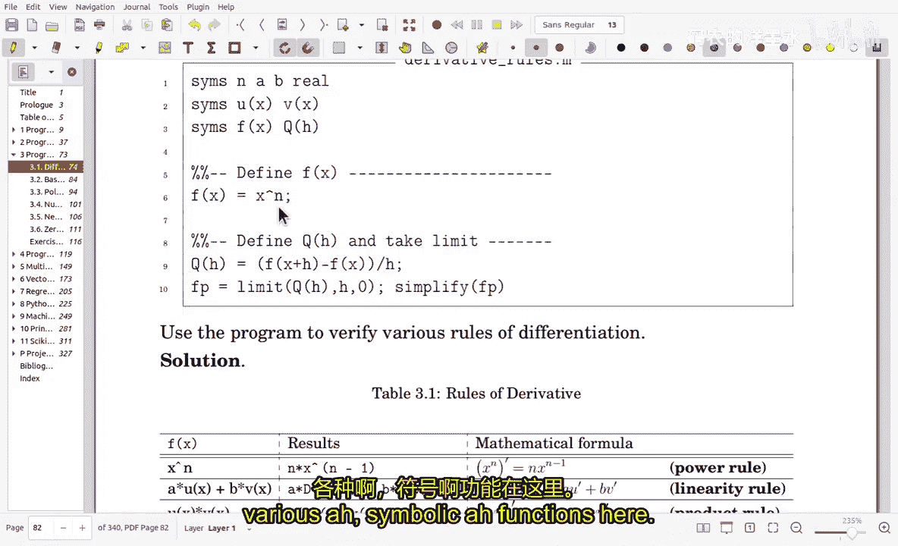

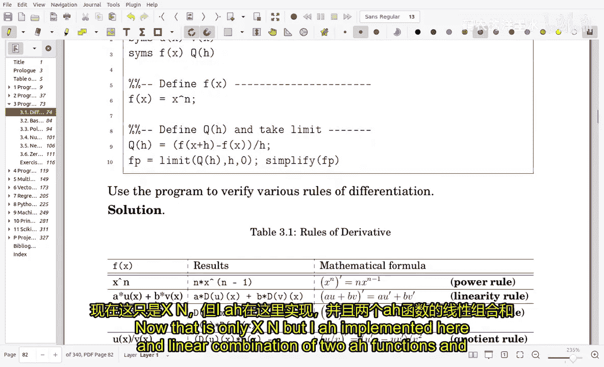

嗯。And I used this program to find the adapt， and these are re。And out of these results。

 we can get here mathematical formula X n prime derivativelu as n times x。N times x to the M minus-1。

 that is a power ruler already we learned and that is now here okay。

 that is a U prime plus B V prime so that's exactly this one there is a linearity rule and for product and we got this result and so that it means this one。

 there is a product rule。For cushionient here， that can be written mathematically in this rank here。

 U over V D B S same as。 Now， the numerator is U prime B。Minus U V prime。

 and the anumator is few squared。Which is called the question to rule。And for company function here。

 there will be same as U prime V。Times V prime。 that is changing rule。And of course。

 by using the definition。I here try to gain the result by using definition just to start with the question。

And take limit， and simplify。So if you do the computation。

 then you again is actually same result and here。

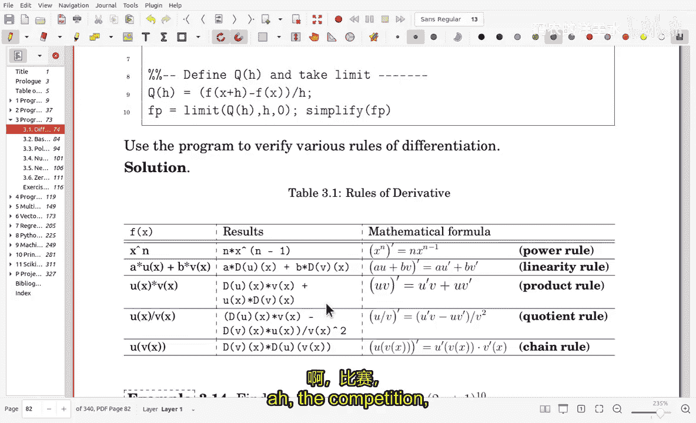

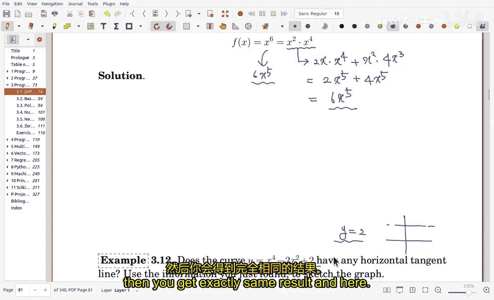

Earlier or so we tried to get those returned， but just。We you these two。Cases， but for other cases。

 you can get exactly same。

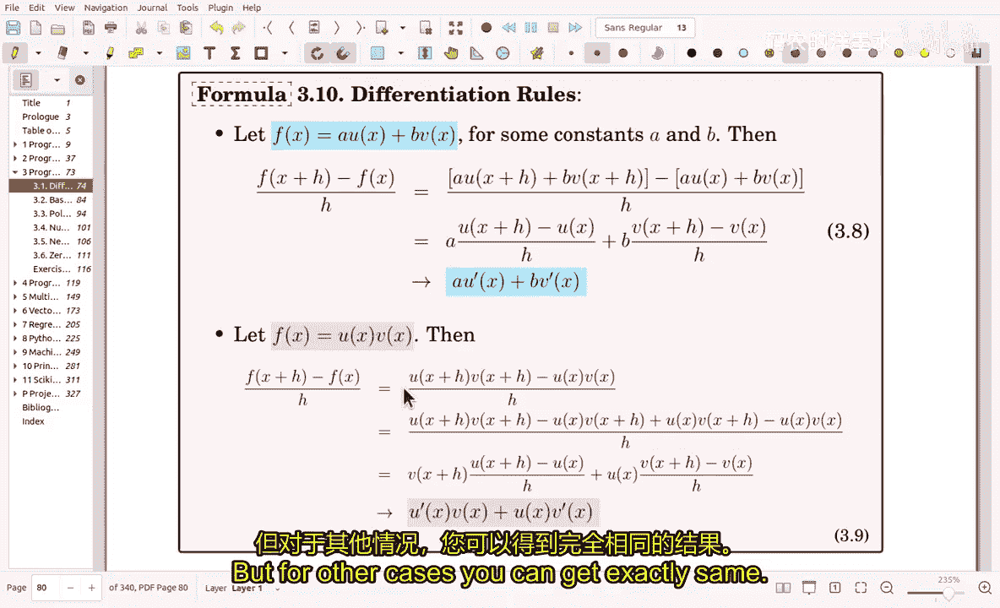

A result， okay。

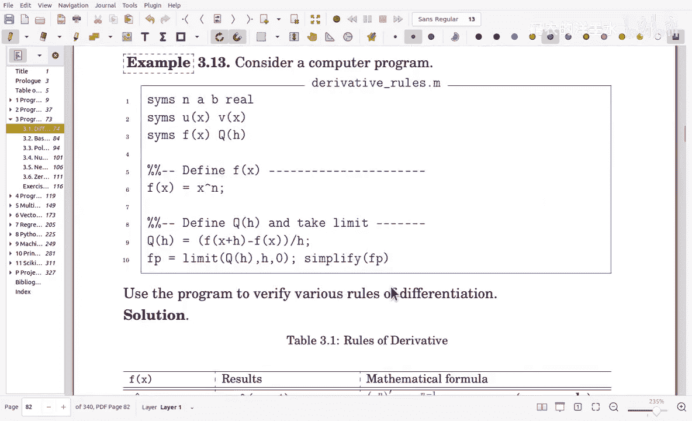

Okay， now we'll try to find the derivative of geoVx is defined in this rh。

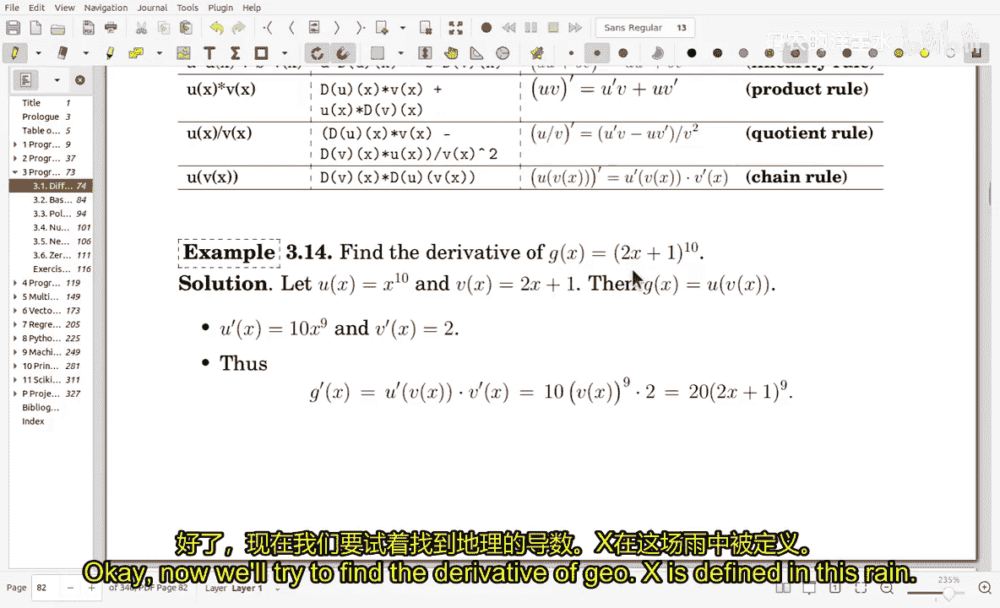

This is now， if you expandend then。Is10th of the polynomial so that you may get divive by using your a power rule。

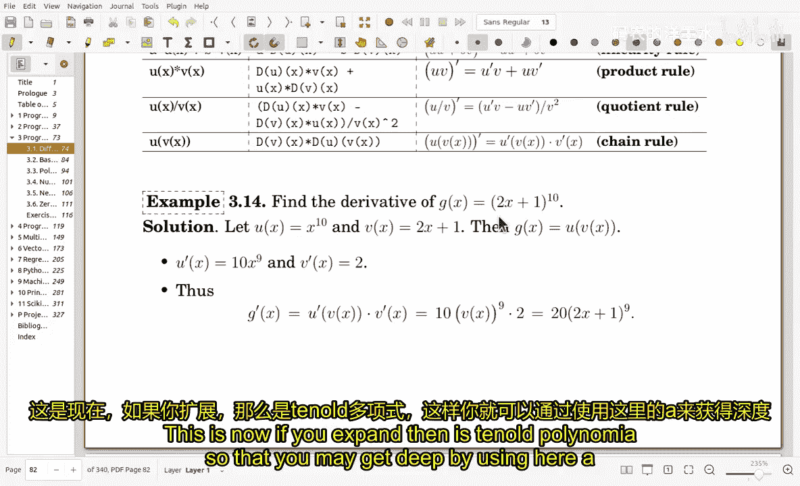

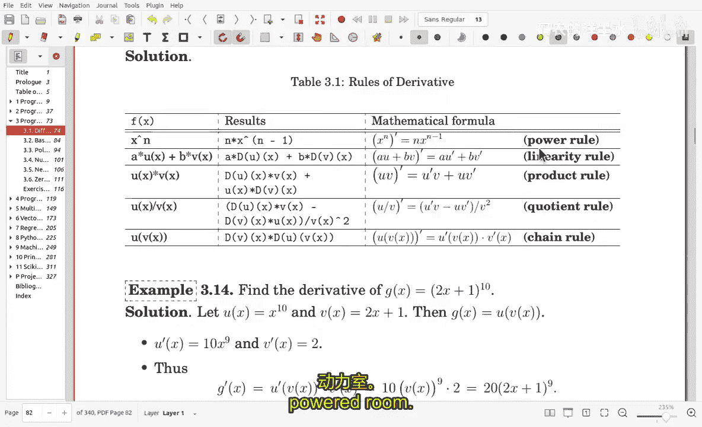

However， if you try to do that， then it's very complicated。

 So we may consider this given function as a composite function。And U have x as x to the 10 now。

Momenturally， we consider this term as variable。And then V of thex now with the variable 2 x plus1。

With this definition， the given function GVx is the same as U or VVx。Now。

 if we are using the chain room。Then， Uvx。Okay， U V X T T B S 10 x to the 9。And here V is 2。 So that。

Now， G pro X is U prime。嗯。But you have to get the value at V Bx so that here， you prime V B X。

V prime X。Rather than x， you have to put here v over the x， so that are 10 times now， okay。

 rather than x， we are using V of V x。P of x to the 9， and。We promise， too。Now， this one。

Is here 3 x plus 1， and we multiply these two， and there will be 20 and V plus V of Vx is M as 3 x plus 1 so that we reach share this term。

 So that's the final answer。

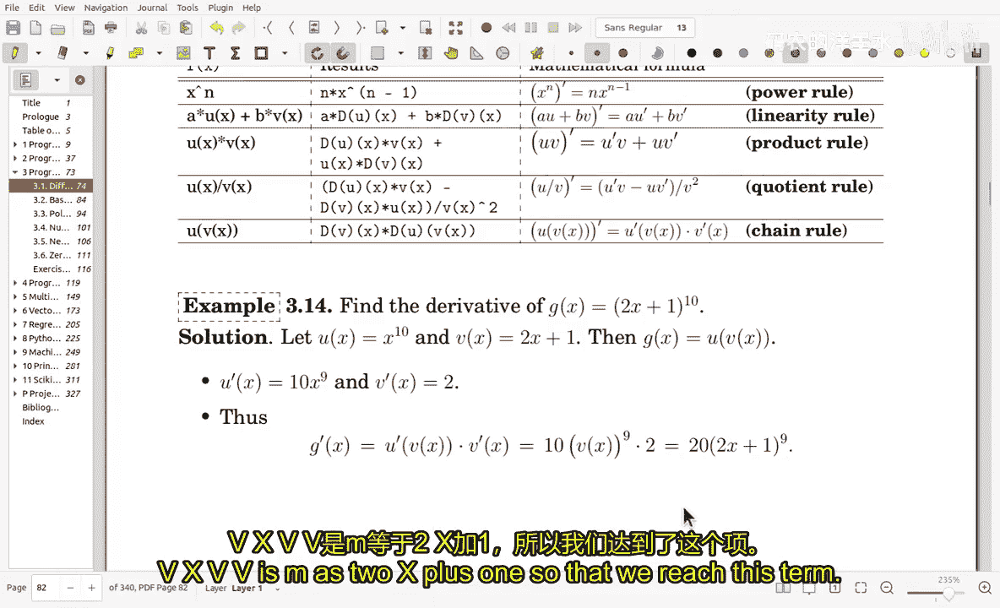

Okay， it seems quite complicated， but you can think in this rank momentarily。

 if you try to get from this one。If you try to get t with respect eggs。Then momentarily。

 you think this one as a variable。Then there will be 10， now dis variable。And plus one and。Power 9。

 And then you think you derivative this variable with respect to x。 then there be2。 that's original。

 This is the same as this one。So。This chamber can be considered in this real， okay。

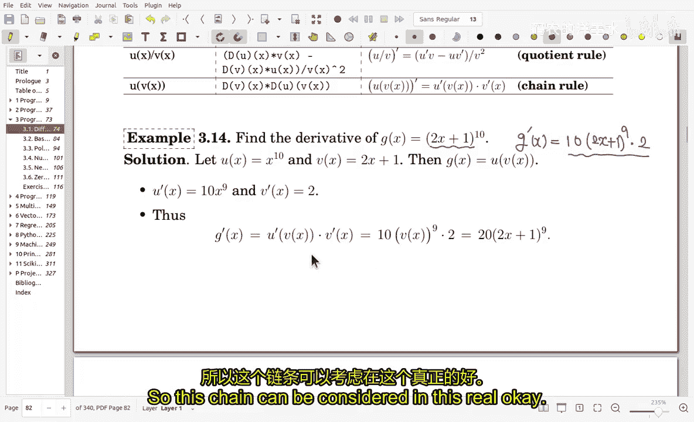

And it went other way。Is okay， now Q Vx。As the same as here， U V reacts okay。Okay， now cheap prime X。

If we try to write on this one in quotient to form， then that is called a DG over Dx。Now。

For this one。 And， of course， because his you is the same， in fact now。T U over Tx。

 you can write in this way， because apparently now there is a U over there。Okay， now for that one。

 you may think here T U。播波TV。Like， you deal with this one。嗯。Like a cushion。So that。

And you put over there to make it the same left inside side right inside。

 Now we put here now TV to numerator and here now T X。This portion。Is the same as here。

 the given function。Here， differentiated with respect to V。That is same as only with these valuable。

We consider this one as a variable V here， variable and differentiate。

That portion is exactly same as that on。 now V。Tivative with respect for X is now 2 over there。

So that the。Change room can be considered in this ring so that quite this is quite reasonable， okay。

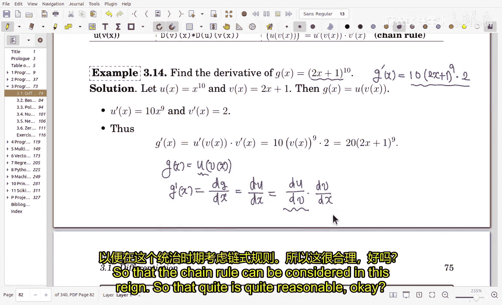

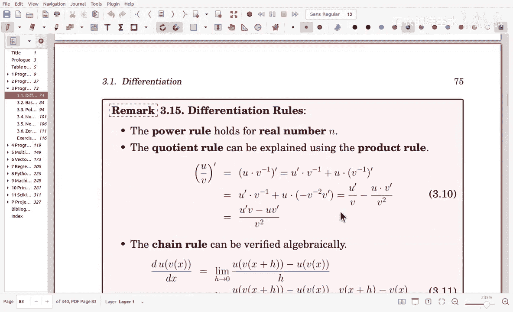

Okay， here we。Again。Now， algebraic television for Ds。Here。嗯。First of all。

 we say power rule holds for real number and not necessarily。Inteent， just a full video number。

We can use it for question to rule。Here there is mathematical television， you are over prime。

 and that is another way of getting question to。And that is， rather than U over V。

 we write down as product U V to the -1， power -1。 And we are using here product ruler。

And then here we simplify and we can get it。So in a sense。

 question to rule is a special form of the product rule。

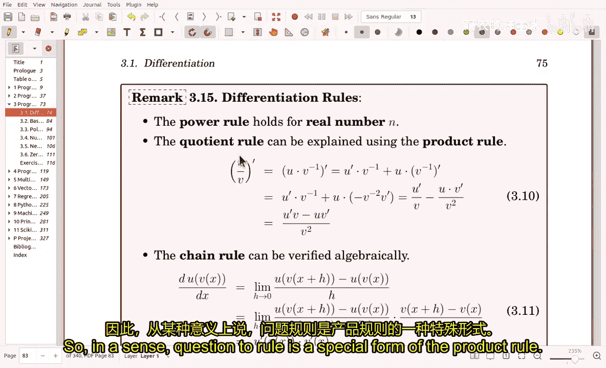

Now， for change rule， we can verify algebra in this vein。Yeah。Now。By definition， we have this one。

 and we are。Yeah。Okay。Here， we are trying to put here this tone and that term。

 and so that if you try to cancel。And then it'll become that on。 So it's the same。 And for each one。

 we try to take a line and we can get an such one。

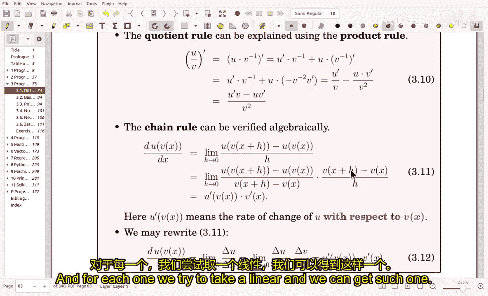

So this algebraic manipulation is basically now here， the same as that one， just we deal with。

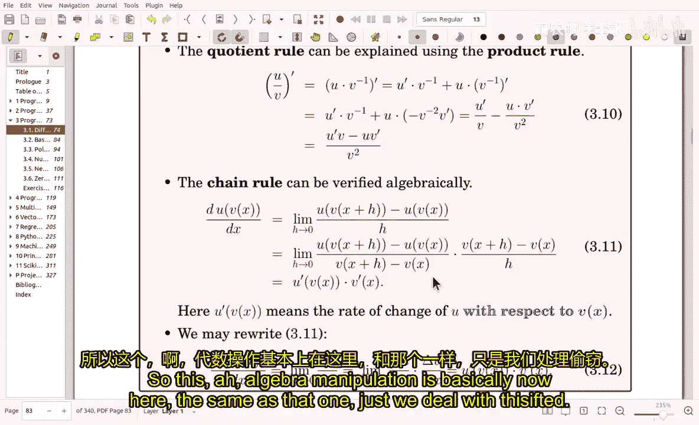

This to lifted。Like as a question。And then， here。Try to multiply D V in both side， and then。嗯。

Try to take a derivative in this one their run separately， and multiply them。

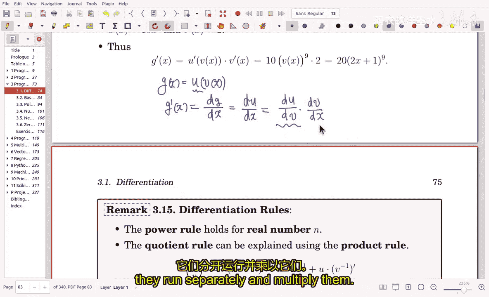

Sos exactly same ideaM。Okay。Okay， here we may rewrite this equation in this form。 Okay， that is here。

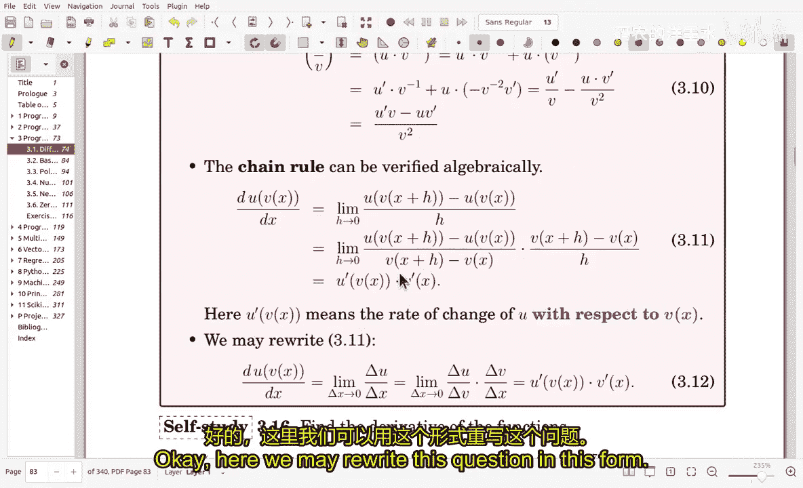

Okay， is' a limit theelta x approaches0， and the same as changing U divided by changing x。Now。

 that can be written here， changing V。As multiplied in the bottom and multiplied in the top。

 So each one。Each now has a limit and in this way so that we can get the final results。So。

 eventually。The channel。lookss like。We are dealing with the the quots and derivative。

 but we consider the derivative as just quoed。 and then we can get it。But aテative。

Once you write in this way， then it's not。Quushioned。Lgorously speaking， but you may deal with it。

That way， because anyway， the TT B is limit of the quo。So that。嗯。一분도有控し的。The derivative is quoed。

All right。It's okay。

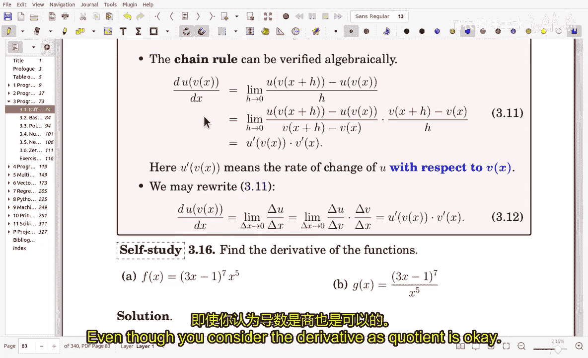

Okay。Okay， for this one， you can get derivativeive quite easily。 Now bying product rule。

You have to get first this derivative times this one and this term times derivative that one。

 But when you try to get derivative for that one， you have to use again。And， and。Cha种。And so that。

You can get。Deivtive quite easilyly。 Okay， do it yourself。

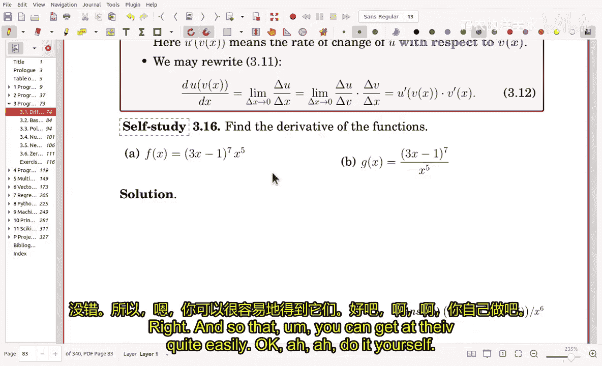

Okay， that's the end of a section， thank you。

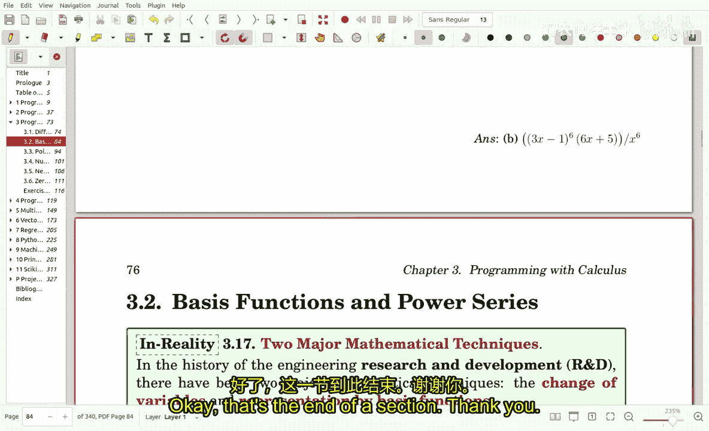