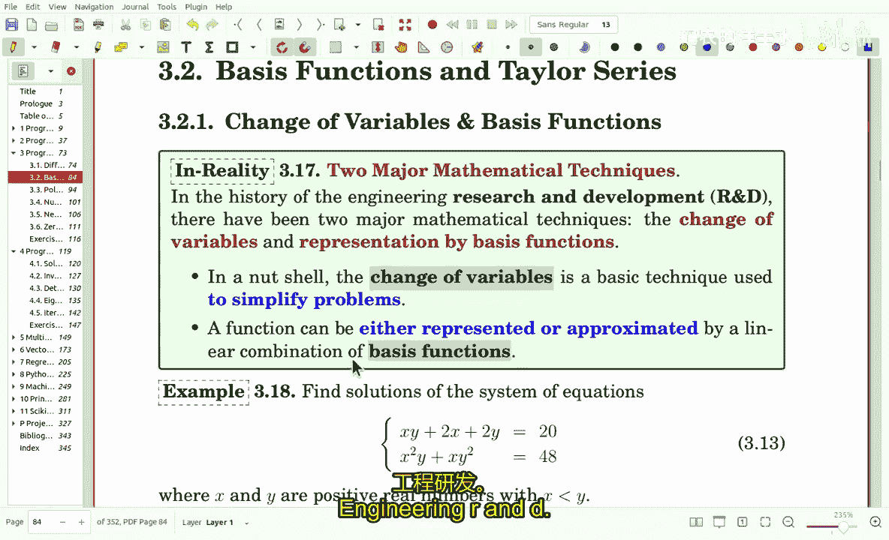
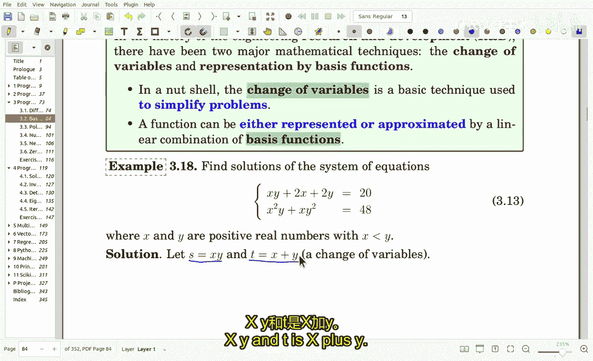
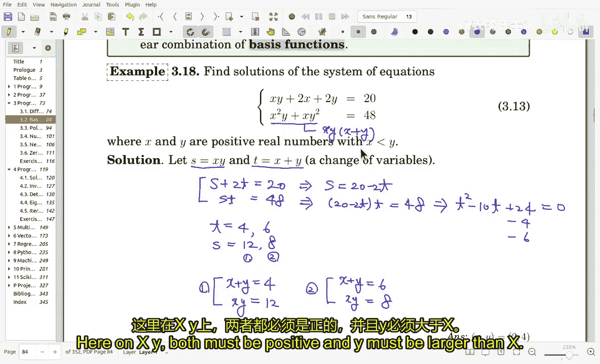
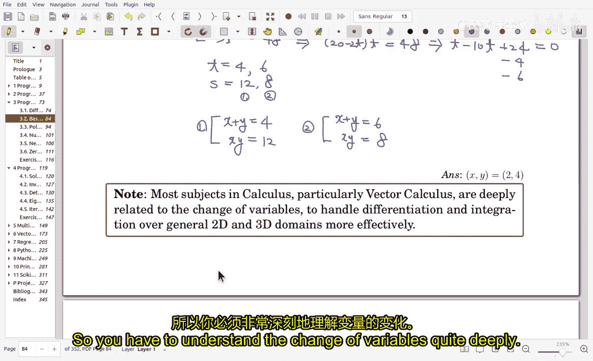
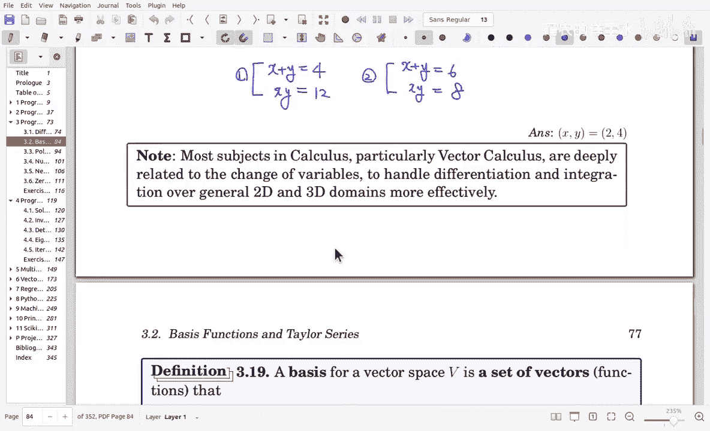
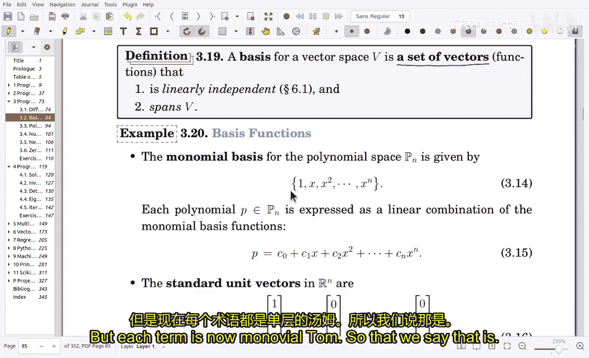
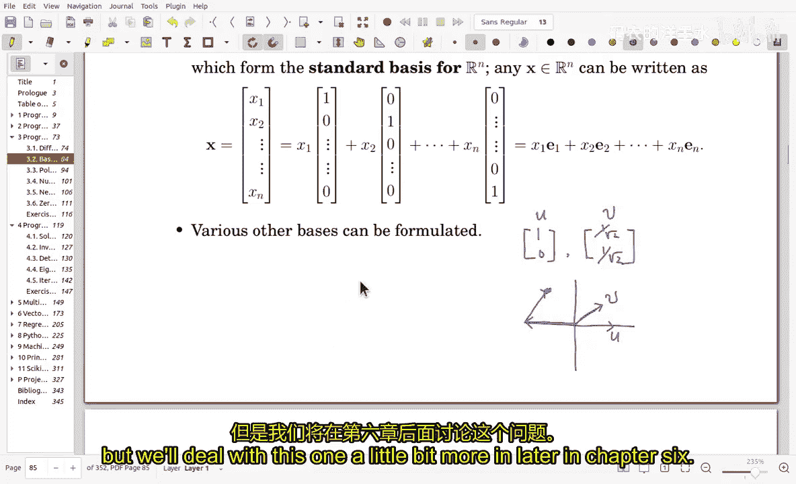
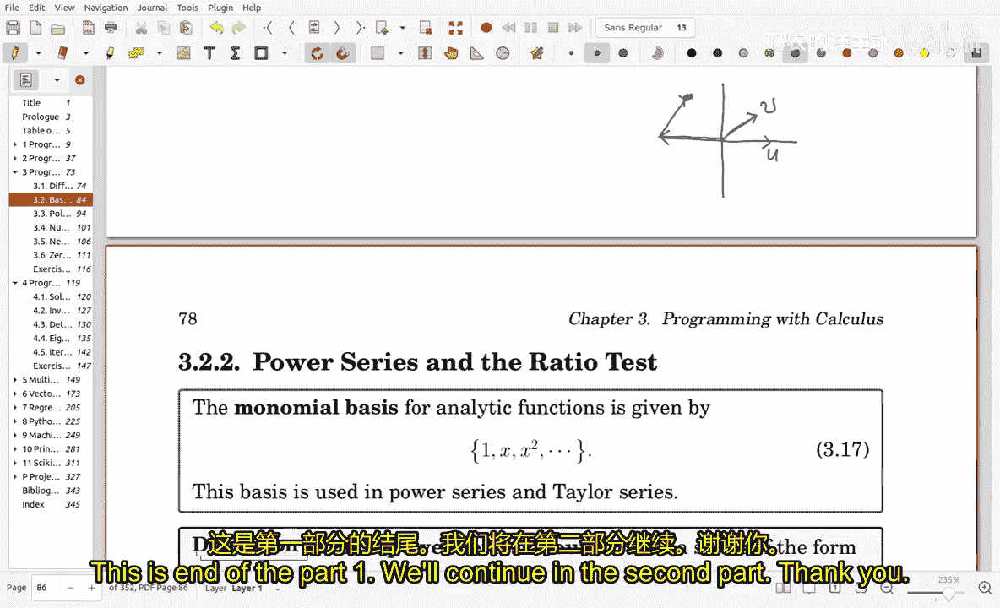

# 【全集-附课程讲义】密歇根大学-人工智能编程-EECS492-中英字幕-p20-Lecture-20---变量和基函数的变化--BV14JqfBNEAS_p20-

It is section 30。2 pace functions and Taylor cities。Let's begin with an observation。

In the history of the engineering， research and development。

There have been two major mathematical techniquess。

The change of variables and representation by pace functions。

The change of variables is a basic technique， used to simplify。Problems。

And a function can be either represented or approximated by a linear combination of basis of functions。

That's the reason， the paces function method have been so popular in engineering， R and D。

Okay， let's see this example。Find the solutions of the systems of equations。 We have two equations。

 to nonen in equations。Of two variables， X， Y with these conditions， X， Y are positiveitive。

 and Y is larger than x。For this problem。By introducing a change of variables。

 you can get the solution much more easily。Here， we'll try to use these change variables as see as。X。

 Y and T is x plus y。Okay。

Then， here。Also because this portion can be lead as now X， Y。And x plus y。

So that we can simplify these terms by using。This change of variables。Okay， the first question。

Can be changed into X， Y， S， S and 2 x plus 2 I S  twice of T。We chairs training。

From second equation， that is now S times T S T。一会。48。Okay。We have thejecting equations。

 much as simpler than the general one。From the first one， we have， for example。

S equal 20-2 T by using this one。From the second equation， we have S is 20 minus2 T。And now， T。

Equal Fourier。Now， we can solve this problem quite easily。 iss quadratic in T。 So it's quite easy。

 okay。We'll move these terms to right side， and expand。And try to divide by 2。

 Then that same as T scatter。Go that is a minus。100 and plus 24。이こ 싫어。

So we have4 and 6 separation minus minus， which means that t is4 or6。T S4 or 6。嗯。In this case。

 the corresponding S must be。Now， once t is full， then S must be2。 and once T is 6， then M must be a。

So for S& T， we have two pairs of values。O。So。There is a first pair， and there is a second pair。

 And with the first pair。Now， S is 12 so that O， Ts4。So here T is x plus y。Which is4， and S S X， Y。

And that is now 12。That is。1。Part and the second part is now。And that is t is 6。

 which means x plus y equals 6。And S is8。So X， Y equal a。If youre using。The same technet。For example。

 move Y to the other side and put up4 y here， and thatll be。Quadratic equation for Y。

 And you can get possibly two。Solutions for y， and then you can get the corresponding X values。

So that。Possibly two solutions from here， two solutions from here。

 but you can get them by using the same technique quite easilyly。So there are8 total4 solutions。

 but among them。Here X， Y both must be positive and y must be larger than x。So you can find it。

Unique solution。Which will be here，3 and 4。So among four solutions that on is satisfying these conditions。

Okay， you can finish the computation yourself。Most sub act in calculus。

 particularly in vector calculus。Tly related to the change of value ones。嗯。

With a change of variables， you can handle。Depressation and。Integration over。The higher dimensionnce。

 more effectively。So you have to understand change variables quite deeply。

Yeah。We define paceces。A basis for vector space V is a set of vectors or a set of functions。That。

Is a linear independent， and that spans the vector space of V。Yeah。

 linear independent means that they are。Once they are producing through linear combination。

Then one element in the cell cannot be made from。Other ens， so that。

One cannot be made from other entries means that they are really independent。Because。

The production is， along with the linear combination。And we say， such independence。

Is linear independence。喂。嗯。Once the set of vectors or set of functions having such property。

 then we say that set as a linear independent。And spend the。

What general vector space means that every。A vector or function in the space can be made。

Can be expressed as a linear combination of this basis。Functions， then we say that。Here。

 the basis is spanning the vector space。 Let's see example。

 You can understand it more thoroughly through this example。

The monoommial spaces for polynomial space P。Okay， this is spaced as。

The collection of all polynomials of dignity。N or less than n。And for the polynomial space PN。

 we can consider a mononomial basis，1 X Xoscal and X N。And along with this。Functions， the polynomial。

 any polynomial in PN can be expressed here1 times C， c1 times x， co times x is square。

 and we have such linear combination of this basis functions。So that means that here。

 these functions are spinningning。The polynomial space。An orongong。You cannot get any entry。

 any function here。 for example， ex。It cannot be made。From other ans。

That means the X square cannot be a linear combination of other terms here。So that means that。呃。

This set as a leaner independent。So this is a linear independent and spans the polynomial space PN。

So this is a basis。But at each time is now。AMoommial Tom。 so that we say that is。

Moomial pay sales， okay？Okay， in R N， we define E1。

Is the first direction and the first component is one every。So if you consider an r2， n is2。Then。

You can make it。You can visualize here。Now，10 is there one， so there is e1。In the X direction。

And E2 is a second component。 This one。 Every else is zero。 So the in R2， that will be E2。

In this way， we can have the un vector， length of one vector。And E 3 and up to E N。 So E。

 the last one is the last component is one， A is 0。So such collection is called。

Standard unit vectors in R N。 And it becomes it the standard basis for R N。The reason is here。

 for any choice of。X in R N， we can write this x1 to X N。

 but it can be written along with this linear combination of E12 E， N。So any vector。

 an arbitrary vector in R N can be expressed as a linear combination of these standard union vectors。

So that this standard unit vectors span R n and also。Each of these unit vector cannot be made from。

Any linear combination of others。For example， Y cannot be made of。Bying others。

 because every else over there will be Zong so that any multiple of these vectors cannot become one here。

So they are linearly independent。So there's vision， the collection of these unit vectors。

Is formal basis， and we call it a standard basis because it is standard unit vectors。Now。

 for the K vector space， you can formulate other bases。And this is the standard basis for R2。

But for R2， again， you can make some other pieces。 So for example， one vector is the same as E1。

But another vector。 okay， let's try to write down a uni vector that is one of character to 2 and also the second direction。

 second value is one of character 2 like that。 So the length is  one。빅토리얼링。Yang。

One vector is to this one。And another one is a 45 angle and length  one vector here。

If we say that is U and that is a V。Then that is U， and that is in V。

But these two vectors will form Pas。Because。Every point in plane。

 you can express this point by seeing a linear combination of these two vectors。Okay。

 so here we have two directions page，2 which shared that one。You go。And now， okay。

 go back and parallel move that way。So that here， first move this direction and parallel move with that one。

And。Yeah， a multiple。Of you。Of course， the questions will be negative。 We reach out over down。

And a multiple log V， if this is parallel to parallel to V。

 then a multiple log V will make a that vector so that this combination will make a that point。

That means in this arbitrary point can be。Express the as a linear combination of U ving。

And also here， buy some one。 and you cannot make the other one。And bying this one。

 you cannot make that one。 So they are linearly independent。 So this is a basis for R 2。

In this rainign。You can formulate various spaces for given space。

But we'll deal with this one a little bit more in。Later in chapterpt 6。

Okay。This is end of the part1。And we'll continue in the second part。 Thank you。

