# 【全集-附课程讲义】密歇根大学-人工智能编程-EECS492-中英字幕-p21-Lecture-21---幂级数与比率判别法--BV14JqfBNEAS_p21-

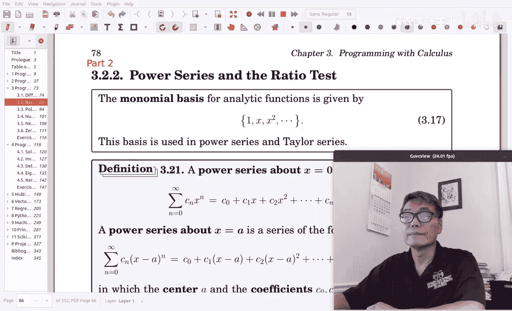

Part 2 of Section 30。2， power C and the ratio attached。

The monomial basis for analytic functions is given by。The collection of monomial terms，1。

 X x squared and so on。An a function is a function which can be differentiated infinitely many times。

So alytic functions are smoother functions。

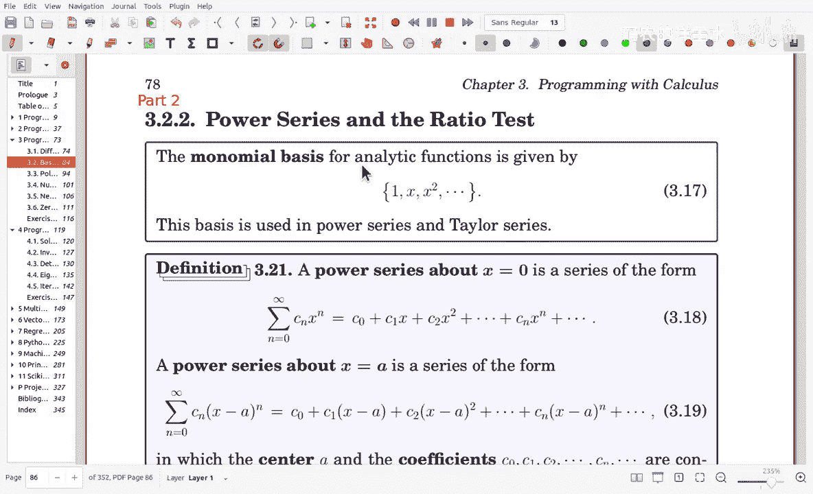

Okay， here we define power layerss。A power series is about x equals 0 is a s of form。

Keep in this equation。Constant。C1 x。Plus， C 2 X scatter， plus， and so on。That is Anth the Tom， and。

Go on。 infinite， many。Toms。And a power 3 is about x equals a is a series of the form here。

 rather than x， we are using x minus a， so c0 plus c1 x minus a。

 C to times x minus a is squared and n through the to is the cn times x minus a to the n now continue here。

Such。Feng。And such a collection of terms is called power s。 Once is about0。 So using x equal。

 then is about x equal 0。 once the terms are combined， along with x minus a， then we say。

A power s about x is a。In this case。Ace the center of the Cage。And now， see you want to see。 And。

 and these are the quos。That is that finish one。

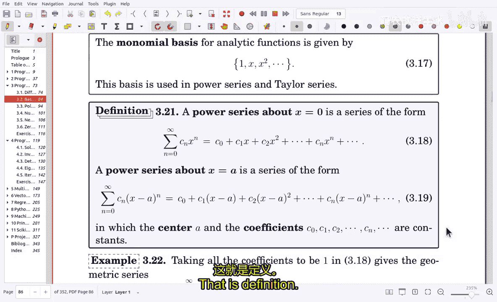

Now we'll see here taking all the optionss to be won in this series。

And we can get the following geometric is。X N N is from0 to infinity。That is given in the real。Now。

 this is a mission city converted is to。One of1 minus x Ol。The absolute value of x is less than 1。

 That means that here this is3 is the same as one of1 minus x。Yuan。um。Absolutely valuable Xs。

Less than one。You can check it quite easily。And if you try to multiply this tone and that one。

Then we can check here。 Okay， For example， we try to multiply two of them。

 Then there is now1 minus x。 and here。1 plus x plus x schedule plus， and so on， like then。Okay。

 then here， this is same as along with1， the same as 1 plus x plus xos scto plus now。

 and along with this one， second on， there's minus x。And plus here。Now。And minus x is scheduled。

 Okay， rather than plus we put here minus。Now， x is Sch and minus x cube and so on so that we can cancel our。

In fact， we have to do this one in this vein。Now， the last thumb。Is X N。

Then there will be here at the X N， and this one will be minus x n plus 1。Power。

And now if we simplify this one， there will be1 minus x2 the。M -1。 Now we take the limit and x。

I N I infinity。Now， once。We take a limit。Then once x is larger than one or the length is one， then。

Possibly we have some problem so that and this limited term should go to  zero。

And all if when now X is in moduluulars is less than one， it equals a0 so that it is approaching to1。

That's exactly this statement。Xing。For y equals one over1 minus X， we try to。Make a polynomial here。

 Now， start with one。 and that the first storm。And now we try to use a linear， and now quadratic。

And here， finally。We try to visualize the a of the polynomial Y sub a。

 then it is appating height nicely。 once you try to choose in higher order。

 then it better appating the original function， one of1 minus x。 However。

 this conncy is done when only the x is between minus-1 to1。Okay。

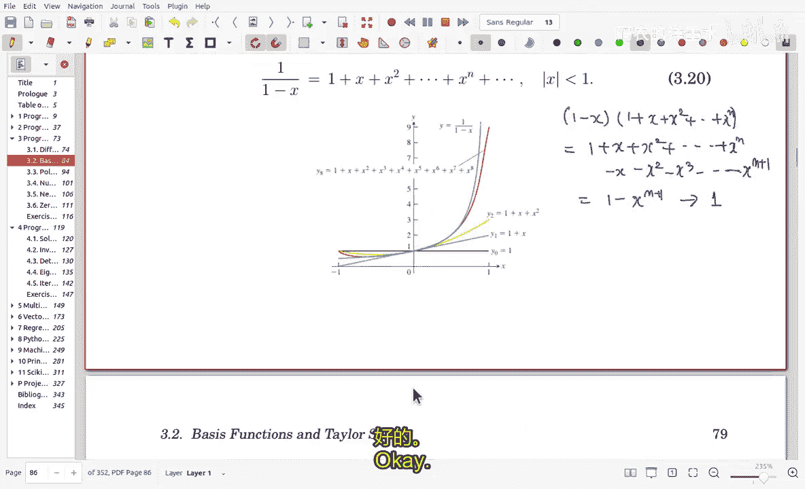

Okay， here it follows from example 3020 that the example 3020 is this one。

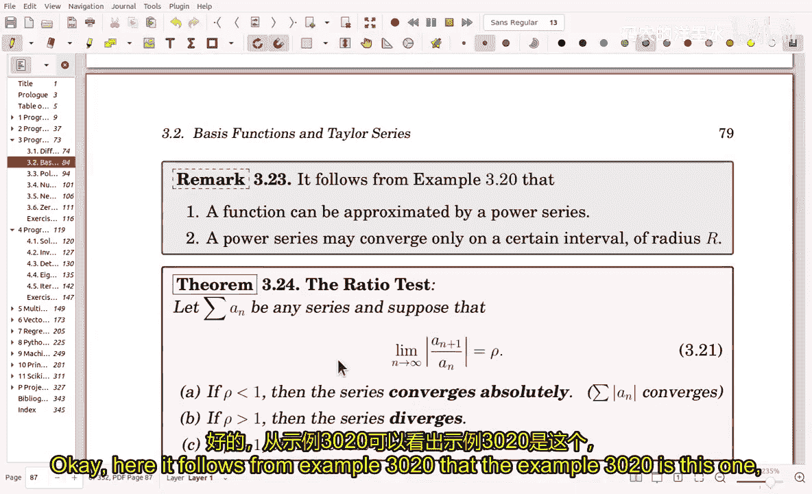

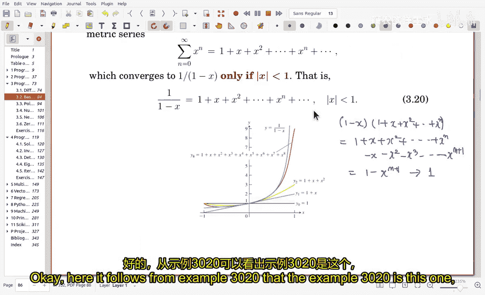

That a function can be approximated by a power series。And secondly。

 power series may converge only on a certain interval of radius R。So here。嗯。

We have to test the given power sage。 Once the power sage is not convergent， then。ペ斯克林。

It's meaningless。Not competent means that the value may go to infinity or ocillatory。

Then we cannot use said， and we cannot define the value。So that。First of all， we have to make sure。

The power cities of conmbogs。Xiang。Let sigma A N so that each term is representgen by the。

A N notation be any s and suppose that。

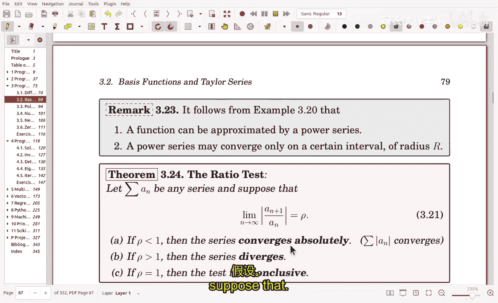

Yeah A n plus1 over A N in this1 here。 this is a0 Who thing is a1， a2， a 3， and so on， right。

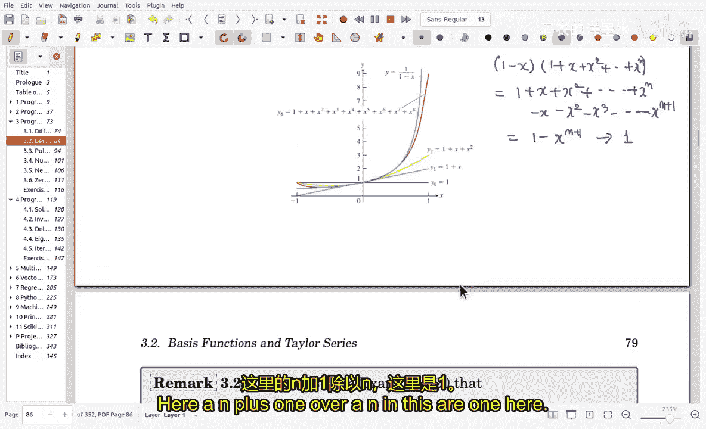

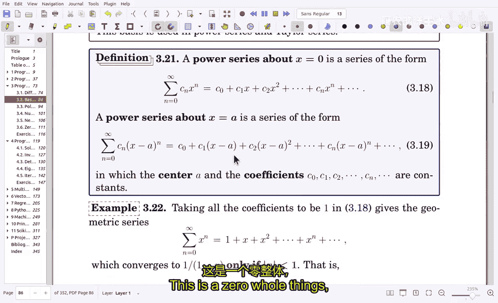

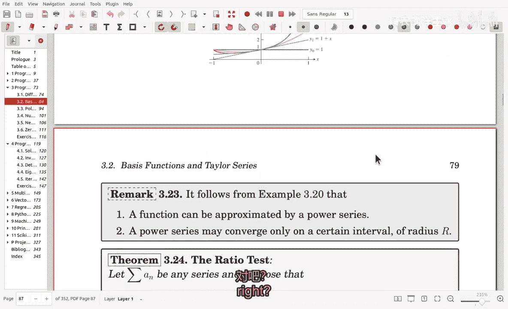

Okay， we try to measure the ratio of the consecutive。The tomb in the cities。And measure。

The absolute value of this visual。And as an inquiry says， if it is compelling to rule some number。

Then now by using the number， we can。Yeah。哦。Now， say the convergence。 if the line is bounded by one。

 less than one， then the city convergs absolutely， which means that absolute valuable terms。

 convergence。Okay， now once the limit is larger than one， then the s diverges。

 and if the limit is one， then the test is inconclusive， which means that we cannot decide。

The convergence by using this ratio test。 Let's see example。

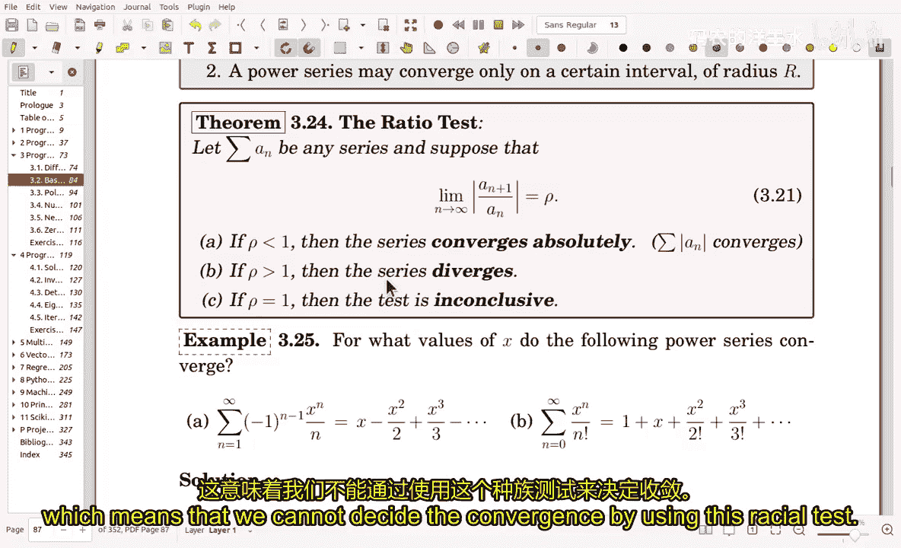

For what values of rank do the following power 3s con？

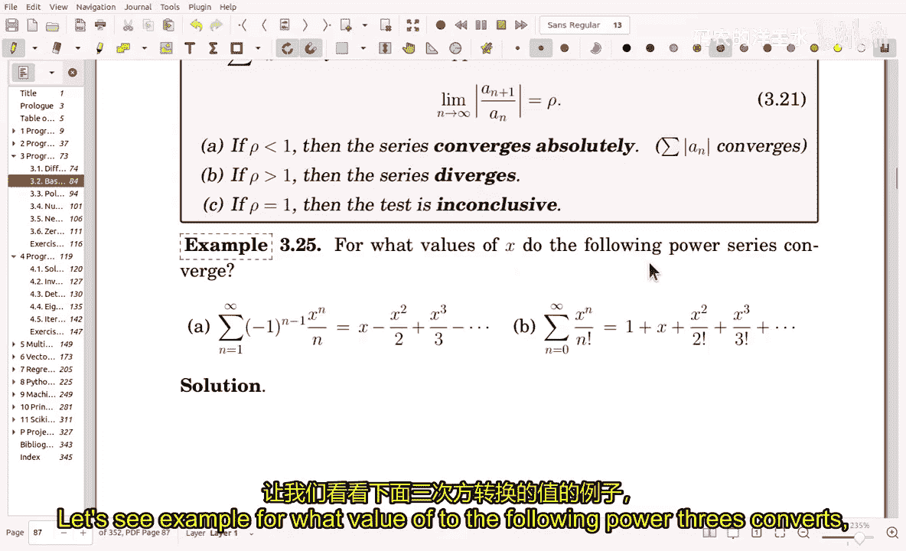

Okay， so here we may say that this is a1， a2， A3， A4， and so on。So。Let's try to use the power 3s。

 Now， A N plus1 over A N absolute value。Okay， that is same as absolute value of here A again will be。

Now。There will be either plus or minus， but along with the absolute signine。

 will Io plus or minus sign。A N will be X N over an。Okay， now A N plus1。So that there must be。X。

M plus1。And over here， N plus1。That is top and。The denominator was AN， which has x to the n or n。

Okay。Now， for x to， we have 1 x yeah。No。And is growing， so that。Now， along with these two terms。

 we have n and n plus one on the bottom。Now， S N。嗯。Orpo to infinity。

This term will convert to one so that eventually。Yeah。

 whole thing will approach to you know actual value。

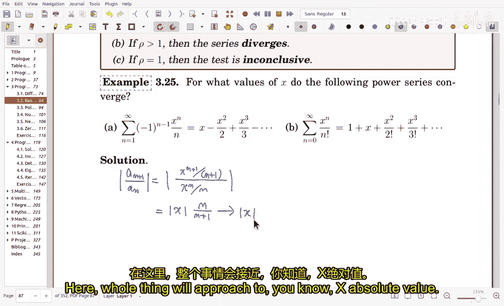

So that is raw。Indu's fi。

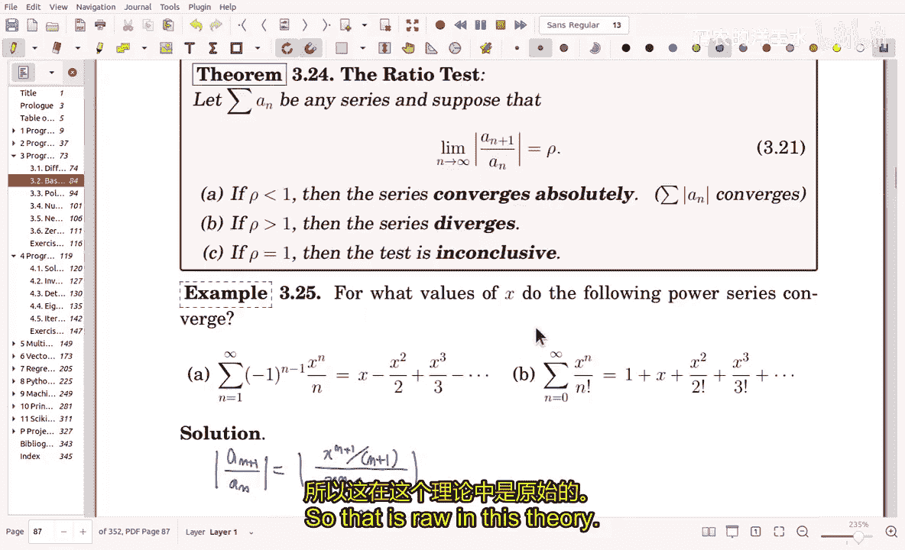

Once we have limit。Then once the limit is pounded by one， less than one so that， okay。

 that's the wrong。

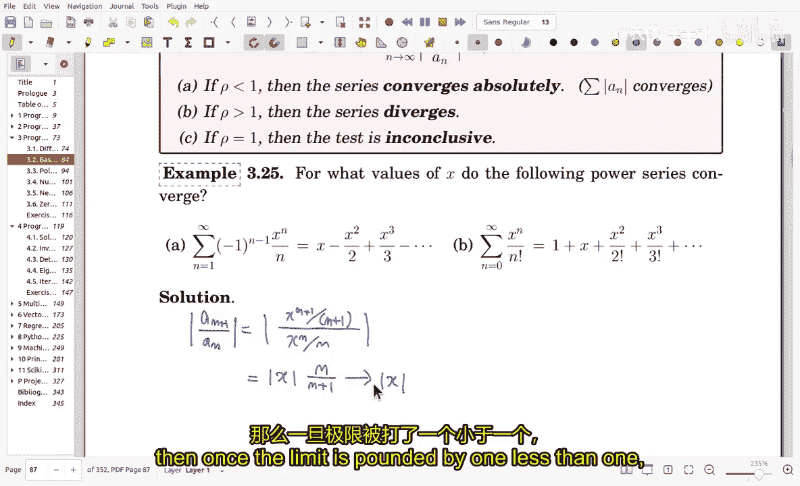

So， raw。Its now x。If this is lesson one， then we know that。The city convergence。Okay。Thats it。

 But here， if raw， of course， there M is now afurex， which is larger than one。

 and then we know that that is divergence。Okay， and what if we have rh equal 1。

 which means that rh equal 1 means here x actual value equals 1， then means x as now plus minus1。

Okay， in this case。The test is inconclusive。So by using the test。

 we cannot decide if the s is convergent。So we may try to use some basic。

Tchnic to decide if it is convergent。 So first cases now x equal  one。Okay， ex one。Start with that。

 then the cities becomes here1 minus1 half。Plus1 third here you are plugging one here。

1 minus5 plus1 third and minus1， fourth。And so on like that。

This is an alternating series and each term becomes a smaller， smaller， smaller。Then in some theory。

 we know that this is convergent。 Okay， so when equal 1， this is convergent。Now， how about x is -1。

X is now minus1。Then the Cuba cis changed the industry way，1-1 half。Okay。

 it's now x is -1 so that this term will become here， minus-1。Third， and again， minus1 fourth。

 minus and so on。And that is。Same as this one。 Okay。

 we can write down this one in this rank and2 minus and one plus1 half。Okay， plus one， third。

 plus  one， fourth， plus like that。Right。But we know that from some theory。

 this as infinity is blowing up。So this whole value will go to minus infinity。

 So when x is minus1 is not convergensant。So， here， we can conclude。The intervalable convergence。

Is from minus1， okay， that one， between1 to 1， but minus1 is not included。 however。

1 must be included。 So here from minus1 to 1 with  one included。 if you choose x from this interval。

 then the s is convergent。Okay， for this one。You can do the same。Now， because of that factorial term。

Here， okay， if you try to measure。Now there on， so that A M plus 1 over A N absolute value。

 then there is Excel value of now A plus 1。That is x n plus1 power。

 and that is n plus one factorial anti by x to the n over n factorial okay。Now， for。X terms here。

 We have absolute value of x。 And for this， we have one over n plus one。

This is a multiplication up to n plus  one。 This is a multiplication up to n。

 So we have an extra M plus  one。 So we reach chat and that on。Now， as n increases， this will。

O process signal， which means that now there is a rule。No matter what x is。

 it doesn't matter this limit is always less than one， right。

 There is a less than one so that for every choice of x， it is convergent， in fact。

This one has the same as e to the x。

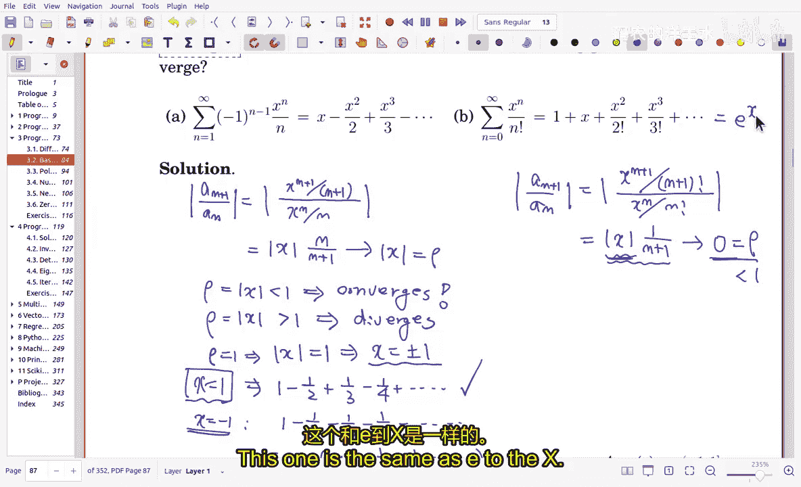

Okay。

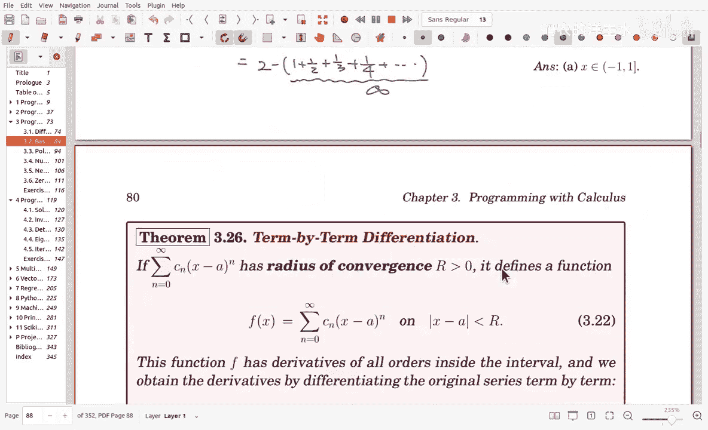

Okay， here tu。We are using power 3， the representation。Is here。Once。

The power cities has radius convergence R。 That means that。This。

The s is convergenent when we are choosing x satisfying this inequality。So in A。

 and here radius R inside of this radius R ex。 then now we assume that is convergenent。And we say。

Because it's convergent， we can Naian。 So when the F is the name of that series is， then。

Here we can get Tative。And term by to， along with a term by to depreation。

So each antherom Cn x minus a to the N。We can get for this one is derivative。

 So is n will come out now C N is constant anyway， n is coming out then x minus a tower 1 down。

 which is n minus1 here。And if we want to make one more time of derivative tip。

 second derivative tip， then again you can do it and here term by to differentiation so that here from this one。

 M minus-1 will come out and then power1 down， which is m minus-2。In this rain。You can嘅。

The T term by Tom， so that is quite convenient in many applications。

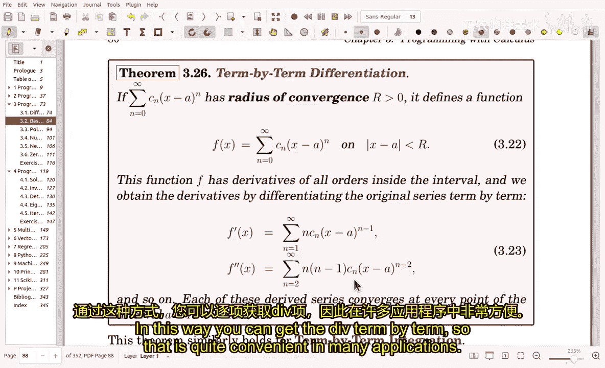

And also。If you try to get integrationeration。

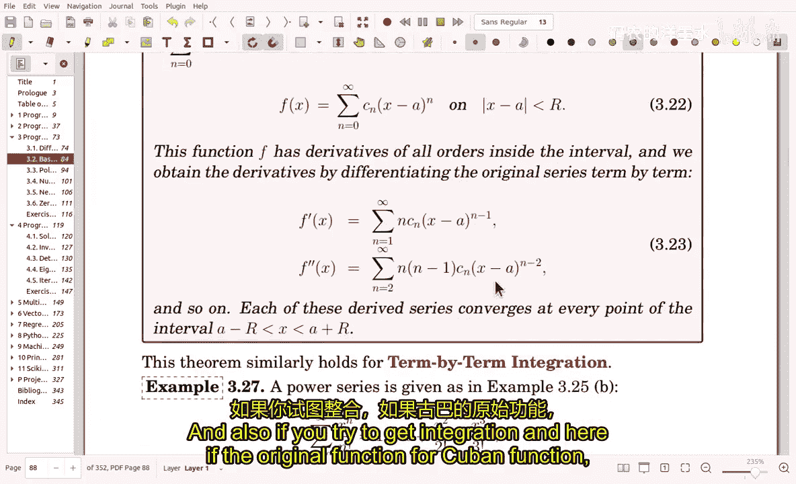

And here。If the original function for given function， probably。It's not easy to get integration。

 but assume it can be written as this。Power storage。Then。Here for the integration of that one。

 you can get integration term by to from this side。That。Ma easieria to listen anyway。

 we know the formula， for instance， the integration is a positive portion of derivative。So that。

From x to the N。Here， the integration is one of M plus1 and x to the M plus1。From this one。

 if you try to get de， then you can reach at that。So it is integration， So term by to。

You can get integration to get whole integration。So this is really all advantages in many applications。

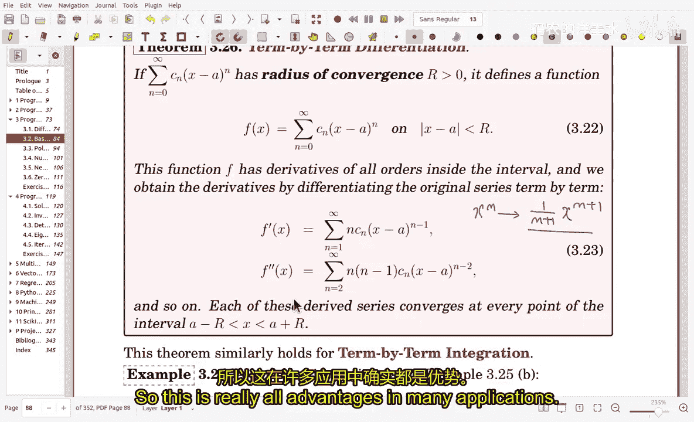

Okay， here。A power city is given as an example 3。25。And B。That one here， this one。

 And I said that this is practically each to the x。

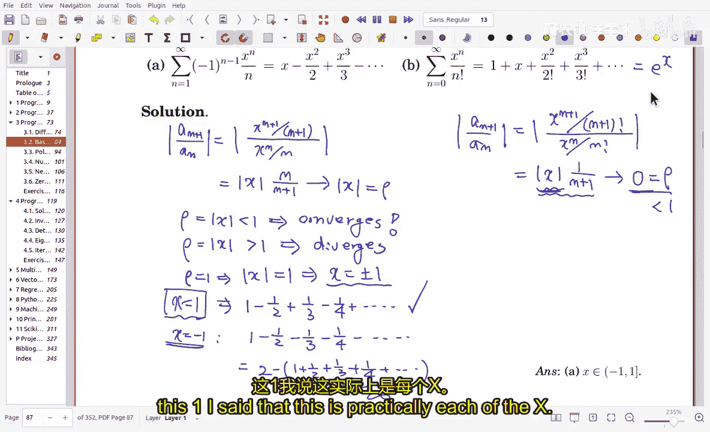

Okay。Now let's try to find the derivative we say this one because it's congenent everywhere and we name the sge as F ofx。

 then F prime of Vx is same as okay， derivative itll disappear in1 and plus。Okay。

2 will come out so that that will disappear along with this tool。 So it is X。Plus。

 now 3 will come out and 3 factorial will become2 factorial canceling 3。

 so the X schedule over2 factorial。The next term will be X to the4 over。For victory are。

If we try to make a derivative for this term， then again， there will be now x to 3。

4 will come out and cancel with the four here。 And the part is 3。Fectorial， and so on。啊。Here。

You can see you can compare these terms and that one， they are identical。And here， from this one。

You can say that e to the x。 this is e to the x。Tative is same as each of the eggs。Okay。From cs。

 if you were in a calculus class， beginning class， then you already know this one。Okay。

And term by term differentiation and intuition is quite。Here， useful。And also。For some applications。

 rather than using infinity series， we cut。

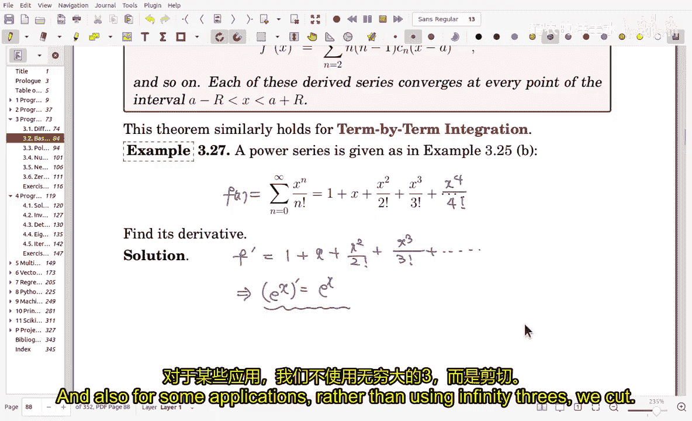

Here the infinitefin region to become a finite。

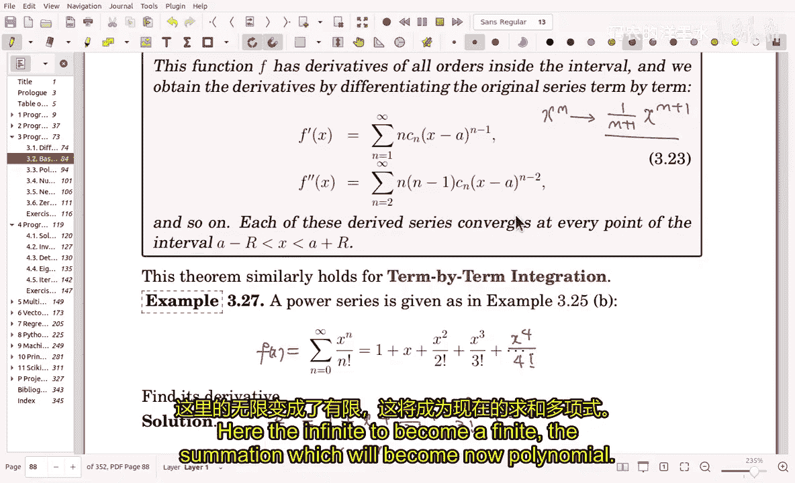

嗯。The sumation， which will become polynomial。

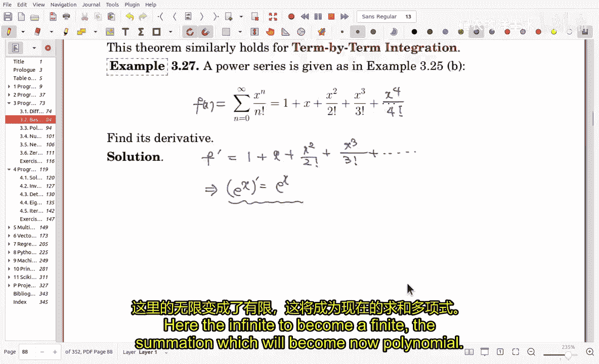

And so bying the polynomial， we can do some other。Tasks，So in engineering application。

 power City detector tech is so useful。And well try to further use share for given function。

 So right now， in this part， we define the cluster。Power storage， but in the。Further part。

 we'll try to find the power search for given function。 So that is the topic of Taylor series。

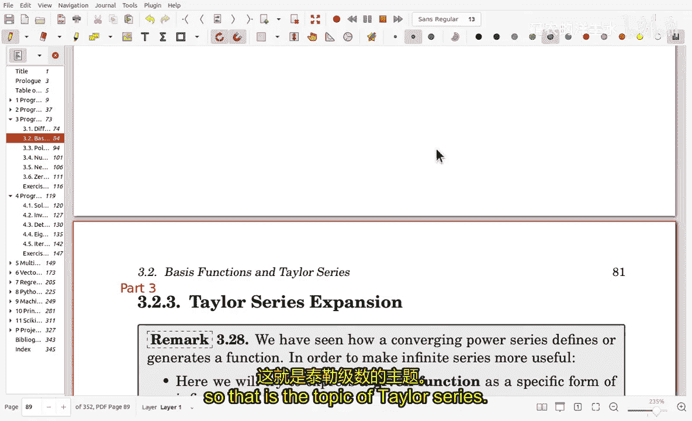

Well continue in third part。 Thank you。