# 【全集-附课程讲义】密歇根大学-人工智能编程-EECS492-中英字幕-p22-Lecture-22---泰勒级数展开--BV14JqfBNEAS_p22-

It is part of3 of Section 3。2， Taylor cities expansion。

We have seen how a converging power sage defines a function here。

We try to express a given function as an infinitefinity s called the Taylor s。

If a power sage is made to represent a function。Then。

The power storage is called the Tayloror switch of the function。In many cases。

The Taylor series provides useful polynomial approximation of the function。

Because approximationation by polynomials is extremely useful to both mathematicians and scientists。

Taylor s are at the core of the theory of infinite disease。Here well see。

How can we get a power surge of function？

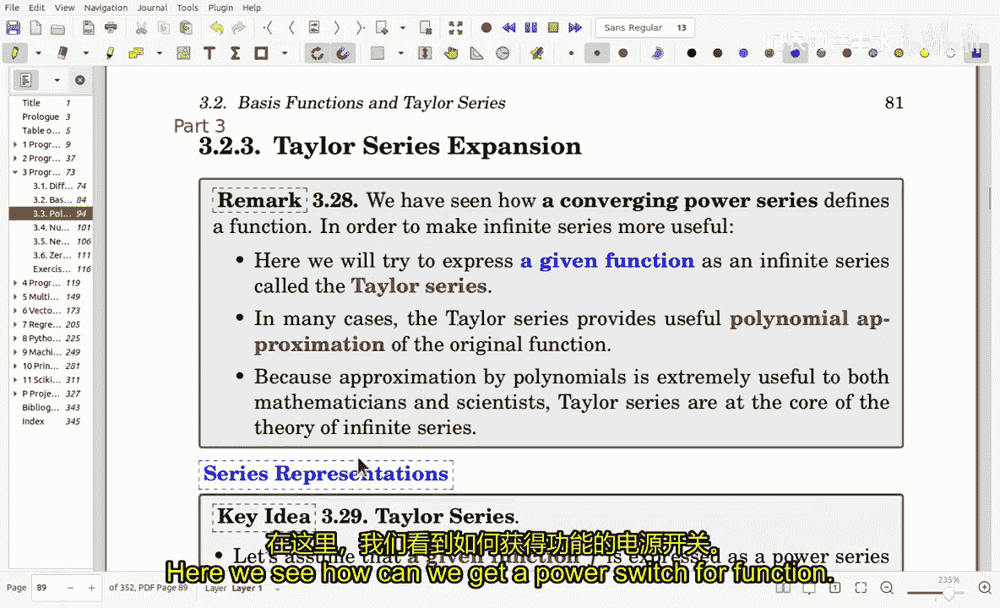

There is a c the of functions。Let's assume that a given function F is expressed as a power series about x equals a。

 then we can write in this ring。Kn function F X is。Expressed as a power sage。

With the redius conents are larger than zero， so in some interval， it is conbogenent。Okay。

Here for this expression， the question is。What are seeing equations。Or how can we find these quos？

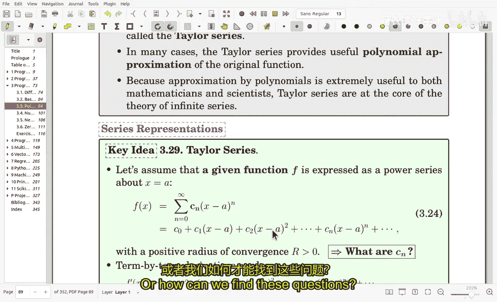

Now we will try to use a term by term delutis。Then the first derivative can be obtained in this ring。

 Now this will disappear。 and from this term， we have C1 now from this one。

2 will go out and here x minus a。 So that is2 c2 x minus a and4。

Other terms you can consider the teles。And also， a second derivative， the the same way。

 we can get a second derivative， third derivative， and so on。

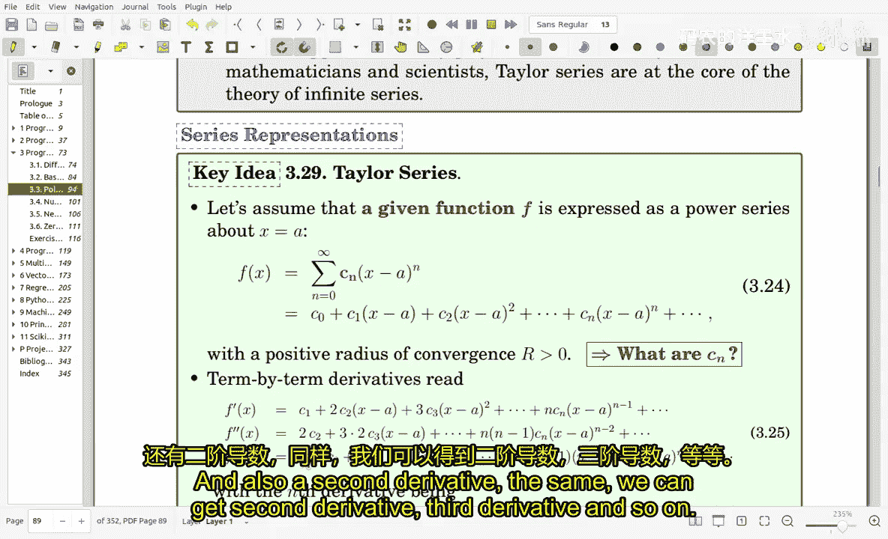

So in general， and derivative will become this form。So if we are set x equals a。

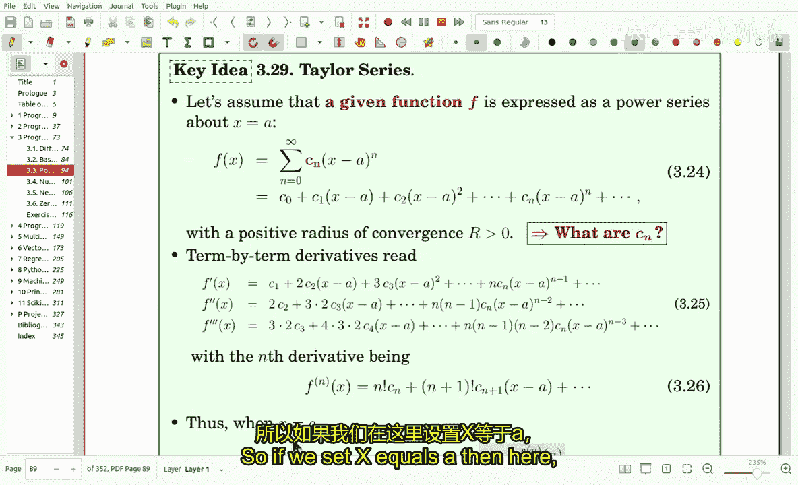

Then here， except this first storm， everything else over there， atoms will disappear。So， after。

Setting x equals a。 we have such equation so that from this one， we can get C N。As it is cushioned。

And the derivative evaluate to the a divided by N factorial。

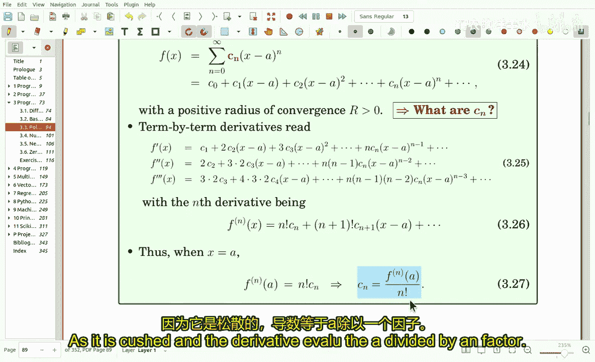

So by using this one here， we can define the Taylor series。

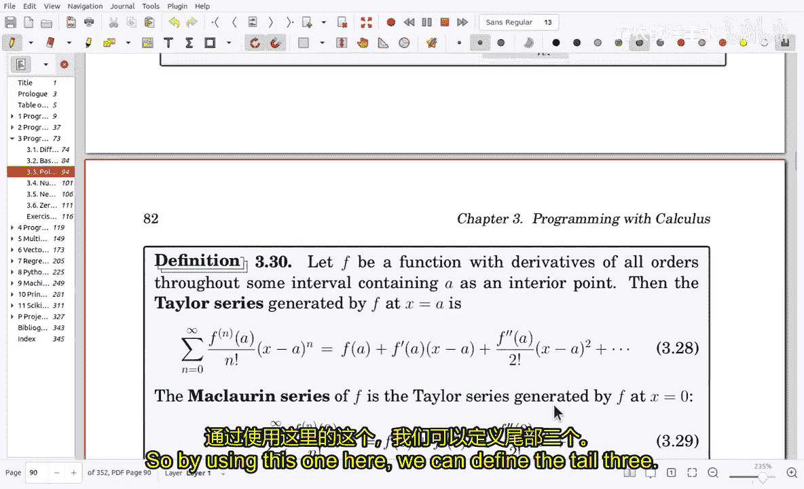

Now， so we have to assume that here F is differentiable。Infinly many times。And around some interval。

 including。The point a。Then the tailes generated by F at x equal a is given in this form。

So this is sigma notation。But that is practically term by term。on。Sn。

So this is Taylor series of F about。X is a。Now， once you are choosing a is0 so that the teley expression is about0。

 then that is called macroloin C H。In mathematical theory。We are dealing with many cases。

 along with x equal 0。So that this special case may have some name。 So the name is macroian cities。

 but it's a special case of the Taylor cities。

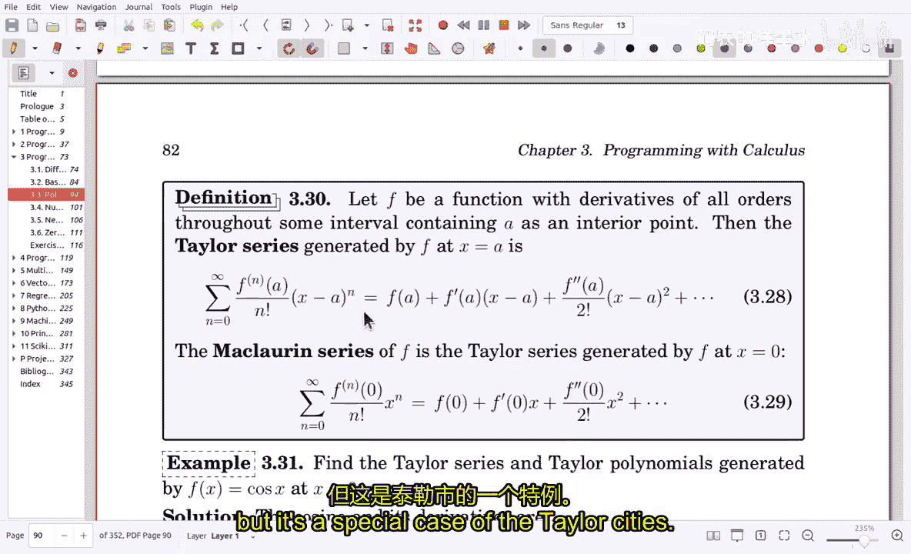

Right。Find the Taylor sge and Taylor polynomials generated by。

Here F x equals cosine x at x equals the0， here。The four cosine function。

 if we try to make a derivative bit and we can get here。

 the first derivative will be minus the sine x， second derivative minus cosine x。

 third the derivative now becomes a sine x， and so on。When we。And。

Choose x equals 0 then this value is 1， and that will be0 and minus1，01 and0。

 minus1 and 0 as on so we can have such a result and we plug those values here。Then。We can't get。

Such a terms。And cosine function is even function so that are terms。

 the coefficients of other terms will be 0 and disappear。 So we have only even with the terms here。

And if you consider of to certain point， then theres a kind of a polynomial so that we call that。

Taylor a polynomial， so here。Now。The causalsal function as this a sion color。And P along， okay。

0 throw。 There is one。 There is this one。And here， second order around this room is OK。

 but very quickly now is quite different。But fourth order and longer。Interval。

Quite similar and and sixth photo eighth order 10th photo polynomial are 12。And later on，18th order。

Tlo polynomial is quite accurate here up to 7。 These two are really quite at the same。

 look same so that。With a high order。And it is approaching to。The K function。

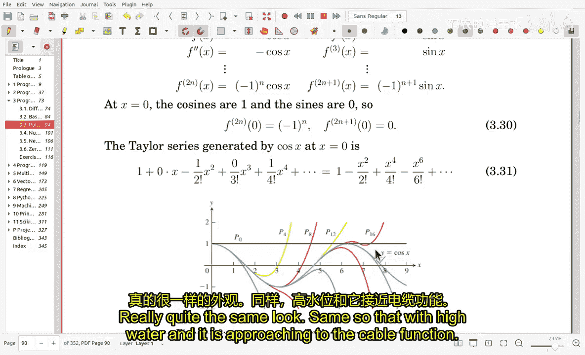

So along with this infinitefinity， we can represent the given function in this case， cosine x。

Bying this infinite sage。 So that sage is called。Tlors of cosine x。It's a kind of a power s。

But once it is theyre presenting a function， then we call it。Tlor。Right， okay。

Here we have a common use tele。For one over1 minus x。 And we have that。 we thought of this one。嗯。

In the second part over the section。 and now E to the x。

 which we consider this one in the second part。 and that cosine x is just we。To I this one。

And now sine x sine function is r function。 So we have only are of the terms。

 along with start with x and。Pjectitive here negative， positive， negative， and also the same here。

 positive negative part to negative right。Okay， for logarithm 1 plus x。

 we can get such Taylor thread。Okay， it's not always congen if you are choosing。

X between minus11 and minus-1 excluded。 Then this one is convergent here。In fact， you cannot get -1。

If x is minus-1， this becomes a0， loggam 0 is not defined。For our tang here。

We have such Taylor seriess。It is convergent。For values for x minus-1 to 1。

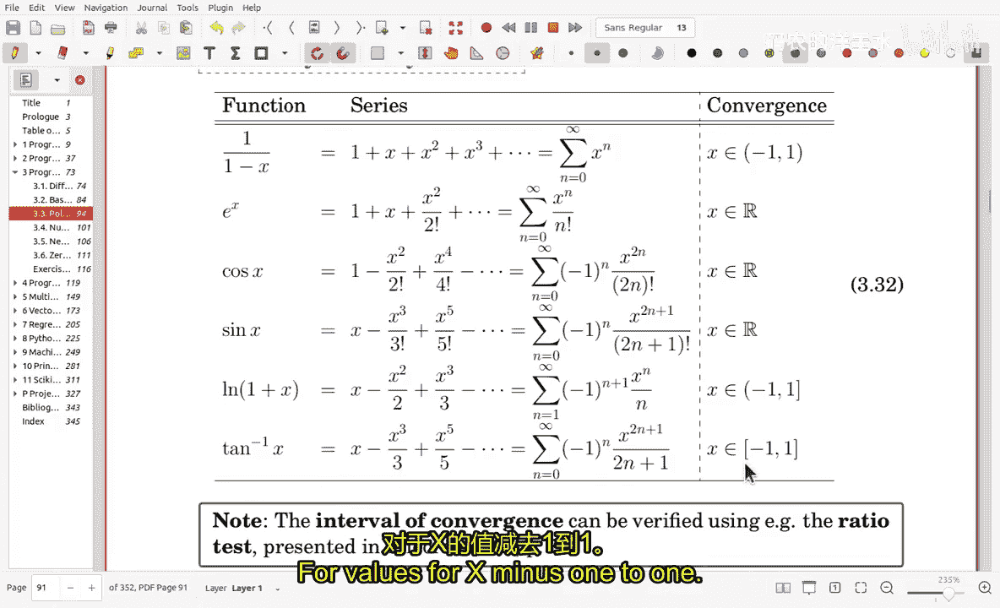

Okay。The intervalal convergence shown in this table can be verified using， for example。

 the ratio test。 we studied this one in the second part of the section。

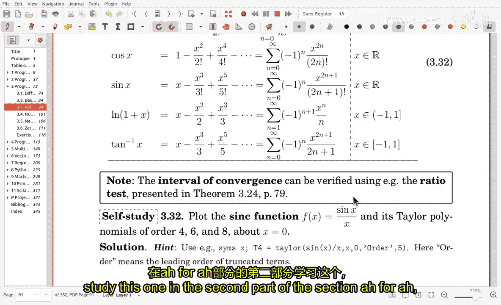

For this one， just if you are interested in。嗯嗯。The single function， then try to。

Make some blood and try to study further for this function。Here。

 now we officially define tele polynomial。

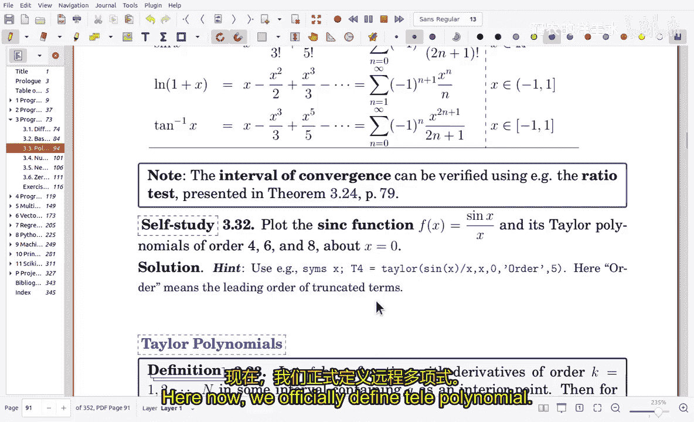

Once we assume here， F is now differentiable and sufficiently many times。 So it is capital n times。

Defishable in an interval， including point A then for integers from 0 to n for choice of integer n。

 the tail polynomial of all the n is given in this way。 So here we select from。The Taylorpheres。

 just the first。Anthroode to here。 So eventually that is n plus one tos。

 and here highest order is anthda。And remain a part of the Taylor strategy。Abanded。

 Then this portion is called Taylor polynomial of or the N。Once you choose this。

A polynomial just up to and through the tones。 Then the question is。Is this？

Operation making rather the given function。 That's the question。

This tele polynomial must be a good approximation of a given function。

To verify and to analyze the accuracy， we may need。

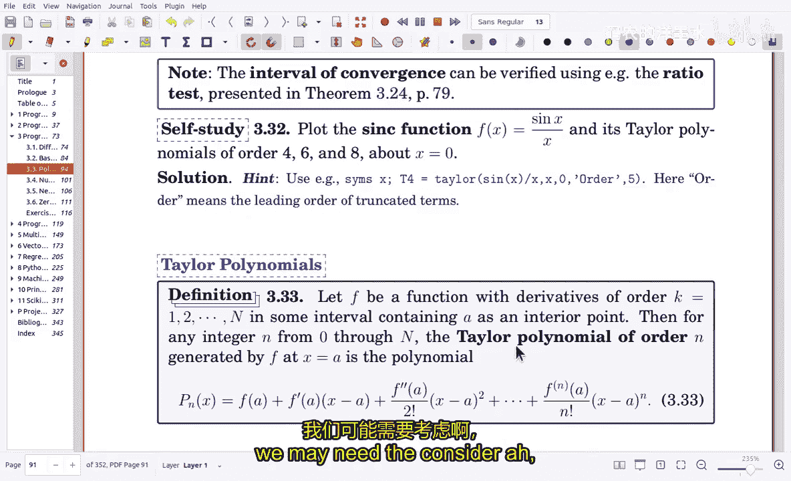

款ship的。Here， this theorem。That is called the Taylor Theorem with Laguranci remainder。We assume。

 the given function is sufficiently differentiable。

 And here M plus first all the derivativeive es in the interval and axis zero as inside of interval then。

For any x inside of the interval here， F of x is now。That push is N through the tele polynomial， and。

Yeah， that remained。Sucharch Lemeda is called Lagarranj Lemeda。Originally。

 the Taylort has infinite maintons。 So this portion should be here。Combination of infinite manittons。

And however， through this theorem， this portion is expressed as just a single term here。

So once we can measure this error。There is a La La remainder。

 Once we can control this term and we can make sure this term is small， then。Now。

 we can conclude that。This tele polynomial is a good approximation of the given function。Right。

The above theorem is useful in various engineering applications。

 The error of the polynomial approximation can be verified by measuring the lagrange remainder。

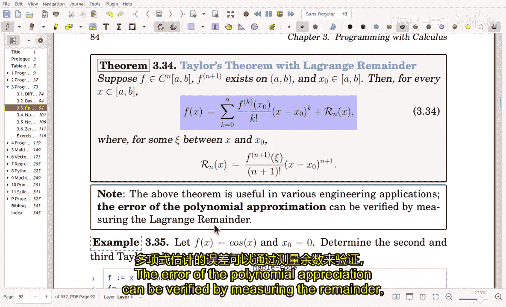

Right， okay。

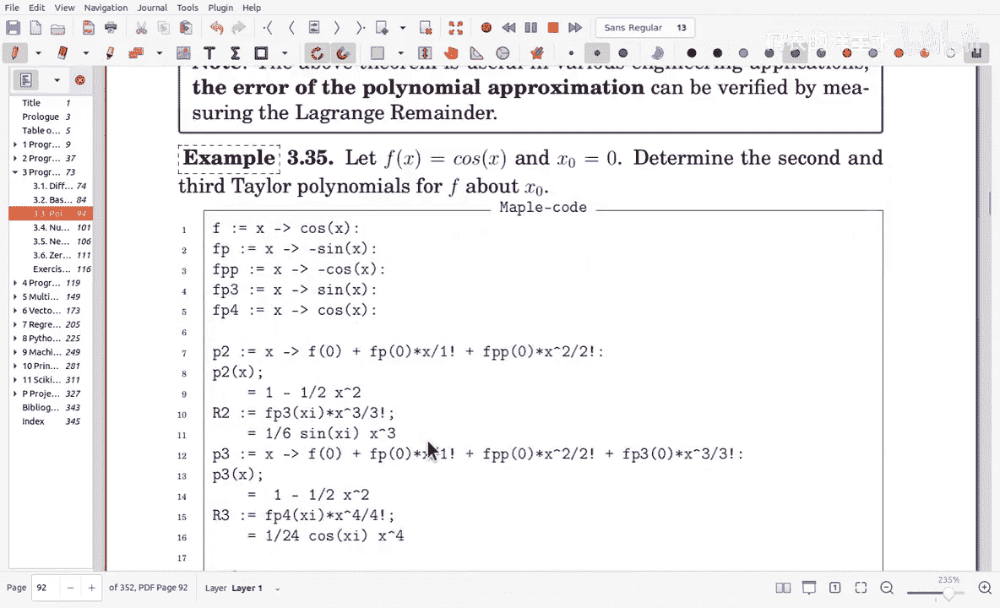

Yeah。Cosine x and x 0 equals 0 determine the second and third ta polynomials for。

AGiven function F about x equal about x 0 x is0 is a 0 now。

 So here to get second and third order tele polynomial， we start with a function， first derivative。

 second derivative， third derivative and fourth derivative。And we try to make。Second的。테러 버려놓으면。

And that's the result。Now， cosine x is。Even function。 So you will get。Here。This one， and even for。

Yeah。P3， because it even function， you'll get the same。That further tone must be settled on。

 And in the case， the error can be expressed in this way。嗯。So that here in practice。

 thatll be useful for error。Right。So， if。X is small， So is' near round the zero。

 Then now this value is about  one。But one of a tri four。 And here that is now a sum value and。

Fourth power so that this value will be very small。 So in a sense。

The error is about fourth order around。Around the origin。

 So is itll be a really good approximation around the zero。And here。

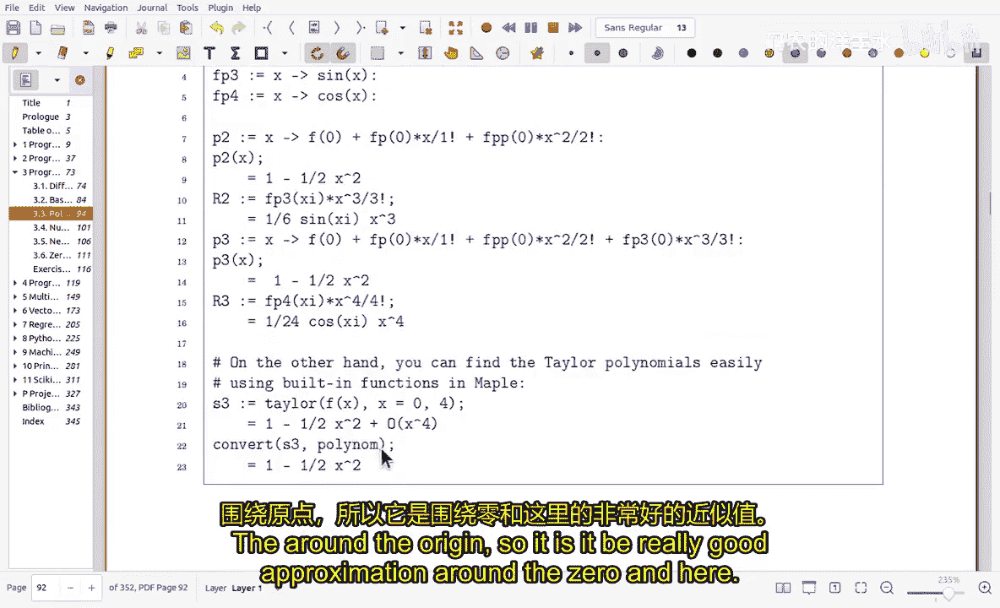

We can see the plot， and around the z。The polynomial， in fact。

 this is quadratic polynomial is really good approximation of cosine x okay。

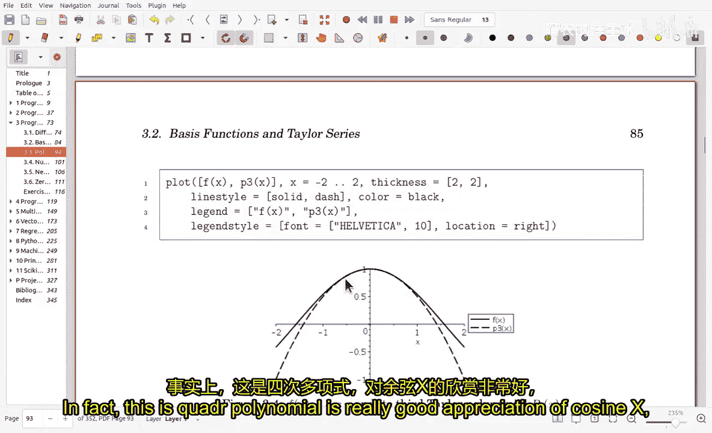

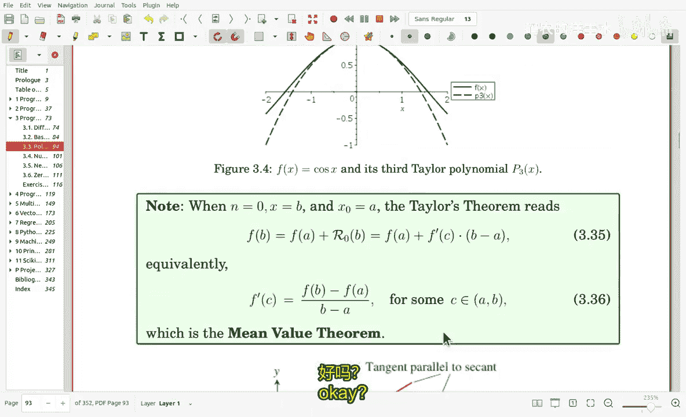

Now we consider a particular case once n equals it。And x is B， and x0 is a。

 then telefiem reads this one here。 F O B is F O B A。 So its expansion is about a。

 and then this is La remainder。 There is。F derivative at some point C。And now that is a p minus a。

So that is exactly teletheorem when n equals0。Now we can rewrite this one。In this way， F for I C。

Is the same as F O B minus F O A divided by by P minus A here C is sum point between A and B。

If you look at this question， then this is。The form of Minville Theem。

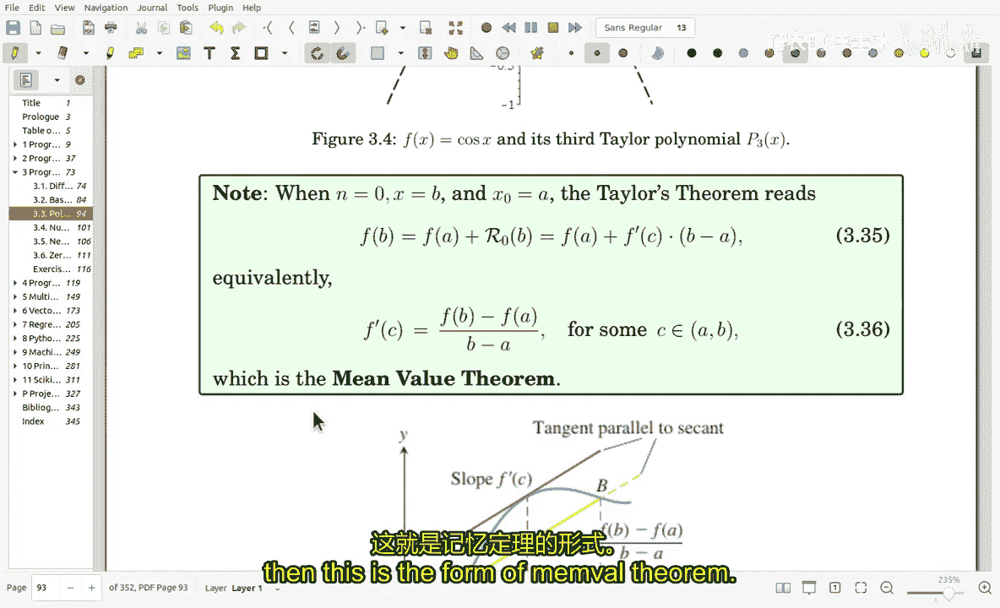

The meaning of this one is here。And that is average law between A and B。

So here the value is F B over there the value height is F B。So， now。That the question is。

 if you put here。So that consider this right triangle， then pattern length is p minus a。

 and this height is F B minus F A。So that there is a law， this is average law。Now。

 this slope is the same as F prime C。 So the slope at some point is seeing。So that here。

 once function is differentiable。Then that is point to see such that。

The instantaneous slope at C is the same as the average slope。

 That's the meaning of mean value theorem。

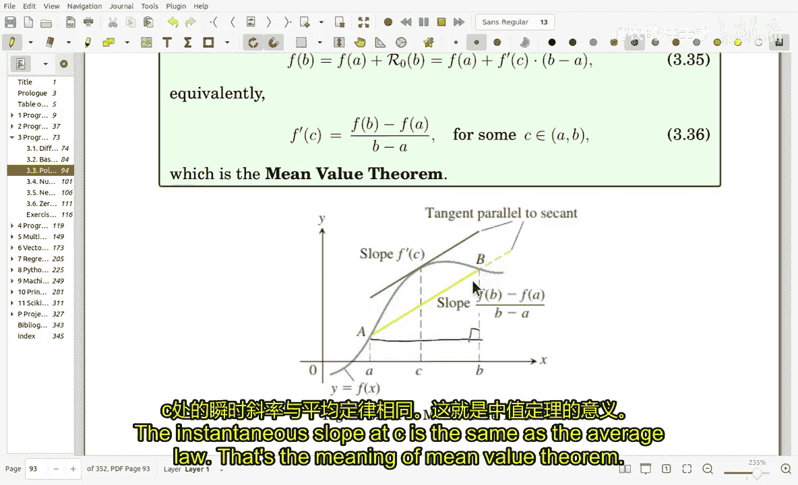

Okay。Okay， that's the end of the section N。 Thank you。

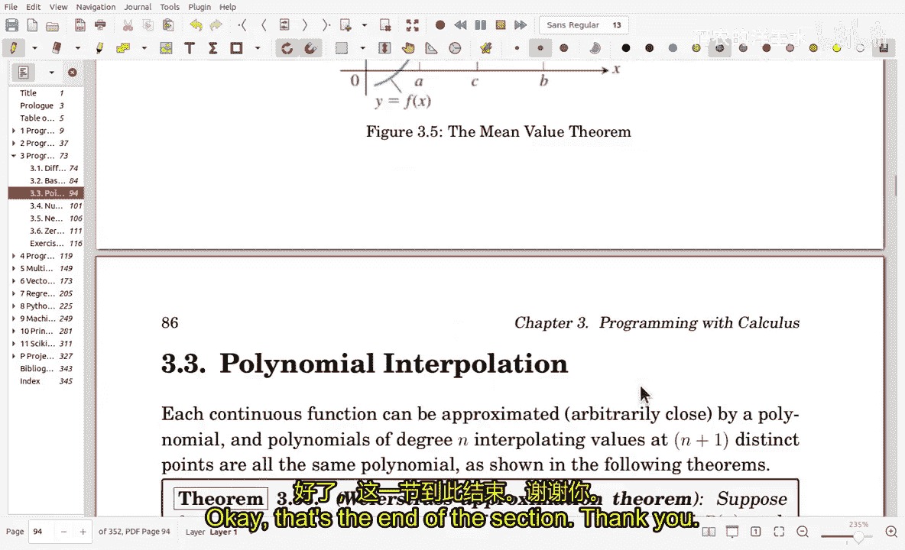