# 【全集-附课程讲义】密歇根大学-人工智能编程-EECS492-中英字幕-p23-Lecture-23---多项式插值拉格朗日形式--BV14JqfBNEAS_p23-

It is a section 3。3 polynomial interpolation。Let's see the theorem。

Vi stress app approximationation theorem。Suppose every is in CA A B。

This notation means the function as continues over the interval A B。Then。For each apsilon positive。

 the e this a polynomial P such that the difference between F and P is less than epsilon for all x in the interval。

You can choose Epsilon， if it really small。But for the choice again。

 you can find a polynomial such that this inequality is satisfied。

The theoryem implies that every continuous function can be approximated by a polynomial arbitrarily cloud。

Let's see another theorem， polynomial interpolation theorem。

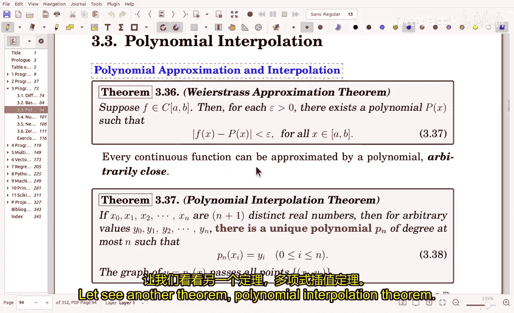

X0 to x n are m plus 1 distinct real numbers。 Then for arbitrary values， y 0 to y N。

 there is a unique polynomial PN of degree at the most and such there。PM at Xr S Y I for all I。

In this case， the graph of y cox will pass all the points X I， Yi。An im of the theorem is。

That for values at M plus one， testing of the points。

The interpoeno polynomial P N of integrity at the most N， is unique。So once you construct polynoial。

 interpoing polynoial。Then even though you construct by seeing other methods， various methods。

The digestjecting polynomial must be the same。

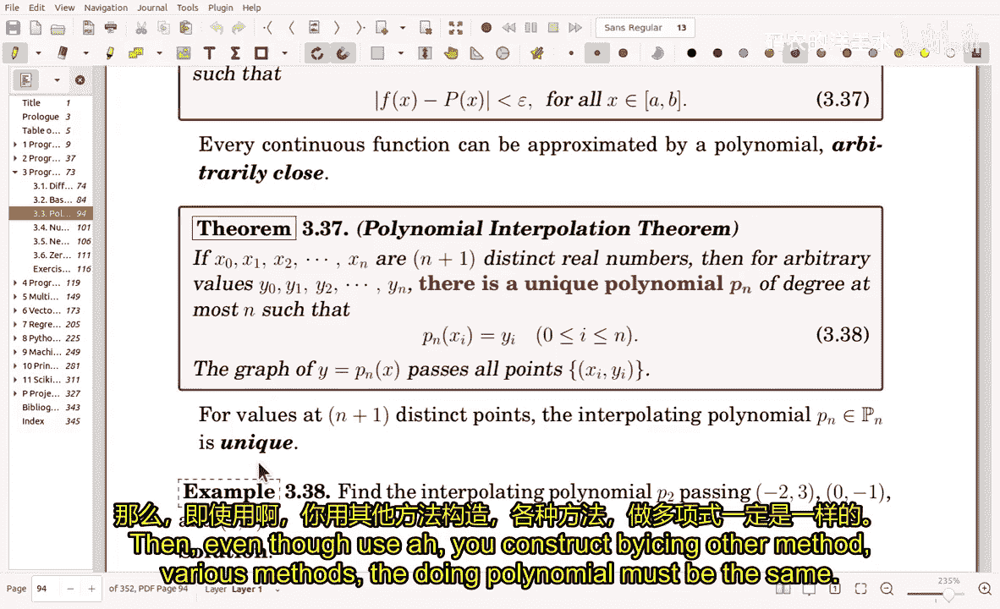

Okay。Okay， here find the interpone polynommal P2 passing the three points。Okay， let's see。

The data points will try to visualize the data points。Okayay， that is。X and Y coordinate here。

X is -2。And y is equal 3 so that we have a。And x is 0， then y is minus-1。That is a -1， and x is。

1 y equals 0。 So that x is1， now y equals 0。So the P2 is a polarrebola。

 and polarrebola is passing these points so that the shape of a polyrebola must be given in this rank。

I。呃。If we try to find the polynomial， then we may start with y equal。A X schedule plus B， X plus C。

Okay。X is 0 y equal -1 means then 0 and -1。 So that means C is -1。Okay， from here。

 Ax is scatterapplasm Bx。Mus one， right？Now we can decide A MBBA biasing two the other points。

The two points， okay。Now， X is minus-2， then y equal 3 and -2 means that there is4 a and。-2 B and -1。

 and X S。What is that x is1？Then y equal 0。 So x is 1， y equals 0， so that 0 is x equal 1。

 a plus B minus-1。So from these two equations， we can get， okay。

 let's simplify there's moving this other side， then it'll be 4 divided by 2。

 so that there is 2 a minus B equal 2 for there on a plus B equal1。From here， we can get immediately。

 okay， a1。B is 0。 Okay， A is one and B is a0， okay。So here， a0， p 0， c is minus1。So here P 12 x is。

Now， a1， x is schedule， B is 0。 So there is no linear term and -1。Okay， that's the。

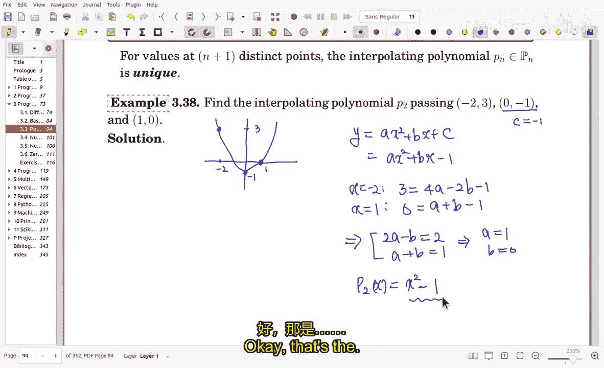

Find an answer。Now， among many other forms， we study Lalan form of interpolating polynomials。

It is most popular one。Okay。We assume we have。 we are given data points， X， K， Y， K。

And case from0 to n。 So there are。M plus one points and this X are thised。

Then the interpo polynomial。Will be sought in the form here。Now， these are y values， y 0。

 y1 up to y N。 And then is y 0 is multiplied with L N0 and y1 with。L N1 and so on。 here。

 Y N is with L and N。 So this is the sigma notation。We'll try to find。

Interpoulating polynomial in this form。Here， L and K K from1 to n，0 to n are Pa polynomials。

And they can be made bying the nodal points， x 0 to xn。We'll try to construct them here below。Now。

 in this way， we try to get interpoulating polynomial， for example， for30 points here。And okay。

 case from 0 to 2， the Larange form of interpo polynomial is given in this vein。Here， n is 2。

 And from 0，2 here 2 and y 0， y on y 2 in this way， will try to construct。

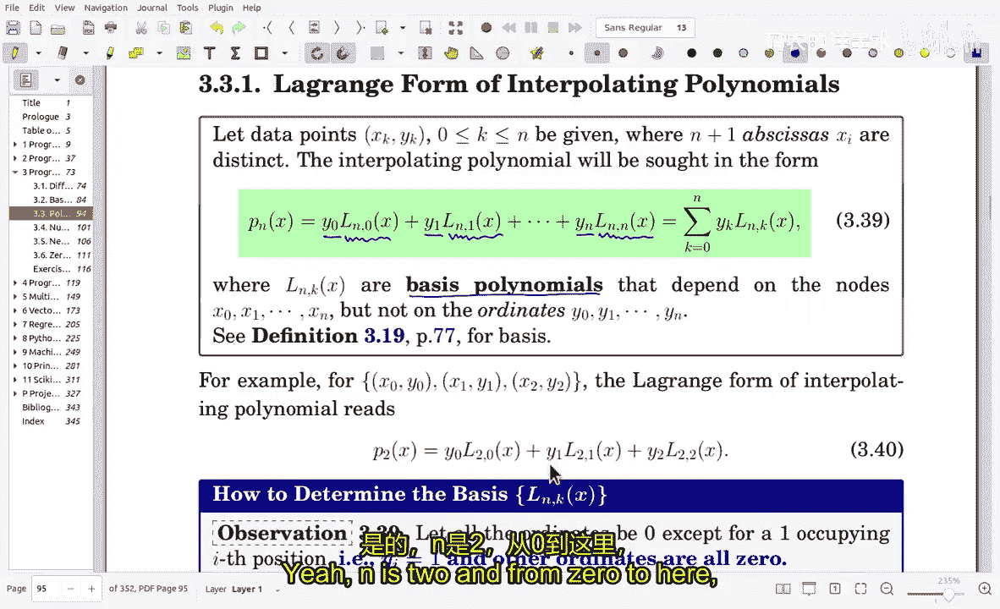

The interporating polynoia。Now， here。So that major thing is。Now。

 we have to know how to construct the Pa polynomial L N K。

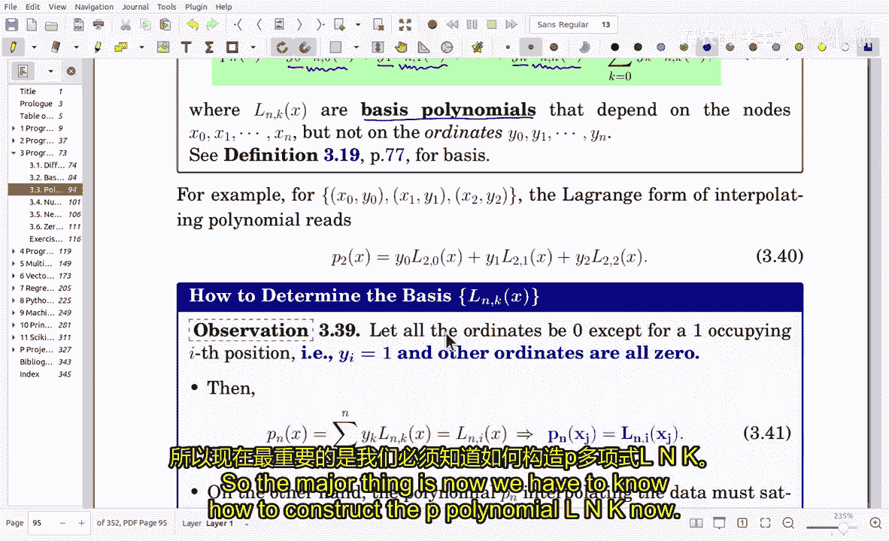

Now。To get idea， we start with a very special case。And all the alternate ors be 0。

 except for one occupying the I position， which means that Y I is  one， and other ors are all0 then。

Once we start with this special cache， then pianoob Vx given in this sum linear combination。

 can be written in this way， L and I， Yr is1 and and every other y values are zero so that we have only one term。

Once here X J is used to then we are here。 P X J is L I X J。And on the other hand， for this data。

And PM， once we construct。Polynomial， then。And。To satisfy this condition。

 the data it should satisfy this one。PM at X J must be a tti Z。Delta J is the K deelta， if I J。

Are the same than the values one and different than is a zero。So only here there one is now at xj。

 the values 1， but for all other points， the value must be zero。No。We you combine them。

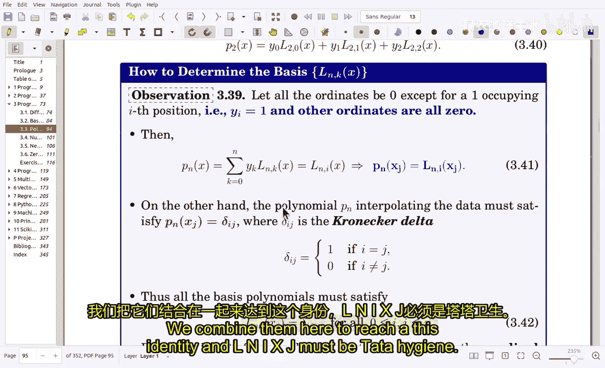

You to reach this identity。And L N I X， J must be Teta I J。

And such polynomials are called cardinal functions。 Okay， so let's see example when n equal 2， Okay。

 let's see n equal2。Then here there are 3 points that is x is0。And now， x1。Inex 2。Now， L。And L20。

Is now only one at x 0。 So that here the values one and other points at other points。

 the value must be 0， which means that。The shape is given in this。 There is a quadratic。

And that is L20。Now， L to1 is at x1， the values 1 and at other point。

 the values is 0 so that it is going。Like that。 So that there's L to 1 and L to 2 is 0，0，1。

 so that that wave。So that is L2，2 in this way。We will try to get the cardinal functions。

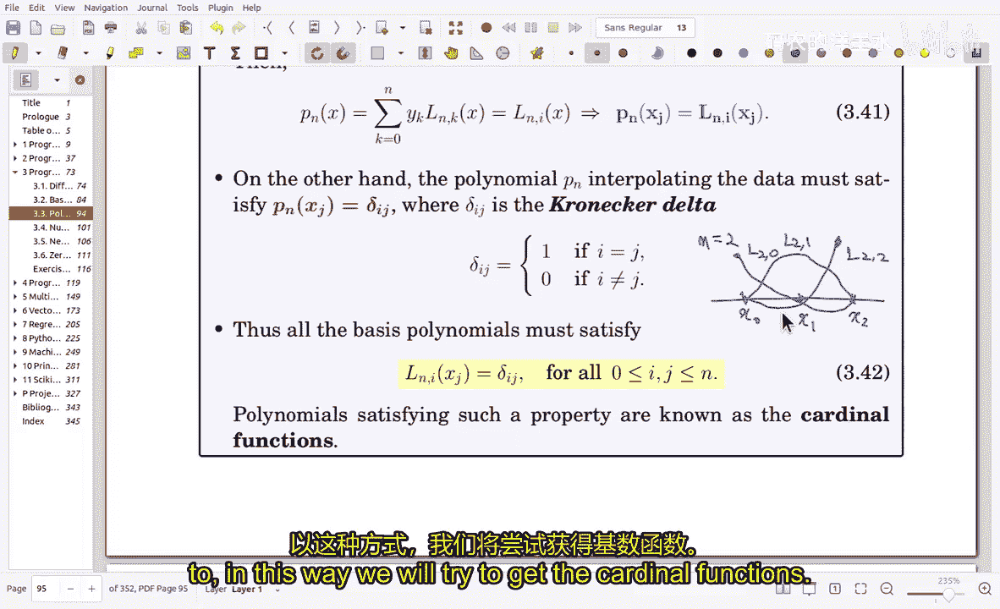

The pace functions， okay？那呃。We'll see here how to construct such cardinal functions。

Now we'll focus on L n0。 There are M plus1 point， distinctive points。And for the first point x0。

 well try to construct the cardal function。It must be one at。X0。But at other points。

 the value must be s。 So here from x1 to x n， the value must be s。

 which means that for each of these points。This function should have a factor。

X minus x1 and x minus x2 and so on， so that here the L and0 should have this effect so that at x1 x2 up to xn。

 the value will become 0。No。This one is already and for the polynomial。

So possible changes only along with the constant at the multiple problem。

So we start with that one for Lnc。Now， this one should satisfy the other one。

 The value must be one at x0。So we put xs， x's at all。Then the values one。Now， here。

 x is deplace with x0。 We have that。But we start with the distinct Xvalue so that this product cannot be zero so that we can solve the equation for C and we have here。

We combine this one， and that one。

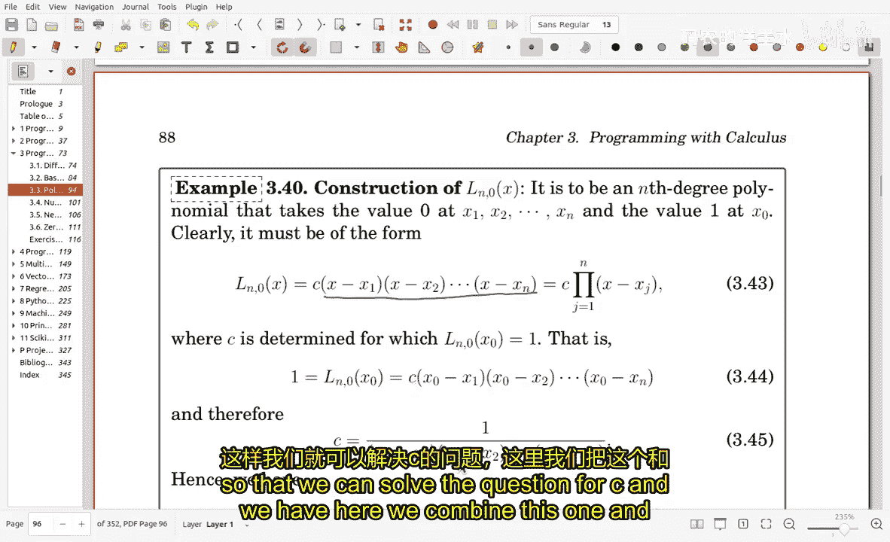

To。Wch at this final form， this is just with product notation is made。Now。

 you can see a pattern here。It cannot have x minus x 0 factor， because。At x， the value must be one。

 but for other points。It the value must be all so that we have this vector。

And then we copy them to the bottom and axis replace the。By ex you don。 So that's it。Now。

 four other points。So L and I。 So it is now。Point X， I。So yeah we make a product。

 but it cannot have x minus X I。 So J is moving from 0 to N。 the product， but J cannot be I。

And we have X minus asqueche， and copy it。To the bottom and x is d by X I。So in product form。

 it is given in this real。 Okay， let's try to solve。

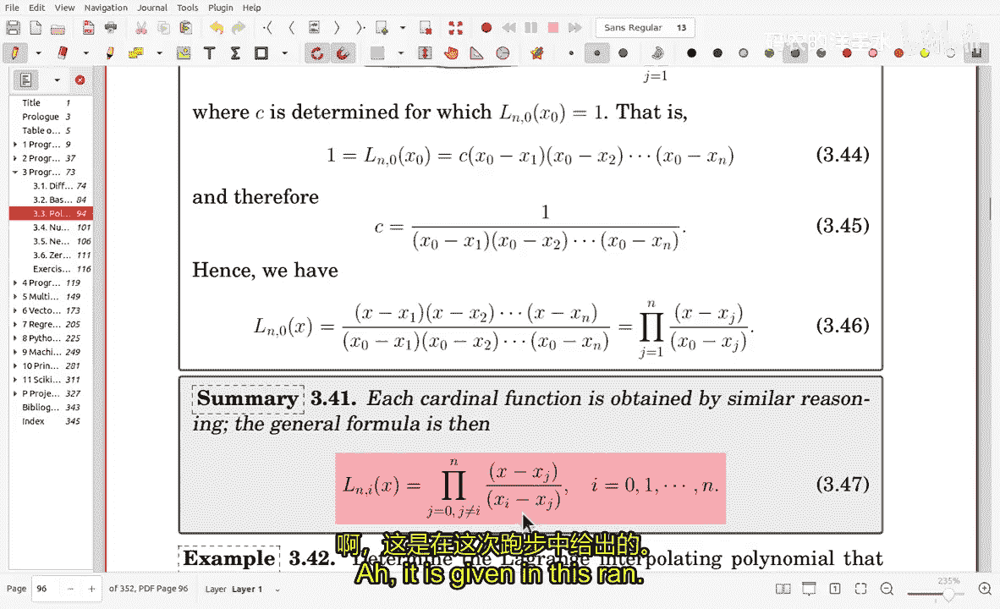

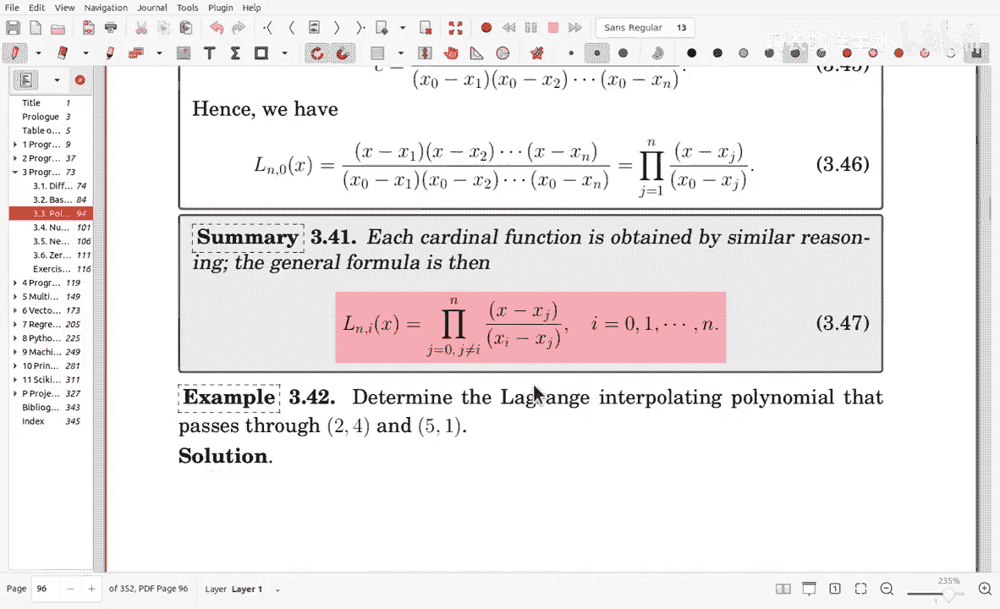

Some problems， examples， okay。determine 라그란지 인터폴레이링 폴리노엘 that 페스으로。2，4 and 501。For this data。

 you may。 you may get a table， for example， X， Y。And then x is 2 and 5 for2 y values 4 and for5 y values 1。

Okay， once you make this table， then。It's quite clear to see data， okay。Now， here， we have to get。

The Laran지 cardal functions。But before constructing it。

 we may consider here the shape of the cardal functions。 That is 2。 That is x0 and 5 and x1。Now。

 this is a linear so that1 here n 0 go down and0 here and 1 over there， that is L10 is 4 x 0。Now。

 that is L 1，1 is 4 x 1。Practically， L10 can be garden in this way。Chump x minus X0。

And then the next one is x minus x1。And over now， x 0 minus x1。 There's no other。 So that's it。

 Now we are using the practical values。 X 1 is 2。So yes， x minus2 n now x1。Okay， X 02。And。Ohoops。

 x one is of 5。And and then 2 minus-5。 So it is a minus-1 third。And x of minus of 5， right？Okay， L1。

1 for this one。Now， x minus x 0。Over now x1 minus x0。 And we have to jump x minus x1。Nothing else。

 So that's it here， x02， x minus-2 x  of 5。Okay， so that is 1， third and x -2。Okay。So here， the P1。

 the final interpone polynomial。Now， y value4。Times this one。That is a minus-1 third， Okay， third。嗯。

Now， x minus- 5。And。Plus one times here，1 third。X -2。Okay。That's the final answer。

 you may simplify the result， but anyway， this is the final answer。

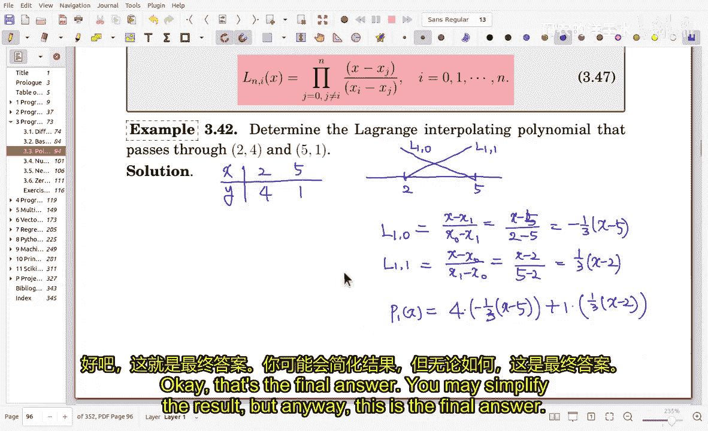

Let's try to do one more here。Now， x0 x 1， x2 K and use the points to find the。Second。

 La the polyium polynomial P24 F x is one of x。 That means that。Where to find the P2。

On interpolating polynomial， satisfying x values and Y values garden from this function。Okay。

 so let's try to make a table， data table。Okay， here。2。4。five。And then y value must be 1 over 2。

1 over4 and one over5 by usinging this a 30。 x0 x1 x 2， we can get。G。

P2オッケそそ cardal functions must be second order and L2。For x0。Yes now， so we jump x 0。 now x minus x1。

 which is 4。And x minus x2。Okay， divide it by， we copy them to the bottom。The denominator。

 and then x must be de by here， X is it don。 So that is now 2-4， and that is 2-5。Okay， that is L20。

And L1， you can get。This card function， quite similarly。Now， x minus x0， which is x -2。

 and x minus x1 must be。Jump with and x minus x2， x minus of 5。And copy these vectors to the bottom。

 and。D plus x with x1， which is 4 so that there is a 4-2。And for minus5。

And the same A exactly same A， you can get L22。 you can finish it your shall。

After getting these cardal functions。 now， the P2 of x must be here。 that y value， first1， y 0。

 half times that1 L。2，0 plus now， one quarter， one fourth times here。Not L to1。

And plus finally 105 your L to2。For example， that one on the bottom， we have3。Min-2 minus-3。

 so that that is one over 6 n。 okay， this vector x minus-4 and x minus- 5。

 and along with this half it has one over 12 and these two factors。

 So for the others you can check here quite easily just try to finish the computation yourself。

Now for that 라그란터레이을폴 놓 으면， we may use 컴퓨터 program。And you can use Matflb。 However。

 Matla is original tabulated for。The vector and metric simulation。

You can do some symbolic computation， but it's not so much flex a。 So you may try to use Python。

And by using the symbolic package is simply。And here we define lag range。 There is x values。

 Y values， the theta values。 once the length of them are different then is error and。

The program stops。 Okay， now we try to get the polynomial， start with the0， and we add them。

And here this inner loop， Okay， that one from here to there there one is。Okay， for each tongue。Yeah。

 we stopped for each term like this one。We start with one， piece one。No。

And trace moving the whole data point。 And once trace is not K。 So this is now K is 0 here， not K。

Then for one， we are multiplying x minus xj Ti by the here， x K minus xj。 there is multiplied。

 So it is making that one that is exactly following that formula right now。

So we try to make here cafe。We are using notation K， but anyway， K。That cardinal function。Here。

And after making that save save in T。 and we multiply y value and add to the。polylynomian。

So it takes moving from beginning to end。 So after that， we return。Now here， this is theta values。

 x values， y values， and we call the function lag range。And P2 has the result。

 and we print out P2 n after a simplification， again， print out， then results are given here。

This is just a raw output， and this is simplified output。Okay。

 here this is yet a kind of a limitation。Rather than。Here。Some integer print out right now。

We have some ratio。 Okay， from here， one third， if we try to express this portion。嗯。Byson integer。

 then one third will come out and one of two will come out and that is a one over two。 so that half。

 one third half。 so that total is one over 12。 so that is exactly that one。

So it is the correct result。And after simplification， you have them。Okay。By usinging software。

 you can get preliminary quite easily。Once implemented， then you can use it again， again。Right。Okay。

 we'll continue in the second part。 Thank you。

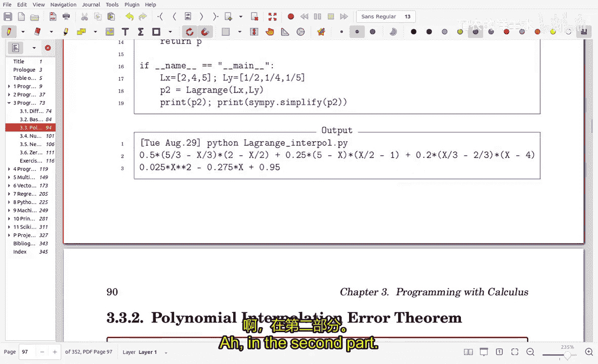