# 【全集-附课程讲义】密歇根大学-人工智能编程-EECS492-中英字幕-p25-Lecture-25---数值微分有限差分公式--BV14JqfBNEAS_p25-

Section 30。4， numerical differentiation， finite definition of formulas。

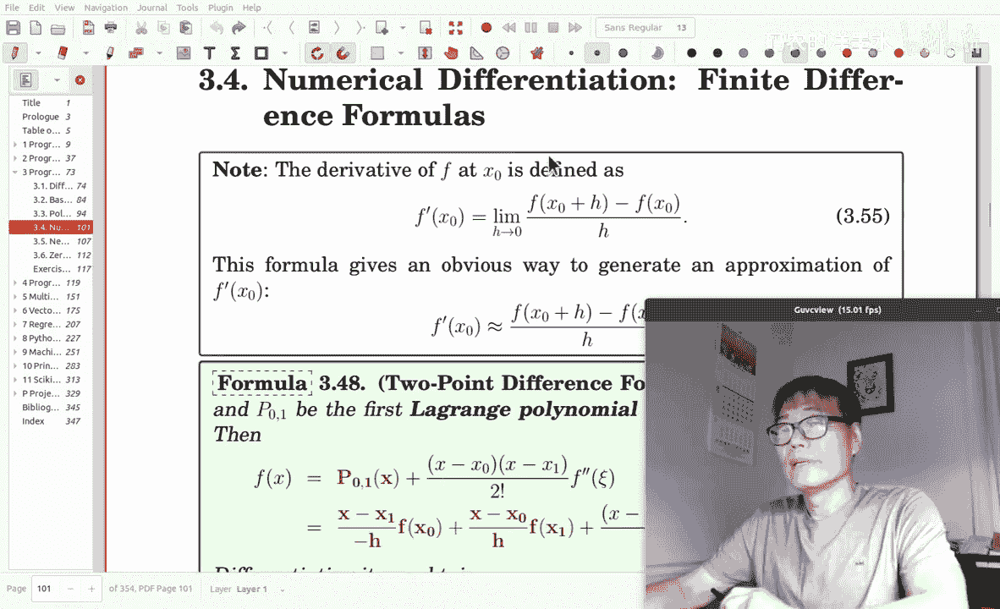

The derivative of F at X0 is defined as in equation。

This formula gives us an obvious way to generate an approximation of。At prime at Exaceedone。

The cushioned。Is approaching the derivative tip as H approaches 0。So the question itself。

Will be a good approximation of the TV tube when it is small。

Now let's see2 point difference formulas。

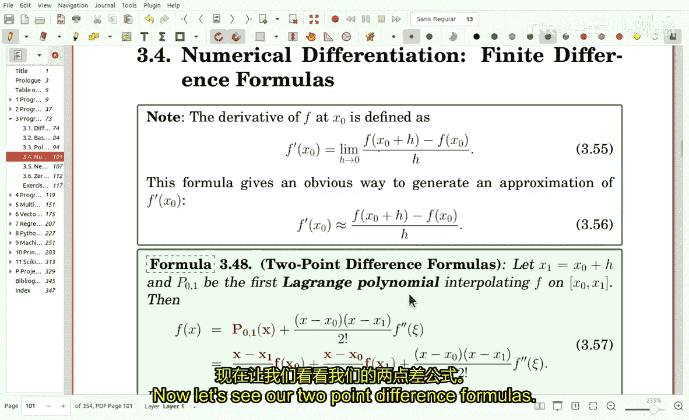

Here。We consider two points x 0 and x1。 X1 is x 0 plus H。So， pictorial。We have here。That is x is0。

And that is x1。Now。Yeah， y equal Fx is given in this way。 Then here， we try to estimate。

The at accessit。And at X1， now， it is related with。The first lagrangenge polynomial。

 which means that line passing these two points。 Okay， let's try to rule。후스트 라그란지폴려놓으면。Okay。

 there is a line。Ys， yeah。Okay。Yeah， that line， okay。Now。

 we call this line P 01 is polynomial pissing X 0 and X 1。Then， from。

Polynomial interpolation error theorem。 we have a term。Now， practically。

 P G 1 can be written explicitly in this vein。This is L 1，0。 This is L 1，1。Now。

 we differentiate the equation。 Then we can get the following。

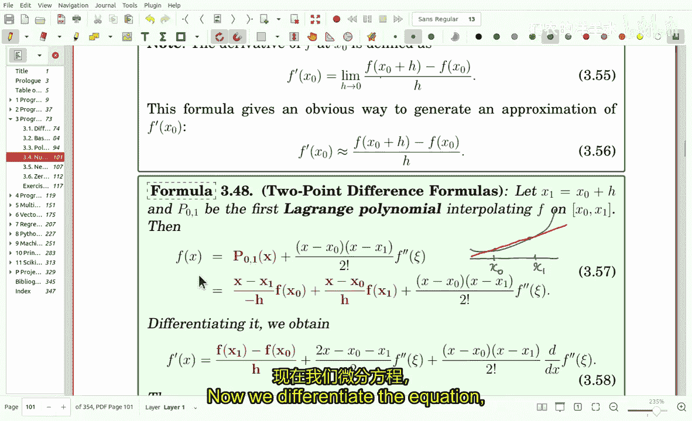

E questionion F prime at x is the same as Now， from this term。

 we have one over minus H times f for x 0。There is this one。 now that is one over H F of x1。

 there is this one。 So from this one， we can get that one Now for this product first we differentiate this one to get this one and now we differentiate it we have this one。

The Qar is dependent on x， so that。嗯。Yeahia。This derivative cannot be because is not a constant。

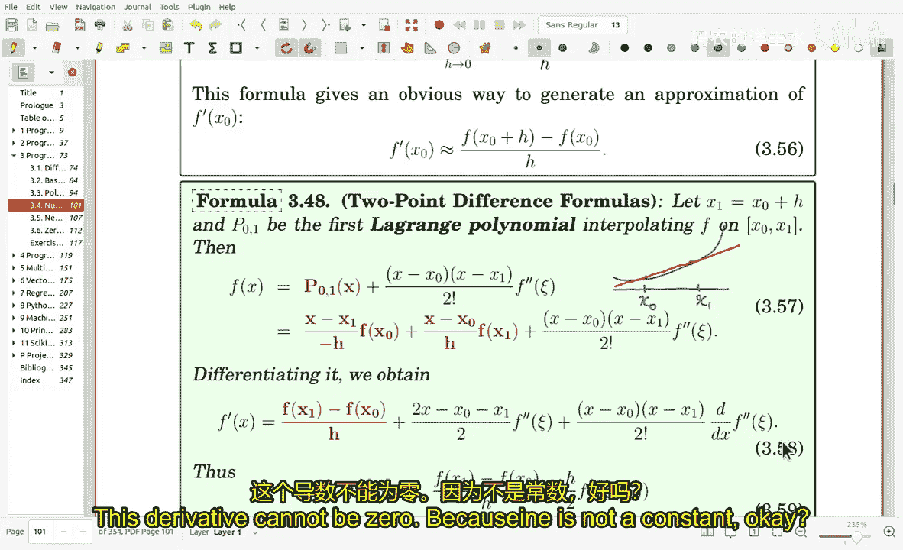

Okay。Now， for， from this equation， we try to evaluate the F prime。呃。The T tip at x 0 and x 1。

 So if we are using x 0， then this term， and here we have this one。But for this one。

 once x equals x0， then this will be 0。 Well， of course， when x is x1， also itll be 0。So that here。

When x is x1， we have the remainder in this form， but we have the same difference formula。

But at that one。Is now the formula looking from X， from left end point。In the case， the error。

Is given in here。And once we try to look at the formula from right and the point。

 then Er is given in this ring。Now， for gender X I， now， when H is positive。X I plus H will be。

For the point。So at X I， this question is a finite finite difference formula using for point。

 So we call this the for difference formula。And we try to use the notation here。

 an x at tape difference formula， along with a photo point。Of F at X。

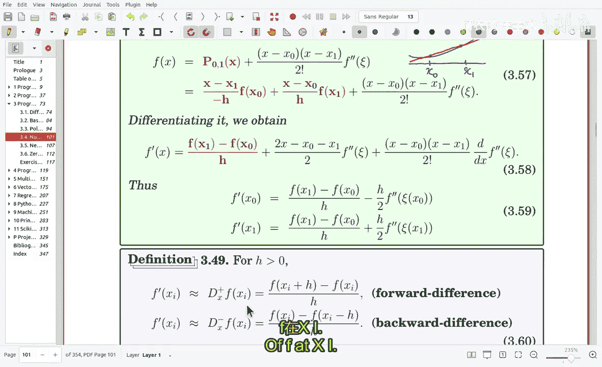

The similarity we we can define the backward order of the difference formula now at X。

 X minus H is be order point。So that this quo is using a be of the point。

 So that we call it the be of the difference formula。 and we are using。

This notation xional difference using bego the point for function F at X。Okay， that's the。

Two different formulas， okay。

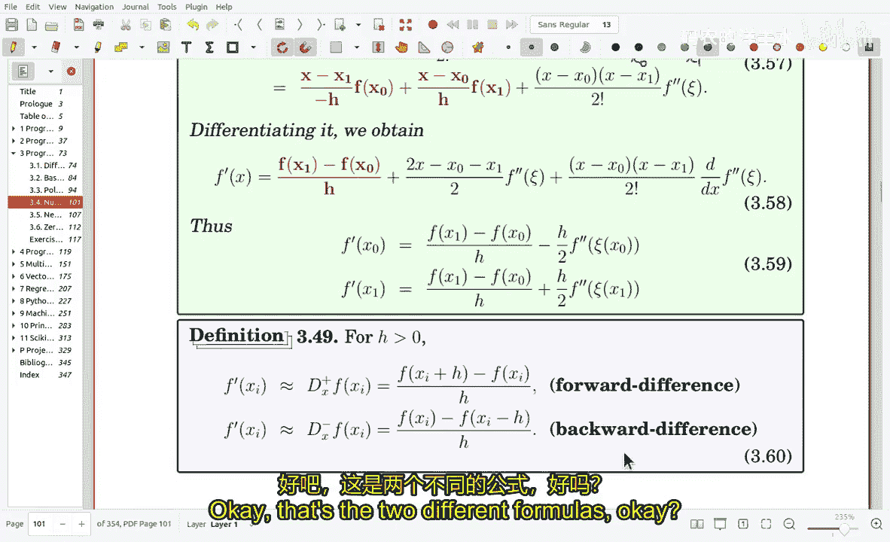

Now we test the accuracy， particularly the food difference formula。

Use the for difference formula to approach mat。Half for relax。

Equals x cubed the add x zero equal1 using H here， a three different H， and each time half the。Okay。

 here， F is defined。 This is a maple languageaging。D find an x 0 is 1。 Now， H is 0。1。

 Now we are measuring。The for the difference。Then it is now 30。 of 31。Here at prime at one。Okay。

 at prime is 30 x schedule at one， the three values is a 3 so that F thetimal point，0。

31 is the error。Now H is half then we have that result from the quotient and one more time for half the H。

 the quotient key reduce the result。You can easily see that the error is half from。The previous one。

 again， half the from previous one， not exactly half， however。Or symptomally half。Okay。

 so that means that it is first to order。

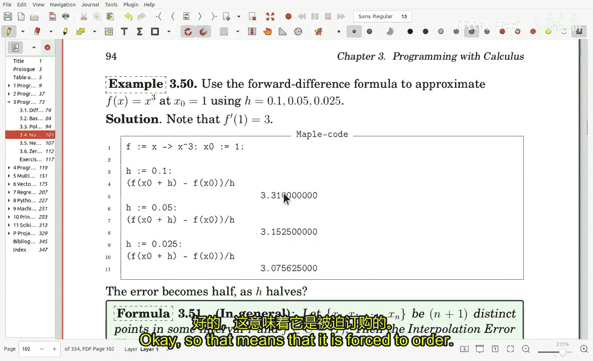

Okay。Okay， in general， once we start with rather than two points。

 start with just m plus one distinct points。Then。The interpretationpo era theorem read in this vein。

We already know that from the interpretation E theorem。Now， if we differentiate。

 then we can get here F prime equals okay for this term。

 for these cardinal functions we have here derivative。And now for this product。

 we forced to differentiate this one and multiply this。 and then we put here。 and for the second one。

 we get the derivative of this second term。

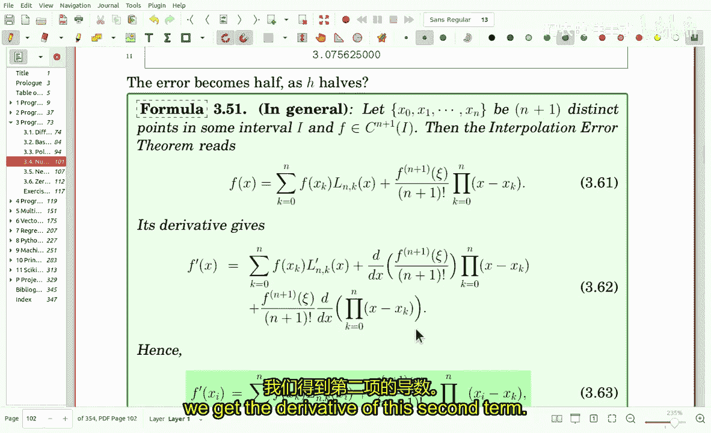

Now here we try to evaluate at X sign。Here， the same the nodal points in one of them here。 In fact。

 for every X we can evaluate then。Now， rather than next， we put X。Then for that one。

 because of this whole product， this will disappear and then from this one。

 this one will make a anom submission so among them only one will survive so that it is simplified in this way。

So that here at prime Xi for everydayI， that's the implies 1 point difference formula。

 and this is the remainder the error， So this term is once it is so small， this error is so small。

 then this formula will approximate the derivative at X quite accurately。Anyway， this is the。

N plus first point， N plus1 point difference formula， okay。

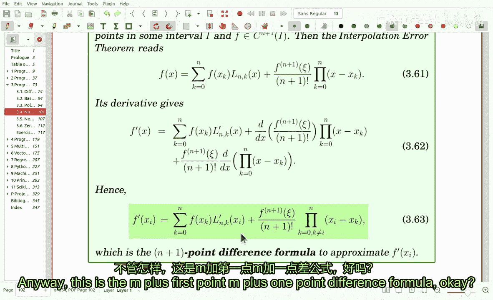

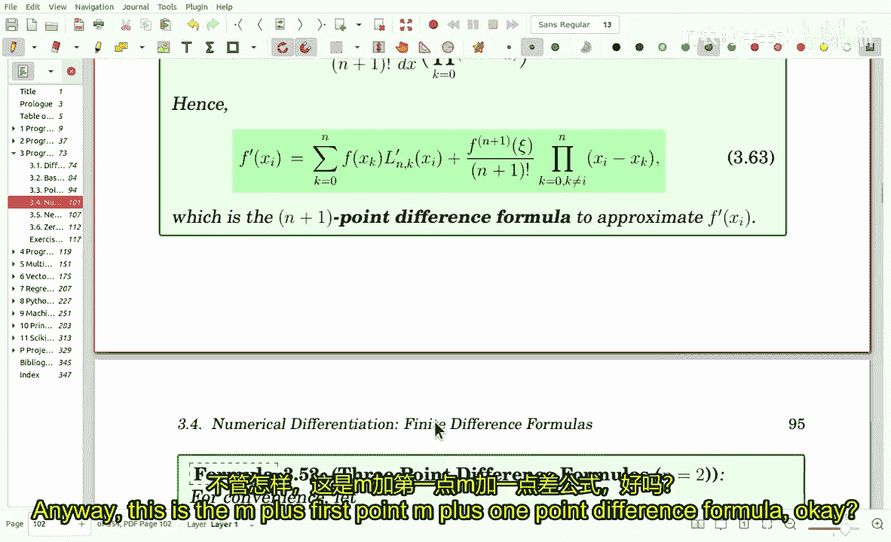

Let's see example，30 point difference formula here n equal to。So for convenience， we choose x0。

 x 1 is H moved to the right。 X 2 is again， H moved。Then。

We can construct the second with cardal based functions。And here， L 2 0， L to 1， L to 2。

And from the polynomial interpretationpo errortheorem we have here。

 that is second of the Lagurangegi polynomial， and this is the erroromeme。

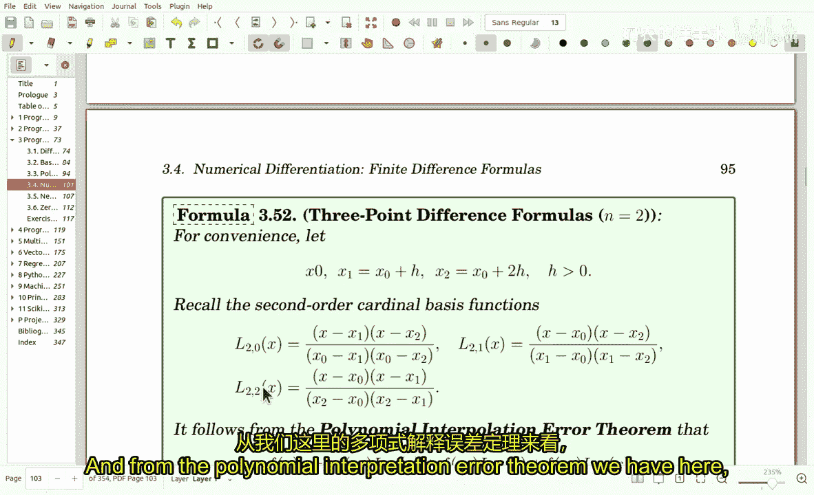

Okay， now we tried to get2 chip。 then F prime is now derivative chip of these cardal functions and2 of the。

The remainder。And we try to evaluate here at each point， x 0， x 1， x 2。

 Once we try to evaluate at x 0， then also。Because it's product， and it'll be simplified。

 And if you go detail， try to， to compute the detail， then you can reach add this one。

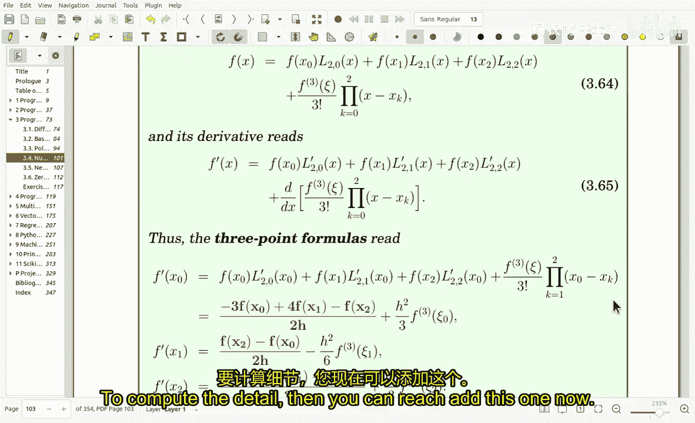

Now。Your old song。Here， these cardinal functions are explicitly constructed。

 and you can differentiate these functions， and then you can evaluate the add。

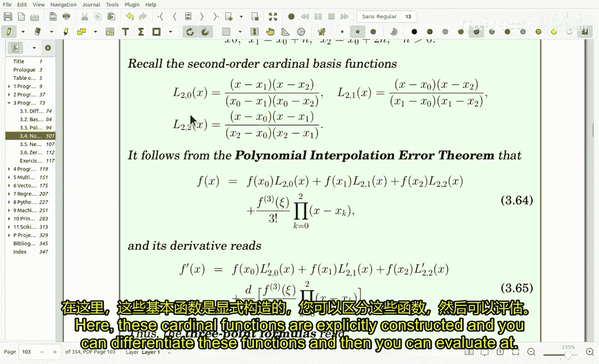

X系。Then after to insert algebra， you can reach at this to from this third termss。

 then this will be simplified into this one。Now， youject to say me。After a differentiation。

 you can evaluate at x1。 then you can get this formula from the three to and from the error。

 the dimension term， you will have such error。And also for x2 right end the point。

 you can get from this one here， this one。 and then this is the error。Here for30 point of formula。

 that is left and the point of formula。 this is a me point of formula。

 This is right and point of formula。So we got the second of the。Formulas by using  three points。

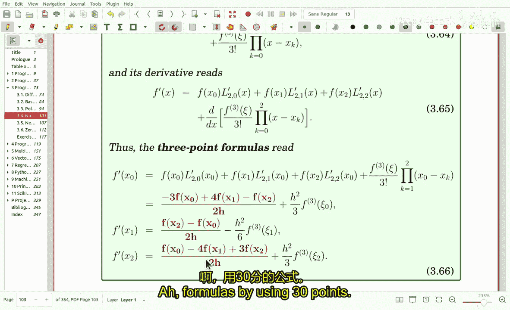

Now， objectiveject same A， we can get5 point difference formulas。

Start with five points and here try to make fourth order Lagarna polynomial。

And along with the correspondinging remainder。And then， we differentiate the。E。

 and then try to evaluate at each point。 Then you can get a formula。 We not go to the detail。

 but here we have this one。F prime at x0 by using 5。 difference formula。 we get that one。That is now。

X series is a middle point， and。F-2 means F at x0 minus-2 H。

And there is a sub minus on means external minus H。There is an X plus H。There's F at x0 plus 2 H。

So here， this is a 5 point of formula and x0 is the middle point。

 so this is the middle point of formula， and error is a fourth order。Now for that one here f0， F1。

 F2， F3， f4， so F0 is left end point， so this is left end point of formula。

 and we have that formula again the error is given in this array， looks like larger than this error。

 however， yet this is a fourth order。Okay。And in this way， biasing more point involved them。

 you can get high order difference formulas。

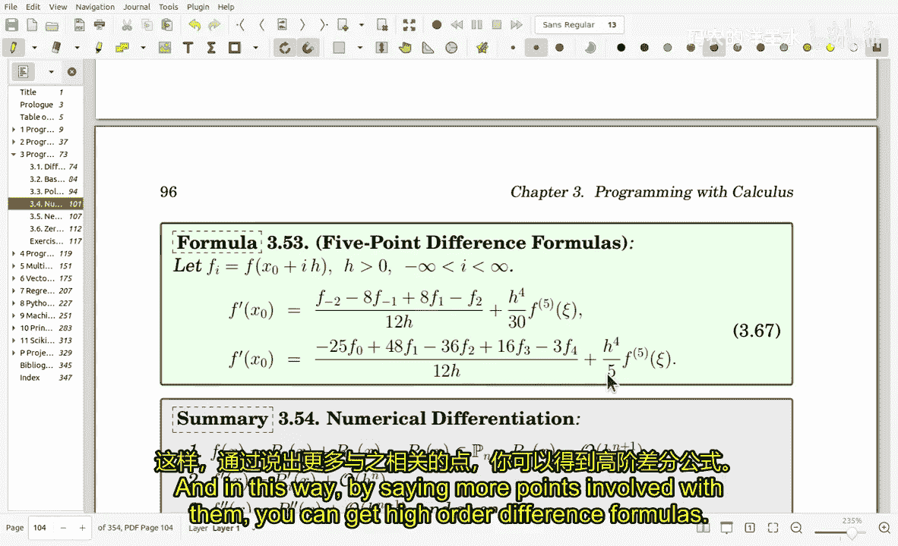

In general， in numerical differentiation， we have this results。Once given function function is。Now。

 interpolateed by saying an the polynomal。 And we have re made the term。

Then the remaining term is order H to the M plus one， because P N is using M plus one points。Okay。

 now once you make a tube tip。Then， now the。This disrupt tip。

 the approximation has now h to the n order the accuracy， so accuracy order is1 down。

 and if you try to also approximate F double prime from polynomial double prime。

 the interpoing polynomial double prime， then again one more time here。Power扩 down。

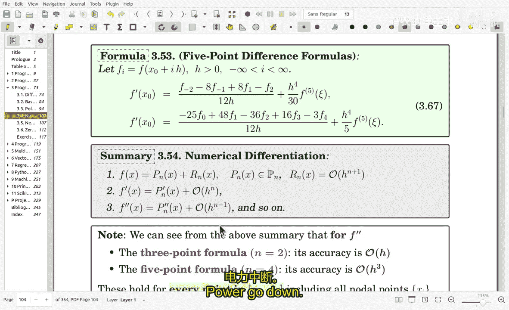

So。We can see here。From the of somebody that for F double prime3 point0 formula in the case， N is2。

And so that its accuracy as order age。 And for 5 point0 formula。In the case。

 N is4 is A order H cubed。Now， there is a theory， and this dessert holds for every point in。

At the interval x 0 to x N。I all noal point Xi。In fact I would point be 10。

 the beginning point and the end of point。嗯m。And so that。Here for second derivative。

 if we are using 30 point of formula， then only the equi or the age。

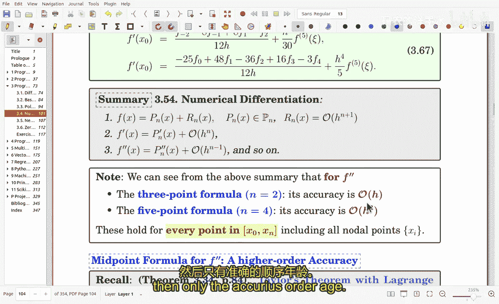

However。If you try to get formula for mid point， then you can enjoy in a high order accuracy。

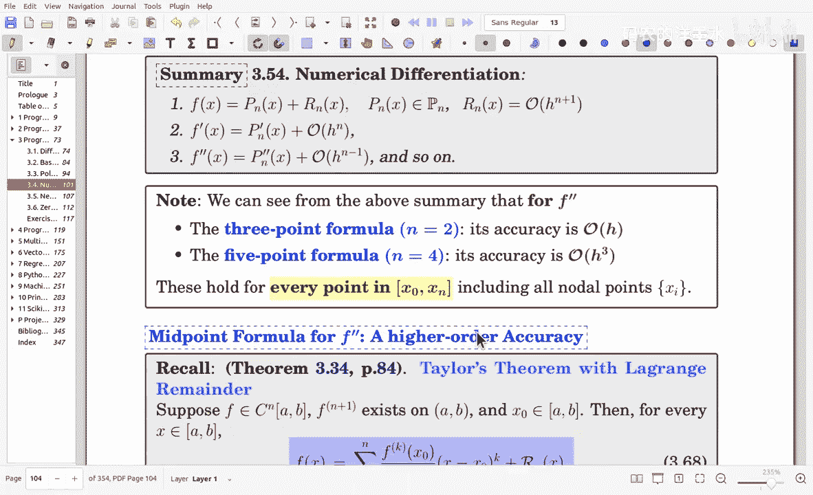

So that one， for example， this is true for every point x0 x1 x2。But if we are focusing on。

The middle point， X 1。Then。Here we can get。And the second order for second derivative。

That will see the possibility。 We start with recall。

For Taylor theorum with the Larange remainder okay。That is the theorem3。

 to the 34 early weve studied。And that is。Now。The given function is sufficiently defishable than for every X。

In the interval we have that is anthoppolynoia plus now Aran， which is one Tom。

 that is a Taylor theorem。Now， from the theorem。

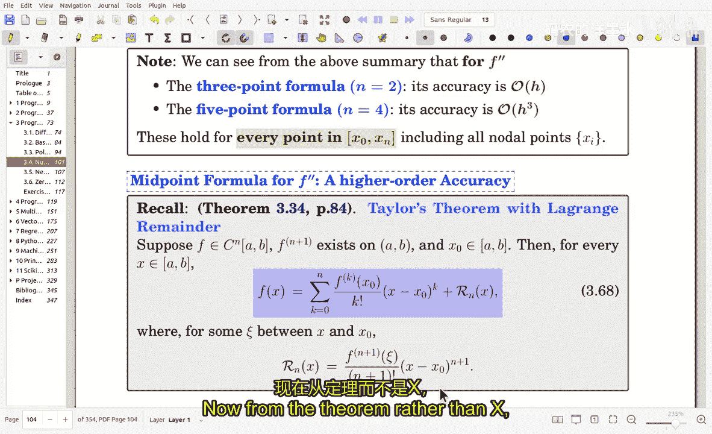

Rather than x， we are using x0 plus H。 X is the center of this formula， and x is ideally around x0。

 So rather than x， we try to use x 0 plus H。So x0 plus H will be around x0。 once h is positive。

 then it will be right side of x0。 H is negative， then it is the left hand side of x0。

So rather than x， we try to use x 0 plus H then。

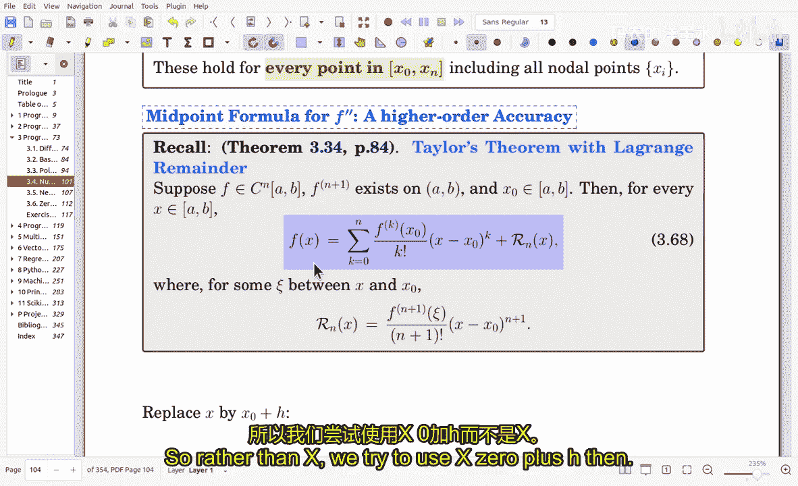

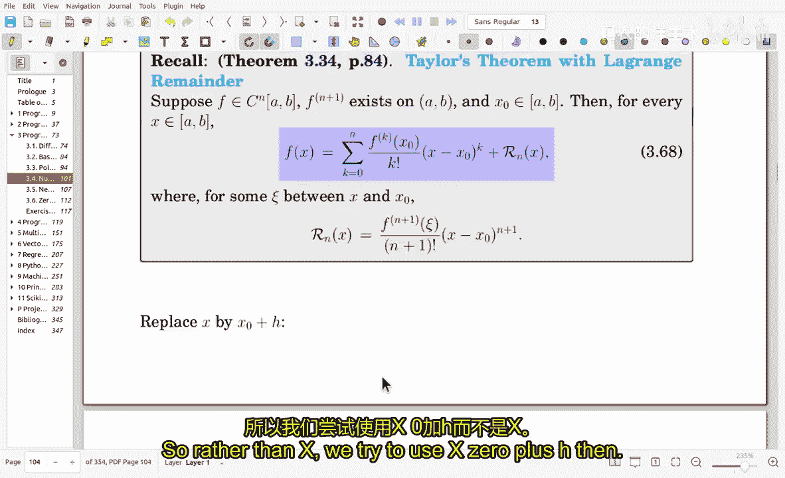

Here， so they are depressing x by x 0 H in the tail of theorem。 We have this formula。And in detail。

 we can write this one rather than sigma notation。 We write down express。Details， then we have that。

 And here， that is R and H here。Okay， we'll use this explicit formula to get。

The middle point of formula for。F double prime here in this example。

 use the Taylorlor 3 to to drive the middle point of formula。

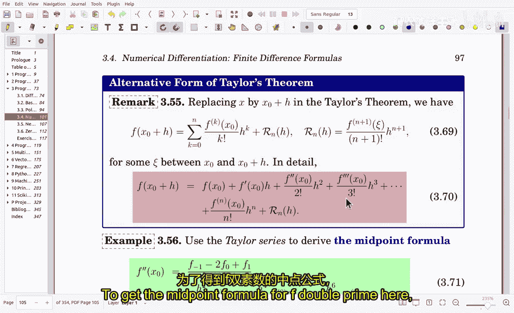

4 F double prime at x 0。 So we are using x 0 and。X0 minus H and x0 plus H。

 And this combination will make here a formula。 And then error is second or the second or the fourth or the sixth or and so on。

 So the overall over there is second over there。Okay。Now we can get this formula quite easilyly。

 and we are using this formula。F x0 H is given here exactly the same。 Now， X0 minus H。

That is rather than plus H。 we are using minus H so that here negative is appearing。

 the minus h squared is h squared。 So we have a plus and again， cube to。

 So we have a minus and fourth power plus and so on。

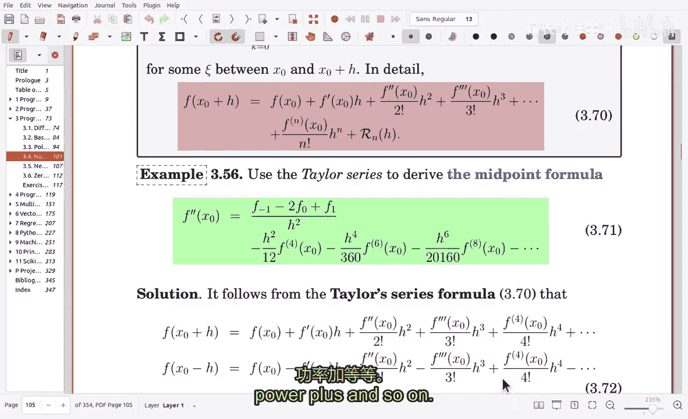

Now。Here， the purpose of this computation is we want to get F total prime x and0 is something。

So that now we want to eliminate this term。We want to eliminate page this term。 and also that term。

 And by adding two equations， then plus minus， it'll disappear。 and also that will disappear。

And here， left hand side is Edan right inside twice of this one。 and again， twice of that one， again。

 twice of that one and so on。

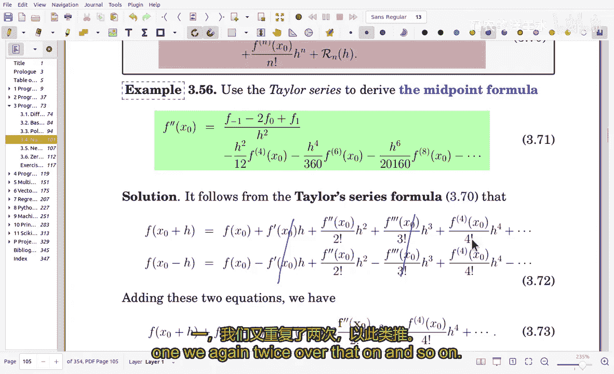

Now we sold for F2 prime x0 on， we move this one to the other side。

 also also there on the other side and divide by h square， then well have this one。

So by using a Taylors expression， we can get such a midpoint of formula。

And that will be higher one or higher than the passive theory。 So it's quite useful。Here， the high。

 higher order accuracy and， and this equation。Can be achieved at the middle point only once you are trying to get the formula for left end point right end point。

 then you follow the basic theory。That means you can get only first order conversiongence。

 first order error。

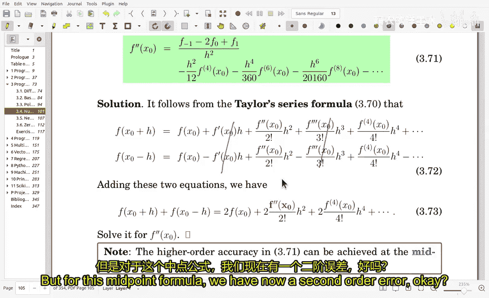

But for this midpoint formula， we have now second order error okay？

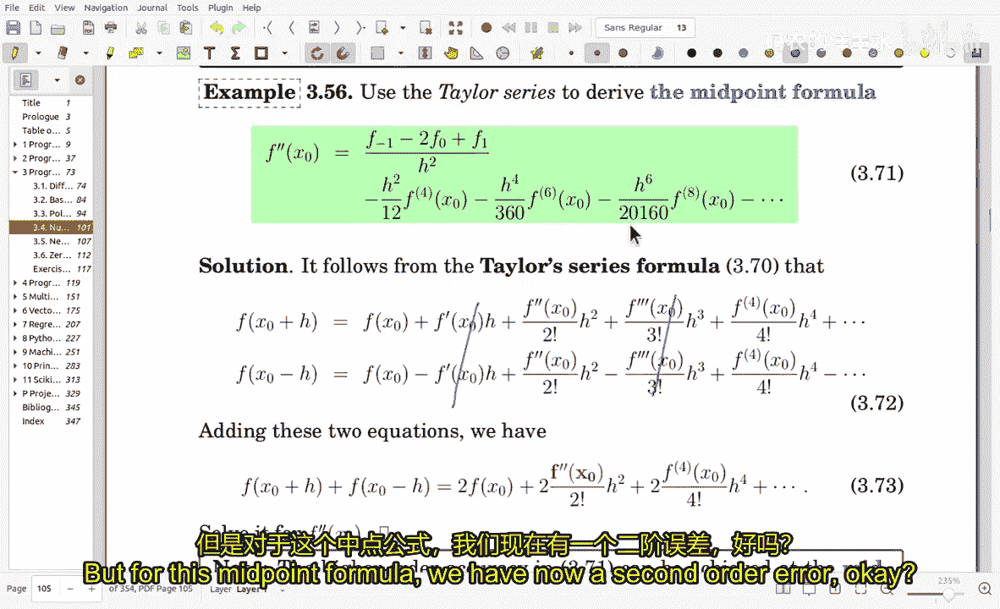

Okay， let's see this example， use the second derivative mid point formula to pushmate F double prime1 for F of x is given to be x to the5 minus 30 x scalinging。

Using hs now，0。2，0。1 and 0。05。Again。And。We will try to use a symbolic tool， maple。

 and F is defined an X1。Now。After second tip， we try to evaluate at x is 0。

 Then the true value is 410 from this one。 In fact， F prime is same is now5 x  to the4。

-6 x and one more time F double prime equal。20 xs scatter minus- X once x equal one， then the value。

 Okay， so the here x is 1， then value is 14。 So we have the2 value 14。Now。

 we are testing the accuracy of the。Second derivative midpoint of formula。 Yeah， that that one。

 So f of x0。 there is a f of x0 minus H F of x0 plus H combination divided by H squared。

 that is exactly this formula okay。

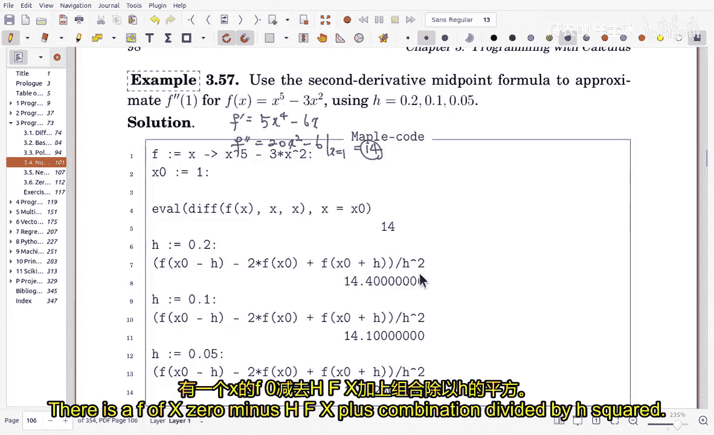

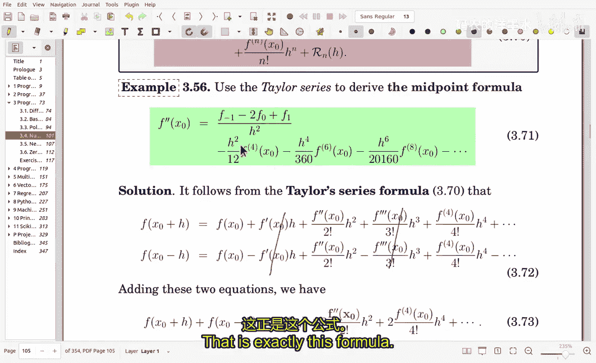

Now， H is 0。2， we have that one。 so that again， after testsma point， this is the error。With H is 0。1。

 we have error， and again。With each h， we have such error。As you can see here。

 the error become cooler when H is half them。That means the error cons in second order。Okay。Okay。

 that's the end of the section。 Thank you。

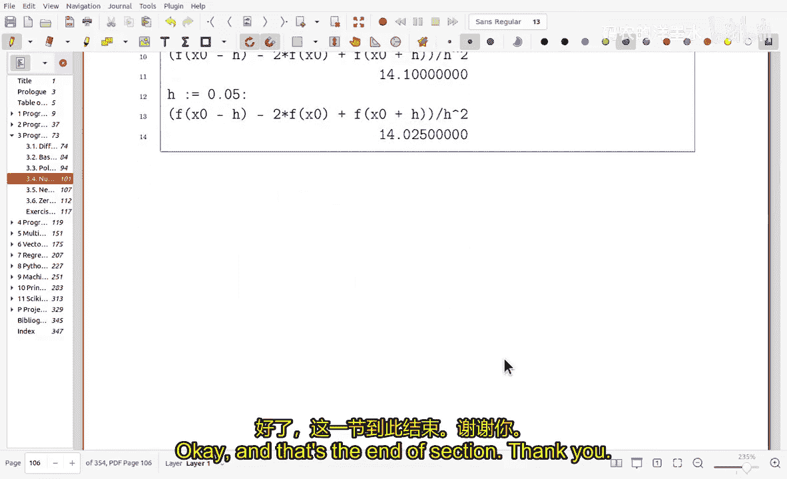