# 【全集-附课程讲义】密歇根大学-人工智能编程-EECS492-中英字幕-p26-Lecture-26---牛顿方法用于非线性方程的求解--BV14JqfBNEAS_p26-

It is a Section 3。5 Newtons method for the solution of。Nanniia equations。In this section。

 the objective is to find a 0 P。Of function of。We'll try to find a point P such that F of P equals0。

 here well assume F of x equals0 is a non nonlinear equation。Here we have a strategy。

P is an approximation of pay。Then we'll try to find a correction Tom H， such that。AP0 plus H。

 the corrector point is a perro approximationation of P than p0， the initial point。Ideally。

The correct， the point is the D， the point。

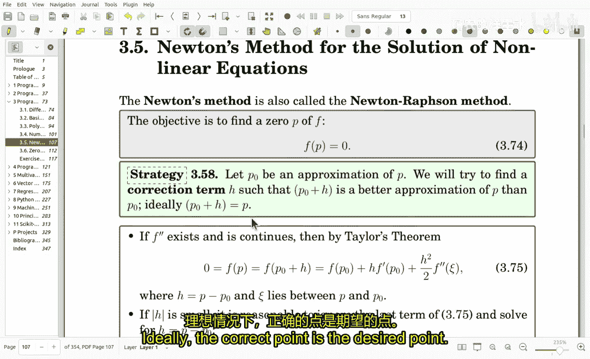

We assume if the double prime exists and continues。

 then we can use Tayloror the theorem in this vein。F P。이꼴し。Now， either case， p0 plus H becomes P。Now。

 using the Taylor theorem， we have such terms。Where H S P minus P0。When H and moduluulars is small。

Then。This the meta to will be small。 So is it reasonable to ignore this thumb and so4。Hge。Yeah。

After ignoringing this one， now we move this onto the other side and divide the by。F prime P at all。

Then we have this Tom。Now we are using approximationation sign because we can order that on。

And so we have H as a Sam to that one。And we tried to super for P。

But is approximation so that after moving this one to the other side。We name it， P1。Then。

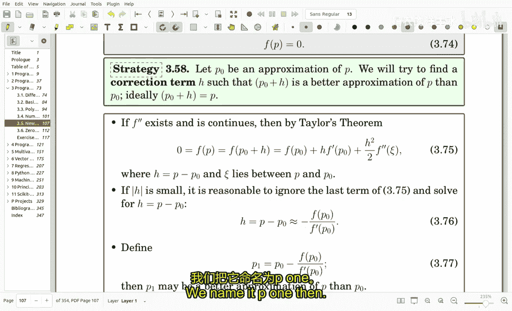

Here， P0 is initial point and this is the correction Tom。And。After correction， we name P1。Here。

 P may be a better approximation of P than P alone。TheThis。呃。The update can be repeated。

 That's the nuton method for solving F of x equals the。

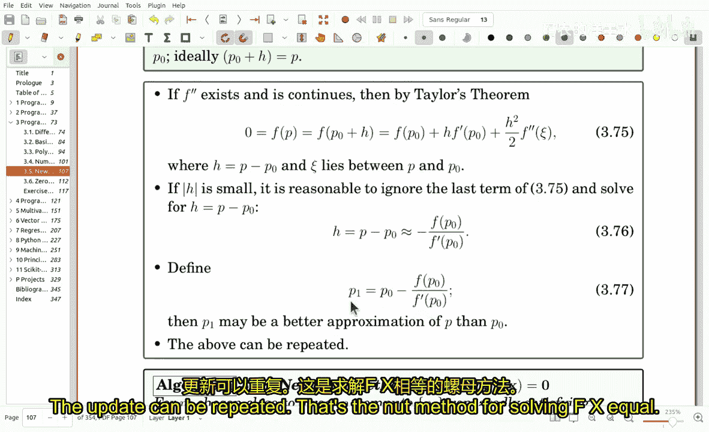

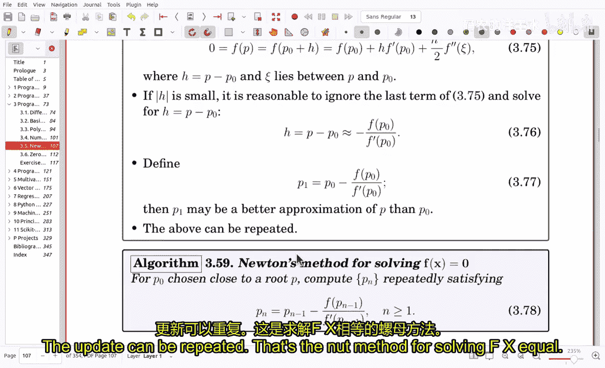

For P0tron close to the root to P， we compute to P repeatedly using that equation。So that repeatedly。

 we try to produce a sequence of points。Then。We get PM and conge to the DJ of the point P。

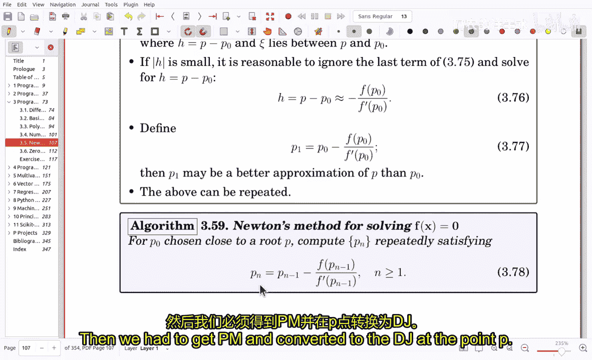

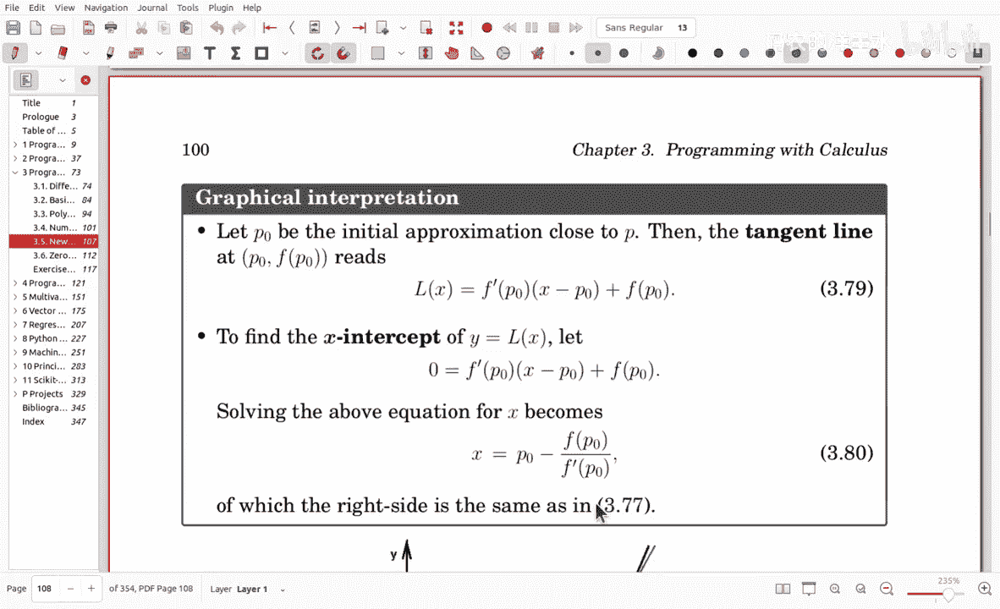

Here， let's see a graphical interpretation of the nus method。P 0 is the initial approximation。

 costo pay then。The tangent line at。P and FP can be formulated in this vein。This says。

The point slope form。

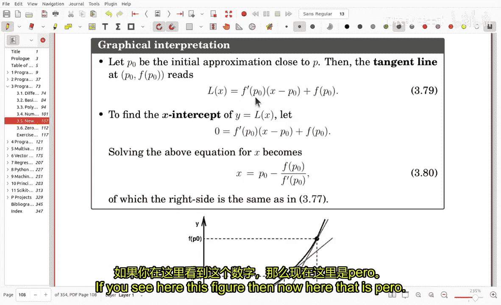

If you see here。This figure then now here that is pon。

 then this point is p0 F of p0 and slope at this point will be a prime of pon。

So we can make this a tang line here， this line。And。Well try to find。

X intercept of the tenderent line。Then here， by putting this thumb0， and we sold it for eggs。

Then we reach out that one。

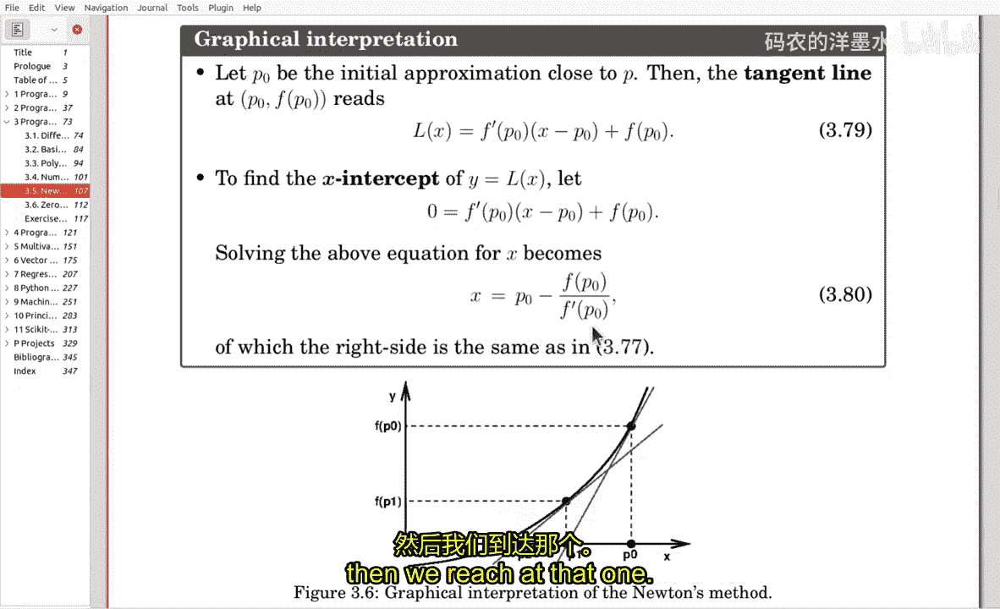

But at this quantity is the same as here。

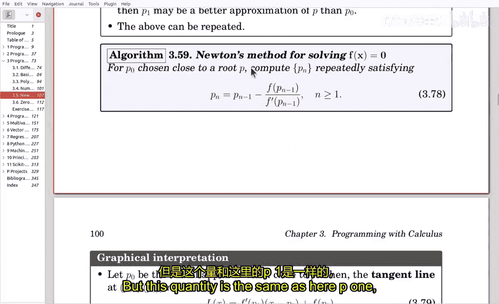

P1。That means there。You tooth's methodod is trying to update the solution in this re。For given value。

We go to the graph， and。Consduct。A tendered line。And try to find x intercept。

 that intercept becomes updated at the point。And P2 will be be。리 here론 그 오대。

T to line and intercept that P2。 and again， P3 will be here and so on so that it is approaching to the de point。

Okay。Now， when we derive the de terms method， we ignore the second of the term so that the H is larger than。

It is not。 It may not converge， for example。We start with the arch tangent of x if we try to show equals0 and the curve of arch tangent is given in this rank so that the0 unique0 is to the origin。

The0， x equal 0 isた。嗯。The unique0 over the function。Now， we start from。파이요보토。And here。

 I this plot and。We do three， okay。Here start with this one pi2 and quote to the curve and tangent line。

And here we have P1。And from P1， again， we follow the corresponding tangent line。

And reach here the intercept。 there will be P 2。 And again， here， now go over there。 there is P 3。

 If you try to get P4， then from here， now go over there far away。So it is a diverging tu。

It is thrgging。Is the poor initialization pi over2 is too far from。The solution P。

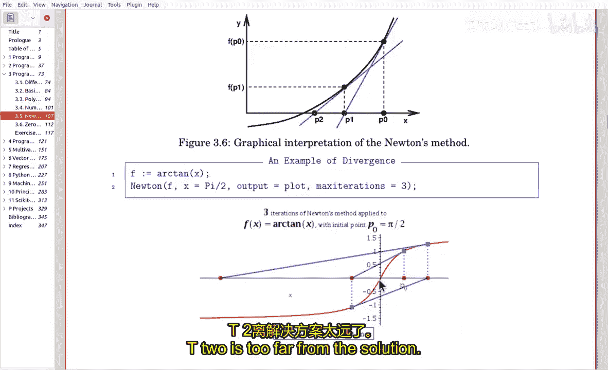

Okay。The nutrients method may dive verge， only as the initialization is a。It cannot be continued， if。

At some point， the derivative was Si。Then， it is broken。嗯。Here， however。

 New's method is mostly effective yuan。At prime is pounded away away from 0 the。 So it is。

At prime is an non zero， then Duton's method is most attractive method。

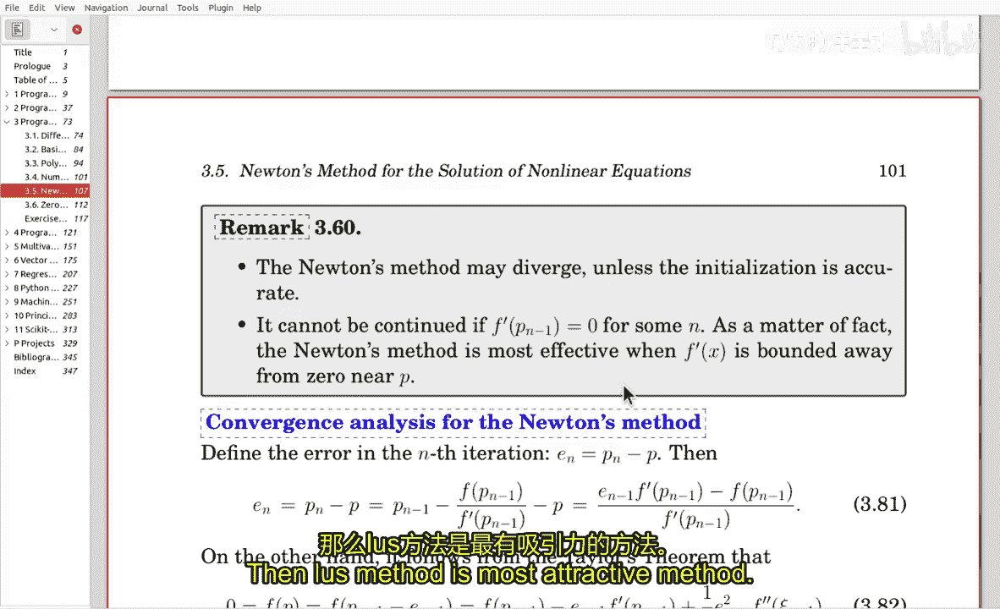

Here we have Camogen So SS。I let deal with this one here。 if you are interested in。The theory。

 then try to read the your main result is here。

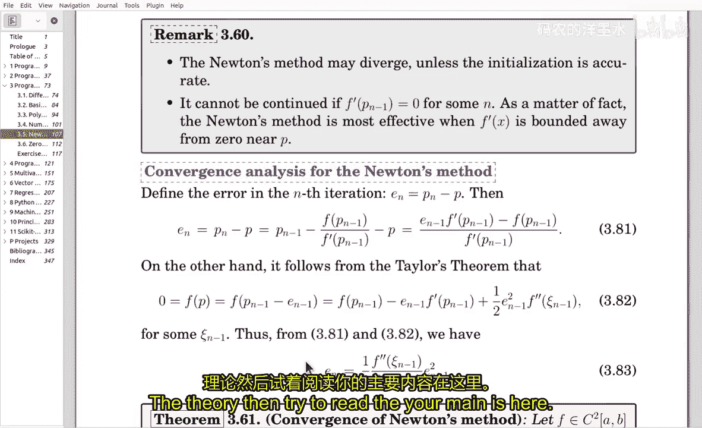

The collect。The iterate error is now。Deletd with。Squere previous error。

And along with that quick sense。Or Shiing at prime。Ass far away from zero。

 and a total prime is a pounded。 This one is a pounded number。And a pounded the quantity。

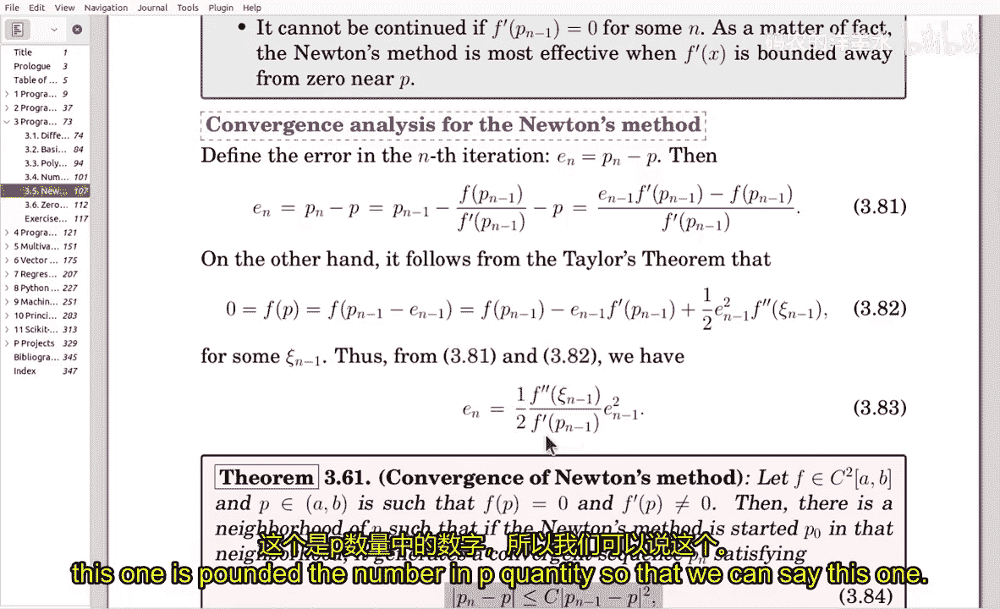

So that we can say this one。Covenance of Newtons methodthadone。Yeah。

 we assume F is continuously differentiable twice。And P is in the interval， and F of P is 0。

 and F prime of p is non0。 So we assume here around the。P is far from 0， and this is bounded。

 That is if the second derivative is continuous， which means that the value is bounded。嗯。Okay。

 now if the new method started P0。In that neighborhood。That means。P 0 is chosenn accurately。

 Then the newton method generates a congenent sequence P satisfying this inequality。

 here error in the current level is compounded by a constant and error from。And。Pretyiousious level。

So it is a quadratic convergence。 It is rapidly convergenging。

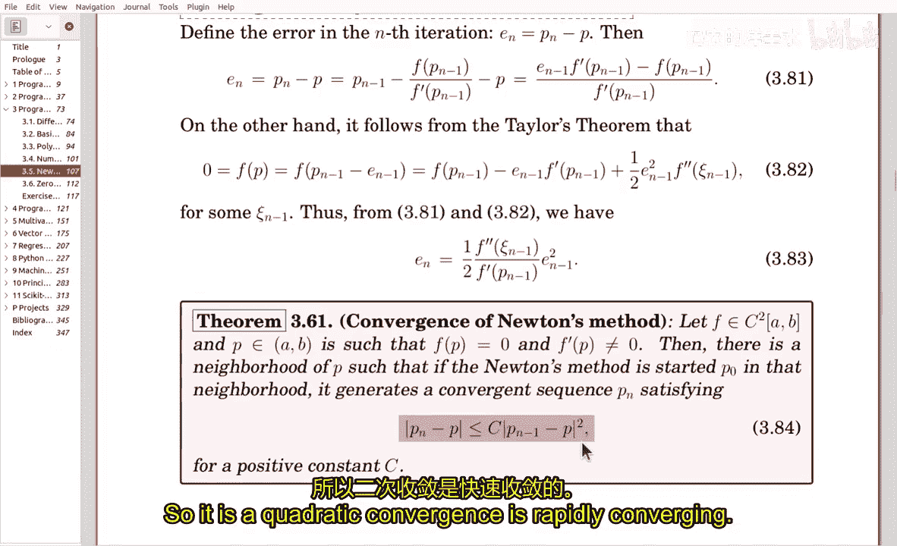

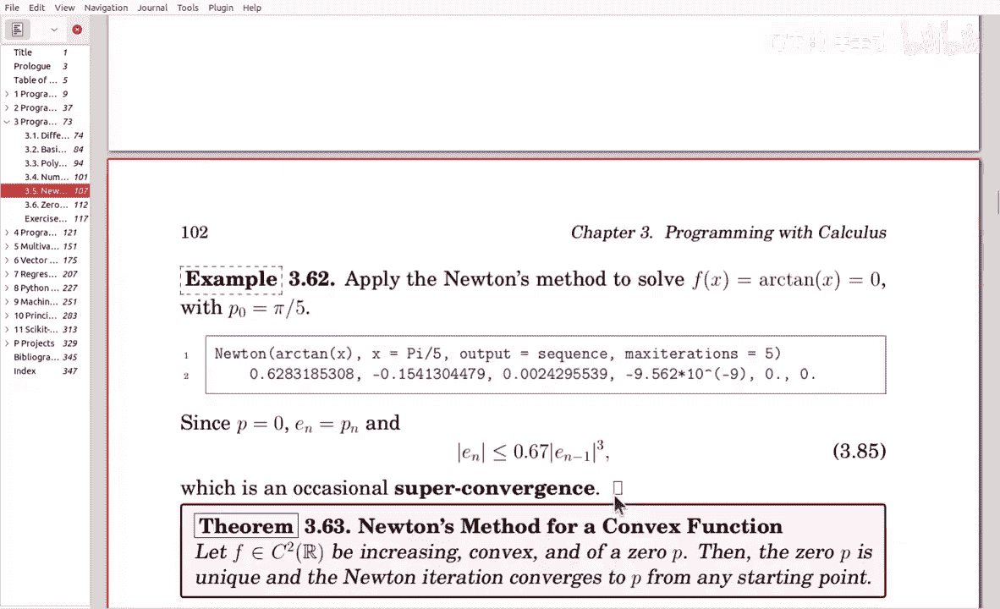

Now。For the same problem， finding a zero of a tangs。叫 we业。

Start with Pi0 pi over5 rather than pi over 2。Then here up this sequence and maximum metrition survive。

As you can see over there。Here the。The PM is comp to see of edit pedalling。

I try to print out this one in detail， along with。Many teach it。 And I found that。Here。

 E N is bounded by here， about two third times E -1 cubed。 So it is。A quadratic， a cubic convergence。

 So it is a kind of a super convergence。Toition， we can see this super convergenenceency that。

The function， the architecture is asymmetric。So if you try to use symmetric structure。

Inherited in the problem quite nicely。 then you can enjoy some super convergence in many cases。

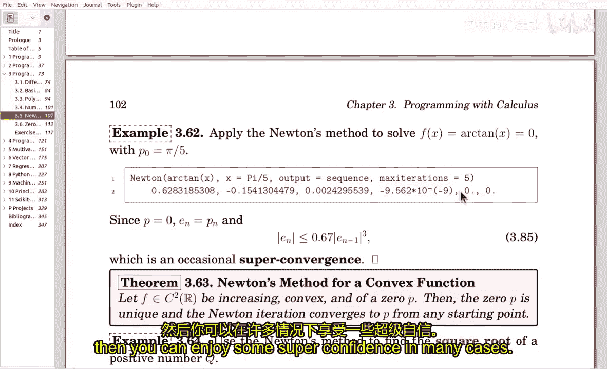

Okay， now let's see a practical application of a Newton's method then。And for quantum x function。

F is now。Continuously second def。And increasing and convex and has a0 P， then the0 P is unit。

 it must be un because its increasing function， a0 is there then the0 must be unit and the newton iteration convers to p from any starting point。

That one can be applied for finding square root of number Q。

So let's try to use the need method to find the schedule root of。

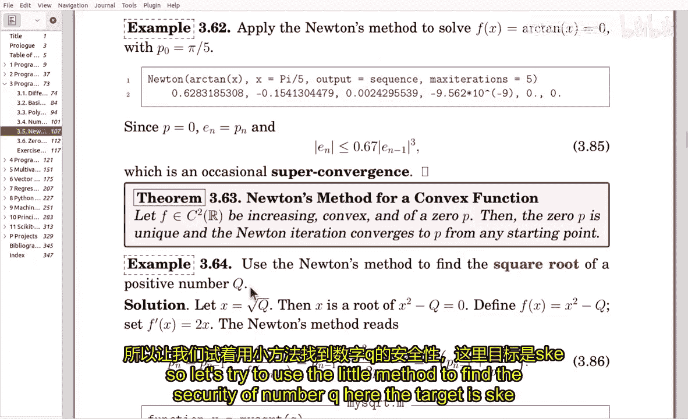

Number  Q。Here。The target is ex， sable cu。From this one， we can see here the equation。Now。

 square both side and move Q the other side。 We reach chat that one。

 Now we define this portion as F O。Then。An F prime of x will be2 edge。Now。

 the corresponding new to method reads。Here PMN is P -1 minus that the correction Tom。

 Now F P minus-1 is this one， F prime P minus-1 is twice over p -1。 now we simplify。

There is average value of P -1 and a ratio between Q and P -1。

So that is due to method we implemented here。

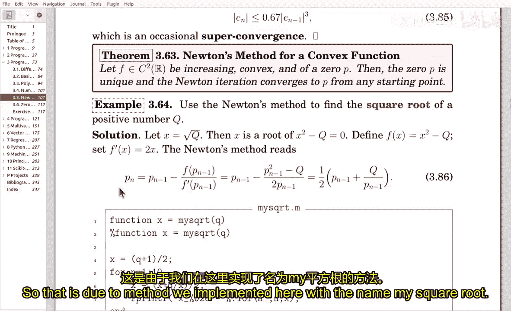

With the name， mywood。Okay， here， the Q is given。Now， we initialize the PM here we use。X variable。

 Q plus1 over 2。 you can use Q。 It doesn't matter， in many cases。But we initially this way。

 And then now we。To this operation x。Plus x， okay， that's Q over x and divide by2。

 that is updated the x。So here x represents P N。 this x represents P minus-1。 Now， in each situation。

 we try to print out to C。How the sequence is converging。

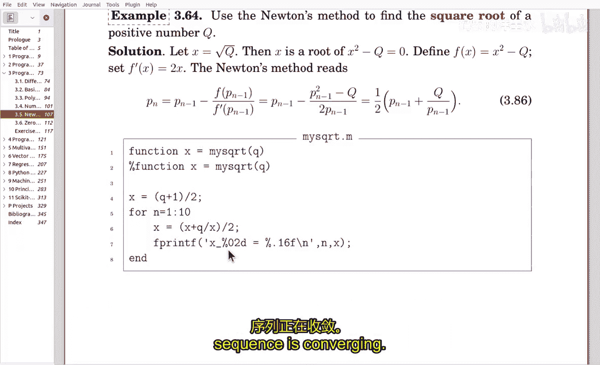

Okay， here。The result T S 4，160。And it is converging in this way。Now。1， so that P1 is this value。

 P2 and so on。 So that after。嗯。6 it。 And from7 to one， we cannot see the change Right now。

 we are printing out with a 610 digit a crochet。

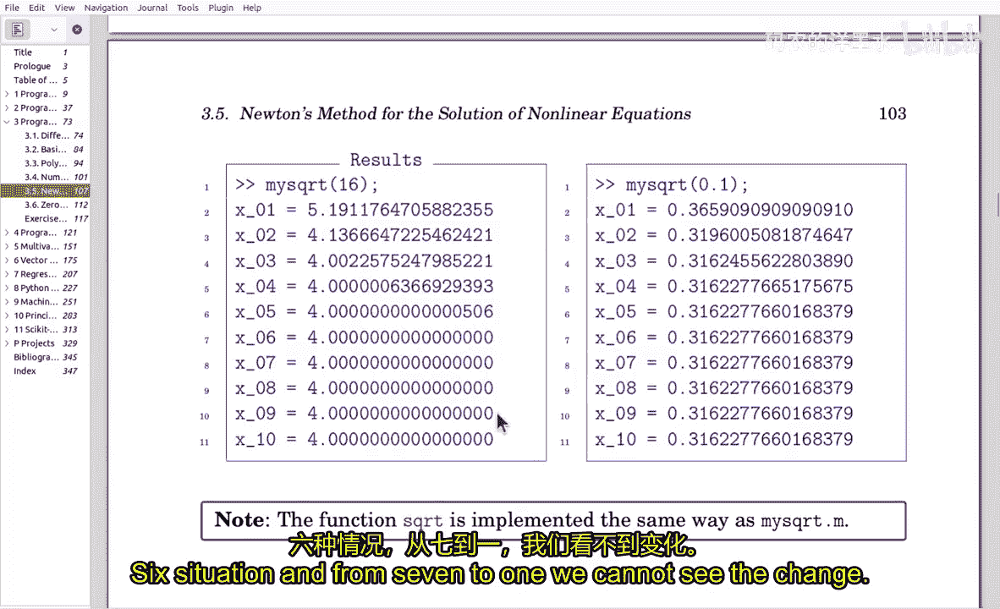

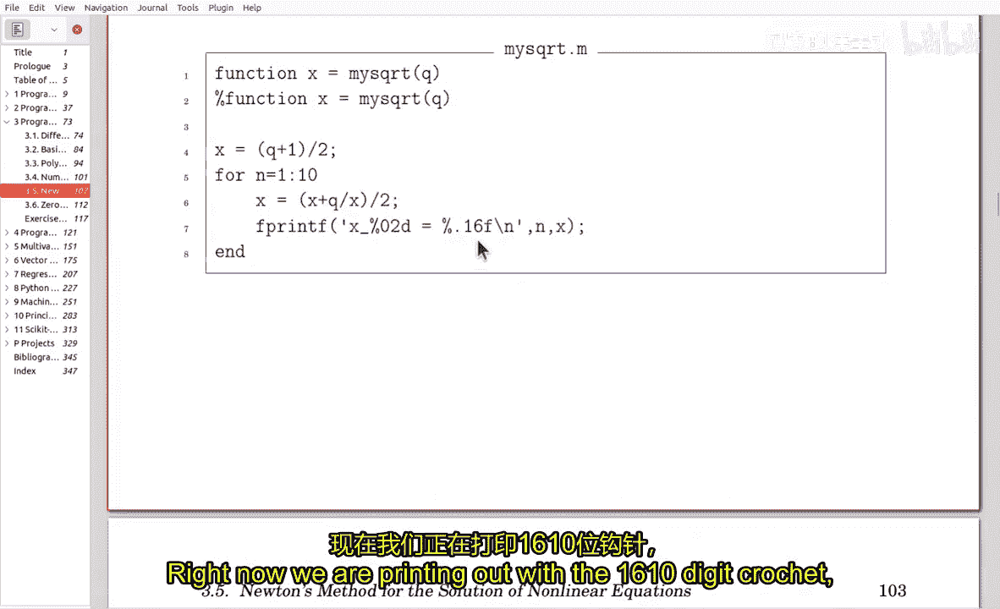

So after six edition。It converged to the digitalta solution with accuracy 6 dig。

 so it is converging very fast。T。Convenence characteristics。Now for 0。1 here we have the sequence。

And now， after5 re。It is not changing， so that。In five iteration， we got a really accurate solution。

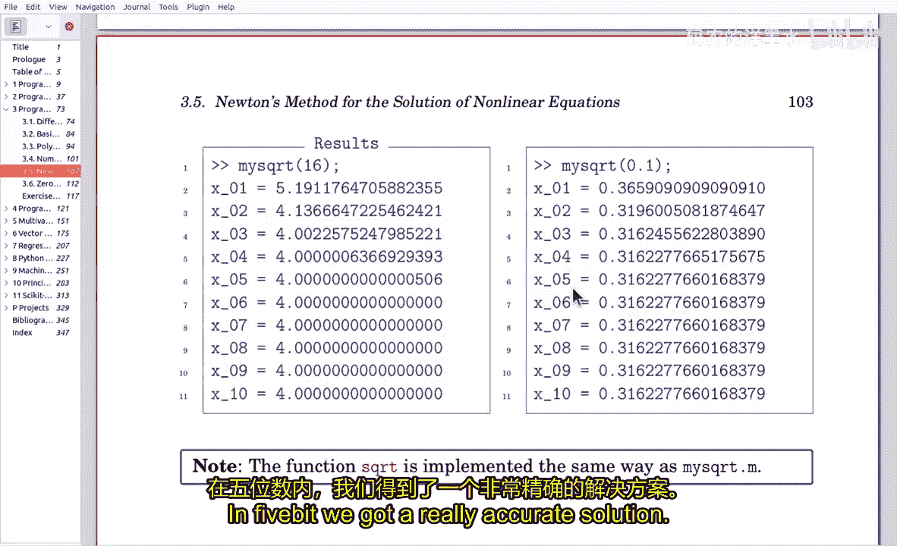

This algorithm is implemented and practically in your computer。

 if you call the functions square root SQRT， then such operations will be fulfilled and youll get the solution。

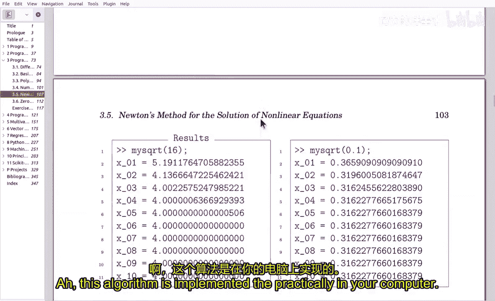

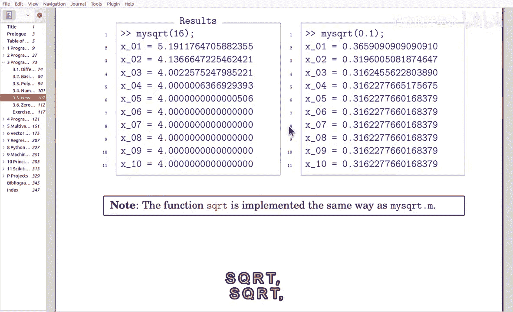

You don't have to keep some stopping criteria。If you check stopping， then also that takes time。

 This is really simple options。 so that， for example。89 iterations。

 then the J will be really accurate。 So that is a practical use to in your computer and in your calculator。

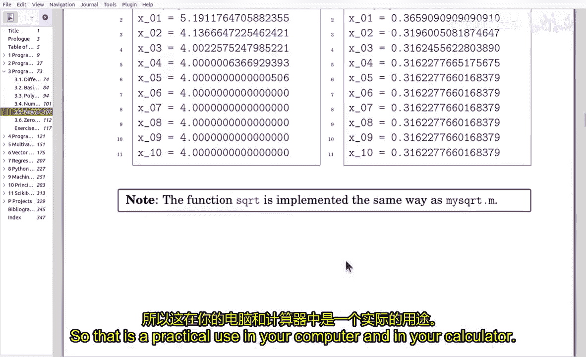

Okay。Okay， that's the end of the section。 Thank you。

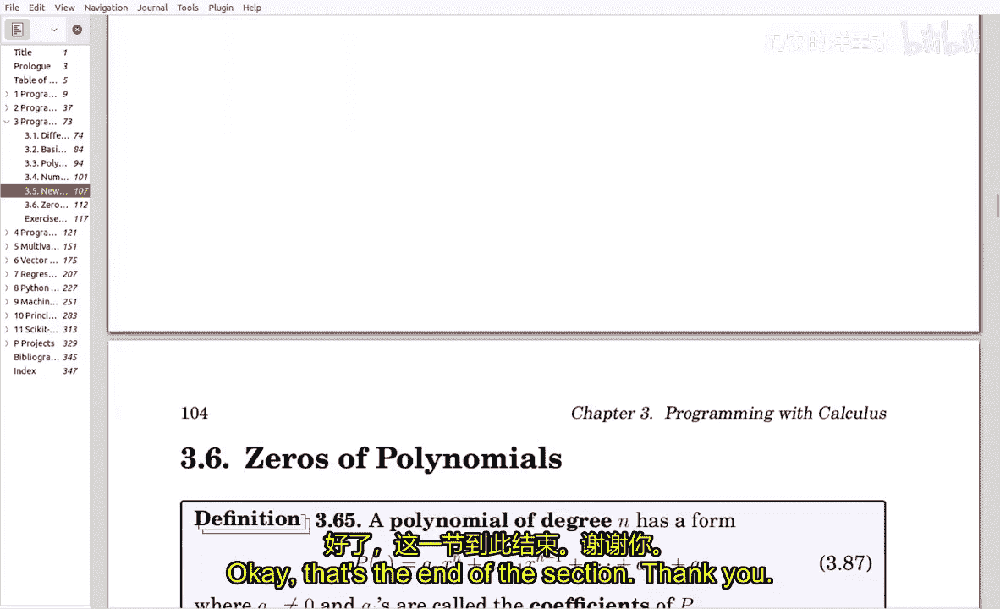