# 【全集-附课程讲义】密歇根大学-人工智能编程-EECS492-中英字幕-p28-Lecture-28---线性方程组的解法-三种初等行变换（EROs）--BV14JqfBNEAS_p28-

Chapter 4， linearbra basics。Real world systems can be approximated or represented as a system of linear equations。

 A X equals B。

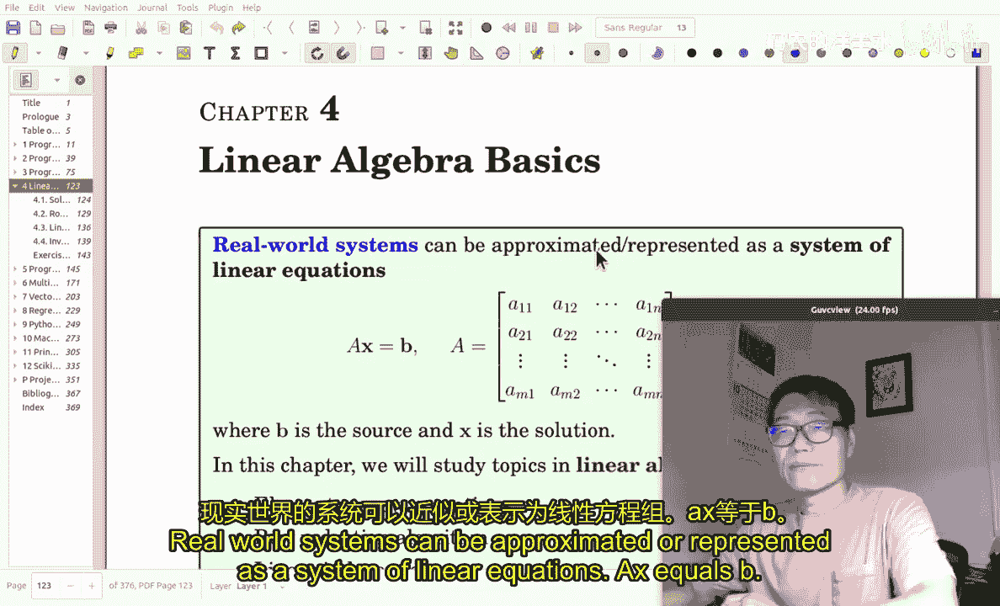

Here is the source factor。And access the solution in this chapter。

Will study topics in linear algebra basic6， including。

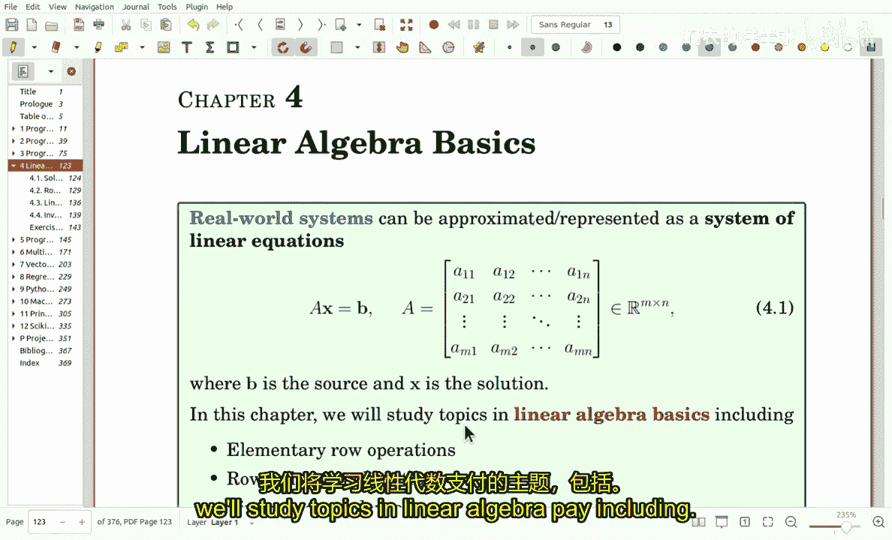

Eliary raw portion。Rode detection algorithm， linear independence and inverable matrix。

In the last chapter。We studied programming with calculuulators。

 calculus and linear algebra are two major topics you have to understand well。

 if you want to be a good programmer。

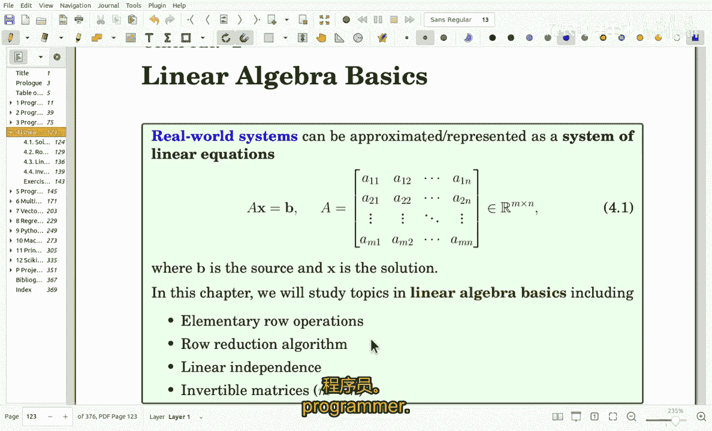

Okay， let's go to section 4。1 solutions of linear systems。A linear equation in the variables， x12 xn。

Is on equation in this form。Yo。😔，Oh。B。And the quos A1 to AN numbers。

They can be real or complex valued。A system of linear equations or simply a linear system。

Is a collection of one or more linear equations involving the same variables。

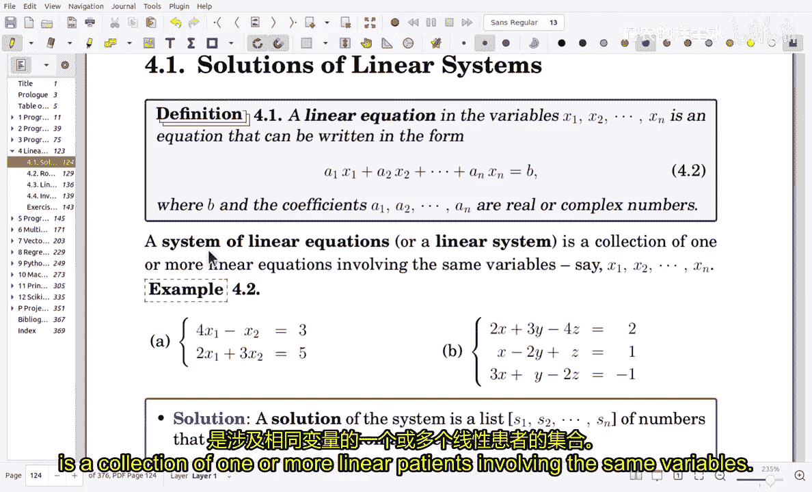

The lift side is。A systemst of two linear equations。Oh。With two variables， x 1 and x 2。

And right side is a linear system of three。E cushions。With 3 variables， X， Y， Z。Solution。

 our system is a list of numbers， S 1， to S N。That makes each Pi a touriststatement。

Once x1 to x and they the by。The list of numbers。 then every question will be true。In the case。

 the list of numbers becomes a solution。The solution cell is set up all possible solutions of the linear system。

And two linear systems are equivalent if they have the same solution Sam。

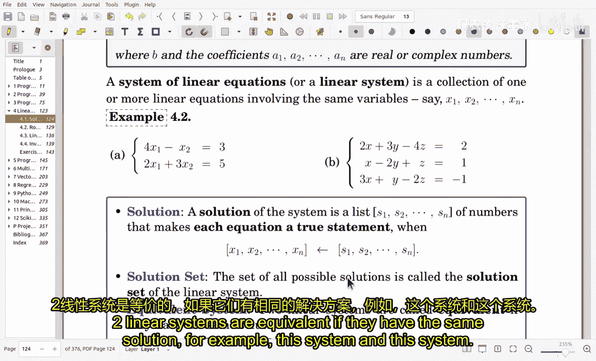

For example。This system， and this system。This one is made。With this operation。The first cushion。

Is de by food station， minus second kitchen。Here， second communication is subjecttract， so that。

2 x 1。-4 x2。 and that will become -2。 So that is this the equation。

 and this one is the same as earlier。These two systems will have the same solution， So we say。

These two linear systems are equivalent。

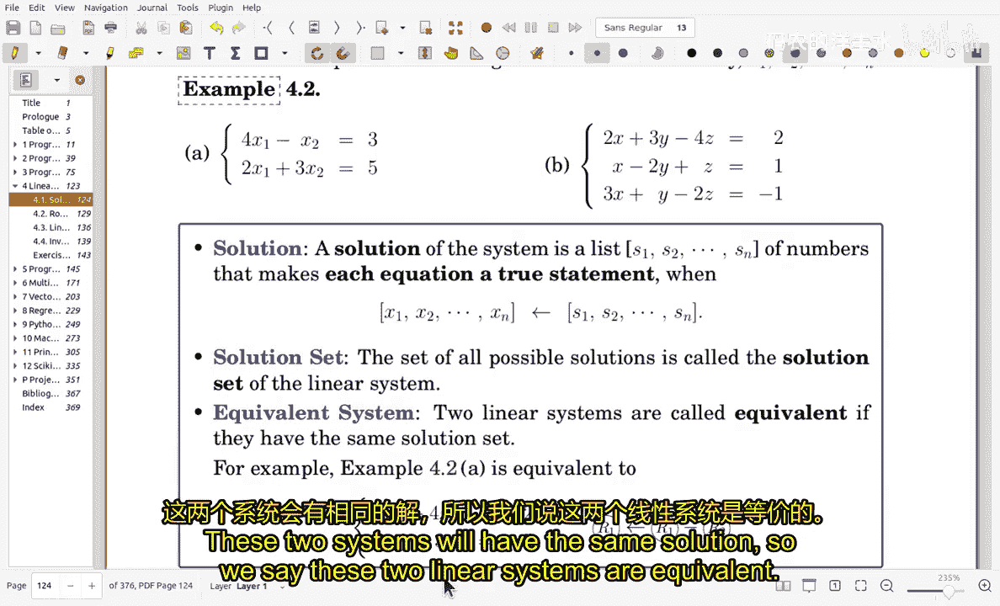

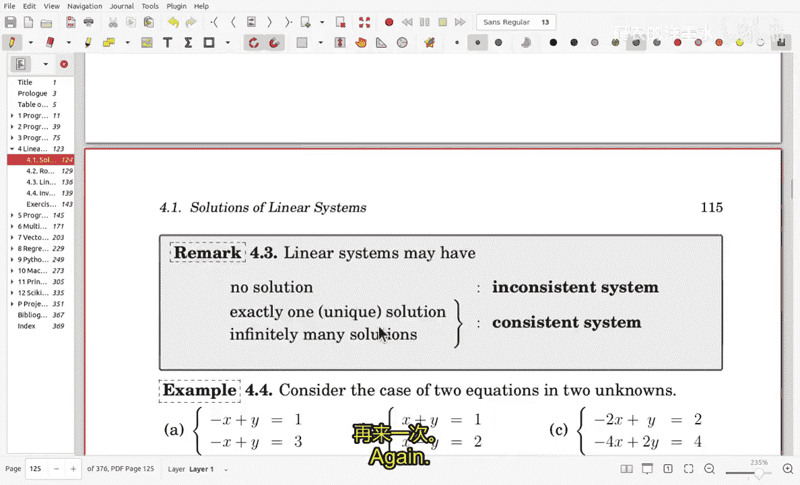

Linear systems may have no solution。If exactly tell you one solution。Infant in many solutions。

When it has no solution， then we say the system is inconsistent。Once it has at least one solution。

 so the either Uni solution or infinite remaining solutions。Then， the system is consistent。Here。

 we consider the case of two equations in。

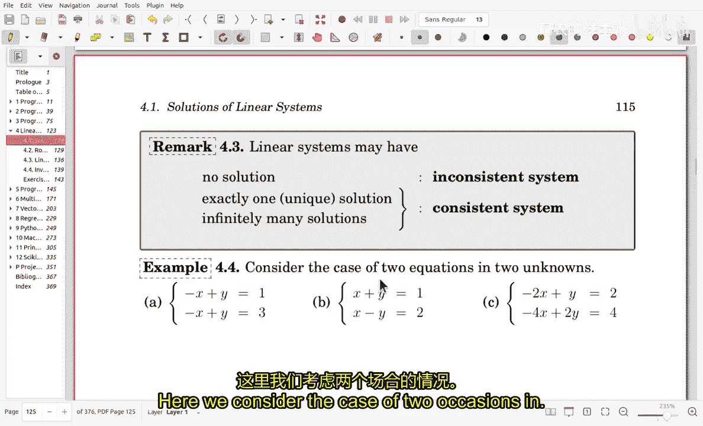

Two unknowns， okay。For。This is system。We may write this one in a more convenient form。

So y core by moving my innerex to the other side。Can have that is x plus1。

 second equation will become y call。X plusory。Now， if we draw cors of each equations， then。

When you see this one？And another one is the one， there is one here， and there is three。The's slope。

This one。For both occasions。And so that。Theこれ。They each other。 So there's no solution for the system。

And the solution will be the intersection of the two lines。

 but these two lines are not meeting each other so that there is no solution。How about this one？

If we write this one。In a con form， then y call that is minus x plus one from the first one from second one。

 y equal x minus-2。1 is slow -1。The other one is s of one。

So that one is minus x plus 1 and x minus-2 is passing there so that。The point。

 the intersection is the solution。It has unique solution。No。Here if we multiply 2。

To the first location， then we can get secondconone。That means that。

These two equations are essentially the same。So this one。

 each one is making a line so that the graphs are identical。That means that two groupss are meeting。

Every point。And so that it has infinite and many solutions。Here无异议。啊。Have 3 systems。

 one has no solution。1 has。A Uni solution， and the last one has infinitely many solutions。

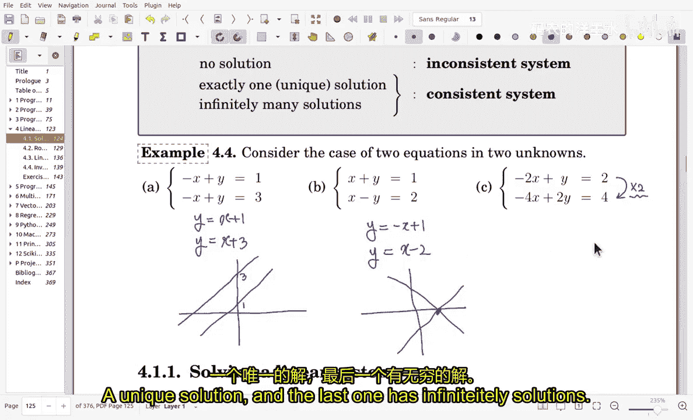

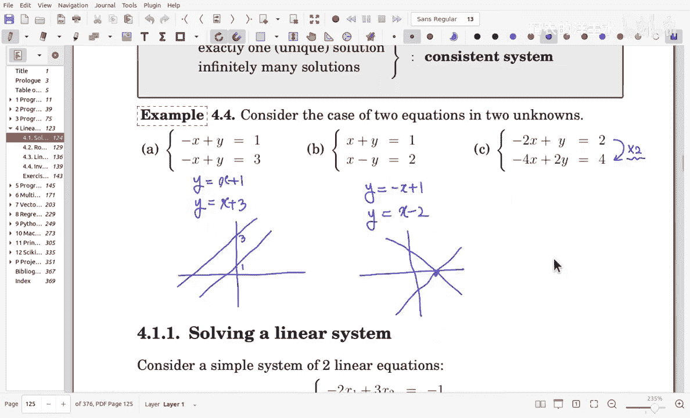

Now we'll consider how to solve a linear system。嗯。Conveniently and efficiently。

Let's begin with this a simple system of two linear questionss。Now， for this system。

Weome may try to express it in magic form。So we collect the courses。Minus 2，3，1 and 2。

 so that it becomes the coefficientsymmetric for the system。

 and then x1 x to the variables and that is a right inside side。So that is a metric form。

 metric equation。

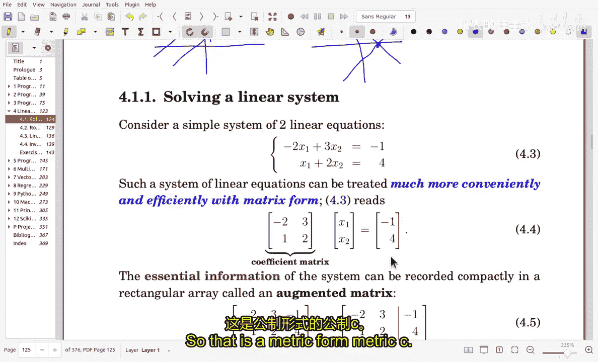

Now， from this one。We may try to get essential information of the system。

This corivesymmetric and right side。We put together to make the logogu man to the mat。

 sosymmetric and right side。To indicate it is un augmented metric。

 Sometimes we are putting vertical line or vertical t line。And either way。

 we can indicate this last columns from right side， or sometimes we move on。

The vertical line is okay。If we understand that， that's fine。Now， this one has。Essential information。

 every。Information from the system。

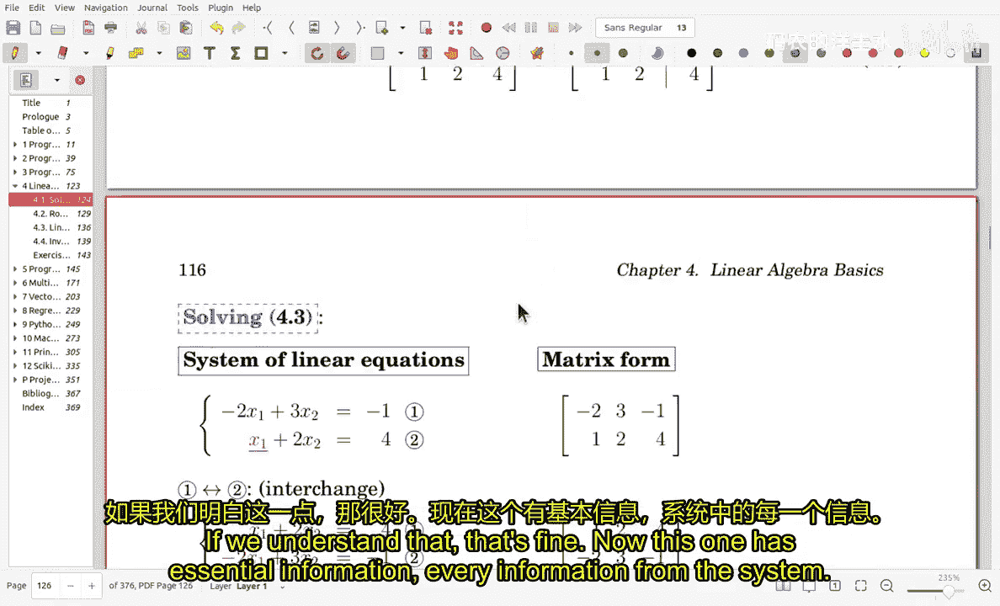

Now let's try to solve the problem。 Okay， this is the system of linear equations。Now。

 that is corresponding matrix form having essential information，-23，-1，1，2，4， we have here。Now。

 if we interchange rules。Then from here， we can get it。Now。Similarly， we try to interchange the rule。

Of the quos， the information， then we can get that one。Now， this metric is representing this system。

1，2，4， minus2，3， minus1， right？Okay。Yeah。As the beginning step of solving the problem。Now， we。

It'll try to eliminate this one。That can be done if we。They place the second row。嗯。By second row。

 plus twice of the first row。Okay， first question twice。Is added to the second patient。

Then it'll be considered。So twice editor。 So it is 0 and twice editor， it is 7 x2， twice editor。

 So you becomes 7。Ex the same name， we can apply。In the operation。 So twice editor。

 itll becomes zero， twice editor there's 7， twice editor against 7。And。You may compare。

The left hand side and right side， the right side is representing the system of vacations。Now。

 scaling。For the second location divided by 7。 Now that is corresponding in Matthew from here。

 just the overall。The second rule is divided the by 7。From here， so we can get this one。Now。

 we can eliminate this one by subtracting。Twice of this。Second question。

And then it is you know two subject to the so E comes to。Now the same operation can be applied here。

So twice the subtraction， that will become zero。 Now that become2。

So this final met form is degening this one。So here in the last step， the solution is a2 and1。

 and from this one， now this is identity metric and right side， that is the solution。Okay。

 we go back to the top。 We start with the。On o mat to the metric。So it is the augmented metric。

Of the system。And start with this one。 Now， we applied。

Elementary low positions interchant deplacement， scaling， again deplacement so that。This portion。

It's changed into the identity。 And now this extra column becomes the solution。Okay。Okay， here。

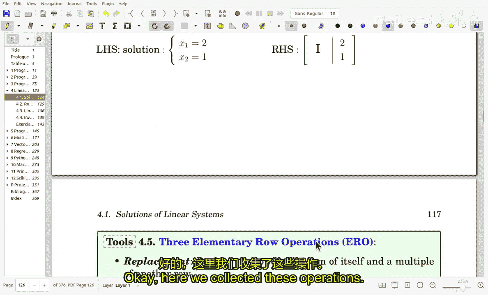

We， we collected these operations。Three elementary raw portions。The first one is a deplacement。

 de one row by the sum of e and multiple of another wrong Irow is replaced by Iron plus。

The K times of J through。That is a deplacement。 and interchange interchange is changing two wordss。

 I through and J through。And scaling。And we can multiply or rule by。N constantsant Ka。

So we can get the scaling。 We use these operations。 These are3 elementary row。

 You will use this one again， again， through。The whole scope of linear to。

And this will be the major weapon。For solving linear problems by hand。

Two matrices are row equivalent if there is a sequence of elementary raw positions that transforms one metric to the other。

 for example。

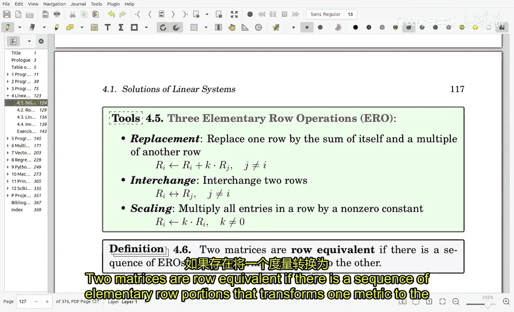

India's competition。This metric。Is real equivalent to the identity matter， because。

By using these elementary row positions， the sequence of these elementary row positions。

 will reach a。

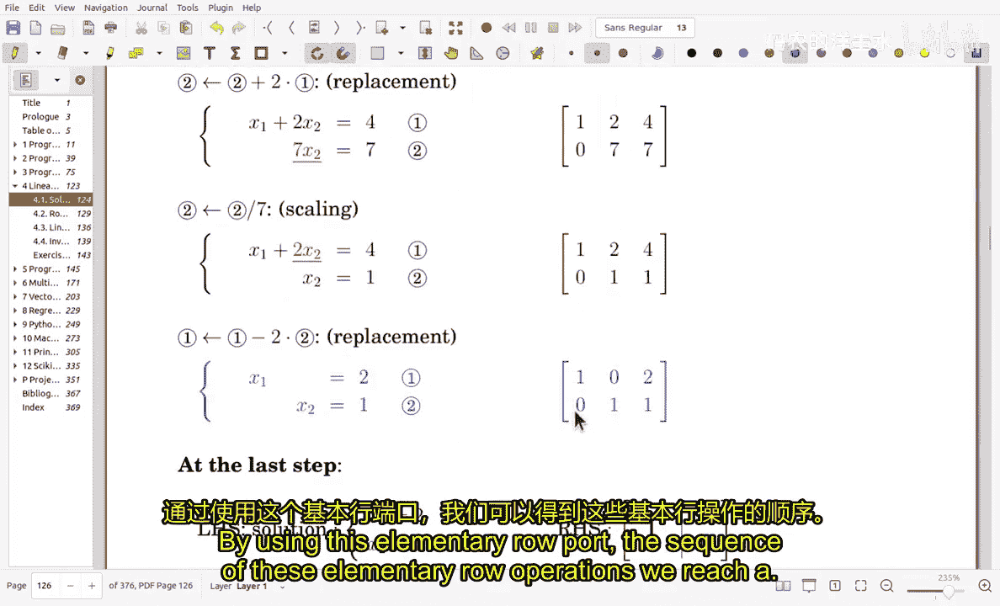

Here， the identity metric。Okay。

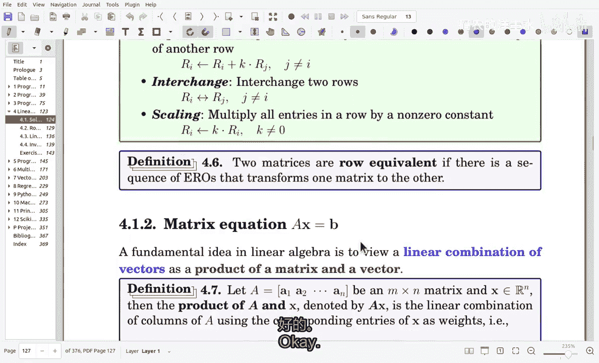

Okay， and matation， A x equals a being。A fundamental idea in linear algebra is to view。

A linear combination of vectors as a product of a metric and a vector。Okay， your a。

Is on M by N metric。And having。And columns， A1 to A N。Then。The product of a and x。

It is denoted by A X is the linear combination of collapse of a。Using the corresponding。

And to sub act as rates。Yeah， Ax。A。Iden。With。The columns， and there's x。

 Then it can be written in this way， x 1， a1。Plus， x，3，82。And then the lastomus X， N A N。So， this。

Ler combination of these victors。Oh。And also。The product of the A X once a is the collection of the vectors。

 and these are the same。So。We can view a linear combination of vectors as a product of metric and a vector。

 Of course， the metric。Is collection of the vectors。mat is of the form， A X equals B。

Where B is a co vi。

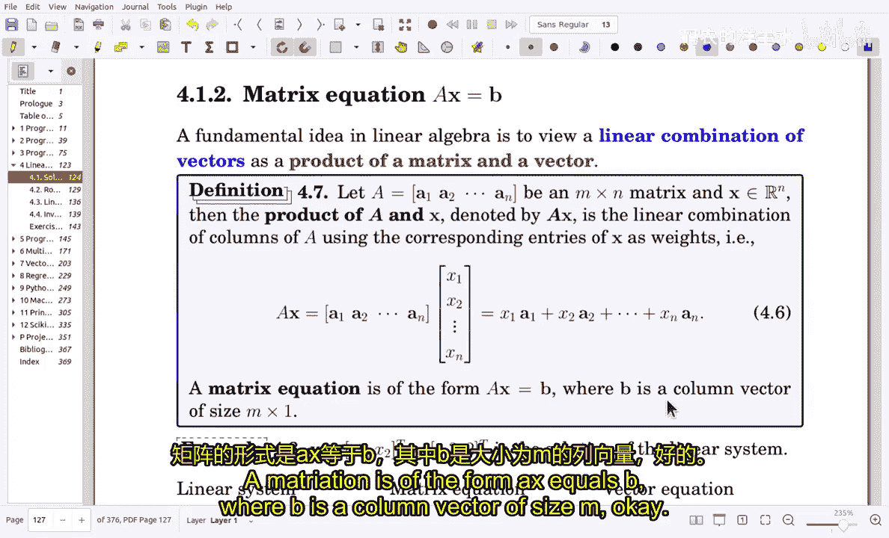

sizeize am okay。Now， for this system。Or is a metric cushion or vector cushion。

 The solution is minus3 and2。Now， once it is written in this way。

 we usually say this is the system of linear patients。Now。Thereon。

 once it is written in this metric form， then it's called a metric cushion。And once it is a written。

 along with。Colums。So vectors， then it is called vector equation。Okay， but。

No matter how it is expressed the。This original system is same as this vector vectorification。

 and also same as this。Okay， that is metric kitchen， sorry， and that is vector kitchen。

 They are the same。

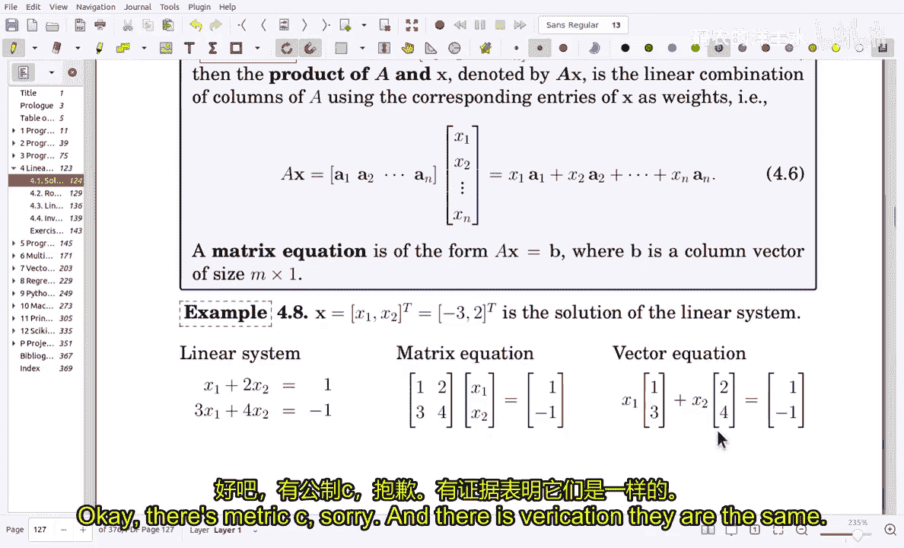

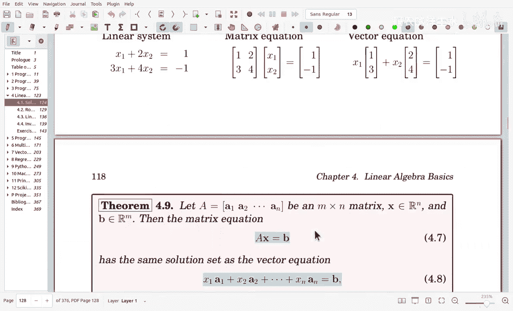

So we have Theodorem。A。Is M by N metric。With went to A N。Colums。And B is O victory Ar Ram。

 then the mattu Kian。Ass the same solution as the vector type question。

So along with the columnam of A。We can write this equation into this vector version。

And which in turn， has the same solution set。As the system with the a woman to the matter。So。

 that is。From a Metro game， and that is from right side。So， the solutions from。

Each one must be the same。

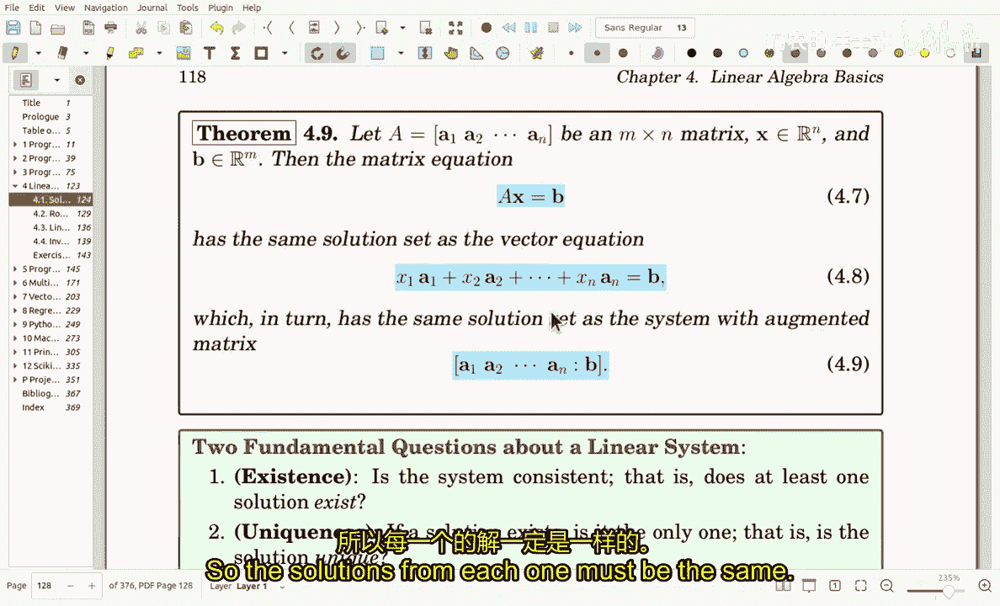

Oh。In linear algebrabra， we have two fundamental questions。And for solvinging。Linear systems。

And first of all， it's a it。AndYou may ask。Is the system consistent？

W does at list one solution exist？Such a question is about existence。And unicorness as。

Deletd with the only one solution。 So if a solution exists this， is it the only one。

That means is the solution unit， you may ask such questions。In many cases。

Once the system has no solution。Or infinite many solutions， then。

You will spend a much more hard time to get reasonable approximations。

So once the system has unique solution， then。You can solve the problem， relatively easier。So that。

Such question is very fundamental in many applications， sometimes。

Existence in unonness is not guaranteed。 Then you cannot get the solution。

So it is very crucial for some testers in linear ground。Determine。The values of age is such that。

The Cuba system is a consistent linear system。 That means that。

We try to find the H such that the system has at least one solution。

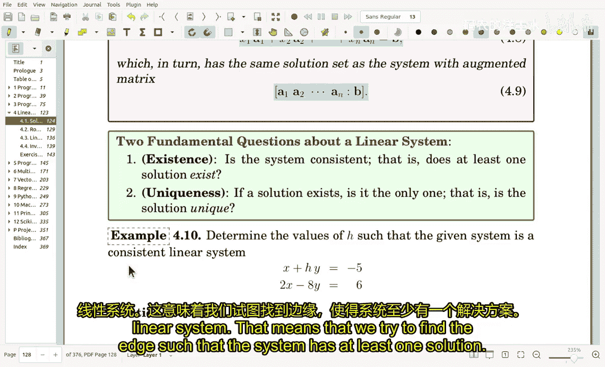

Now。We already know that for。

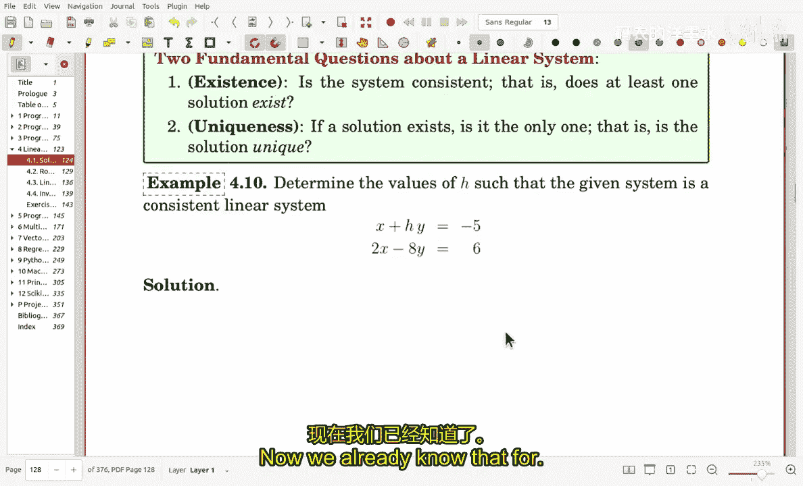

The linear system we can write in this way in metric equation or vector equation。

Or in augmented metric。

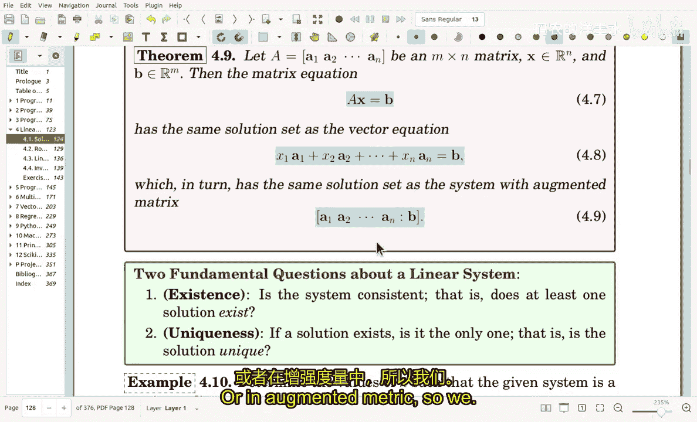

So， we'll。Try they go to the Ma。Okay， we collect here essential information。

And one questions and H and2。Minus this is from the quo metric and right inside。-5 and 6。

If it has at least one solution。Then only system system will have。The same。Solutions。Okay， from here。

Okay， let's try to apply elementary rule portions。 Okay。

 eliminate this one by subtracting twice of the first row。1 H minus-5。And that is you wrong。

And that is a minus8 and minus 2 h。Twice subjecttracted。This one will be 16， right。Okay。Now here。

Okay， if this is a son， for example， there is a son， then means that there is a0 x plus a 0 y equal。

16。Left hand side is as you know， and right side is a 60 is impossible。If it is a non zero。

Then we can scale， and we can get the solution。 So here the requirement is。-8 minus2 H must not be 0。

 right， That's the requirement。Then。F。H。Which has satfi this occasion。

And here we can scale and we can decide y value。 And again， here， by eliminating this one。

 we can get here x value。So， H is any value。

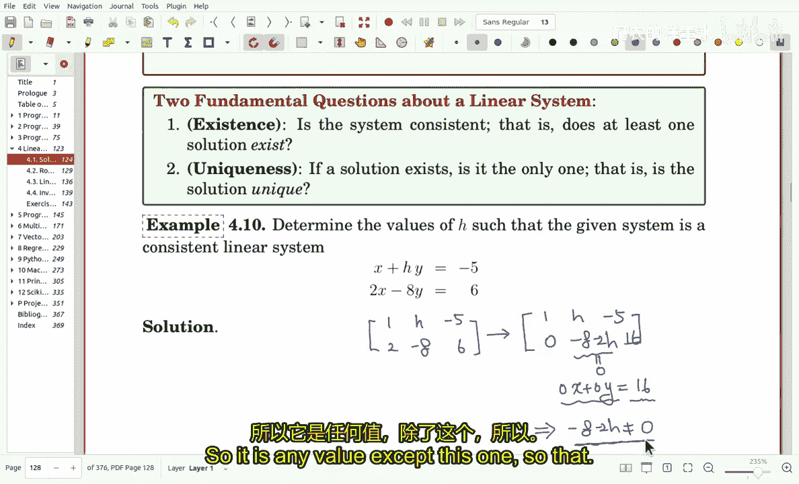

Except this one so that。That is HS now， not minus-4。Okay， so H is that -4。 Then it has solution。

 but the solution is unique。

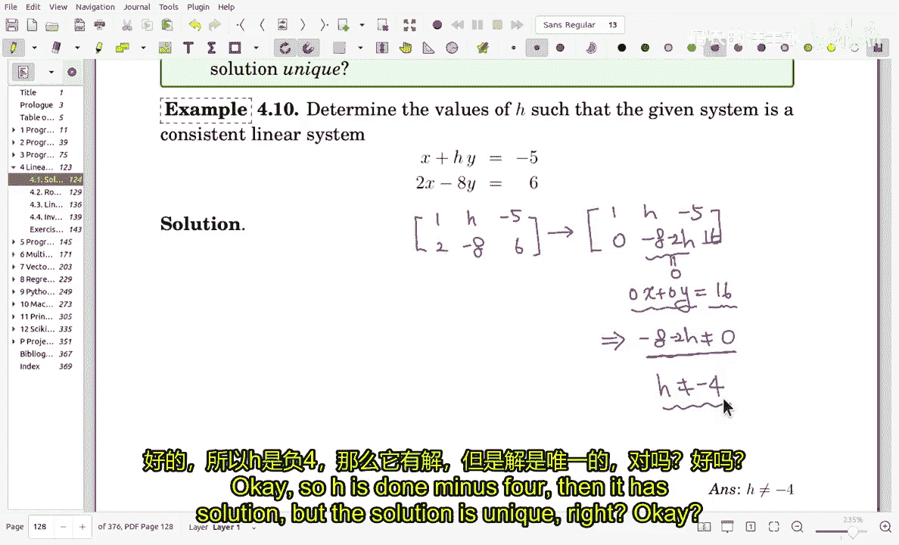

Right。Okay， that's the end of section 4。1， thank you。

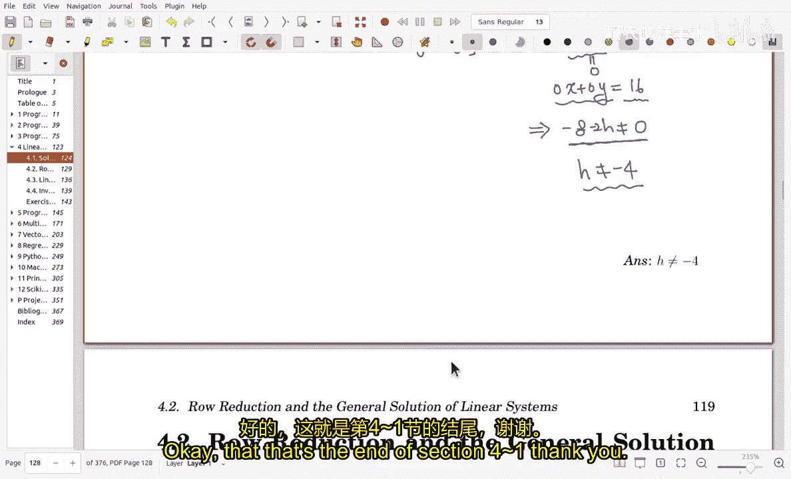