# 【全集-附课程讲义】密歇根大学-人工智能编程-EECS492-中英字幕-p29-Lecture-29---梯级形式与行缩减算法--BV14JqfBNEAS_p29-

It is a section 4。2 rule reduction and the general solution of linear systems。And the last section。

 section 4。1。We studied three elementary row portions。In this example， we'll try to find a solution。

Of the Cuba system using the three elementary raw portions。Okay， here we may begin with。

The augment matrix。 So let's try to。Collect the equations，0 1-2，01-2。And1 minus-2 and 2。

4 minus-8 and 6。And the right side， 0，3。14。😔，This has the or to the matrix。Okay， this values is zero。

 so we may interchange first and the second rules。1。-22 and for the。Okay， and here，01 minus-2 and 0。

And now， for this last one。Okay， let's try to subtract four times of this row from here。

 then there will be00 four times subtraction minus2， four times subtraction that is 2。那。Okay。

 this last row can be scaled， okay， we。Right down here， divide the by。-2， so that that can be 0，0，1。

Minus1， right？Okay， so rather than this one， we may consider this wrong。Okay。Now here。呃。

This is the leading one， another leading one， another leading one。

So here we have to eliminate in this。These two values。 and also these values。

 Let's try to eliminate these two values first。Okay。That is， okay， twice subtraction。There one。

-2 and 0， twice subtract。That becomes a5。And a twice addition， 0，1，0 and twice addition minus2。

And here， the last row is 0，0，1， minus-1。Now。Using this one， we can eliminate that。

Value twice edition。Then here。There's 1，0，0， twice at。 so it is one。Now，0，1，0-2，0，0，1，-1。

So it becomes the identity metric and so that this one is the solution。1-2 -1。

It is the unique solution。So the system is consistent。Right。

The system of linear questionss can be solved by transforming。

The augmented metric to the reduced raw aron form。That is the reduced raw form will define the term very soon。

In Mat lab。We have a function RREF。For the religious the raw form。Here a is defined。

The same a this portion and B is now this right side and we've got augmentmetric metric A B and。

We try to find the reduced raw aional form。 Now the result is given in this range。

 so we can find the solution， the last column。Okay。

Here we define ast forms and consider the raw detection algorithm。

A rectangular matter is in an a form。If it has following。Propers。Okay， all。

 all non zero are the above any zerolons。A row hair non0。 Then there must be of any zero rules。

 That means that roots of all zeros should go down。By using interchange， you can do it。

The 리딩앤 트레 오케이 난시로。R is given that490 from left and side is called the leading entry。

 Each reading entry in a row is in a column to the right of leading entry of the row above here。

 which means that。Here， leading accuracyacy is now down and right direction。So okay。

 let's try to make a figure here or a metric is given and then we can apply。

Eleementary row poison so that we can make later here。The shas cabin in this way。Like that。

Here there is a reading entry， reading entry and reading entry。

 zero rows will be on the bottom like that and below leading entry is a0。

 so the below the leading entry column is a0 words。So once it is made in this form。

 then it is called an astron form。Baacheron。By definition is a shape of leather。

And one side is narrow and gradually。呃。Becomes wider。Like here， so that。Here， and。

 and this is shared as national form。Okay。Now， if two extra condition here are satisfied。

 then it is called rule reduce the etroent form or simply reduce the etroron form。

You the leading entry。Leading N지 and。In each Nnjiluru is one， so that by scaling。If you make。

 you can make this leading actually become one and again。

The leading one is the only non0 entry in this column。

 So after changing this leading one and below and above。Every other entry must be 0。

 Then these two two extra conditions are satisfied， then。

An national form becomes the radio station form。Let's see here a jump。And this。Okay， example 4。 to13。

 okay here。Now this is a leading entry by leading one。Beating at three， there's one。

And so it has an e form。 and0 is on the bottom。 This enal form。 Also。

 the leading address is  one is a satisfying the condition 4。 How about condition 5。

This leading one is only。The 난지로 엔트리。In its column。

 so that here we have zeros and zeros so that these extra two conditions are satisfied so that it is a。

The register elon form， okay。Now， how about this one that is a leading entry？Leading it， leading it。

 Okay， so it is not in an actual form。 If you interchange these two roots， then。

It is seen on aron form。How about this one is says a leading at， leading actually。

 they are ones and except this leading ones and the columns here are the values are 0。

 So it is a registeral asron form。Okay。Let's see this one is a leading entry。Leading entity。 Okay。

 leading entity is down and white。So it is in an national form。However。

The leading entry is not one here。And also。These are not zeros， so that。I's not in。

Not the deucation form， but is in an national form。Okay， so that is esrow form。Okay。Now here。

 leading a tree， leading a tree， leading a tree。So youで。In an as form， however。Now。

 these are non zeros。 so there is not。Reduce the astroron form is only etrolon form。Okay。

How about this one is leading entry， leading entry， leading entry。 So it's not in。On external form。

Okay， however， if you interchange this tool。Then。It is on achelon form。

But not yet video station form。

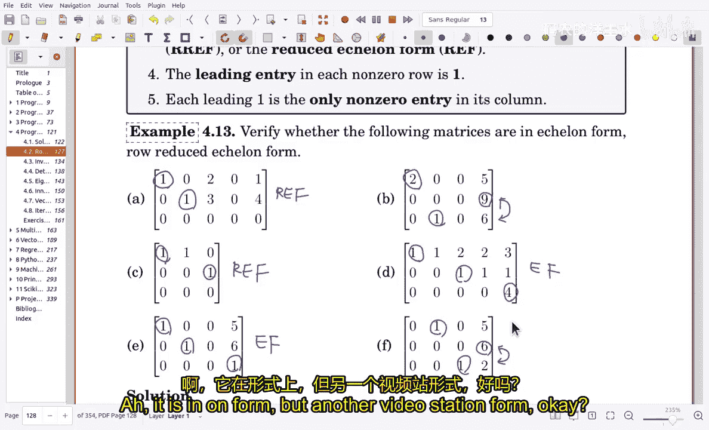

A pivot position is a location in the metric A。 So you have to find the location in a in the metric。

Okay， that corresponds to the leading one in the reduced the aron form of a。Okay。

 let's see this example for this Cuba matrix。We have reduced a form。Yeah， leading on。Leading one。

 again， leading one， okay。Now， so。Here， the position in a corresponding position is called a pivot position。

 So here this one。And that one。There are pivot positions。A pivot column。

Is a column of a that contains a pivot position so that if we call a1， a2， a3， A4， a5， then a1。

 so that for this example， pivot columns are A1 and a3 and here a5 right。

3 columns are PV columns for this one。

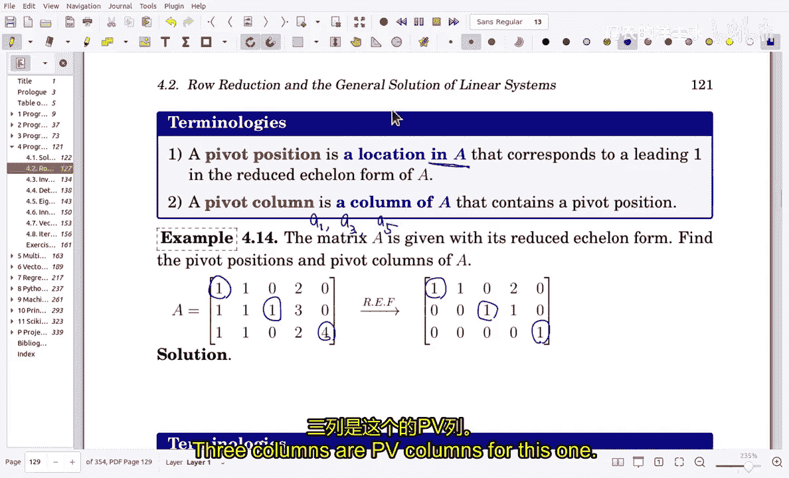

那嗯。Here， these two are called non period columns。Okay。We continue the terminologies。

The basic variables in the system， AS equals B。The variables that correspond to pivot columns in the augmented metric。

Are basics。 So once we try use this metric， for example， and we try to solve A X equal to B。

 then an actual。Eleementary road we can reach share this soon。 and here some in vector。Okay。

 here we found here we can see and。First column， further column， fifth columns are P columns。

 so that。Here， x1。So corresponding variables are just x1 from here and x of 3 and x of 5。

 these 3 are basic variables。And now non basic variables， which is called fully variables。

 so x2 and x4 are fully variables， well see why it is called why they are called fully variables。

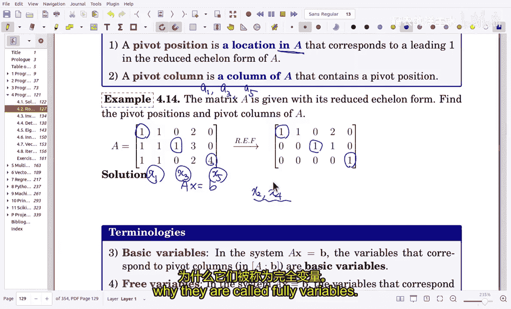

Here in the system， A X equals B， the variables that correspond to nonp columns， are fully variables。

 That means that once it's not a basic variable， then it is a fully variable， okay。

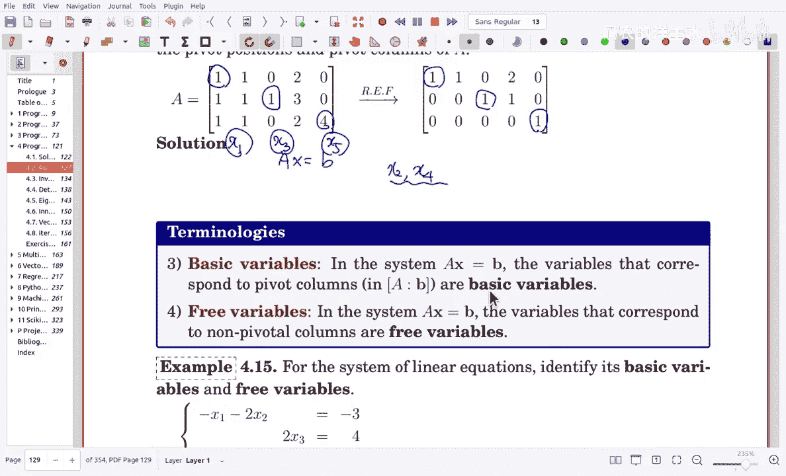

Okay， let's see this example。For the system of linear equations。

 identify as basic variables and free variables。So here that is we have to work on the romantic the metric and try to find the pivot positions。

And then the corresponding variables are based variables， and others are free variables。 Okay。

 so let's begin with。The augment Mad， okay for the system。So-1，-2， and a third one is 0。

 and for the metric， 0，02。And s， zeroフり。This。The cor sense。

 And this whole thing is the cor sense metric。 and right inside minor 3，4， and 6。Okay， that's the。

Orga， okay。Now here we apply scaling divide by 2， divide by 3， then also we multiply minus1。

 then there is 1，2，0 and 3， this is 0，0，1，20，0， again1，2 okay。So that here。

We can eliminate the par wall real idea 1，2，0，3，0，0，1，2，0，0，0，0， okay。能。Okay。

 so here we found here this is in this video station form of a， this is leading one。

 and this is leading one。So that we already know that basic variables are x1 and now x3。

The corresponding variables to the period columns and fully variable there is x of okay， x2。 Okay。

 here we have x 2。It so fully variable。

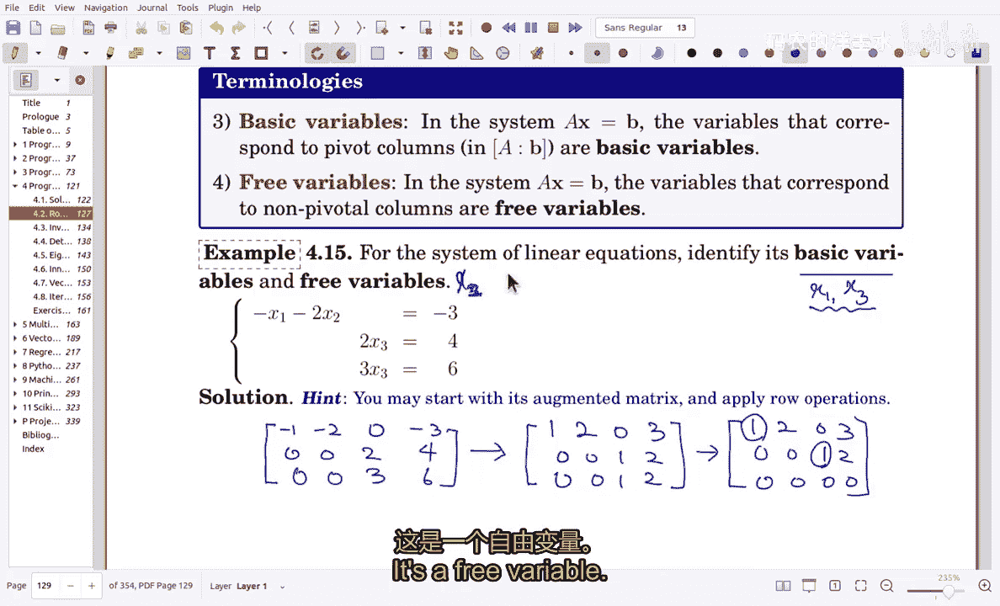

Let's see why it is called a free， okay。The system here is the same as this one。

 The first rule is same as x 1 plus 2， x 2。Equal 3， and that is x 3 equal to the second one。

That is same as3 is tool。那。From this one， let's try to find the the solution。

 but we have to find the values for x1， x 2， x 3。All of the variables， for all of the variables。

 you have to find it。The Vans。That would become。Soution， okay， so now。

To solve the these for x1 and x to x3。We keep。Basic variabless left and side。

 everything else to the right side。Okay， so x1。Equ 3 minus-2 x2。Now。

 also we have to find value for x2。 So we write down here， but there's no equation for that one。

 So we may write down x2 is x2。Its always true。 So it's okay。 now， how about X 3。That is now true。

Then。For this vector， x 1， x， x 3，3， we can write this right side in this ring。 There is a 3，0。

2 or vector。Plus， x 2。And minus21 and0， the optionss are minus21， and that is same as 0 x 2， right。

 so we can write in this area okay。So here。For the solution， x1， x2， x3。 now。

 this vector plus x2 times minus-21 and0。In this solution。X2 can be chosenn arbitarily。

 You can choose x2 freely。And for any choice of X 2。This result， the result， will become a solution。

So thats vision x2 is called free variable because you can choose freely。嗯。Now。

 here is the raw reduction algorithm。And I'll try to explain the algorithm through this example。

Rll reduce the metric into the reduce the aron form A is given here。Now。That。This variables is it。

 So we apply interchange， Okay， along with the further wrong。So it is warm。

 so it is easy to a handle later on。So after interchange， we have that one now。This is pivot。

And we have to eliminate the below the period。So multiply2 for the first row and add to second row test flow operation to make a0。

Then this position becomes a five。And we done for this period。

And now we move our attention to this value。And now to make it handle each year， we divide by 5。

 So we have here and3 times can be added to make。This portion below the leading athlete。

So here we make this one sit。Now we will share this metric so that this becomes a period。Now。

 divide buy the by。-5， we have this one。So that these are pivot positions and all values are one。

Here。Now， to which at of this form， we have eliminate over of the reading ones。

 so these two values and this value。We start with。This one so first。-9 and 30 will be eliminated。

By adding nine times of this one and by adding 30 times this was wrong。Okay， then we chat that one。

Now we can eliminate that one。So， here。嗯。Four times of this raw will be subtracted。

From the first row。And we can make this one sit down。 So we reach at this reduced form。Here。

 leading ones。On on the columns。Except leading ones。Every other values are0。 Okay， so it is。

The reduced as form。Now， when we try to eliminate these two values and there on， okay。

 we can eliminate。Okay， here， this one and that one。If you try to eliminate this on first。

Then after elimination of that on。If you try to eliminate this one， then。Ohow。

It's okay for this shade。And at the elimination of that one。

Now you can do it again here and you can eliminate this one however。In this case。

 I'd be more expensive once you eliminate this position， then itll become zero so that later on。

 when you eliminate this value， you don't have to worry about this position。

So usually elimination of the values over the period value is back of the way is happening。喂。Okay。

Okay。Now， let's hear the combination of our operations in line。F， there's F and F。

Its the full phase of raw deduction。So first， we try to using this period。

 We try to eliminate this one。And now bying this period， we try eliminate this one。

And then here that we reach share this as form。So。Through this food phase。

And now town and right direction， town and right direction， we try to eliminate。

And we reach share this one。 That is eron form。This phase is called the folder phase。 And from here。

 we try to eliminate above the。Leing one。And we eliminate here and the bag of the way。

 eliminate this one。 And then now eliminate this one so that in bag of the way。

 we try to eliminate the values。 So this。The combination is called the backward word phase。Okay。

 so through forward， we reach chat as form and through back with the phase， we can reach chat。

The reduced as form。

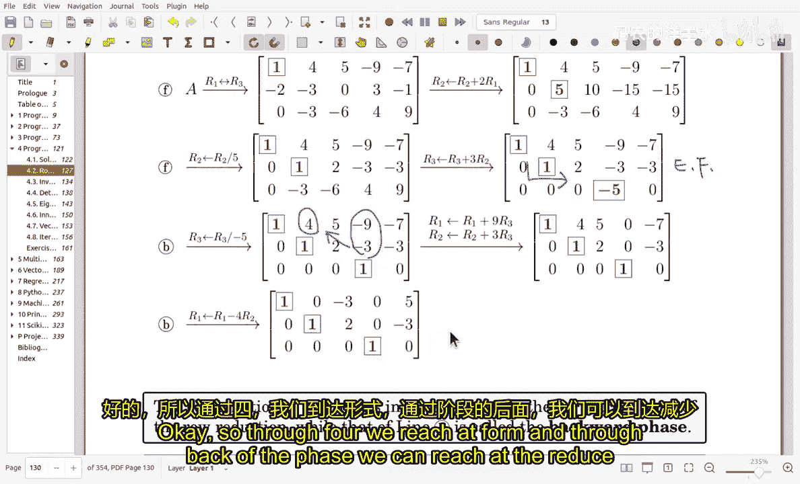

Okay。Piot positions， once the matter is in on national form。

F rule operations do not change the positions of the leading ans。

 Thus the leading aners become the leading ones and reduce the eron form。Okay。

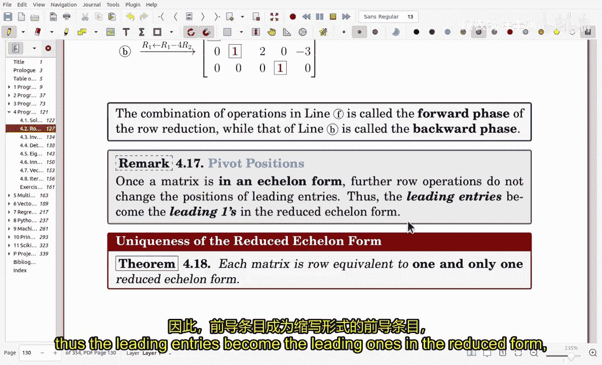

In。Definition。Here， period position is the location in a that correspond to the leading one in the video station form of a。

So pivot position is decided by the leading one in the lead form。

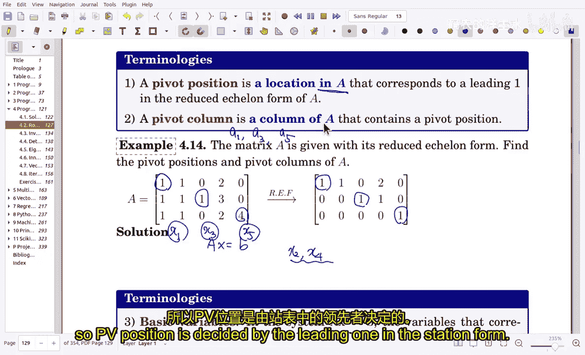

However， in reality， once you reach a。On actual form than this leading entries。

Its not changing the position。On in the further operations， Okay。

 this leading to this are changed into here leading ones。 and it becomes the。

Lead is the national form。 however， the positions not changing them。

So that once you reach a rational form。Then here you can decide。P positions。Of course。

 pposition is in the metric。And also P columns are in this case， one，2 fourth。The columns。

 these are period columns， not in this astroron form。

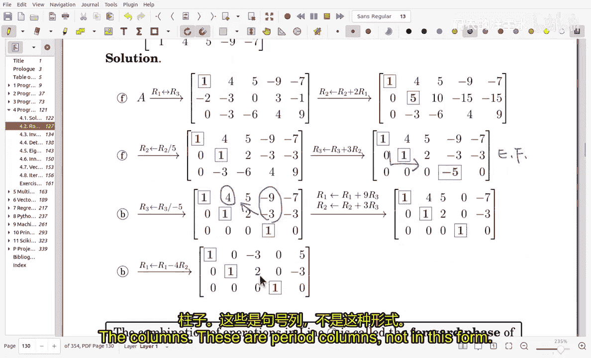

Here。Each metric is row equivalent to when an only one reduce the aron form this image there。

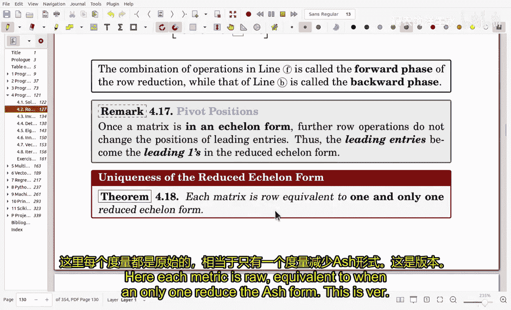

And here for this gimetric， this is an actual form。Also。After scaling， this is also an eron form。

Okay this one is an astroron foam。They are not at video form， however。These are astroron forms。

 so astroron forms are not unit。So you can have various as forms， if you want。

 you can get infinitely many ast forms for a given metric， however。If you try to get。

Reduce the eron form， then。Reist the as forms are unique。

 You can have only one in one and reduce the。Oh。Aal reform。

So that when an only one leads to the actual form e justs for K matrix。

 So this is the unique due to the actual form of the K matrix A。

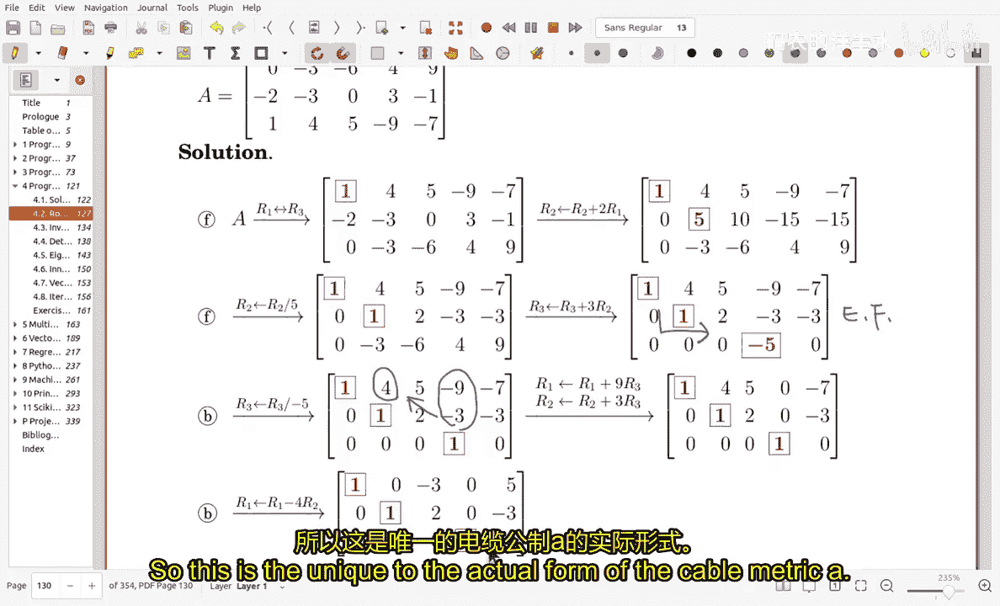

Okay。

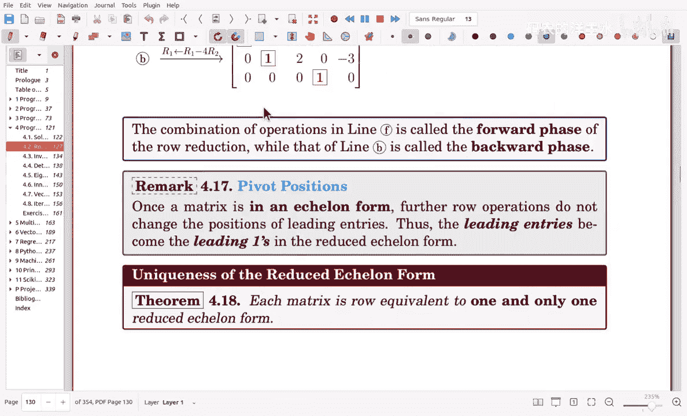

Okay， we'll continue in the second part。 Thank you。

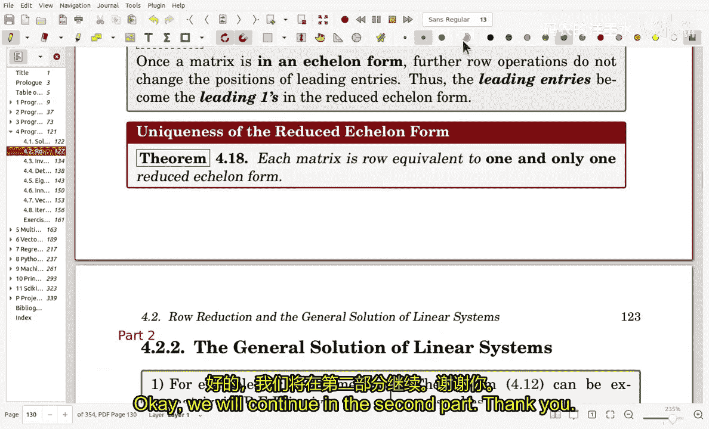