# 【全集-附课程讲义】密歇根大学-人工智能编程-EECS492-中英字幕-p30-Lecture-30---线性方程组的通解：基础变量和自由变量--BV14JqfBNEAS_p30-

It is part2 of section  4。2。The general solution of linear systems。In the first part。

 we studied the concept of pivots。Pivt pots and pivot columns。

Then we introduce the basic variables and free variables。Ass a review of the first part。

Here will begin with this example。

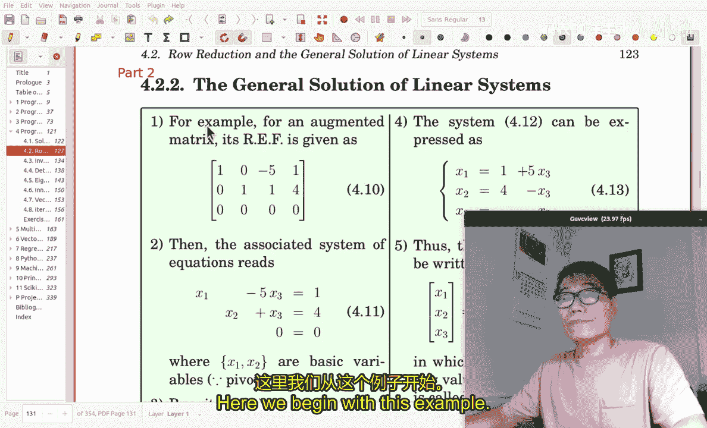

For on a romantic metric is reducedation form is given as in this metric。Then。The associated。

 the system of equations can be leading。In this situation。Here x1。Minus x 48， so that。想 know。

This is related to x1， there's x2 and X of 38。And x1。Minus 5 x3 equals 1。And x 2 plus x 3 equals 4。

and then the last one is 0 equals0。Here。1。And this one， leading ones。And。

They decide the p positionss and pivot columns。So， eventually。Basic variables， Yeah， X 1。

 x2 are basic variables。

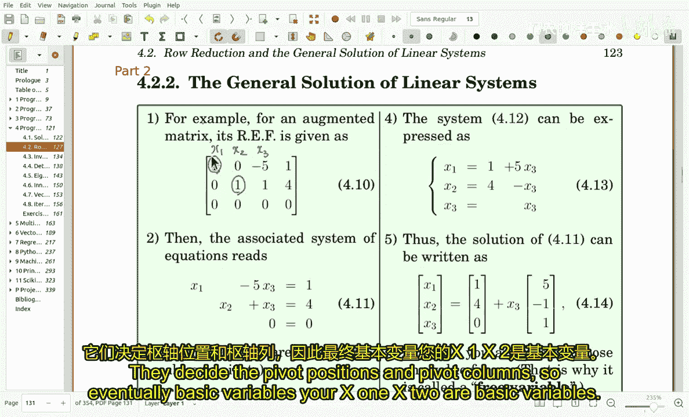

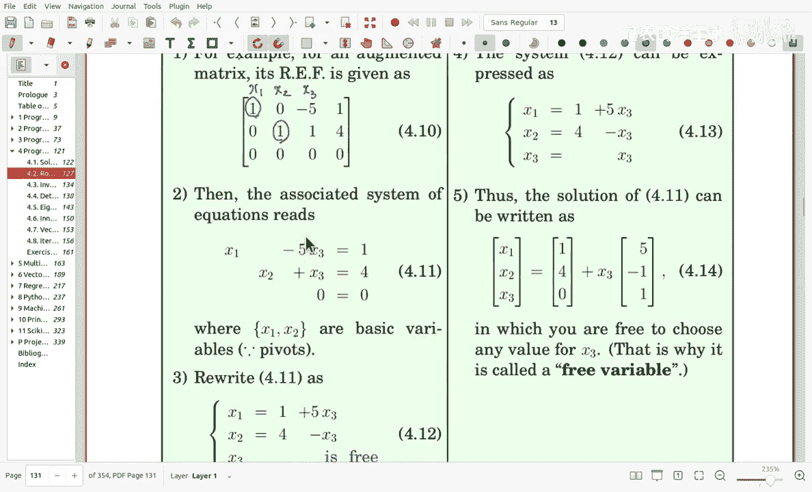

Okay。And so here。We move everything except basic variable。

We keep basically the left hand side and everything else to the right side。

Then here x1 is 1 plus 5 x3 from second1， x2 is4 minus x3。Now， x3 is a free variable。Now。

 rather than x 3 is3， we can write in this way， x3 is x3。So it is always true。

 so we can add this line。Rather than saying X is free to listen， we are doing this way is that。

When you try to say a solution of the givenn system。

 then you have to find all values for all variables， x1， x2， x3。So we added one line here。X line。

 x 3 equals x 3。Then from this one， now x1 x to x 3 is this constant vector，1，4，0 and4 x3。Yeah。

 the vector is5， minus1 and one， so we reach at。嗯。This solution。So for arbitrary choice of exp。

The search will be a solution。So， you can choose X3。Freely。

 so there's a vision we call it free variable。

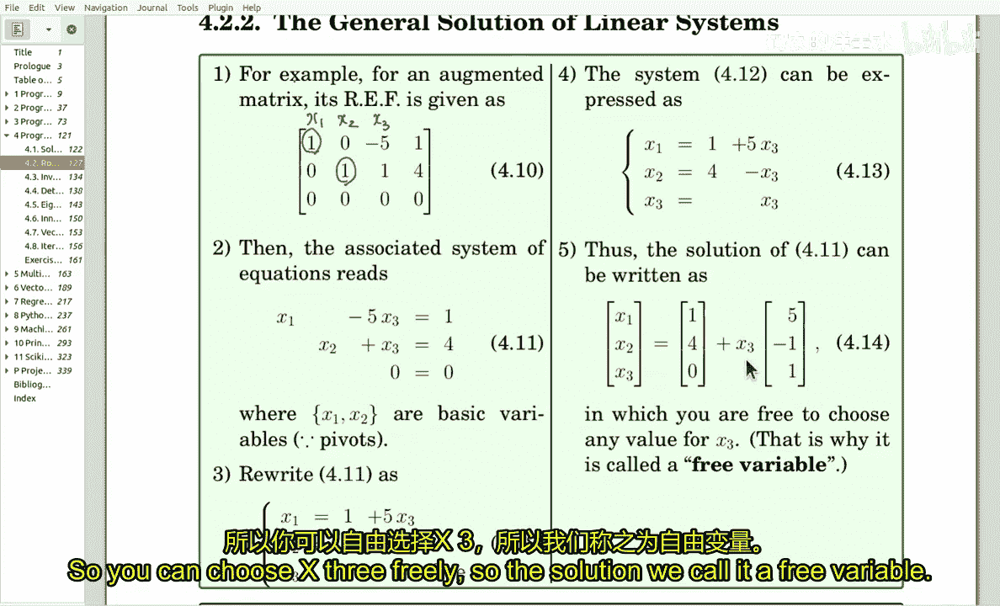

Okay， here， the description in this equation is called a parametric description of the solution set。

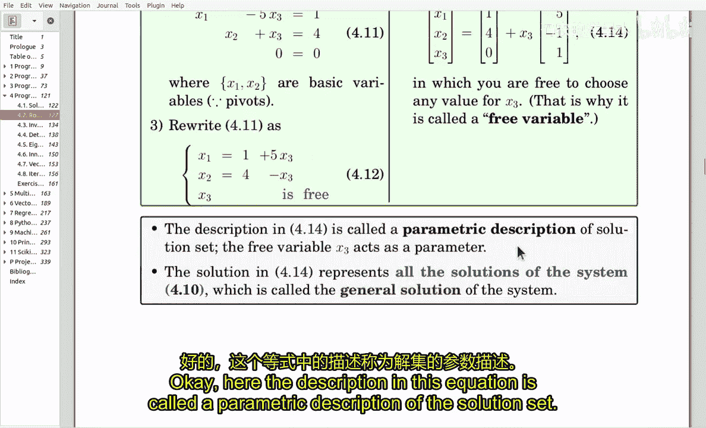

And the fully variable x3 x as a parameter， you can choose it arbitrarily， so it is like a parameter。

The solution in the equation they present all the solutions of the system。

These are all the solutions。So we call it the general solution of the system。

So this is the general solution of the k system。

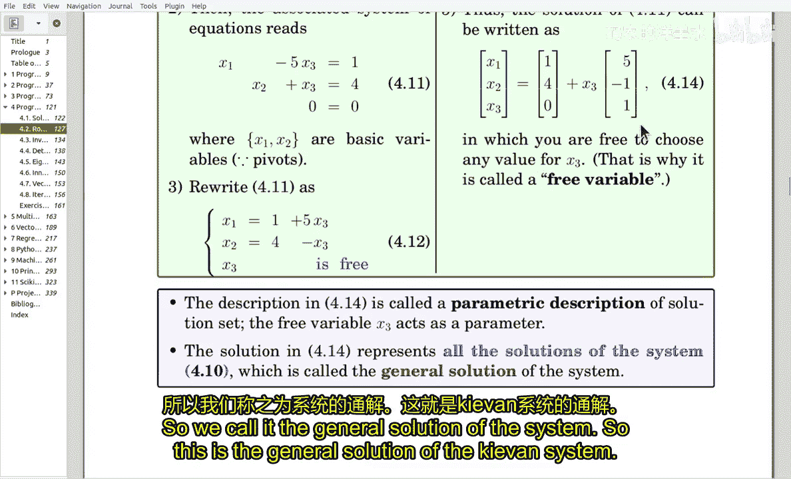

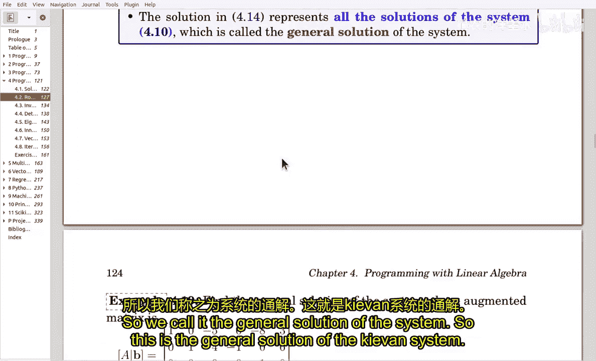

Find the general solution of the system whose augmented metric is given in this real。

So that means that we have to find all the solutions。And here， from this augment metric。

 we have to reach to。The reduced a form now this is a leading one。And leading one。And here。

 leading one。But it's not in a form。Once it is eliminated， then it will become aure form。

But it's a simple， just eight times editor。 Then that one will be。Eliminate each other， right。Okay。

 nothing else is changed there。 So it becomes the reducedal form now。

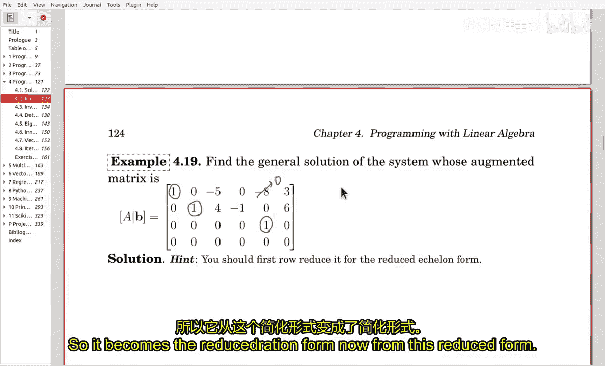

From the S a distribution form。The algebra equations can be written in this way now here。

This so that anyway basic the which are x1。X2，3，4，5， x5。These are basic variables， and of course。

 here x3 and x4 are3 variables。Anyway， we write down eions here， x1。Minus5 x of for D。Eals 3。

 now x1 O X2， the second row， x 2。Plus。4 x of3 minus x4。Equals 6， and further all。Is saying x of 5。

Equals 0， O， from this one。Now， we can。Basic variables from the left hand side and everything else to the right side。

 Okay， so here from the first one， x1 equal 3。Mus5 x of for a。Now from second one， x2 equal。six。

-4 x of 3 and plus x 4。Now， x for a。It's a free variable。 And again， x four years of free variable。

 and last one， x of 5。There's a Pacific， which is zero。Now， for these3 variables。

 we write down x of3 is x3 x4 is x of 4 right？Okay。For。To make it。

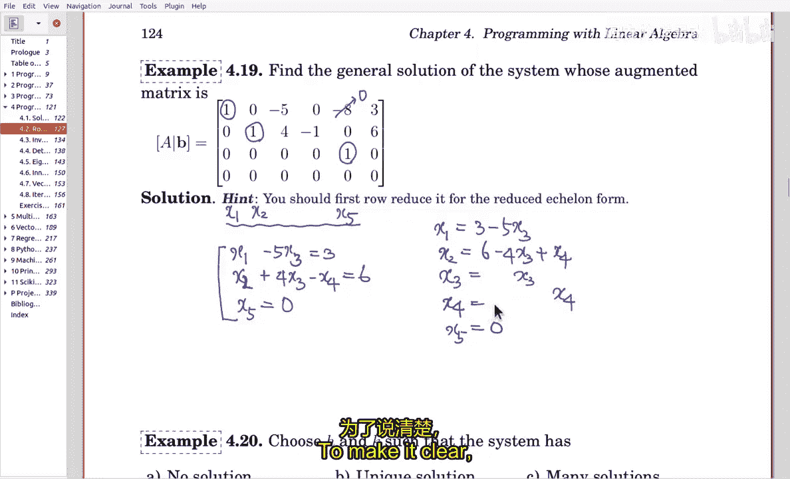

Cler， we。Try to。Fill out here the empty positions with the 0。 Okay， that is 0。

 that is 0 and 00 and 0， right。Okay， so from this one here x， which is x1 to x5。

That is the same as a cause the vi。46。ああ、し白白。And along with free variable x3。The direction is， now。

Okay， then must be。Plus， right， so it is a5。Now，-4。And this is one。 And then z， z all。

And we have one more。Ful variable plus x 4。And then the direction is 0，1，0，1。0。Right。So。For。

The system here， you can choose x 3 and x 4 arbitrarily。 And these are all the solutions so that。

This is the general solution of the Cuban system。

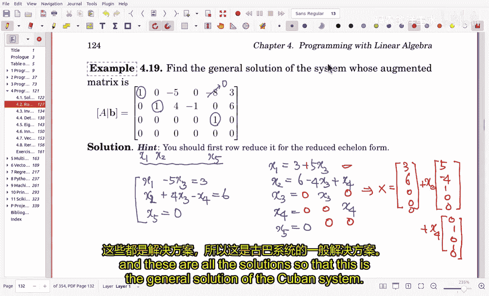

Choose H and K such that the system that given here。Has no solution， unique solution。

And many solutions。 Okay， now for。This one so that we may start with。Its augmented metric。1。

 minus 3 and1。And this is quoed in this right side。2。H and K。So we try to eliminate this one。

Go it one。Minus 3 and one。And twice subtraction x you， twice a subtraction。

That is H plus 6 and twice subtraction。 that is K。-2。Okay。So it is on a form now。

We consider case by case a， no solution。No solution is happening when this is zero， this is Nan zero。

So h plus 6 equals 0 and k minus-2 is90。Then0 is non0。Which is impossible。 So there is no solution。

And part be。Unic solar项。Now行。

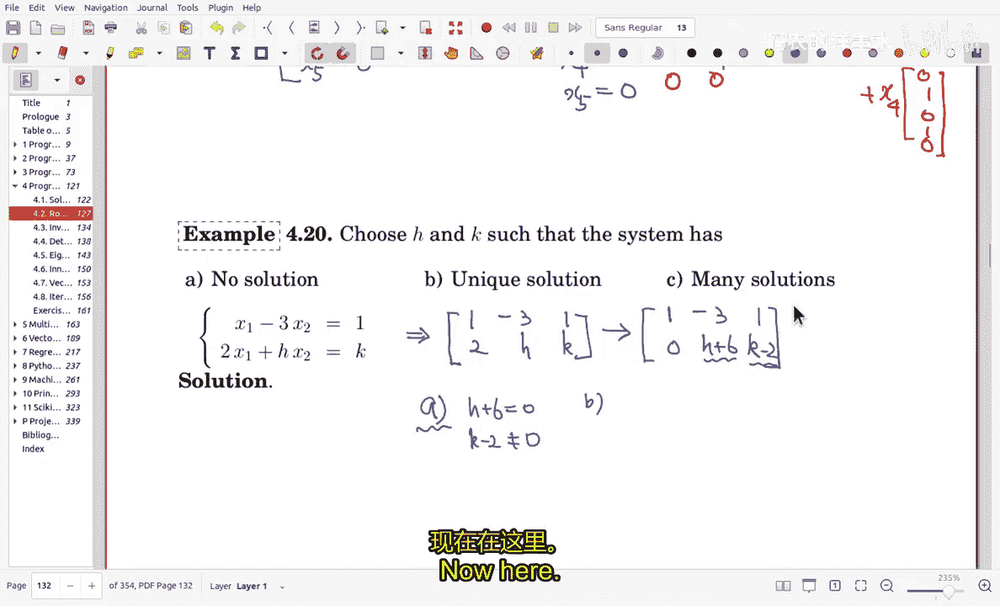

Look at this one。 If there is no free variable， then the solution will be unique。So， that。Unicors。

The solution is related to no fully variable， every variable。Is a basic variable， than the solution。

Must be unique。

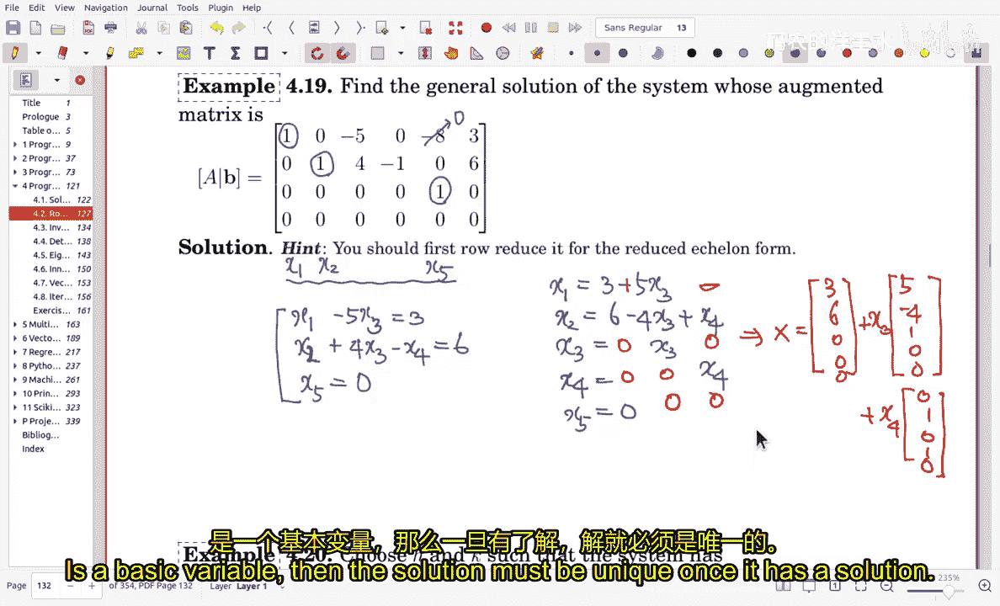

Once it has a solution， okay？So for that one， and unique solution means no fully variable。

 so this must be a pivot position， which means that H plus 6 must not be0。

Now how about many solutions。For this one。And。You have to have。嗯。One。

 at least least one free variable， which means that H plus6。Must be zero。 but if it is a non zero。

 then you don't have a solution。 So simultaneously here K -2 must be zero。So that these two。

 are the quo for manual solutions。Okay。Okay。Yeah。They'll find the general solution of the system of which。

The augmented metric is given in this metric。Okay， for this problem。

 let's try to use computer program。We define the augment method here， and then we use the function。

Part EF。For the augment to the matrix。Then the answer result is given in this thread。That is now。

Leading one， leading one， leading one。So， x1。X2 x 3 are basic variables， and x 4 is fully variable。

 okay。Here， from this one， now， x1 equals now7。And minus x47， minus x4 and x2 from the second row。

 and that is minus10， the constant and left hand side is minus 3 x4 on the right side。

 it becomes 3 x4。Now， third row x3 equals 3 minus here， x4。 now x4 is a free variable。

 so we can write down x4 is x4。Then from this one x， this whole collection is X and。The constant。

Viy is seven。And-10 and 3。Pチ。And then。Here we have for x4。The free variable， the direction is -1。

3 minus-1。Okay，-1，48，-1 and1。So， this make the。All the solutions。 So it is the general solution。

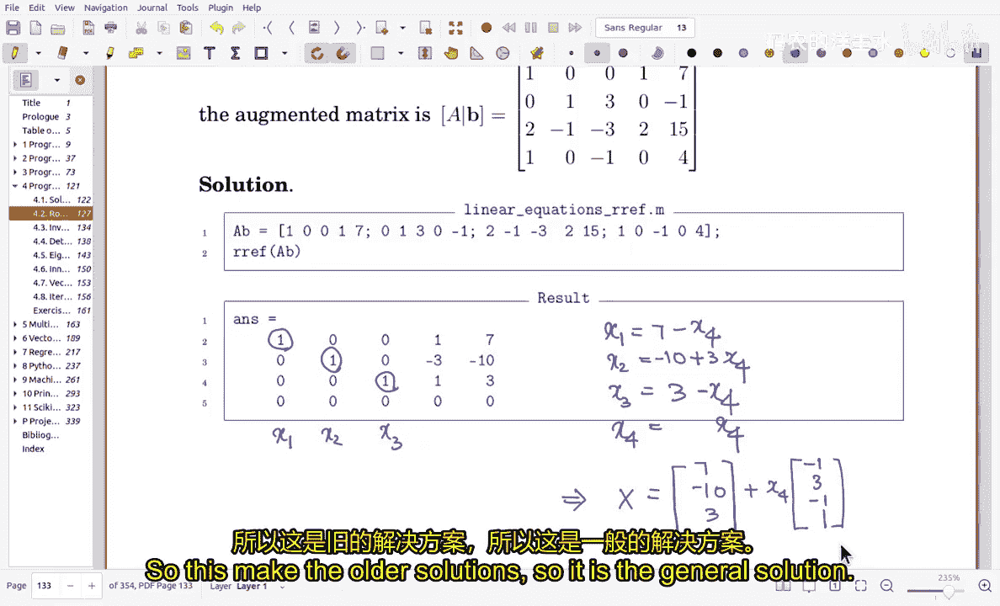

Now we have true or false problem。The rule reduction algorithm applies to all to the augmentmet the matrix for a linear system is true。

The road detection algorithm can be applied to any matrix。 It doesn't have to be augmented matrix。

So that。Is forest。Okay。If one raw in an actual form。On augment to the matter is given here。

Then the associated to the linear system is inconsistent， which means has no solution。Okay。

But this role means that。1，2，3，4，5。 Your x are 5 equals 0。This line means x 5 is0。

 but it doesn't mean that has no solution。Once these numbers are changed， for example。

 2 and 0 changed then and 0 equals 2。Which is impossible。That means that is no soda shown。But for。

The current rule。あ、一た面うんうん。It's not necessarily。For the system。To别啊。Inconsistent。

 you may have a solution， depending on other role。Here， the consistency may be decided。 However。

 this law is does saying that it is no solution。 Okay， so it is a false。

The pivot positions in a metric depend on whether or not raw interchanges are used in the rule reduction process。

Okay， this statement is also false。Yeah。Now。And pivot positions are independent from the use of raw interchanges。

嗯。Even though you don't use any raw interchange， you can decide people projections once you reach at on excellent form。

 then you can decide people projections。In this deduction process。

And you don't have to use a raw interchan if。It's not necessarily， right？

The given statement is wrong。Reducing a metric to an actual form is called the for phase of the raw detection process。

Is it true？Yeah， it is true。And here in。

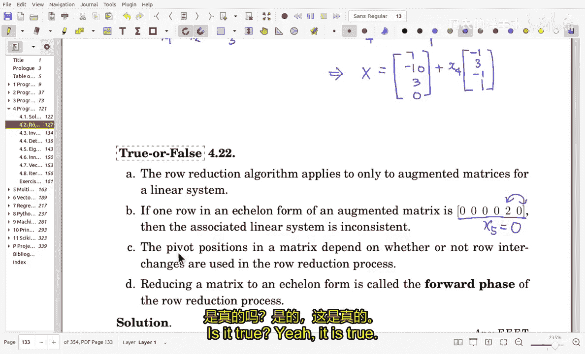

Theロデで잖아요。 algorithmル on。Here， okay， let's see here。 And from a。No。

We apply element to role positions and which add on external form。These combinations of operation。

Is the forwarder interface。 And here after that， an elimination of。

The other entries of on the column of leading ones。It's called a backward one。

 because it's usually in。And they would order this。Nanu and are Eliliator。

 so it is called the big word phase。

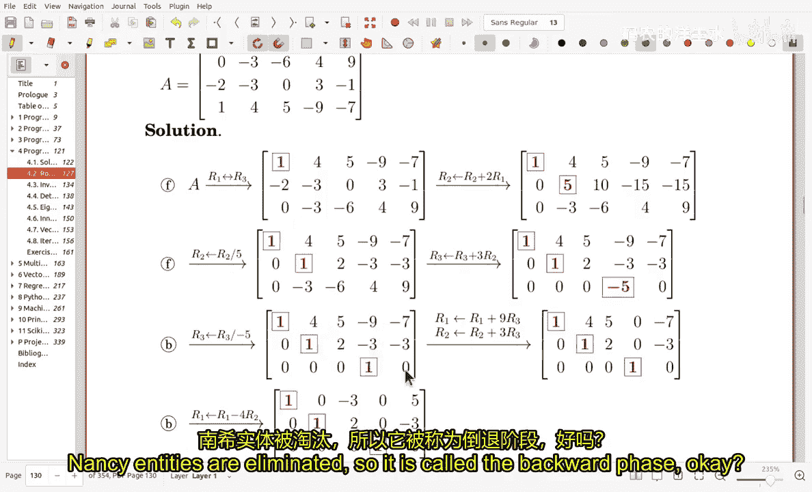

Okay。

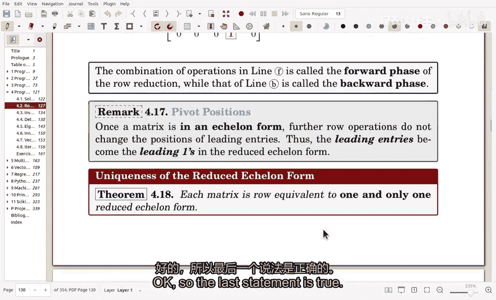

Okay， so the last statement is true。

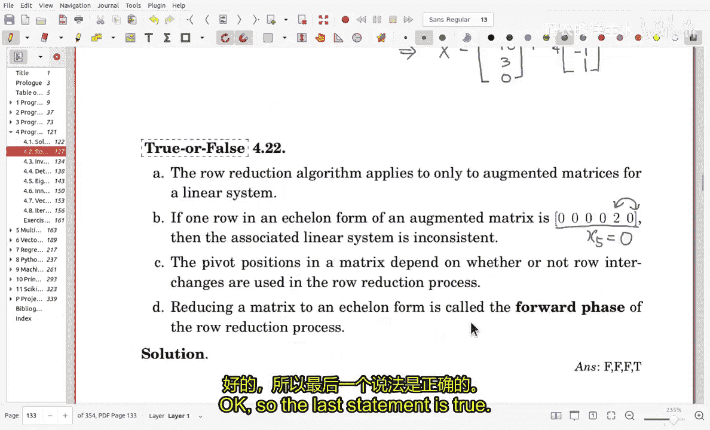

Okay。That's the end of the section， thank you。

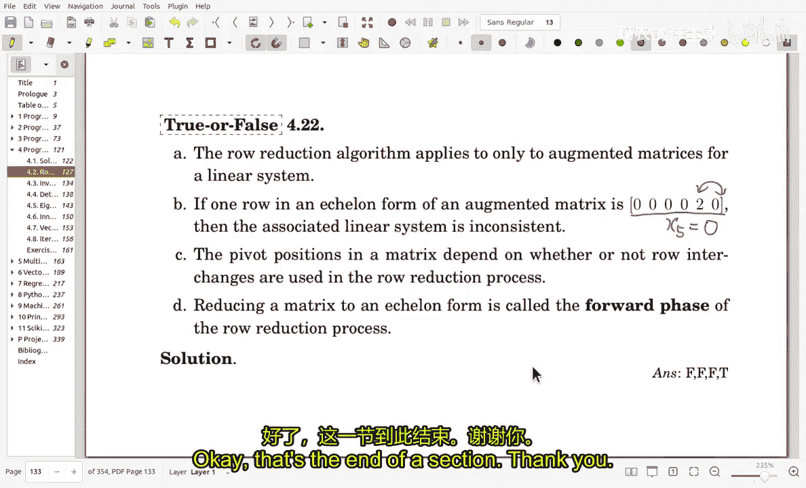