# 【全集-附课程讲义】密歇根大学-人工智能编程-EECS492-中英字幕-p31-Lecture-31---线性独立性与向量张成--BV14JqfBNEAS_p31-

Section 4。3， linear independence and span of vectors。A set vectors as including P vectors。

 Each one is in Rn。Is linearly independent if。The fact question。

A linear combination of the vectors equals 0。Has only the trivial solution， otherwise。

The set of vectors is said to be linearly dependent。That means there are weights， C 1，2， C P。

 not World0， such that。The linear combination is a zero。Lineer independence implies that。

Each vi in the sad。As independent each other。That means that。A victim in a linearly independent said。

Cannot be。It's expressed as a linear combination of other vectors。

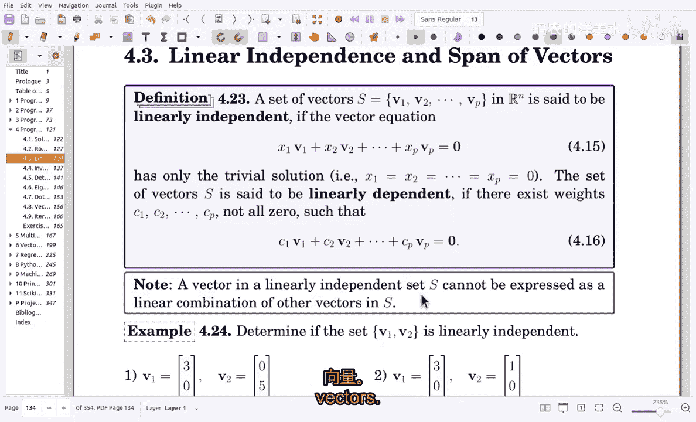

In the same set。Okay， let's see example。Determine if the said vivo and Fi2 is legal independent。Okay。

 if we are using the definition， we start here。

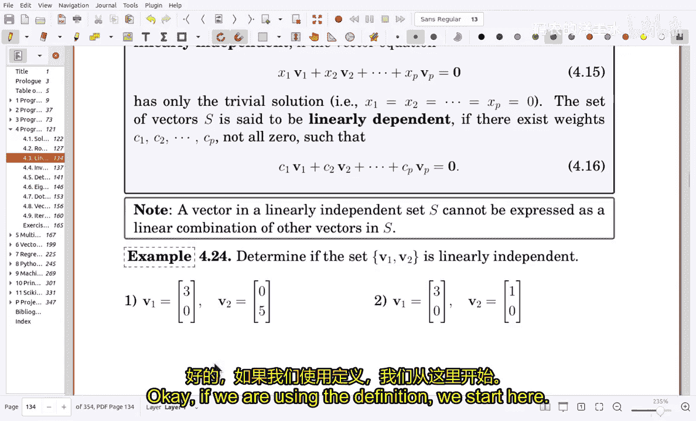

Now x1， v1， we start with x1， v1。Plus， x 2， V2 equals 0。Then this left side， the same as X1。

 V1 is 30。Plus， X 2， V 2。Yes， it's 05。Okay， so it is the same as。Okay， that is pretty。X1。

And the second term is 0， and there is now 5 x2。So this and that must be0。 So from here， x1 equals 0。

 x2 equal 0。So we have only。The trivial solution， so they are linearly dependent。

The same you can put here about this one。Is linearly dependent。Okay， okay， Sam me。Using definition。

 x1， v1 plus x 2， v2 equals 0。Now， we can organize this the left and side。 Okay， X 1 V1， so that。

First any must be 3 x1。Plus， x 2 be 2。 So it is x 2。 Okay， have a second on0，0。 So we have a 0。

That must is sit down。That is that here。Okay， this must be zero。30 x1 plus x 2 equals 0。

 so we can choose here， x 2。呃。Equal， for example。M 30 x1， then for any choice of x1。

 if x2 is minus 3 times x1， then this equation must be satisfied。So， for example。

X1 equals 1 and x2 equals minus 3。 then that will be satisfied。So it is。

Lnially dependent because it has non trivial solution， okay？

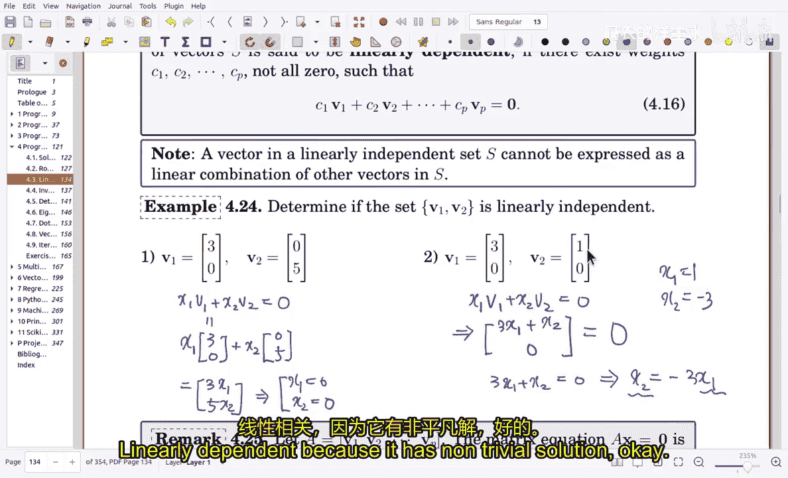

We collect the vectors to form a metric。The metric， ax equal0 is equivalent。To this vector get。

And columns of A are linear and independent。That is the same as here。Yeah， we went to VPR。

 Liang independent， if and earlier。And Ax equal0 has only the trivial solution， and from definition。

 you can see it very easily。And that is also equivalent， Ax equals0 has no free variable。

Once you try to solve the problem。The system， the homogene system points。

That is free variable than it has infinite many solutions。Now， also。

 it is equivalent to here to this statement， every column in a。Is a pivot column。So， once。嗯。

The free variable is made from nonP column right so that every column is a pivot column。

 then every variable is basic variable and there's no free variable。

Columns of A are linearly dependent， if and all if。This homogeneous equation has a non tual solution。

And also Cubana2le。The homogeia system has at least one free variable。Again， equivalently。

A has at least one non period color。

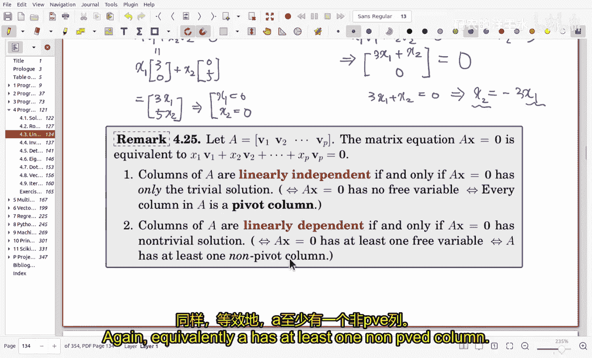

喂。Okay。Determine if the vectors are linearly independent。

So we'll try to use Tech with developed here。 So we'll try to make a metric。And。

Collecting these of3 vectors， and。Try to see if that is。Fre variable or non PV column。

 If there is no non PV column。 So every column is PV column， then。This said is linearly independent。

 right， so eventually。Solving such problem。Is related with elementary raw polish。 Okay。

 we consider these 30 vectors as metric。Then， from here now。Okay， we try to。Ro interchant。Here。

 that is2。 So if we try to apply replacement， probably non integer。

Competition is needed to avoid air here。Okay， we'll try to subtract to this one and then we'll put the remainder here。

They're subjecttracted。 there's one subjecttracted， again， minus a and subtracted and -2。Okay。

 so from this two row， we have that。And then， yeah， we can put here now that on。2，0，3。

 and then this one，0，0， minus1， right。 Now we can eliminate this one。By your saying。Again。

Or the police month。1 minus8 minus3 is the first row。

Unchange there twice the subtraction is you know twice subtraction is the6。Twice of。

 now theres 7 and 0，0 -1。This is a pivot， pivot， pivot。Every column。Has a pivot， so。The metric。

The colors of a metric as Sena independent。Linear independent。

 which is the same as that the vectors are linearly independent。Okay。

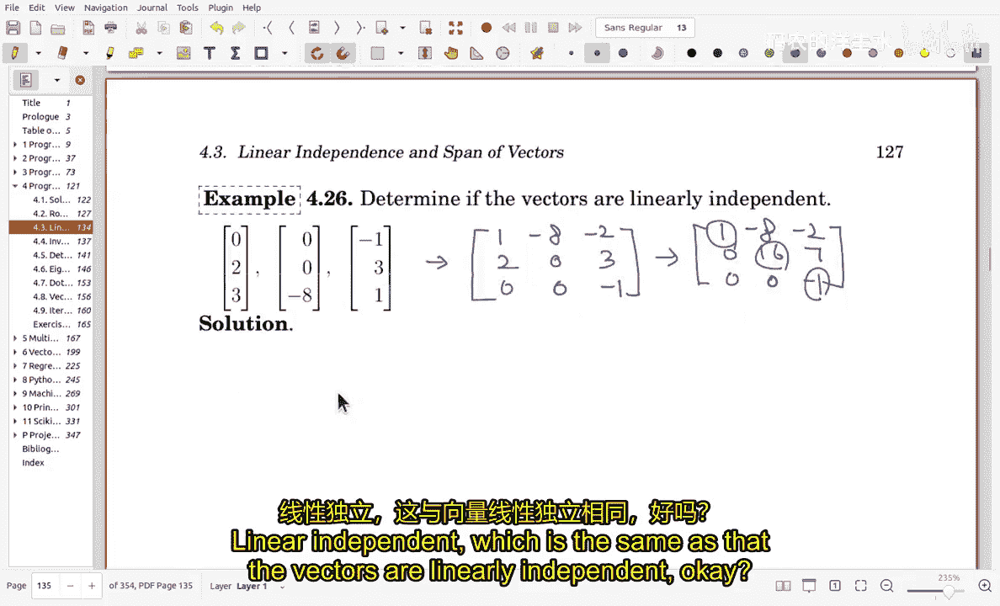

Okay， here， determine if the vector are linearly independent， actually A， who can do that。那。

Look at these four vectorctors as a metric。Then now we apply elementary rotations，1-2。And 32。

So the purpose says。嗯。To find the pivot positions。Okay。Twice addition， there is a zero。

Twice Ed Sha again， you。And twice against， you know， twice Ed， that is a6。And that is a C all。

1-1 and 3。If you。Interchange。last two ruless， then one minus2，3，2。And that is a1， minus1 and3。

And that is the sex。Okay， this is an actual form。And if you reach at on actual form。

 then you can decide。The pivot positions here we have pivot， pivot， pivot or gang。

This third column is a non period column。 So if there is。Noan few column， then。Now。

 these vector are not linearly independent。 So it is a linearly。Depenent。So we learned it from here。

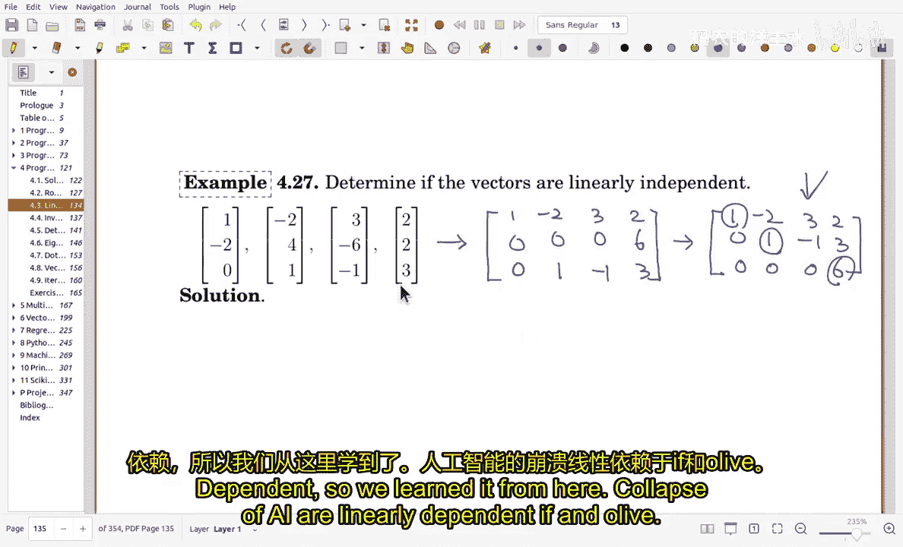

columnlums of are linearly dependent， if and olive。

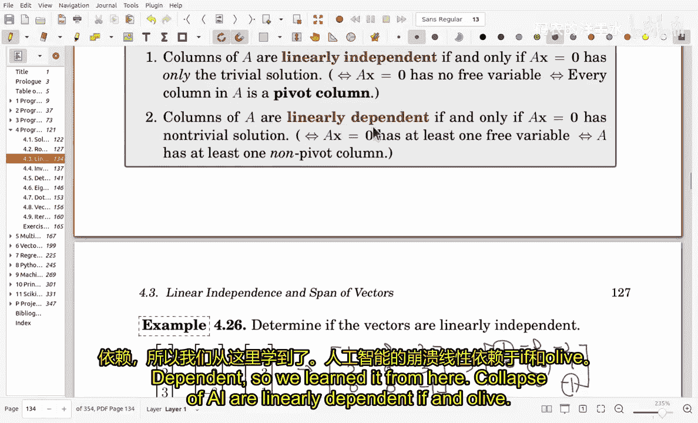

Ax equals0 has none0 resolution。Equivalently， the system has at least one， fully variable。

And what saw。Eventually a has at least least one non period column， right？

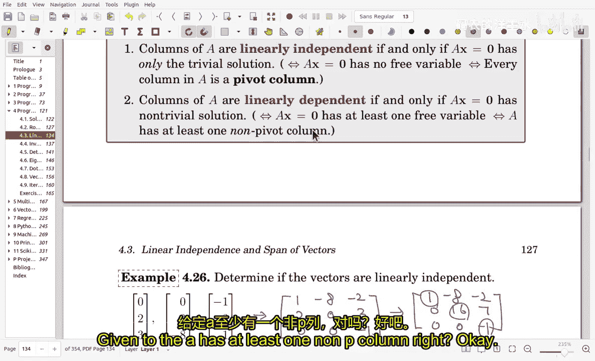

嗯。In the above example， factors are in。Out in and if30， a number of vectors。Pce 4。As in this example。

 if P number of vectors is larger than the dimension， then the vectors must be linearly。

Depenent is ship， because an R3。For that one。We can have maximum 30 pivot。But there are four columns。

 So at least one column。Must be a nonp column。Right。And the number period cannot be larger than。

The number of ruless。So here n is a 3， but the number column is a4， so that at is one。No P column。

 must be there。So。嗯。Such set of vectors must be linearly dependent。Is he clear？

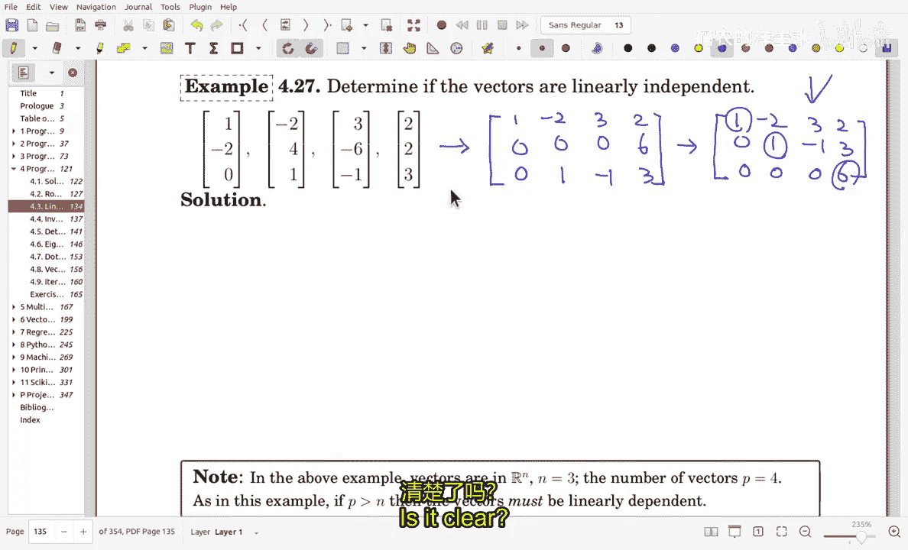

ok。

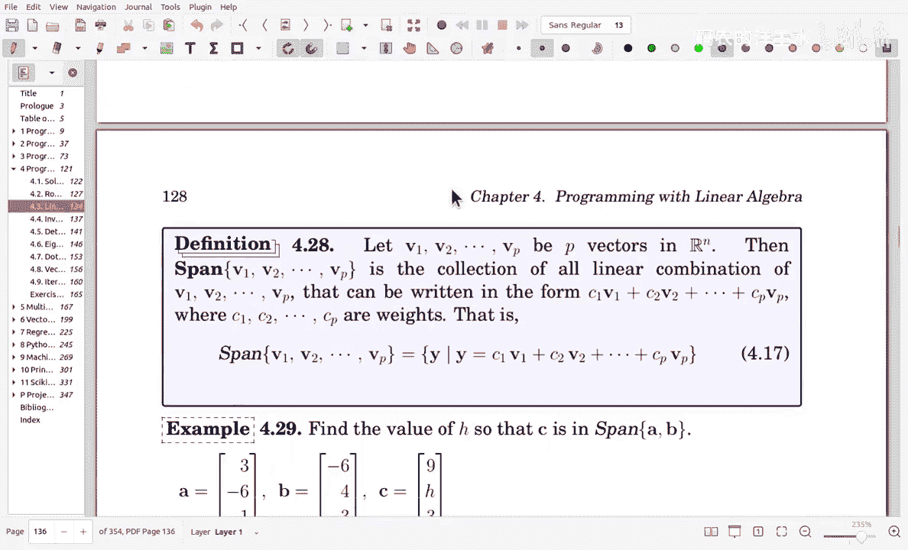

呃，行。And V 1 to B P。A P vectors in Rn， then the span， we define span。And here view into a beef here。

Is the collection of all linear combination of beyond 2。啊屁屁。

Here there can be written in the form here， linear combination so that。嗯。We write in this race span。

 these vectors is just the collection of every possible linear combinations。Look at that is a span。

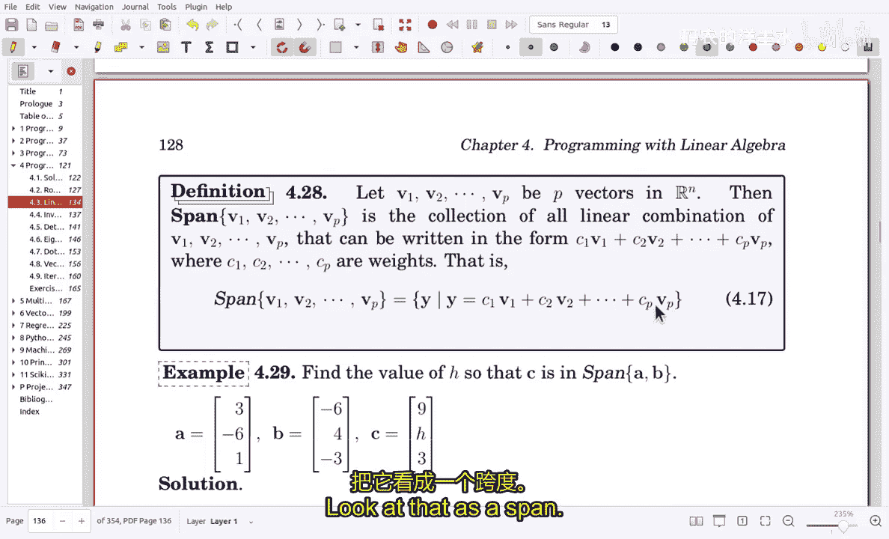

啊。Find the value of H so that C here ABC is in span A B， okay。

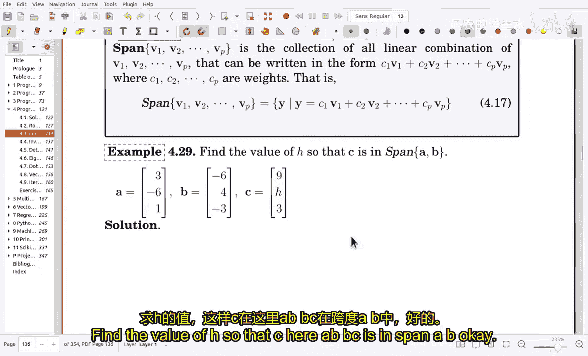

So C is in span avi。We first try to understand that。The meaning of this one， okay。Here。

 Cs in span of A B， but a span。OfA B is collection of linear combinations， so that it must be。

Every the。Entry the element in this is set as now like here。X 1， a plus x2 B share。

Cize inpan means that is a saying。So this is vectorification。And。那。So that it has a solution。

 then C must be in the span， right。So that the problem is changedd into now the。

A question of existence of the solution。Once we consider is two vectors。啊。Is a metric。

 and the C is the right side。 right， Okay， so we start with。The corresponding augment to the metric。

You know。30 minus X and1 first column。 and second column is minus- X4 and3。 and here。

The right side is 9， H and 3。Okay。So we'll decide H such that it has a solution。Okay。Yeah we。

Interchange yeah the。嗯。Or we may。Divide by 3， then there will be here。1。Min-2 and 3。

And a subtraction。No， yes， twice an edition will make a see， twice an edition。Minus 2。

 so that is a minus8 and twice addition。H plus 18， this is it。Now we okay。

 we put here first minor 3 and3。And then。To make this one zero subtraction so that here。This is one。

嗯。Minus23。And0 minus a and H plus 18。Right， okay。Okay， yeah。Now for that one， capital subtraction。

 this is zero and subtraction。us1 and here subtraction will make a。Right。Okay。So。If the' changing。

The raw will be shared here and scaling with a -1。1，-2 and 3，0，1，0， and now 0 minus8 H plus 18。

We can eliminate this one。By adding eight times of second row。1， okay， again， twice editor。 So 1，0。

3 and  eight times editor。That is now。Okay，1，0。

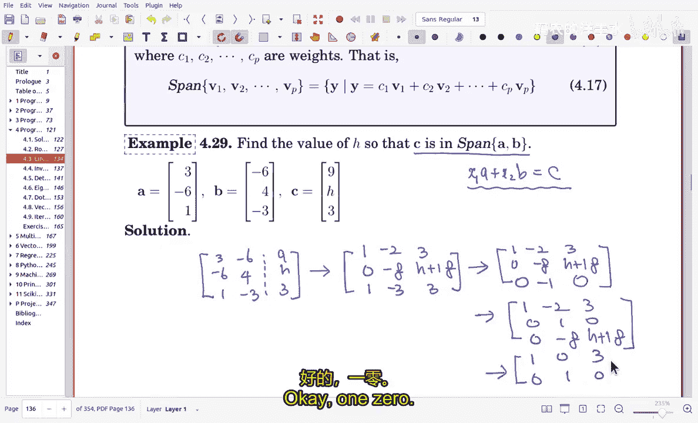

I see 1，0 is a second row， and the further row will be。0 and eight times editor。

 And this is H plus 18。Okay。Now， here for this augment system to have a solution。 you now this is it。

It must be 0 also， right， so that H plus 18 must be 0。So in the case， the solution is3 and zero。

 so h is now minus 18 there 1。Then it actually three times of A becomes C。Right。

So that the the x1 is3 x2 is a0 here。So the value H must be minus 18。

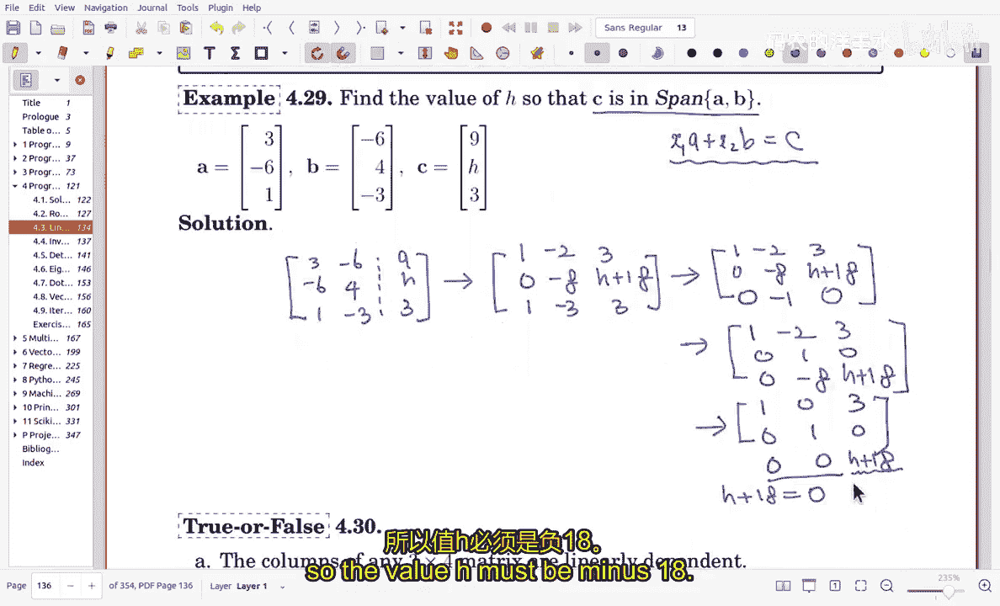

Okay。Okay。Now we'll try to solve true or false problems。Okay。Okay， the columns of any 30 by4 metric。

啊，0。Depenent， is it true？呃。Must be true， right， so that there are 3 rows and four columns。

So that here。It can have maximum 30 periods。Now， so that at least one non PV column exist so that。

It must be linearly。Depenent。U and V are linearly independent。 And if U U VW is linearly dependent。

 then W must be。Itspan it。OfYanV。Is it true。Yeah， it must be true。Okay， if you start with。

 for example， metric of U and V。And that one。As a linear independent。

 that means that in2 pivot positions。 And if now you add W as a linearly dependent means that there's a three。

That's making。Just only two PV positions。 So if there are 3 P positions。

 it must be linearly independent。 So that means that W must be in spin U N V。 So it is true， okay。

Two vectors are DNAly dependent， if and only。They lie on the line through the origin。Is it true。

linearly dependent。 Two vectors are linear dependent means that here。For vi。Must be expressed。嗯。

Has the other or once one， at least one is a 0， for example， 0 and or vector v。

 if it is given in this rank， is  non0。Then again， anyway。

 these two vectors are light on a line through the origin， you may consider line。

 including a V and the0， and then these two are on the line。And over here， zero years。Now。Okay。

 once the0 vector is there， then， for example， and any x10 plus 0。

V equals all is a s so that this vector and another vector。

So that you can choose here x1 up to x1 and the linear combination zero。

 So here a linearly dependent if two vectors U and V are non0。

But the dependent then image that here one vector is expressed as multiple of the other。

 So they are on the。Same line passing through the audition。 Okay， so it is true。

The columns of mat are linearly independent if。The equation。A x equals0 has the trivial solution。

 Is it true？あ。Maybe somebody may say。It is true。 however， it is foreign。The homodia system has alls。

The tri solution。 Yeah， you have to say that。The eetian has only the triol。 if you put here now only。

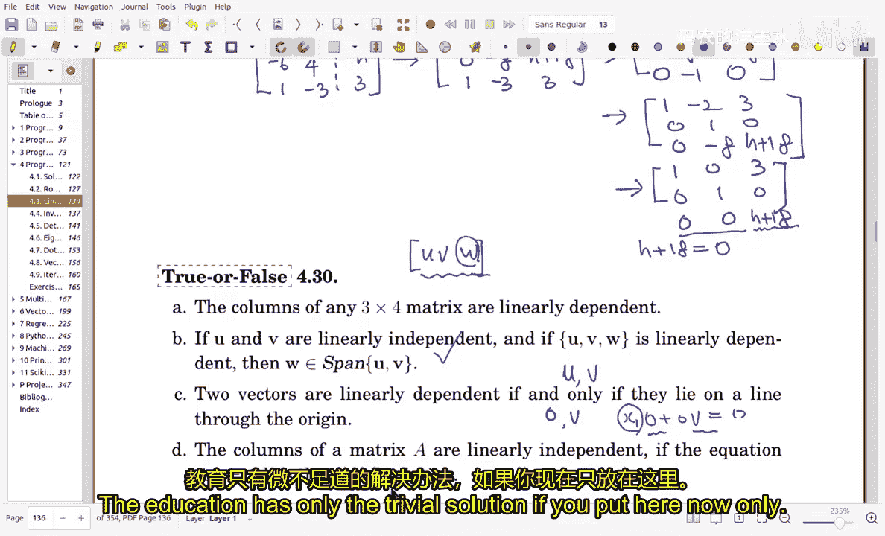

H。That it is true。But it has always the three solution。And。Now， you can have some other solutions。

 non to your solution， then。The columns of the metric cannot be linearly independent。So。

 the st is false。Okay， that's the end of the section。 Thank you。

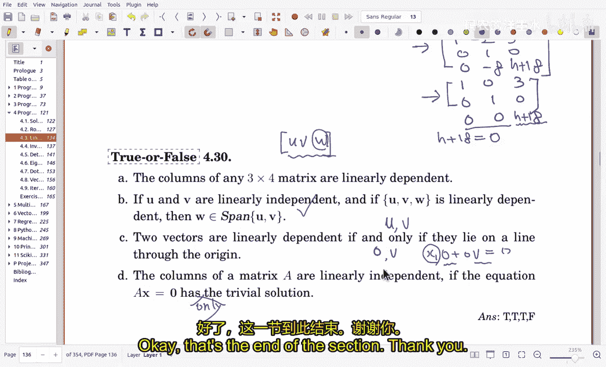