# 【全集-附课程讲义】密歇根大学-人工智能编程-EECS492-中英字幕-p32-Lecture-32---可逆矩阵：可逆矩阵定理--BV14JqfBNEAS_p32-

It is a section 4。4 inver matrix cells。On M by N， square matrix A is inver。我南 singular了。

If that is on M by M metric B， such that both AB。

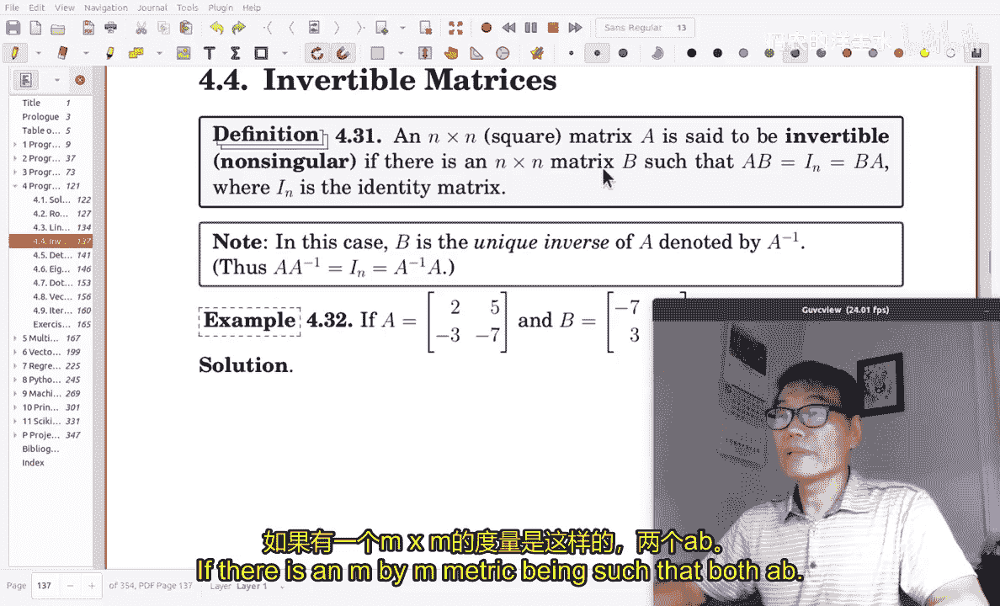

And B are the identity material。In this case， biasing。What about the theory of linear Brown。

 we can prove that such B is union。So we can say B is the unique inverse of a。

 and we are using the notation a inverse。So this location can be written here， a inverse。

Yes the identity map and it's the same as a inverse a。

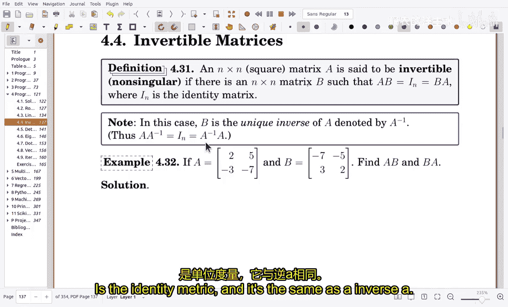

See this example。A and P are given， and we have to find A B and B A， okay。YourAB。Okay for that one。

Here A and B。Rar column。First row， first column。That is-14 plus35。 And first row， second column。

-10 plus 10。And now here， second row first column。21。-21。And second row。 Second column。And plus 15。

-14。 So we can see here now。Okay， this one is 14。 Okay， then must be 15。So that is 1，001。

 which is the identity metric in two dimensions。Okay， how about PA？Okay， that is。 Okay。

 we write time me a B first。-7， minus-5， 32。And a is2 or5。-30，-7。Okay。Then。First of all。First column。

 that is now-14 plus 15。So that it's one。First， second column is minus 35 plus 35。That is it。Now。

 here， second row， first column。Plus，6，-6。Which is a zero。And second row， Second column。15-14。

 which is 1。So here we check to that A B and B A R。The identity metric。So a is inverse of A。

 inverse of B。And we can say B is the inverse of a， either way you can say that。

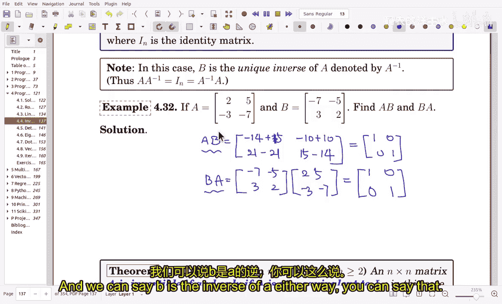

Inverse of on M by n metric for n is larger than O equal to on M by n square matrix， a is inver。

Even Ol F A is raw equivalent to。The identity the me， that means that。Stuff from A。

 if you apply elementary row positions， then。Is a reduced form as identity at。

That is also the same as data and pivot。Pos。 So each row and each column has a pivot position。

In this case， any sequence of elementary rule positions that reduces a into。

The identity metric will also reduce the identity metric to a inverse。Okay， this observationion。

Is introducing an algorithm to find a inverse。 Start with this algorithm metric， A and identity。

 and we apply elementary rule positions so that we'll try to make the first part to the identity metric。

 we already。Know that A is inverible， then。We can apply a rule portion to reach at the identity material。

 So once we do that， then this identity part will be changed into。The inverse of a。

 once we cannot reach at the id metric for the first portion。Then a does not have an inverse。

 which means that a is not inverible。That is quite similar。As this one。

 once we we try to solve A X equals B。And here， once acing vertical Rich is that there are N period Poions N。

From this aroma metric， after applying element to raw projects。

 we can reachsha the identity metric and the X column will be。The solution X。

 which is the same as here a inverse times a B。 So we start with B over there。 if we start with。

 for example， identity metric， then there will be here exactly this portion will be a inverse。

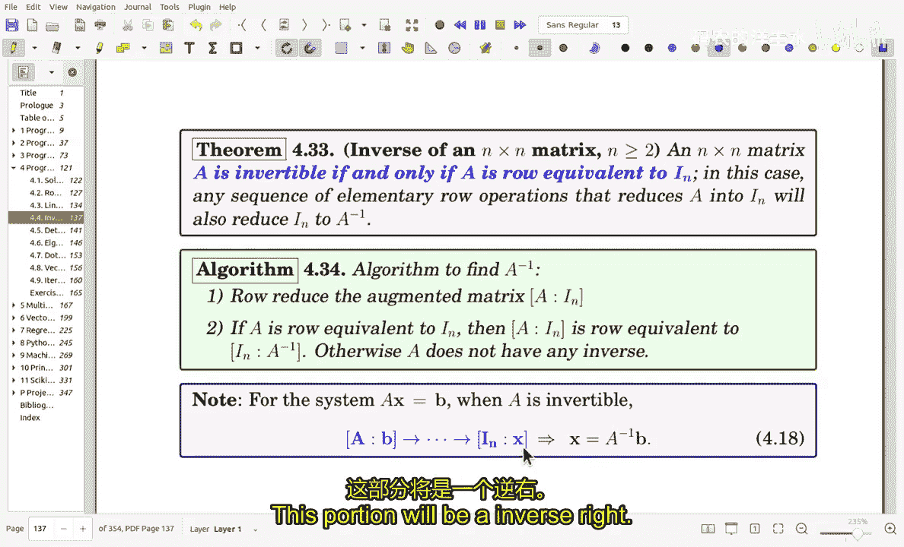

Okay。 find it the inverse A a is given here。We may begin with this augmentary metric。

 the metric and identity from here。Okay。Now we have to apply element to raw positions such that。

 and this portion becomes identity。Okay， we may。Try to use non integer competition to avoid that。

 Okay， let's try to this way。First， we multiply 3 for the first row。

So that there is 9 and6 and3 and0 for this one， we try to eliminate second rule。

 then there will be1 and 1 and3 and minus1。Right。Okay， and second row is subtract is 1。

3 and minus innocent。 Okay， and then we put here the second row， a，5，0，1。

That's a kind of replacementment。 Okay， now from here。We can eliminate the second row。

 And without introducing non integer values，1，1。30 minus-1。Okay， eight times subtract。

 which will be pseudo。8 times subtraction minus3， eight times subtraction， minus24。

8 times subtraction。 So a is editor， which becomes here now9。 okay， you divided by minus 3。

Which becomes here。That is01 divided to minus 3。8 and minus0， right？So by using this one。

 we this PV value。We can eliminate error by subtracting the second rule， okay。So it is a 1。

0 subtraction and minus 5 and subtraction will become pianol2。喂。Okay。那。We are putting here01。 Okay。

 you see 2， minus5 and subtraction。The same as adding 3， so it's 2 okay， Yes correct。

 and there is a and here minor 3。 So now it becomes identity and so that this portion will be a inverse。

 right。Okay， now we'll go to here and its for your self study。

 use pass and paper to find inverse of your A。If it exists。We can check at the existence of。Inverse。

Baasing met lab。We define a， and now I。30， that is making 3 by 3。Identi metric， So we。Form。

The augmentgamat metric。Try to get reduce the actual form。 So first part it becomes identity。

 Now this portion。As a inverse。Just biasing pencil。Paper。Try to check yeah， okay。

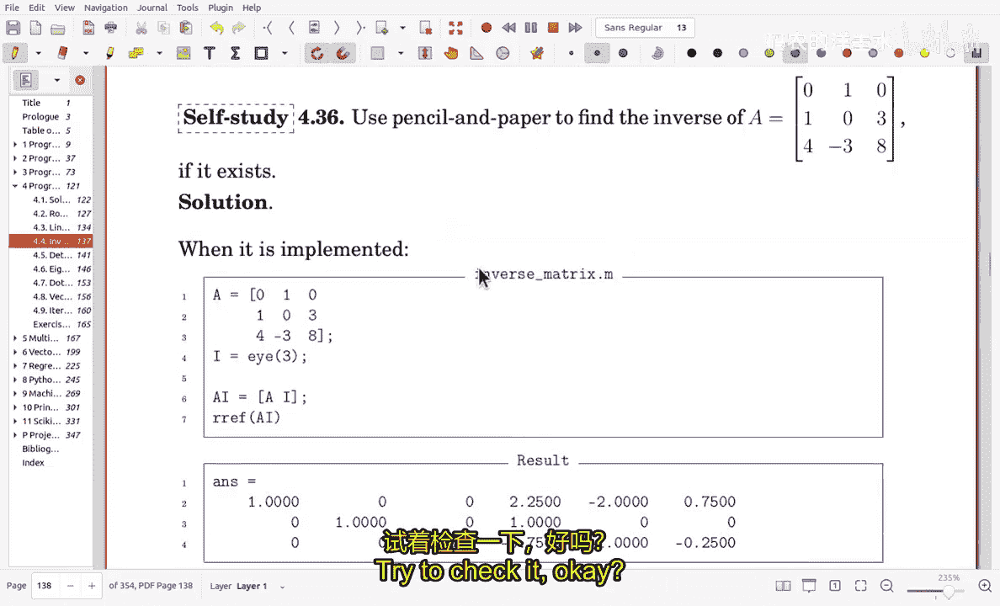

Okay， keep it on M by N matrix A。 It doesn't have to be square， right， the transpo of a。

Is the metric here using the notation a transports。

 whose columns are formed from the corresponding rules of damage there here。A is AI J， then in R MN。

 then a transport is now rather than IJ， we are putting JI and that was in R N by M， for example。

 your A is given in this vein。T eight transports。Okay， definition， we say that。Here。

 the columns are formed from the corresponding root of a and each column。In。

A transport is formed from roads， which means first of all， was the first column。1，4。A1。

 second row goes the second column，0 minus-2 minus-1 and 3。 Third row goes to for column 0，9，9。

あ、しすなインしろし。5， okay。And this row goes column or， you can say that first row goes the first column。

 second row， second column， third row， first column， third row， the final column。Final rule。

You may think of that way， either way。They are the same。

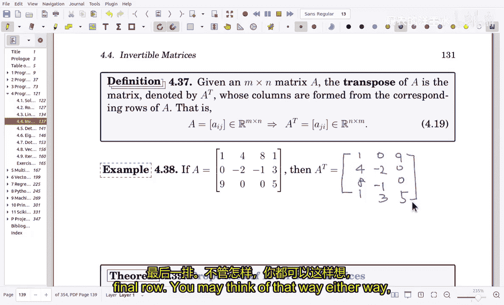

Okay。Here we have prous of inverable matrix acids。Okay， for2。2。Ma sense。

We may write the metric in this form， ABC D。If a8 minusピ is何0 then。The metric a is invertible。

 and a inverse can be written in this ring， one over 80 me PC。

In the next section we will learn about determinant and this is a determinant a d minus BCc is a determinant of the matrix。

 once it is a non0， then we put here one over the determinant a d minus BCc。And from the metric。Here。

 we change position A D。Interchange through this cross direction。

 and here for the other direction now change the sign。So全 positionion，全 sign。Okay。

And in front of that， we have one of an adeM species， that's the inverse of Cuba matrix。

So S of p S a d minus BC 90。And we can form this metric。Okay， so it is inver。

If a is on invertual metric in general dimension， then a inverse is also invertable and inverse inverse will become the original one。

It's a reasonable plan。If A B are n by n inverable mattresses。

 then their product is also inver and the inverse of A B。Its the same as B inverse， A inverse。

 be careful。You have to change the order， A B， but here。B verse， A verse。Okay。We not prove that。

 but it's well known。Fat。If A is inverable， then its transport is also inverable and transport and inverse。

Commute so that you can get inverse first and transport or transport your first and inverse。

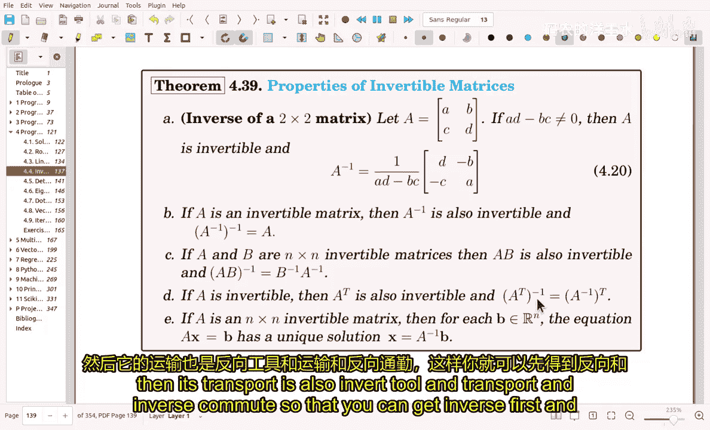

If a is on M by n invertual metric， then for each V， for any choice of being。Okay。

 that is it for each being。The equation， A X equals B has unique solution。

So that x must be an inverse of a being。

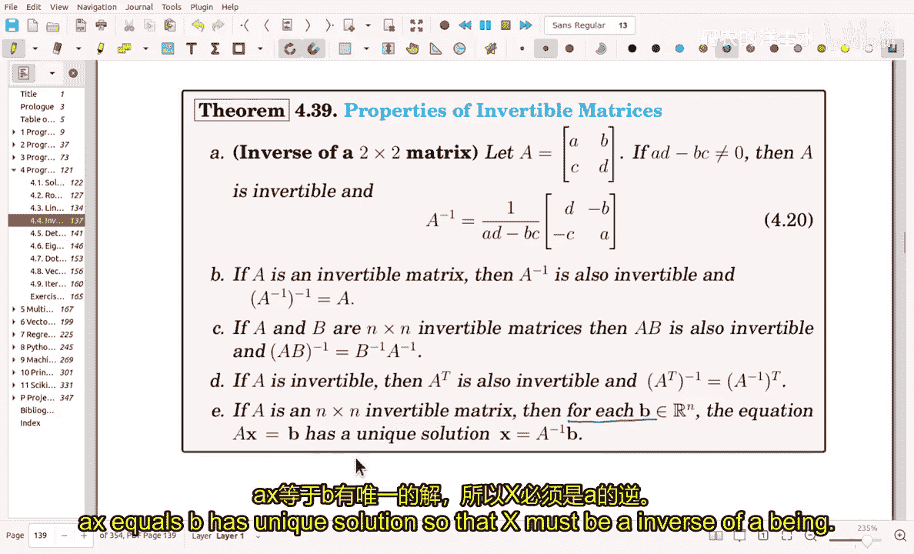

Okay， for every choice。

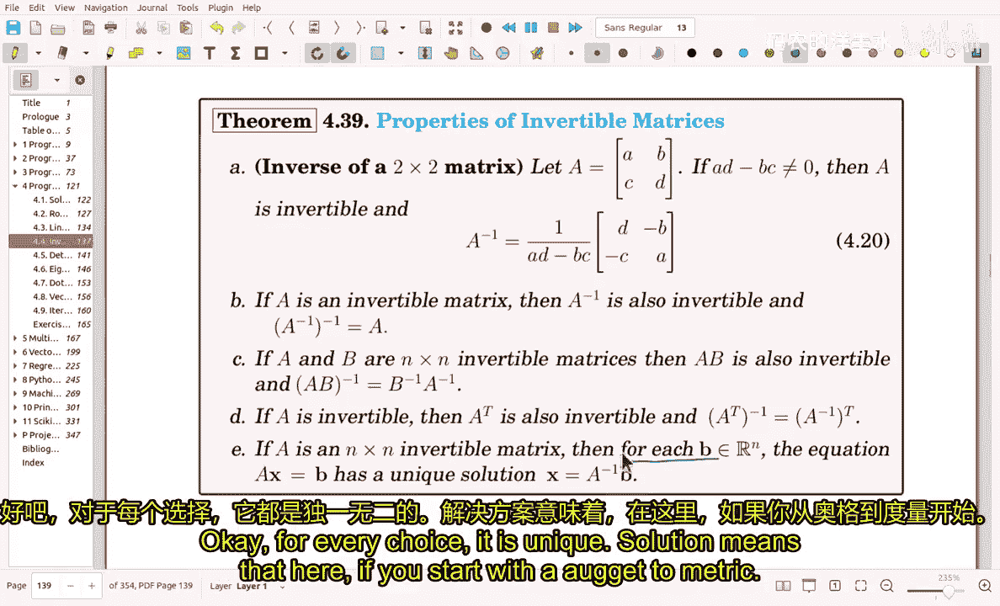

It has unique， means that here if you start with program to the matrix。

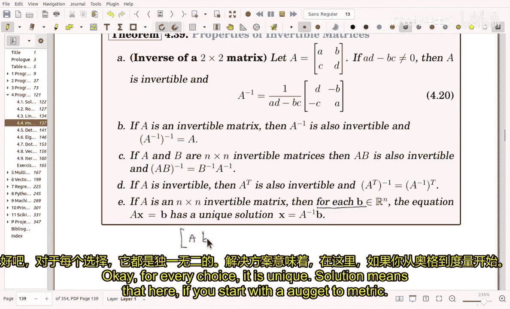

Then for every choice of beer has unique solution to that。 and every column of a。Has a PB position。

 so the columns of a must be linearly independent。We'll see later。They are basically the same。

There were sessions。

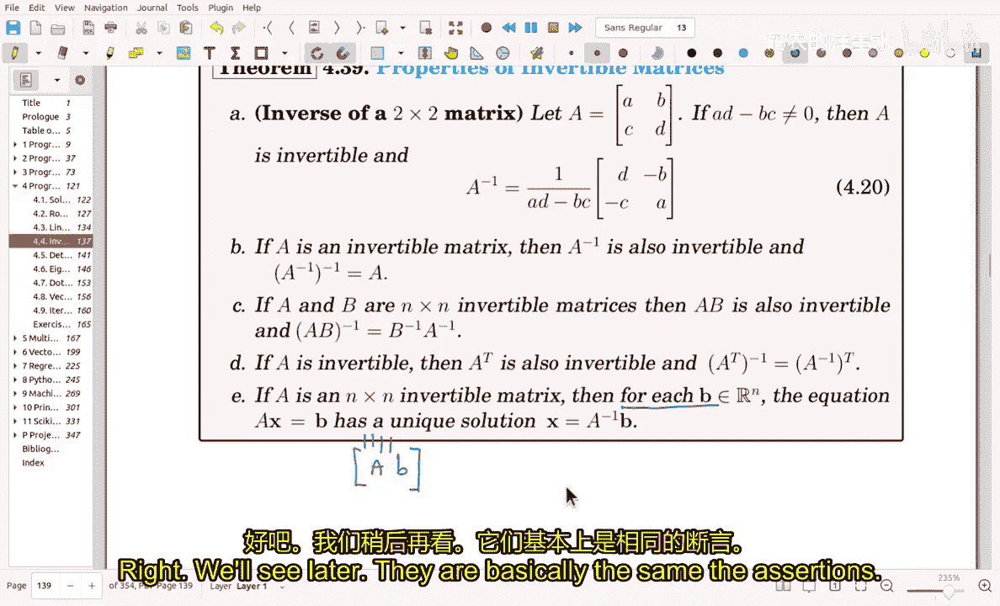

Okay， that is the invertable matter theorem。A is on M by N schemetric， then following are equivalent。

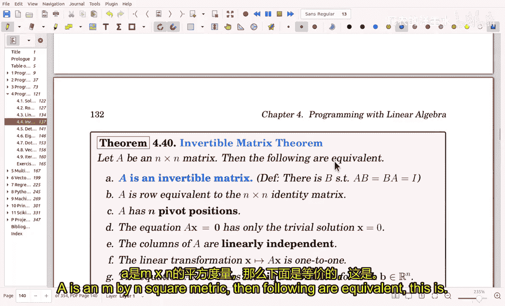

This is。An equiative theorem for invertable matrix。And。Originally。

 the invertability is defined in this way in definition by definition。

Here we need a metric such that A B and P A are the identity metric。

So it is not easy to verify this definition。Now we will put here the equivalent statement so that if you can verify one of this statement then that means that the gimetric is inverable metric。

So equivalent theorem is a kind of expansion of the definition okay a is the inver metric that a has rh equivalent to the M by n identity metric we considered it earlier。

 and that is also same as a has NP pivot positions。And。

So that this homogeneous equation should have only the tri solution and columns of a must be linear and independent。

And so we collect the findings and earlier here。Okay。

We consider the mat tumor question as linear transformation， then it is a one to one。

We didn't study about。That went on。 but here that is a quite similar concept。As the one one。

 when you are dealing with。The standard function of one variable。So you may think of that way。

 this is one ton。And worse so。Now。This equation has unique solution for every choice of a B。

 and we was consider this one。 and the columns sub a span our n。Okay， so that。

The linear combinations of the columns of a will make every vector in R and that one is basically M as there for every choice of。

B。We can produce beam as a linear combination of a columns of a that is exactly same as thatlon。Now。

 also， if we consider this one as。Lina transformation theres onto， which means that。

Image of image under the multi of a is now the same as the whole space。

Which means that And here for each one in our end， we can make it。

 So that one is the same as statement。嗯。There is a matrix C such as C as identity。

Original definition of inverable metric is existence of a metric such that right multiplication。

 left multiplication simultaneously。The identity material。 but here。

This statement is saying that just left multiplication becomes identity then dec。

And so that that means once left inverse exists this， then it becomes automatically right inverse。

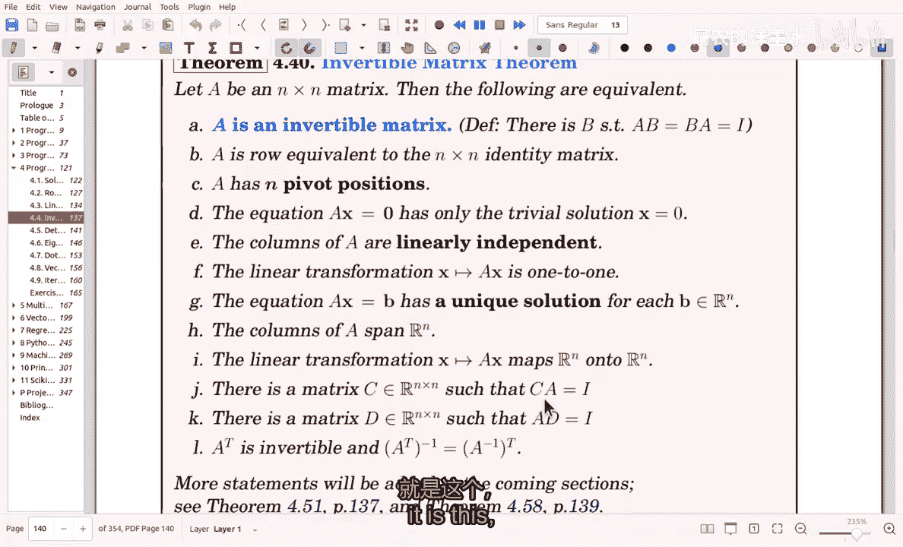

here again， now this is a writing verse。And once right inverse exists， then。

The right inverse will become also left inverse。 So only one side。Inverse is enough。Yeah。

 and a truth4G is inverible。So once a is inverable， then a transport is inverable。

If a transpo is invertable， then a E self is inverable。

 and this is all we consider inverses and transportpo co。Okay。

More statement will be added in the coming sections here。

We'll see more the equivalent statement later on。

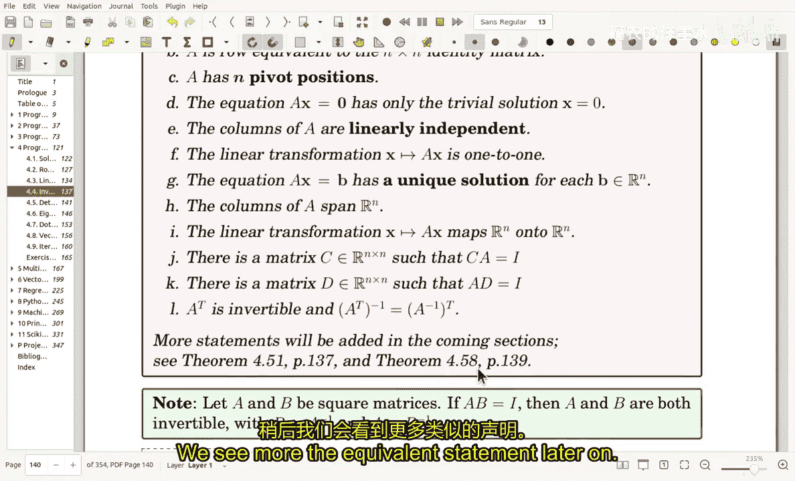

A B sche matrix if A B is the identity， then A and B are both invertible。

 So we can say that B is a inverse or A is B inverse， so。

The definition of inverse is a sort of a symmetric definition。

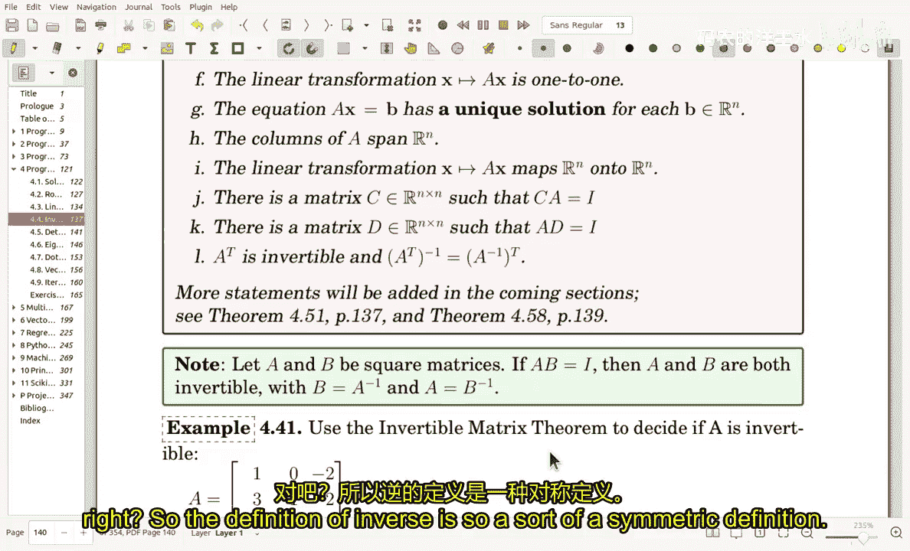

Use the inverable metric theorem to decide if A is inverable。

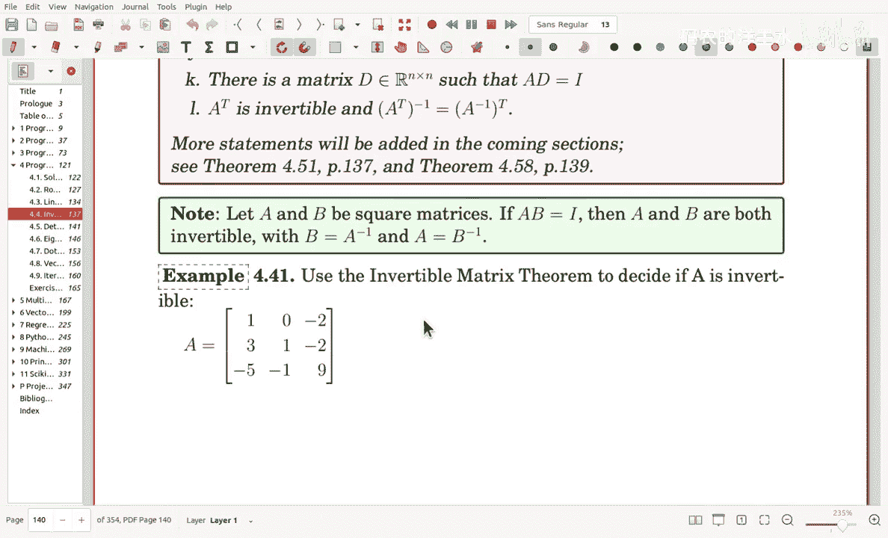

Once you verify one of this statement， then that end。Okay， here， let's try to use this one。

So most frequently used。Stateimments will be this one。And also there one。

And here probably of this one。

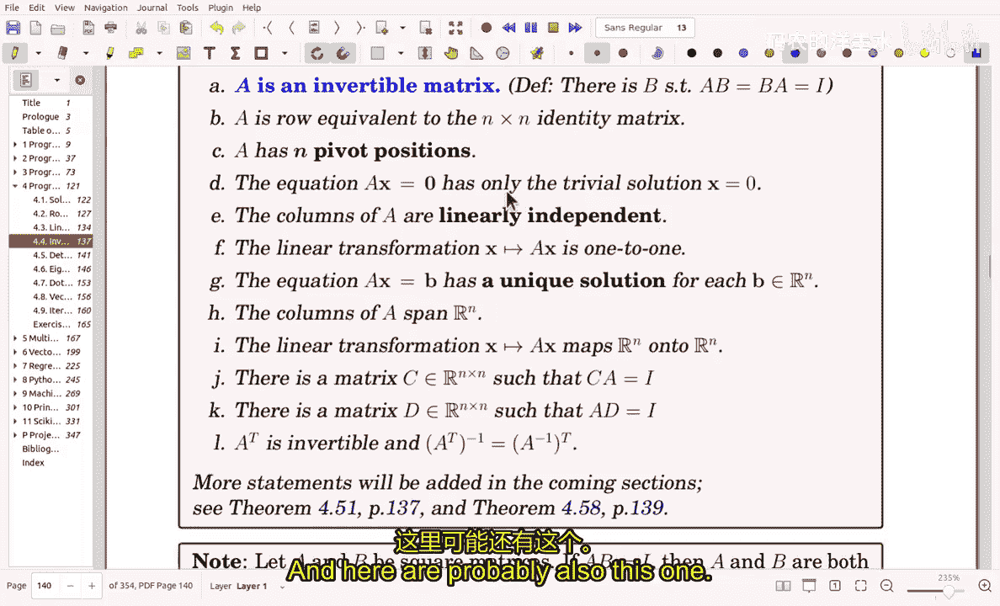

And also that G。Okay， so for this problem， we'll try to use that so that。The problem。

Is reduced to checking the number periods。Okay， from a。Now we apply elementary road positions。So1，0。

2， the first is not changing。And then yeah 30 times subtraction will make a0。

 30 times subtraction the same one because it is0，30 times subtraction six is to added。

 so it'll be conform。And a five times addition is at all，5  addition-1， five times。Head the sh。

 there must be here。Okay， minus 10 so that it is a minus1， right？Okay， from here again。

Along with this P， we can make it sit long。1，0，2。Anyway， you have to reach at on as form。So0，1。

4 and addition0。Z and three， we have three periodss。Okay。In on astro form。So。

The columns are linearly independent， which means that the metric is inverible。

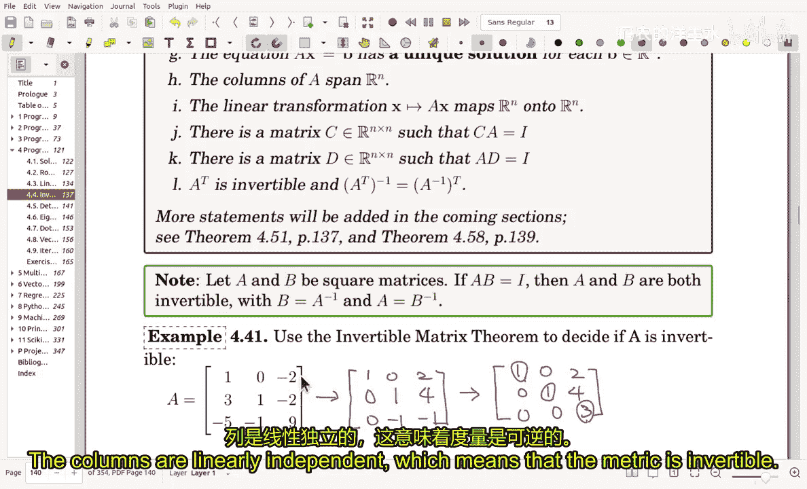

Right， okay。That's the end of the section， thank you。

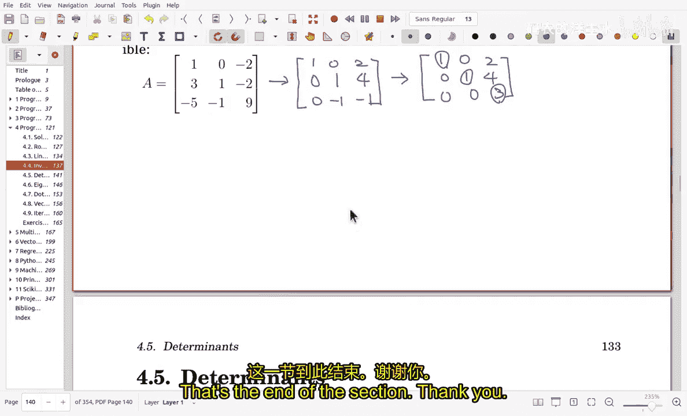