# 【全集-附课程讲义】密歇根大学-人工智能编程-EECS492-中英字幕-p33-Lecture-33---行列式：体积缩放因子--BV14JqfBNEAS_p33-

Chapter 5。Pro로gramming with linearage brown。In the last chapter chapter4。

 we studied linear algebra basic。In this chapter。We will consider popular subjects in line brown。

Applicable for real world problems through programming。Let's go to section 5。1 determinants。

A E is on M by N smetric， then。The determinant of the metric。Is a scholar value。Tnoted by T， T A。Or。

Absolutely well sign， we。If a is on one by one metric。Having single entry A， then。

Determinative a is the entry。If a is two by two metric， having four entries， AB，C D。Then。

 determinant of a。Is8 D minus PC。Okay。嗯。Will try to understand determinant， more thoroughly。

By solving some examples。

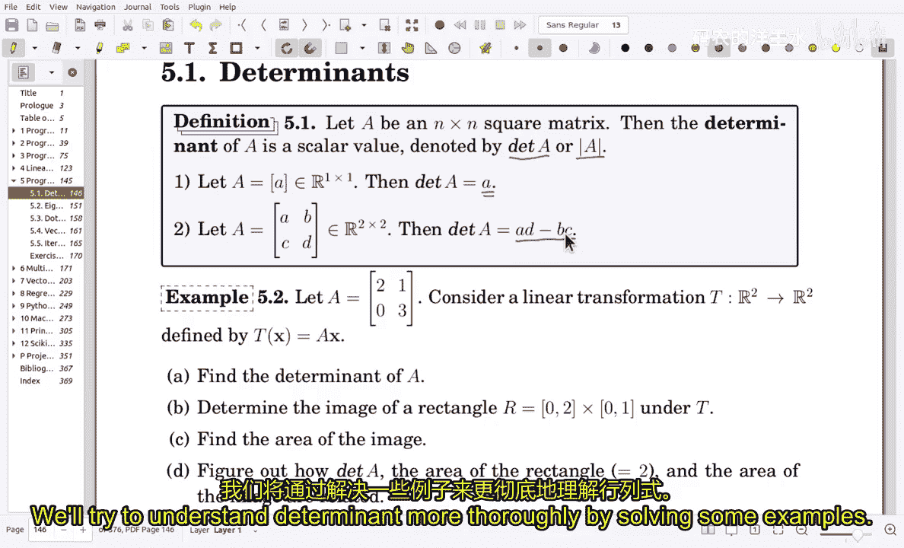

A。I given。Like this one， two by two metric。And。Consider linear trace formation T from R2 to I2。

T find du by。This metric multiplication。Find the determinative a， okay。That is the same as。

A D minus PC。 So two times of3 minus。One times 0。Which is 6。Okay， okay。

Determine the image of rectangle R on the T。Okay， we'll try to solve part B here。Let's visualize how。

Okay， that is a given like this。Yeah。There's 0， okay，0，0。 And this is 2 and 0。

And this corner is twin and1。And that is now0 n1， right？That is our。We want to find the image。

Of all and the T。So we have， okay。Another coordinated system here。And we try to。

To roll the image here。The battery multiplication is a linear transformation。Ler transformation。

Send the lines to lines。And points to points so that here the corners。Must be corner in the image。

 So let's try to figure out。The image of a corners， then， by connecting。The connoene in this image。

 we can get the image of this region。Okay。We are。The order， the point， this number one corner。

And there is number two。And here that is in number three。And this one is number 4。可orner。Okay。Now。

 the metric。Is here 2，1，0，3。Now。For number one，コナ 지ジ。이후 멀트플라이 시리즈러로 된。

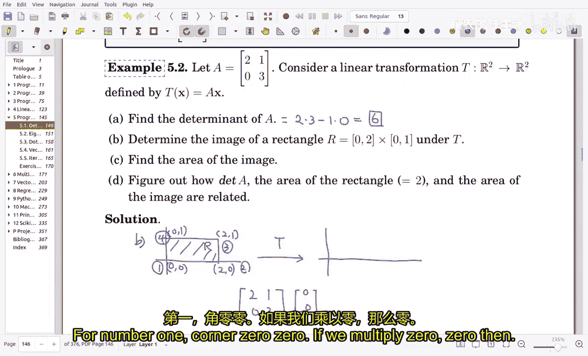

The zero must be 0，0。 Yeah， okay， we' write down。Below of this vector。There one。And meanss。

This is the image of the first corner。And。Quonner 2， thats 2，0。Piply 20。Here to the met J。

 then now then is twice of first column so that。Then must be 4，0。

So here we have this is a4 and that is the image with a second corner and I have a third corner that is2 and 1。

This metric vector multiplication is okay， row column。So that there is a5 and row column。

And that is 30。So here we have a five in xuction and height2 of 3， we have here 3。That that is now。

Okay here。This point is。The image of the third point。Okay。0 of4， there's 0 and 1。

Once this vector is multiplied here， then then means 01 just the second column。

So that is same as here， now one and three， okay。So we have one x direction and height de is the 3。

Okay， that is image of the。Po4。那 we。Connect to them。2 get 이미지브 regionion， stuff from here and。

2 and 3。And4 and coming back to one， okay。So that's the image of the region R。Okay。

 now find the area of the image。 The bottom length is 4， height to 3。 so that must be 12。Right。Now。

 figure out how determintable a， which is 6。The area of rectangle， that is2， apparently。

 clearly the area 2 and the area of the image。That is child。A related。

You can see there six years scaling。From 2 to 12。Six times two is 12， right？So that in this case。

 the deterative a。Is used as a scaling factor area。This is not existal example。Is always happening。

 So we can say this statement the determinant can be viewed as a volume scaling factor。

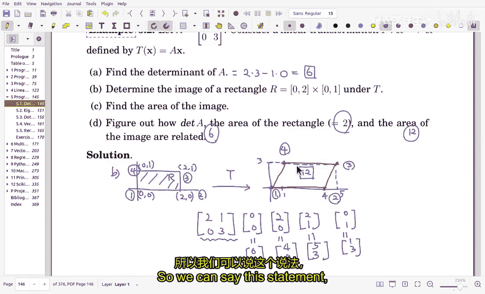

And through the and。Higher dimensional space。 we deal with volume。 We can find a general。Volume。

 and so they can say that。에오리아 카브2디메전 바리。

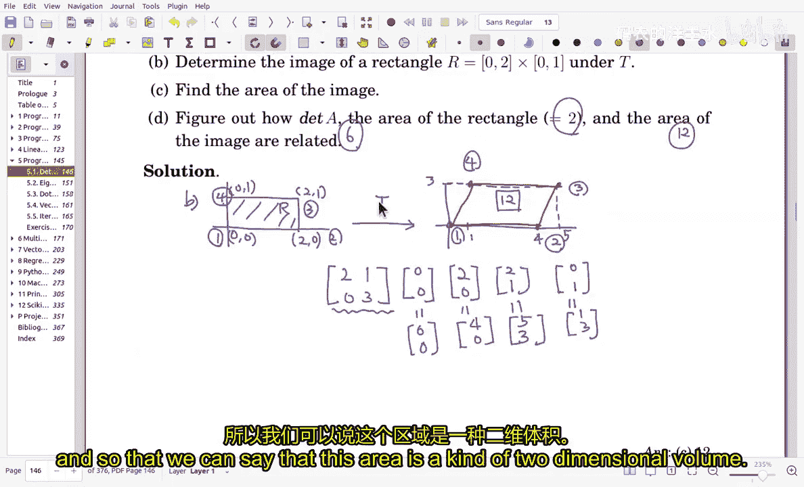

Right， so。Determinant has。Gometric interpretation like this one volume scaling factor， okay。

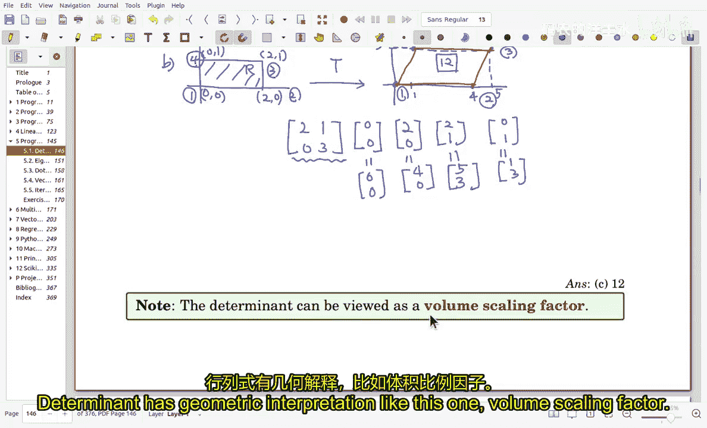

Now， we'll try to define determinants for mat。Having the tiid。Larger than equal to2 for。

Chaandler M by N met versus。Now， we'll begin with。That they finished of a core factor。

AI J is the sum metric of a obtained by Cl rule I and column J of a， okay。

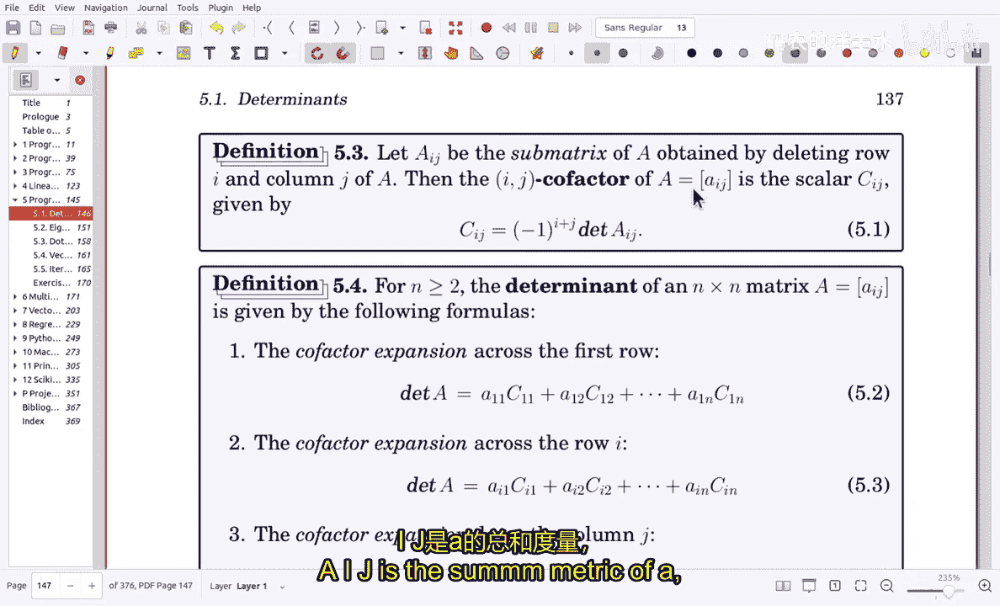

I visualize。The sumsymmetric。Commetric A is given。Then here that is a 1，1， a 12。

 so that there's a1 n。The below is a2 on and go down and A and1。For example。Capital a11。

The sumsymmetric。Is attending this rain。For a 1，1。We delete the raw， including a1，1， and column。

Including a1，1， then。They mean the path must be M-1 by。And minus-1 metric。That is called a 1，1。In쇄。

Yeah。에아즈。That is in Irow。There is how。And now there is chase column。 So we till it， I throw。

Chase column， then limit the part will make again。M-1 by M-1 metric。For this one。

 we call somesymmetric AI J okay。And we define。The IJ core factor of a metric。As the scala C J。

And defined in this range。 So it is a -1 to the。I plus J and determinant of。The summetric。AI J。

 So that is a core vector。Now， for mattress。Of。And by n， entry is here， we define the determinant。

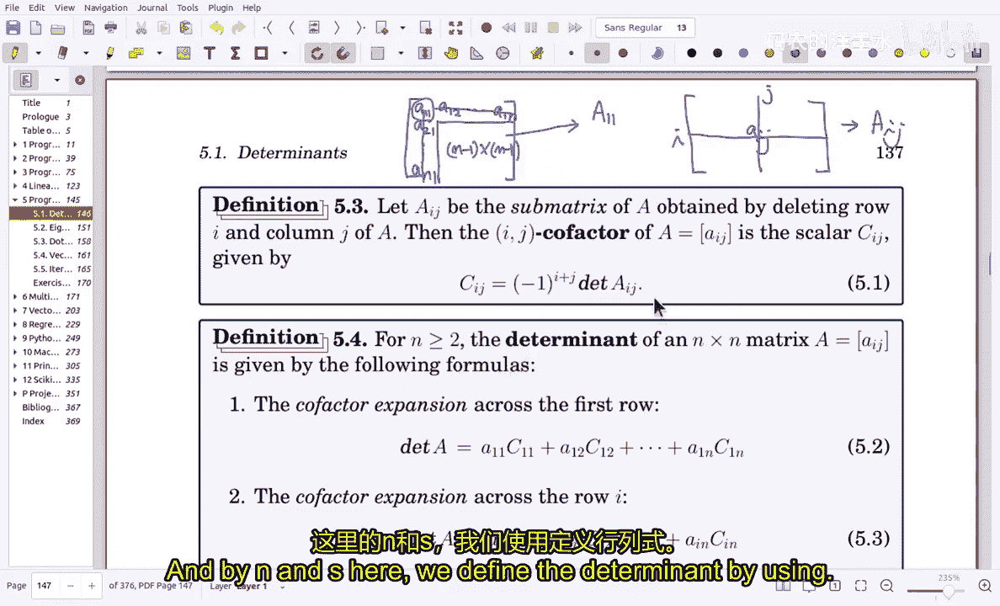

By using。The core factor expansion。HereDemin a is a 1，1， C 1，1， and a 12， C 12 this expansion。So。

 again， we draw。The metric。That is a 1，1， a 1，2， and a 1， n。Then， a 1，1。

Times the corresponding core factor， so that。This qua is computed in this way， minus-1 to the1 plus1。

 which will be 1。 and then eliminate here the a11 is eliminated row， including this one in column。

 and this a small portion。That is M minus1 by M minus some metric for the sum metric。

We get the determinant that would make a C11。By using this definition and for a1，2， this entry。

We tried to get the corresponding core factor。I see want to。And so on。

 So for every entry in the first row。We tried to get。It's a core vector， and。

The entry self will be multiplied， and summed。That is perfect expression across the first row。

And we define determinative a is same as the qua expansion。Fortunately。

 we can make such a core factor expansion， not only。With the first row。And。

 but also across the any room and I through， we can make a such。Ex。Then the result must be the same。

 So determinant of a can be garden by any perfect expansion acrossum。Ro， any。

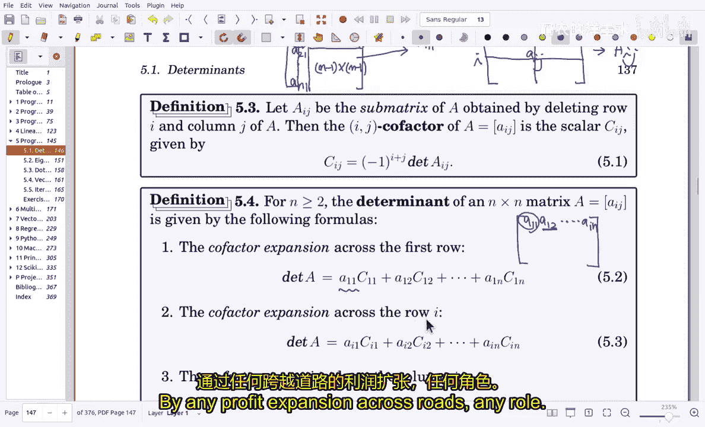

Now， again， such core factor expansion can be done by choosing any column。

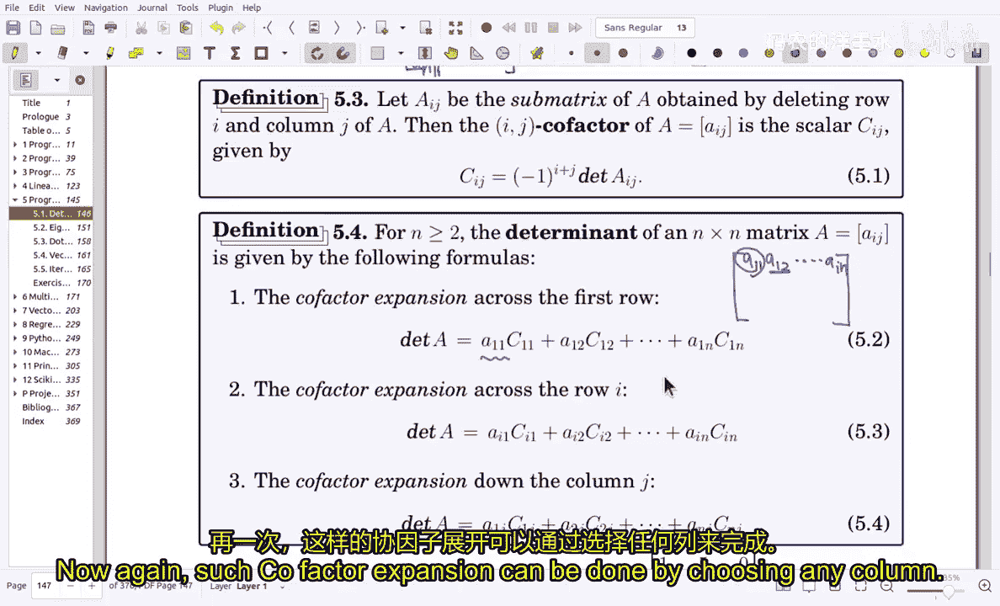

So perfect expansion down the column J。Is defined in this vein in truth column。For this entry。

We try to find the correspondinging core factor for there and again， again， again。

 go down to the bottom。Then this expansion will be the same value。

So we can define that determinant of a biasing any of these。

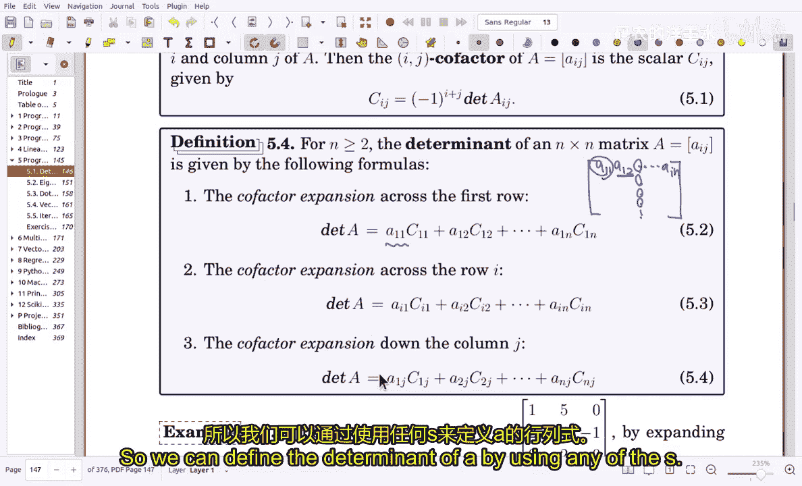

Okay。Now， find the determinative A given in this way by expanding。Across the first row。

And down column 3， Okay， that is the first task。That is the second task for the example。Okay。

 let's try to。嗯。Do the first task， okay。First wrong。So that is1 times C1，1。 That is1 here。

Plus five times， you get that5 and C 1，2 plus 0 times C，1，3。Okay。C 1，1 is -1 today。1 plus 1 is 1，1。

 And then okay， the determinants of a 1，1。 Okay that is。Eliminate the raw。Of that entry。

 row and column remain the part this one。That is the sum metric， a 1，1，4 minus-1 minus-2 and s。 Okay。

 so here there this is one， and that is-2， right。Okay， how about C 1，2。Which is  -1 to the1 plus 2。1。

2，1， plus 2。And。We have to get the summe for five this entry。 And if you eliminate raw。

Column that limit the party is 2 minus-1，0，0。2 minus-1，0，0。 Okay。

 determinative of this metric is a 0 so that that is 0 now。This one is， so that we don't。

Have to compute this one。아피코사 일을。Makeking no contribution。 Okay， so here from this。Values。

 we can get the determinant1 times the C 1，1 is minus-2 and five times 0 is a 0。 so that。That is -2。

 We got the determinant。嗯。When we are using。The expansion across the first rule。

Now let's try to do this one。The second task。Okay이， column 3， then okay 0。Times C，1，3 position，1，3。

Plus， here， -1 is the entry and C 2，3。Plus0 times she3，3。Okay。

We don't have to worry about C13 because0 will be multiplied， also same here。And。We only need2 C 2，3。

 C 2，3， which is same as  -1 to the。2 plus 3。 And then the。Determinant of some matter。 Okay。

 for this entry， we have column。Ro。Eliminated， then the middle party is 1，5，0 -2。1，5，0 minus-2。嗯。

Okay， that is。This portion is -1， and there is-2-0， which is-2，-1-2， so that then will be2。

So from this here， we have a first one is a plus minus1 times the seat。2，3 is 2。And of course。

 over there， there'll be， so that we have -2。So we got the same result。Okay， here。

The observation is that to get the determinant of 3 by3 matrix。

And we need determinant of some mattresses。Yeah， some me are two by two metric says。

So took that 30 by 30met it says。We combine。嗯。The determinant of two by two matrix。

 There's a first observation。 And also' the second one used to that。This second test is simpler。

And so that once you try to make expansion， Qua expansion， you may choose a row or column such that。

呃呃。That includes most of the zero。And。Here， in this case， also if you choose a further row。

 then only one90 is there so that you can get。The determinant much more effectively。Right。Okay。

If a is a triangular， a a lower metric。Then determinative a is the product of entries on the main diagonal of a。

Okay， let's try to get the term of a for this metric， which is。Well。Or per triang I at right， okay。

Now， determinative way， and we are。约ing的。Quefic expansion。For the first column。

 then this only we have one。And then a C 1，1， there is same S minus12 the。1 plus one， And then。

Determininate the。Some metric has - X，-7，5，0，3，0，0，0，4。And for other core factors。

 we don't have to worry about。Here，0，0，0 will be multiplied。 so they。Make no contribution， okay。Now。

 from this one， we have to get a determinant of this matter there。 Again。

 this position is 11 position， and we try to use the qua vector expansion along with this first column。

Then now there is one， and this will disappear， and there is a minus 6。

And here we ignore minus-1 to the1 plus 1， and then the determinator is sum matrix。So theres a 3，0，0。

4。 Okay， now we know。The determinant of2 by2 metric A D minus B， right。

 so that there's one times minus6 times 3 times 4。That's the determinant。

 which is the product of the anus on the main diagonal。Right， okay。AndBy using a command。

 built command in Matlab， you can get it quite easily。 here， A is defined the same metric。

 and we call D T。 Then you can get the answer minus-72。 Of course， that will be the same value。

The metric a in the last example has a pivot position in each column。 So it is inverible。Okay。Now。

 this metric has here in etroron form and。That is period， period， period， period， in each column。

It is pivot。So that it is invertable now。One of them is0， for example， this is0 rather than4 then。

Here the that product will be0 so that determinant will be0 and then of course here。

 because this is0 and there are only three periodss， so it is not inverable。And。So。Looks like here。

deterterminant。0 then here， not okay。That is， not inevitable。So in fact， these are the same。

 So inverable matrix。Cannot have zero determinants。Okay。So is always is true。

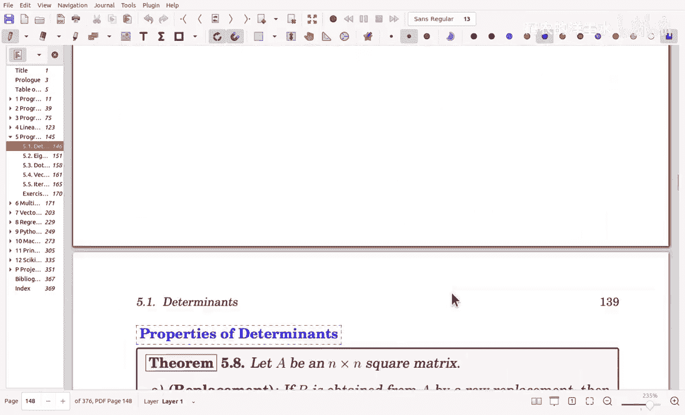

Okay， here we consider properties of determinants。Okay。A is on M by N square metric。

 and we apply the elementary rule positions to the metric and see for how the determinant is changing。

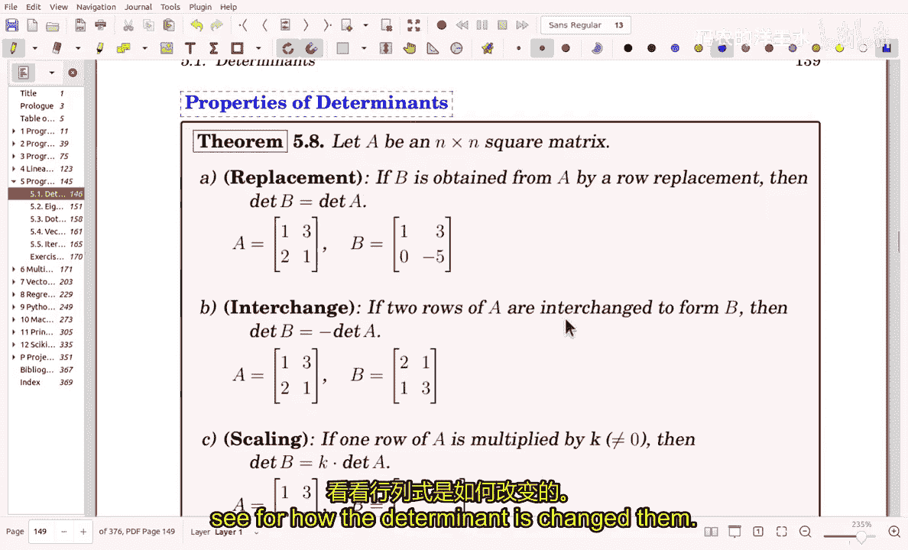

B is obtained from a by a rule police， then determinantative B。

Its same as the determinants of the what Mad。That means。

Re replacementment is not changing the determinant， Okay here。We applied。

Dplacement and eliminate this value and twice the subtraction is a 0 and twice subtraction will be minus 5。

Okay， for that one。The determinity is a D minus B1 minus6。 So that is minus5。Okay。Now。呃。For this one。

 minus5。inus0， so that again， minus5。The replacement didn't change the determinant。

 How about interchange。If two rows of a are interchanged from。To form。Or matter B， then。

Determinant to B is deviation of determinant to a。 Now， B is made by。An interchange。Okay。

 so first row becomes a second row， second row becomes a first row for this metric。

The determinant is 8 D minus pie6-1， which is 5。5 years， the of。Minus5。Right。If。

1 rule of a is multiplied by K。So we are applying scaling operation。 Then for the new metric。

 the determinant is K times of the original metric determinant。 Okay， for this metric。

 we multiplied for。To the second row， K equals -2。So that we have minus4 minus2。Then from here。

 the determinity is A D minus B-2。Plus。There's 12 minus minus 12， so it's plus 12。So that。

The answer is 10。 this is obtained from here that is determined to minus5 and times minus-2。

 we can get 10。Now， you have to be a bit careful when the K is multiplied to the whole matrix。

 for example， k minus2， then there will be minus2 of a。Okay， for。A， we are dealing with。

That is minus2 is multiplied， then minus2 minus6。And then-4-2。

 So that determinant of the metric is AD D。For。Minus。24。Which is now-20。 Okay， this value。

Can be interpreted in this way。 That is。Yeah，-2。Schedule times -5。

That is determinant of a original metric。There is now minus2 squared。

The reason we are putting this way is that here minus2 a is the same as from original met gain。

 we multiply minus2 to the first row。And again， one more time-2 in the for the second row。

 So that -2 squared。If we are using this。Computation， then exactly it can be explained in this way。

Okay， so don't be confused with。-2 multi K。To whole metric。And， but。O。To a rule。

 you have to distinguish this to。Operationss， okay。

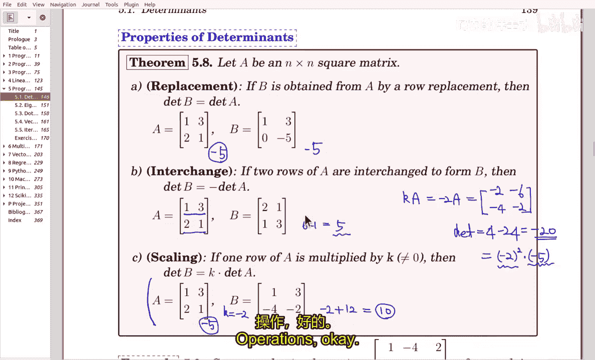

Okay。Now， compute determinative A。A is given in this way。

 After applying some elementary rule positions。 Okay。

 now we know how the three element rule positions change the determinants so that after applying some。

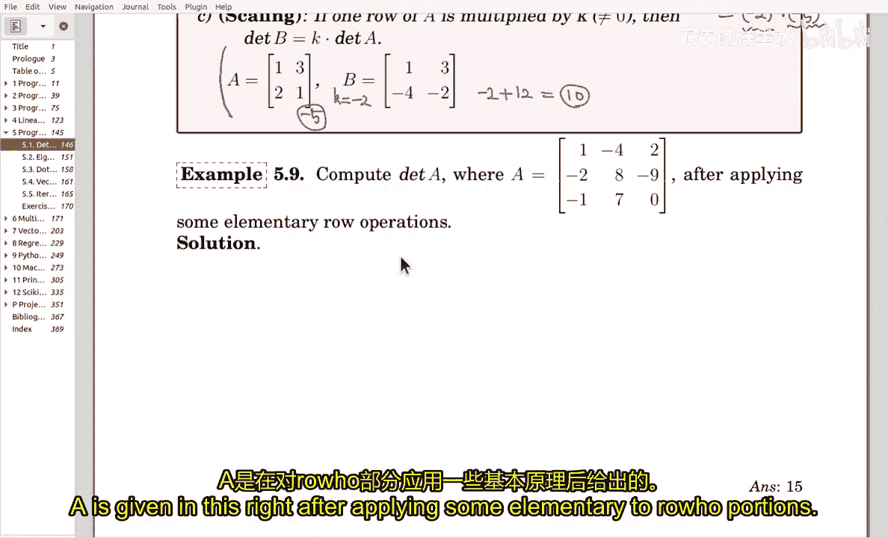

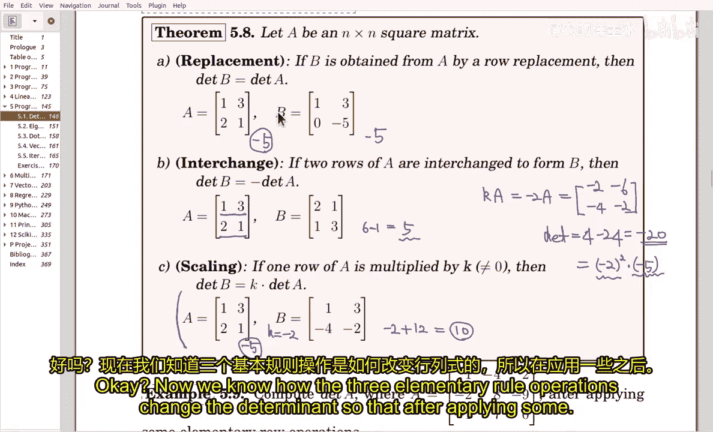

Eleementary role positions， we can get， if we can get the determinant easily， then we can chase back。

To get the determinant of original metric， okay。As to hear from a。

Let's try to eliminate this one replacement。1， minus-4 and2。And twice addition will make 0。

 twice addition again 0， twice addition， there's minus-5。Okay， now addition will make us Ed。

 There is a three addition。 There is2。Okay， and we applied twice of replacement so that determinant of this one and determinants of this metric will be the same。

Now。We may apply now interchange and second row and third row will be applied。

And interchangeed then one， minus-4 and 2。And then that is 032，00 minus5， okay。

 now it is on upper triangular metric so that the triagonal entry， the product will be determinant。

So the determinator for this metric is -15。Now呃。After the interchange。

 we got that one So that determine this one must be 15。Now， we obtain this one。

Using deplacement operations so that the determinative metric。A must be the same。So this value。

 so the answer is 15。

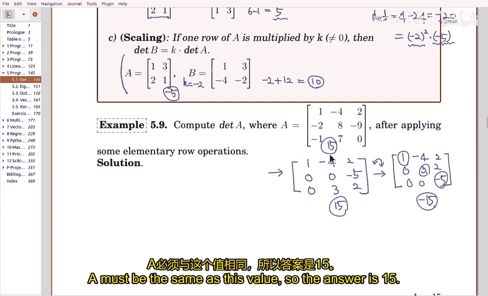

Okay。

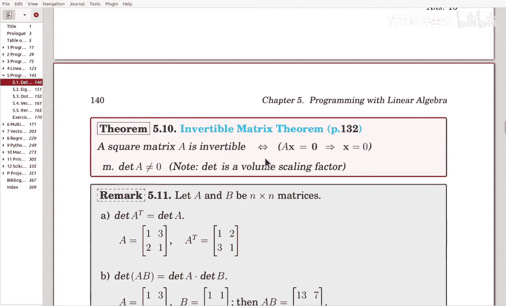

Inverable metric theorem， we can add the one more line for the invertable metric theorem。

A smetric A is inverible， and then it is same as this one。

 the homogeneous system has only the tribal solution。Now。

 that is equivalent to say determinative a is a non zero。Once determinative is a C。

Then if we consider this one as。The determined operation as a volume scaling factor。Then， here。Now。

 once O， we assume determin to a equals0。Then here， Ax。For。90， x and 90 and that。My PC wrong。

Because the volume can in factor， so it is a0， which means that x will be collapsed to become0。

This means。This homogeneous system has nontrial solution。So it is a kind of a controller they。

And this is a proof， but in。In linear ground， in fact， two things are proven in a different way。

But also， if you are using the factor that determinant is a volume security factor。

 you can prove the equivalence like here。

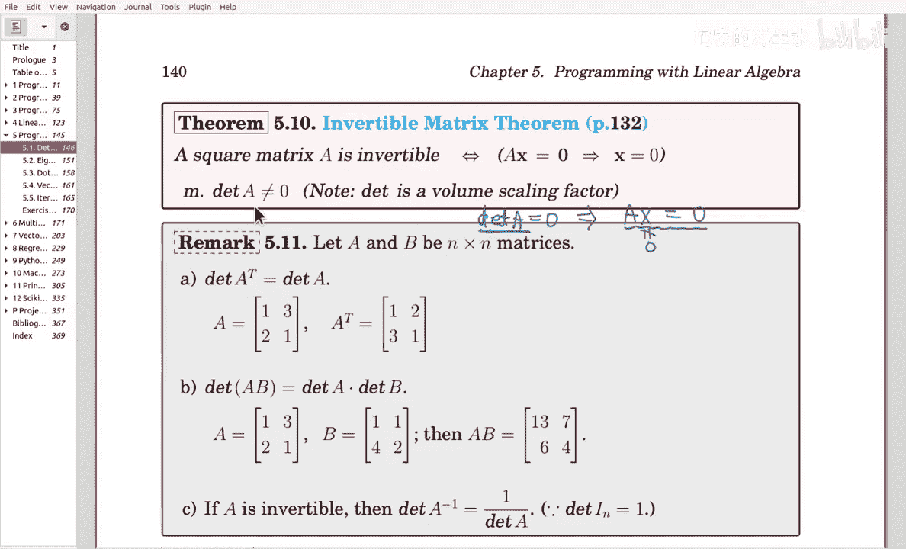

Okay。A A and PR are2 M by n square matrix says。Then here。

 determinant of a transport is the same as determinant of a。And。That is。

 all that we know determinant is a minus5。 and for a transports， again， A D。Minus B so that， again。

 minus-5。For。Every metric says for general N here， it will be too long。Okay。

 for product of two metes。A B determinant of A BA is the same as determinant of A and times the determinant of B。

이ル비 유치だ。Quite frequently。Here， the determinant a as a minus-5 and determinant to B is。2。

 minus-4 so that there is a -2。Now， ABA。Yes， yeah。80 minus B。That is 52。Minus of 42， which is 10。

So you can easily see minus5 times minus2 is 10。喂。Now， if a is invertible。

 then determinant of a inverse。Is one of a determinatory A。 Okay， we can see it quite easily。Now。

 a inverse times a must be identity。And， and theron。The identity Mad。Now， by using this fact。

 now determinant of a inverse a is same as determinant of a inverse times determinant of a。Now。

 right side is a determinant of identity。Okay， earlier， we solve one example。

Saying that for triangularome。The determinant is the product of entries on the main diagonal。 Now。

 identity material is。And lower triangular and upper triangular at。So that the triagonal is not one。

 so that their product must be one。So， a determinant of。Identity metric is one。Now。

 for determinative a inverse， we can see easily is one determinative A that is exactly this one。

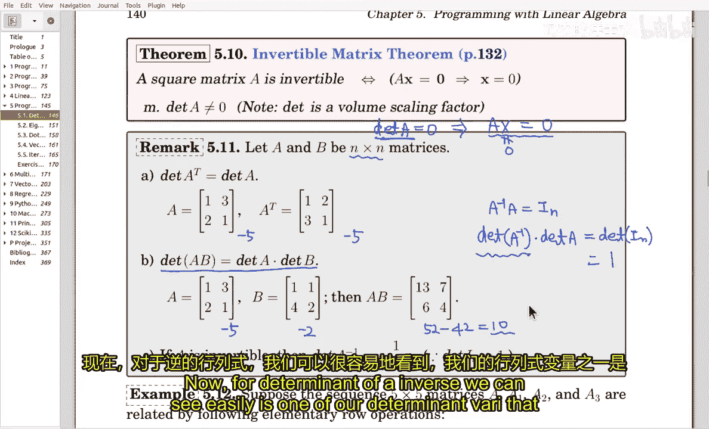

Okay， let's try to solve this problem。 Suppose the sequence5 times 5 matrixes， A， A 1。

 A to A 3 are deleted by。Following elementary rule positions start from a and with the dement A1 scaling A2。

 interchange A3 and A3 is given here。 So we have to find the determinant of A okay。

 So we start with the determinant of A3。Okay， this is a per triangular metric。

 the product of diagonal will be the determinant。1 minus to 3 minus-1， so that。That is a sex。

 the product is a sex， okay， so determintable A3 is a sex。And it is made by interchange operation。

 So determinative a2 must be minus6。Okay。Now， one row， further wrong。It is killed by 105。

So that A1 determinative A1 can be obtained by the skill bat， which means。Multiply 5。

 So here there's minus。30 so that105 is multiplied， then we can get minus x。Now。

 that is a deplacement operation， so determinant is not changing。Yeah。

 so a determinative a is minus 30。Right。Okay， that's the end of the section， thank you。

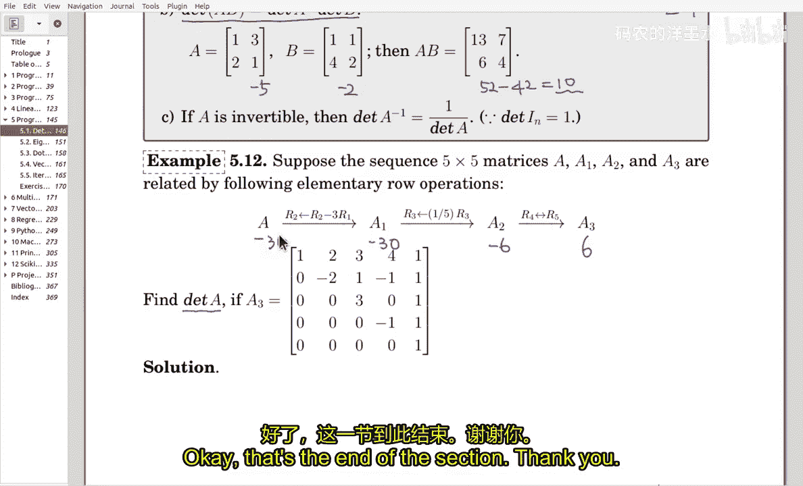