# 【全集-附课程讲义】密歇根大学-人工智能编程-EECS492-中英字幕-p34-Lecture-34---特征值与特征向量：特征方程--BV14JqfBNEAS_p34-

Iendvalue， and I again vectors。These are defined for square mets， like determinants。

A is on M by M metric。

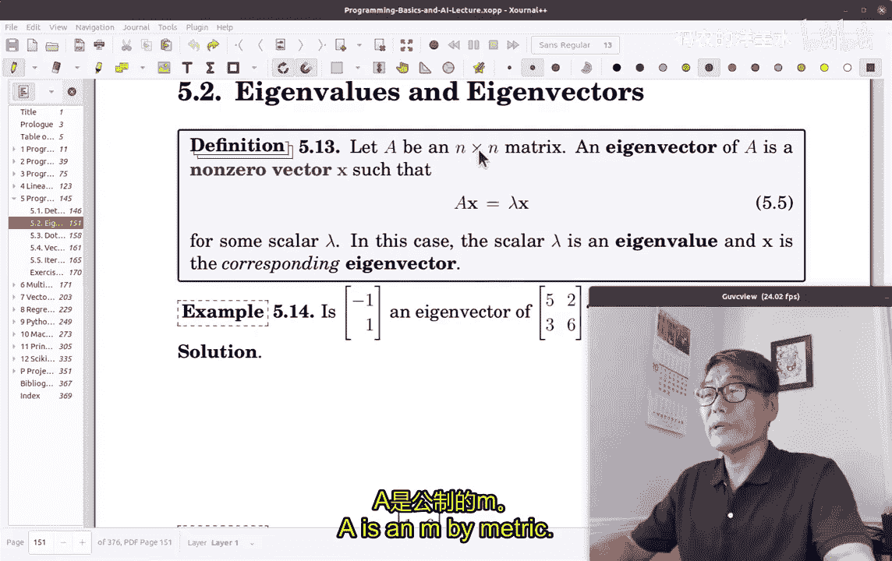

On Ive a。I's a nonze vector x， such that。A X equals Ramda x for some scal Ramda。 In this case。

 the scal Ramda is an eigenvalue and x is the corresponding eigen vector。

We'll try to get a better understanding。Of these new terms by solving some examples。

Is this vector on eigenve of the metric？What is the。I can value， okay。

For this vector to be an eigve of the matrix。This should satisfy this kind of location AEX equals Ram Ds。

Okay， so we try to get the product。The metric。Is now 5，2，3，6。 and the vector is -1 and1。Okay。

 raw column。That is minus 3。Second row， column。There is a 30， minus 30 plus X， okay。

So we have to write this one in the chat here， Rammnda and X。X says。us1 at1 right now， this x。

And two with the same， we have to put here 3。 So 3。Is the corresponding I， value。And also。

 this vector is an eigenvector of themetric， okay。

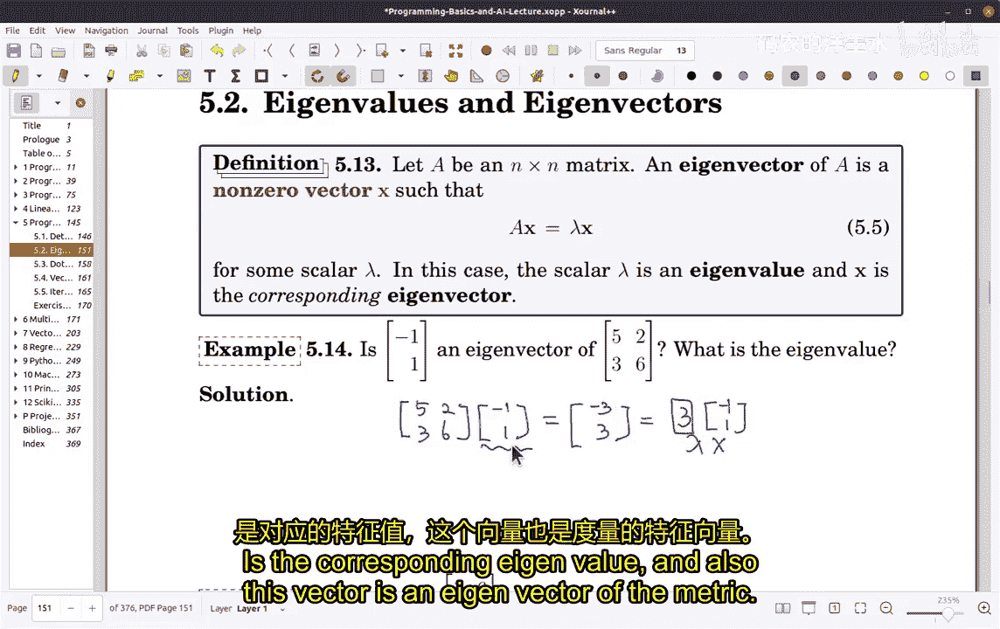

A is given in this metric， and we will show that 7 is on eigenvalue of a。And。

Will find the corresponding eigen vectors。 Okay， that is in fruit form。 We'll see why we have that。

Okay， now once the7 is on eigenvalue， then we can write in this way A X。He called7 x。For some。9。

0 vector。Okay。Now， from this one， a。X minus of 7 x。More piece all。 And we can write this one again。

 a-7。Identity and x equal 0。So this metric。Should have。Notri solution。 This is for modern education。

Now， it should have。92 solutions， because x is non0。 Okay， let's try to。Organize this matter， A S 1。

6。5，2。And-7 identity 1，0，0，1。So along epi multiplication， along diagonal， the values 7 and 0。

 so that。Here， we try to subtract-7。 So it's -6 and 6 and-7。 So that5 n。And minus5， right， okay？

So we have to solve the problem here， x equals0 and once we can find the nontri solution。

 that will be corresponding eigenvector，Now， for this one。We may start with augment to the metric。-6。

6，5， minus5 and rh I0 vector。Okay， scaling makes 1-10。 again， scaling1-10。The same， so。

With a replacement， we can make0，0，0 here now。So， we have。Basic variable， x 1， and x 2 is。

A free variable。So， first all is saying。X1 minus x2 equals 0， which is same as x2。

X 2 is free so that we have here X2。From here now X， the left and side is same as x 2。

The free variable and one in one direction。So， for。Every9zero choice of x2。

 itll become the solution of this homoal system， and it'll be。

On eigen vector so that there are infinite many eigenvectors for。The Ienvalue 7。

So the solution we are using here。F form。Okay。Now， for example， if you choose x2 equal1。

 then x becomes here one in one。Okay， from here now8 times x， that is a is1，6，5，2。

And now that is one and one。There is now，7。1 plus 6，5 plus 2， again 7。So， that can be written。

You seven times one and one。 so here Ax equal 7 x。So 11 is an eigenvalue and the corresponding eigen victor and corresponding eigenvalue is a 7。

Now。For example。We choose x2， equal minus-2 then。X must be。-2 and -2。

From here now A X equals the same metric， 1，6，5，2。Exition now。-2 and -2。So that。Here that is， okay。

 minus2 minus12。-14。And-10-4， again，-14。So， that is same as 7。Times-2，-2。We have here， A X， equal。

7even act。So for various choices of x2。They are over。Eigen vectors for the eigenvalue 7。嗯。

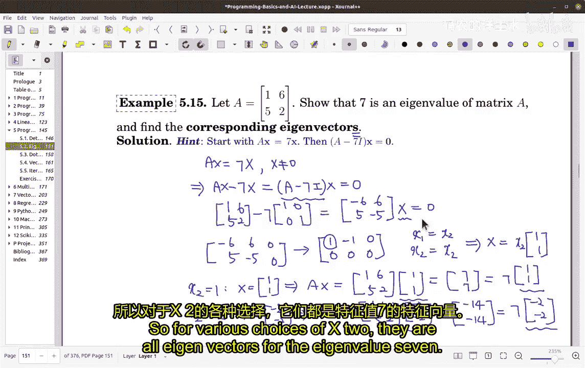

Now， Ramda is on eigenvalue of a。 That means that A X equals Ramda X for。X。南지ろ。Right。Then here。

 the homogeneous system。 So from here we can get this system should have。

Nontribal solution that means has at least one free variable。Because x is90 and also。

The determinant of Rammmed eye must be。Okay。So that。Determined toし。

So that we can have non triver solution。 So this one will be used when we try to find the id values。

And then I vectors。Okay。Now we'll add one more line to the invertable metal theorem。But pmetric。

 A is inevitable。It's the same as here。 the homogeneous system has the only non only tri solution。

 Now， that is the same as this one。The number 0 is not on eigenvalue of a。Now， will。こ the。The Ramda。

 we assume Ram is0 when eigenvalue of a0， then。So we'll try to show that once it is0。

 then a is not inverible。Okay。Then Ax， there are some non zero x。Such that A X must be 0。 Okay。

 this is eigenvalue，0 and x。That will be a0。So the homogene system has non triral solution。

Which contradicts to this fact。 So in this case， a is not inevitableverable。

 so the other direction also can be put quitely。And so that， they are the same。Once a is inver。

 then 0 cannot be。But I invaluably aim。

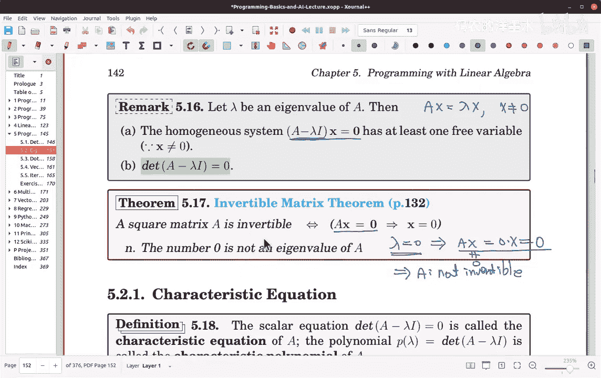

对。Okay， here。We have subsection characteristic regression。

The scal equation determinant of a minus Ramda I equals0 is called the characteristic equation of a。

And the polynomial that itself determinant of a minus Rammda I。

 so we are using the notation P Ramda is called the characteristic polynomial V。

The solutions of the characteristic equation determinant of a minus randomda equals0 idenvalue obeying。

That means that two find the eigenvalue of a。We have to solve this equation， characteristic equation。

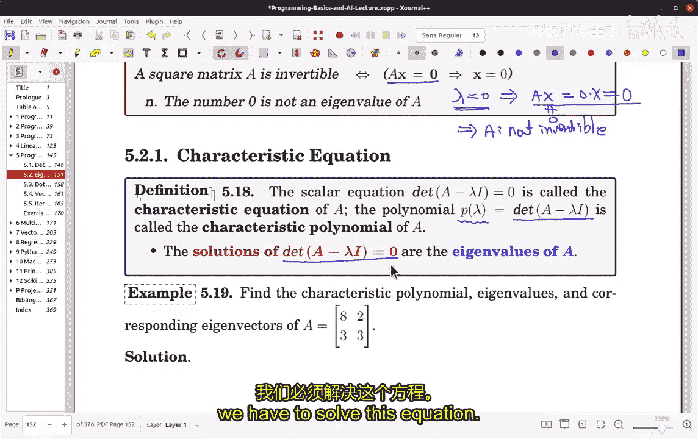

Now let's try to find the characteristic polynomial eigenvalues and corresponding eigenvectors of the matrix。

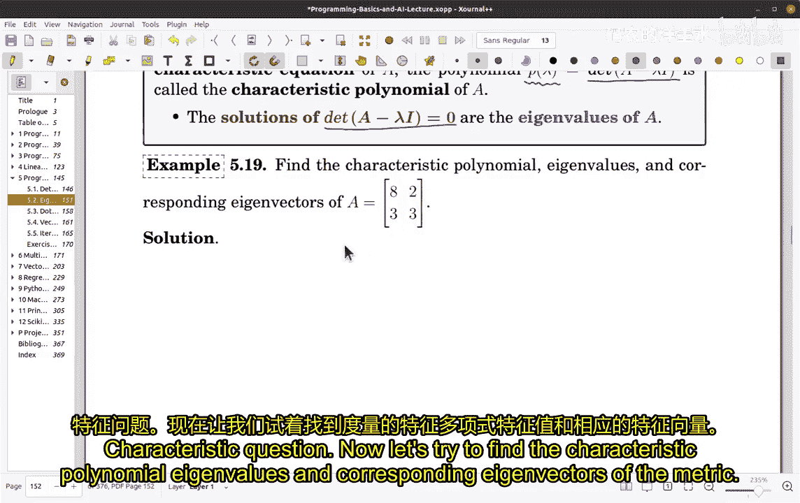

Okay， let's begin with a。Mus Rammda I。There's a yes， a，2，3，3。우램da， minus램da 아1，0，0，1。

So here we can get the metric and along the diagonal， we subject Ramnda。So there is a minus Ram。

 and that is 2 and 3 and 3 minus Ram。Okay， so its determinant。Yes， just 80 minus PC。8 minus lambda。

And。38 minus Rammda and minus。6。Okay， so here that is Ramda here。-11 Ram， and plus 24。-6。

 So we have Ram scatter minus-11 Ram。And that is plus 18。Equals 0。Is the characteristic equation。

 And this portion is the characteristic polynomial。Now， we have to solve this equation to get values。

Okay， now，18 can be separated into 2 and 9。 And if we put here minus minus。

 then also this one is a render Ram separation。So， from here。We have two eigenvalues that is 2 and9。

 right。

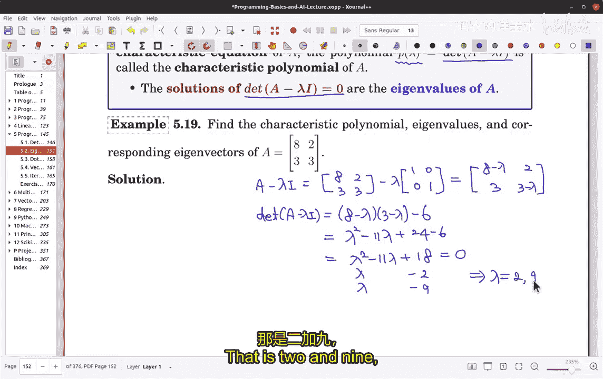

Okay， from here now once Ramda equal2 for each case， we have to find。Eiggan vectorctors， okay。

 what M does is2。Then A minus Ramda I， we subject to along the diagonal。

There is now 6 and 2 and now 30 and1。 So we have to solve a minus Rammda I X equals0。

 we have to solve with M。Okay。So this homogeneous system must be solved them how。We can start with。

They augment the matrix and then apply elementary row portions，6，2，0。31，0。 Okay。

 two rules are essentially saying after scaling， you can get that on。 So here from this one。

 we can reach at。No。Okay， that is。Okay， against scaling。1，1 over 3，0。 and using。Dplacement。

 we have 0，0，0，So x2 is a pretty variable and x1， equal call minus1 third。I'll be x 2。

 and x 2 is x 2。So follow here， X can be obtained there。With x2 and dion is -1， third， and1。

We may rewrite this one in this vein and using integer values again x2， because it is arbitrary。

 we are using again x2 and a multiplication of 3， we have a minus1 and 3。Right， okay。

So scalam pull this vector。Will be the corresponding eigenvectors。Of。The I value2， right？

And how about Redaius 9？Okay， then。Here a minus 99 and 9 will be subtracted along the diagonal。

Then there's minus1 and 2， okay， 9 is subed here， minus1 and 2，9 is subed the 30 n minus x， okay。

30 and-6。Okay， that metric。Times X must be。The see， right， we have to find the edge。Now， again。

 the same。By using the augment matrix， we can get it。Yeah， the augment metric is minus-1，2，0。

30-6 see on。Here， essentially， these two rules are the same。You can eliminate these two valuess。

But through thement。Okay， so that we have here now。1-20，0，0，0。 That means here。X1 is 2， x 2。X 2。

Is x2 so that we can get here now， that is x2。And then。Here，2 and1。 So we can conclude in this range。

Now these are icon canvicctors。For the again， value 9。

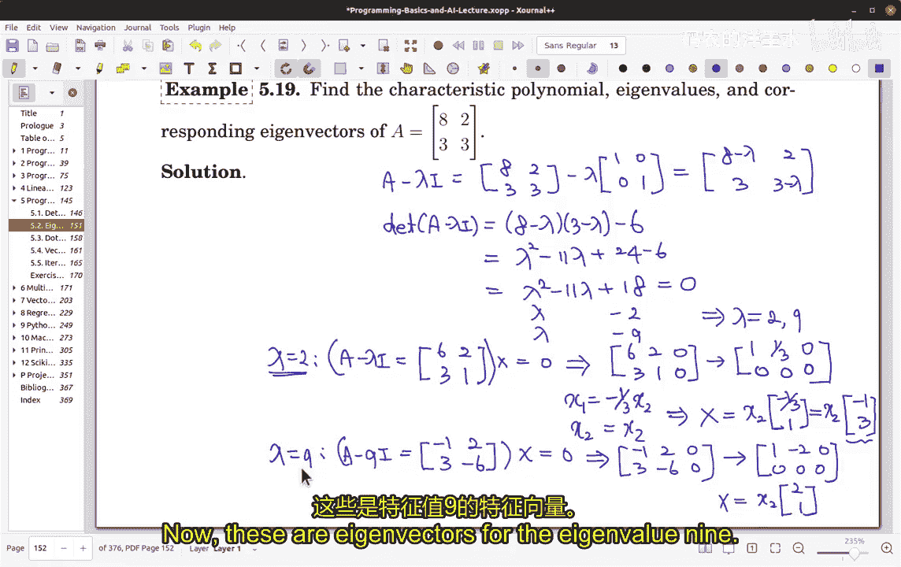

Okay。Okay。

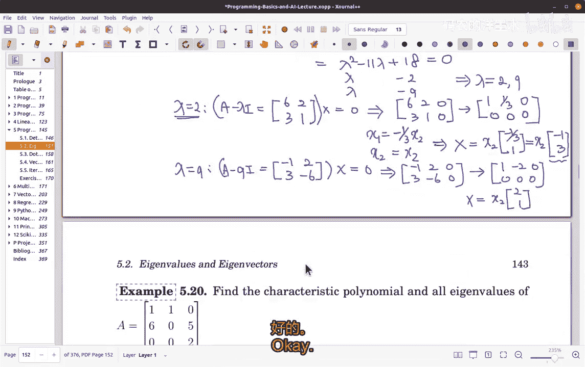

Find the capitalist polynomial and all eigenvalues of the metric。

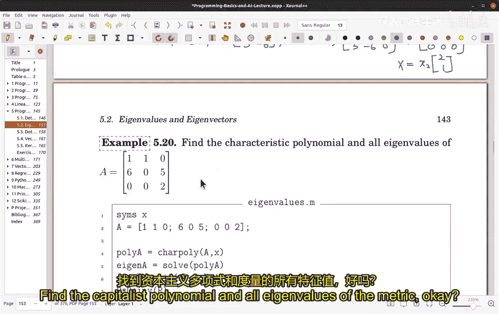

Now， you can get quite easily。But now， start with the computer program。And matlab。

And here we define a the same metric， and we are using。

Chaactteristic polynomial A and output will be with the X variable。 So that's this one。 And we solve。

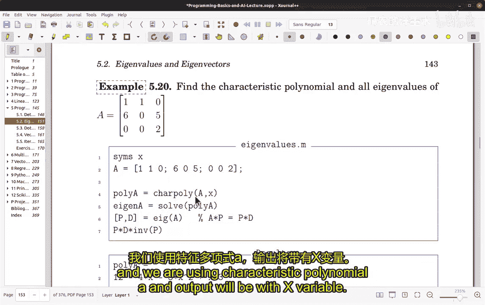

The the polynomial。Equals0， and we get eigenvalues。 that is here， minus2，2 and 3。

 That means this can be。Now， are factor in linear terms。That is x plus 2。And x-2 on not Ramda x。

 We are using a Ramda notation。 and then now x。Okay， minus3。Okay。Now， by EIG command。

 built command that we can get here。The collection of eigen vectors and diagonometric of eigenvalue。

So here these are eigenvectors and the corresponding eigenvalue are 30 minus to 2。Okay。

 and once we get there， right then。The metric P times the diagonmetric and inverse P with。

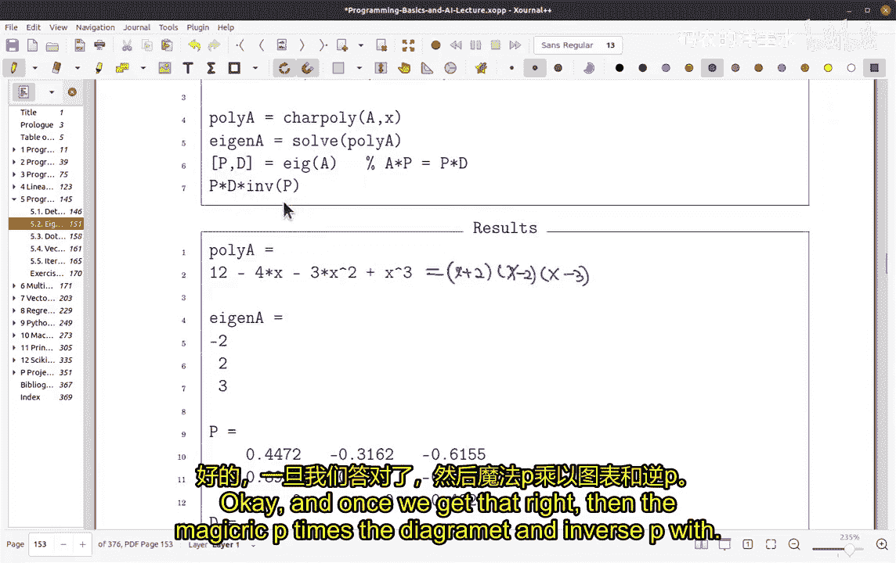

Produce the original metric。 So see if it is making。The Cuba metric is exactly the same as that one。

Okay。Now。Okay。嗯。Okay， okay。Now， metric similarity and the diagonalization theorem。

Will continue in the second part。 Thank you。

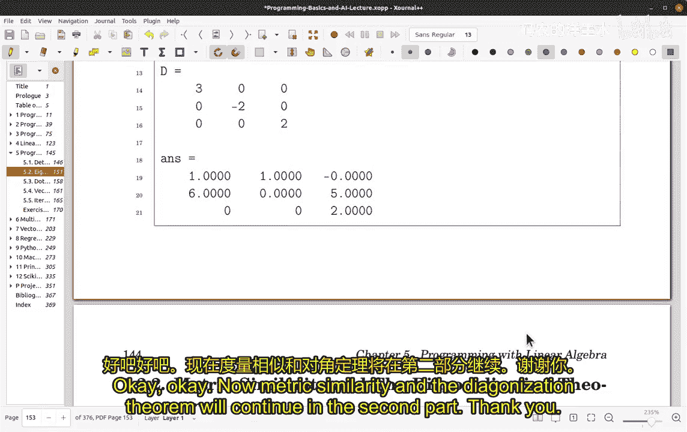