# 【全集-附课程讲义】密歇根大学-人工智能编程-EECS492-中英字幕-p35-Lecture-35---矩阵相似性与对角化定理--BV14JqfBNEAS_p35-

It is part2 of Section 5。2 metric similarity and the triagonization theorem。

A and PRR 2 M by N scale matrix says。Then a is similar to B。 If there is an invertable metric P。

 such that。A is P， B， P inverse， or equivalently。P inverse A P。Is being。

If we define Q as inverse of P， then dis equation can be written in this form。 So we can say B。

Is also similar to a。 So the similarity。Is a symmetric definition。

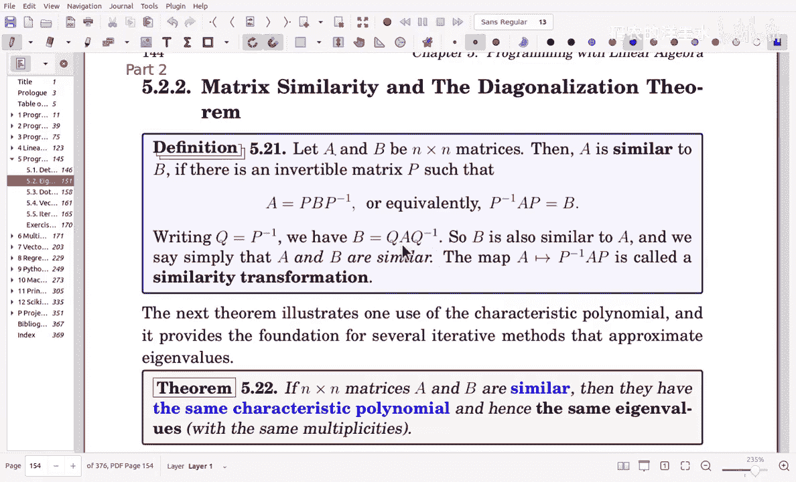

So， we can say， simply。A and P are similar。The mapping A2 P inverse A is called similarity transformation。

Okay， this a theodem。Is explaining。And。How to get the characteristic polynomial through the similar mattresses。

Okay。And。If M by N matric A and B are similar， then they have the same characteristic polynomial。

 and therefore the same eigenvalues。 the eigenvalues must be exactly the same。Let's prove that。

Your B is similar to a， so B is P inverse A P。Then。Now， B。Minus Ramda I can be written here。

 That is B。M- rida I。Now， for this eye， we use P inverse P。 then we。Factor P inverse。 Now。

 P to the right。Okay， so we reach at Pverse a minus Ramda I and P。

Now we apply determinant and determant this one is same as determinant of that。

But a property of determinant。Is that。The determinant of metric product。It's the same as。

The product of each determinant。So here， determinant of a P minus Ramda I can be rid the determin of P inverse determinative of a minus Ramda I determin of P。

But now this one is disprocle of that so we can cancel out so that we end up with a determinative a minus Ramda I。

 which means that。Once A and B are similar， then。They have exactly same c polynomial so that their eigenvalues are exactly the same。

2。

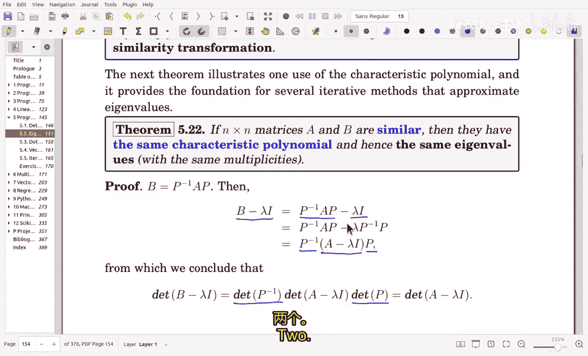

Okay， yeah。D 에agonization。When M by N， metric A s metric A is diagonalizable if。

There is on inver metric P and diagramagon metric， such that A is PD D P inverse。

 That means that A is similar to。Diaagonal metric， then A is diagonal iso。

Once it is a large so similar to。A diagonalmetric then。

Sometimes it is really quite efficient in the competition of the power of the metric and determinative of the metric here。

에이에서 다곤을놔주고。Then A SP D P inverse with a diagonalmetric D。Then。A squared。

 A and A and Pverse square will be canceled。 And that d squared。 so we can get。This Tom。

Using the same idea， the power general K power of a can be。Obtained in the rain。P T to the K。

 P inverses。Once。The Cuba matrix is a tiagon large stone， then simply。Power。

Of A can be obtained by powering the diagram mad， which is very simple。

Now how about inverse Also if you take inverse of the diagonal metric then。We can get the inverse。

 Of course， the cable mat must be inver when we get this one。Now。

 determin a is same as determinative D Earl， we proved here once A and B are similar then。

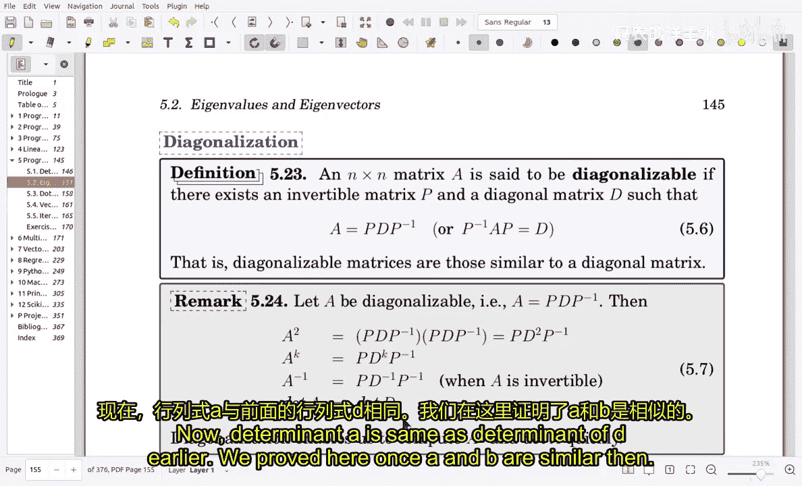

Noun。Determinant must be the same。Okay， now。We choose here Ram I consider。

 So then eject here determinative B is the same as determinator V。

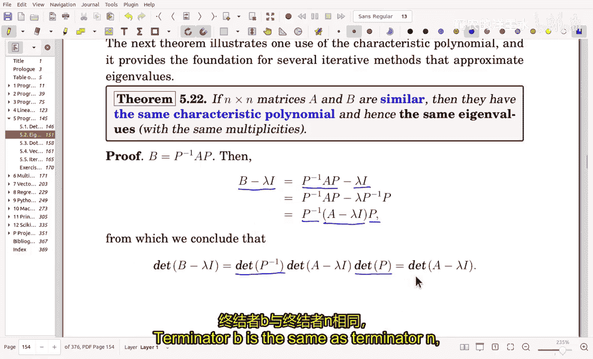

Now， we have a self study problem。 Now for the kmetric and P And D are。Given so that here now。

 A is similar to。D and。A to the K。 you can find a formula 4 a to the K。 So first to make a K power。

And D to the K is 5 to the K，30 to the K。And you can。Multiply P and P inverse from both sides。

 And you can find the final formula。

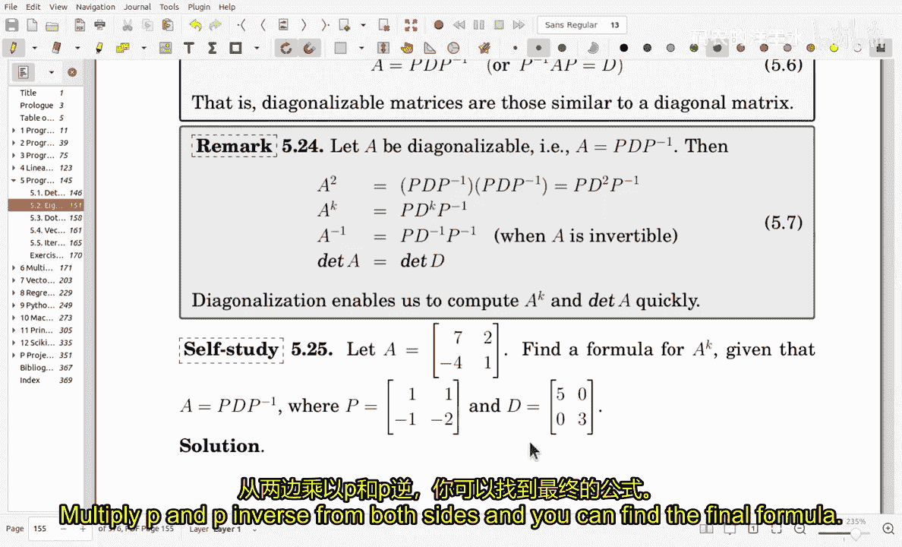

Okay， there it's this one， you can check here yourself。

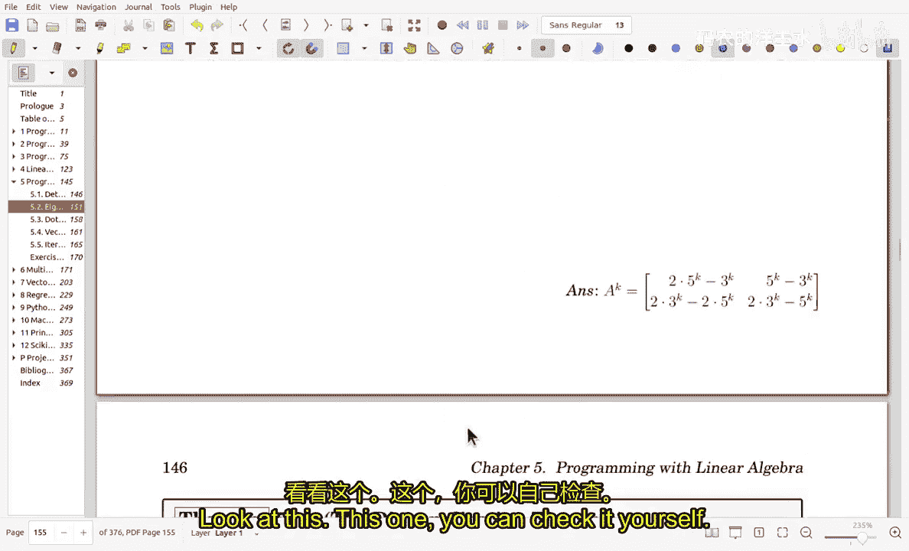

Here we have the Tegonization theem。嗯。When M by N square metric a is diagonalizable。

 which means it is similar to a diagonalmetric if and only F a has n linear independent eigenvectors。

So for diagonsable mattresses， it has always。嗯。And linear independent id vectors。And， in fact。

A is reading as P， D Pverse。If and olive the columns of P are n linearly independent。

Independent eigenvectors of A。In this case， the diagonal entries with D are the corresponding eigenvalue away。

Here we collect the N linearly independent id vectors to form the metric P。And we form。

A diagonal metric， using the corresponding。Iiggan values Ramda1 to Ramda n。You now。A V K is Ramda K。

 V K。So， Ramda K， V K。Ien value。 I can vector pairs。So it must be match。 the order must be the same。

Then we can write here。 A is P， D P emerge。So once it's diagonizable。

 then always we can put this way。And this is all way。So P will be the collection of eigenvectors。

 and D is the eagonmetric of the corresponding eigen values in the same order。

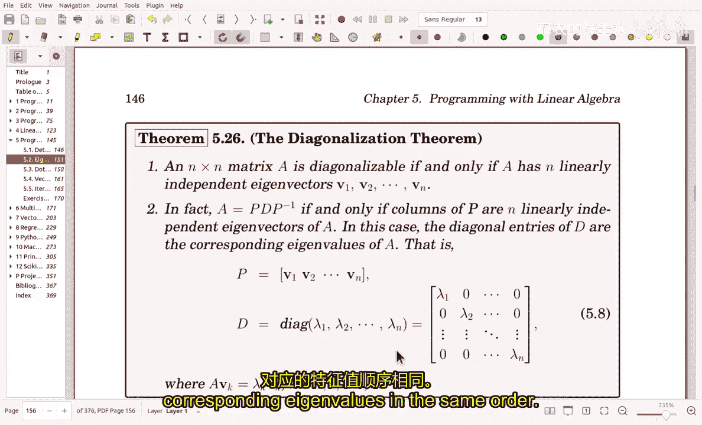

Here is the proof， if you are。Intered in mathematics， then you can read the。

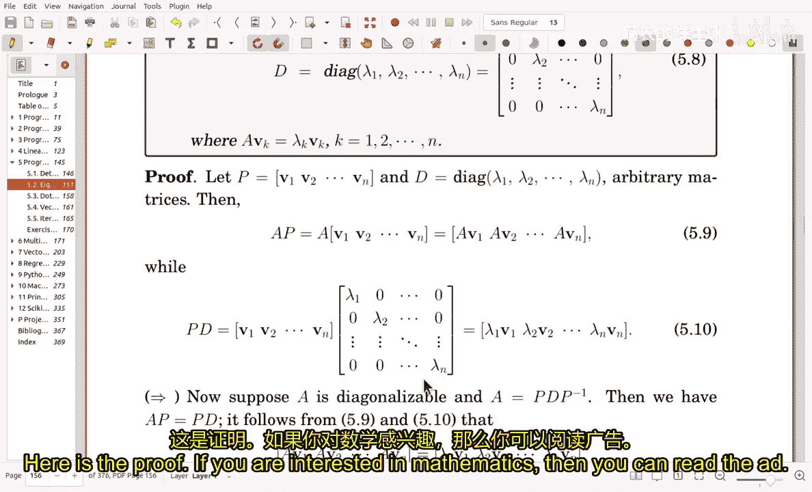

Okay。嗯。Diaagonalize the following metric， if possible。

 That means that we have to check if it has three linear independent eigenvectors。Okay。

 the solution is here。 First， we try to find the eigenvalues and try to find the three linearly independent eigenvectors。

 and we can construct P by using the eigenvectors， and we can construct D from the corresponding eigenvalues。

 That's the。The order。Now here we did it in this way。

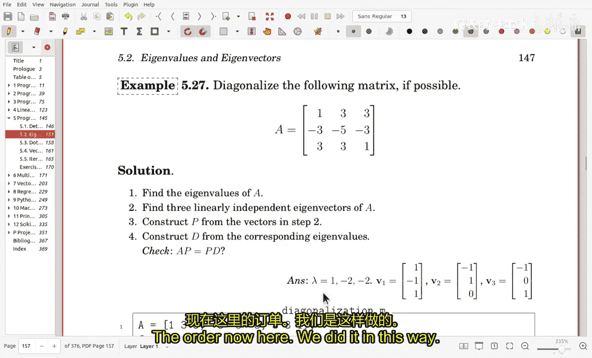

Now， if you are using computer program in Matlab。And for a now。Basing EI J builtin function。

 you can get the P。 that is collection of eigenvectors。 And D is the。嗯。

The diagonmetric of corresponding eigen values。 So we print out okay， P And D。And we check here， P。

 the P inverse。Is the k mat。 So it is the same1 minus 3 minus 3 okay，3 minus5 or3 okay。

 is the same3 minus 31 for the last column。 Okay， iss the same。Now， here。

Once you try to get eigenvalues and eigenvectors by hand， then you'll get1 minus-2 minus-2。

 so that we have two eigenvalues， one and minus-2 and minus-2。-2 have two eigenvectors。Okay。

 now for Ramdas1， it's okay here scaled。Now， if you butterfly some scar。

 then you can reach at 1 minus1 and1。 so same magnitude in moduluulars so that you can get this one。

But now for。Ramda is -2。 We have this one， and this one，2 eigenvectors。

 but the computer output is quite different， okay。

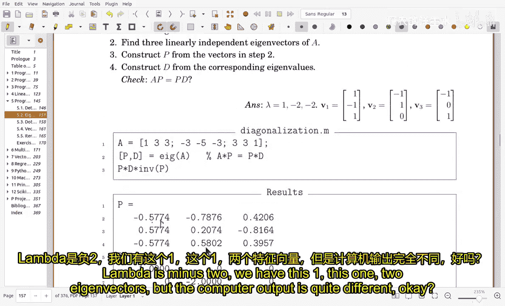

And here， let's check if it is correct。 Okay， now start with。Reamnda。Yes，-2。Then a minus Ram。

I must be same as。A plus 2， I。That is the same here along the diagonal we added。2。

 so that there is a 3，3，3 and 3， minus 3， minus 3 again 3，3，3。So we have to serve here。😔。

This metric times x equals 0， how bioing。The elementary row position okay from a we eing the0 extra column。

 Okay， here after scaling， we have 1，1，1， again，1，1，1， again，1，1，1。 So essentially they are the same。

So that we have here。Zeros。That means that。I'm sorry。

 X1 is the basic variable and x 2 and x is 30 are3 variables。

We' going be now x1 equals minus x2 minus x 3。And X2。And X 30 are free。Vable。

 so we have x3 x to x 3 is x to 3。So， the vector adds。Can be along with x 2。

 The direction is -1 and1 and 0。And along with the X 3。No。Yeah， direction is -1 and seedo and1。

This one there is exactly this two。So for arbitrary choice of x2 and x3， x will be the eigenvector。

Now， using one in0， we have that one and now0 in one， we have this one。

And now we have this linear independent， so that。This can be two eigenvectors。

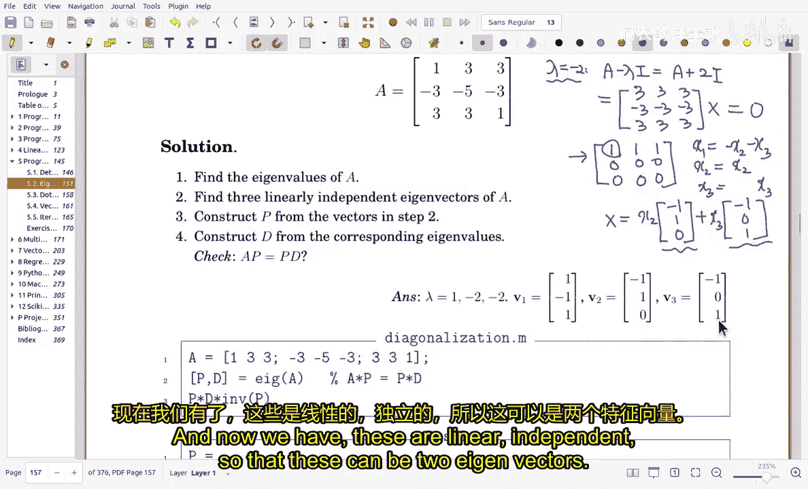

But here， the computer output is quite different。 Now， I checked here。This one。This one can be made。

By a linear combination of these two vectors。 So this column。

 that column makes a metric and there is a right inside and tries to solve the problem。

 Then you can solve we， which means that this is on。A linear combination of these two vectors。 again。

 for this last one， you can do the same so that this is a linear combination of these two so that。

And these are linear and independent， so that。Either you can use these tool or this tool。

 It doesn't matter。It'll be the same anyway。Because now， the same。Ienvalue， you can get various。

Other vectors， rather than this hand completed of vectors okay。But essentially， they are the same。

Okay。Okay， that's the end of the section， thank you。

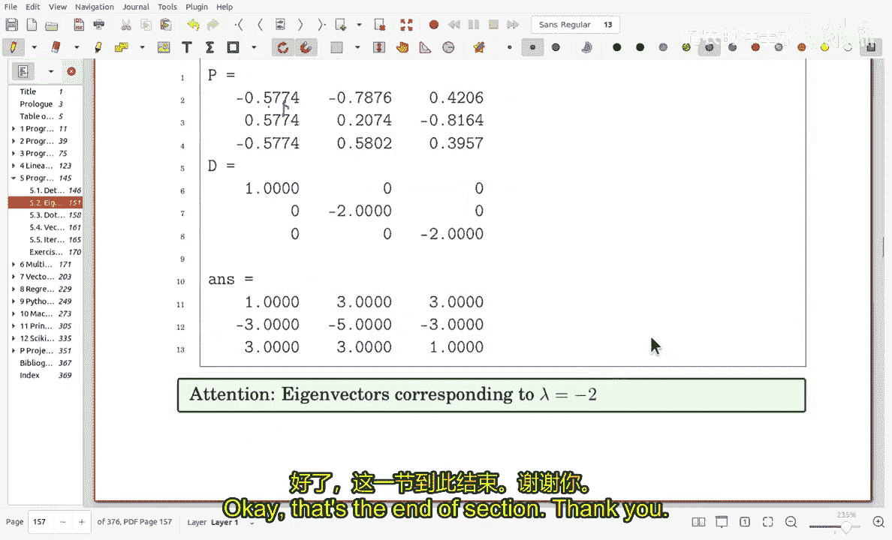