# 【全集-附课程讲义】密歇根大学-人工智能编程-EECS492-中英字幕-p36-Lecture-36---点积、长度与正交性-勾股定理--BV14JqfBNEAS_p36-

Section 5。3， top product length and orthoity。See this definition。U and we are two vector in Iran。

 then。

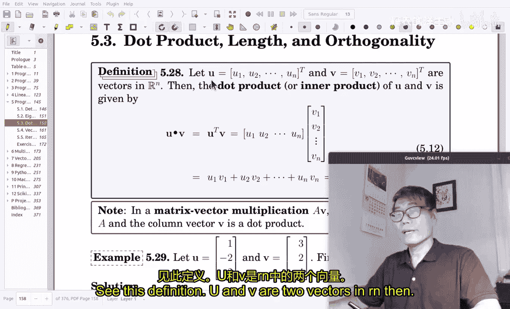

The type product or the inner product of U V is defined as in this equation。

You that being as the same as you transpose the being。And first。

 we multiply the corresponding entries。You1 V1， U2 V2。 And the last one is you and V end here。

 and will some。And those numbers。To get the data product， that's the definition of data product。

In a metric vector multiplication， A B， the product of rule of a。

And the color vector V is that the product。So， you already used the。The tattoo product。 Now here。

 we define。At the taappo of the Act。

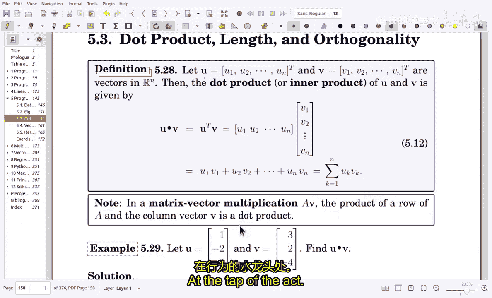

Okay， U and V are given。 We want to find the you that will follow over the definition。

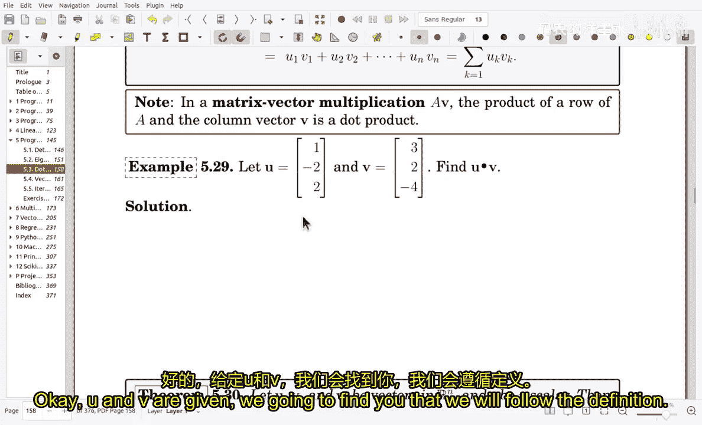

You。That the。We multiply the corresponding values，1 times 3 from second and two。And-2。

Times 2 from 30 entries， we have two times minus-4。And we sum those numbers。Then 30 minus4 minus a。

 so we have minus9。That's the final answer by a simple plan。

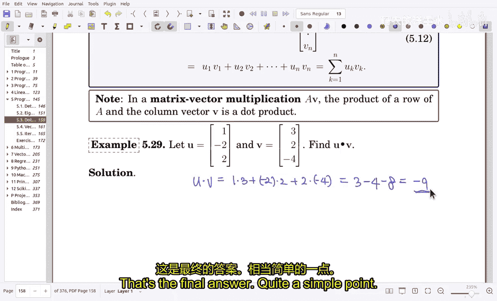

U VW R vector R， N， and C is a scalar then。We have these rules。

You can make data product with Apple over there， and you can see quite quite easilyly。

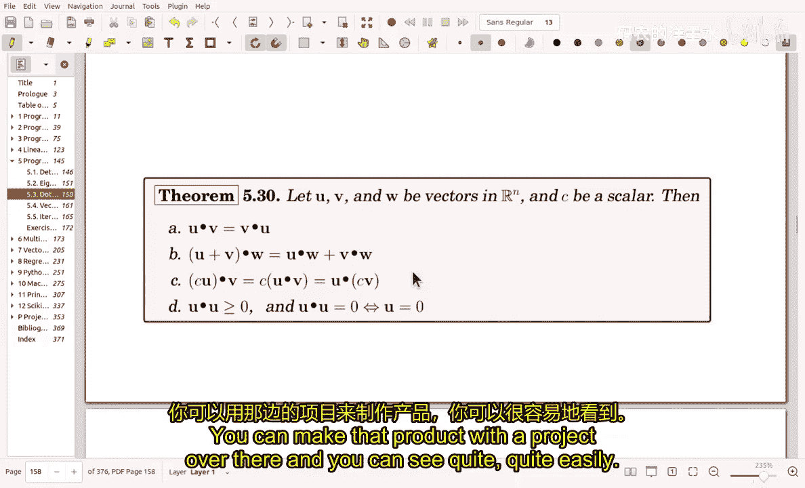

It must be true， because。Even though you put V in front of you， it doesn't matter。The product。

The verplication of the corresponding entries will not change the result so that。

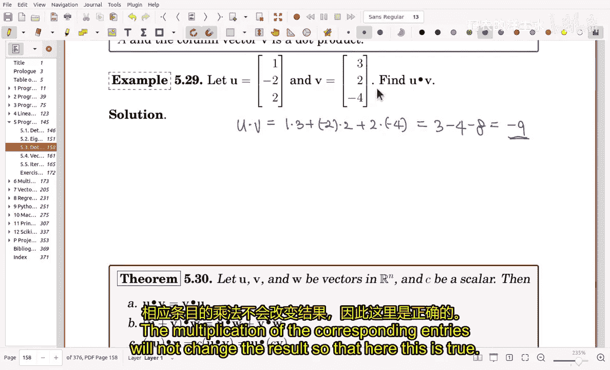

Yeah， this is true。嗯。For these two terms， when W is common。Then you can hear the that product。

After adding UB first and that product。This， a rule can be used when you see this one。

 then rather than。Making twice a without the product。

You may combine them and compute this one and one title product。In。

Real competition is a bit more efficient。Now， for scalar multiplication。

 you can multiply a scalar C for U or V or after that product， just the one multiplication of C。

Either way。You can do this， to the computation。So also in from the computation point of view。

 this one will be mostly efficient。And you that you must be non negative。Okay， here。无异议。

Multiply corresponding entries。 So the first one from here， first one from here， they are the same。

You want， so itll be scale from second on you to together from third。The third ones。

 and eventually the last one。So that。This edition。M be non negative because each term is not negative。

No。You that you。Is Si， but then that means all this you went to you and must be Si。

 which means you is a Si。So u that u equals0。

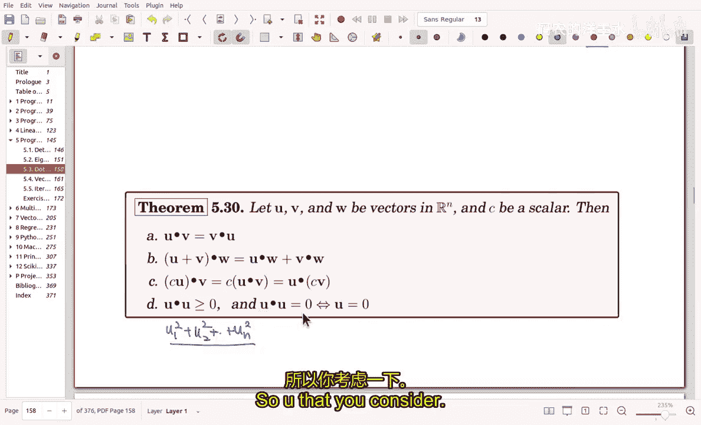

Is the same as u equals0？

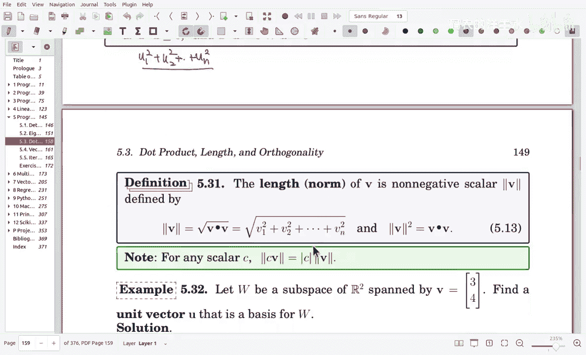

Now we define the length or norm， sometimes it is called Euclidean norm。

Length of V is non negative sc value and using that notation。Defined by here。Now。

 V known is spiritual of V do V。Now that is。Here we have stopography V1 scatter， plus V2 scatter。

And last one will be VN square。By spreading Pothide， we have V norm square as same as V dot V。

For any scholar value C。If you multiply C to a vector v and take the norm。

 then they the same as the norm of v times absolute value over C， you have to be careful。

 you have to put here absolute sign for the scalar。

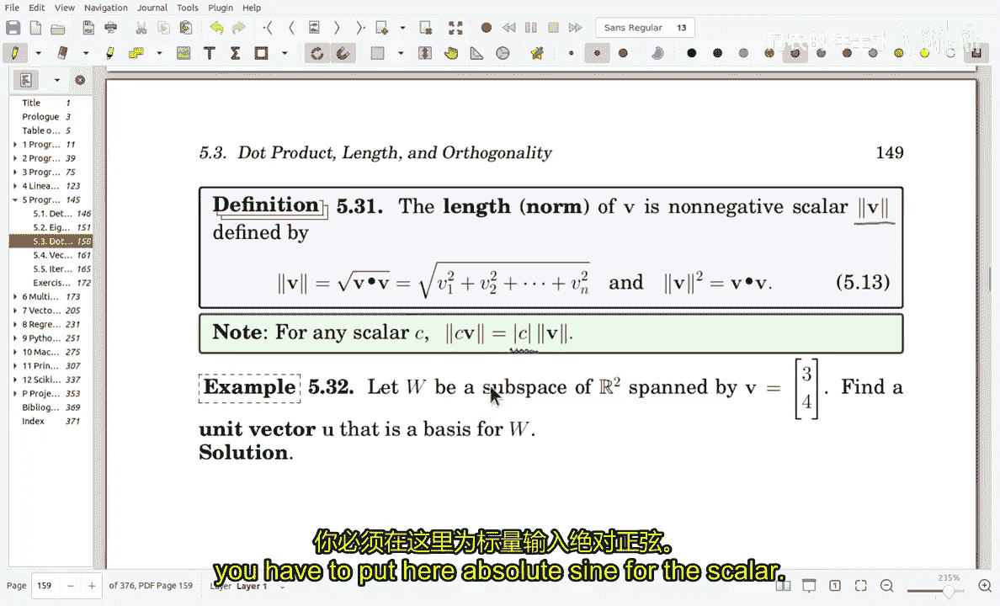

Okay， here W is a subspace of R 2 spend by。Of vector V。34。Pctorialally。

 we can visualize W in this range here， that's in x is a 3 and y the action is 4。So we have a vector。

From Or here for the4 position， that is a vectoria。Sin。嗯。So， that W is now spend。OfV。

Theyre the same as the collection of。Lar combination of the vector， that means C or B。

For every color。Oh。We have the vectors and is collected。

 The vectors are collected so that the W will make a state line passing the origin and then including the vector。

That is。The subspace W。And find the un vector U that is a basis for W。

Id Egypt to get unfactor U equal。Now V divide by length of view。G length of V is okay。

 let's try to find the length of V V。There on， equal same as square top V scatter V scatter。

3 scatter。Plaastic forceca。There is 9 plus 16， so that this is 25。Which means that is five。Okay。

 so here we have that is 105。And then yeah， that is a pretty and form。So that is the un。

 So it'll be a similar one around here。 That is U。And scalar multis of this U。

So if we collect all of them， then。And eventually， it becomes the subspace W。 So you。

Esself will form the basis for W。

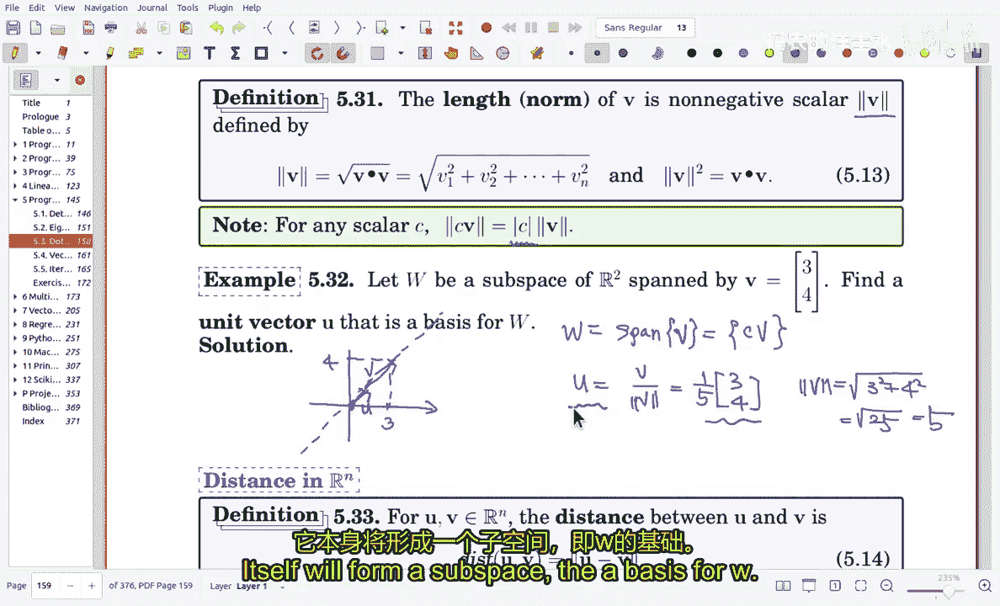

Now we define these stance。You and V are in RN， and we define the distance。

Between U N V in this very distance。U V is M S norm of U minus field。

So eventually this is same as the length of the vector U minus v。

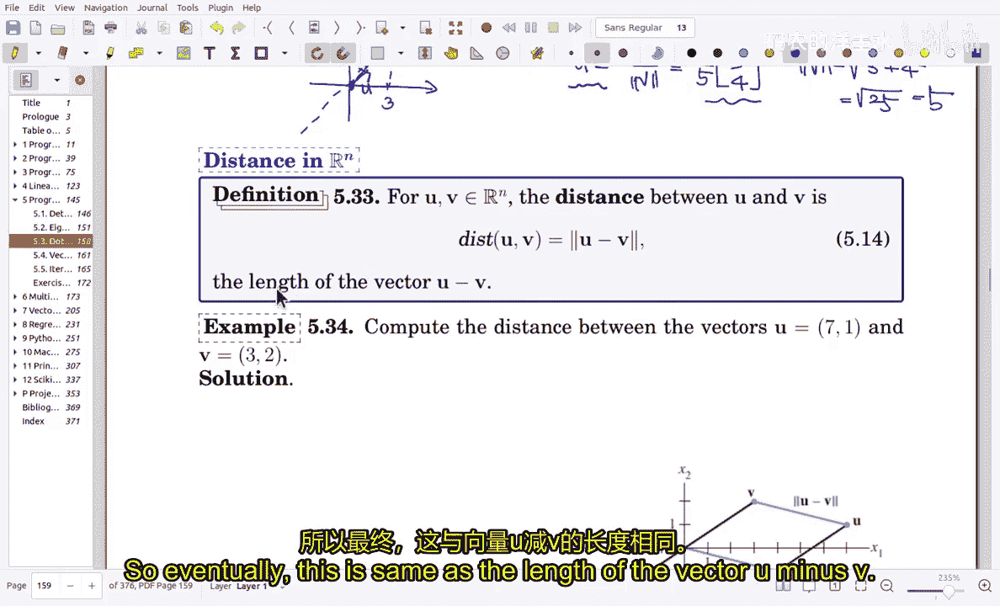

行。Will compute the distance between102 vectors， U and the。First， we form u minus v U is a 7 and1。

And v is affiliate2 so that the first component must be four second component must be -1。

So U minus vhi norm the same as。Yeah。By using the definition of the norm。Here。

 the first component is scatter， four schedule plus second component is scatter。

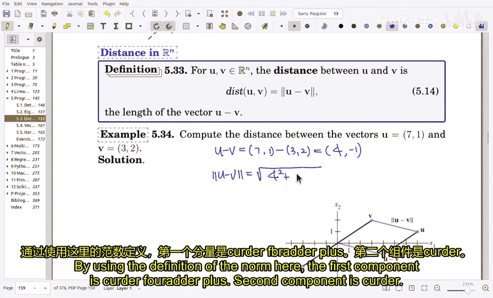

So that is ske tub， 160 plus one。Which is a 17。So the distance is schedule of 17。

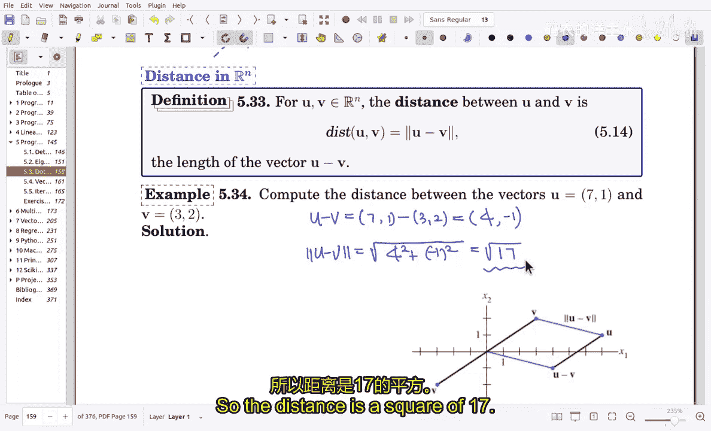

The pet link， we can explain that one。You is here。 So you may throw another vector from。

What is to you。And V see here。Now， minus v is this one。So U minus V means that stuff from。The origin。

Go to U and minus。 So we reach here that one。That is now if we so that this position is U minus being。

 So that is exactly this one。But if we consider this parallelogram。

 then length of this one is the same as length of that one。So that the distance type chain。2。

Of vectors is really the distance between two a vector。 So that distance is。

The distance between two vectors， okay。

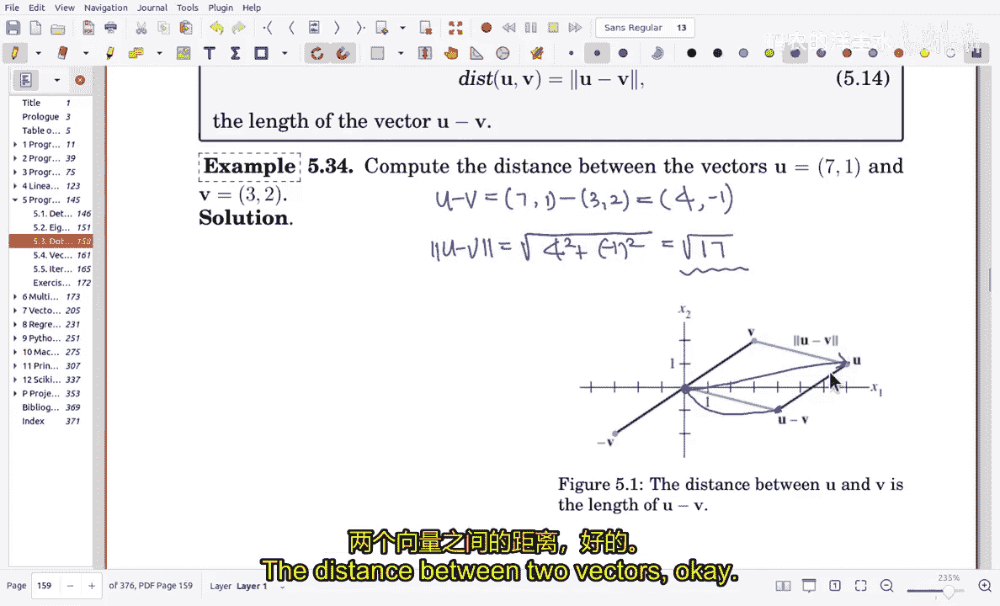

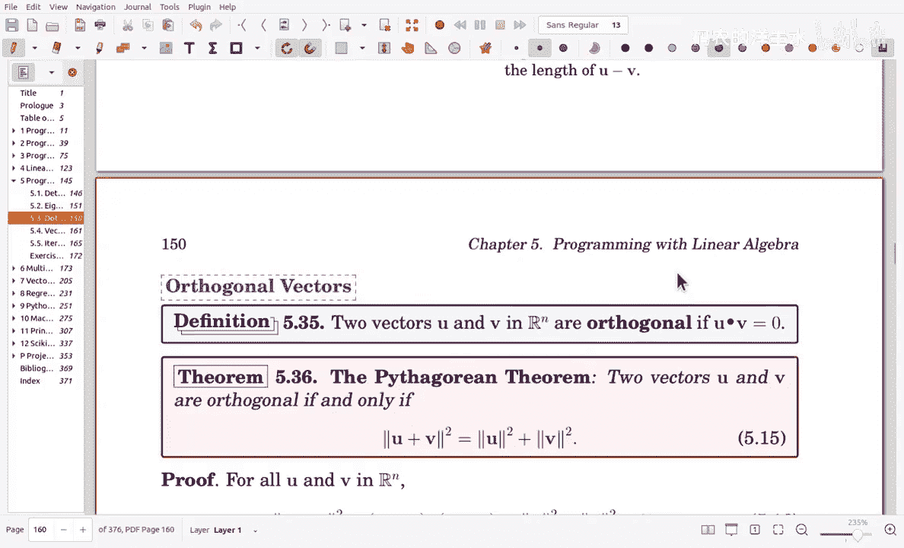

Two vectors， U V in Iran are orthogonal if their third product is 0。Here we have the Piorian theorem。

 two vectors， U and V are alsoal， if and O。U plus V No square is same as U No square plus V No scared。

Now。Let's draw a figure。That's you。And that is a fear。Okay， that is U。 and that is V。

Then here from the origin， there one will be now U。Plus B。You learned from high school。

The Pthre and theorem， once it is the triangle。That angle is right angle。

Then length squared plus length is squared with this one。

 the same as the length squared of this hypotenus。 So that is exactly this equation。 It is true OF。

 It has this angle。9で。So that means this 90 degree is orthogonal。

So orthogonality is the same as right angle。So geometrically， what 200 vectors make 90 degrees。Right。

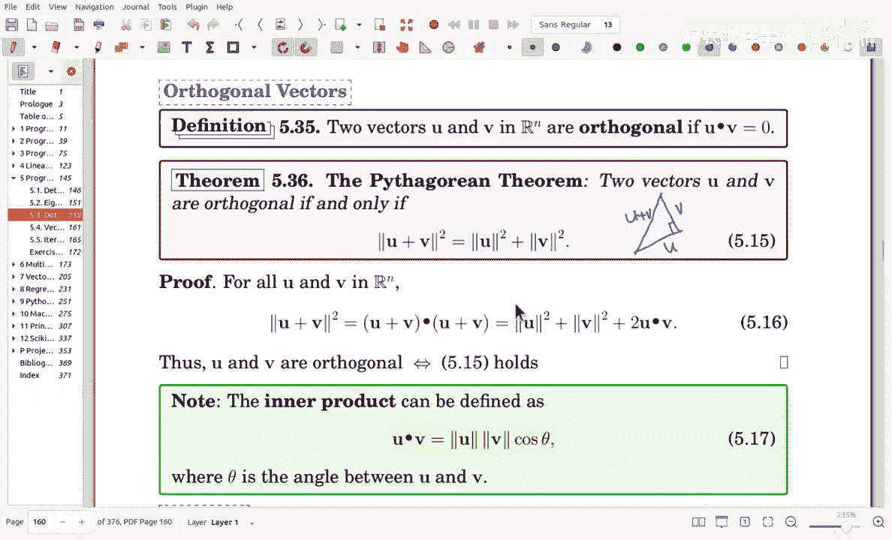

Okay。The in the product can be defined as in this equation。

 U dot v as you know times v known times cosine Theta here， Theta is the angle between U and V。

Let's try to find the angle between U and V。We solve only Part B and you can do this one。

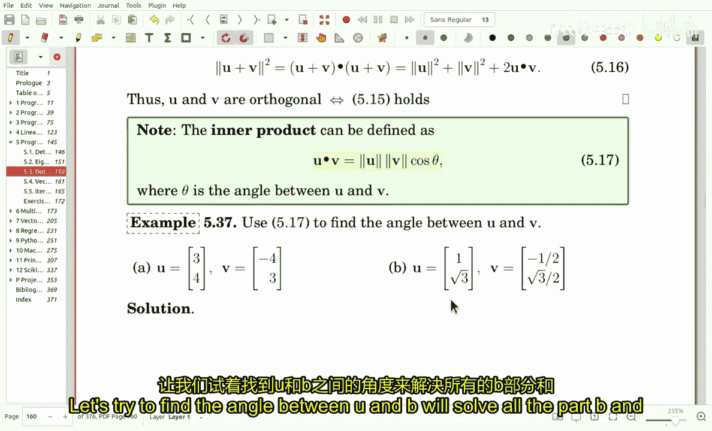

Yourve。Okay， we have to compute to U v U norm and V norm， and we can find the cosine theta。

 and out of that value， you can decide the theta。Okay。Okay， start with U thatt V。That is。

The corresponding answer is multiplication， there is a minus1 half。

 and this multiplication is a video of two。And some。Which makes1。나 you know。Vium here and Scov。

Once cat is one。Scarpt 3， square is a 3。 so that that is character 4， which is the true。And V norm。

The same as secure， that is one quarter。Plus， the second term square will be very over。4。

So the editor must be one， so that is one。So which this question U is1 equal uom is2 v no is1 now cosine theta。

So we have cosine theta。😔，Equal1， half。Okay， so we can easily get pi over。Right。

That'est the final answer。

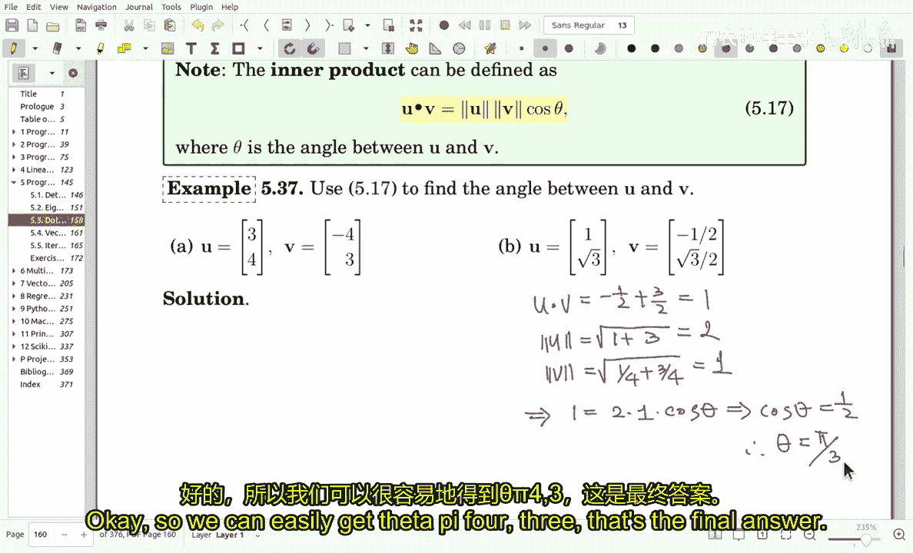

This is the end of the section， thank you。

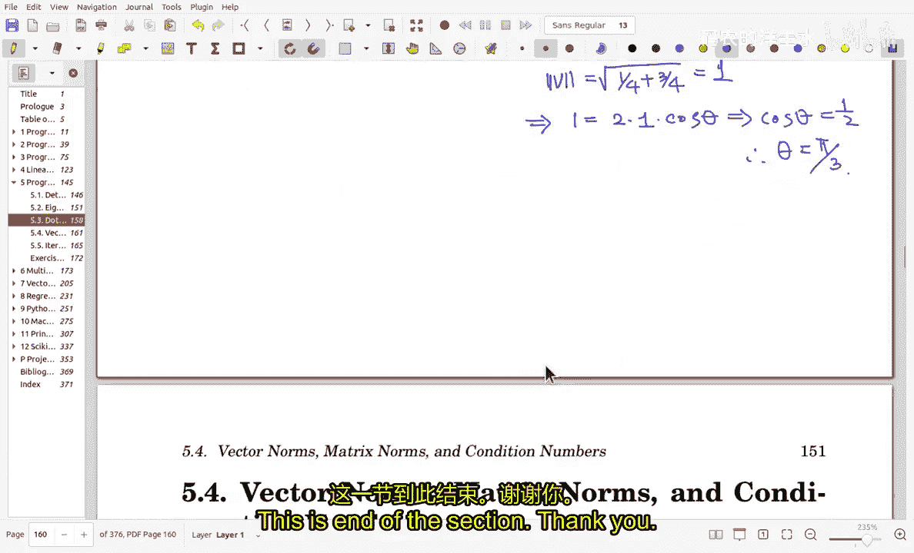