# 【全集-附课程讲义】密歇根大学-人工智能编程-EECS492-中英字幕-p37-Lecture-37---向量范数、矩阵范数、算子范数与条件数--BV14JqfBNEAS_p37-

Section 5。4， fact norms， mat norms。And condition numbers。

A norm or a factor norm defined on our N is a function that assigns。

ANo negative number to each vector x in our。And that satisfies。The three properties。For all X。

 Y in R N。Ramnda Sa。This first one is the positive with definition is。And second one is homogeneity。

And the last one is triangle inequality。We can define various norms， satisfying these3。Propers。

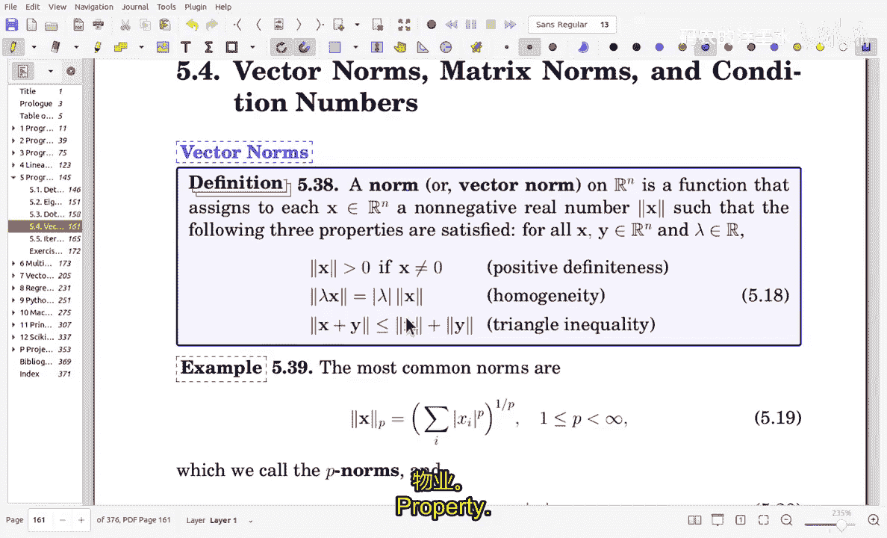

The most common norms are pens and the maximum norm。For pen norms。For entries。

 take absolute values and。P power。And some。And for the sum， we apply the power want to appear。

For maximum norm。Yeah， we are taking the largest value。In moduluulars， after taking。

The absoluteute values。 and among them， we choose the largest one。

The maximum norm is also called the infinitefinity norm。

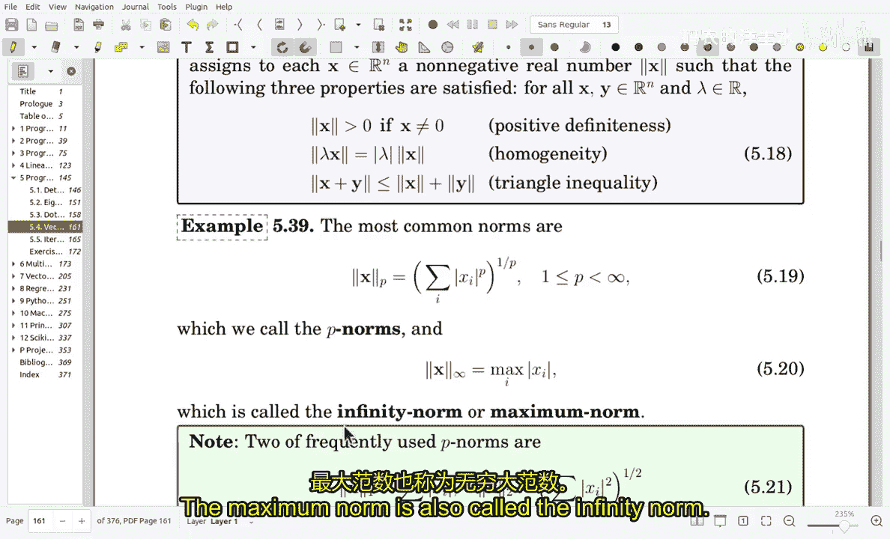

Now。Two of frequently used pen norms are one norm， and the two norm。

One norm is simply the addition of。Absolutely values of entries and two norm is the ssism and power half。

The tuome is also called the。Eucli their norm， and we often use without。The subscript。

 then means that once you see norm without any sub， then the default is the two norm。

Or the Euclian norm。

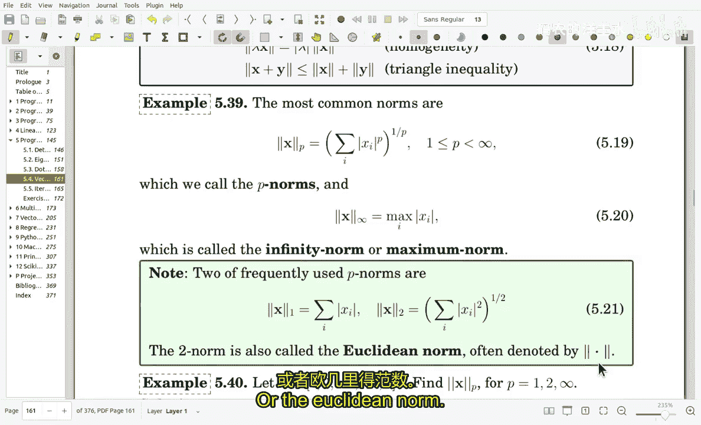

Let's see this example。Xus given。From L5， there are five components and we'll try to find the penons。

 p 1，2 and infinity。Okay， let's begin with one norm。Okay， x1 norm。That is， from definition。

Just addition of actual values， sort of for。Plus 2。Plus 2。And plus 4。And 3。 So that is 6，12，15。 Okay。

 so we have 15 here。Now how about2 norm x2 norm。They're the same as half power。

 so there is a screw root。And square， so 16。😔，Plus4。Plus4。Now，16。Plus，9。So's 20，40，49， schedule 49。

Yes，7。Okay。Now。The infinitefin norm， maximum norm， okay。That is maximum。 So we are choosing。

The maximum value out of the absolute value of the entries is。For2。2，4 and。それ。Okay。

 so the maximum is a four。So here， oneommi is the largest one。And inphia is the smallest lawn。

And Tuum has mid value。In general。We can prove these inequalities。So if cannot be larger than。

2 norm and two norm cannot be larger than one norm。Once x is from R N。

So I ask you to prove this inequality。

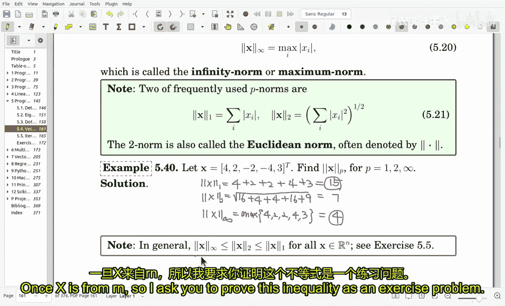

Its an exercise problem。

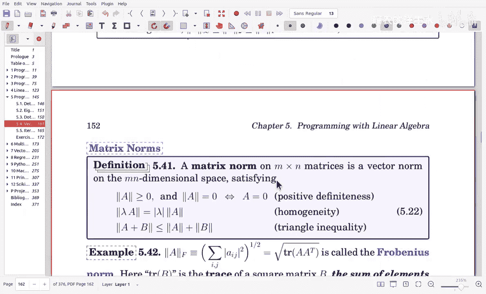

Maomes。For matrixes， we can define also norms。A mat norm on M by N mattresses is a vector norm on the M and dimensional space。

Satisfying。These3 conditions。The same conditions for effectileome。

Also you can define varioussymmetric norms。One example is the Florveius norm。

That is sism of every entity。And half power。This quantity can be completed by using this formula。

 First， we organize。A And A transport and take a trace。 Three trace is the sum of an。

On the main diagonal。That is the definition。And you can get also in this ring。

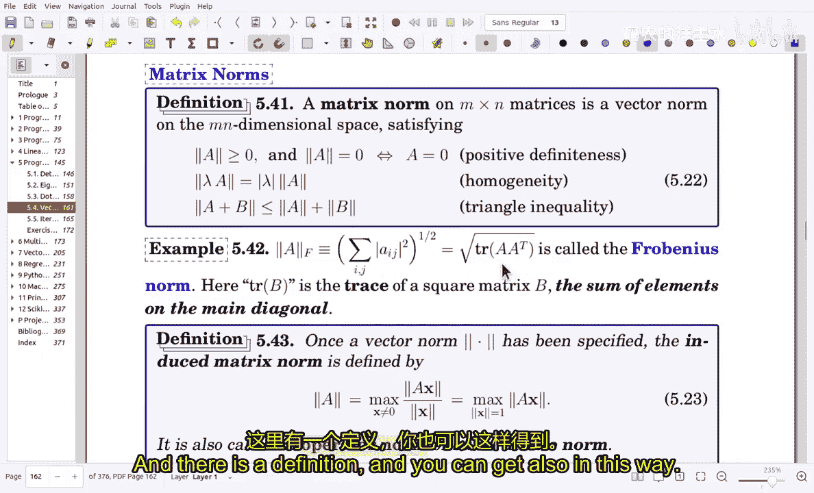

And。Here， some other kind of norms are defined here。So it is called induced the metronome。

 because it is induced from。Vectanome。Once the effectome has been specifiedified。

So this can be any pecan normome。Then we can define induced the matome。Based on the vanum。Here A mar。

I's the same as maximum。Maximum will be taken。Over x， now， A X is。O vector。

So that the dyssnemia is a vectorome， only known vectorome， and also x is a vector。So that。

An A X of tunnel divide the by。Xveome， among these ratios， we are taking largest one。

That is the matineome。Here。On the。Tenominator， we have x that is for scaling of x so that。

This definition can be really in this way， just a take X such that norm vectom is one。 and for all X。

 we。Tech here， AX， recanome among them。Take the maximum。 Then that is the same matronome。

That is a bit complicated， the definition。Of。For the matriome。But it's quite popular norm。

 and it is called an orbit norm。Or the subordinate genome， The operatingomy is the most popular。

A name。

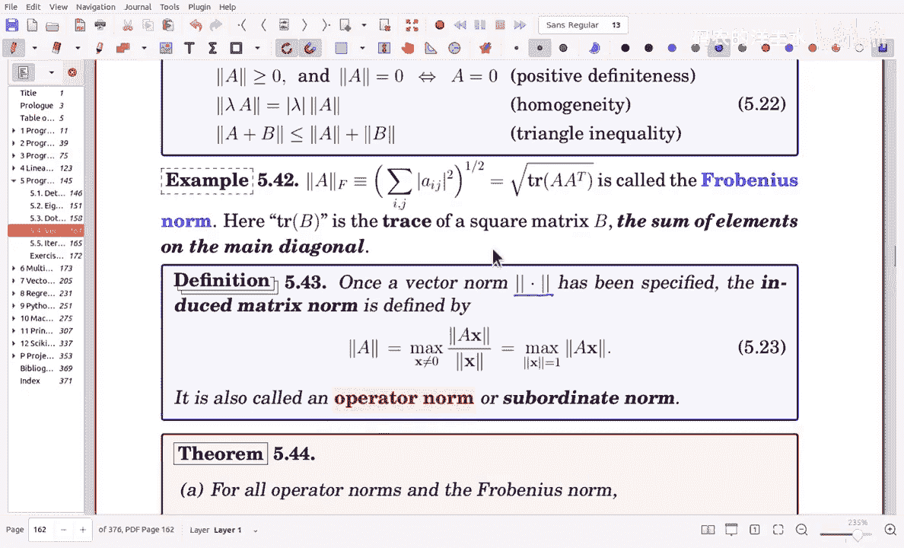

Here we see some theory。For all operator norms and the。F norm。E래 프로버。And most being because。

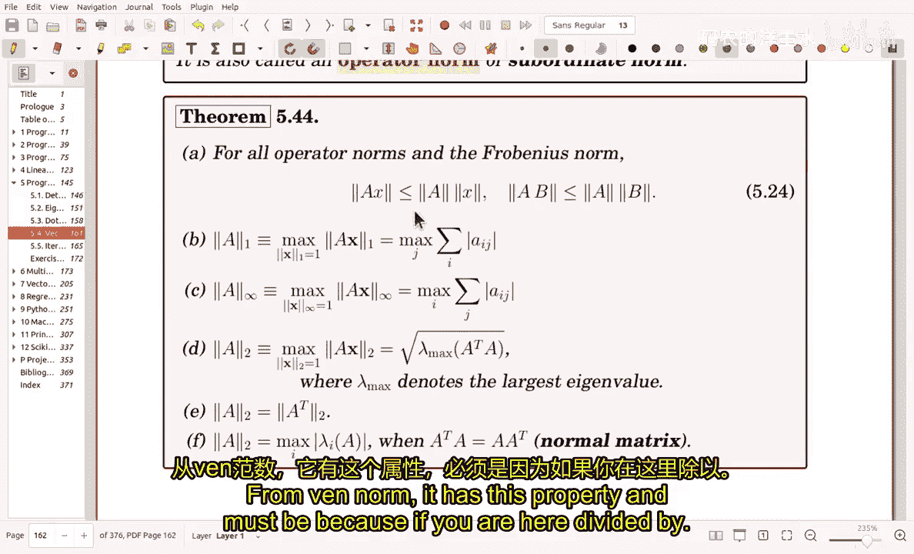

If you are here。Tバ theバイ。Ex norm。Then we have that here at normal。And。我不的呀。

The anome is largest among that one so that always this inequality is satisfied。

 So we multi over there to get。The assertion。Now， Sam， you can prove this one。Matic preduct the norm。

 Of course， this is a matter norm。Is pounded by。Matting， product matomes of each matter， right。

Now one norm。

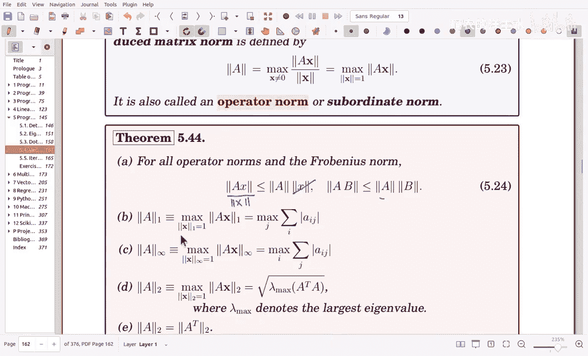

Maric 1 norm， and that means that we start with the vectorome， one vectorome。And。Now。

The definition is given in this way。 So this is vector norm is one norm。Okay。

Now that's the definition。This is a kind of competition。For the computation we put here now。

 for matrix and， for absolute value， we are adding along I direction， which means that。

For given metric， we take。Absolly values and add vertical hydr direction， vertical。

Then we'll have values。Here sum for second column， sum， for third column， another sum。

 There are sums here among them。We are taking the lot。The maximum， that is one norm。Now。

 for maximum norm， that's the definition。 That's for each computation。 Now the sum。Yes。

For absolute values of entries with some in trade direction。 So some here along each row with some。

 the absolute values。 then each row will make sum。And that N sum。Values among them。

 the maximum will be。The maximum norm， metric， maximum norm。

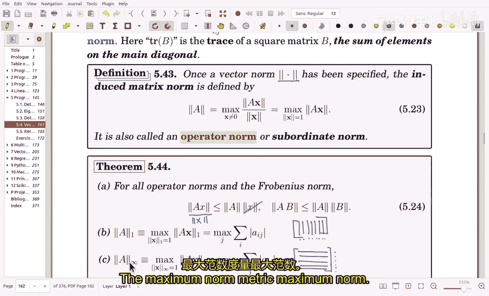

Now， for toome， if we start with the factecttonome is the twoome， then that is metric to norm。

There can be garden in this rain。Take a tpo A。 And for that one。

We find the maximum eigenvalue and take a square route。We can。Get the norm in this way。

Here for two norm， now， a transport will put this one later。 But anyway， a norm。

 a2 norm and transport two norm are the same。And also if a satisfies this equation。

That is called such metrics called a normal metric。For example， a is a symmetry。

 then it is a normal metric。Then， here。The two norm。Is。嗯。That's among eigenvalues， the largest one。

 but for normal metric。And。The eigenvalue can be。So that some eigenvalues can be less than zero。

So that here in moduluulars， we' try to take the maximum。So that is a tunnel。Okay。Now， here。

To't be confused with this one and that one。If for one norm， for computation。

 we are adding the absolute values vertically because that is one is a vertical。Now。

 we are adding horizontally for infiniteome because the infinite sign is about horizontal， right？

Okay， so you can memorize them quite easily。

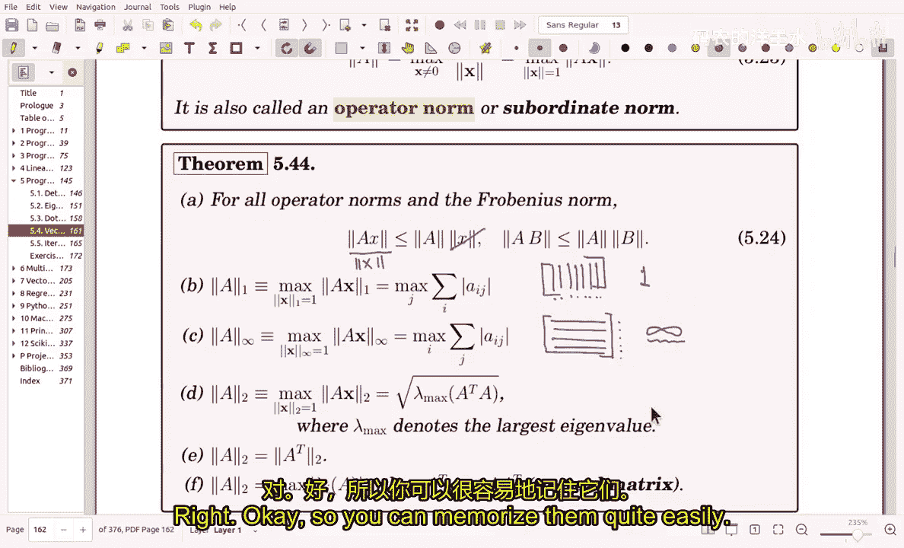

If a。Acr metric。Is invert than we can define。The quoation number。

Couple of a is a norm times a inverse norm。And， of course， here。Now。The norm。Should be。The same。

 so associated to the matching norm。 So once you are using one norm for this measurement。

 then that is。One condition number， if you are using two norm， then is two condition number。So。

 we say， usually。L 1 condition number， L 2 condition number or L infinitefin condition number when the matronome。

Is along with L in Fi norm。

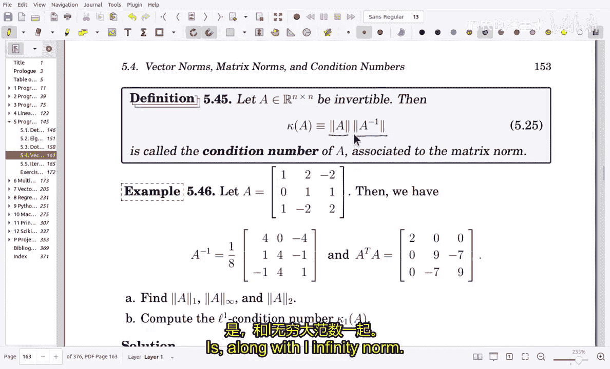

Okay。Is given。As in this metric。Then we have a inverse and a transport a is。

Can be obtained in this right。I made this a in and a transport A for your convenience。 Now。

 let's try to find a one norm， a infiniteome， a two norm， and。Try to compute the L1 condition number。

 Okay， let's do that。Now，他。A you want them。A1 known is just from a。

We are attacking absolute values and some vertically， some of the absolute values vertically。

 among them， we are trying to get maximum。From。First column， we have two from second column。

 we are focused on this metric and。The absolute values。 And from second column， we have a five。

And30 column again， we have a5， so that then must be5。How about a。If you know。That is a maximum。Of。

Hent sum。E values， and that's five。No。First row， we have a5， second row， we have a2 and5 again。

And so that that is a five。How about two norm？诶。出笼。That is from。

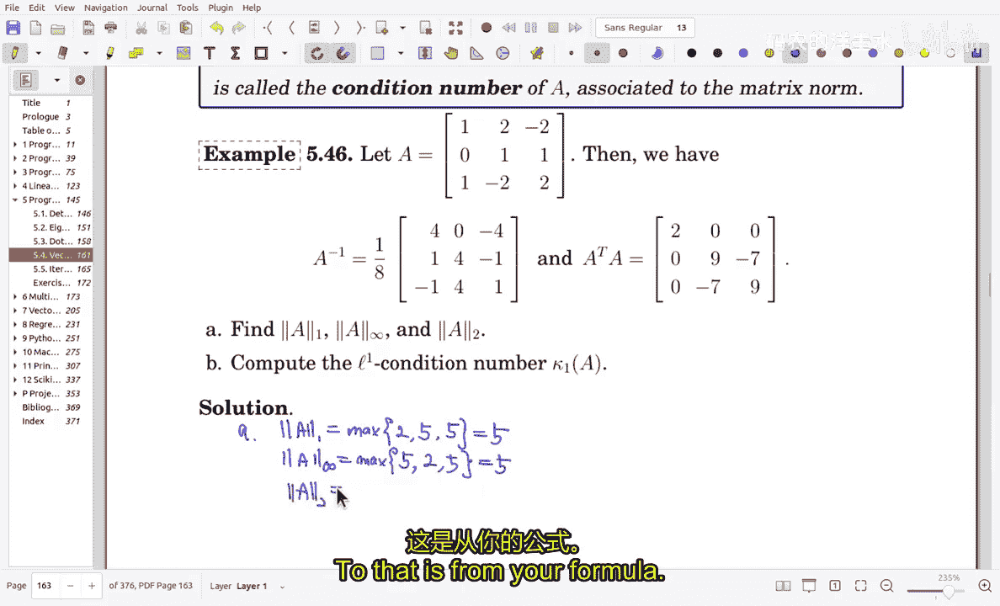

Your formula。Okay， that is definition。呃。It's not easy to get this maximum value， however。

Once we can get a transport A。 and if we can find the maximum eigenvalue。And for that one。

The itemenvalue。Must be。largerarger than equal to 0 is real and not negative。

So that without taking any absolute design， we can choose the maximum eigenvalue of this metric。

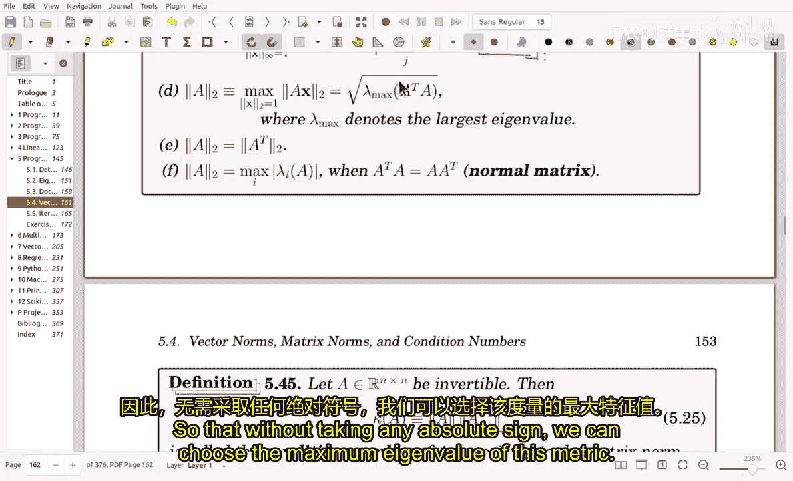

Okay， so here。That can be decided from。Now， maximum eigenvalue。

 So we have to find the maximum eigenvalue of that。Okay， let's try to find Ivalue。A transport A。

 okay， a transport a。Okay， I rer。もう clearlyり。Okay。That is a trans A and minus M I。

 We start with that。We start with the characteristicification of the metric。That is now。

And 2 minus Ramda 0，0 and 0。9 minus deda， and-7。And there is a zero-7 and9。Oops that， okay。Here。

 there must be Rammda nu 7。Okay。Here we have this is all and。That is 9 minus vinda。Again。

 this is a nine minus remda， okay？Now we take the determinant of the metric。Then。Okay。

 there is bi conflict expansion can get it。So here from this one， we have two minus render and。That。

That will be the corresponding core vector will be determinative of that portion。

So that is the same as here9 minus lamb。Sped的。80 minus PC now，49。So we have here2 minus render。

And then this one is Ram Sch。-18。Ramda and。81。-49， which is here，32。Right， okay。So。

That is the characteristic equation。 And from here。Now， Ram does is 2。

 this one eigenvalue and this one can be separated。Okay， that is 2 and 16 and minus minus， okay。

So we have  three idenvalue。Here， Ramnda is from here。 There is 2 again， from here， again，2 and 16。

 Okay， that is part deep 16。So that is the largest。I can value of a transpo a。Okay， so we can。

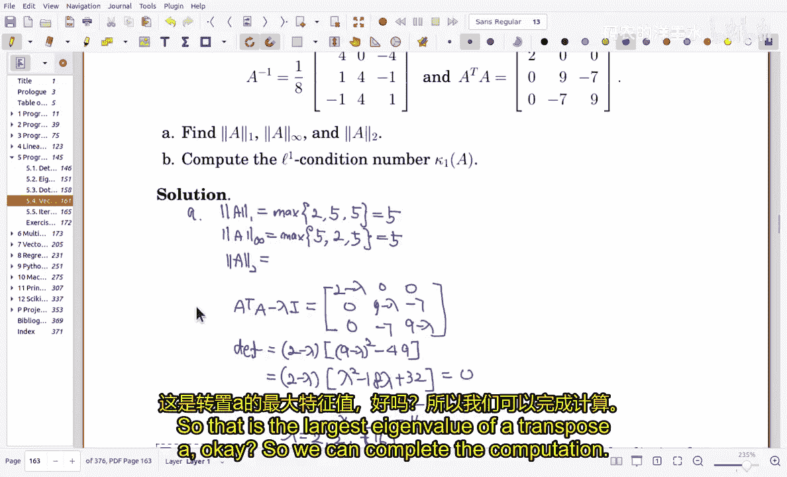

And complete the computation sculture。 the largest one is 16， so that there is4。嗯。Okay。

So we finished the part A。 How about Part B。能。And L1 condition number is Co 1 a。From definition。

 definition we have that is a。One norm times a inverse，1 norm。Okay， we already know a one is five。

Now。We tried to get。A inverse1 norm， okay。To get a inverse again。

 we try to add absolute values vertically。 Among them， will choose the largest one。

One of eight is in front of the metric so that all we consider。The Ed， the is the sex。That is8。

 that is the6 so that。Here are。The maximum。Wellll will be a， so that condition number is 5。Okay。Okay。

We may consider the infiniteome as the limit of p norms as P。Apps infinity。 Okay， that means that。

Okay， now。Let's consider a vector in。You are。30， so we question only 30 components so that x can be read。

Great example for X 1， x2， X of 38。Then， from this one。Now， X Pome。It's the same as。Now。

 x1 F value pome P power and x2 F value P power。Plus x3， absolute value x3 P power and1 over P。Aroom。

Here， x1。Is largest larger than。Okay， it's strictly larger than， for example。That's true。

And except for the。Then maximum norm of the vector must be。That value of x1。Now。

For along with this assumption。Along with this assumption， now， let's see。

This is known as P increases。X1 is the largest one then this one will increase much faster than that one。

 for example， this is5 and this is2， then this one is much larger than that one。As P put says。

 this one is the terminated to， so that。It looks like it's almost the same as now x1 and P power。

And pe power。 And we ignore this portion， basically。And now one of our people well。

So that now that is same as basically here x1 actual value。So it is approaching to this value。

 which is the。X。In， right， because we assumed in this way。 So you may assume that any。

Entry the maximum， you can get the same conclusion。

 That means that the infinite norm can be considered as the limit of P norms S P。

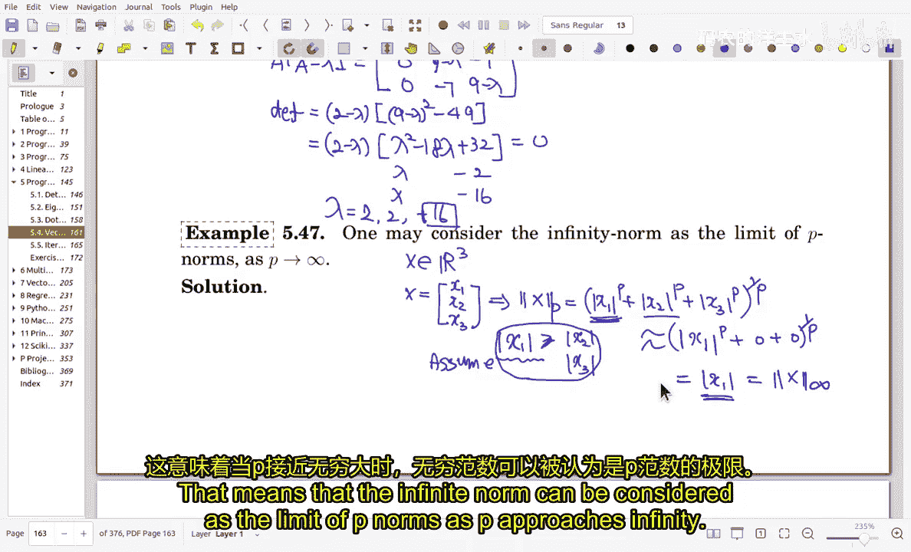

App purchasease infinity。

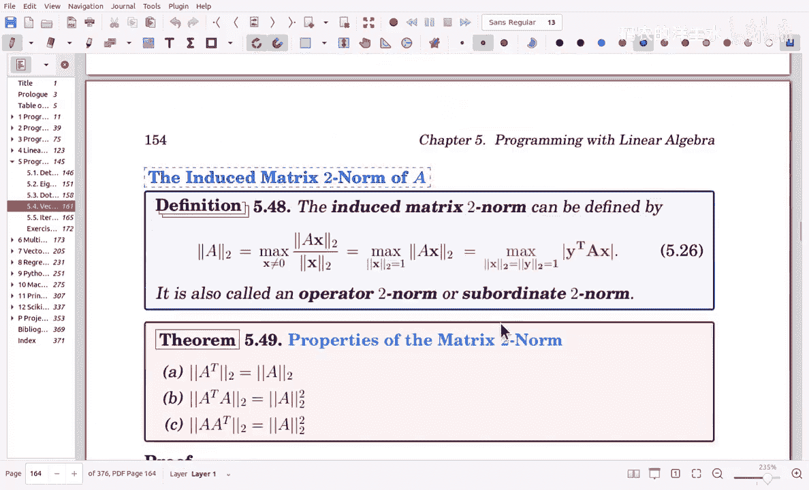

Okay， now we consider that the in matrix 2 norm of the metric gang。This is a special case。

And once we choose Pome。Then。The metronome can be defined in this way。Yes。

 for this vector tu norm divided by x2 norm among them， we are choosing the maximum。

 They are the same as source of this one。 Now for this two norm， we have a one more term identical。

That is this one。We multiply from the right。Vectctor， then that is now。Vtical vector。

 Now we multiply here white threshold on horizontal vector so that it becomes a scalar。

Now we are taking absolute value。So we are choosing here。

X2 norm and Y2ome are stonis1 among these choices。X and Y， the maximum color value。Is the aum。

We can get。Matthew Tuum， well with this identity。So with that， we can prove this。

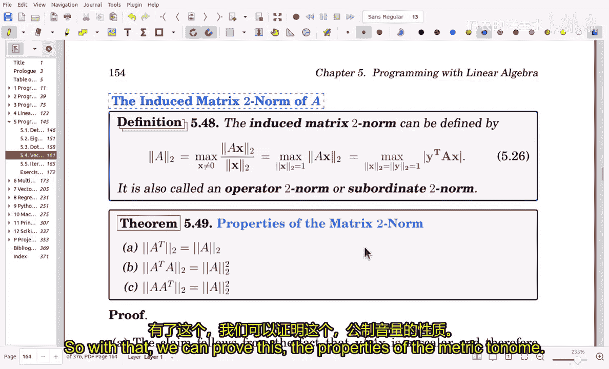

The properties of the metric toum。Tum sports of a tu norm is same as a2 norm。

And now here a to exposure a for general metric gain。

The twoome is the same as a two norm squared and also the same A a transport two norm is the same as a norm squared。

Here， the proof is cabin。If you are interested in mathematics， then you may try to understand。

The proof。 So you learn a lot out of this proof。OkayThat's the end of section， thank you。

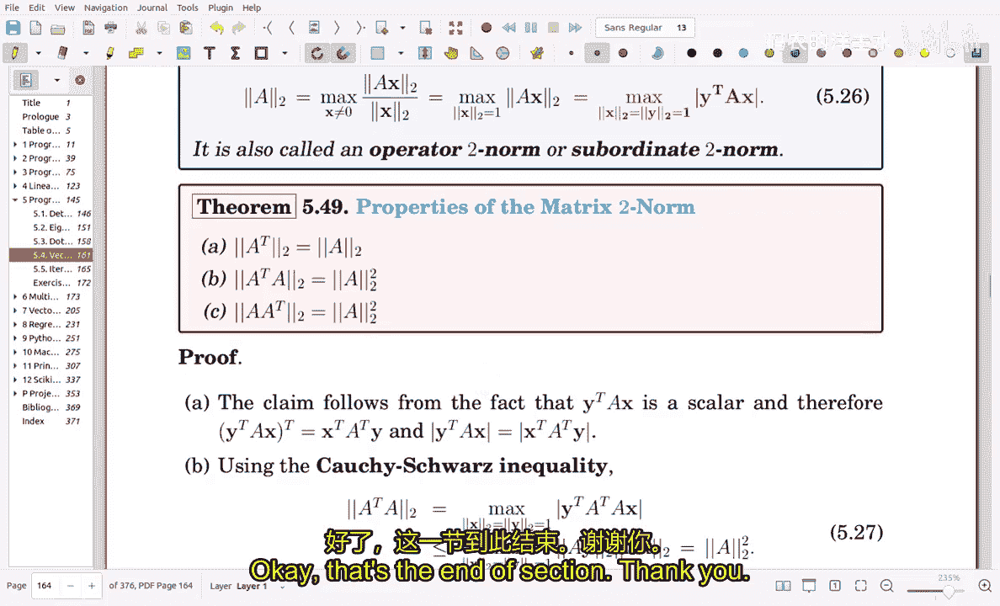