# 【全集-附课程讲义】密歇根大学-人工智能编程-EECS492-中英字幕-p38-Lecture-38---特征值幂法与逆幂法--BV14JqfBNEAS_p38-

Section  5。5 power method and inverse power method。For idvalue。The power method is an E TV algorithm。

Keep분은 squaremetric에。The algorithm finds a number rem。Which is the。

Larggest eigenvalue of A and is corresponding eigenbacterctor V。To apply the power method。

We need to assume that a has this properties。

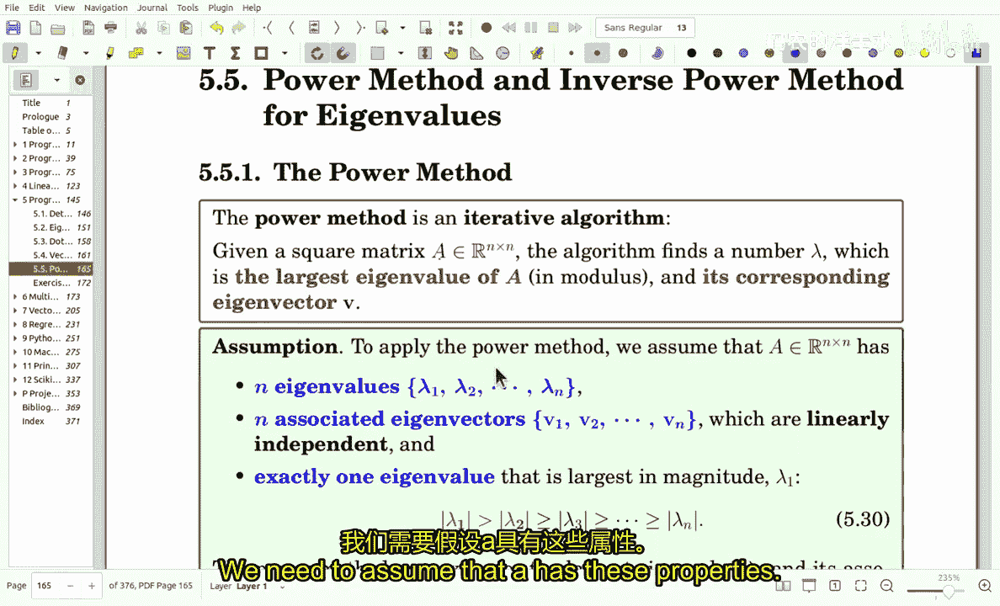

A has n eigenvectors， Ramda 12， Ramda n。A has n corresponding eigenvectors， we want to VN。

 which are linear independent。A has detected one eigenvalue that is largest in magnitude。Once we。

Woude。The item values。In modulus， then。And absolute the value of Ram 1 must be strictly larger than。

The second largest itemvalue in modulars。That is required。 And also。Oh。This。

Condition is also required very seriously。A should have n linearly independent eigen vectors。

Then the power method pushmates。The largest eigenvalue random one。

And is a corresponding idea am Victor。

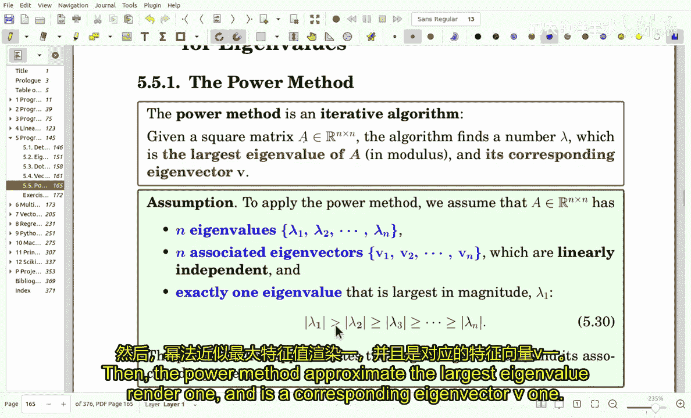

V1。Let's derive the power duration。

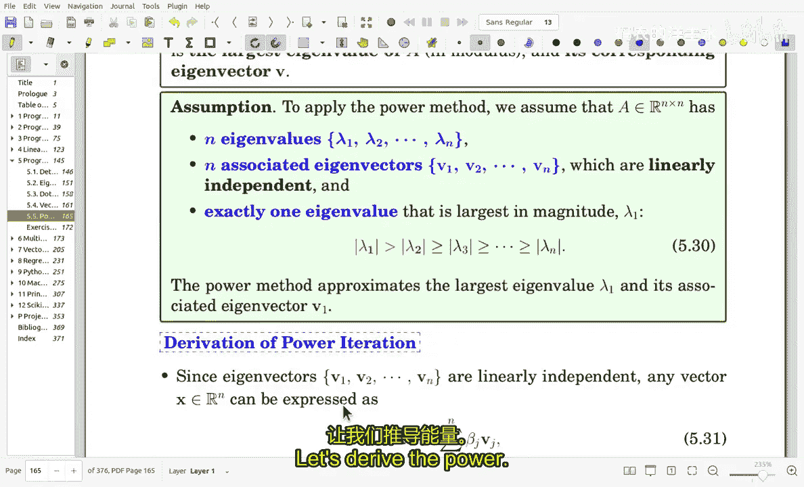

We assumed that A has N。Le are independent iden vectors。 So these iden vectors will form a base。

And therefore， for any vector X。It can be expressed as。A linear combination of。The I victims。

For some constant。Pta 1，2， Peta N。Now we multi라 a。He yet。Now a will be multiplied to Vj， so A Vj。

 that is same as Ramda J Vj。If we multiply one more time， a。Then here A VJ， which will be Ramda J VJ。

 So we reach at。This time。In general。After K multi of a， we have them。Once we factor out。

 random want to decay， then。Here for this term， were changing this rank in detail。

We can see in this ring。Now Ramda want to the K。Peter1。And this will be one。And V1 from second one。

 Ramda 2 over Ramda 1 to the K， and third one will be Lada 3 over Ramda 1 to the K and last one is given in this rank。

Now， also we should do that than the one。Is strictly larger than。Lambda 2。

 and the other eenvalue are。Not larger than that。 So4 changes is from tutu and。

These are strictly nice from one， so that。For these terms。As K increases。They will con to Si。

So here we have conclusion。A to the Kx as K。App purchase infinity。

They're the same as here Ramda1 to the K， be1， V1。Now， the same limit。Okay， this。

To this one will convert to 0， and this is one so that。Yeah。We take a limit only here。

 lambda want to the。Pta 1， v1， that is exactly this one， okay。

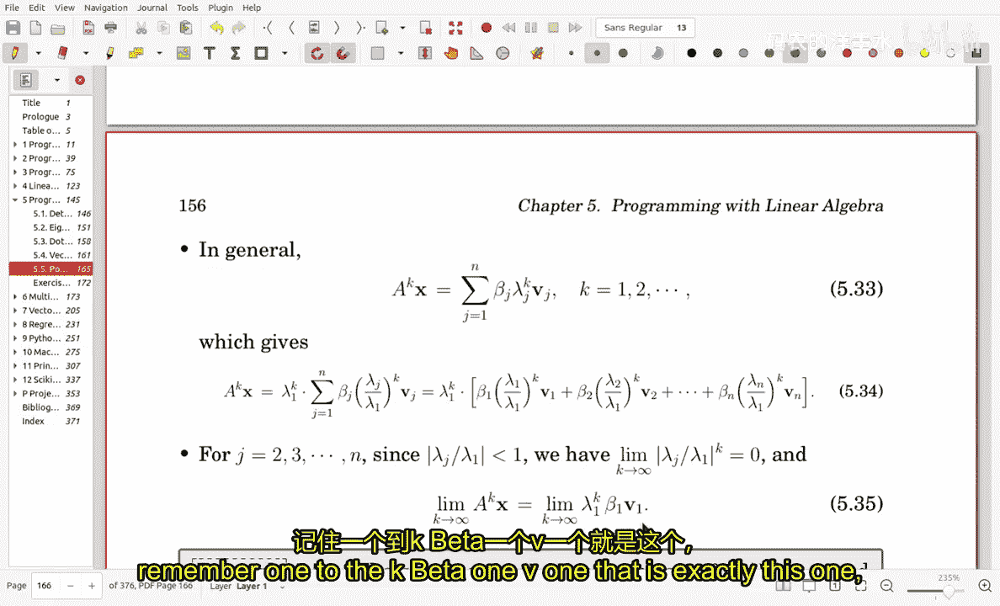

嗯。The sequence in this equation converts to 0 if。Remembermbnda one。And modulus is less than one。

So itll be considered。And if it is larger than one。Then， itll tie words。In either case。

Its hard to decide the largest eigenvalue Ram 1 and is corresponding eigenvector or V1 because it's either converted to 0。

Who are accompanied to infinity divergence。So to take care of that possibility。We scale。

The H to the KX in an appropriate manner。嗯。To ensure that the limit。

Indi question is a finite and non zero。Is converting to some finite terms。

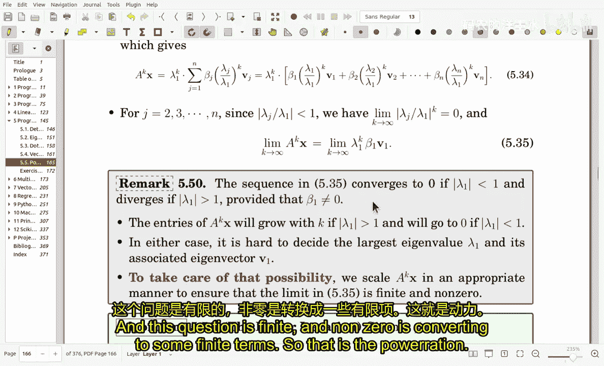

So that is the power。We start with。Victor。Ex and。Now， for that，90 vector and x0 is scaled so that。

I maximum norm will be one。Now in eachtu， we multiply a。

And we save the modification into a temporal vector。And measure the maximum nu， and scale。

The temporal vector。By UK took at。The de of vector acts。

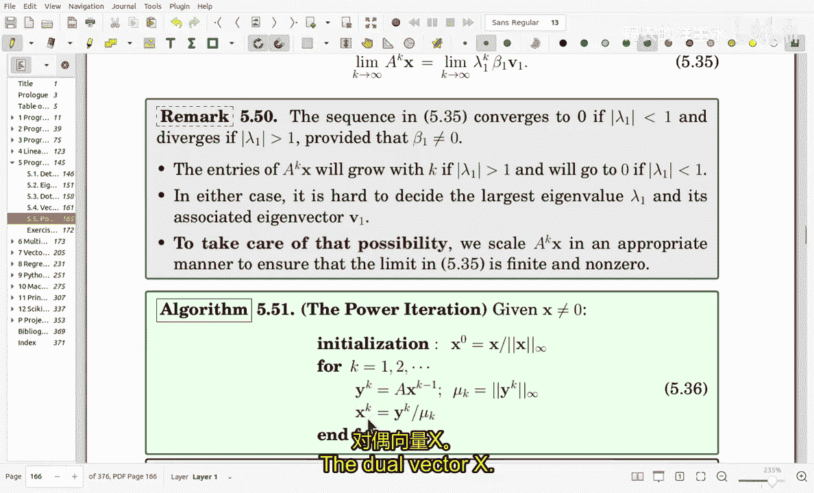

Now， we keep going。Then。We have this conclusion。

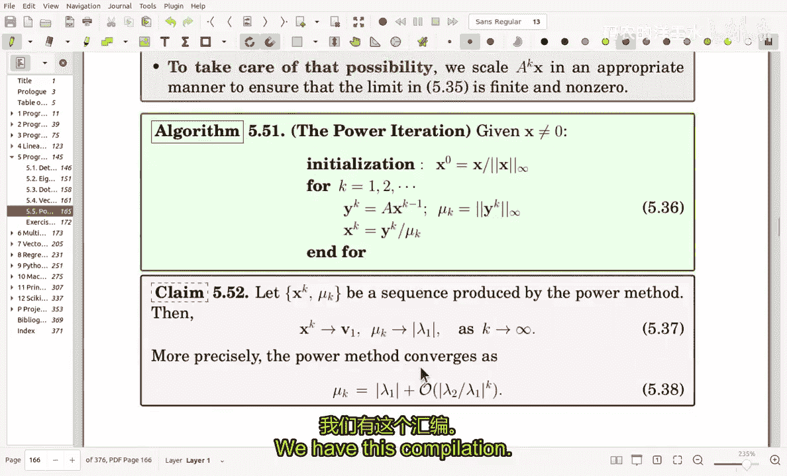

And mu， okay， Xk， muk。嗯。A sequence produced by the power method here， then。X K is coming to V1。

 and mu K cons to。Absol value Ram one。More precisely。The power method companys， as in this equation。

 UK is compared to Ram1 with this error now is reducing in this ring。

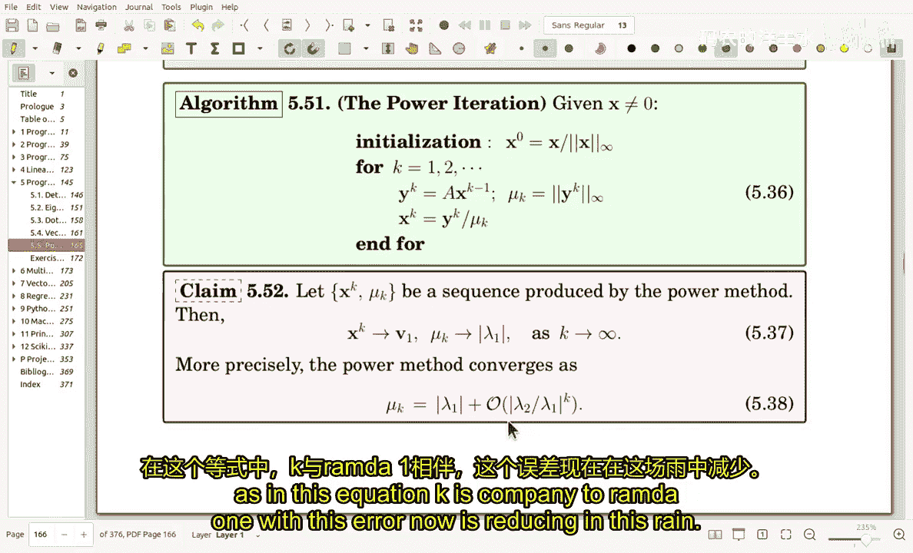

Okay， let's go back to。This line。And。Okay， here。That is converging。 and one。

The absolute value of this。Again， values。嗯。Smaller and smaller， smaller over there than。嗯。

Theseisel later terms will con much faster so that the error。That portion is。Tinate to error。

 So that。

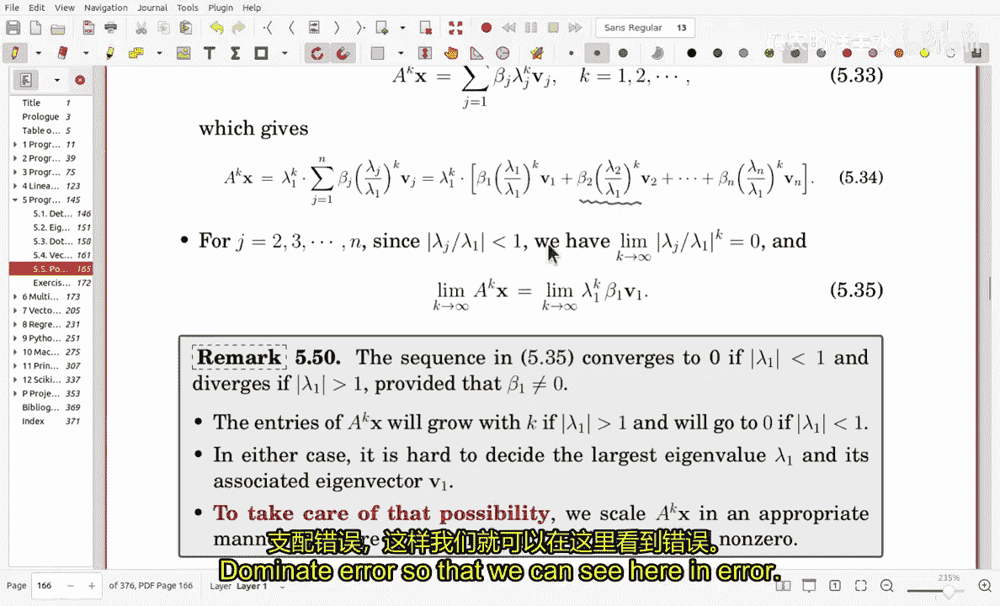

Here we can see here in error， this is the term1。 So we may write down in this rank。

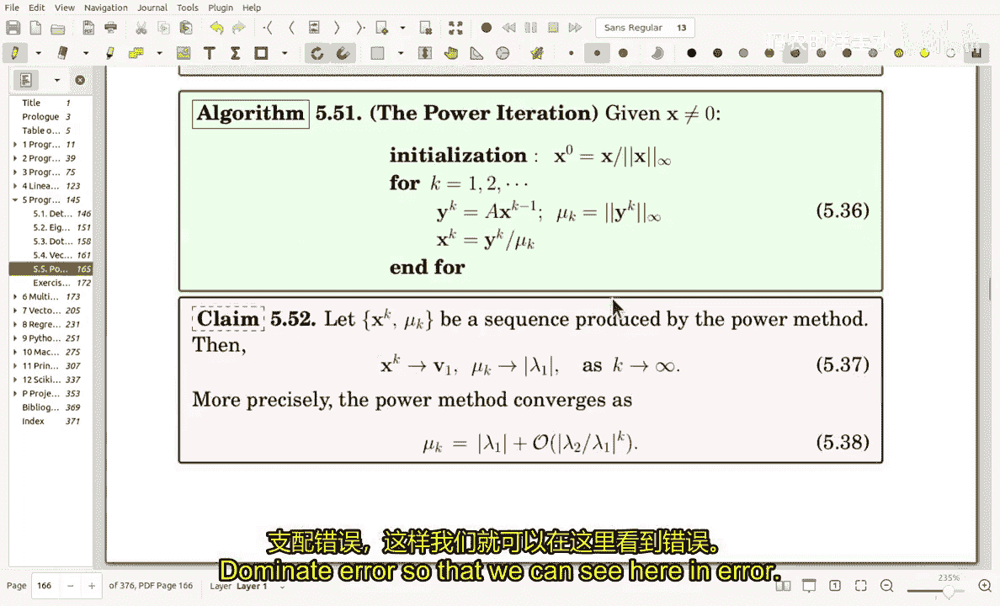

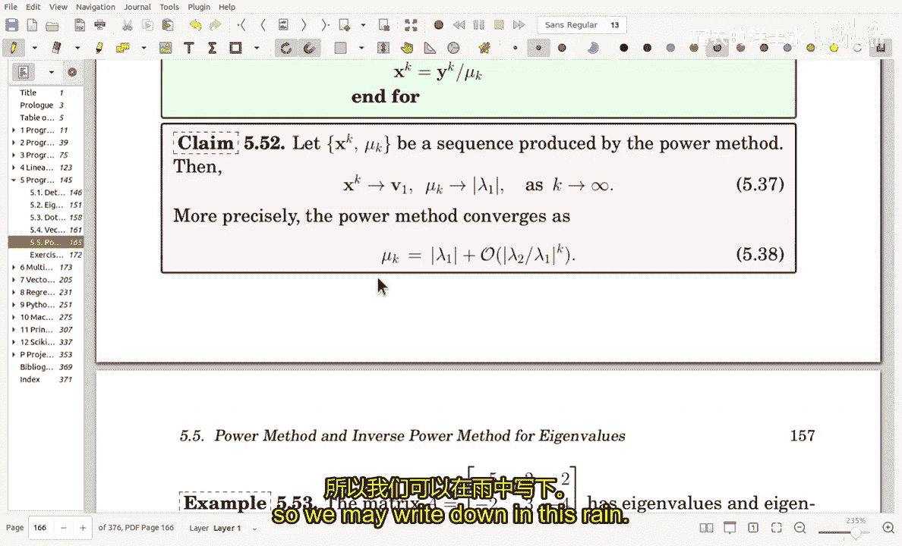

Okay。Okay， here。We have an example， A is given。And it has eigenvalues and eigenvectors as followers by using the command in MAlab。

 we can find it quite easily。And itemvalue are 931。For 9。

 this is the corresponding eigen vector for 3 that1， and that for -1， this is the eigen vector。

Verify that the sequence produced by the power method that converts to the largest eigenvalue and its associated eigenvector。

The algorithm is implemented in both MAP。And Python。

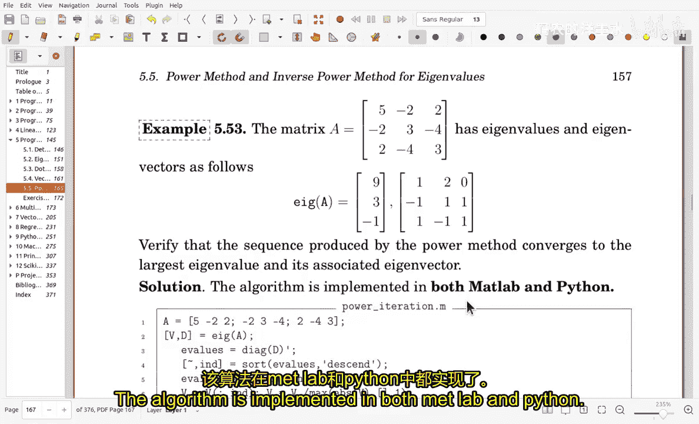

Les it is Metrolab algorithm。That portion is for a definition bying Pton function EIG we found。

That is eigenvector， and that is a diagonmetric having。Hyideem values。 So by using the comment。

Diague。We can collect all the othervalue。From the diagonal of D。And for。Ienvalues。We try to。

Order in from largest to smallest。 And that's index。So well use the index and。

Same index you used to order the change ion vectors。In the same way， so now。V is order than。Here。

Okay， now we scale。So that。Maxim value in modulars in eigenvectors will be one with this scaling。

So this is a lit with the。True and。T eigenvalue and true eigenves。Now， from here。

Willll try to compute the largest eigenvalue， and corresponding。Iem vector start with 1，0，0。

 This is the format for print。And。우일두1니 트 레。First， we multiply x to get y and we。Try to find the。

The position rail。The largest value in modulus occurs。And we assign mu from。Temperered orderde， Y。

 and we scale。Why by mu to get U vector。 So that is the power。In Python。Is one was the same。Yeah。

 we are using the package lumpy。And we choose option， such that。The print out。

Will be suppress them damage that for example， is 10，0，0，0。 Then with this option。

 the print will be one dot。Okay。Now we define a。And。对。No piece of packaging， Line brown。

Is used in the function EI J。Its producing eigenvalues and eigenvectors。Now。

 that is outputll budget yet。For metal lab。The first one is ion vector， and second is iron values。

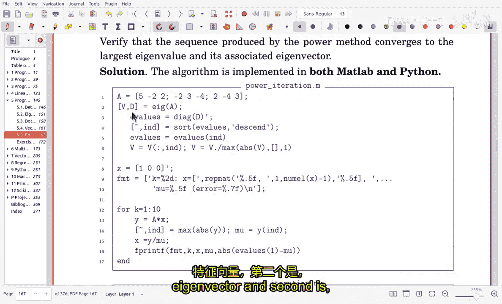

Now， the is the first swing is eigenvalues and second one is eigenvectors，Now， we thought the。

Iemvalue。呃。And。Decent。So that along with the index， we。嗯。So to the idvalue。 And again， same。

 we sort to the id vectors and again， scale。So that。

The maximum value in modulus will be one in idigenvectors。Okay。

That is for true eigenvalues and eigen victors and here。This is the power iteration。

 will do just10 iteration。No。XA is multiplied there。Xiao。2 x。And save into a temporary vector。

 And again， we find the。The position where。The largest value occurs。

And we take a mu from the position and scale the temporary vector to get U1 and print out and herearrow is measured from the first eigen value。

Now， once two pro the。Programs are run then you can see the result the same。

 here is the output from the MA lab code。

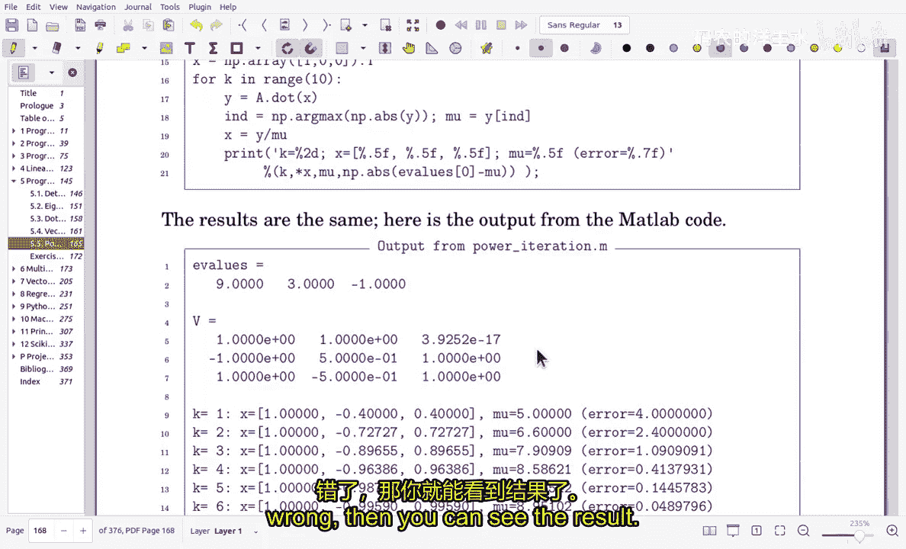

These are again， values and this。Iigenvectors and after 10 it。Yeah， you can get， yeah。

 good convergence。For。Mu values。 It is convert to。Now， the largest eigenvalue and error。That is。

 now reducing。In this rain。For the example。Lambda one is 9， Lada2 is3 so that that must be one third。

Here， the error。M be one third reduced in each duration ideally。 So let's see if it is happening。

 Okay， that is about three times is about three times larger and again， about three times larger。

So it is working。Like the theory。The inverse power method。

Some applications required to find on I value。D prescriptor value Q。

The inverse power method is variantant of the power method to solve such a problem。Okay。

 let's try to。A drive the inverse power method。We start with them。This one。Ram I V I eenvalue。

 een vector pair。For the matter game。Now。And if we。Here subject QI。

Then the corresponding eigenvalue must be shifted by Q。

And here we apply that metric inverse side and this per collaboration number。

Then we reach at this one， that means。Once Q is。呃。

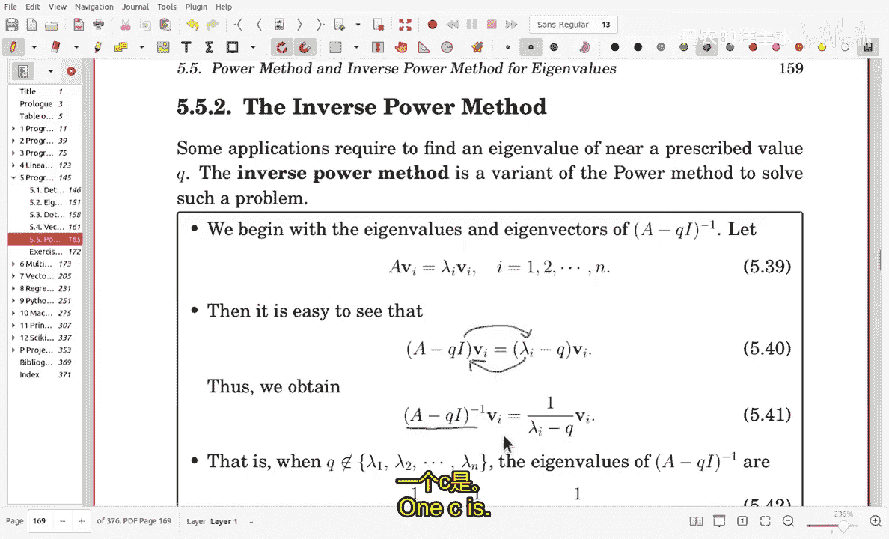

None of the eigenvalues of a then。I gain values of this metric。

So this one so that one of Ram O minus Q， one of lamb Q minus Ram 2 minus Q and so on。 this are。

Ien values of a minus Q I inverse。 Now， willll use this metric。With the power tradition， that's the。

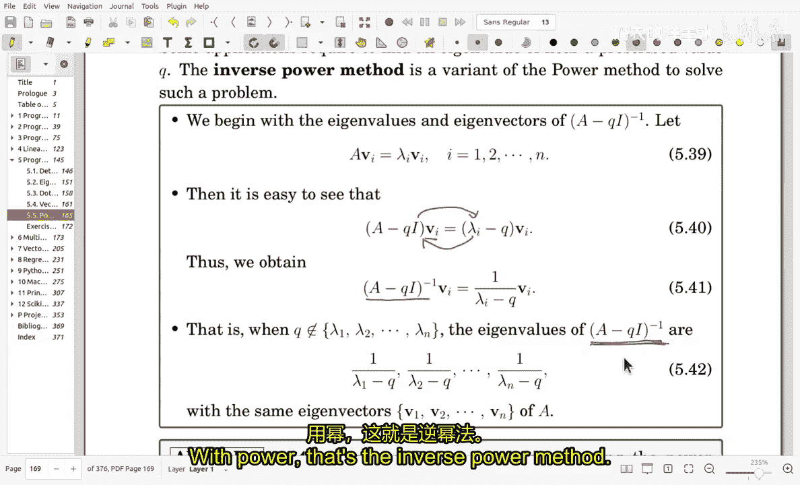

Inverses， power method。Okay， let's see here。 But anyway， the eigen vectors are the same。

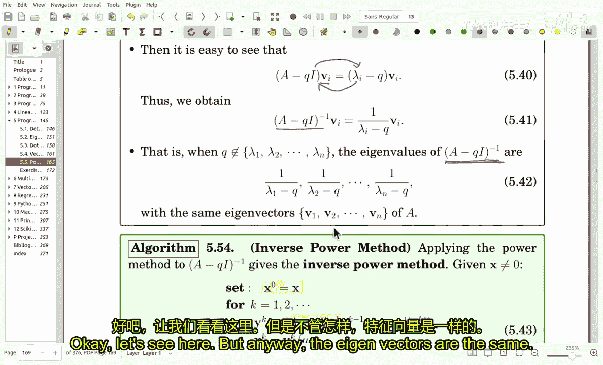

As those of。对。This is the power inverse power method。Okay now for気分。X90。Okay， X0 must be。Yes， scale。

 along with。X infinite norm。Okay， that is x at all。Now， we must。The inverse。

Of a minus Q I to x to get u。Oh。ATempate vector。 And we measure is a magnitude and scale。

The temperature vector to the U1。Here， UK。You can， from power Methad。

We know that UK is converging to。The largest eigenvalue。Of that metric。So， among these values。

The UK will convert to the largest value。So， eventually。Here you。嗯。K will convert to。But one of this。

 So one of。Some。Okay， let's say Ramnda。Mus Q。And we can solve it for Remnda。We pushed to。Se equal。

Then now， Rammda minus Q is the same as。Yeah， one of UK。Now， so that from here， Rammnda is one of a。

UK plus Q。UK。Yes。On a to on eigenvalue their on。Now， Ramda K。

 this Ram value will approach to one of a。Eigenve of a， so it is a， but that one is for this metric。

 that is eigenvalue。对。So。That's the line to recover。I get value of a。

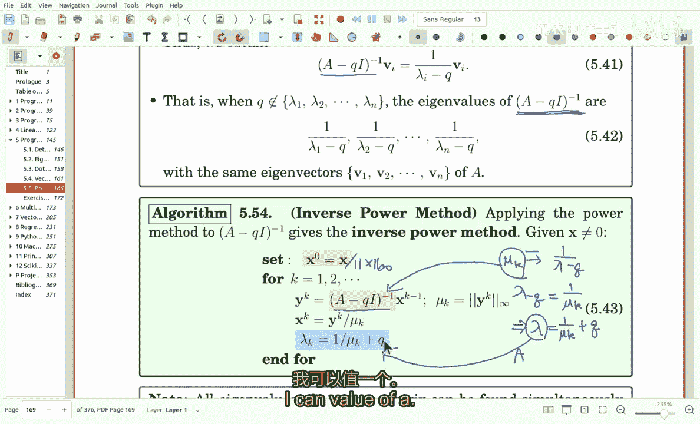

Allright。The power method and the inverse power method is。can get。Or you one single。

Eigenvalue and corresponding eigen Ve。All eigenvalues of a s metric can be found simultaneously。

By applying some advanced algorithm。For example， the Q it will see this method later on。

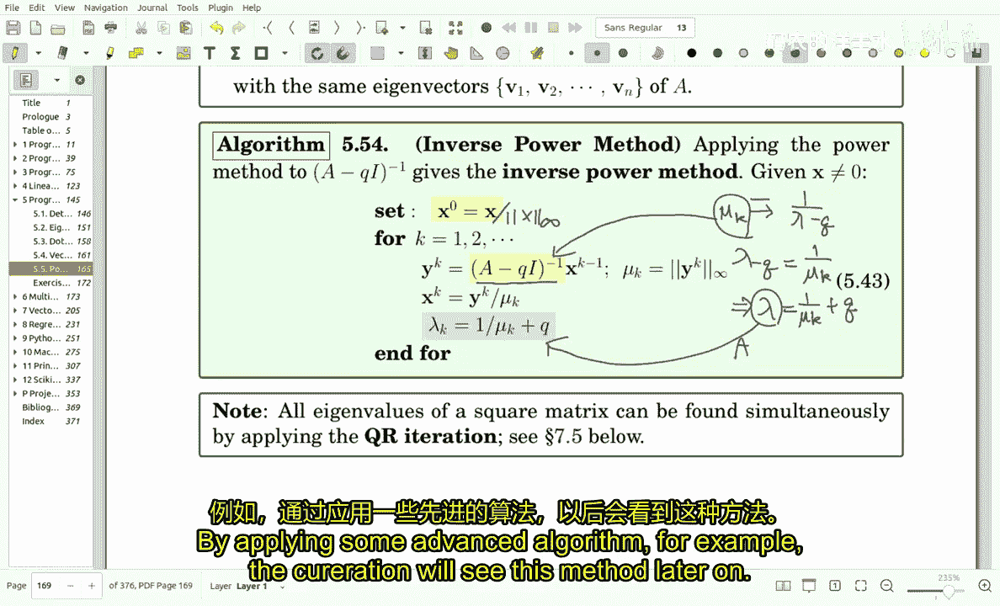

The inverseice。Pul method are also implemented in both metla and Python for the same metric。

And we'll try to find them。One e value of a。D is to。Q is 4。

So that here the eigenvalues are 9 and 3 and minus-1 so that that will be found。Okay。

 here this portion is the same as the original power method。Now here。And along with the same。

In hisal。Now， Q is for an inverse of a minus Q I is saved into B and here。

B sub multiplied to x to get a temporary vector。And we try to find。The position real。

The maximum occurs， and we get the volume mu and scale。Why by mu to get U vector。Vi is comforting to。

On itemvalue of B。Now， Ramda is comparing to an evalue of a。Now we put Ta。

And the difference between the second。Ienvalue and Ramnda that will see the difference。G for Python。

Also， this portion is the same as the original power method。And cu for。And。X is now。The same100。

And we save。The inverse of a minus Q I into B by saying。This function from。

Sub package of lumpier linear algebra。Now again， we do 10 nutritions， first multiply B。

And now get a temporary vector。 and we try to find the maximum position， and we get mu。

And scale the temporary vector to get du X。Now， well try to recover。

The eigenvalue of a view is comparing to on eigenvalue of B and。

Ramnda is converting to on island value of a。The same name。Now we'll try to print out the congenence。

With the error。Now。The second eigenvalue and。The Ramda difference。Okay， in Python。Lembda。

 along with a little L。Lambda is a special function， so you cannot use it。As a parameter。

 So I used to hear capital L。Okay。

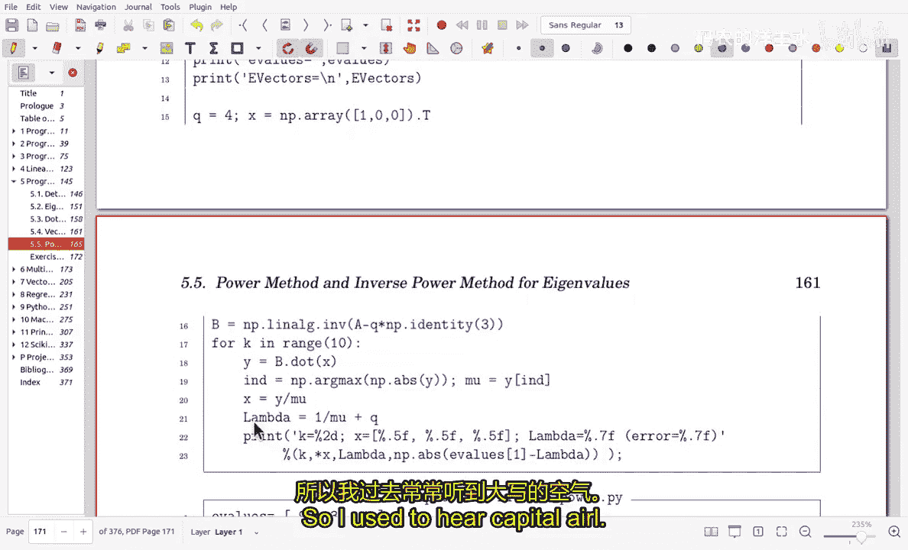

Okay， now for inverse power method， we run the Python program。Okay， this is eigenvalue。

 soed and corresponding。Ien vectors， and these are inverse powertu。0 to 9， so we have 10 equations。

Now， it is convert to 3 very nicely an error。Yes， a reduce I be faster than。Pow method。

It was curious for。Then eigenvalue of M and SQI inverse。One， fifth， minus1 and minus1 over5。So that。

Ramda1 over Ramda 2。And modulus must be a five。So the error must be reduced by a effect of5。

 let's see。If it is happening。This is about five times larger， about five times again。

 about five times。It runs as the theory says。 that convergence is really。As that theory。And requires。

Okay。Once you choose Q is a 30。1， so then nearer to the eigenvalue and the eigenvalue of a is again here 9 and 3 and1。

 is minus1。So， earlier， we。Choose Q is now 4。 Now， again， Q is chosen to be 3。

1 so that this number is near to 3 in this case。Now， is converting to 3 much past much faster。

So here now error is reduced quite rapidly。Yeah looks like about。Six times。Okay。

 it's about 60 times reduced them。So we just。Competing much of our stone in exercise，5。8。

 you will analyze。The conbot behavior。Okay。That's the end of the section。 Thank you。

