# 【全集-附课程讲义】密歇根大学-人工智能编程-EECS492-中英字幕-p39-Lecture-39---多变量函数及其偏导数--BV14JqfBNEAS_p39-

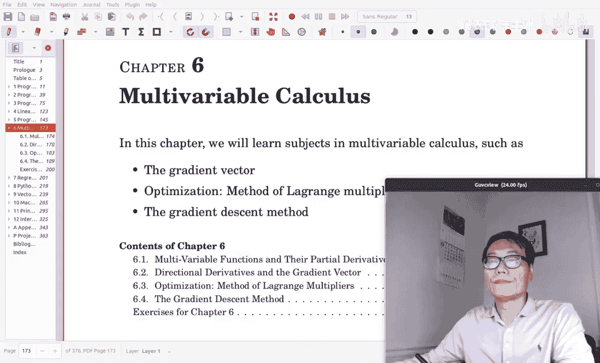

Chapter 6， multivalable calcuulators。 In this chapter。

 we learn subjects in multivalable calcuulators， such as。The gradient vector。Maathod of。

L 단지 multiplierers。For constraining the optimization problems and the gradient decent method。

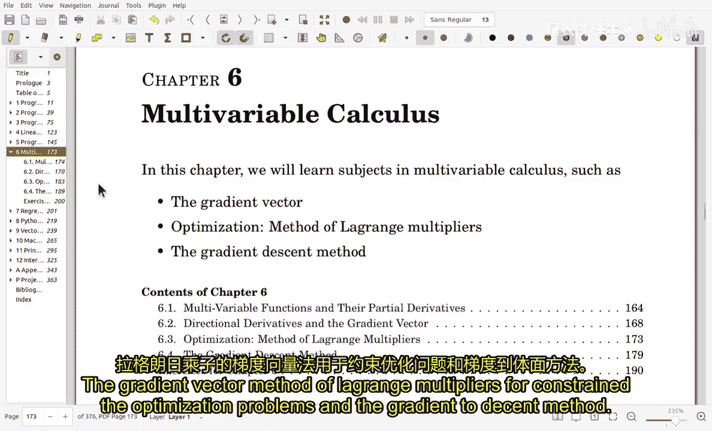

Section 6。1。Mivable functions。 and their partial derivatives。Earlier。

 you learn the function of one variable。And axis independent variable and y dependent variable。

 Then we can write here y call F forex。You learned this one from high school。

Now we define a function of two variables F。As a rule。

That means it's a function that assigns each order the pay of real number X y。AUn， real number。

At the order to divide F for， X， O Y。The D is called the domain of the function F and it arranges the set of。

The all failures that we have。If F is a function of two variables and if we write down in this way。

 then X， Y。Are called independent variables。 And Z is the dependent variable。

So rather than one independent variable。The function is defined。With the two independent variable。

Once you try to make a graph for。This simple function， then。This is X， X， and。Now that is Y axis。

 and it'll be a curve。But a full。Functions of two variables。It'll be sophs。Okay， that is now。

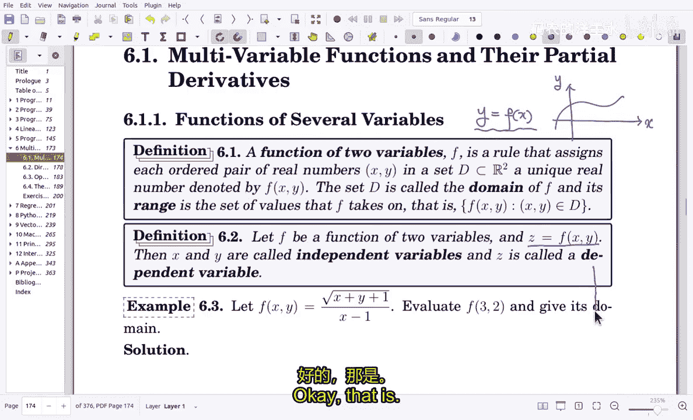

And this x direction， Y direction and z direction。For example， we have a domain here， D。

Recting eamine like a D on X Y plane。Then a function， the graph of function can be like that here。

Now， or surfacephus。So that is now。嗯。For the graph for this function。

And each point over there will be。Now that is x and y and is a z。Okay， Z is the same as F for X Y。

Okay。So it is expansion of this functions sub one variable。

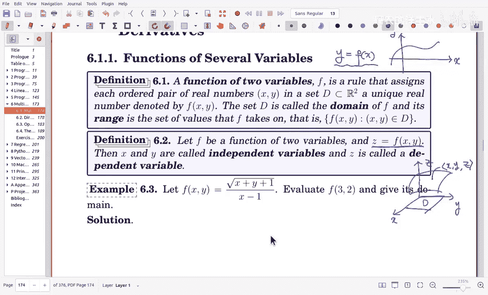

See this example F X Y is defined in this way。Evaluate F 3 to， and give as domain。Okay。

 that means that x3 y2。So， here， from definition。The tab will be x 3，3 plus y2 plus 1。

 and then bottom is x 3，30 minus1， so we can get tabius scale26 bottom is 2。

 That's the answer for this portion。나 하바트 도메인。For动面。Now we may consider the natural domain。

 That means the collection of points where the function is well defined。First of all。

 the installed radical must be non negative so that x plus y plus1 must be non negative and the denominator must not be zero。

 So x minus1。Is nuts at。So every point satisfying these two conditions will be a point in the domain。

 Okay from here。We can rewrite to。To roll。The domain， okay。And y is large than equal to minus x -1。

 now x as。Not one。 Okay， let's try to visualize the domain。That is now x direction。

That is wide direction。Okay， then。And that's Y， and that's X。

And minus-6 minus-1 may be given in this way， and y is larger than or equal to this line。

 so that is upper proportion。And。This one is saying that x should not be one。 D means at1。

We are making vertical line， and this line must be excluded。So， this is the domain。In。

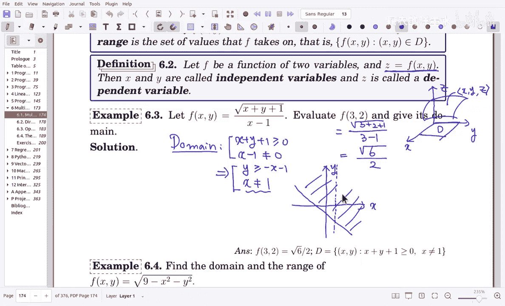

Picture。Okay。Find the domain and range of function F for X Y。Is a squared of9 minus x is squared。

Minus y square。 Okay， again， for this function inside the red column。Failure must be non negative。

9 minus X together， minus y together。What's been non negative。

That is same as x Sch plus y Sch is a pound by 9。Okay， that is。A disk of raius3。

Ex coordinateordinate in a Y direction。 this inside this disc detamine。Okay。Now。What is the range。

 A red color is always a negative。No。Inside the radical， the value is decreasing once x and y are 0。

 then the values are 9。 So here at the center the F is skelet of 9， which is3。

 but as x far away from the origin， the value is decreasing， in fact， is decreasing rading， and。

At the。Bundド。There is the same as here for this inequality。 when it is equal， then is boundary。

 on the boundary， the value is 0。So we can say that。The ranges。

 okay we try to use the0 notation ranges from 02。3， so that's the range， okay。First。

 were the partial derivativeduct。We learned early。In earlier chapter， we learned the derivatives。

So y equal Fx for this function of one variable。And we define the derivative。

Is differentiable at a if。Thiss question。So， that is， if we see。This picture， A and A plus H。

 and we measured the slope with this second line。And then as H approaches0 once the limit existss this。

 then it will be。Sb at the point。 This slope is defined as the derivative of F at the point a。We did。

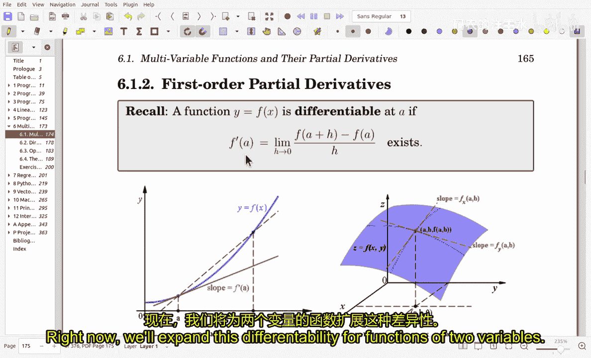

Now well expend this differentialibility for functions of two variables。

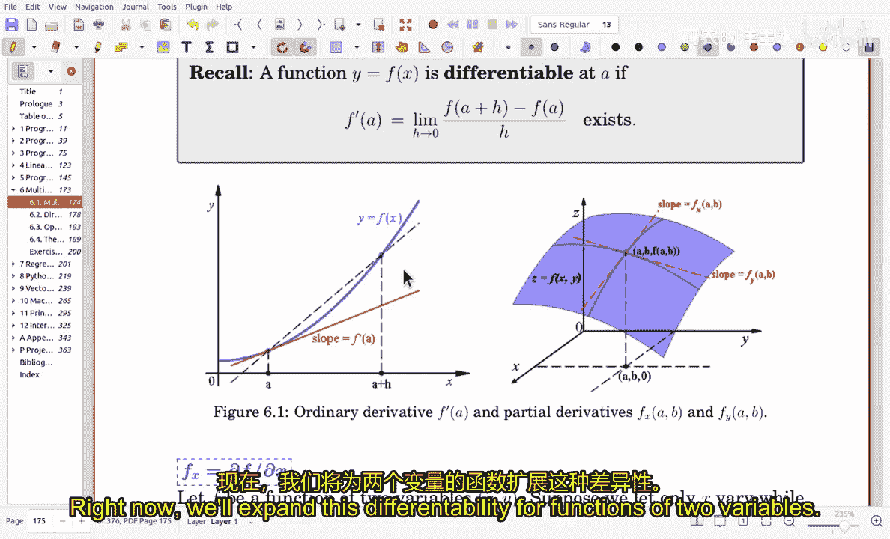

Okay， first we'll define acceleration derivative。

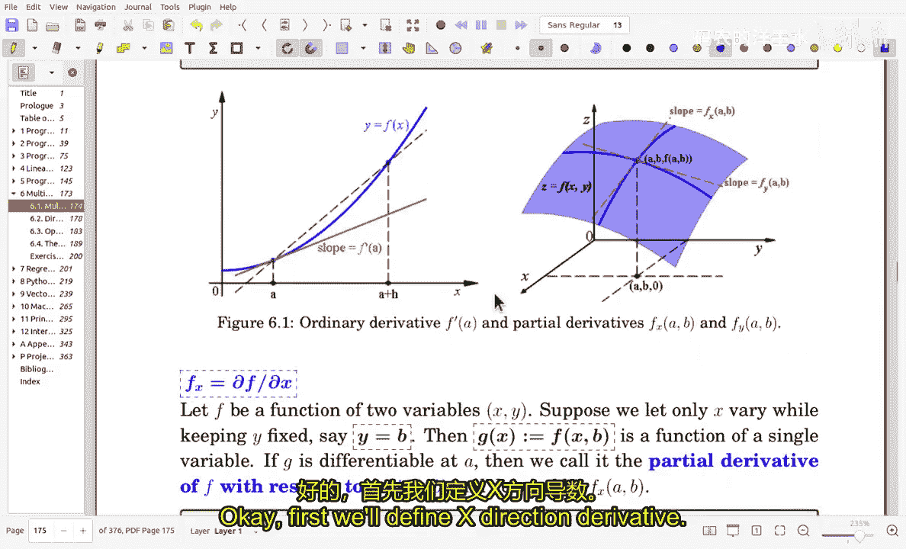

Now， F is a function of two variables， X， Y， and we。

Consider the case where y ex varyating while y is it fixed。 So say y equals being。Then。Here。

We define G of x equals F of x being。And。Then this is a function of a single variable x。

 So by using the standard derivative， the definition。

 we may try to get derivative of G in x direction。 That is the partial derivative variable F with respect to x。

And we are using the notation of subback。

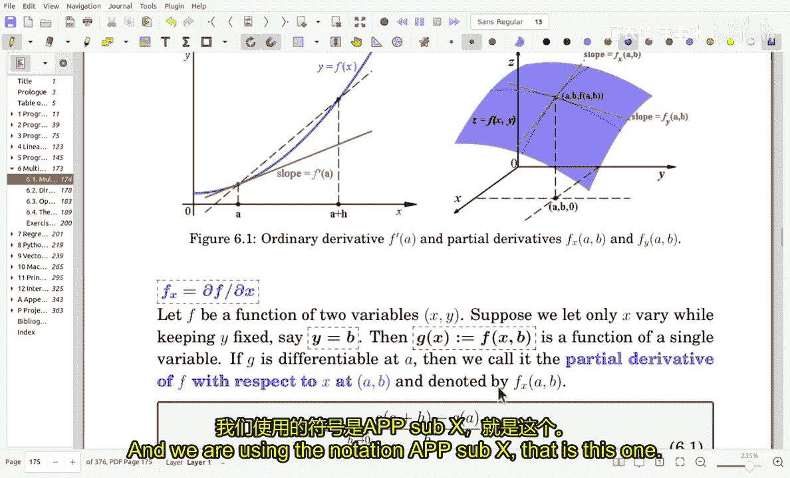

That is this one。The quo is made for G。 G is a functional react， and a plus H minus。Now。

 G of A plus h minus G of V that is exactly。

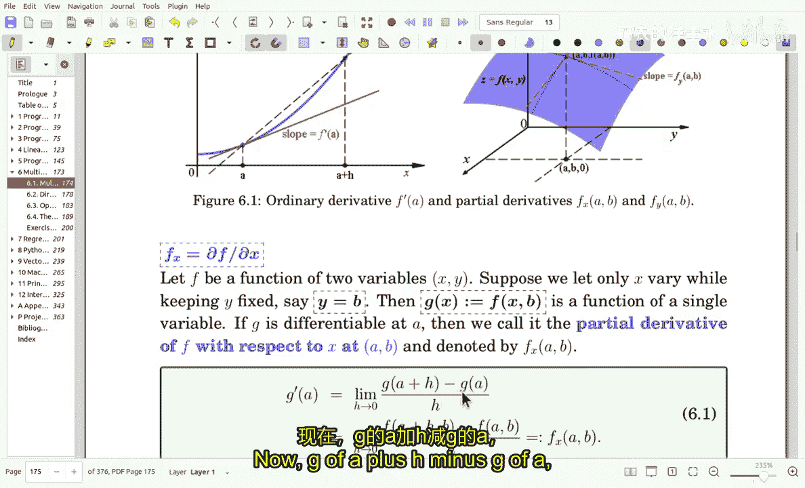

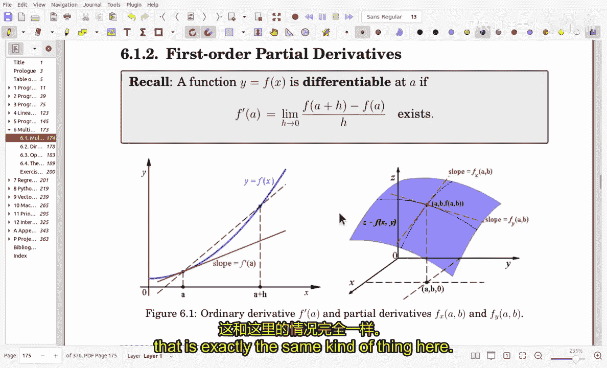

Same kind of thing here。Now， G is here F of x B。 So we can write in this ring。 Now。

 once limit exists is， then we say this is F of sub x。At ABA。Okay， that is the same as to this one。

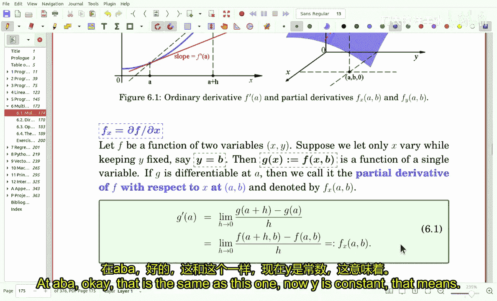

Now， why is constant， That means。For that A B， now， Y is constant， then it is same as this direction。

 extraction。If we。Consider image of this line。 Then on the surface， it'll make a curve。

 And along the curve， we try to measure the slopeb at the point。Then that is exactly a sub x。

 We did mathematically by fixing y unchan them。But in the case here。

 the image of this line will be a curve。 then once it is curved， then exactly same。

Lging for just simple F prime is used to at the point。And the slope along the curve is now F sub x。

 the partial derivative of F。In the direction of the act。

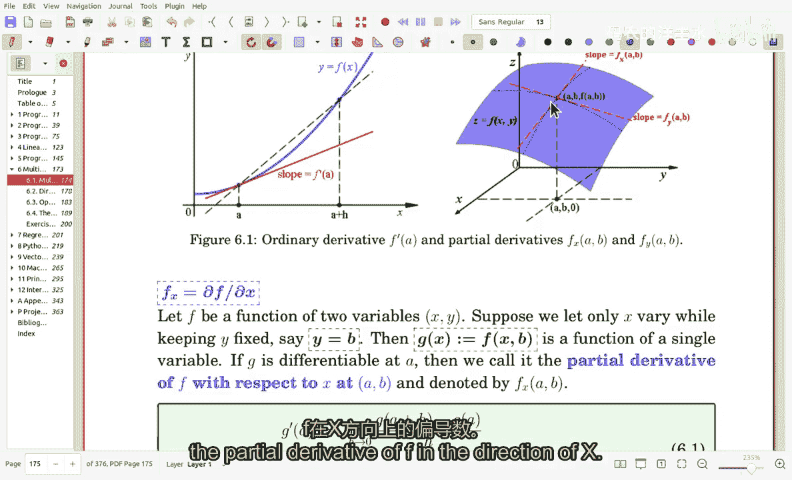

And similarly。For wide 액3 tape。We can do in this way。Here。Now， we fix X is a， and now。Why is varying。

 So pi。

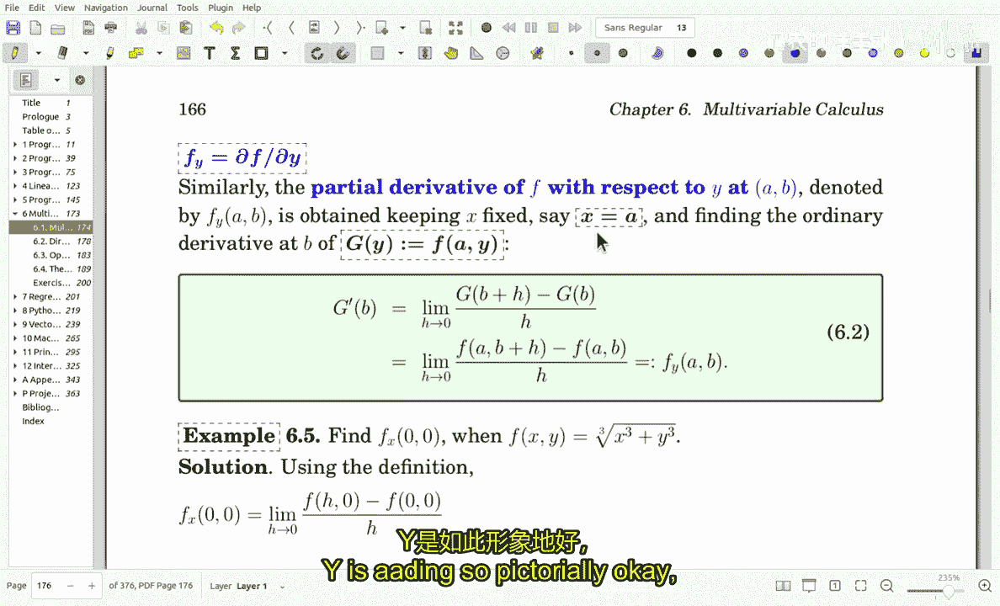

Okay， we go back to this picture。Now we fix our x so that ys ofva then means this direction。

If we crunch the image of this line， then it is a curve。 Now， at the point。

 we try to measure the slope。In that direction。 So the slope， if so big。

 then we say that is F sub y at the point A B。

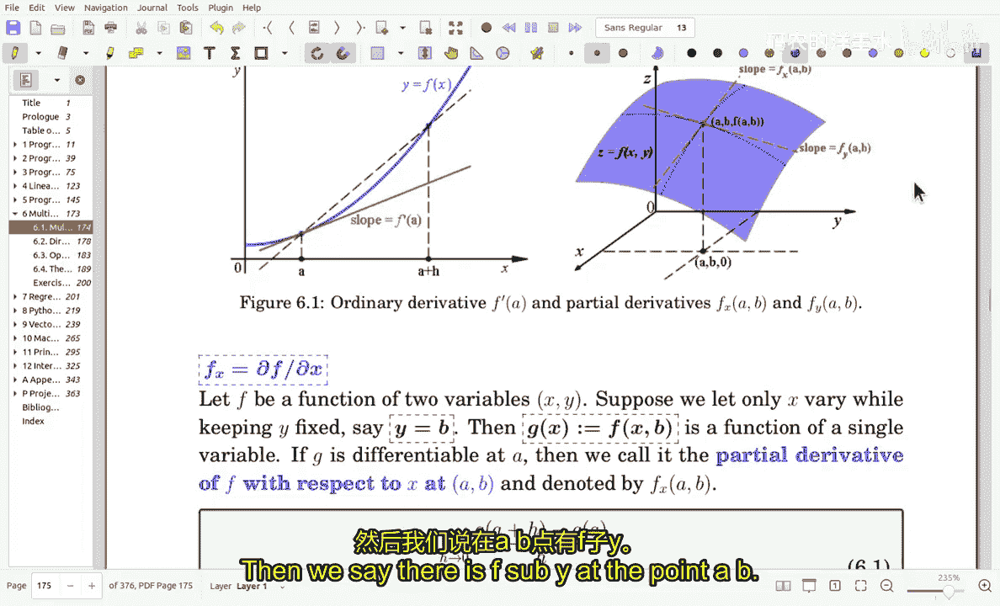

So this。Mathematic derivation is eject。the same way okay as。Except X and Y interchange。Okay。

 let's try to find a soex you on。For the function defined in this range。Then， from the definition。

They are the same as here in x direction iss changing H and 0 and Y direction。

 We have a value B here，0 fixed。Okay， and we take a limit。 H approaches 0。 Okay， there is the limit。

 the same limit H approaches 0。 Now， what is F H 0， x is H y is 0 so that。That is。Okay。Further route。

Ill read write here。And that is。Further of。No。X is H so that H cube and y equals 0， so that 0 cube。

Mineus f0， and that is a third of。Z cube드 plus0 키드， antite by H。Okay， so here there's a linear。

And here that will be， okay， this is the zero wrong。 Of course， over the whole thing is it wrong。

 And power 3 and third root。 So itll make H and bottom H。 Okay， this is always one。No matter how。H。

 how small H is。So that that is same as an limit。Of course。

 we write here now the detail H was the 0 and1。 So there must be  one。So that's the final answer。

For this function at 0，0。The slope in extraction is one。

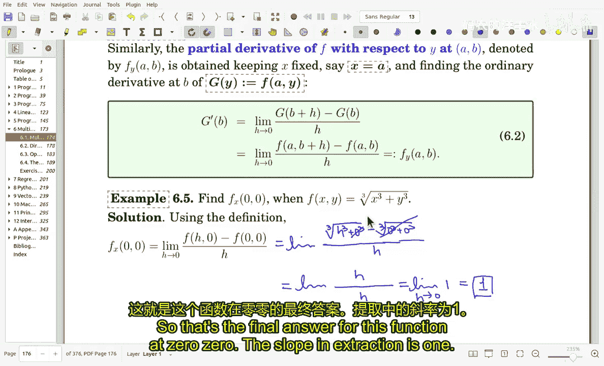

Okay。Here we have definition if F is a function of two variables is partial derivatives are the functions。

 F sub x。And we are using this notation over this notation。 We call this one。

Round F over round the x。And F so Y？Is round F over round Y defined by here in this equation now。

 rather than。Spec point A B。 Now， we are using gender point X Y。

 And here for every of X now is changing in x direction only。

For F subbi is changing in y direction only。So， that's partial derivatives of。

A function of two variables。

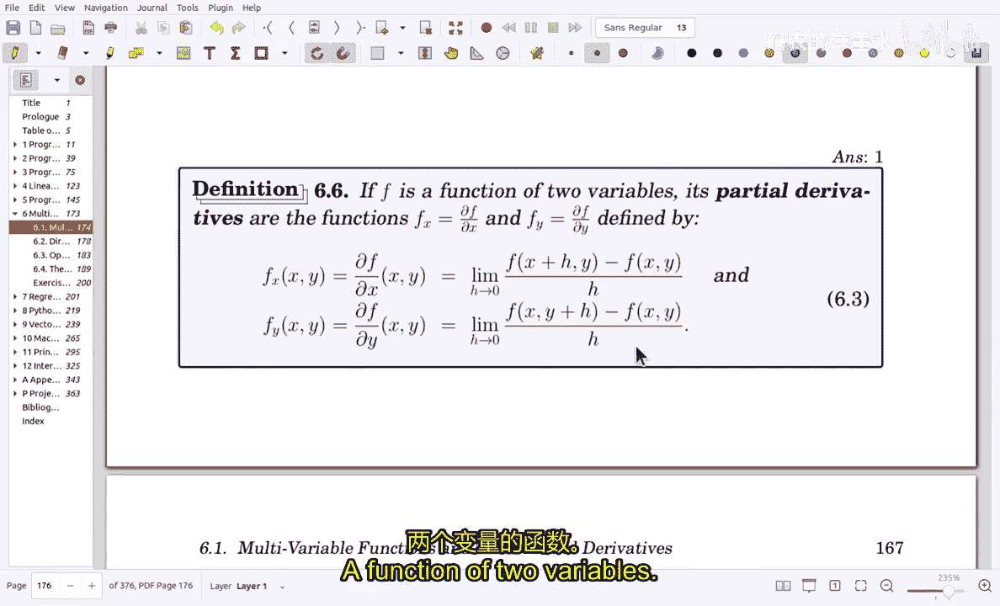

Here we have observation。 the partial derivative with respect to X represents the slope of the tangent lines。

To the curve that are parallel to the X G plane。

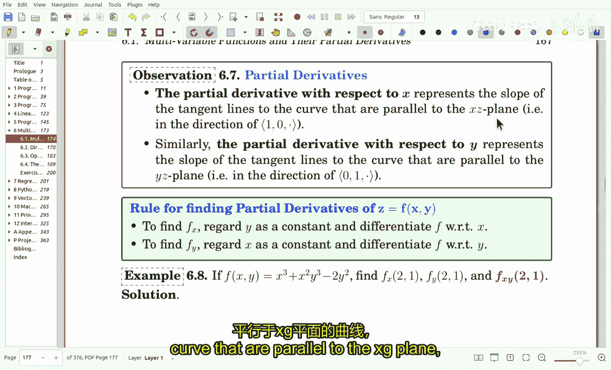

Okay。I explained the Victoriactor already here。

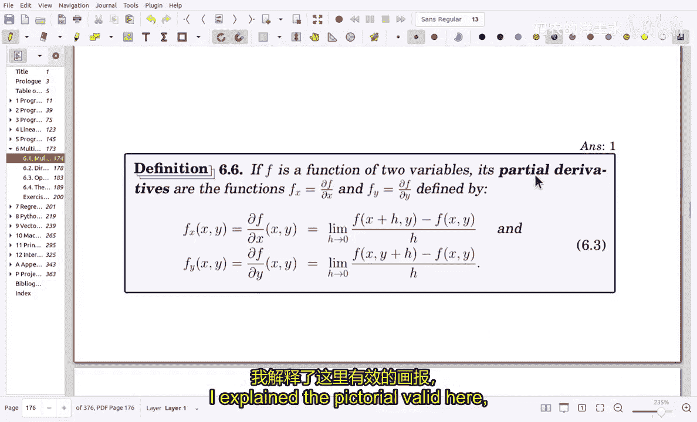

嗯。SoEroobs is just along that one， we consider the imaging。

 So the curve along the curve at the point， we try to get sb， that is。Oh boy， that is now。That one。

But that is， in y direction， x is fixed then in y direction， I'm sorry there must be F sub y。

And for ever subex。Now， wise is fixed。 so along this line。

 we consider image here and along the curve， we try to get slope at the point。

That is equal subax okay？

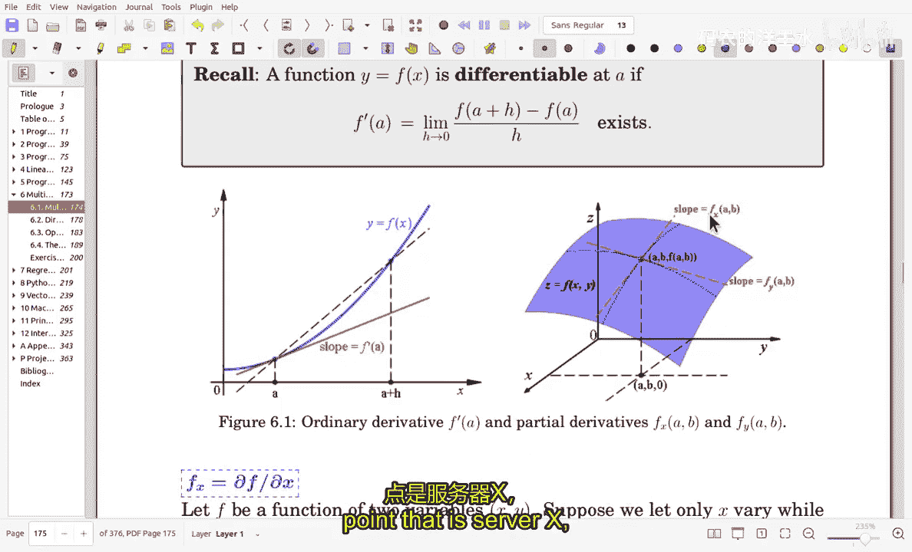

So that is here the explanation。

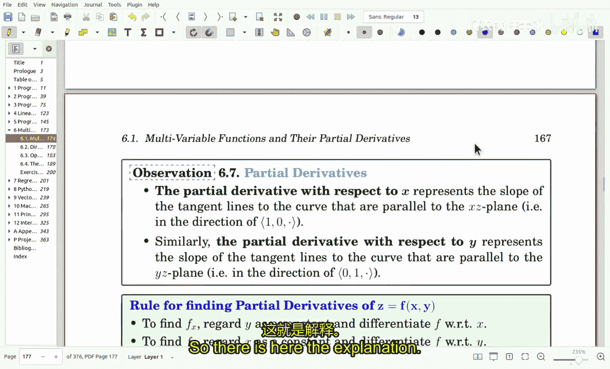

Now， in pres。Here is rule for finding partial derivatives to find epi X with regard Y as a constant and differentiatepre F with respect to X。

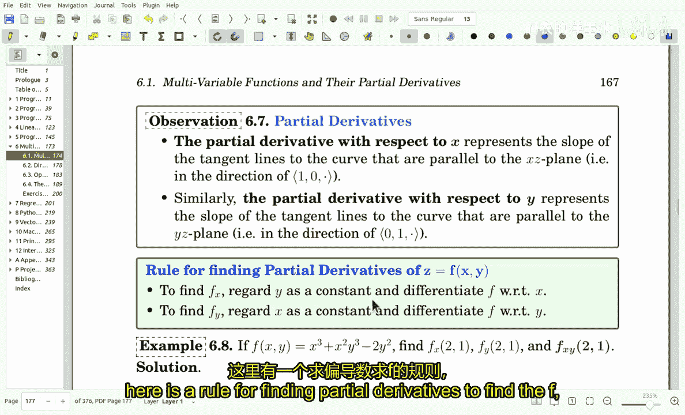

And for。Epiode by。We consider x as a constant and differentiate F with respect to Y。 Let's try here。

 by using the rule。Now， F skip in this thread， and we try to find F subex F sobi and or so。Now。

 second derivative okay。So first， we try to get E subex and F subbi。Have subback。X drift here。

 x is variable。 Y is constant in this case。 X is variable。 So it's a three xs Schter。

And this is constant。 So theres now2 x Y cube de。 This is constant。 So it'll be set in derivative。

How about now F sub。Theres， that will be constant。 So deluive will be0。 And for this one。

 now y cubed， there is a3。Y squared so that3 x is squared is constant and y squared。And that on。

 minus4 y， right？Okay。Now， how about F sub x and y。

 that means that first we make x of T and y derivative T。Okay， from this one。

Now we make wideデ chip and then 내비 싫어。And here。This is constant。

 so that we have a constant and derivative to y cube do with respect to y will be 30 y Sch。

We did idea here， six。嗯。X， Y， scared，Now， once x is 2 y equal 1。

 we can evaluate this one here at 2 and 1。Okay， then X is to。Then12。Plus， exit to 4 and  one。 Okay。

 so this is 4。 So it is 16。So in X direction， the syllabus 16 Ha about for y direction。 Again。

 we are using 02 3 and1。Then x is 2。That is 12 and 1 and -4。 So that is a。So in x direction。

 the slope is about twice of y directional slope。What they on。Now，2 and1。Then。Okay， X is 2。

So here there is 12 and equal 1。 Okay， so that's the answer。

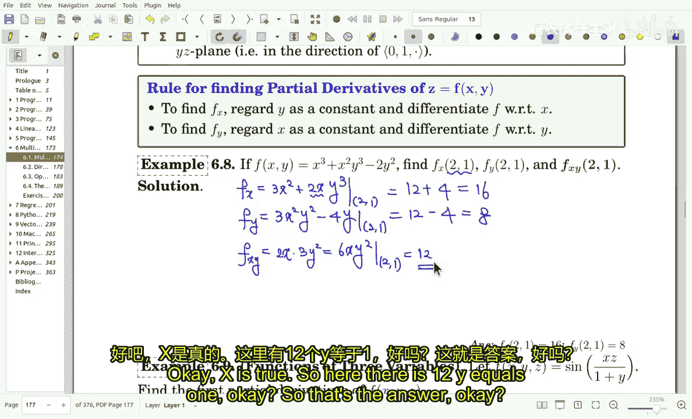

Okay。Function of 3 variables。 we didn't define functions of 30 variables， officially， however。

And from functions one variable。We try to get。The derivative was for functions of two variables。

 Now we can naturally expand the concept for functions of 30 variables。So here F of X， Y。

 z is defined in this way now we try to find the first partial derivative with the function， Okay。

 so x， Y， Z are independent variables， So we start with F sub x， x directional derivative， there on。

So in this case， y and Z are constant。嗯。So， first， we are using。Here， now。

 with X variable and using product rule or chain one， we can get。Tip tip。 Okay， so for all this term。

 we make a tip tip。 then that is same as cosine。 So we are using chain room cosine。Ex and Z over。

1 plus y。And。Delied with this one with respect to X， which is a z over1 plus y。This is simple， right？

How about F for subi？Again， same in this case， y is。The variable and Estasy are constants。

So that again， we start with a derivative with respect this whole thing。

 That will be this cosine part down on times here。 we have to make a derivative。

With respect to Y for their own。 Now， X E are constant for this one so that theyre the same as here。

1 plus y and schedule and minus-1 will appear。 So that minus X here。喂。Okay， Stan。

And how about epips C， the same and。Yet， now Z is at the variable。So first。

 we try to make derivative with respect that on。Chale， so we have the same term times。 Now。

 for this one， we have to make a derivative with respect to Z， which is x over1 plus y。Yeah。

That's the。As okay。Okay。It is the end of section。 Thank you。

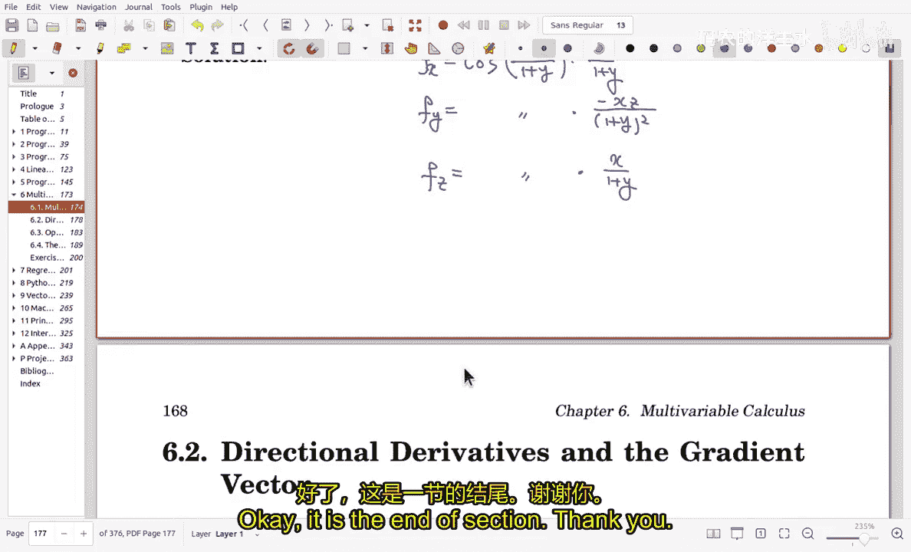