# 【全集-附课程讲义】密歇根大学-人工智能编程-EECS492-中英字幕-p40-Lecture-40---方向导数与梯度矢量--BV14JqfBNEAS_p40-

Section 6。2 directional derivatives and the gradient vector。For functions of two variables。

Z equals F of x， y。The partial derivatives， esoex and eso Y represent the rate of change of Z。

In the X， Y the exs。That is directions of unfactors， ion J。In this direction， it will be Fo X。

 In this direction， a derivative will be F sobi。Now。

 it would be nice to be able to find the slope of tangent lines。To the surface as。

In the direction of an arbitrary unfactor， U equal A B。 So consider an arbitrary direction U。

 And along the direction， were going to find the slope of the tangent line。Okay， here， that's the。

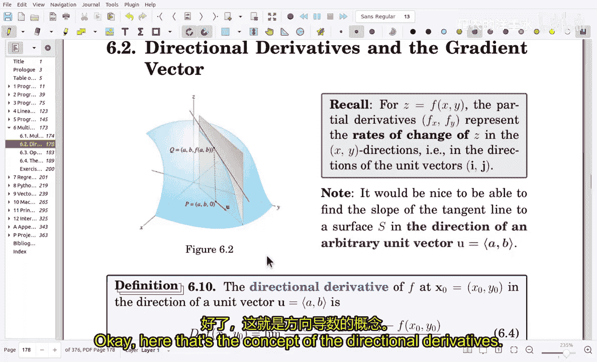

Con of the direction of derivative of twos。The directional derivative of F at x 0， x0， y 0。

In the direction of unfactor U is defined in this ring。Get this cushion。Is measured in the direction。

Therefore。This inside of a parent this， we can write this one in this that is。

X 0 plus H and U in U direction， H distance is。Yeah， consider。 And that is now aaceceone。

So in U direction， we try to find this law。Once it are limit。

 it just understand we say that is the directional derivative of F in U direction。

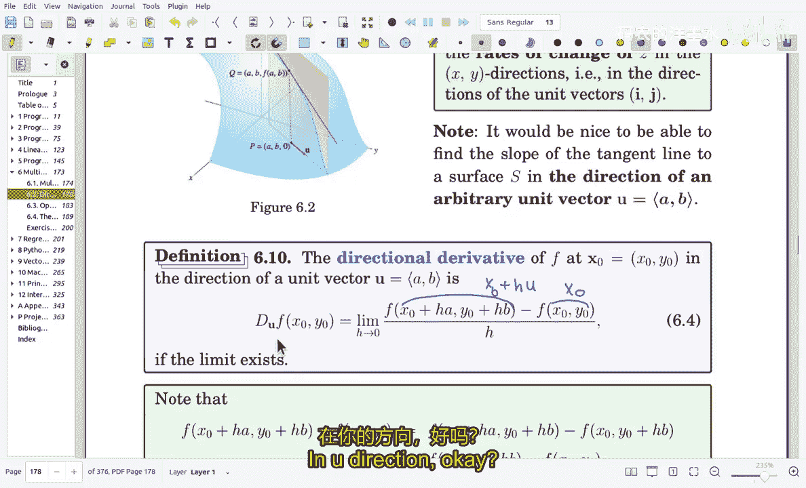

Okay。That's the definition。Now， for。The 뉴메。Here we may subject this term and add this one。

And now we try to deal with these two and that， too， separately。

So that the cushionent is the same as。Now。T by double by H and multiply A and A here。

The same A for these two terms divided by H and also divided by B and multiply B here。

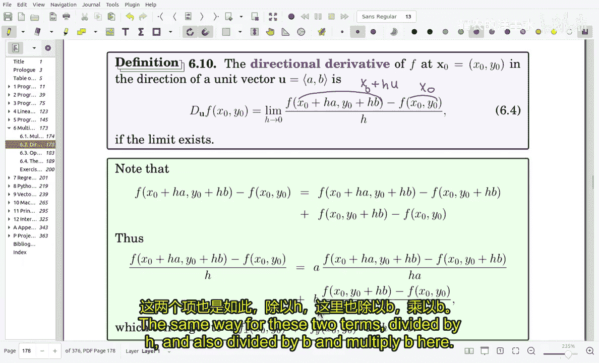

Okay。Now呃。If we look at the。The question is H approaches 0。 Then we can see quite easily。 Okay。

 that one is the same。By alien exction。Is perturbed so that once it is exit direction。Okay。

 now for a B。There is x。 And this is A B。 Then this question is a measured。 Okay。

 a little bit of perturbion。In y， however， the direction is that direction。

 that directional the slope is measured them。 and as H approaches， these two will convert to y 0。

So that eventually this term， if the limit exists is。

 then it converted to F sub X x directional slot。And for that one。But you can see quite easilyly。

 this whole thing is converting to episode y because X0。 And then now only。The perturbion。

 the point is obtained in y direction。So that itll。Converted to episode line。

 so we can say that here。This quot will convert to a episode X。Plus B F sobi as H approachess0。

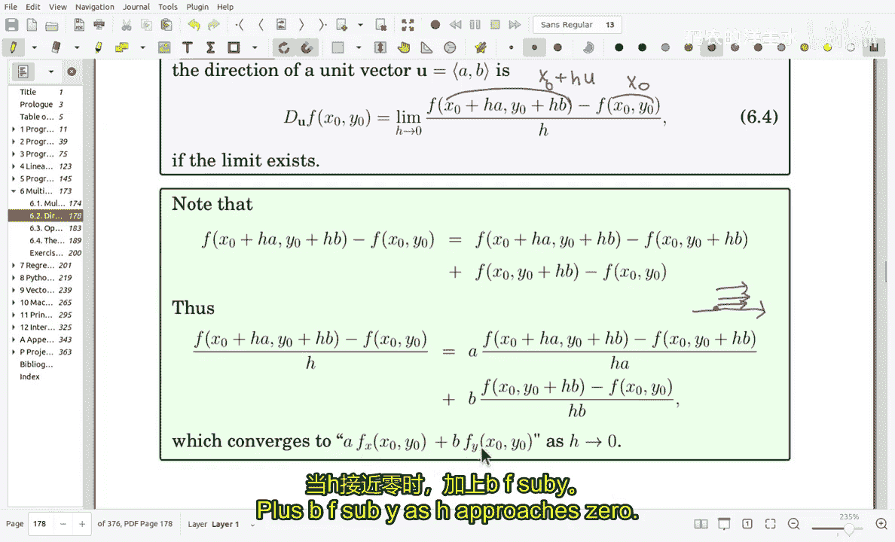

Okay， so here we have a theorem。If F is defiable。Fortunate of X and Y or then。

F has a directional derivative in the direction of any un vector U。Oh。A BR component。And D U F。

 the direction of derivative in the direction of U is the same as now F sub x times C A plus F sub y times C B。

We collect here F sub X， F sub Y and A B。Then we can write down in this frame。 Okay， this one。

 this vector。With you that product。Later on， well define this one as the gradient vector。

 So we'll use the notation。 But anyway， right now， we have this one correlation。

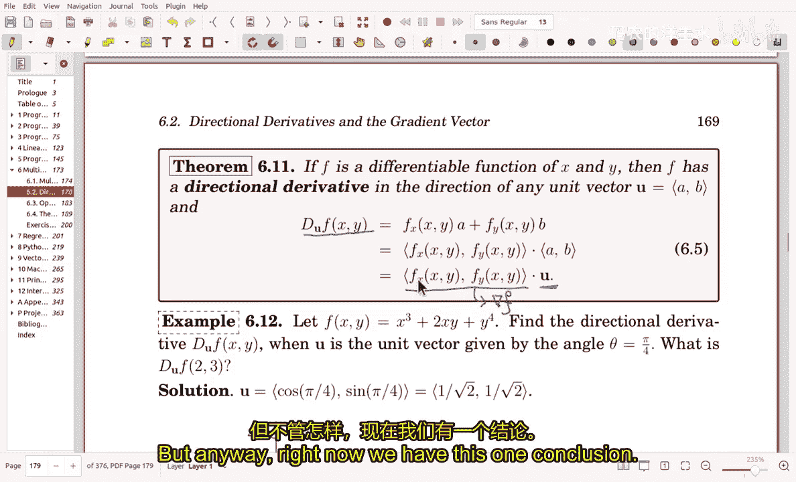

Okay， let's see this example， F X Y。As they find in this way， find the directional derivative。

Do you have。When use the unfactor given by the angle， pi over4。And what is D U F 2，3。

So here in the beginning， you may try to get the direction。 That is a 45 degree direction pi of4。

 So that is un factor in the direction as cosine pi over4 and sine pi of 4。Which is this one。

 one of script 2 in X。In Y component the same。Okay， that is the direction。Now。

 if we try to use the formula， then we have to get。E for sub x， F sub y evaluates at2 or3。 Okay。

 let's try to get F for sub x。X derivative chip for that on， theres a three x together。

And now there is2 y and there is0。And if saw why， why did achieve。

Which is now this will become0 because we consider x as a constant。 and that one will be 2 x。

There's 3 x。 And this one is four times y to do3。 now we。Set the  point 2 and 3 x is to Y equal 3。

Then， from this one。X equal 2 then is 12 and y equal 3，6， so that that is 18。Now。

 for f sub I x equal 2， then there's 4 and y equal 3。Then here there is  three times30 times 3。

 which is 81。 now，81 times 4， right。Oh no， no， it's 27。 I'm sorry。27。Times4。So that thats 68。Right。

Okay。Times 4。27 times 4， now，6，1，0，8。Yeah。1 or8。 So it is a 1，12。Okay。So D U of weF at 2，3。

Its the same as。This vector 18 and 1，20 and part the product with U。

 which is one of S 2 and one more， one over scope 2。

So that is same as one of us captureded2 and Ed the shn。That is 1，30。So we may write this one。

 We multiply script 2。Then now half of that one is 6 and 5 and script 2。 That's the final answer。

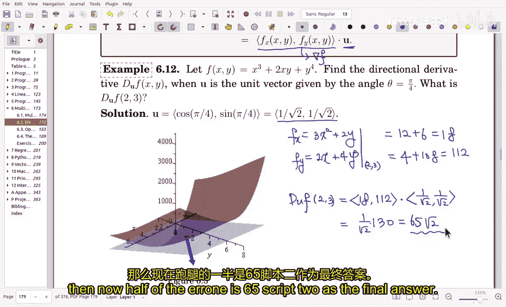

Okay。Okay， for this one， you may try yourself and try to get it。Now， for this one。

 angle is pi over 3， which is a 60 degrees so that U must be here。

 first component is cosine over the angle。Which is one and half。 and then now second on。

 the sign pi of3 is script of 3 over2。That is。Unit vector。So now exactly the same。

 you can finish this problem。Now， the concept of directional derivative can be defined for functions of three variables。

 in fact， functions of arbitrarily many variables。Okay， now。Yeah。

F is defined as a function of 3 variables， X， Y， Z in this way。

 and find the directional derivative of F at 1，3，1。In the direction of V 2-2-1。

Let's try to decide the unit vector in the direction。There must be U equal V over length of V。

The length of v。As now。That is skeletative， the Euclidean length is 4 plus 4 plus 1。So。

 use the three。Okay， so here we have that is one third。Of 2-2-1， that's。You。

Now we have to find F sub x， F sub I， F sub C， and evaluate at here 131。Okay。Okay， and for subax。

That is x chip。 That is2 x。 And now Y and Z are considered as constant。 So we have that。 Okay。

 F sub y， Y derivative， that is minus4 y， quite easily and F sub C， which is now 4 Z。Cute。

Now we use the points。1，3，1， x is 1， y 3， These1 from this one。 Now， there's 2 from this one-12。

 and from this one now  for。喂。So， here。The D U。F at 1，31 is same as the vector。That is 2-12 and 4。

With the top product。 now， that is one third。 and here。2，-2 and 1。Yeah，That is quite simple。 Now。

 one third constant。 and this one is now 4 plus 24 plus 1。Okay。In fact， the last one is full。Right。F。

Plus 24， last1，4， okay。Okay， so。You can finish the computation。Okay。Okay。

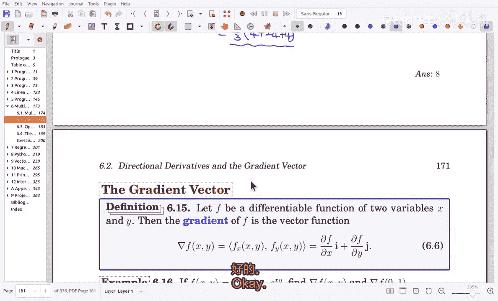

Now， here well define gradient vector。F is the differential function of two variables， X and Y。

 then the gradient。Our F is the vector function given in this rank。Just we are using the notation。

Here， that is Nabula， Nabula F。And that is a vector of epiossos and eossobi。

We may write in this ring。 I is 1，0， J is 0，1， so we can write in this ring。Okay。

 that is called the gradient vector。For example， for that one。

 we can find the gradient in the vector。Ely， just simply here， we put。Xci derivative of T。

 then that is cosine x。And plus now that is y each the X Y。Now， if we do Y of chip。

 then there'll be0， and that is x。E to the X， Y。Okay， so that is a gradient。

 and we can get the value at one in0 x， Okay，0 and  one。No。1 and0。Okay， that is now。0 and1。

X is it all lies1。Okay， let's see here。 If x is0， then it's one， Y is 0， then that be 0。 So that is。

X is 0， then is1。 Y is 1，1， E0 is 1， so that one plus 1。Now， x is0 so moreB0 so that the vector。

As now here to n。And we can write this vector in this form。 So we are using this。Anngular notation。

 when we try to write it in horizontally。

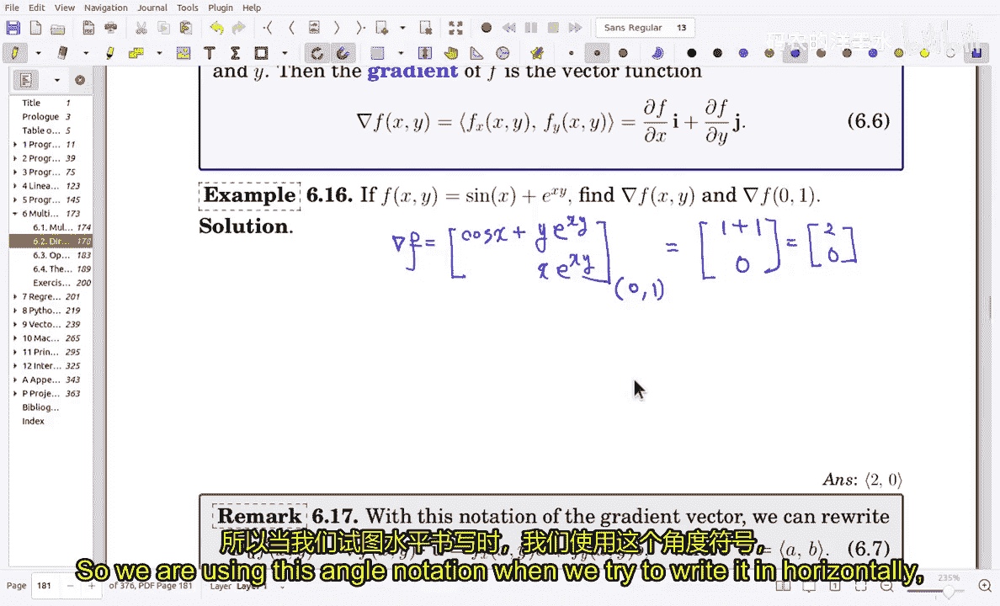

Okay。With this notation of the creditre vector。We can redite the directional drift D U of F。

Which is same as now gradientedent of F dot U。Right， so。嗯。

Well use this one a lot for directional direct。 We construct this one， most frequently。

Find the directional derivative of F O X， Y， keeping in this way at that point and。

In the direction of V 3，4。So first， let's try to get U U is now V over v length。Oh。From Pthorian Tri。

We know that the length is 5， so that we have here now 5 and V。For the end， this。

The un factor in that direction。Okay， now F sub x and F sub y for gradient。Okay。

 that's exit as 2 x Y cubeter。And there is， now， why do we have there is a three X schedule。

Y scatter and minus of 4。That would't make a minus-4。And at2 and minus1。then。Access to。

Y is -1 X is 2。Y is a -1 so that theres a -4。And x is 2 is say minus-1， x 2。12-4， which is it。

So here the directional derivative DV F is same as gradient of F dot U。Okay。

 that is now minus4 and a and dot and one over 5。And here，3 and 4。105 is constant。

 and we have ta product， which is-12 and。Plus32， there be。Okay，20， so that， okay。

 so that the answer is full。可以。

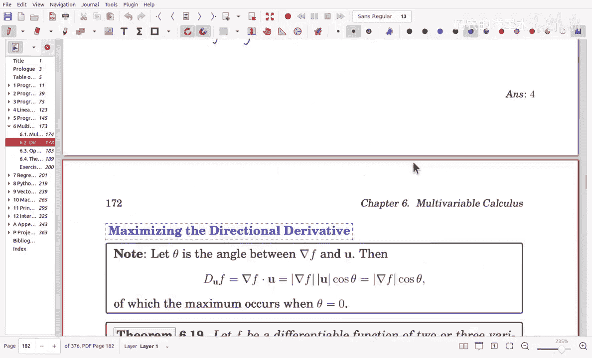

Now， this is the major subject。Maximizing the directional derivative。Okay。Here。D U F。

 the directional derivative， can be written in this re， created to F thatt U。By using a formula。

 we can write in this way the length of gradient。Time the length of you。And cosine thera。

 when thera is the angle between the gradient and U。Now， length of U is one， so we reach at that one。

Now， this value is maximum when cosine3 is 1， which means3 is 0。

Of which the maximum occurs when theor is K the result。Okay。

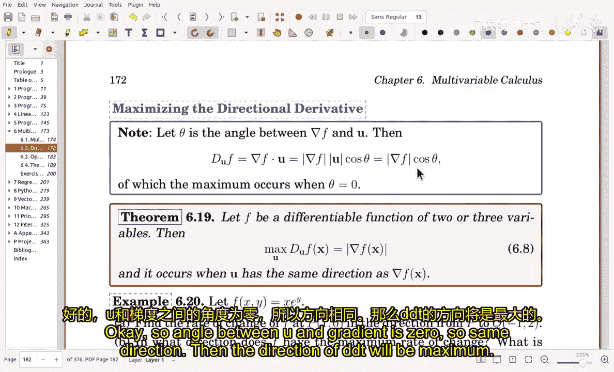

So angle between U and gradient is0。 So same direction， then the directional degree will be maximum。

We say here， in theorem。F is a differential function of2 or three variables， then。Maximum。Now。

 we are taking maximum over U and D U F the absolute value of length of gradient of we have。Okay。

 here， that is the maximum so we can get here maximum。We are using here now actual value sign。

 but it is basically。The norm， Eucliar， the norm。And。

This one occurs when you has the same direction as the gradient。

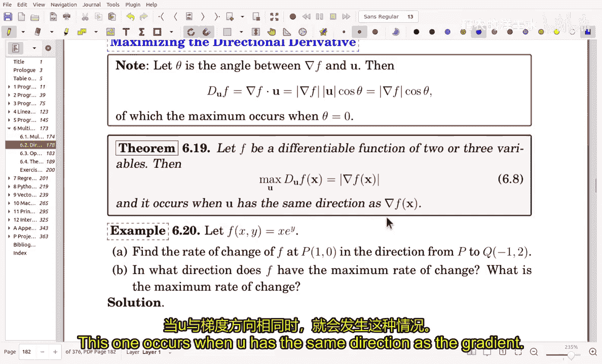

Okay。So we already object it from here。

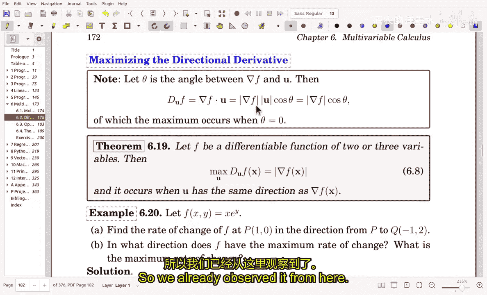

Well， let's see this problem。F of X， Y is x times e to the y。 Find the rate changeable F at。1。

0 in the direction， from P to Q。Okay， for this problem。Let's try to find the U first。 Okay here。

You yes。Now， the un factor from now P to Q， right？ So once V is given for that one。

 then un effect will be obtained from that direction action。 How can we express that one。

 There is a basically a Q minus P。That is here okay， there's -1 and 2。And P is1 n0。 So that。

The vector。I。-1 minus-1。 so that that is -2。And this is true。Okay， minus-22 direction。So U。

 the un effect in the direction is now。The length of that one。

Yess2 squared up to 2 divide by2 squared up to 2 is the same as。One of cube 2。 and that is -1 and1。

That is e。YouThe unit。Now。We want to find the red changeover have at。1 zero for the function here。

 So start with。Could then to we have。This time， we'll try to write down horizontally x。

That is each dy。 And y did it achieve X each d y。Now， we are just here one in， x is 1。와이콜 싫어。

So that that is1， y equal 01， x is 1， y equal 0， So again， that's1。So the directional derivative。

As same as here， one and one。 and that。And when of us scared of the two。Minus1 and1。Okay。

 so here constant whenever step 2， and this type product is a0。 So it is a0。That means that。In this。

 the function is not changing。 That's flat。If we question all the direction。

But itt unnecessarily flat every direction。You know， what direction。

Does F have the maximum rate of change？ What is the maximum rate of change from theory over there。

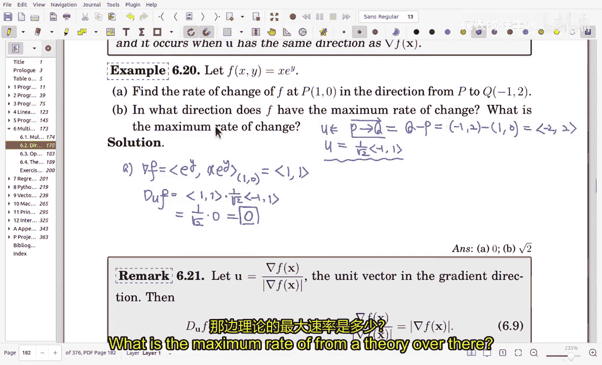

The maximum of directional derivative j now。We have to choose the direction。

So that it becomes maximum that is happening when we try to choose the same direction of the gradient。

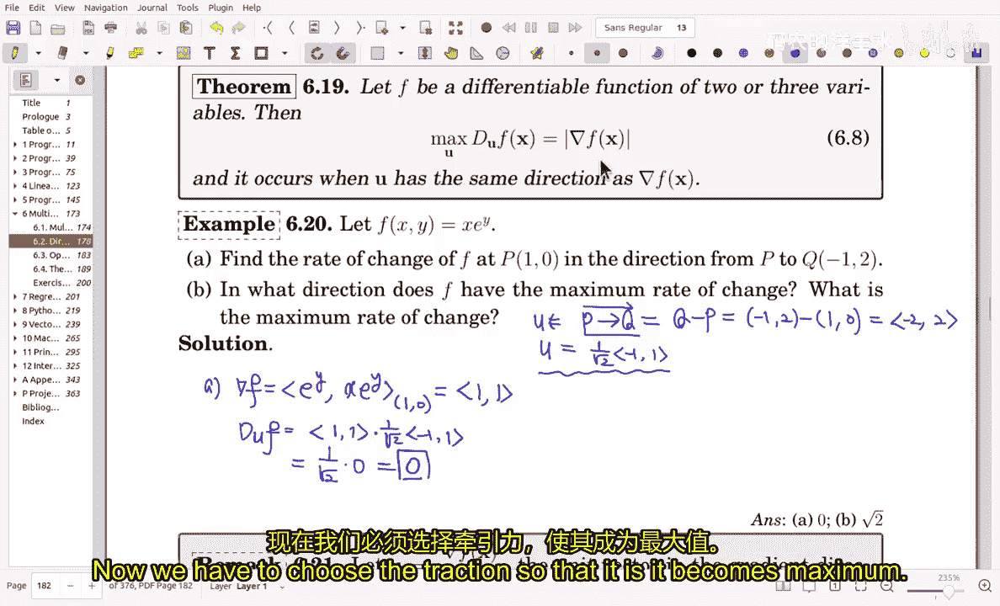

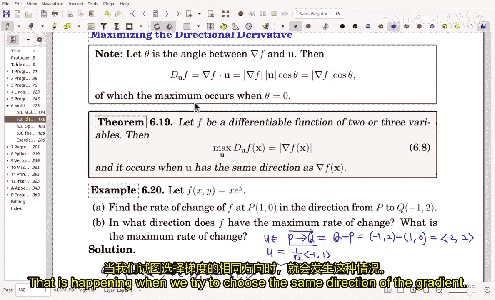

So that means that。If we choose here。Now， you equal the same direction of that。

 which means one over character 2 and one and1。Then it will be maximum。

 that a maximum value is the nu of the gradient。 So here we can easily say that maximum is gradient to F。

The length。Norm， so that is not only this is 1 and1。 so that that is scope 2。Okay。So in this。

 if you choose you in this， then here there's maximum。This is there。The credit attraction。

The function is changing。Fst test。And。That's the conclusion we are to。

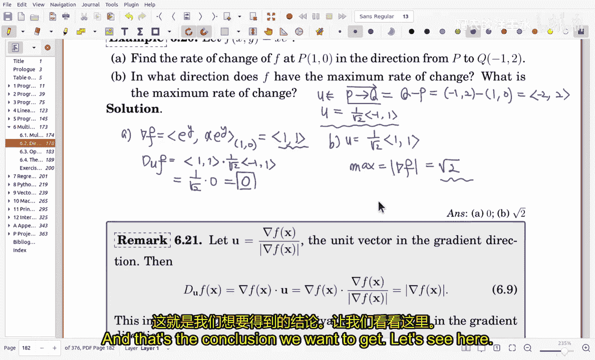

Let's see here。If we choose you。In the direction of gradient。

 the unfactor in the direction of gradient， then D U F。Which is。Creian F that you。

Which makes now this that the product will make。Cident of F norm scatter。So one norm here。

 so when is canceled， we reach chat that on。This impliesized that。The directional drift as maximized。

In the gradientedent direction。So we can make a claim。

The correct direction is the direction where the function changes fast test。More precisely。

 increases fast as them。

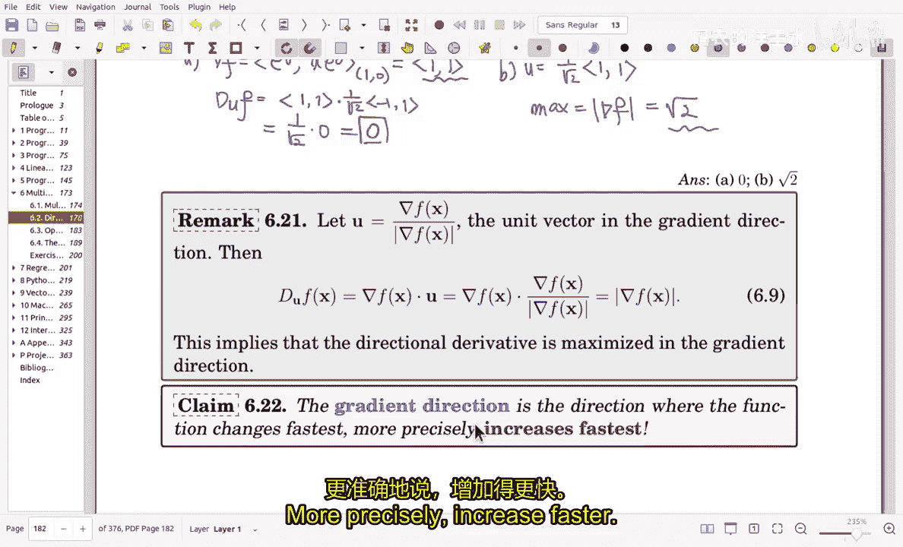

Now。Here， rather than change， we are using the word increases。Okay， that is。

 although with some other。Mathematical analysis says the changes， in fact， the increase。

But we may think， in this way。TPT B always increasing direction。Okay， let's start with。

The well known function， y equal F3 x。Okay， let's see here。And if y equal F x， then。

If this is y called Fx， the graph， then at the point， we know that。And is increasing。

 So the slope bo data is positive。For대로론 슬로비스 네。F prime is now positive negative。

 positive means there is this direction。 negativeative means that direction。

So t is always increasing in reaction。It is changing fast， but gradiented is increase duration。

So we can conclude that。The correct attraction is。The traction of fastest ins。Okay。

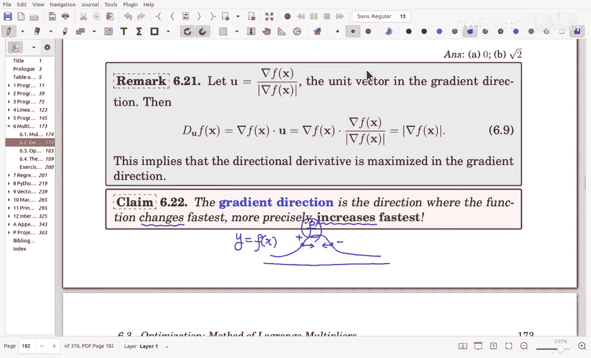

That's the end of the section， Thank you。