# 【全集-附课程讲义】密歇根大学-人工智能编程-EECS492-中英字幕-p41-Lecture-41---拉格朗日乘数优化：等式约束--BV14JqfBNEAS_p41-

In this section， we will study optimization problems。And we'll try to solve them。

Using the method of lagggedran multipliers。In the last section， we got this claim。

The gradient direction is the direction where the function changes fast test。

 more precisely increases fast test。Here we'll begin with level covers。 See this example。

Consider the unicCcle， the circle of redis1。And then。The equation is given in this way。

 x squared plus y squared is1 square。Okay， we。Name this portion。Oh。By F of X， Y。

What can you say about the gradient of。Okay， to answer the question。

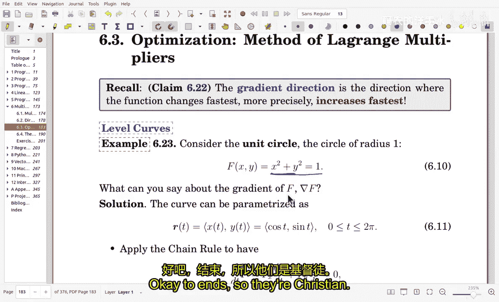

嗯。We introduce。The parameterization， the curve can be parameterized as in this equation， aruci。

Is a vector。X of T and y of T。And x of t is cosineine， and y of T is a sineine。

 and t is moving from 0 to2 pi。So that is。The circle of redius one。And here。And stuff from here， T。

A pi over two is pie。And 30 pi over2， and 2 pi。Right。Once x and y are function of T。

 then we may consider capital F as a function of a T。

So let's try to get derivative web F with respect to Ting。Now we are using the chain rule。First。

 we make X derivative and Xt derivative。And why deive and。Yeah， Y T deive。

 and this is constant you must be。Now we collect epiex， ifso Y。To be cred we。And x tative is minus19。

And。Now。Y sine t T derivative B cosine t。Okay， for。A point on the curve。 That is X， Y。Now， this one。

 the vector must be cosine T。And minus， okay， and minus sing。Ja。Co。Sci0。Okay， back at that。那。

So that that direction is this one。 If we rotate， then now change the position and put minus so that that is exactly this one。

So， minus sine cosine。That one， the vector is 90 degree rotationtation in counter coolarwise。

 So that is now that direction。This is that one has that direction okay。

But a dis equation is saying that gradientt we have and the direction， the vector that product is0。

Instead that creating into F is ortho to that direction。So the choice is this one。嗯。

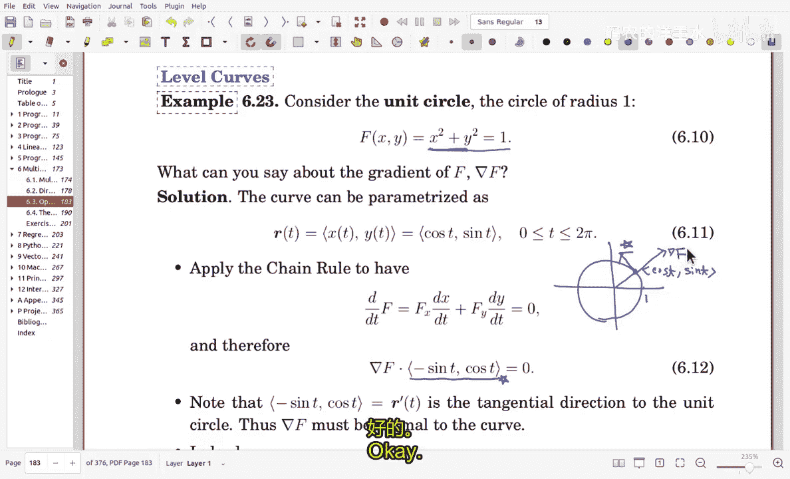

Practically。We can get credit until we have。And x derivativeivity is 2 x and y derivative 2 I。

 So exactly。From here today， that is correct we have。Here， geometrically。

 the gradient is normal to the curve because that one is tangile vector。

So that must be a normal vector。And the gradientent to F is。

And the targetinging the fastest increase direction。Inside。

The value is less than one for exoscadter plus y scatter。 And along the curve， the value is one。

 and outside， the value is larger than one。And along that direction， values are increasing fast。

So we considered one example。

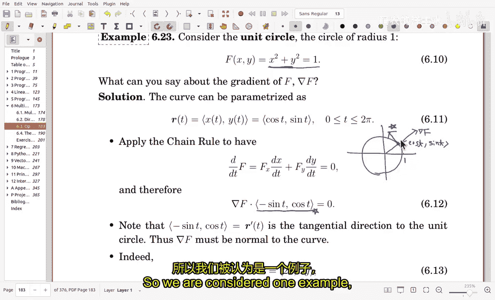

But we can generalize this observation here is always true。

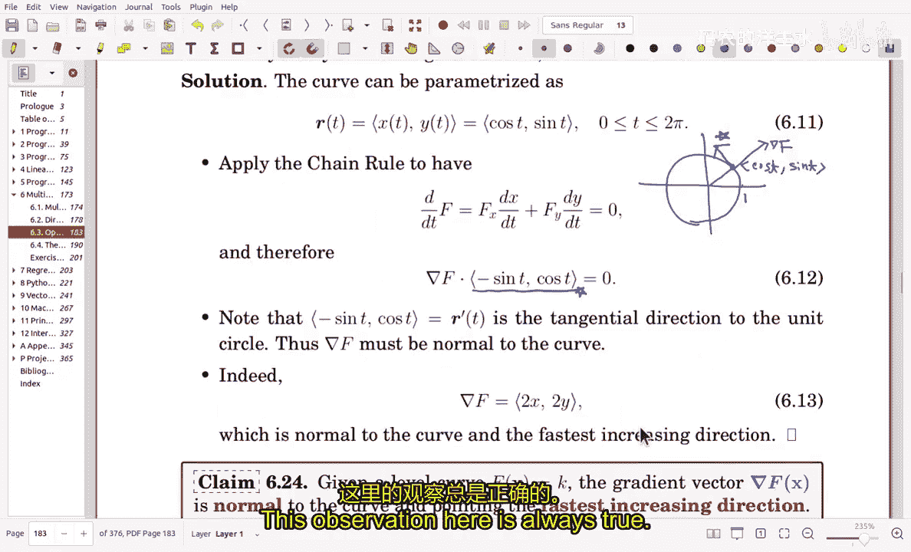

Given our level curve， Apple x equal K。The gradient vector， grid F。

Is normal to the curve and pointing the fastest increased direction。

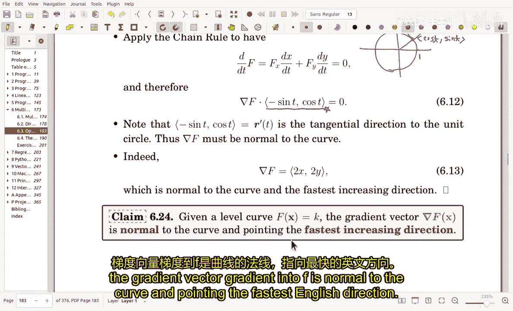

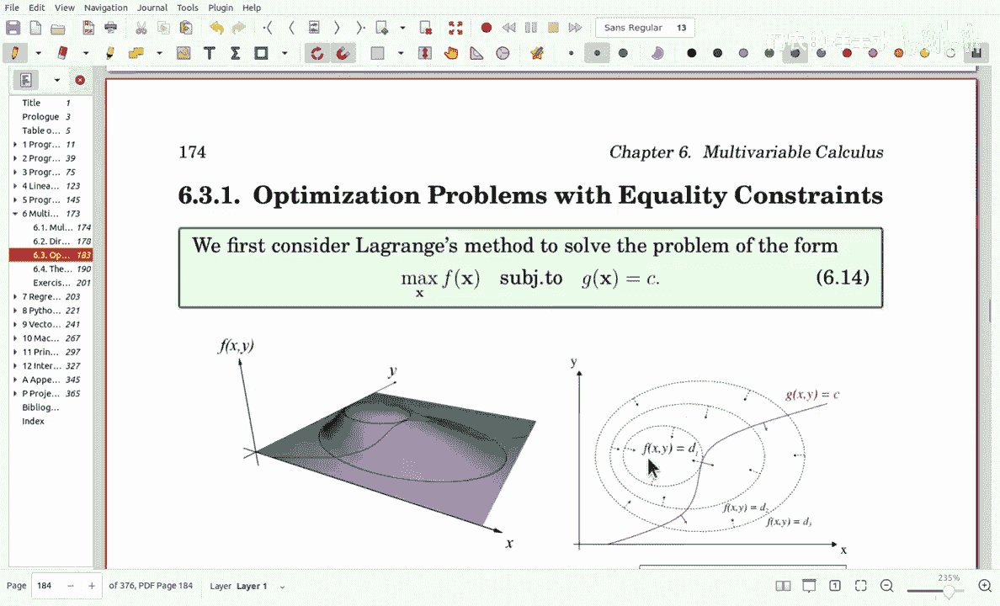

Now， we are ready to consider optimization problem with equality constraint and introduce an effective technique。

We try to maximize F O x subject to G x equals C。That means that。

X must be chosen satisfying this equation。 and among all x points。

 And now we try to measure the maximum value。

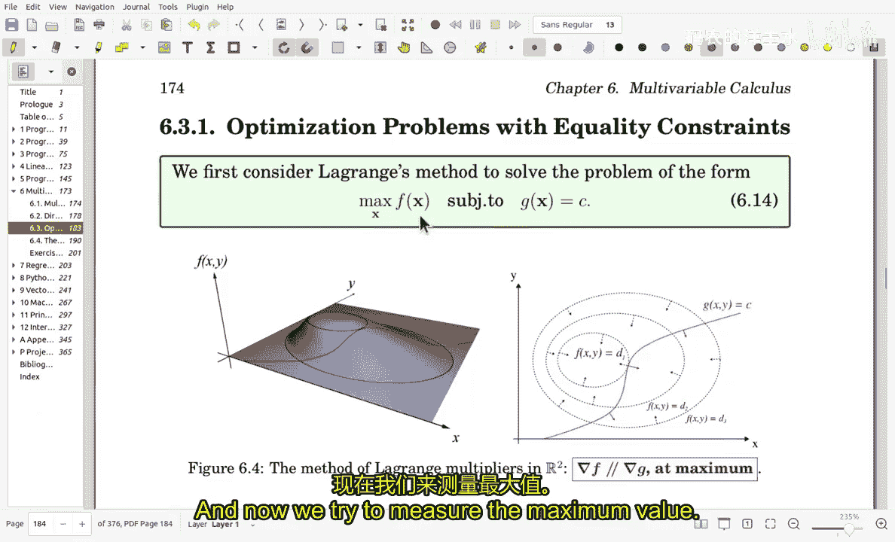

That's the problem。Here look at this picture。Now this one is now that one is z equal F of x Y。

That's up is。Okay， now we try to maximize this function and with the。The constraint， this curve。

 this cop is on X， Y plane。 So we have to choose。The point from all curve。And。We measure。

The function value。 And among them， we can choose the maximum。빅토리아네。

This point seems the largest value。Now， look at this controlt。

And this one is contour and with the D1 large value and T2 and will be smaller。

 and now T3 is small value。Now， along these contours。

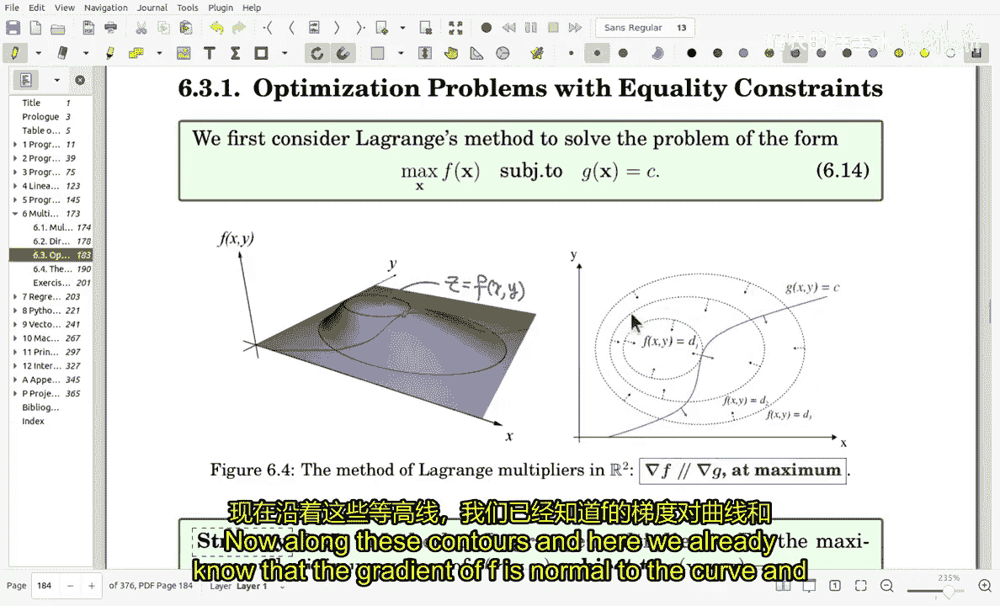

And here we already know that the gradient of F。

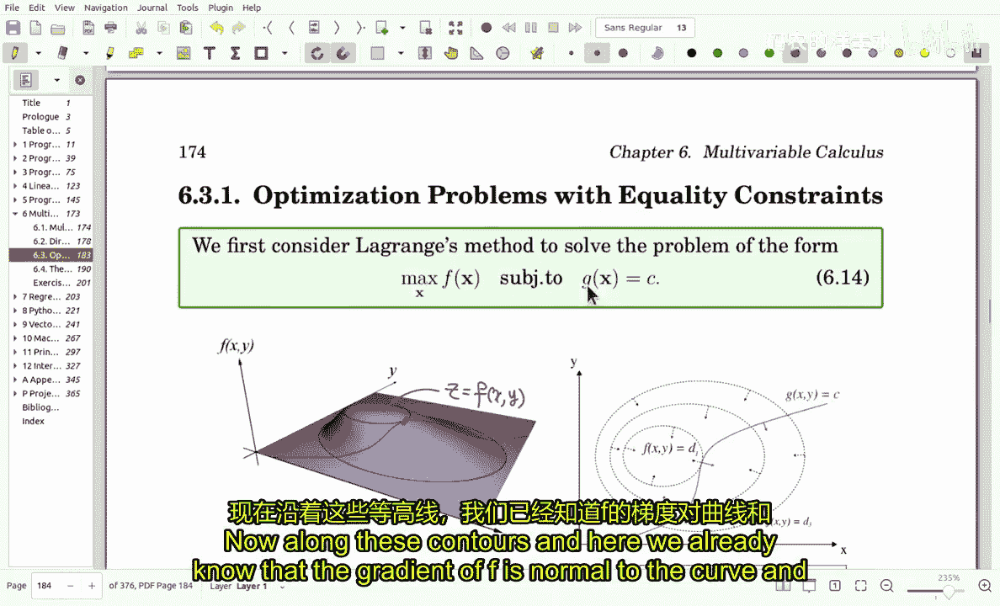

Is normal to the curve and a pointing the fastest increased direction so that thesearrows are the gradient direction。

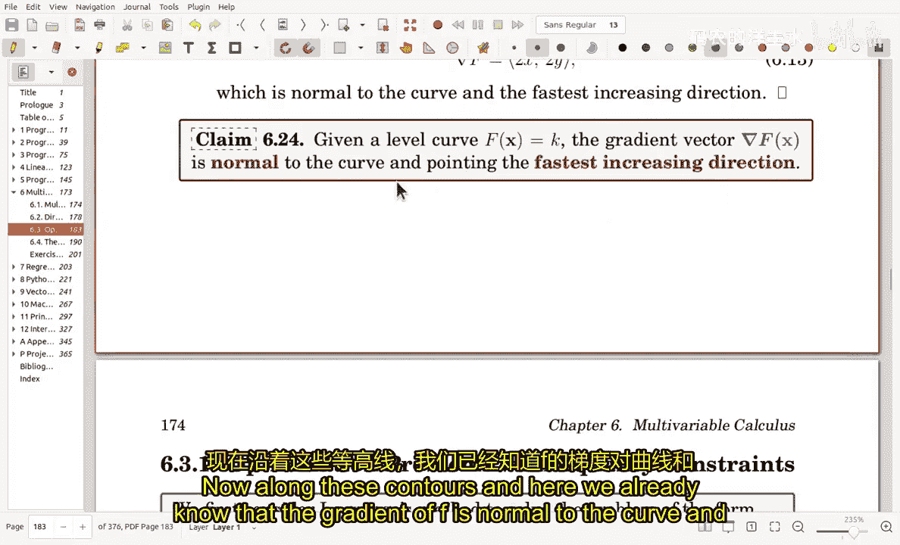

Along the cartours。那。Here， the constraint G of V x y equals C。

 Also if we try to make gradient to then the gradientdi must be normal to the curve and must be。嗯。

The fastest increased direction。 But for this one， we don't know which direction is increasing direction。

 however。Once we have maximum。Okay， the corresponding again point to that one is this one。 Then here。

 this contour。And that curve。should tang each other。So that couldn't。

Of F and coordinate to G must be parallel。We know is the same direction， however。

 they must be parallel to each other。So we have this conclusion and maximum。2 cr must be para。

Because they tended each other at the maximum。

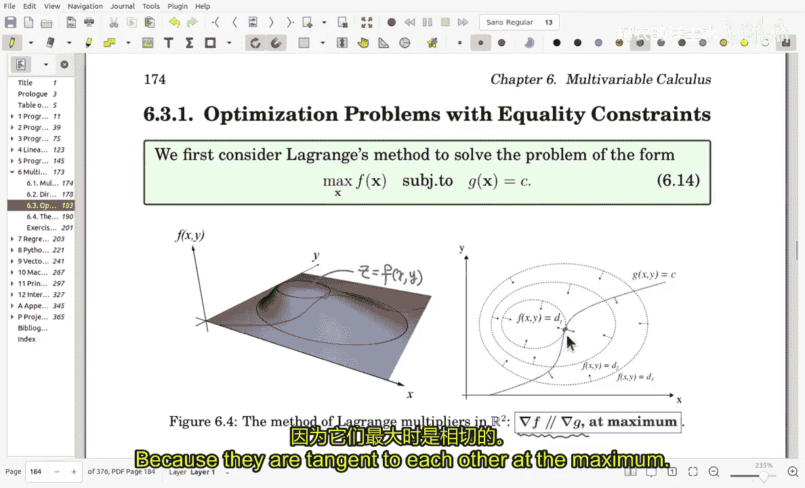

Okay。So from this geometric observation， we can get the method of lagang multipliers。

For the maximum and minimum values of F， subject to。Qi。Of X， Y， z equals C。 Now。

 we consider functions of3 variables。llFind all values of X， Y， Z and Ramda， such that。

Could it into app is。Reamnda， because they will be paralleled at maximum or minimum so that along with a constant。

 we can express this equality。And here this is constant。We have to decide of four variables， X， Y。

 Z and Remnda。 Now we have four equations。In3。The gradient will make a three equations。

And this is the equation constraint。 So we have a full equations。

 We can so that we can solve the problem， Pre。Now， after finding all values， all points and Ramnda。

Now， by listening。X， Y， Z。We evaluate have at every here points and try to。

Get the largest one for the maximum and try to get the smallest one for the minimum。

 That's the strategy。Let's go to。

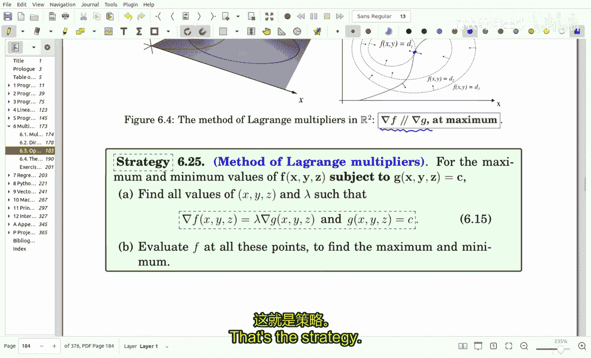

Example。A tab layers rectangular box is made from 12 square meters of cardboard。

Find the dimensions of the box that maximizes the volume of the box， okay。Let's draw a picture。For。

The rectangular box。Okay。Yeah， that is theular box。 and now。Okay， let's go down。 and here。Like that。

So， if we。The for this length is x and it refuse Y and height this C。 Then the volume will be X， Y。

 C。Now。Here。Xta E is the area of the frontal side and backside。 We have another one。 So two Xta E。

And for this side， and right side。The air is yz and another one over there。 So the two yz。 Now X。

 Y is air of the bottom， but we need to get topless rectangular bug。So that。Here。

 only we have one of X， Y。Total area must be 12。 So we have this occasion。 It will be useful for。

The constraint。 and that is G V X， Y， Z。

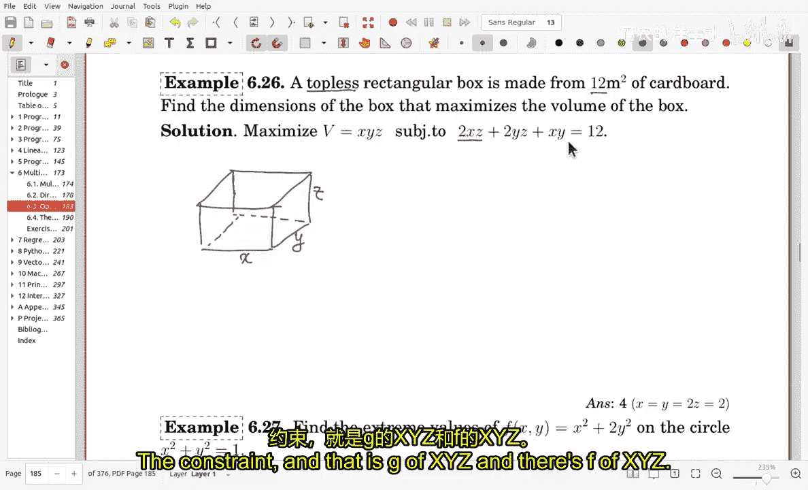

And there's F for x yz。Now we'll use the path of lag and multipliers。Okay， could then have。

이퀄램다 그래덴트부지。

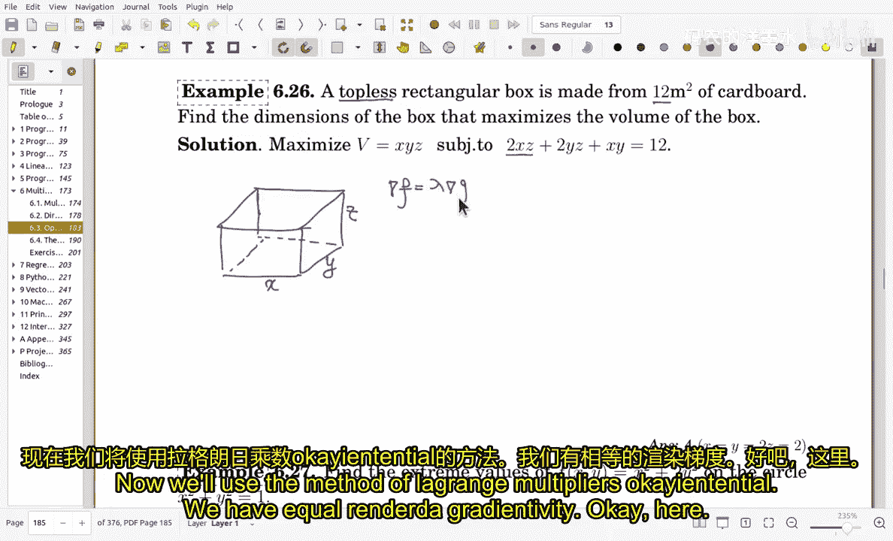

Okay， here。X derivative chip S Y Z， Y0 T B S， X Z， and C derivative T B， S X， Y。Remnda。

And G X the derivative。That is2 Z。엑스 derivative 1비로 and plus y。

And y derivative achieve then there be0， and that is 2 z。And then y derivativeivity will make x here。

Now， its either of T， then that is 2 x。And plus2 I。And。The last one was be， okay。Now。

 this equation is not easy to solve。 Of course， it is three equations and there is the fourth equation。

Now， two Sovietan effectively。Let's try to explore some symmetry。

We'll try to multiply here for the first one。X， and for the second one， we try to multiply y。

 And for the last one， we try to multiply Z。 Then this will become X， Y， Z again， X， Y， Z， again， X。

 Y， Z， so that。The villages are the same。Then， we may get some。Hint and strategy。How can we do that？

So， here。By multiplying x， we have X， Y， Z。Equals Bmda。Okay， for the first time， we multiply x。

 then2 x， Z plus x， Y。For the second one， we multiply y， then it's the same。

And Ramda and y is multiplied the2 Y， Z。Plus， X， Y。Okay。Now we multiply z， then again， x。

 Y z and Ram z to multipplly them。2 X， Z。And plus 2。Wing。Right。Yeah。Okay。So。Once Ramda is non zero。

Then here， because this is same。 these two must be the same。X Y is the same。Now， of course。

 over there to make a reasonable volume， X， Y， Z must be positive。So that these two are the same。

 left hand side the same。If Ramda Si wrong， then right side is wrong， So is one of Z。

 then becomes Si。So physically， we know that Ram cannot be0 and x and y and C must be positiveative。

 right。So there's region。 now， this same。These are same。 So this must be same， which means that。Okay。

 from， okay， this is equation 1， equation 2， equation 3， and that is equation 4。 Then from one and 2。

 we can get here。Okay。X equal y，How about2 and3， okay。2 and 3。Okay， left hand side is the same。

 Rammda is non0。 So the right side must be same。 Now， this one thereon are the same。

 So it must be same。 Now， X is come on。So the y must be20。So from here， why must be2 thin。

Here we have now x equals y and y equal 2 Z。 We get thereron。How can we complete the computation。

 Now， we have to use that on we have never used this so far。 Okay， so we use that。Yeah。没有。

X2지 y2지 블로그거든요。So， from4。We have x to z y equal to z。

 So we try to make everything as a function of single variable Z。X is2 z。 So the2。And2 Z。

 X E2 Z and times Z plus y is 2 z，2 times 2 Z and Z again。Now。Okay， and that is the C。Okay。

 now the finally X Y。2 z times 2 z， right， There must be 12。Okay， from here，4 z square，4G square。

4G square。 so that 12 was z square。That is 12。That means that z schedule is one。

X z must be larger than1， so that z must be。Z must be positiveative so that z must be1， then x and y。

啊，2。All， so from here。X and Y are2。So that。Now， the volume， X， Y， z。So the maximum volume， X， Y。

 Z equal。This one， X， Y， R 2。 So that for the star。

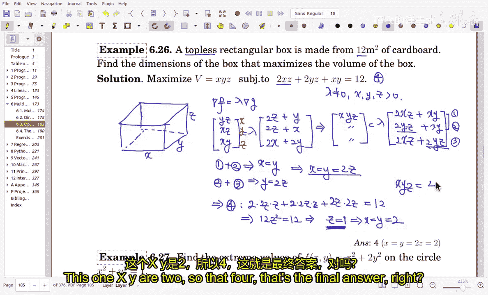

Pinner answer。喂。

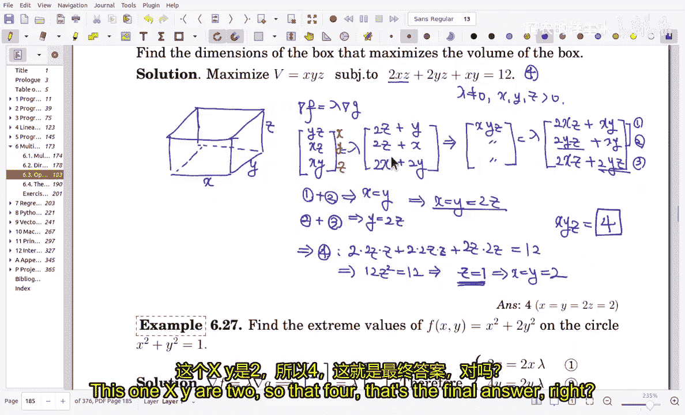

Find the extreme value。Of F of X， Y called x squared plus 2 y squared on the circle。Now。

This one is constraint。 That is the function。Again。

 we start with gradientent to F is Ramda gradientnt through G。And we have that。

So here we separate three equations and two xs Ramda。Okay，2 x is a Ramta 3 x。

And now4 y equals Ramda 2 I。 and the constraint X squared plus y squared is 1。Now， flow 1。

And if we move this one to the other side， then it becomes 2 x and now Ramda minus1 equals 0。

 So we have either x equals 0 or Ramda is21。If x is a0。Okay。That is。If。No。Exis is it all？Then。Now。

 we can use this occasion。Then y srom equals1， which implies y equals plus minus1 for x0。

 we have y plus minus1。Now how about Ramda is one。Bram does one。Then for this one。

 just there's no information。 but once Rammed is one， then。From equation 2， we have4 y。Equal2 I。

That implies here y equals son。 Now， the constraint by using third equation we have in this case。

 now x is plus -1， right。So。On the circle of radius 1 now。We found four points。Once x equals it。

 then y is plus -1。 This is a -1 plus 1 plus 1。Once y equals 0， so is horizontal x xs。

Then x is plus  -1。 So we found the four points。

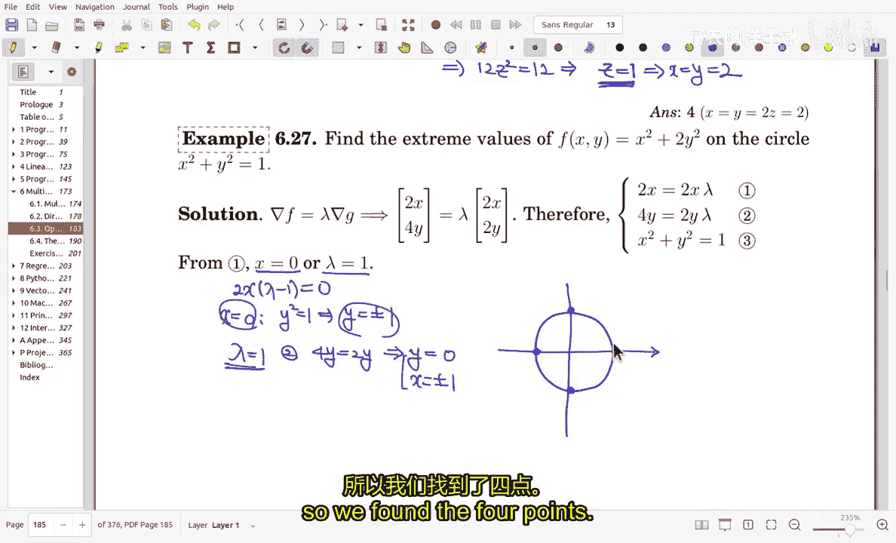

And。Like what the strategy is we have to find all values of the point in Ramda satisfying these four equations in two D general case we have three equations and now we try to evaluate the F at all these points and try to get the maximum M minimum。

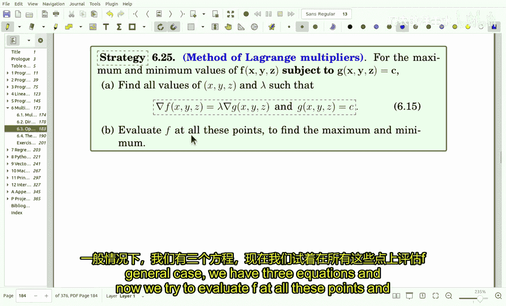

Okay， we found these points。 And here， okay， from this one。The function。That is now。

X is scatter the plus Y sian， twice a Y sian。X is 1。 y is 0。 so that here F is 1。

 But of course over there also the Y F is 1。 Now， how about this point。X is 싫어。

And y is1 so that F must be2 at the point。 And again， this one is F is 2。

So a minimum value is 1 and maximum value is 2。Okay。Okay， now。We。To a continuation from the last one。

Okay， now we try to find extreme values of F of x y， the same， but rather than the curve。

 now the domin is inside and curve and inside of the unit circle。Now。And only。

 but we only know that along the boundary here， the value is 1 here，2，1，2， like that。

 So values are between1 and2 along the boundary。

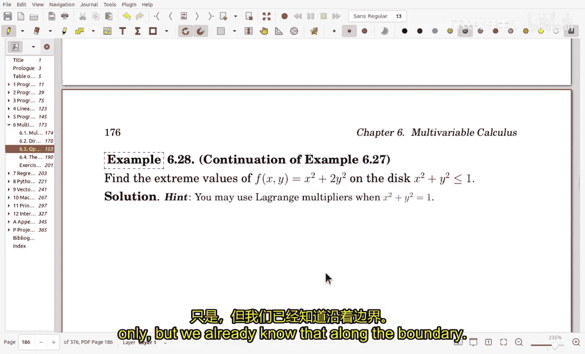

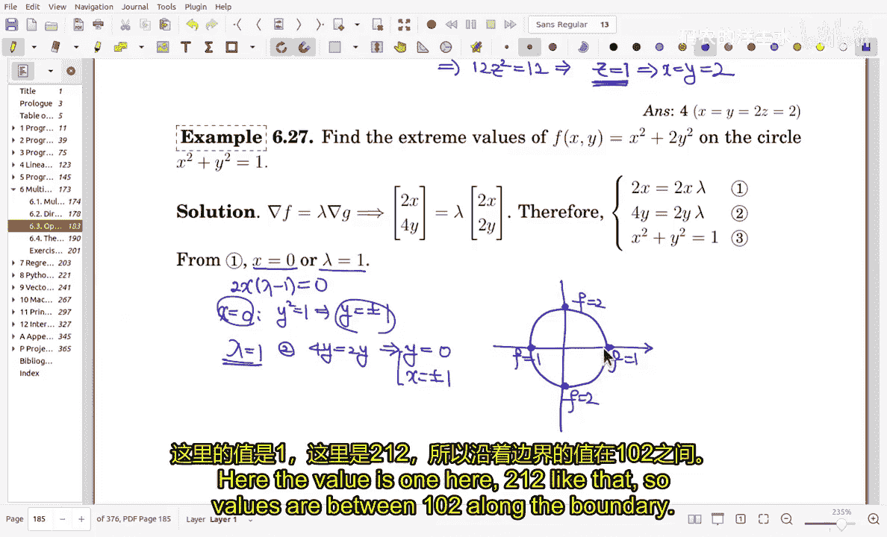

How about inside。For inside。We may try to get the critical point， and。Try to find the critical value。

Okay， so now we get gradient we have。That is， here 2 x。And for y。Equals。

 which means that x equals0 and y equals。That is critical point at the point here， F is nowze， right。

 so inside。The extreme value is the， which is a minimum value。

So that along with this one here F is zero， and this is minimum， and that is now maximum F is 2。

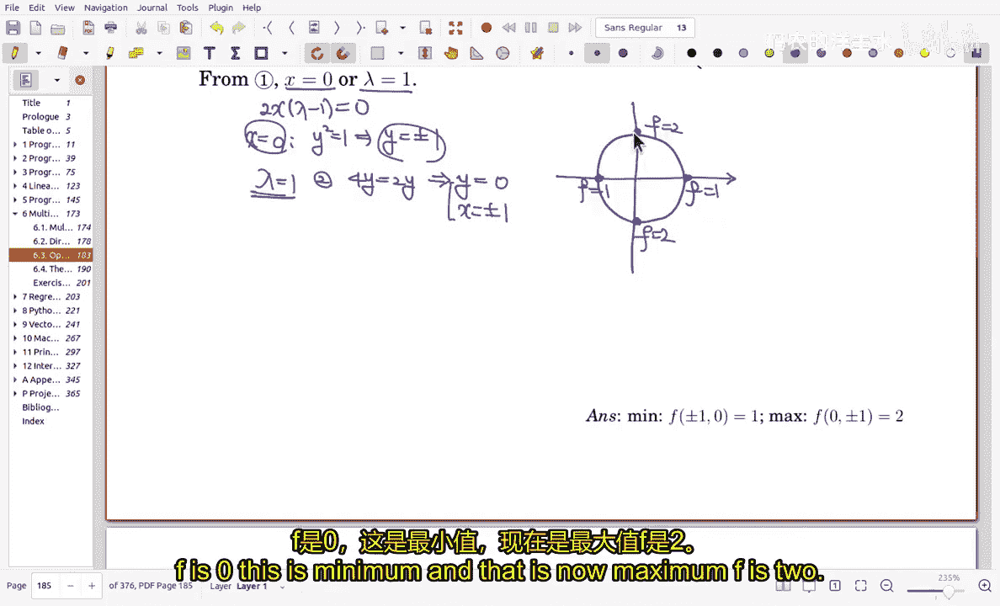

谁。Okay。Here we look at the method of laggar and multipliers from different angle。

For the optimization problem。Yeah， maximum when we F subject to geovx equals C。

The math defines values of X and remda。Satisfying this equation。Now。Will try to interpret this。

Methone byen clus。 In fact， we made this formula from geometric observation。

Now we'll try to interpret here。Now， it can be interpreted as followers。

 find the critical points of this function。

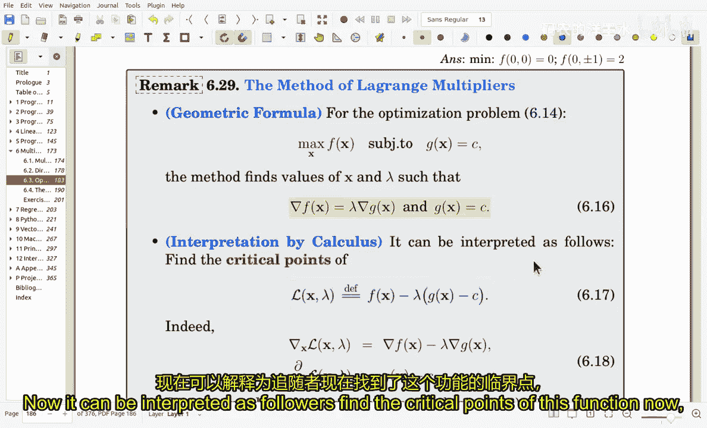

Now， F for x。Mus Ramda and geo B x minus C。So let's start with。That function。In。

The theory of optimization， it is called Laallanian。

So start with the Raanjan and we try to make a derivative tape。 Okay。

 this one is derivative tip with respect to X。So that that one will make young。um。

C to F minus Rammda deci， and this is constant。 So itll disappear。

And we try to make a derivative with respect to Rammnda。 Then this will be the。那 we。U K。

 to the right side。두비 싫어。Back at that。Then。Here， we can obtain。That。The method of。

AndAnother multipliers。So that in practice。In optimization theory， will work with this lagangian。

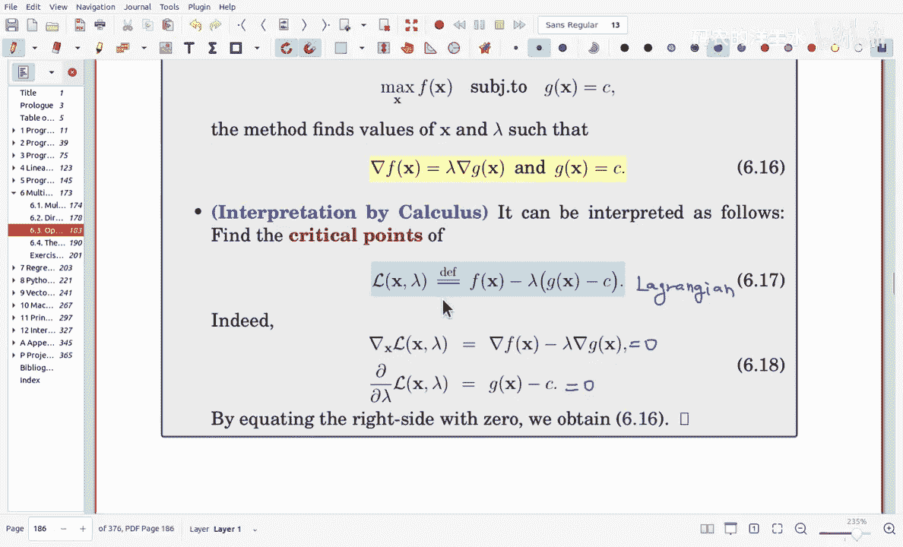

Okay。Okay， we'll continue in the second part。 Thank you。

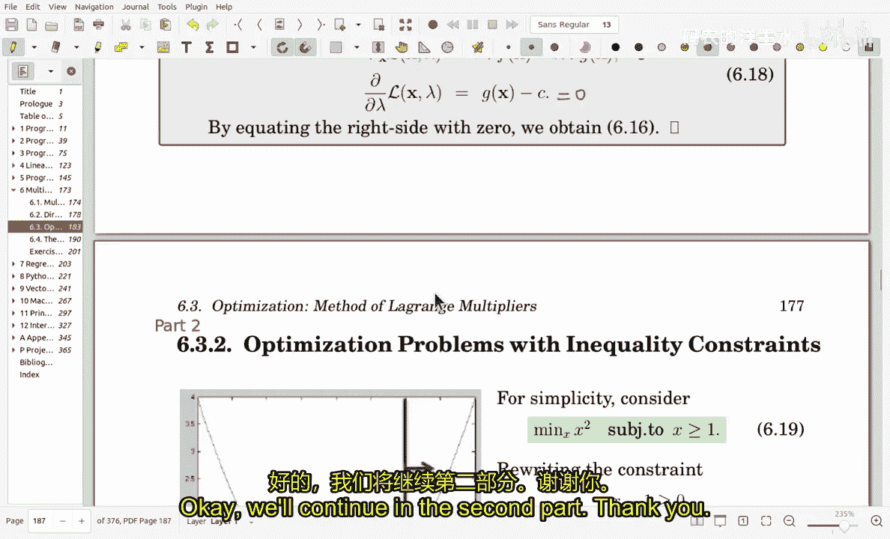